# 推理系统与压测深度文档

> 审校日期：2026-09-26。沿用各组件固定证据，正式 Release、Alpha/Beta、tag-only 与未发布主线快照分别记录；本次为结构与编辑整理。

## 第1篇：公共概念：KVCache、P/D 分离与性能指标 {#inference-concepts}

公共定义在本篇统一说明；组件章节保留实现、接口、数据生命周期与测量差异。

### 1.1 KVCache 与资源瓶颈 {#mooncake-大模型服务的核心矛盾}

大语言模型（LLM）推理服务面临三大结构性挑战：

**KV Cache 内存墙。** 随着上下文长度从 4K 扩展到 128K 甚至 1M，KV Cache 占用的内存急剧增长。以 LLaMA-3-70B 为例，128K 上下文的 KV Cache 需要约 32 GB 内存——几乎等同于模型权重本身。GPU 显存已难以同时容纳模型权重和长上下文 KV Cache。

**Prefill 与 Decode 的资源需求不对称。** Prefill 阶段需要大规模并行计算处理输入 token，是计算密集型；Decode 阶段逐 token 生成，对延迟极度敏感，是内存带宽密集型。将两者混合部署在同一集群意味着无法为任一阶段独立优化资源配置。

**过载场景的真实困境。** 当请求量超出系统容量时，传统的"尽力服务"策略导致所有请求的延迟同时劣化，无一满足 SLO——而已经在 Prefill 上消耗的 GPU 计算资源无法回收，形成巨大的浪费。

### 1.2 LLM 压测为什么不同于普通 HTTP 压测 {#benchmark-llm-压测为什么不同于普通-http-压测}

普通 HTTP 压测通常关注 QPS、平均延迟、P99 延迟和错误率。LLM serving 的压力模型更复杂，因为一次请求内部包含两个性质完全不同的阶段：

| 阶段 | 主要工作 | 典型瓶颈 | 用户感知指标 |
|------|----------|----------|--------------|
| Prefill | 处理输入 prompt，构建首轮 KV cache | 计算吞吐、attention、长上下文内存 | TTFT |
| Decode | 逐 token 生成输出 | 显存带宽、KV cache 容量、batch 调度 | ITL、TPOT、输出 tokens/s |

所以，LLM 压测不能只看“请求完成得快不快”。它至少要回答：

| 问题 | 为什么重要 |
|------|------------|
| 首 token 多快出现？ | 决定流式交互体验，受 prefill、排队和调度影响 |
| 后续 token 是否稳定？ | 决定用户阅读流畅度，受 decode batch 和 KV cache 影响 |
| 单用户速度和系统总吞吐是否同时达标？ | 高吞吐可能牺牲单用户体验 |
| open-loop 下是否积压？ | 真实流量不会等服务端处理完才发下一条请求 |
| 请求长度分布是否真实？ | 200 token 与 200K token 对系统是两种工作负载 |
| prefix cache / KV cache 是否改变结果？ | 缓存命中会显著改变 TTFT、吞吐和容量边界 |
| 输出长度是否可控？ | 不控制 `ignore_eos`、`min_tokens` 时，不同工具可能测到不同输出长度 |

因此，LLM 压测工具的核心差异不是“能不能发 HTTP 请求”，而是能否准确表达 LLM workload：token 分布、到达模型、多轮上下文、缓存复用、SLO、goodput、trace replay、多模态输入和服务端观测。

---

### 1.3 核心指标与口径 {#benchmark-核心指标与口径}

#### 1.3.1 延迟指标 {#benchmark-2-1-延迟指标}

| 指标 | 含义 | 常见口径 |
|------|------|----------|
| TTFT / Time To First Token | 从请求发出到收到第一个输出 token 或第一个有效 chunk | 衡量 prefill + 排队 + 首 token 生成 |
| TTST / Time To Second Token | 第一个 token 到第二个 token 的间隔 | 用于区分首 token 之后的启动抖动 |
| ITL / Inter Token Latency | 相邻输出 token 之间的时间间隔 | 衡量流式输出平稳性 |
| TPOT / Time Per Output Token | 每个输出 token 平均耗时，通常不含首 token | 常用于估算 decode 速度 |
| E2E Latency / Request Latency | 请求开始到完整响应结束 | 非流式或整体 SLA 关注 |
| TTFB / Time To First Byte | 首个 response byte 时间 | 音频、图片或无法按 token 切分时常用 |

要注意：不同工具对 TPOT/ITL 的细节可能不同。有的按 chunk 统计，有的按 token 统计；有的把第一个 token 排除，有的包含首 token。横向比较时要先固定工具口径，不能直接把两个工具默认表格的 `TPOT` 当成完全相同。

#### 1.3.2 吞吐指标 {#benchmark-2-2-吞吐指标}

| 指标 | 含义 | 使用方式 |
|------|------|----------|
| RPS / request throughput | 每秒完成请求数 | 用于业务请求容量估算 |
| Output tokens/s | 全局每秒输出 token 数 | 主要衡量 decode 能力 |
| Input tokens/s | 全局每秒处理输入 token 数 | 主要衡量 prefill 能力 |
| Total tokens/s | 输入 + 输出 token 总吞吐 | 适合粗略比较整体处理量 |
| tokens/s/user | 单用户输出速度 | 用户体验侧指标 |
| Goodput | 满足 SLO 的请求或 token 吞吐 | 生产容量评估更有意义 |

Raw throughput 只说明系统做了多少工作，goodput 才说明有多少工作在 SLA 内完成。例如系统在 200 RPS 下仍能完成所有请求，但 P99 TTFT 已经超过 10 秒，这个 RPS 对交互式业务没有意义。

#### 1.3.3 统计口径 {#benchmark-2-3-统计口径}

LLM 压测至少应报告：

| 统计项 | 作用 |
|--------|------|
| mean / avg | 快速观察总体水平，但容易被长尾掩盖 |
| p50 | 典型用户体验 |
| p90 / p95 | 常规尾延迟 |
| p99 / p999 | 生产 SLO 和容量边界 |
| min / max | 发现异常点和冷启动 |
| stddev | 衡量稳定性 |
| success / failed / incomplete | 判断结果是否可信 |

只报告平均延迟的压测结果基本不够用。LLM serving 的尾延迟通常由长 prompt、batch 调度、KV cache miss、模型加载、网络抖动或服务端排队造成，平均值会掩盖这些问题。

---

### 1.4 负载模型 {#benchmark-负载模型}

#### 1.4.1 closed-loop 与 open-loop {#benchmark-3-1-closed-loop-与-open-loop}

| 模型 | 行为 | 适合场景 | 风险 |
|------|------|----------|------|
| Closed-loop | 每个 client 等上一个请求完成后再发下一个 | 固定并发、用户会话模型、单用户体验 | 系统变慢时实际 RPS 会下降，可能掩盖排队崩溃 |
| Open-loop | 按目标速率发请求，不等待旧请求完成 | 真实流量、容量规划、SLO/goodput | 需要控制最大在飞请求，否则可能压垮服务 |

固定并发不是固定 QPS。一个 100 并发 closed-loop 测试，如果服务延迟从 1 秒变成 10 秒，实际 RPS 会从 100 降到 10。open-loop 才能回答“每秒固定来 100 个请求时系统会怎样”。

#### 1.4.2 到达分布 {#benchmark-3-2-到达分布}

| 到达模型 | 含义 | 适合场景 |
|----------|------|----------|
| 同步 / synchronous | 一个请求跑完再跑下一个 | 功能 smoke test、单请求 latency |
| 固定并发 / concurrent | 保持 N 个请求在飞 | 并发能力和延迟曲线 |
| 固定速率 / constant rate | 每秒固定发 R 个请求 | 稳态容量测试 |
| Poisson | 请求间隔服从指数分布 | 更贴近随机到达的线上流量 |
| sweep | 扫描并发或速率直到饱和 | 找安全工作点和容量边界 |
| trace replay | 按真实 trace 重放 | 复现生产流量、agentic workload |

#### 1.4.3 压测前必须对齐的参数 {#benchmark-3-3-压测前必须对齐的参数}

| 类别 | 必须对齐 |
|------|----------|
| API | `/v1/chat/completions`、`/v1/completions`、`/v1/responses`、embedding/rerank endpoint |
| Streaming | 是否开启 SSE streaming；不开启通常无法测准 TTFT/ITL |
| Tokenizer | 同一 tokenizer 路径或同一模型 ID |
| 输入长度 | 固定长度、分布、数据集、prefix 长度 |
| 输出长度 | `max_tokens`、`min_tokens`、`ignore_eos` |
| Sampling | `temperature`、`top_p`、`top_k`、`seed` |
| 缓存 | prefix cache、prompt cache、KV offload 是否开启 |
| warmup | 预热请求是否计入正式指标 |
| 客户端资源 | 压测机 CPU、连接数、端口、网络是否足够 |

很多“工具 A 比工具 B 测出来快”的差异，其实来自默认参数不同：一个用了 `/v1/completions`，另一个用了 chat template；一个开启 streaming，另一个非流式；一个让模型遇 EOS 停止，另一个强制输出固定 token。

---

## 第2篇：Mooncake {#mooncake}


> **以 KVCache 为中心的分离式 LLM 推理架构全面解析**
>
> 基于 Mooncake 官方文档 (https://kvcache-ai.github.io/Mooncake) 整理编写
>
> 稳定版本基线：`v0.3.13.post1@719735896c86b56fabec6cf3e825fb2ea640597a`，审校日期：2026-09-26。论文结论与软件实现会明确区分；`v0.3.13.post1` 为 lightweight tag，所列 commit 即 tag 直接指向的源码提交。
>
> FAST 2025 最佳论文 | Moonshot AI 的 Kimi 服务平台

---

### 2.1 引言 — 为什么需要 Mooncake {#mooncake-引言--为什么需要-mooncake}

#### 2.1.1 大模型服务的核心矛盾 {#mooncake-1-1-大模型服务的核心矛盾}

资源画像与 KVCache 内存墙见[公共概念](#inference-concepts)。本篇聚焦 Mooncake 的实现与运维。

#### 2.1.2 Mooncake 的核心洞察 {#mooncake-1-2-mooncake-的核心洞察}

Mooncake 提出了三个关键洞察，从根本上重塑了 LLM 推理架构：

1. **以 KVCache 为中心而非以计算为中心。** 传统架构围绕 GPU 计算组织系统；Mooncake 将 KV Cache 视为一级资源，围绕数据的存储、传输和复用重新设计整个架构。

2. **GPU 集群中被忽视的闲置资源。** 典型 GPU 集群中，CPU、DRAM 和 SSD 的利用率远低于 GPU。Mooncake 利用这些闲置资源构建分布式 KVCache 池，无需额外的专用缓存硬件。

3. **从"尽力服务"到"智能拒绝"。** 与其在过载时让所有请求延迟劣化，不如提前预测无法满足 SLO 的请求并尽早拒绝，节省计算资源用于可以成功服务的请求。

#### 2.1.3 核心成果一览 {#mooncake-1-3-核心成果一览}

| 指标 | 结果 |
|------|------|
| 长上下文模拟场景吞吐提升 | **525%** |
| 真实生产负载请求增长 | **75%** |
| 学术认可 | **FAST 2025 最佳论文** |
| Kimi K2 部署 | 128×H200, 224k tok/s prefill / 288k tok/s decode |

#### 2.1.4 v0.3.12.post1 稳定版收敛范围 {#mooncake-1-4-v0-3-12-post1-稳定版收敛范围}

`v0.3.12.post1` 不是只修复 wheel 元数据的重新打包：它在 `v0.3.12` 之后继续收敛了 Store 隔离、SSD 生命周期和 Python 结构化对象接口。本轮按 release notes、源码和重新组织后的官方文档逐项确认：

| 领域 | v0.3.12.post1 已发布能力 | 仍需保留的边界 |
|------|-------------------|----------------|
| TENT | QoS contract、per-policy SL/TC/QP pool、transport hint/intent、EDF 与 deadline degradation、priority promotion、local admission/runtime queue | 多项策略是 opt-in；TENT 仍不能无条件视为经典 TE 的完整替代品 |
| Transfer Engine | acknowledged TCP completion、RDMA metadata/HCA/GID 刷新、graceful shutdown、注册回滚、QP/MR teardown、故障 rail/reconnect 修复 | `COMPLETED` 语义和 transport 故障恢复需按实际后端分别压测 |
| Store / SSD | proactive disk watermark eviction、跨节点 `RemoveAll` SSD 清理、OffsetAllocator FIFO eviction 与可选 `relaxed`/`strict` 重启恢复、L2->L1 promotion retry | OffsetAllocator 持久化默认禁用；恢复能力不等于业务级强持久存储 |
| 租户与缓存隔离 | canonical `TenantId`、tenant-scoped 元数据与对象 RPC、tenant-aware async storage task、配额准入；新增多模型/发布/request group 隔离指南 | Mooncake key 对 Store 仍是 opaque string；模型与发布隔离必须由 SGLang/vLLM 命名空间正确配置 |
| Python 对象接口 | `MooncakeBundleTransfer`、DataProto/字典结构化存取、字段和行选择、caller-provided buffer、JSON-safe handle | 非 tensor 字段按 codec 序列化；zero-copy 需要注册 buffer，不能把所有 Python 对象都视为零拷贝 |
| 控制面与生态 | Master snapshot、local/S3 object store、Redis/embedded catalog、KV event publisher，以及重新分层的 Deployment/Design/API Reference | snapshot/restore 仍标为实验性；旧官方文档深链已经移动，应固定到本 tag 的新路径 |

因此后文涉及 TENT、SSD 驱逐与恢复、租户隔离、结构化对象、快照、Conductor KV event 和 Kubernetes 部署的能力，兼容边界均以 `v0.3.12.post1` 为准。

#### 2.1.5 v0.3.13 与 v0.3.13.post1 稳定增量 {#mooncake-1-5-v0-3-13-与-v0-3-13-post1-稳定增量}

`v0.3.13.post1` 是 `v0.3.13` 的打包补丁：相对 `v0.3.13` 只回补了非 CUDA wheel 不携带 CUDA 依赖的约束和 TestPyPI prerelease gate；真正的运行时增量位于 `v0.3.12.post1...v0.3.13`。由于 post release notes 只覆盖这两个打包提交，下面的能力边界同时以固定 compare、tag 内源码、文档与默认配置复核，不能从后续 `main` 反推。

| 领域 | v0.3.13 稳定线中的变化 | 部署与兼容边界 |
|------|-------------------------|----------------|
| Transfer Engine / TENT | 新增 NCCL host/device、MUSA IPC、MPComm、FlagCX、`rdma_twosided` 控制面通知；TCP connection pool 默认开启并增加 session progress deadline；RDMA/EFA 的 MR 边界、device locality、重连和 pacing 路径得到修复 | transport 是否可用仍取决于构建选项、硬件与依赖；不能仅因代码进入 tag 就假定 wheel 含全部后端。TCP 默认池化会改变连接复用和故障恢复画像，升级后须重测超时、重连和有序完成 |
| Store / SSD / HA | 引入 NVMe KV 与 POSIX DFS replica 路径、VRAM segment/NVLink 同节点传输、ranged multi-buffer session API、动态 hot-replica fanout，以及 batch-record OpLog、producer-view fencing、bounded/chunked standby snapshot；同时修复 io_uring 读损坏、SSD carryover 去重、recovery/eviction 与 promotion retry | NVMe KV、DFS replica、HA OpLog 和 standby snapshot 是不同数据路径，不能混写成同一种持久化保证；恢复副本在可读性确认前不可参与驱逐或提供数据 |
| Python / rollout 对象 | wheel 增加 native fast-copy PUT、jagged `NestedTensor`、typed-ragged 与 fragmented-rollout DataProto catalog 生命周期；grouped write 语义在结构化对象路径中保留 | 结构化对象仍由 manifest/catalog 和多个 payload 组成；catalog 生命周期修复不把任意 Python 对象变成原子事务或无条件零拷贝 |
| PG / Reshard | PG 引入控制面、支持 in-place rejoin 并修复 P2P recovery；Reshard 增加资源/模型权重 manifest 与 N-D logical weight transfer planner | planner 输出是传输计划，不验证模型语义或自动提供训练检查点一致性；rejoin 仍需相同通信与模型布局契约 |
| 可移植性与构建 | 增加 ROCm/HIP release wheel、ARM64 non-CUDA wheel、CUDA 13/EFA wheel，并建立 `scikit-build-core` Python 项目基础；`mooncake_master` 不再强制 CUDA | 每类 wheel 的 transport/accelerator 集合不同；`v0.3.13.post1` 只修正 wheel 依赖封装，不能把非 CUDA wheel 当作 GPU 功能包 |
| 运维与多租户 | 新增 multi-tenant deployment guide，Master admin/metrics bind address 与 RPC/TENT worker 数可配置；配置项逐步结构化并补充严格解析与测试 | bind 到通配地址会扩大暴露面；租户 key 隔离仍不替代认证、授权、网络隔离和加密 |

从旧基线升级时，至少应复测四条链路：TCP 池化后的 peer 重连、RDMA/EFA 跨 MR 边界传输、io_uring/SSD 恢复的一致性，以及 HA batch OpLog/standby promotion。已有 `v0.3.12.post1` 的 TENT QoS、租户配额和结构化对象结论仍成立，但本文的稳定兼容上限统一提升到 `v0.3.13.post1`。

---

### 2.2 架构总览 — 分离式 KVCache 中心架构 {#mooncake-架构总览--分离式-kvcache-中心架构}

#### 2.2.1 三大集群 {#mooncake-2-1-三大集群}

Mooncake 的核心架构由三个逻辑上分离的集群组成：

**Prefill 集群** — 专门处理输入 token 的 Prefill 计算。该集群由大量 GPU 节点组成，目标是最小化 Prefill 延迟（Time to First Token, TTFT）。由于 Prefill 是计算密集型的，节点可以采用较高的 GPU 占用率。

**Decode 集群** — 专门处理逐 token 生成的 Decode 计算。该集群追求最小化每 token 生成延迟（Time per Output Token, TPOT），是内存带宽密集型，GPU 占用率通常较低（约 30-50%），大量 GPU 显存用于存储 KV Cache。

**KVCache 池** — 利用 GPU 集群中闲置的 CPU、DRAM 和 SSD 资源构建的分布式缓存池。该池集中管理所有 Prefill 和 Decode 节点间的 KV Cache 数据，是整个架构的数据中枢。

> **设计决策：** 为什么要分离 Prefill 和 Decode？ 因为其资源需求本质不同——Prefill 需要高 GPU 利用率和大 batch 的计算吞吐，Decode 需要低延迟和小 batch 的内存带宽。分离后每个集群可以独立配置硬件和调度策略。

#### 2.2.2 请求生命周期 {#mooncake-2-2-请求生命周期}

一个典型请求在 Mooncake 中的完整生命周期如下：

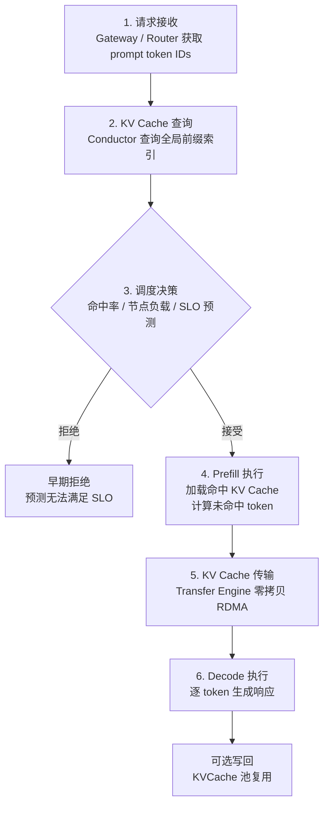

#### 2.2.3 生态组件地图 {#mooncake-2-3-生态组件地图}

Mooncake 的完整技术生态可按层次划分为：

| 层次 | 组件 | 职责 |
|------|------|------|
| **传输层** | Transfer Engine / TENT | 高性能零拷贝数据移动 |
| **存储层** | Mooncake Store / EngramStore / P2P Store | 分布式 KV 缓存、嵌入表、检查点分发 |
| **调度层** | Conductor / KVCache-centric Scheduler | 全局前缀索引、负载均衡、SLO 管理 |
| **分层缓存** | HiCache | L1(GPU) / L2(CPU) / L3(分布式) 三级缓存 |
| **分布式执行** | Mooncake EP / Mooncake Backend (PG) | MoE 专家并行、容错集体通信 |
| **统一抽象** | Unified Parallel Tensor IO | 跨并行方式统一张量 IO 接口 |

#### 2.2.4 关键架构决策 {#mooncake-2-4-关键架构决策}

**为什么用闲置资源而非专用缓存节点？** 专用缓存节点增加了硬件成本和运维复杂度。GPU 集群中每台服务器通常配备 512 GB–2 TB DRAM 和数十 TB SSD，这些资源的利用率极低。复用它们构建缓存池既经济又高效。

**为什么选择零拷贝 RDMA？** 传统的基于 TCP 的数据传输需要多次内存拷贝（用户态→内核态→网卡），对大块 KV Cache 传输效率极低。RDMA 绕过 CPU 和操作系统内核，实现 DRAM/VRAM 间的直接传输——对于数百 MB 的 KV Cache 块，这是唯一可行的高性能方案。

---

### 2.3 Transfer Engine — 零拷贝数据移动基石 {#mooncake-transfer-engine--零拷贝数据移动基石}

> Transfer Engine 是 Mooncake 所有组件的传输基础设施。2024 年 11 月开源，已集成到 vLLM、SGLang、TensorRT-LLM、NIXL 等主流推理框架，并于 2026 年 2 月正式加入 PyTorch 生态。

#### 2.3.1 设计哲学与核心抽象 {#mooncake-3-1-设计哲学与核心抽象}

Transfer Engine 围绕两大核心抽象构建：

**Segment（段）** — 代表一个可被远程读写的连续地址空间：

- **RAM Segment（DRAM + VRAM）：** 每个进程启动时自动创建一个以主机名命名的 Segment（必须全局唯一）。它逻辑上覆盖整个内存地址空间，引擎内部将其划分为多个 **Buffer**（位于同一设备上的连续地址空间）。内存范围不必连续——多个 DRAM/VRAM 区域可以同属一个 Segment。每个进程有且仅有一个 Segment，远程进程通过 `openSegment` 访问。还支持注册仅用于本地存储的 DRAM 区域（如 vLLM 的 DRAM PageCache），不可被远程打开。

- **NVMeoF Segment：** 将远程存储节点上的文件通过 NVMe-oF 挂载到本地，实现从 NVMe 到 DRAM/VRAM 的直接传输（绕过 CPU，零拷贝）。用户通过 `openSegment` 引用挂载路径。

**BatchTransfer（批量传输）** — 封装一组非连续数据空间之间的同步操作，支持双向 Read/Write，功能类似于异步的 AllScatter/AllGather。

#### 2.3.2 传输矩阵 {#mooncake-3-2-传输矩阵}

Transfer Engine 支持以下源-目标组合：

| 远程↓ / 本地→ | DRAM | VRAM |
|------------|------|------|
| **DRAM** | ✓ | ✓ |
| **VRAM** | ✓ | ✓ |
| **NVMe-oF** | ✓ | ✓ |

#### 2.3.3 传输后端 {#mooncake-3-3-传输后端}

| 后端 | 适用场景 |
|------|---------|
| **Local memcpy** | 同节点 DRAM/VRAM 间 |
| **TCP** | DRAM↔DRAM（无 RDMA 环境的回退） |
| **RDMA** | DRAM/VRAM↔DRAM，多 NIC 池化 + 重试 |
| **HIP** | AMD GPU 同节点 GPU↔GPU 和 GPU↔CPU（ROCm IPC/Shareable handles） |
| **cuFile (GPUDirect Storage)** | DRAM/VRAM↔NVMeoF |
| **NVLink / IntraNodeNvlink** | NVIDIA GPU 节点内高速互联 |
| **EFA** | AWS Elastic Fabric Adapter |

超过 64KB 的请求会被自动切成多个 Slice，每个 Slice 可能走不同路径以利用所有 RDMA NIC 的聚合带宽。

#### 2.3.4 拓扑感知路径选择 {#mooncake-3-4-拓扑感知路径选择}

现代多路服务器中，CPU、DRAM、GPU 和 RDMA NIC 之间的带宽受 UPI 链路和 PCIe 交换机的拓扑约束。Transfer Engine 实现了拓扑感知算法：

1. **拓扑矩阵生成：** 每台服务器生成描述其 NUMA/PCIe 拓扑的矩阵并广播到整个集群
2. **NIC 分类：** 基于拓扑数据将 NIC 分为 **preferred**（首选，同一 NUMA 节点或可通过本地 PCIe 交换机实现 GPU Direct RDMA）和 **secondary**（次选）两级
3. **路径选择：** 优先选择 preferred NIC；仅在首选不可用时使用 secondary NIC

**示例：** 从本端 cpu:0 上的 Buffer 传输到远端 cpu:1 时，根据双方的优先级矩阵，选择本端 NIC mlx5_1 和目标端 NIC mlx5_3 组成最优路径。

#### 2.3.5 多 NIC 聚合与切片策略 {#mooncake-3-5-多-nic-聚合与切片策略}

- 单个请求超过 64KB 自动分片为多个 Slice
- 不同 Slice 可走不同 NIC 路径实现带宽聚合
- 性能实测：4×200 Gbps 达 87 GB/s，8×400 Gbps 达 190 GB/s

#### 2.3.6 端点管理 {#mooncake-3-6-端点管理}

- **按需建连：** 端点对（local NIC ↔ remote NIC）包含一个或多个 RDMA QP 对象，首次请求时才建立连接
- **端点池上限：** 通过 `MC_MAX_EP_PER_CTX` 控制（默认 65536），超过上限使用 **SIEVE 算法**驱逐过期端点
- **故障清理：** 失败的连接从双端移除，下次传输时重建
- **异步回收：** 被驱逐/删除的端点进入 `waiting_list_`，待已完成 Slice 完成后回收（~1Hz 心跳监控）

#### 2.3.7 容错与自动恢复 {#mooncake-3-7-容错与自动恢复}

| 故障类型 | 处理策略 |
|---------|---------|
| NIC 临时不可用 | 自动识别替代可达路径，重提交到其他 RDMA NIC |
| RDMA Context/CQ 异常 | 临时规避该资源，直至问题解决 |
| 端点级故障 | 双端移除，按需重建 |

#### 2.3.8 运行时调优参数 {#mooncake-3-8-运行时调优参数}

##### 2.3.8.1 QP 与连接配置 {#mooncake-qp-与连接配置}

| 环境变量 | 用途 | 默认值 |
|---------|------|-------|
| `MC_NUM_QP_PER_EP` | 每个端点的 QP 数量（更高=更细粒度 IO） | 2 |
| `MC_MAX_EP_PER_CTX` | 每设备最大活跃端点 | 65536 |
| `MC_MAX_SGE` | 最大 Scatter/Gather 元素数 | — |
| `MC_MAX_WR` | 最大 Work Request 数 | — |

##### 2.3.8.2 网络参数 {#mooncake-网络参数}

| 环境变量 | 用途 | 默认值 |
|---------|------|-------|
| `MC_MTU` | 每设备 MTU | 4096 |
| `MC_IB_TC` | RDMA Traffic Class（流量规划） | -1 |
| `MC_IB_SL` | InfiniBand Service Level（0-15，QoS/VL 映射） | -1 |
| `MC_GID_INDEX` | 每设备 GID 索引 | 3（或最大支持值） |
| `MC_PKEY_INDEX` | QP 分区键索引 | 0 |

##### 2.3.8.3 性能调优 {#mooncake-性能调优}

| 环境变量 | 用途 | 默认值 |
|---------|------|-------|
| `MC_SLICE_SIZE` | 请求分片粒度 | — |
| `MC_RETRY_CNT` | 最大重试次数 | — |
| `MC_ENABLE_PARALLEL_REG_MR` | 跨 NIC 并行 MR 注册（-1=自动） | -1 |
| `MC_FRAGMENT_RATIO` | 尾部小片段合并阈值 | 4 |

##### 2.3.8.4 连接与传输控制 {#mooncake-连接与传输控制}

| 环境变量 | 用途 | 默认值 |
|---------|------|-------|
| `MC_ENDPOINT_STORE_TYPE` | 端点存储策略：FIFO 或 SIEVE | SIEVE |
| `MC_TCP_SLICE_SIZE` | TCP 分片粒度(bytes) | 65536 |
| `MC_IB_PCI_RELAXED_ORDERING` | PCIe Relaxed Ordering | 0 |
| `MC_FORCE_HCA/TCP/MNNVL` | 强制特定传输方式 | — |

##### 2.3.8.5 ECMP/LAG 优化 {#mooncake-ecmp-lag-优化}

| 环境变量 | 用途 | 默认值 |
|---------|------|-------|
| `MC_MLX5_QP_UDP_SPORTS` | 覆盖 RoCEv2 UDP 源端口（ECMP/LAG 负载均衡） | 空（驱动自选） |
| `MC_MLX5_QP_LAG_PORT_BALANCE` | 自动 LAG 端口负载均衡 | 禁用 |
| `MC_ENABLE_DEST_DEVICE_AFFINITY` | 优先同名称远端 NIC（Rail-Optimized 拓扑） | false |

##### 2.3.8.6 GPU 内存注册 {#mooncake-gpu-内存注册}

| 环境变量 | 用途 | 默认值 |
|---------|------|-------|
| `WITH_NVIDIA_PEERMEM` | 使用 `ibv_reg_mr()` 注册 GPU 内存（需 nvidia-peermem）；默认采用 DMA-BUF | 0 |

---

### 2.4 TENT — 传输引擎下一代演进 {#mooncake-tent--传输引擎下一代演进}

> TENT (Transfer Engine NEXT) 是 Mooncake 经典 Transfer Engine 的继任者，定位为"异构 AI 集群中点到点数据移动的运行时"。

#### 2.4.1 经典 TE 的局限 {#mooncake-4-1-经典-te-的局限}

经典 Transfer Engine 假设每个进程绑定单一传输后端（RDMA 或 NVLink）。这在同构环境中运作良好，但在现代集群中暴露两个根本问题：

1. **无适应性** — 传输无法适应连接质量的变化。静态后端选择意味着一旦选定 RDMA，即使该路径拥塞或故障，也无法切换。
2. **尾部延迟劣化** — 静态多 Rail 条带化下，一条慢速或降级的链路就会拖累整个传输的尾部延迟，降低有效带宽。

#### 2.4.2 三大核心支柱 {#mooncake-4-2-三大核心支柱}

**支柱一：动态传输选择**

应用不再挑选传输后端。它们只需声明搬运什么数据，运行时决定怎么搬。如果没有直接路径，TENT 自动构建中转路径（如经 Host Memory 中转），无需应用修改任何代码。

**支柱二：细粒度遥测驱动调度**

大传输被切分为独立的细粒度 Slice，每个 Slice 独立调度。运行时利用简单遥测数据（观测完成时间、队列深度）来路由 Slice。慢速或拥塞路径自然接收更少 Slice，快速路径接收更多——避免了单条慢速路径导致的队头阻塞。

**支柱三：运行时内故障处理**

部分故障在运行时内部处理，不暴露给应用。路径降级时暂停调度该路径，其余路径继续；后端级故障自动切换到另一后端。Slice 按需重试，恢复路径稳定后自动重新加入。从应用视角看，传输持续进行——"可能在短期内性能有所降低"。

#### 2.4.3 TENT 架构 {#mooncake-4-3-tent-架构}

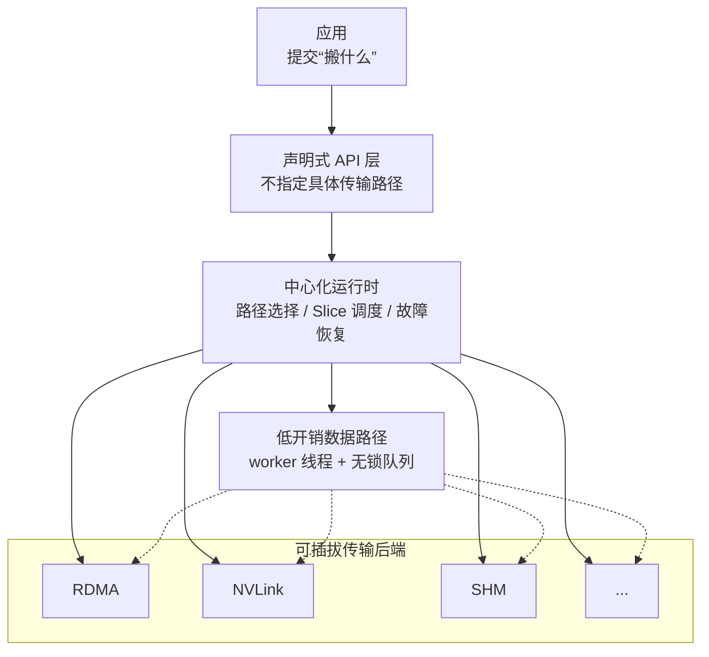

截至 v0.3.12.post1，TENT 已把调度从“按路径快慢喷洒 Slice”扩展为可配置 QoS 合同：`Request` 可携带 `transport_hint`、`policy_name`、`deadline_ns` 和 `IntentType`；selection policy 可以绑定 transport、SL/TC 与 QP pool。local admission queue 支持 opt-in earliest-deadline-first、deadline proximity promotion、deadline-infeasible drop/degradation，以及根据实时 RDMA bandwidth 做仲裁。receiver-credit ledger 约束接收端资源，避免单纯在发送端排队时把压力转移到对端。

这些机制不是默认的全局 SLO 保证。deadline、priority promotion 和 bandwidth arbitration 需要显式策略；best-effort cancellation 也不代表所有已经提交给硬件的操作都可撤销。生产应同时观察 queue/admission、transport、MLU 和 causal-stage latency 指标。

#### 2.4.4 经典 TE vs TENT 对比 {#mooncake-4-4-经典-te-vs-tent-对比}

| 维度 | 经典 TE | TENT |
|------|---------|------|
| 传输选择 | 应用管理，静态 | 运行时管理，动态 |
| 多 Rail 调度 | 静态条带化 | 遥测驱动 Slice 喷射 |
| 故障处理 | 上报给应用 | 运行时内重试 + 路径恢复 |
| 混合互联 | 每进程单后端 | 自动多后端 + 中转回退 |
| 适应性 | 无 | 运行时持续重评估 |

---

### 2.5 Mooncake Store — 分布式 KV 缓存存储引擎 {#mooncake-mooncake-store--分布式-kv-缓存存储引擎}

> 2025 年 3 月开源，2026 年 5 月被 vLLM 官方采用为分布式 KV 缓存池后端。

#### 2.5.1 设计动机与定位 {#mooncake-5-1-设计动机与定位}

Mooncake Store 不是通用缓存（如 Redis/Memcached）的替代品。它针对 LLM 推理场景做了关键特化：

- **键不是值的哈希派生** — 对象插入后不可变，直到显式删除
- **大对象** — 单个 KV Cache 块可达数 MB 到数百 MB
- **低延迟高带宽** — Prefill/Decode 节点间需要快速传输完整 KV Cache
- **轻量级设计** — 不保证高可用（由上层冗余覆盖）
- **写原子性** — `Get` 操作始终读取一致版本（不一定最新）

#### 2.5.2 整体架构：Master 与 Client 双角色 {#mooncake-5-2-整体架构master-与-client-双角色}

系统由两大组件构成：

**Master Service** — 独立进程，集中管理集群逻辑存储池：
- 管理节点生命周期事件
- 处理对象空间分配决策
- 维护对象到 VRAM/DRAM/NVM 缓冲区的映射
- **绝不参与数据流** — 仅提供元数据信息

**Client** — 双重角色设计：
1. **作为客户端**：应用程序通过它发起 Put / Get / Remove 请求
2. **作为存储服务端**：贡献连续内存构成分布式 KV Cache 池，数据在 Client 之间直接传输

角色配置：
- `global_segment_size = 0` → 纯客户端（不贡献内存）
- `local_buffer_size = 0` → 纯服务端（不发起请求）

Worker → Master 的心跳机制用于监测 Client 健康状态，恢复的 Client 自动重新加入。

**Transfer Group Metadata** — 每个后端维护的共享元数据包括：
- 当前 rank 和后端索引
- 容量（`size`）与可见活跃大小（`activeSize`）
- 主机/设备活跃 Rank 掩码
- 对等连接状态、rank-local/rank-global 映射
- Store 句柄与扩展状态
- P2P 代理与连接轮询器状态

#### 2.5.3 三种部署模式 {#mooncake-5-3-三种部署模式}

##### 2.5.3.1 模式一：嵌入模式（Embedded） {#mooncake-模式一嵌入模式embedded}

Client 与 LLM 推理引擎（如 vLLM）运行在**同一进程**中，作为共享库导入。嵌入模式的 Client 直接发起请求，当 `global_segment_size > 0` 时同时贡献内存资源。这是最简单的模式，无需额外进程。

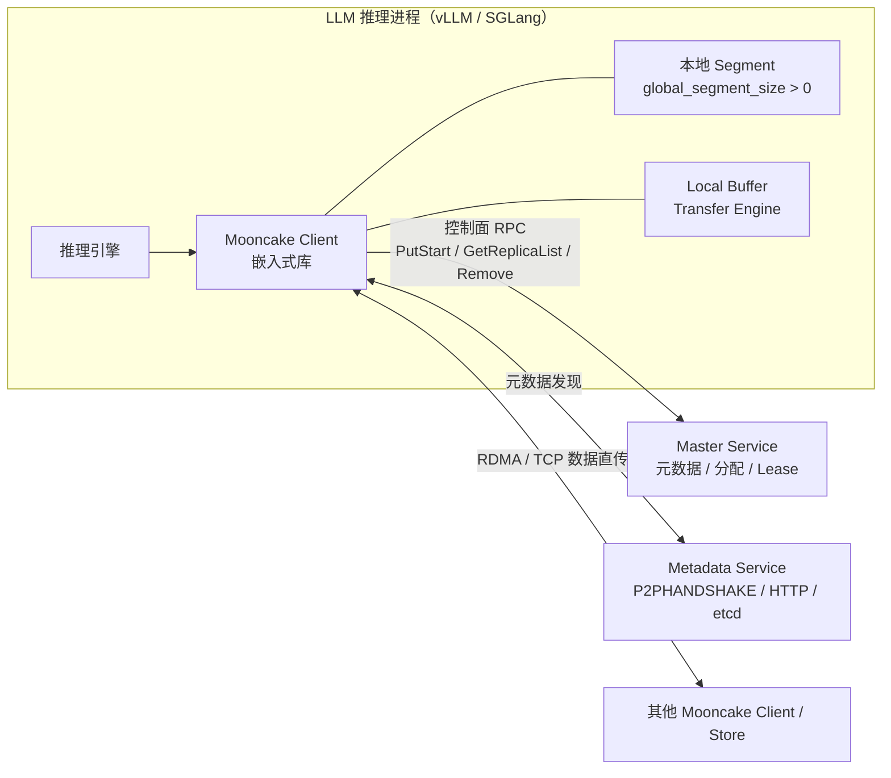

```python
from mooncake.store import MooncakeDistributedStore
store = MooncakeDistributedStore()
store.setup(
    local_hostname="localhost",
    metadata_server="P2PHANDSHAKE",
    global_segment_size=3200 * 1024 * 1024,  # 贡献 3.2 GB DRAM
    local_buffer_size=512 * 1024 * 1024,     # Transfer Engine 缓冲区
    protocol="tcp",
    rdma_devices="",
    master_server_addr="127.0.0.1:50051",
)
# 直接使用 store.put() / store.get() / store.remove()
```

**适用场景**：单机调试、vLLM 集成、小规模部署

##### 2.5.3.2 模式二：嵌入 + Dummy-Real 分离模式 {#mooncake-模式二嵌入-dummy-real-分离模式}

在 Tensor Parallelism 场景下（如 TP=8），每个 TP Rank 持有一个**Dummy Client**（零资源），而每个推理实例有一个**Real Client**拥有全部资源。Dummy Client 将所有请求通过 RPC 转发给 Real Client，Real Client 负责全局 Segment 管理、RPC 处理、内存管理和数据传输。Dummy→Real 通信使用**共享内存/零拷贝**机制，数据路径保持高效。

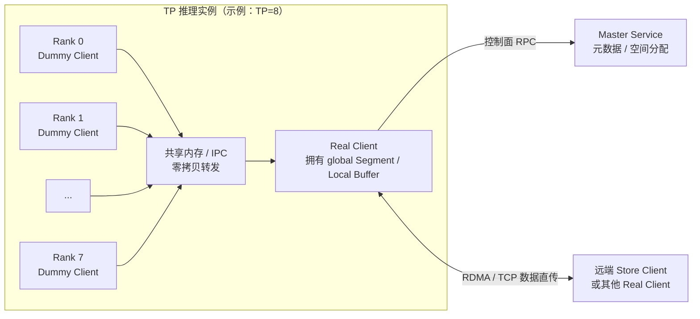

**适用场景**：Tensor Parallel（8 Dummy + 1 Real），避免每 Rank 重复注册内存

##### 2.5.3.3 模式三：独立存储服务（Standalone Store Service） {#mooncake-模式三独立存储服务standalone-store-service}

通过 `python -m mooncake.mooncake_store_service` 启动独立进程，提供全局 DRAM/SSD 资源池。嵌入 Client 设 `global_segment_size=0` 仅贡献 NIC 网络资源。可部署在推理引擎同机或异机。

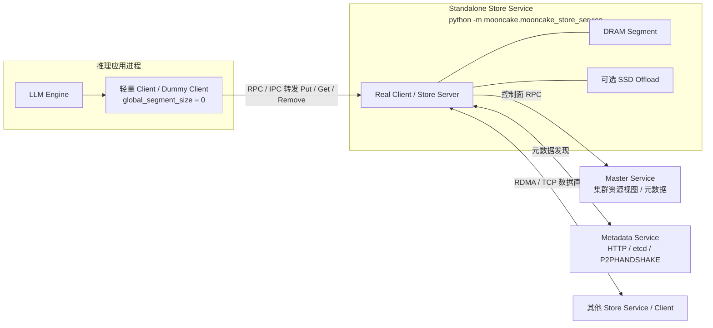

```bash
# 启动独立存储服务
MOONCAKE_MASTER=127.0.0.1:50051 \
MOONCAKE_TE_META_DATA_SERVER=P2PHANDSHAKE \
python -m mooncake.mooncake_store_service

# 或指定 HTTP 元数据服务
MOONCAKE_MASTER=127.0.0.1:50051 \
MOONCAKE_TE_META_DATA_SERVER=http://127.0.0.1:8080/metadata \
python -m mooncake.mooncake_store_service --port=8081
```

**独立 RPC 客户端** (`mooncake_client`)：提供独立进程的 RPC 接口，应用进程使用轻量级 Dummy Client 转发请求。

```bash
mooncake_client \
  --global_segment_size="4GB" \
  --master_server_address="127.0.0.1:50051" \
  --metadata_server="http://127.0.0.1:8080/metadata" \
  --protocol=tcp --port=50052
```

| 参数 | 默认值 | 说明 |
|------|-------|------|
| `--host` | 0.0.0.0 | 绑定地址 |
| `--port` | 50052 | 监听端口 |
| `--global_segment_size` | 4 GB | 贡献 DRAM |
| `--master_server_address` | 127.0.0.1:50051 | Master 地址 |
| `--metadata_server` | http://127.0.0.1:8080/metadata | 元数据服务 |
| `--protocol` | tcp | 传输协议 |
| `--device_names` | 空 | 设备名（逗号分隔） |
| `--threads` | 1 | 工作线程数 |
| `--enable_offload` | false | 客户端侧 SSD 卸载 |
| `--start_offload_rpc_server` | true | 启动卸载 RPC 服务（供 Dummy Client 使用） |

**适用场景**：生产环境全局缓存池、多框架共享存储池

##### 2.5.3.4 三种模式对比 {#mooncake-三种模式对比}

| 维度 | 嵌入模式 | Dummy-Real 分离 | 独立存储服务 |
|------|---------|----------------|-------------|
| 进程拓扑 | 同进程 | 同实例多进程 | 独立进程 |
| 内存贡献 | Client 自身 | Real Client | 存储服务进程 |
| 请求路径 | 直接调用 | Dummy→Real RPC | Dummy→RPC 进程 |
| TP 支持 | 需自行管理 | 天然适配 | 天然适配 |
| 部署复杂度 | 最低 | 中 | 较高 |
| 资源隔离 | 无 | 进程级 | 完全隔离 |
| 适用规模 | 单机/调试 | 多 GPU 推理 | 生产集群 |

#### 2.5.4 支持的协议类型 {#mooncake-5-4-支持的协议类型}

| 协议 | 传输方式 | 关键配置 |
|------|---------|---------|
| `tcp` | TCP/IP | 默认，无需 RDMA 设备 |
| `rdma` | RDMA | 需指定 `rdma_devices` 或 `MC_MS_AUTO_DISC=1` 自动发现 |
| `efa` | AWS EFA | 自动发现默认开启（未指定设备时） |
| `cxl` | CXL 内存 | 客户端需设 `MC_CXL_DEV_SIZE`（必填） |
| `ascend` | 昇腾 NPU | 昇腾硬件传输 |

通过 `setup(protocol=...)`、`MOONCAKE_PROTOCOL` 环境变量或 `--protocol` CLI 参数指定。

#### 2.5.5 客户端配置三种方法 {#mooncake-5-5-客户端配置三种方法}

##### 2.5.5.1 方法 A：编程 `setup()` {#mooncake-方法-a编程-setup}

```python
from mooncake.store import MooncakeDistributedStore
store = MooncakeDistributedStore()
store.setup(
    # ── 7 个必填参数（无 Python 默认值）──
    local_hostname="10.0.0.1",           # 可达的主机名/IP
    metadata_server="P2PHANDSHAKE",       # 元数据服务地址
    global_segment_size=3200*1024*1024,   # 贡献的 DRAM 大小
    local_buffer_size=512*1024*1024,      # Transfer Engine 缓冲区
    protocol="rdma",                      # 传输协议
    rdma_devices="mlx5_0,mlx5_1",        # RDMA 设备（注意：非 device_name）
    master_server_addr="10.0.0.1:50051", # Master 地址（注意：非 master_server_address）
    # ── 4 个可选参数 ──
    engine=None,                          # 复用已有 Transfer Engine
    enable_ssd_offload=False,             # 客户端侧 SSD 卸载
    ssd_offload_path="",                  # SSD 卸载路径
    tenant_id="default",                  # 租户 ID
)
```

> **⚠️ 常见陷阱**：参数名是 `rdma_devices`（非 `device_name`）和 `master_server_addr`（非 `master_server_address`）。使用此方法时 `MOONCAKE_*` 环境变量**不生效**。

##### 2.5.5.2 方法 B：`MOONCAKE_*` 环境变量 {#mooncake-方法-bmooncake_-环境变量}

解析优先级：`--config <path>` → `MOONCAKE_CONFIG_PATH` → `MOONCAKE_*` 变量 → `-D key=value` 覆盖

| 变量 | 映射 | 默认值 |
|------|------|-------|
| `MOONCAKE_MASTER` | master_server_addr | 必填 |
| `MOONCAKE_TE_META_DATA_SERVER` | metadata_server | P2PHANDSHAKE |
| `MOONCAKE_PROTOCOL` | protocol | tcp |
| `MOONCAKE_DEVICE` | rdma_devices | 空 |
| `MOONCAKE_GLOBAL_SEGMENT_SIZE` | global_segment_size | 3.125 GiB（接受 `500gb` 等后缀） |
| `MOONCAKE_LOCAL_BUFFER_SIZE` | local_buffer_size | 1 GiB |
| `MOONCAKE_LOCAL_HOSTNAME` | local_hostname | localhost |
| `MOONCAKE_OFFLOAD_ENABLED` | enable_ssd_offload | false |
| `MOONCAKE_OFFLOAD_FILE_STORAGE_PATH` | ssd_offload_path | 空 |
| `MOONCAKE_CONFIG_PATH` | — | 未设置 |

JSON 配置文件示例：
```json
{
  "local_hostname": "10.0.0.1",
  "metadata_server": "http://10.0.0.1:8080/metadata",
  "global_segment_size": 268435456,
  "local_buffer_size": 268435456,
  "protocol": "tcp",
  "device_name": "",
  "master_server_address": "10.0.0.1:50051"
}
```

##### 2.5.5.3 方法 C：`mooncake_client` 独立 RPC 进程 {#mooncake-方法-cmooncake_client-独立-rpc-进程}

应用进程使用轻量级 Dummy Client 转发请求到独立 RPC 进程。见 5.3 模式三中的完整参数表。

#### 2.5.6 高可用部署 {#mooncake-5-6-高可用部署}

**单 Master 模式**：简单但有单点故障风险。

**多 Master + etcd 模式**：
```bash
mooncake_master --enable_ha=true \
  --etcd_endpoints="10.0.0.1:2379;10.0.0.2:2379;10.0.0.3:2379" \
  --rpc_address=10.0.0.1
```
客户端使用 `etcd://IP:Port;...` 格式的 `master_server_addr`。

**多 Master + Redis 模式**：
```bash
mooncake_master --enable_ha=true \
  --ha_backend_type=redis \
  --ha_backend_connstring="redis://127.0.0.1:6379" \
  --rpc_address=10.0.0.1
```
客户端使用 `redis://connstring` 格式。

**快照与恢复**（实验性）：
```bash
export MOONCAKE_SNAPSHOT_LOCAL_PATH=/data/mooncake_snapshots
mooncake_master --enable_snapshot=true --snapshot_interval_seconds=300 \
  --snapshot_retention_count=5 --snapshot_object_store_type=local \
  --enable_snapshot_restore=true
```

#### 2.5.7 分层存储架构总览 {#mooncake-5-7-分层存储架构总览}

本节统一整理 Mooncake Store 的分层存储能力。阅读顺序建议如下：

| 小节 | 关注点 |
|------|--------|
| 5.7 | 快速理解 DRAM、DFS、SSD offload、NVMe-oF、CXL 和 Local Hot Cache 的整体关系 |
| 5.7.1 | 各类存储后端的介质、协议、配置和部署差异 |
| 5.7.2 | DFS persistence 为什么不支持自动文件驱逐，以及它和 SSD offload 的边界 |
| 5.7.3 | DFS、SSD offload、NVMe-oF 的使用场景与容量治理策略 |
| 5.7.4 | DFS 外部文件生命周期清理的安全流程、GC 架构和监控指标 |

Mooncake Store 的分层存储可以分成三类：主存储层、持久化/卸载层、扩展介质层。主存储层承担低延迟读写；持久化/卸载层负责在 DRAM 压力下保留或迁移 KV Cache；扩展介质层提供更大容量或更低成本的硬件选项。

```text
DRAM / VRAM 主存储层
  -> Put 的入口，Get 的优先读取位置
  -> 内存压力下触发 approximate LRU eviction

DFS persistence / SSD offload / NVMe-oF
  -> 内存 miss 后的回源或冷层缓存
  -> 各自容量治理能力不同

CXL / 3FS / Local Hot Cache
  -> 面向特定硬件或读热点优化的补充能力
```

| 路径 | 启用方式 | 主要用途 | 容量治理 |
|------|----------|----------|----------|
| DRAM/VRAM 主存储 | `global_segment_size` / `MountSegment` | 热 KV Cache、低延迟传输 | Master 内存 eviction，近似 LRU |
| DFS persistence | `--root_fs_dir` | 共享持久化备份、内存 miss 回源 | Mooncake 不自动清理，依赖外部治理 |
| SSD offload | `--enable_offload=true` + `MOONCAKE_OFFLOAD_FILE_STORAGE_PATH` | 本地 SSD 冷层缓存、DRAM 扩容 | 本地后端支持 bucket/file/offset 管理 |
| NVMe-oF SSD pool | `--enable_mooncake_nof_pool` / NoF 注册 | 远程 SSD 块存储池 | Master 侧 NoF tier 驱逐 |
| CXL memory | `--enable_cxl=true` / `--allocation_strategy=cxl` | 大容量低延迟扩展内存 | 作为指定 CXL Segment 分配 |
| 3FS USRBIO | `USE_3FS=ON` + 3FS 挂载 | 高性能 DFS 原生用户态 I/O | 仍遵循 DFS persistence 的清理边界 |
| Local Hot Cache | `MC_STORE_LOCAL_HOT_CACHE_SIZE` | SSD-resident 对象的本地 DRAM 读缓存 | CountMinSketch 准入，缓存大小受环境变量控制 |

两个最容易混淆的边界：

- `--root_fs_dir` 是 DFS persistence 路径，用于共享持久化和回源；它不是 SSD offload 的本地磁盘路径。
- `MOONCAKE_OFFLOAD_FILE_STORAGE_PATH` 是 SSD offload 路径，用于 Real Client 本地磁盘冷层缓存；开启 `--enable_offload=true` 时应使用它，而不是 `--root_fs_dir`。

#### 2.5.8 存储类型详解 {#mooncake-5-7-1-存储类型详解}

Mooncake Store 支持 5 种存储类型，从高速内存到持久化存储，覆盖不同延迟、容量和持久化需求。

##### 2.5.8.1 存储类型全景图 {#mooncake-存储类型全景图}

| 存储类型 | 访问方式 | 介质 | 访问协议 | 延迟 | 持久化 | 状态 |
|---------|---------|------|---------|------|--------|------|
| **内存存储** (DRAM/VRAM) | 对象级 | 本地内存 | RDMA/TCP | 最低 | ✗ | 稳定 |
| **文件存储** (DFS/本地SSD) | 文件级 | 本地 SSD / DFS | POSIX / io_uring | 中 | ✓ | 稳定 |
| **块存储** (NVMe-oF) | 块级 | 远程 NVMe SSD | NVMe-oF / RDMA | 低 | ✓ | 实验性 |
| **CXL 内存存储** | 对象级 | CXL 扩展内存 | CXL / DAX | 低 | ✗ | 稳定 |
| **3FS USRBIO** | 用户态原生 | 3FS 分布式文件系统 | USRBIO 原生 API | 低 | ✓ | 实验性 |

##### 2.5.8.2 内存存储（DRAM/VRAM）— 主存储层 {#mooncake-内存存储dram-vram--主存储层}

对象级语义存储，是所有数据的入口。Client 通过 `MountSegment` 注册 DRAM/VRAM 内存段，Master 通过 Buffer Allocator 管理分配。

- **VRAM 支持**：通过 GPUDirect RDMA 实现 GPU 显存直接访问，零拷贝传输
- **OffsetBufferAllocator（推荐）**：O(1) 实时分配，bin-based 策略，低碎片
- **CachelibBufferAllocator（已弃用）**：Slab 分配，不适应可变对象尺寸
- **对象不可变**：Put 成功后数据不可修改，直到显式 Remove
- **写原子性**：Get 始终读取一致版本（不一定最新）
- **适用场景**：热数据、低延迟访问、Prefill/Decode 节点间 KV Cache 传输

##### 2.5.8.3 文件存储 — DFS/本地 SSD Offload {#mooncake-文件存储--dfs-本地-ssd-offload}

文件存储分为两种模式：DFS 持久化存储和 SSD 卸载存储。两者都基于文件系统，但用途和实现不同。

###### 2.5.8.3.1 DFS 持久化存储 {#mooncake-dfs-持久化存储}

通过 `--root_fs_dir` 启用，数据异步持久化到分布式文件系统。

- **文件组织**：key → 文件名映射，每个文件对应一个 KV Cache 对象
- **写入路径**：Put 同步写内存 + 异步写 DFS
- **读取路径**：内存未命中时回源 DFS
- **空间控制**：`--global_file_segment_size`（默认 int64 max，即无限）
- **限制**：不支持 DFS 驱逐。DFS 文件不会因空间压力被 Mooncake 自动按 LRU/FIFO/TTL 清理
- **必须确保** DFS 挂载目录在所有 Client 主机上有效且一致

###### 2.5.8.3.2 SSD 卸载存储 {#mooncake-ssd-卸载存储}

通过 `--enable_offload=true` 启用，将 KV Cache 从 DRAM 卸载到本地 SSD。SSD 读写均在 Real Client 进程内完成。

**三种存储后端实现：**

**1. `bucket_storage_backend`（推荐）**

将多个对象合桶存储到 `.bucket` 文件（数据）+ `.meta` 文件（元数据），减少文件系统开销，支持高效批量 I/O。文件名采用时间戳命名（如 `1710000000000-0.bucket`）。

| 配置变量 | 默认值 | 说明 |
|---------|-------|------|
| `MOONCAKE_OFFLOAD_BUCKET_SIZE_LIMIT_BYTES` | 256 MB | 每桶最大大小 |
| `MOONCAKE_OFFLOAD_BUCKET_KEYS_LIMIT` | 500 | 每桶最大 key 数 |
| `MOONCAKE_OFFLOAD_BUCKET_MAX_TOTAL_SIZE` | 0（磁盘容量 90%） | 驱逐阈值（字节） |
| `MOONCAKE_OFFLOAD_BUCKET_EVICTION_POLICY` | fifo | 驱逐策略：`none` / `fifo` / `lru` |

> `BucketBackendConfig` 结构体的构造默认值是 `NONE`，但标准 `FromEnvironment()` 配置路径在变量未设置时明确选择 `fifo`；因此独立 Store/集成常规启动路径的有效默认值是 FIFO。生产环境仍建议显式设置，避免自定义嵌入方式绕过环境解析而得到不同策略。

**适用场景**：通用大规模部署

**2. `file_per_key_storage_backend`**

每个对象存储为独立文件。简单直观、易于检查，但大规模时产生大量小文件。

| 配置变量 | 默认值 | 说明 |
|---------|-------|------|
| `MOONCAKE_OFFLOAD_FSDIR` | file_per_key_dir | 存储路径下的子目录 |
| `MOONCAKE_OFFLOAD_ENABLE_EVICTION` | true | 启用本地存储驱逐 |

**适用场景**：调试、小规模部署

**3. `offset_allocator_storage_backend`**

预分配单个大文件，通过偏移量分配管理空间，使用 1024-shard 元数据实现高并发。

> ⚠️ **关键限制**：重启持久化默认禁用。默认 `MOONCAKE_OFFSET_PERSIST_MODE=disabled` 时，进程初始化会截断数据文件并清空内存元数据；只有显式选择 `relaxed` 或 `strict`，且 checkpoint 与记录校验通过时，才能恢复之前卸载的对象。该 tag 的 SSD deployment 页仍保留“OffsetAllocator 不支持恢复”的旧警告，但同 tag 的实现、测试和 design 页已经包含 v3 checkpoint/record 恢复路径；生产应以固定源码实测为准。

| 配置变量 | 默认值 | 说明 |
|---------|-------|------|
| `MOONCAKE_OFFLOAD_TOTAL_SIZE_LIMIT_BYTES` | 2 TB | 预分配文件大小（= 磁盘使用上限，无安全余量） |
| `MOONCAKE_OFFSET_EVICTION_POLICY` | none | 可设 `fifo` 启用写时驱逐；LRU 尚未实现 |
| `MOONCAKE_OFFSET_PERSIST_MODE` | disabled | `disabled` / `relaxed`（周期 checkpoint）/ `strict`（每次 BatchOffload 持久化） |
| `MOONCAKE_OFFSET_PERSIST_INTERVAL_SECONDS` | 60 | `relaxed` 模式 checkpoint 周期，必须至少 5 秒 |
| `MOONCAKE_OFFSET_RECORD_CRC` | true | 为记录写入并在恢复时校验 CRC-32C；仅在明确保证存储顺序时考虑关闭 |

**适用场景**：高并发、小对象密集；需要重启恢复时必须显式选择并压测持久化模式

**三种文件存储后端对比：**

| 维度 | bucket | file_per_key | offset_allocator |
|------|--------|-------------|-----------------|
| 文件组织 | 多对象合桶 | 一对象一文件 | 预分配单文件 + 偏移管理 |
| 文件系统开销 | 低 | 高 | 最低 |
| 并发性能 | 高 | 中 | 最高（1024-shard） |
| 驱逐策略 | FIFO / LRU / None | 布尔开关 | opt-in FIFO 写时驱逐 |
| 重启恢复 | ✓ 扫描元数据 | ✓ 扫描元数据 | 默认关闭；可选 relaxed/strict checkpoint |
| 适用场景 | 通用大规模 | 调试/小规模 | 高并发；持久化模式需单独压测 |

**SSD 卸载核心配置：**

| 变量 | 默认值 | 说明 |
|------|-------|------|
| `MOONCAKE_OFFLOAD_FILE_STORAGE_PATH` | /data/file_storage | SSD 存储目录（必须绝对路径，无符号链接/`..`） |
| `MOONCAKE_OFFLOAD_STORAGE_BACKEND_DESCRIPTOR` | bucket_storage_backend | 后端类型 |
| `MOONCAKE_OFFLOAD_LOCAL_BUFFER_SIZE_BYTES` | 1.25 GB | 客户端暂存缓冲区 |
| `MOONCAKE_OFFLOAD_TOTAL_SIZE_LIMIT_BYTES` | 2 TB | 最大磁盘使用量 |
| `MOONCAKE_OFFLOAD_TOTAL_KEYS_LIMIT` | 10,000,000 | 最大磁盘对象数 |
| `MOONCAKE_OFFLOAD_HEARTBEAT_INTERVAL_SECONDS` | 10 | 卸载心跳间隔 |
| `MOONCAKE_OFFLOAD_USE_URING` | false | 启用 io_uring 异步文件 I/O |
| `MOONCAKE_OFFLOAD_ENABLE_DISK_WATERMARK_EVICTION` | true | 在 FileStorage heartbeat 主动检查本地磁盘水位 |
| `MOONCAKE_OFFLOAD_DISK_EVICTION_HIGH_WATERMARK_RATIO` | 0.90 | 超过该后端 quota 比例时开始主动驱逐 |
| `MOONCAKE_OFFLOAD_DISK_EVICTION_LOW_WATERMARK_RATIO` | 0.80 | 主动驱逐的目标使用率 |

**io_uring 注意事项**：启用后使用固定缓冲区注册。若 `MOONCAKE_OFFLOAD_LOCAL_BUFFER_SIZE_BYTES` 超过 `RLIMIT_MEMLOCK`，注册失败。解决：`ulimit -l unlimited` 或降低缓冲区大小。失败不中止启动，但回退到非固定缓冲区模式，性能可能降低。

**两阶段驱逐**：
1. 先从元数据移除桶并通知 Master（其他节点副本不受影响）
2. 等 in-flight 读取完成后再删除文件

**重启恢复与全量清理**：`bucket_storage_backend` 和 `file_per_key_storage_backend` 启动时扫描已有 SSD 元数据并报告 Master；OffsetAllocator 只有在显式持久化模式下才尝试从 checkpoint 和带 sequence/CRC 的记录恢复。`RemoveAll` 会在 Master 为每个 LocalDisk Segment 设置清理标记，各 Real Client 在 heartbeat 中通过 `PollRemoveAll` 获取并清空本地后端，因此从任意节点发起的全量删除不再只清理调用方 SSD；离线节点仍需在恢复/重新注册流程中验证残留。

##### 2.5.8.4 块存储 — NVMe-oF SSD 池（实验性） {#mooncake-块存储--nvme-of-ssd-池实验性}

块存储通过 **NVMe-oF（NVMe over Fabrics）** 协议实现，核心区别是**无文件系统层**——SPDK 用户态驱动直接访问远程 NVMe 块设备，绕过操作系统内核。

###### 2.5.8.4.1 架构 {#mooncake-架构}

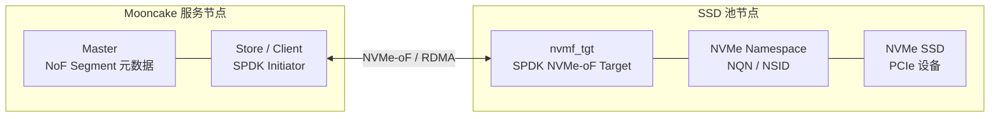

- SSD 池节点运行 `nvmf_tgt`（SPDK NVMe-oF Target 进程）
- 每块 SSD 暴露为 NQN（NVMe Qualified Name）子系统内的命名空间
- 客户端通过 NVMe-oF 协议 + RDMA 传输直接访问
- Master 追踪命名空间和 NQN，而非文件路径

###### 2.5.8.4.2 部署步骤 {#mooncake-部署步骤}

**1. 编译**（需安装 SPDK 依赖）：
```bash
cmake -DUSE_NOF=ON .. && make -j
```

**2. 启动服务**：
```bash
# Master
mooncake_master --rpc_address=192.168.65.81

# Metadata
python3 -m mooncake.http_metadata_server --host=192.168.65.81 --port=8080

# Store（需 RDMA）
python3 -m mooncake.mooncake_store_service --config=store_service.json --port=8081
```

**3. 配置 Hugepages**（Store 服务启动 SPDK 环境时需要）：
```bash
echo 512 > /proc/sys/vm/nr_hugepages  # 通常 512 足够
```

**4. 创建 NVMe-oF Target**：
```bash
python3 -m mooncake.spdk_tgt_create \
    --spdk_target_info="ip:192.168.65.56 path:/home/spdk pci:0000:01:00.0,0000:02:00.0" \
    --spdk_target_info="ip:192.168.65.57 path:/home/spdk" \
    --core-mask=0xff \
    --transport-type=RDMA \
    --max-queue-depth=128 \
    --max-io-qpairs-per-ctrlr=127 \
    --max-io-size=4096 \
    --in-capsule-data-size=131072 \
    --io-unit-size=131072
```

Target Info 参数：`ip`（节点 IP）、`path`（SPDK 安装路径）、`pci`（SSD PCI 地址，逗号分隔；省略则自动注册所有未挂载 NVMe 设备）

**5. 注册到 Master**：
```bash
python3 -m mooncake.mooncake_ssd_register \
    --master_server_address=192.168.65.81:50051 \
    --spdk_target_info="ip:192.168.65.56 path:/home/spdk" \
    --spdk_target_info="ip:192.168.65.57 path:/root/spdk"
```

**6. 注销 SSD**：
```bash
python3 -m mooncake.mooncake_ssd_unregister \
    --master_server_address=192.168.65.81:50051 \
    --spdk_target_info="ip:192.168.65.56 ns:1 nqn:nqn.2016-06.io.spdk:cnode1"
```

###### 2.5.8.4.3 客户端 QoS 控制 {#mooncake-客户端-qos-控制}

| 变量 | 默认值 | 说明 |
|------|-------|------|
| `MC_NOF_WORKERS` | 4 | SPDK NoF I/O 工作线程数 |
| `MC_NOF_SUBMIT_CHUNK_BYTES` | 128 KB | 每次提交到 SPDK 的 I/O 大小 |
| `MC_NOF_INFLIGHT_BYTES_LIMIT` | 32 MB | 系统级最大在途 I/O 字节数 |

三个参数共同提供 SPDK NoF I/O 的 QoS 控制。

###### 2.5.8.4.4 Master 侧 NoF 参数 {#mooncake-master-侧-nof-参数}

| 参数 | 默认值 | 说明 |
|------|-------|------|
| `--nof_eviction_ratio` | 0.05 | NoF SSD 满时驱逐比例 |
| `--nof_eviction_high_watermark_ratio` | 0.90 | 触发驱逐的使用率 |
| `--nof_heartbeat_interval_sec` | 10 | 探活间隔 |
| `--nof_heartbeat_probe_timeout_ms` | 1000 | 探活超时 |
| `--nof_heartbeat_failures_threshold` | 3 | 连续失败后卸载段 |

###### 2.5.8.4.5 性能测试 {#mooncake-性能测试}

```bash
./build/mooncake-store/benchmarks/nof_worker_pool_bench \
    --endpoints='traddr:192.168.65.56 trsvcid:4420 subnqn:nqn.2016-06.io.spdk:cnode1 trtype:RDMA adrfam:IPv4 ns:1' \
    --op=read --io_size=1048576 --iodepth=8 --warmup_sec=3 --duration_sec=30
```

Endpoint 格式：`traddr`（目标地址）、`trsvcid`（端口）、`subnqn`（子系统 NQN）、`trtype`（传输类型）、`adrfam`（地址族）、`ns`（命名空间 ID）。

###### 2.5.8.4.6 vLLM + LMCache 集成示例 {#mooncake-vllm-lmcache-集成示例}

```yaml
# vllm-lmcache-mooncake-config.yaml
chunk_size: 256
remote_url: "mooncakestore://192.168.65.81:50051/"
remote_serde: "naive"
local_cpu: True
max_local_cpu_size: 8
enable_mooncake_nof_pool: True
extra_config:
  local_hostname: "localhost"
  metadata_server: "http://192.168.65.81:8080/metadata"
  master_server_address: "192.168.65.81:50051"
  global_segment_size: 0       # 推理进程不贡献内存段
  local_buffer_size: 1073741824  # 仍需本地暂存缓冲区
  protocol: "rdma"
  device_name: "mlx5_0"
```

##### 2.5.8.5 CXL 内存存储 {#mooncake-cxl-内存存储}

CXL（Compute Express Link）扩展内存通过 DAX 设备直访，提供比 DRAM 更大容量但延迟略高的内存层。

- **设备路径**：`/dev/dax0.0`（DAX 设备）
- **CxlAllocationStrategy**：仅从指定 CXL Segment 分配（`preferred_segments` 首元素），单副本
- **类型标记**：分配的缓冲区通过 `change_to_cxl()` 标记为 CXL 类型，下游可区分 CXL 数据与普通 DRAM
- **与 DRAM 的区别**：容量更大、延迟略高、类型可区分
- **Master 配置**：`--enable_cxl=true --cxl_path=/dev/dax0.0 --cxl_size=<bytes> --allocation_strategy=cxl`
- **Client 必填**：`MC_CXL_DEV_SIZE`（`protocol="cxl"` 时未设则启动中止）

##### 2.5.8.6 3FS USRBIO 原生存储（实验性） {#mooncake-3fs-usrbio-原生存储实验性}

3FS 是 DeepSeek 开源的分布式文件系统。Mooncake 通过其原生用户态 I/O 接口（USRBIO）实现高性能持久化存储，**绕过 POSIX 内核栈**。

- **编译**：`cmake -DUSE_3FS=ON ..`
- **依赖**：安装 `libhf3fs_api_shared.so` 到 `/usr/lib/`，`hf3fs_usrbio.h` 到 `/usr/include/`
- **部署**：`mooncake_master --root_fs_dir=/path/to/3fs_mount_point`
- **自动降级**：若指定路径非 3FS 挂载点，自动回退到 POSIX API（不报错，但性能降低）
- **与 DFS 的区别**：DFS 走 POSIX 系统调用（read/write）经内核；3FS USRBIO 直接用户态 I/O，绕过内核，延迟更低

##### 2.5.8.7 文件存储 vs 块存储对比 {#mooncake-文件存储-vs-块存储对比}

| 维度 | 文件存储 (DFS/SSD Offload) | 块存储 (NVMe-oF) |
|------|--------------------------|------------------|
| 存储抽象 | 文件系统 | 原始块设备 |
| 访问协议 | POSIX / io_uring | NVMe-oF (RDMA) |
| 存储位置 | 本地 SSD / DFS 挂载 | 远程 SSD 池节点 |
| 驱动方式 | 内核文件系统 | SPDK 用户态 |
| 数据路径 | read/write 系统调用 | NVMe 命令 + RDMA |
| 部署复杂度 | 低 | 高（需 SPDK、Hugepages、SSH） |
| 数据持久化 | ✓ | ✓ |
| 重启恢复 | ✓（bucket/file_per_key） | ✓（Master 注册） |
| 适用场景 | 通用卸载、本地存储 | 远程 SSD 池、网络存储 |

#### 2.5.9 DFS 持久化存储限制：不支持 DFS 驱逐 {#mooncake-5-7-2-dfs-持久化存储限制不支持-dfs-驱逐}

Mooncake 的 DFS 持久化路径通过 `--root_fs_dir` 启用，定位是**持久化备份与冷数据回源**，不是一个带自动替换策略的有界缓存层。Put 路径会先写入内存池，再异步把对象写到 DFS；Get 路径先查内存副本，内存 miss 时再尝试从 DFS 文件回源。

```text
Put / BatchPut
  -> 同步写入 Mooncake 内存池
  -> 异步写入 DFS 文件

Get / BatchGet
  -> 优先读取内存 replica
  -> 内存 miss 时尝试读取 DFS 文件
```

“不支持 DFS 驱逐”的准确含义是：Mooncake 当前不会在 DFS 空间紧张、达到容量上限，或新对象需要写入时，自动选择旧 DFS 文件删除来腾出空间。

| 能力 | DFS 持久化路径 |
|------|----------------|
| 按 LRU 删除最冷 DFS 文件 | 不支持 |
| 按 FIFO 删除最早 DFS 文件 | 不支持 |
| 按高水位线自动清理 DFS 文件 | 不支持 |
| 按 `--eviction_ratio` 回收 DFS 空间 | 不支持 |
| 按 TTL 自动过期删除 DFS 文件 | 不支持 |
| 感知 Lease / Soft Pin / Hard Pin 做 DFS 文件淘汰 | 不支持 |
| 内存 miss 后从 DFS 回源 | 支持 |
| 显式 `Remove` / `RemoveByRegex` 删除对象 | 支持，但这是主动删除，不是自动 eviction |

`--global_file_segment_size` 也不是 DFS eviction policy。它表达的是 DFS 文件层的容量边界或容量视图，默认接近无限；达到边界或底层文件系统写满时，Mooncake 不会自动执行“删除旧 DFS 文件 -> 腾出空间 -> 继续写入新 DFS 文件”的闭环。因此 DFS 目录需要外部容量治理。

这与内存层 eviction 的语义不同：

```text
内存 eviction
  -> 回收 DRAM/VRAM Segment 空间
  -> 近似 LRU，受 Lease / Pin / group 安全规则约束
  -> 不等于删除 DFS 持久化文件

DFS 持久化
  -> 保留内存副本被回收后的回源能力
  -> 当前没有自动文件淘汰策略
```

它也不同于 SSD offload。SSD offload 是专门的 DRAM 到 SSD 分层缓存路径，通过 `--enable_offload=true` 和 `MOONCAKE_OFFLOAD_FILE_STORAGE_PATH` 启用；bucket 后端可以配置本地磁盘空间淘汰策略（`none` / `fifo` / `lru`），并支持 promotion 把热 SSD 对象拉回 DRAM。DFS 持久化路径则由 `--root_fs_dir` 启用，属于 DFS persistence，不应与 `--enable_offload=true` 混用。

生产使用时需要注意：

- DFS 文件可能随新 key 持续增长，默认不会由 Mooncake 自动清理。
- 冷数据即使长期不访问，只要没有显式删除或外部清理，DFS 文件仍可能保留。
- 底层 DFS 配额、磁盘容量、inode 数量和写入失败需要独立监控。
- 如需清理，应使用业务级 `Remove` / `RemoveByRegex`，或在 DFS/运维层配置目录配额和安全清理任务。
- 如果目标是“有限容量冷层 + 自动 LRU/FIFO 淘汰 + 热数据提升回 DRAM”，应优先使用 SSD offload 或 NVMe-oF SSD 池，而不是 DFS 持久化路径。

推荐配置原则：

```bash
# DFS persistence：用于共享持久化备份和回源
mooncake_master \
  --root_fs_dir=/mnt/dfs \
  --cluster_id=mooncake_cluster \
  --global_file_segment_size=<合理容量上限>

# SSD offload：用于可管理的本地磁盘分层缓存
export MOONCAKE_OFFLOAD_FILE_STORAGE_PATH=/mnt/local_ssd/mooncake
mooncake_master \
  --enable_offload=true \
  --offload_on_evict=true
```

一句话总结：**DFS 持久化路径负责把 KV Cache 对象落到共享文件系统并在内存 miss 时回源；它不负责在 DFS 空间压力下自动删除旧对象。DFS 容量治理要依赖外部配额、监控、显式 Remove 或运维清理；需要自动磁盘缓存淘汰时，应使用 SSD offload / NoF 这类专门的分层缓存路径。**

#### 2.5.10 使用场景与容量治理：DFS、SSD Offload、NVMe-oF {#mooncake-5-7-3-使用场景与容量治理dfs-ssd-offload-nvme-of}

Mooncake 的文件/块存储路径容易混淆。可以按两条主线区分：

1. **使用场景**：是要“共享持久化回源”，还是要“本地/远程 SSD 分层缓存”。
2. **容量治理**：空间满时由谁清理，是外部运维清理、Mooncake 本地磁盘淘汰，还是 NoF SSD tier 的 Master 侧驱逐。

##### 2.5.10.1 DFS 持久化存储 vs SSD 卸载存储 {#mooncake-dfs-持久化存储-vs-ssd-卸载存储}

| 维度 | DFS 持久化存储 | SSD 卸载存储 |
|------|----------------|--------------|
| 启用方式 | `--root_fs_dir=/mnt/dfs` | `--enable_offload=true` + `MOONCAKE_OFFLOAD_FILE_STORAGE_PATH` |
| 存储位置 | 所有 Client 可见的一致 DFS 挂载目录 | 每个 Real Client 的本地 SSD 目录 |
| 核心定位 | 持久化备份、内存 miss 后回源 | DRAM 到 SSD 的分层缓存扩容 |
| 写入路径 | Put 同步写内存，异步写 DFS | Put 后异步 offload，或内存 eviction 时 offload |
| 读取路径 | 内存 miss 后尝试读 DFS 文件 | 内存 miss 后读 `LOCAL_DISK` replica |
| 容量策略 | Mooncake 不提供 DFS 文件自动驱逐 | 本地 SSD 后端可做磁盘淘汰 |
| 替换策略 | 无 LRU/FIFO/TTL 自动清理 | bucket 后端支持 `none` / `fifo` / `lru` |
| 热数据回迁 | 无专门 promotion 机制 | 支持 `--promotion_on_hit` |
| 重启恢复 | 依赖 DFS 文件与 Master 元数据/快照恢复路径 | bucket/file_per_key 可扫描恢复；offset_allocator 不恢复 |
| 适合场景 | 有共享 DFS、需要回源副本、容量由外部治理 | 需要受控冷层缓存、降低 DRAM 压力、利用本地 NVMe |

**DFS 持久化适合：**

- 已有稳定 DFS/3FS/NFS/HDFS 类共享文件系统，所有 Store Client 能看到一致路径。
- 业务希望 KV Cache 在内存副本被回收后仍有一个共享回源副本。
- 容量、配额、清理、审计已经由外部文件系统或运维平台负责。
- 对磁盘层自动 LRU/FIFO 替换、promotion 回 DRAM 没有强需求。

**DFS 持久化不适合：**

- 希望 Mooncake 自动控制 DFS 目录大小。
- 希望 DFS 空间满时自动删除旧 KV Cache 文件。
- 希望按 Lease/Pin/group 语义精确清理 DFS 文件。
- 希望构建“有限容量冷层 + 自动替换 + 热数据回迁”的缓存闭环。

**SSD offload 适合：**

- 每台 Store 节点有本地 NVMe/SSD，希望把 DRAM 中较冷的 KV Cache 下沉到本地磁盘。
- 需要在内存压力下把对象 offload，而不是直接丢弃。
- 需要本地磁盘层的容量上限、bucket 淘汰和热数据 promotion。
- 对性能更敏感，希望使用本地 SSD、io_uring、bucket 合并等优化。

**SSD offload 不适合：**

- 需要所有节点共享同一个文件系统视图。
- 本地磁盘容量很小，或节点生命周期短且不希望依赖本地盘。
- 需要强持久化语义；SSD offload 的定位仍是缓存层，不是业务事实源。

##### 2.5.10.2 容量治理一：DFS persistence {#mooncake-容量治理一dfs-persistence}

DFS 路径的容量治理原则是：**Mooncake 只记录和使用 DFS 文件，不负责自动清理 DFS 文件**。

| 治理项 | 建议 |
|--------|------|
| 容量上限 | 显式设置 `--global_file_segment_size`，不要默认无限增长 |
| 文件系统配额 | 在 DFS 层配置目录配额、租户配额、inode 配额 |
| 告警 | 监控 DFS 目录容量、inode、写入失败、回源失败 |
| 清理入口 | 优先用 `Remove` / `RemoveByRegex` 做对象级清理 |
| 外部清理 | 只在确认对象生命周期结束后执行；避免直接删除仍被 Master 元数据引用的文件 |
| 命名规划 | key 建议包含模型、租户、日期/会话等前缀，便于正则清理 |
| 隔离 | 用不同 `cluster_id` 或目录隔离环境、集群和租户 |

推荐的 DFS 清理策略：

```text
业务或运维系统确定一批 key 已过期
  -> 调用 Remove / RemoveByRegex 删除 Mooncake 对象元数据与副本
  -> 再由 DFS 层的目录配额/生命周期任务清理落盘文件
  -> 通过 metrics 和日志确认写入失败、回源失败没有上升
```

不推荐的 DFS 清理策略：

```text
底层定时任务直接 rm DFS 文件
  -> Master 仍可能认为该 key 有 DFS 回源能力
  -> 后续内存 miss 时回源失败
  -> 形成“元数据存在、文件不存在”的不一致状态
```

如果必须做外部文件生命周期清理，建议把它设计成“先删 Mooncake 对象、再删文件”的两阶段流程，而不是直接扫描目录删除旧文件。

##### 2.5.10.3 容量治理二：SSD offload {#mooncake-容量治理二ssd-offload}

SSD offload 的容量治理由 Mooncake 本地磁盘后端承担，尤其是 bucket 后端：

| 后端 | 治理方式 |
|------|----------|
| `bucket_storage_backend` | 设置 bucket 总容量上限后，可按 `none` / `fifo` / `lru` 淘汰 bucket |
| `file_per_key_storage_backend` | 一对象一文件，适合调试/小规模；大规模文件数压力较大 |
| `offset_allocator_storage_backend` | 预分配大文件，重启会截断，不适合需要恢复的场景 |

关键治理点：

- `MOONCAKE_OFFLOAD_FILE_STORAGE_PATH` 必须指向本地 SSD 路径。
- `MOONCAKE_OFFLOAD_BUCKET_MAX_TOTAL_SIZE` 控制 bucket 后端容量上限。
- `MOONCAKE_OFFLOAD_BUCKET_EVICTION_POLICY` 控制 bucket 淘汰策略，典型值是 `none` / `fifo` / `lru`。
- `--offloading_queue_limit` 和 `--offload_cap_ratio` 控制每轮内存 eviction 可排队 offload 的对象数量。
- `--offload_force_evict=true` 时，超出 offload 能力的对象可能被直接丢弃；关闭时，对象可能继续留在内存中等待后续机会。
- `--promotion_on_hit=true` 可让 SSD-only 热对象在命中后回到 DRAM。

SSD offload 的清理顺序比直接删文件更安全：bucket 后端先从本地元数据移除 bucket，通知 Master 删除对应 `LOCAL_DISK` replica，再等待 in-flight read 完成后删除 `.bucket` 和 `.meta` 文件。这样可以避免 Master 返回一个已经被删除的磁盘副本位置。

##### 2.5.10.4 容量治理三：NVMe-oF 块存储 {#mooncake-容量治理三nvme-of-块存储}

NVMe-oF SSD 池是实验性块存储路径。它和 DFS/本地 SSD 最大的区别是：**没有文件系统语义**。Mooncake/Store 通过 SPDK 和 NVMe-oF 访问远程 SSD 块设备，Master 追踪的是 NoF SSD segment、namespace/NQN 和对象放置，而不是目录和文件。

| 维度 | NVMe-oF SSD 池 |
|------|----------------|
| 存储抽象 | 原始块设备 / namespace |
| 数据路径 | SPDK 用户态 NVMe-oF I/O |
| 容量治理主体 | Mooncake Master 的 NoF SSD tier 策略 |
| 清理方式 | 对象/副本级 eviction，释放块空间 |
| 文件清理 | 无 `rm` 文件这种操作 |
| 状态 | 实验性 |

Master 侧 NoF 容量治理参数：

| 参数 | 默认值 | 说明 |
|------|-------|------|
| `--nof_eviction_high_watermark_ratio` | 0.90 | NoF SSD tier 使用率达到该比例后触发驱逐 |
| `--nof_eviction_ratio` | 0.05 | NoF SSD 空间满或达到水位线时，每轮驱逐比例 |
| `--nof_heartbeat_interval_sec` | 10 | 探测 NoF segment 的周期 |
| `--nof_heartbeat_probe_timeout_ms` | 1000 | 单次探测超时 |
| `--nof_heartbeat_failures_threshold` | 3 | 连续失败后卸载 NoF segment |

NoF 的清理策略应按“块设备上的对象副本生命周期”理解，而不是按“文件目录生命周期”理解：

```text
NoF SSD 使用率达到高水位线
  -> Master 在 NoF SSD tier 中选择可回收对象/副本
  -> 遵守对象状态与安全约束
  -> 移除对应 NoF 副本元数据
  -> 释放块存储空间
```

运维上不要尝试在 NoF 路径做文件级清理，因为没有 DFS 目录和文件名可清理。容量治理重点应放在：

- 合理设置 NoF 高水位线和每轮驱逐比例。
- 监控 NoF segment 使用率、驱逐量、写入失败、读回失败。
- 监控 NVMe-oF target 的 namespace 容量、SPDK 进程、RDMA 链路和 heartbeat 状态。
- 对实验性功能设置更保守的容量余量，例如把高水位线设得低于默认 0.90。
- 确保 NoF segment 掉线时，Master 能通过 heartbeat 卸载不可用 segment，避免继续分配到坏路径。

##### 2.5.10.5 选型建议 {#mooncake-选型建议}

| 目标 | 推荐路径 |
|------|----------|
| 共享 DFS 上保留回源副本，外部系统负责容量 | DFS persistence |
| 本地 NVMe 扩展缓存容量，允许自动磁盘淘汰 | SSD offload |
| 希望磁盘层支持 FIFO/LRU 替换 | SSD offload bucket backend |
| 希望远程 SSD 池集中供给容量 | NVMe-oF SSD pool |
| 需要文件级可检查性和简单排障 | DFS 或 file_per_key offload |
| 需要高性能块设备、绕过文件系统 | NVMe-oF |
| 不希望自己写清理任务 | 避免 DFS persistence，优先 SSD offload / NoF |

最实用的判断标准：

```text
需要“共享持久化回源”：
  选 DFS persistence，但必须自带容量治理和清理流程

需要“自动管理的本地 SSD 冷层缓存”：
  选 SSD offload，优先 bucket backend

需要“远程 SSD 池 + 块设备性能 + Mooncake 侧 NoF 驱逐”：
  评估 NVMe-oF SSD pool，但按实验性功能保守上线
```

#### 2.5.11 DFS 外部文件生命周期清理 {#mooncake-5-7-4-dfs-外部文件生命周期清理}

“外部文件生命周期清理”指 Mooncake 之外的业务系统、运维任务、文件系统策略或独立 GC 服务，负责判断 DFS persistence 中哪些对象/文件已经过期，并释放 DFS 空间。它存在的原因是：Mooncake 的 `--root_fs_dir` DFS 路径当前不提供自动文件 eviction，不能依赖 Mooncake 在 DFS 空间满时自动删除旧文件。

这里的外部清理不应等同于简单执行 `find ... -mtime +N -delete`。DFS 文件仍然可能被 Mooncake 元数据引用，直接按文件时间删除会导致“Master 认为可回源，但文件已经不存在”的不一致。

##### 2.5.11.1 外部清理要解决的问题 {#mooncake-外部清理要解决的问题}

| 问题 | 说明 |
|------|------|
| 容量增长 | 新 key 持续写入，DFS 文件持续增加 |
| 冷数据堆积 | 长期未访问的 KV Cache 文件仍保留 |
| 模型版本残留 | 老模型、老 tokenizer、老 cache key 空间未清理 |
| 租户挤占 | 单个租户占满共享 DFS 目录 |
| 会话过期 | 已结束会话的 prefix/KV 文件仍占用空间 |
| 孤儿文件 | Mooncake 元数据已无引用，但 DFS 文件残留 |
| 不一致文件 | 文件被外部误删，但 Mooncake 元数据仍认为可回源 |

清理目标是：**在不破坏 Mooncake 对象一致性的前提下释放 DFS 空间**。

##### 2.5.11.2 不建议直接按文件时间删除 {#mooncake-不建议直接按文件时间删除}

危险做法：

```bash
find /mnt/dfs/mooncake_cluster -type f -mtime +7 -delete
```

主要风险：

- 文件 `mtime` 代表写入时间，不代表 KV Cache 最近访问时间。
- Master 可能仍持有 key 到 DFS 文件的元数据引用，内存 miss 后会回源失败。
- 文件可能正在被 DFS 回源读取。
- 文件可能属于异步持久化中的对象或刚完成写入的对象。
- 一个逻辑 KV cache 可能拆成 K/V、layer、shard 多个文件，按单文件删除会破坏 group 完整性。

mtime 或文件大小只能作为辅助信号，不应作为唯一删除依据。

##### 2.5.11.3 推荐清理层级 {#mooncake-推荐清理层级}

| 层级 | 清理方式 | 安全性 | 建议 |
|------|----------|--------|------|
| 对象级清理 | 通过 Mooncake `Remove` / `RemoveByRegex` 删除对象 | 最高 | 首选 |
| 元数据感知 GC | 对比 active keys 与 DFS 文件，清理孤儿文件 | 高 | 推荐，但需要实现 |
| Manifest 驱动清理 | 业务侧记录 key 生命周期，按过期状态清理 | 高 | 推荐用于生产 |
| 文件级 TTL 清理 | 直接按目录、mtime、大小删除文件 | 低 | 仅应急或可接受 miss 场景 |

核心原则：

```text
优先清理 Mooncake 对象生命周期
再清理 DFS 物理文件残留
不要绕过 Mooncake 元数据直接删除仍可能有效的文件
```

##### 2.5.11.4 方案一：业务驱动的对象级清理 {#mooncake-方案一业务驱动的对象级清理}

业务系统通常最清楚 cache key 的生命周期。推荐在 key 命名中包含租户、模型、版本、会话、任务等维度：

```text
tenant/{tenant_id}/model/{model_id}/version/{version}/session/{session_id}/block/{block_id}
tenant/{tenant_id}/model/{model_id}/version/{version}/prefix/{hash}/layer/{layer}/shard/{shard}
```

典型清理事件：

| 生命周期事件 | 清理动作 |
|--------------|----------|
| 会话结束 | 删除该 session prefix 下的 cache key |
| 模型下线 | 删除该 model version 下所有 cache key |
| 租户退租 | 删除 tenant prefix 下所有 cache key |
| 批处理任务完成 | 删除 job prefix 下所有 cache key |
| 实验过期 | 删除 experiment prefix 下所有 cache key |

示例：

```text
RemoveByRegex("^tenant/a/model/qwen3/version/v1/")
RemoveByRegex("^tenant/a/.*/session/sess_123/")
RemoveByRegex("^tenant/a/.*/job/job_20260707/")
```

推荐流程：

```text
业务判断对象过期
  -> 调用 Remove / RemoveByRegex
  -> Mooncake 删除对象元数据及相关副本语义
  -> DFS 文件如仍有残留，交给后续孤儿文件 GC
```

##### 2.5.11.5 方案二：元数据感知的 mark-and-sweep GC {#mooncake-方案二元数据感知的-mark-and-sweep-gc}

如果 DFS 已有大量残留，或者无法完全依赖业务主动 Remove，可以构建独立 GC 服务：

```text
Mark：从 Mooncake/业务 manifest 获取仍然有效的 key 集合
Sweep：扫描 DFS 文件，只删除不在有效 key 集合中的孤儿文件
```

安全流程：

```text
1. 导出 active keys
2. 扫描 DFS 目录得到 file keys
3. candidate_orphans = file keys - active keys
4. 等待 grace period，例如 24h / 72h
5. 再次导出 active keys 并重新扫描 DFS
6. confirmed_orphans = 两次都确认无引用的文件
7. 移动到 quarantine/trash 目录
8. 观察无回源失败后再永久删除
```

二次确认和宽限期可以降低以下风险：

- 异步 DFS 写入尚未完成。
- Master failover 或元数据短暂不可用。
- 扫描期间有新 Put。
- DFS list 有延迟。
- 文件系统和服务端时钟存在偏差。

##### 2.5.11.6 方案三：Manifest 驱动清理 {#mooncake-方案三manifest-驱动清理}

生产中更稳妥的方式是在业务层维护一份生命周期 manifest。每次 Put 记录 key、租户、模型版本、创建时间、过期时间、group id 和状态：

```json
{
  "key": "tenant/a/model/qwen3/version/v1/session/s1/block/42",
  "tenant": "a",
  "model": "qwen3",
  "version": "v1",
  "session": "s1",
  "created_at": "2026-07-07T00:00:00Z",
  "expire_at": "2026-07-14T00:00:00Z",
  "group_id": "s1-block-42",
  "state": "active"
}
```

清理服务只选择 manifest 中明确过期或已 removed 的对象：

```text
manifest 中 expire_at < now
  -> 调用 Mooncake Remove
  -> manifest 标记 removed/removing
  -> 等待 grace period
  -> 扫描 DFS 残留文件并作为 orphan 处理
```

Manifest 的优点是可以按租户、模型、会话、实验和 group 做审计与批量删除，不依赖文件系统时间猜测。

##### 2.5.11.7 Quarantine 优先于直接删除 {#mooncake-quarantine-优先于直接删除}

外部文件清理建议先隔离再删除：

```text
/mnt/dfs/mooncake_cluster/
  active/
  quarantine/YYYYMMDD/
```

推荐流程：

```text
confirmed_orphan file
  -> mv 到 quarantine
  -> 观察 3-7 天
  -> 如果 DFS read failure 没有上升，再永久删除
```

这样即使误判，也可以把文件从 quarantine 恢复。直接 `rm` 不可逆，尤其 KV Cache 文件较大、重建成本高时风险更高。

##### 2.5.11.8 并发与一致性防护 {#mooncake-并发与一致性防护}

| 风险 | 防护 |
|------|------|
| 正在 Put | 只处理超过 grace period 的候选文件 |
| 正在 Get 回源 | 先逻辑删除，延迟物理删除 |
| 新对象复用同 key | key 中加入 generation/version，避免旧文件误匹配 |
| 多个 GC 并发 | 全局 GC lock 或按租户/前缀分区锁 |
| DFS list 延迟 | 两次扫描确认 |
| Master failover | 避免 failover 窗口做强删除 |
| Client mount 不一致 | 定期校验所有 Client 看到同一 DFS 挂载 |
| 时钟漂移 | 使用 manifest/service 时间，不单靠文件 mtime |

##### 2.5.11.9 监控与告警 {#mooncake-监控与告警}

外部清理必须配监控，否则很难发现误删或清理滞后：

| 指标 | 意义 |
|------|------|
| DFS used bytes | 总容量压力 |
| DFS inode count | 小文件数量压力 |
| DFS write failures | 持久化失败 |
| DFS read fallback count | 内存 miss 后 DFS 回源次数 |
| DFS read failures | 回源失败，可能误删或文件损坏 |
| orphan candidate count | 候选孤儿文件数量 |
| orphan confirmed count | 二次确认后的孤儿文件数量 |
| quarantine bytes | 待最终删除容量 |
| permanent delete bytes | 实际释放容量 |
| Remove / RemoveByRegex latency | 逻辑删除性能 |
| per-tenant DFS bytes | 租户容量治理 |

清理任务上线后尤其要观察 `DFS read failures`。如果清理后该指标升高，说明清理过激，或 Mooncake 元数据与 DFS 文件状态出现不一致。

##### 2.5.11.10 最小可行实践 {#mooncake-最小可行实践}

```text
1. 规范 key 命名：tenant/model/version/session/job 前缀
2. 维护业务 manifest：记录 key、生命周期、过期时间和状态
3. 清理只从 manifest 选候选，不直接从 DFS mtime 选候选
4. 先调用 Mooncake Remove / RemoveByRegex 结束逻辑生命周期
5. 扫描 DFS，只处理不再被 active keys 引用的 orphan 文件
6. 先移动到 quarantine，观察 3-7 天
7. 再永久删除释放容量
8. 配置 DFS 容量、inode、回源失败率和清理失败告警
```

应急容量打满时，也应优先按明确废弃的 tenant/model/version/job 前缀做 `RemoveByRegex` 和 quarantine 清理；不要跨整个 `root_fs_dir` 用 mtime 做大范围删除。

结论：**DFS 外部文件生命周期清理本质是 Mooncake 之外的容量治理与物理 GC。安全做法是先结束 Mooncake 对象生命周期，再清理 DFS 孤儿文件；先隔离，再删除；能按 key/prefix/manifest 清理，就不要按文件 mtime 猜。**

#### 2.5.12 对象生命周期管理 {#mooncake-5-8-对象生命周期管理}

**Lease（租约）：**
- 在 `ExistKey` 或 `GetReplicaList` 成功时授予
- 保护对象在 TTL 内不被 Remove 或驱逐
- 默认 TTL：10 秒（`--default_kv_lease_ttl=10000`，单位为毫秒，也接受 `10s` 等带单位写法）
- 过期租约使进行中的 Get 失败（而非冒险读取损坏数据）

**Soft Pin（软钉住）：**
- 适用于重要/频繁访问的对象（如系统 prompt）
- 非钉住对象优先被驱逐
- 默认 TTL：30 分钟（`--default_kv_soft_pin_ttl`）
- 每次后续访问自动刷新
- `--allow_evict_soft_pinned_objects`（默认 true）控制最后手段时是否可驱逐

**Hard Pin（硬钉住）：**
- 对象"在任何情况下都绝不可被驱逐"
- 通过 `with_hard_pin` 在创建时设置，之后不可变
- 仅通过显式 Remove / RemoveAll 释放

| 保护级别 | 默认 TTL | 可刷新 | 可驱逐 | 设置时机 |
|---------|---------|--------|--------|---------|
| Lease | 10s | ✗ | ✗ | 读取时授予 |
| Soft Pin | 30min | ✓（访问时） | 仅最后手段 | 创建时或运行时 |
| Hard Pin | 永久 | — | ✗ | 仅创建时 |

**ReplicateConfig 结构体**：

```cpp
struct ReplicateConfig {
    size_t replica_num{1};              // 总副本数
    bool with_soft_pin{false};          // 启用软钉住
    bool with_hard_pin{false};          // 启用硬钉住（永不驱逐）
    std::string preferred_segment{};    // 首选存储 Segment
    std::vector<std::string> group_ids; // 可选分组 ID（批量时与 key 列表同长）
};
```

`preferred_segment` 优化数据局部性：先尝试从首选 Segment 分配，失败后回退随机分配（最多 10 次重试）。

#### 2.5.13 缓存管理详解 {#mooncake-5-8-1-缓存管理详解}

Mooncake Store 的缓存管理不是 Redis/Memcached 式的通用 key-value 过期缓存，而是面向 LLM KV Cache 的对象级生命周期管理。它把缓存对象的**放置、读写保护、淘汰、分层、恢复和租户隔离**放在同一套 Master 元数据控制面里处理；实际 KV 数据仍然在 Client/Store 节点之间通过 Transfer Engine 直接传输，Master 不进入数据面。

##### 2.5.13.1 缓存对象模型 {#mooncake-缓存对象模型}

Mooncake 以对象为基本缓存单位。对象通常对应一个 KV Cache block、某层 K/V tensor、某个 shard，或上层框架拆分出来的 prefix cache 片段。对象写入后默认不可变，直到被显式 Remove、被 eviction 标记删除，或在分层存储中从 DRAM 释放只保留 SSD 副本。

典型写入生命周期：

```text
PutStart(key, size, ReplicateConfig)
  -> Master 做配额检查、选择 Segment、分配 offset/replica
  -> Client 直接把数据写入目标 Store 节点内存
PutEnd(key)
  -> Master 将对象标记为 COMPLETE，可被后续 Get 查询
```

典型读取生命周期：

```text
GetReplicaList / ExistKey
  -> Master 返回可用 replica，并刷新 Lease
  -> Client 通过 RDMA/TCP/其他 Transfer Engine 从目标节点拉取数据
  -> 读取过程中 Lease 保护对象不被 Remove 或 eviction 回收
```

这套状态机的核心目标是：**Get 永远读取完整对象，不读取半写入或已经被安全回收的对象**。

##### 2.5.13.2 缓存管理控制面 {#mooncake-缓存管理控制面}

Master 维护全局逻辑缓存池视图，包括：

| 元数据 | 作用 |
|--------|------|
| Segment 注册信息 | 每个 Client 贡献的 DRAM/VRAM/CXL/SSD 资源 |
| Buffer allocator 状态 | 对象 offset、大小、空闲空间、碎片情况 |
| Object / Replica 状态 | key 到 replica 列表、完成状态、删除状态 |
| Lease / Pin 状态 | 读写安全保护、热点保护、不可淘汰对象 |
| Group membership | 多个物理对象共享生命周期提示 |
| Offload / disk replica | 对象是否仍在 DRAM，是否有 LOCAL_DISK 副本 |
| Tenant quota | 多租户资源准入和租户内 eviction |

Client/Store 节点负责实际缓存数据：

- `global_segment_size > 0`：向全局缓存池贡献内存段。
- `local_buffer_size > 0`：为本地 Get/Put/SSD 读写提供 Transfer Engine 注册缓冲区。
- 开启 SSD offload 时，Real Client 还负责本地文件 I/O、offload heartbeat、SSD 对象读取和 promotion。

##### 2.5.13.3 DRAM 主缓存层 {#mooncake-dram-主缓存层}

DRAM/VRAM 是 Mooncake 的主缓存层，也是所有对象进入系统的入口。Client 通过 `MountSegment` 注册连续内存段，Master 用 allocator 管理这段空间。

| 机制 | 行为 |
|------|------|
| `OffsetBufferAllocator` | 默认推荐，基于 offset 的低碎片分配，适合 LLM KV Cache 可变大小对象 |
| `CachelibBufferAllocator` | 已弃用，slab 风格，对高度可变对象尺寸不够理想 |
| `allocation_strategy` | 决定对象放到哪个 Segment，例如 `random`、`free_ratio_first`、`local_first` |
| `replica_num` | 决定对象副本数，提升热点读取能力和容错余量 |

主缓存层的淘汰触发条件有两个：

1. `PutStart` 分配失败，说明当前没有足够连续空间或可用空间。
2. 后台 eviction 线程发现使用率超过 `--eviction_high_watermark_ratio`。

##### 2.5.13.4 内存淘汰：近似 LRU + 安全过滤 {#mooncake-内存淘汰近似-lru-安全过滤}

Mooncake 当前主内存层采用**近似 LRU**。它优先选择最近较少访问的对象作为候选，但不会为了严格 LRU 破坏读写安全。

```text
内存压力出现
  -> 选择 approximate LRU 候选
  -> 展开 grouped objects 的当前成员
  -> 过滤 Lease / Pin / 未完成写入 / busy replica 等不可回收对象
  -> 标记对象删除，释放对应 allocator 空间
```

关键参数：

| 参数 | 默认值 | 含义 |
|------|-------|------|
| `--eviction_high_watermark_ratio` | 0.90 | 缓存使用率达到该比例触发后台 eviction |
| `--eviction_ratio` | 0.05 | 每轮 eviction 目标回收比例 |
| `--allow_evict_soft_pinned_objects` | true | 没有普通候选时，是否允许淘汰 soft-pinned 对象 |

不可直接淘汰的对象：

- 仍有活跃 Lease 的对象。
- `PutEnd` 尚未完成的对象。
- Hard Pin 对象。
- Soft Pin 对象，且当前策略不允许淘汰 soft-pinned objects。
- 正在被 copy/move/offload/promotion 等任务占用的 replica。
- grouped object 中不满足安全条件的成员。

因此 Mooncake 的 LRU 语义应理解为：**在可安全回收对象集合上的近似 LRU**，不是通用缓存系统里的严格全局 LRU 队列。

##### 2.5.13.5 TTL、Lease 和 Pin 的真实语义 {#mooncake-ttl-lease-和-pin-的真实语义}

Mooncake 支持 TTL，但 TTL 主要用于保护和生命周期控制，不是 Redis 式 per-key 自动过期删除。

| 机制 | 默认值 | 作用 | 是否等同 key 过期 |
|------|-------|------|------------------|
| Lease TTL | 10s | 保护正在读取的对象不被 Remove/eviction | 否 |
| Soft Pin TTL | 30min | 热点或重要对象的软保护窗口 | 否 |
| Hard Pin | 永久 | 永不被 eviction 选择 | 否 |
| Client TTL | 10s | 判断 Client 是否失联 | 否 |
| PutStart timeout | 30s / 10min | 清理未完成写入造成的僵尸对象 | 否 |

Lease 在 `ExistKey` 或 `GetReplicaList` 成功时授予。Lease 有效期内对象不能被 Remove 或 eviction；如果 Get 在 Lease 过期后仍未完成，操作会失败以避免读取损坏数据。

Soft Pin 适合系统 prompt、热门 prefix、多轮会话共享上下文等重要对象。它会让普通对象优先被淘汰；如果对象长时间不访问，soft pin 状态会超时消失，后续访问可再次刷新。

Hard Pin 适合极少数必须常驻的关键对象。它永不过期，eviction 永远跳过，只能通过显式 Remove/RemoveAll 释放。生产中不应滥用 Hard Pin，否则内存压力下容易导致 PutStart 失败。

##### 2.5.13.6 分层缓存：DRAM 到 SSD {#mooncake-分层缓存dram-到-ssd}

开启 SSD offload 后，Mooncake 形成两层缓存：

```text
DRAM/VRAM 热层
  -> 低延迟、RDMA 直接访问、容量有限
  -> 内存压力下被 eviction 选中

Local SSD 容量层
  -> 容量更大、延迟更高
  -> 保存被 offload 的对象作为 LOCAL_DISK replica
  -> 命中后可 promotion 回 DRAM
```

两种 offload 模式：

| 模式 | 配置 | 行为 |
|------|------|------|
| eager offload | `--enable_offload=true` | Put 完成后异步持久化到 SSD |
| eviction-driven offload | `--enable_offload=true --offload_on_evict=true` | 对象被内存 eviction 选中时才写 SSD |

SSD offload 的控制参数：

| 参数 | 默认值 | 说明 |
|------|-------|------|
| `--offloading_queue_limit` | 50000 | 每个本地磁盘 Segment 的 offload 队列上限 |
| `--offload_cap_ratio` | 0.5 | 单轮 eviction 最多排队 `limit * ratio` 个对象 |
| `--offload_force_evict` | false | 超出 offload 能力时是否直接丢弃对象 |
| `--promotion_on_hit` | false | SSD-only 对象命中后是否提升回 DRAM |
| `--promotion_admission_threshold` | 2 | promotion 的 CountMinSketch 热度门槛 |

如果希望提升缓存容量和命中率，通常优先开启 `--enable_offload=true`；如果 SSD 写入压力过大，可用 `--offload_on_evict=true` 把 SSD 写入推迟到内存确实需要回收时。

##### 2.5.13.7 SSD 本地缓存后端和磁盘淘汰 {#mooncake-ssd-本地缓存后端和磁盘淘汰}

SSD offload 的本地文件后端也有自己的空间管理，和 DRAM 层 eviction 是两套不同机制。

| 后端 | 文件组织 | 重启恢复 | 磁盘淘汰 |
|------|----------|----------|----------|
| `bucket_storage_backend` | 多对象合并成 bucket + meta 文件 | 支持 | 支持 `none` / `fifo` / `lru` |
| `file_per_key_storage_backend` | 一个对象一个文件 | 支持 | 布尔开关 |
| `offset_allocator_storage_backend` | 预分配大文件 + offset 管理 | 默认禁用；可选 relaxed/strict checkpoint 恢复 | v0.3.12.post1 支持 opt-in FIFO 写时驱逐；watermark heartbeat 路径仍 no-op |

Bucket 后端的 LRU 是**桶级 LRU**，基于 bucket 的 `last_access_ns_` 选择最久未读的 bucket；从未读取过的 bucket 会优先被淘汰，因此未读 bucket 之间接近 FIFO。它不同于 DRAM 层对象级 approximate LRU。

OffsetAllocator 在 v0.3.12.post1 可通过 `MOONCAKE_OFFSET_EVICTION_POLICY=fifo` 启用写时 FIFO，并按 bytes/key 的 high/low watermark 和 `MOONCAKE_OFFSET_MAX_EVICT_PER_OFFLOAD` 控制单次回收。eviction policy 默认仍为 `none`。重启恢复是另一组独立开关：`MOONCAKE_OFFSET_PERSIST_MODE=relaxed` 周期写 checkpoint，`strict` 在每次 BatchOffload 后建立持久化屏障；默认 `disabled` 仍会截断文件。恢复会按 checkpoint sequence 排除 checkpoint 后可能撕裂的写入，并在启用时校验记录 CRC-32C；这提供本地缓存恢复能力，不构成跨节点事务或业务事实源。

##### 2.5.13.8 Local Hot Cache {#mooncake-local-hot-cache}

Local Hot Cache 是 SSD-resident objects 之上的本地 DRAM 读缓存，用来减少频繁 SSD 读取。它由环境变量启用：

| 变量 | 说明 |
|------|------|
| `MC_STORE_LOCAL_HOT_CACHE_SIZE` | 设置为正整数启用；只接受原始字节数 |
| `MC_STORE_LOCAL_HOT_BLOCK_SIZE` | 热缓存块大小；只接受原始字节数 |
| `MC_STORE_LOCAL_HOT_CACHE_USE_SHM` | 设为 `1` 使用 memfd 共享内存 |
| `MC_STORE_LOCAL_HOT_ADMISSION_THRESHOLD` | CountMinSketch 计数达到阈值才准入 |

这相当于在 SSD 层之上再加一个本地读热点层：

```text
远端/本地 SSD 对象
  -> 读取时进入 local hot cache
  -> 高频 key 后续从本地 DRAM 命中
```

##### 2.5.13.9 对象分组对缓存管理的影响 {#mooncake-对象分组对缓存管理的影响}

对于 K/V tensor 分离、layer/shard 分离等场景，多个物理对象共同构成一个逻辑缓存条目。`group_ids` 给 Master 一个生命周期提示：

- `ExistKey` / `GetReplicaList` 会刷新当前 group 成员的 Lease。
- eviction 选择候选时会展开 group 当前成员并一起做安全检查。
- group 元数据是 best-effort，不保证成员原子创建、原子可见或原子淘汰。

这能降低“K 还在但 V 被淘汰”“某个 shard 还在但另一个 shard 被回收”的概率，但不是事务语义。

##### 2.5.13.10 多租户缓存管理 {#mooncake-多租户缓存管理}

启用多租户后，缓存准入和 eviction 会带 tenant 维度：

```text
PutStart / UpsertStart
  -> 先做 tenant quota reservation
  -> 配额不足时只扫描目标 tenant 的对象
  -> 在该 tenant 内做 eviction，最多重试两轮
```

v0.3.12.post1 将租户身份传播到对象 RPC 和异步 storage task，并用 canonical `TenantId` 生成 tenant-scoped 内部 key；因此不同 tenant 可以使用相同的业务 object key，而 Master 元数据、SSD task 和配额计数仍保持隔离。租户内 eviction 仍遵守全局安全规则：跳过 Hard Pin，遵守 Soft Pin 配置，保护活跃 Lease，并处理 grouped objects 的生命周期检查。

##### 2.5.13.11 多模型、发布与请求组隔离 {#mooncake-多模型-发布与请求组隔离}

Mooncake Store 把 object key 当作 opaque string；它不会检查两个 key 是否来自兼容的模型权重或 KV layout。共享一个 Store 集群时，应把四层隔离组合使用：

| 隔离边界 | SGLang / vLLM 配置 | 目的 |
|---------|-------------------|------|
| 模型 | SGLang `--served-model-name`；vLLM 从模型路径末段派生 model id | 隔离不同模型家族或不兼容变体 |
| 部署/发布 | SGLang `extra_backend_tag`；vLLM `cache_prefix` | 滚动升级、canary、量化/微调版本并存时避免复用旧 KV |
| 请求组 | vLLM OpenAI 请求 `cache_salt` | 只在同一应用或用户组内复用 prefix；随机 salt 会禁用跨请求复用 |
| Mooncake tenant | Client `tenant_id` + Master `--enable_multi_tenants=true` | 独立 object namespace 与 quota；不替代模型兼容性命名 |

同一发布中需要共享缓存的 prefill/decode/replica 必须使用完全一致的模型和发布 namespace；模型权重、KV layout、quantization、adapter 等改变时，应先切到新 namespace，再预热和迁移流量。旧新发布并存期间要为两份 warm cache 预留容量。

##### 2.5.13.12 调优思路 {#mooncake-调优思路}

| 现象 | 优先检查 | 调优方向 |
|------|----------|----------|
| `PutStart` 分配失败 | 内存使用率、碎片、eviction 是否触发 | 降低 `--eviction_high_watermark_ratio`，增加 DRAM Segment |
| 热 prefix 频繁 miss | 是否启用 Soft Pin / group | 写入时设置 `with_soft_pin=true`，延长 soft pin TTL |
| SSD 有数据但 DRAM 命中率低 | promotion 是否启用 | 开启 `--promotion_on_hit=true`，调低/调高 admission threshold |
| SSD 写入跟不上 eviction | offload 队列和 cap | 增大 `--offloading_queue_limit`、`--offload_cap_ratio` |
| 内存长期被关键对象占满 | Hard Pin 使用量 | 减少 Hard Pin，改用 Soft Pin |
| 多租户互相挤占 | tenant quota 指标 | 开启/调整 `--enable_multi_tenants` 和配额策略 |

总体上，Mooncake 的缓存管理可以概括为：**DRAM 层用近似 LRU 管理热 KV 对象，用 Lease/Pin 保证安全和热点保护，用 SSD offload 扩展容量，用 promotion/local hot cache 把再次变热的数据拉回快路径，用 group 和 tenant quota 处理 LLM 对象结构和生产隔离问题。**

#### 2.5.14 僵尸对象清理 {#mooncake-5-9-僵尸对象清理}

当 Client 在 `PutStart` 后但 `PutEnd`/`PutRevoke` 之前崩溃，对象变为僵尸：

- **`put_start_discard_timeout`**（默认 30s）：此后新的 `PutStart` 对同一 key 可以抢占旧的（分配新空间，旧空间延迟回收）
- **`put_start_release_timeout`**（默认 10min）：此后分配的 Replica 空间变为可释放，优先在驱逐触发回收时使用

#### 2.5.15 分配策略 {#mooncake-5-10-分配策略}

| 策略 | 适用场景 | 核心行为 |
|------|---------|---------|
| `random`（默认） | 稳定集群，追求最大吞吐 | 随机选择 Segment，100 次迭代上限 |
| `free_ratio_first` | 动态扩缩容，均衡利用 | "Best-of-N"：采样候选→按自由比排序→优先选择更空闲的 |
| `ssd_free_ratio_first` | SSD 卸载感知 | 按 SSD 自由比排序（详见第六章） |
| `local_first` | Worker 与存储同城部署 | 优先写入者同主机 Segment，循环 host-id 排序 |
| `cxl` | CXL 内存硬件 | 仅从指定 CXL Segment 分配，单副本 |

**local_first 细节**：Master 从请求的 client host identity 推导写入者 host id，构建有序首选 Segment 列表。活跃主机按循环字典序 host-id 排序，从写入者主机开始。同主机内 Segment 名排序后按 key hash 旋转。`localhost`、`127.0.0.1`、`0.0.0.0`、`::1` 被视为 unknown，**不触发自动 local-first 放置**。

`free_ratio_first` 的加速收敛：如果采样到新的/空的 Segment，"它几乎必然因最高自由比而排名第一"。

#### 2.5.16 驱逐策略 {#mooncake-5-11-驱逐策略}

**触发条件：**
- PutStart 因内存不足而失败
- 存储使用率达到高水位线（默认 90%，`--eviction_high_watermark_ratio`）

**算法：** 近似 LRU
- 每次驱逐周期默认驱逐 5% 的对象（`--eviction_ratio`）
- 持有活跃 Lease 或未完成 PutEnd 的对象受保护
- 分组对象一起解析驱逐

#### 2.5.17 对象分组 {#mooncake-5-12-对象分组}

对于单个逻辑缓存条目跨多个对象的场景（如 K 和 V 张量分离），Group ID 提供最佳努力的共享生命周期行为：
- 分组成员共享 Lease 刷新
- 驱逐时一起考虑
- 设计上"轻量级且向后兼容"——非事务性原子性保证

#### 2.5.18 租户配额 {#mooncake-5-13-租户配额}

可选的严格多租户准入控制（默认禁用）：
```bash
mooncake_master --enable_multi_tenants=true \
  --tenant_quota_connector_type=file \
  --tenant_quota_connector_uri=/etc/mooncake/tenant_quotas.yaml
```

配额 YAML 定义：
```yaml
version: 1
tenants:
  - name: tenant-a
    quota: 200GB
  - name: tenant-b
    quota: 500GB
```

租户名约束：非空、唯一、不可以 `_` 开头、无 NUL/控制字符。配额：正整数 + B/KB/MB/GB/TB 单位。

配额动态按注册内存容量比例缩放。PutStart 和 UpsertStart 在分配前扣减配额；不足时尝试租户范围驱逐（限两轮迭代）。

`v0.3.12.post1` 支持在编译时启用 `STORE_USE_ETCD=ON` 后使用 `--tenant_quota_connector_type=etcd`。策略保存在 `mooncake-store/<cluster_id>/tenant_quota_policy`；若 HA/oplog 同时使用 etcd，quota connector endpoints 必须与进程级 Store etcd client 一致。未知 tenant（包括未注册的 `default`）会被严格拒绝。

`TenantId` 的内部 scoped key 使用 NUL 分隔 tenant 与调用方 object key；调用方不应自行拼接这个内部格式。所有 Client 必须显式传递相同的 `tenant_id` 才能共享对象，同名 raw key 在不同 tenant 下不会命中同一份元数据。配额表采用分片状态，reservation、commit、release 和 metadata object count 都按 tenant 维护。

**Admin HTTP API**（同 Metrics 端口）：

| 操作 | 方法/路径 |
|------|---------|
| 列出所有租户 | `GET /api/v1/tenant_quotas` |
| 查询单个租户 | `GET /api/v1/tenant_quotas?tenant_id=tenant-a` |
| 创建/更新配额 | `PUT /api/v1/tenant_quotas?tenant_id=tenant-a` + JSON `{"requested_quota_bytes":...}` |
| 删除配额 | `DELETE /api/v1/tenant_quotas?tenant_id=tenant-a` |

HA 模式下仅 active master 服务请求，standby 返回 503。删除非空租户返回 409 `TENANT_NOT_EMPTY`。

#### 2.5.19 Python BufferPool {#mooncake-5-14-python-bufferpool}

每个 Store Client 通过 `local_buffer_size` 创建一个在 setup 时注册到 Transfer Engine 的本地缓冲区，由 `ClientBufferAllocator` 管理短期客户端侧暂存。

Python `BufferPool` 复用此已有本地缓冲区而非分配第二个注册区域：

- **池租约 = `client_buffer_allocator_` 的子分配**，常见路径免 `register_buffer()` / `unregister_buffer()` 调用
- 池保持 Python 侧租约 API、memoryview 生命周期检查、阻塞获取语义
- 可选 `max_regions` 并发限制
- **软隔离策略**：内部 Store 路径与外部 Python 租约共享同一本地注册缓冲区
- **溢出缓冲区**：临时耗尽时 BufferPool 可分配并注册短期溢出缓冲区，避免突发请求报错；溢出在租约释放时注销
- 调用者如需限制长期外部压力，使用池级控制（`max_regions`、`max_bytes`、acquire 超时）

#### 2.5.20 客户端 API 完整参考 {#mooncake-5-15-客户端-api-完整参考}

##### 2.5.20.1 C++ 客户端 API {#mooncake-c-客户端-api}

| API | 描述 |
|-----|------|
| `Init` | 初始化客户端（元数据服务、协议、Master 地址） |
| `Get` | 从预注册的本地内存切片中检索对象数据 |
| `Put` | 存储对象数据，可配置复制和持久化 |
| `Upsert` / `BatchUpsert` | 插入或更新（复用已有放置） |
| `Remove` | 删除对象及其所有副本 |
| `CreateCopyTask` / `CreateMoveTask` | 异步跨节点数据传输 |
| `QueryTask` | 监控异步 copy/move 任务状态 |
| `BatchQueryIp` | 发现存储节点的网络位置 |
| `BatchReplicaClear` | 批量清除指定 Segment 上的副本 |
| `QueryByRegex` / `RemoveByRegex` | 正则匹配查询/删除对象 |

##### 2.5.20.2 Master Protobuf RPC API {#mooncake-master-protobuf-rpc-api}

**BufHandle 消息**：`segment_name` + `size` + `buffer`(指针) + `BufStatus` 枚举（`INIT=0`, `COMPLETE=1`, `FAILED=2`, `UNREGISTERED=3`）

**ReplicaInfo 消息**：重复 `BufHandle` + `ReplicaStatus` 枚举（`UNDEFINED=0`, `INITIALIZED=1`, `PROCESSING=2`, `COMPLETE=3`, `REMOVED=4`, `FAILED=5`）

| RPC 方法 | 描述 |
|---------|------|
| `GetReplicaList` | 取 key 的所有可用副本 |
| `GetReplicaListByRegex` | 正则匹配 key，返回 map |
| `BatchQueryIp` | 按 client ID 批量查询 IP |
| `BatchReplicaClear` | 批量清除副本（仅清除指定 client_id 且 Lease 过期的对象） |
| `PutStart` | 分配副本空间，返回 `replica_list`（保证每 slice 在不同 Segment） |
| `PutEnd` | 标记副本状态为 COMPLETE |
| `Remove` | 删除对象及所有副本 |
| `RemoveByRegex` | 正则删除，返回 `removed_count` |
| `MountSegment` | Client 注册内存段 |
| `UnmountSegment` | Client 注销内存段 |

##### 2.5.20.3 Upsert 生命周期 {#mooncake-upsert-生命周期}

Upsert 镜像 Put 生命周期但操作**插入或更新**语义：

- `UpsertStart` / `BatchUpsertStart`：key 不存在时行为同 `PutStart`；key 存在时 Master 可能复用当前分配（原地更新）或布局变化时分配新空间
- `UpsertEnd` / `BatchUpsertEnd`：标记完成
- `UpsertRevoke` / `BatchUpsertRevoke`：撤销未完成的 Upsert

#### 2.5.21 Python 结构化对象与 DataProto 接口 {#mooncake-5-15-1-python-结构化对象与-dataproto-接口}

v0.3.12.post1 在基础 bytes/tensor API 之上发布 `mooncake.structured_object_store`。`MooncakeBundleTransfer` 用一个轻量 ref 关联 manifest、metadata 和多个 payload object，既能保存普通 mapping/单个 tensor，也能按 stage 保存 DataProto-like 对象：

```python
from mooncake.structured_object_store import MooncakeBundleTransfer

transfer = MooncakeBundleTransfer(store, key_prefix="rl")
ref = transfer.put_dataproto(
    data,
    namespace="rollout",
    partition="step-1",
    stage="rollout",
)
ref = transfer.append_dataproto_fields(
    ref,
    logprob_data,
    stage="old_log_prob",
)
subset = transfer.get_dataproto(
    ref,
    fields=["input_ids", "old_log_probs"],
    rows=slice(128, 256),
)
```

| 能力 | 契约 |
|------|------|
| DataProto-like 输入 | `batch`、`non_tensor_batch`、`meta_info` 三类 mapping；普通 dict 也可用 |
| 分阶段追加 | `append_dataproto_fields()` 新写一个 stage，不重写已有字段；重名默认拒绝 |
| 选择性读取 | 按 `fields` / `batch_fields` / `non_tensor_fields` / `meta_info_keys` 取字段，`rows` 支持 slice 或行号序列 |
| 跨进程 handle | `export_dataproto_ref()` 生成 JSON-safe handle，只携带路由和 manifest key，不复制 dtype/shape/chunk 元数据 |
| 目标缓冲区 | `destinations` 可复用 ndarray 或 `tensor_object_buffer`；owner/lease 必须活到结果使用结束 |
| 清理 | `cleanup_dataproto()` 删除 ref 引用的全部 stage object；pool-backed 结果可用 `release_result()` 确定性释放 |

zero-copy 不是这个接口的默认普遍属性：control-plane manifest 总是复制；numeric ndarray/tensor 会优先使用可用的直接路径，但 `copy_mode="zero_copy"` 要求调用方提供已注册的 `tensor_object_buffer`。字符串、bytes、ragged tensor、JSON-like value 和 media 等 `non_tensor_batch` 字段按 codec 序列化。行选择只支持 batch axis 0，并依赖底层 range read；使用前应按实际字段类型、destination 和 BufferPool 生命周期做回归测试。

#### 2.5.22 快照与恢复 {#mooncake-5-16-快照与恢复}

Master 支持基于 fork 的写时复制快照，序列化与反序列化内存元数据：
- `--enable_snapshot=true --snapshot_interval_seconds=300`
- `--snapshot_retention_count=5`
- 减少重启后的预热时间

`--snapshot_object_store_type` 支持 `local` 与 `s3`，catalog 可使用 `embedded` 或 `redis`；S3 client 通过 `MOONCAKE_AWS_REGION`、`MOONCAKE_AWS_S3_ENDPOINT`、`MOONCAKE_AWS_BUCKET_NAME`、`MOONCAKE_AWS_ACCESS_KEY_ID`、`MOONCAKE_AWS_SECRET_ACCESS_KEY` 等环境变量配置。凭据应来自 Secret 注入，不能写入文档、镜像或 ConfigMap。

快照路径是"托管目录"——超出保留数量的旧快照会自动删除。该能力在 v0.3.12.post1 文档中仍标为实验性；默认 interval 为 600s、retention 为 2，以上命令显式覆盖为 300s/5。restore 前应验证 snapshot object 与 catalog 一致，不能仅凭对象存在就认为可恢复。

#### 2.5.23 元数据服务 {#mooncake-5-17-元数据服务}

**开发环境：** 内置 HTTP 元数据服务器（`--enable_http_metadata_server=true`），无需额外部署，但缺乏 HA 特性。支持 `--enable_metadata_cleanup_on_timeout` 在客户端心跳超时后删除陈旧元数据键。

**生产环境：** 推荐 etcd。

**P2P Handshake 模式（推荐起点）：** 使用字符串 `P2PHANDSHAKE` 作为 `metadata_server`，无需任何中心化元数据服务——元数据存储在每个节点的本地。

v0.3.12.post1 的客户端配置应优先使用带 scheme 的完整 URI（如 `etcd://`、`redis://`、`http://.../metadata`）或字面量 `P2PHANDSHAKE`。内置 HTTP metadata server 适合简单部署；大规模、长生命周期集群仍应独立评估 etcd/Redis 的 HA、清理和访问控制。

#### 2.5.24 监控与可观测性 {#mooncake-5-18-监控与可观测性}

**Master Metrics**（Prometheus 格式，端口 9003）：
```bash
curl -s http://<master_host>:9003/metrics          # Prometheus 格式
curl -s http://<master_host>:9003/metrics/summary    # 人类可读摘要
```

**租户配额指标**（启用多租户时）：
- `mooncake_tenant_quota_requested_bytes{tenant_id}`
- `mooncake_tenant_quota_effective_bytes{tenant_id}`
- `mooncake_tenant_quota_used_bytes{tenant_id}`
- `mooncake_tenant_quota_over_quota{tenant_id}`
- `mooncake_tenant_quota_reject_total{tenant_id,reason}`
- `mooncake_tenant_evict_bytes_total{tenant_id}`

**Transfer Engine 指标**：`MC_TE_METRIC=1` 启用（默认禁用，不支持 TENT）

**Client 指标**：`MC_STORE_CLIENT_METRIC=1`（默认启用），`MC_STORE_CLIENT_METRIC_INTERVAL` 报告间隔

#### 2.5.25 运行时调优环境变量 {#mooncake-5-19-运行时调优环境变量}

##### 2.5.25.1 RPC 调优 {#mooncake-rpc-调优}

| 变量 | 默认值 | 说明 |
|------|-------|------|
| `MC_RPC_PROTOCOL` | tcp | Master↔Client RPC 传输：tcp 或 rdma |
| `MC_RPC_TIMEOUT_MS` | 30000 | 每请求超时 |
| `MC_RPC_CONNECT_TIMEOUT_MS` | 30000 | 建连超时 |

##### 2.5.25.2 传输引擎 {#mooncake-传输引擎}

| 变量 | 默认值 | 说明 |
|------|-------|------|
| `MC_USE_TENT` / `MC_USE_TEV1` | 未设置 | 设任意值启用下一代 TENT 传输引擎 |
| `MC_MS_AUTO_DISC` | 未设置 | NIC/GPU 自动发现：1=强制开，0=手动。rdma/efa 默认开 |
| `MC_MS_FILTERS` | 空 | NIC 白名单（逗号分隔） |
| `MC_TE_METRIC` | 0 | 设 1 启用引擎指标 |
| `MC_TE_METRIC_INTERVAL_SECONDS` | 5 | 指标报告间隔 |

##### 2.5.25.3 内存优化 {#mooncake-内存优化}

| 变量 | 默认值 | 说明 |
|------|-------|------|
| `MC_STORE_MEMCPY` | auto | 同 Client 操作优先本地 memcpy；按传输方式自动检测 |
| `MC_STORE_USE_HUGEPAGE` | 未设置 | 设 1 启用 HugeTLB 后备 mmap |
| `MC_STORE_HUGEPAGE_SIZE` | 2MB | 支持 2MB / 1GB |
| `MC_MMAP_ARENA_POOL_SIZE` | 未设置 | 预分配 mmap 竞技场大小（如 `8gb`）。~50ns/分配 vs ~1000ns/直接 mmap |
| `MC_DISABLE_MMAP_ARENA` | 未设置 | 设 1 禁用竞技场，回退每次 mmap |

##### 2.5.25.4 端口与日志 {#mooncake-端口与日志}

| 变量 | 默认值 | 说明 |
|------|-------|------|
| `MC_STORE_CLIENT_MIN_PORT` | 12300 | Client 连接最小端口（1024-32767 或 61000-65535） |
| `MC_STORE_CLIENT_MAX_PORT` | 14300 | 最大端口（须 ≥ min） |
| `MC_STORE_CLIENT_SETUP_RETRIES` | 20 | 注册重试次数 |
| `MC_CXL_DEV_SIZE` | 未设置 | CXL 设备大小（protocol="cxl" 时必填） |
| `MC_YLT_LOG_LEVEL` | warn | 日志级别：trace/debug/info/warn/error/critical |

#### 2.5.26 压力测试 {#mooncake-5-20-压力测试}

使用 `mooncake-store/tests/stress_cluster_benchmark.py` 验证 prefill/decode 双角色数据传输：

```bash
# 基础测试（TCP）
python3 mooncake-store/tests/stress_cluster_benchmark.py --role prefill
python3 mooncake-store/tests/stress_cluster_benchmark.py --role decode

# RDMA + 拓扑自动发现 + NIC 过滤
MC_MS_AUTO_DISC=1 MC_MS_FILTERS="mlx5_1,mlx5_2" \
  python3 mooncake-store/tests/stress_cluster_benchmark.py --role prefill
```

**验证命令**：
```bash
curl -s http://localhost:9003/metrics/summary   # 健康检查
```

Python 集成测试：`mooncake-store/tests/distributed_object_store_provider.py`
C++ 集成测试：`build/mooncake-store/tests/client_integration_test`

---

### 2.6 SSD 自由比优先分配 {#mooncake-ssd-自由比优先分配}

> 本章是第五章的深入扩展，专门分析混合存储场景下分配策略的设计。

#### 2.6.1 问题：DDR-only 策略对 SSD 的盲区 {#mooncake-6-1-问题ddr-only-策略对-ssd-的盲区}

在混合部署中，部分 Segment 配置了 SSD 卸载，而部分没有。标准策略（`random`、`free_ratio_first`）仅考虑 DRAM 使用率，完全无视 SSD 状态。这导致流量集中在 SSD 容量很快耗尽的 Segment 上，而 SSD 充裕的 Segment 反而闲置。

#### 2.6.2 SSD 自由比计算 {#mooncake-6-2-ssd-自由比计算}

```
ssd_free_ratio = (ssd_total_capacity - ssd_used_bytes) / ssd_total_capacity
```

示例：1 TB 总量，200 GB 已用 → 自由比 = 0.80。SSD 满时比例为 0.0。

**关键防护：** `ssd_used_bytes` 被 Clamp 到 `[0, ssd_total_capacity]` 区间，防止瞬态计数漂移产生越界比值。若无 SSD 指标提供者或总容量非正，该 Segment 被视为完全空闲。

#### 2.6.3 有界候选采样 {#mooncake-6-3-有界候选采样}

每次请求采样 `min(6 × replica_num, total_segments)` 个候选 Segment。6 倍系数在统计多样性与排序成本之间取得平衡。

#### 2.6.4 SsdMetricsProvider 接口 {#mooncake-6-4-ssdmetricsprovider-接口}

```cpp
class SsdMetricsProvider {
    int64_t getSsdTotalCapacity();  // 总配置 SSD 容量（字节）
    int64_t getSsdUsedBytes();      // 当前 SSD 使用量
};
```

`ScopedLocalDiskSegmentAccess` 实现此接口，实现策略与 Segment 实现的解耦。Master 仅在 `SSD_FREE_RATIO_FIRST` 策略生效时传递 SsdMetricsProvider，其他策略传 `nullptr`。

#### 2.6.5 SSD 使用量追踪 {#mooncake-6-5-ssd-使用量追踪}

- **增量更新（NotifyOffloadSuccess）：** Master 成功添加 `LOCAL_DISK` 副本到元数据后才增加计数器。若对象已从元数据消失，通知被忽略
- **减量更新（ReleaseLocalDiskUsage）：** Master 在 `LOCAL_DISK` 副本移除时减少——全对象删除、部分副本移除、本地磁盘驱逐
- **语义：** 最终一致的放置信号

#### 2.6.6 完整流程 {#mooncake-6-6-完整流程}

1. 采样候选 Segment
2. 计算各候选的 SSD 自由比
3. 按自由比降序排序
4. 优先从顶部候选分配
5. 剩余未满足的副本回退到 `random` 策略

启用方式：`--allocation_strategy=ssd_free_ratio_first`

---

### 2.7 Conductor — 缓存感知路由的 KV 索引器 {#mooncake-conductor--缓存感知路由的-kv-索引器}

> Conductor 解决的核心调度问题是：**给定请求前缀，哪个注册实例拥有最优的 KV Cache 局部性？**

#### 2.7.1 三层架构 {#mooncake-7-1-三层架构}

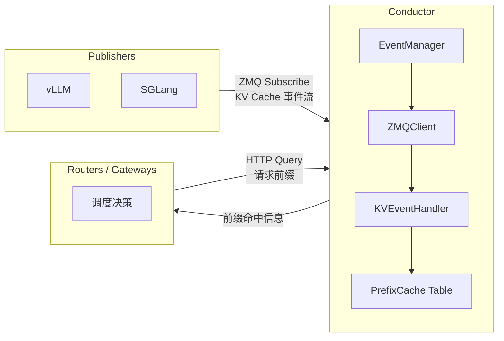

#### 2.7.2 核心组件 {#mooncake-7-2-核心组件}

**EventManager** — 拥有 Conductor 生命周期、HTTP 服务器、动态注册，维护活跃服务映射和租户-实例映射。

**ZMQClient** — 连接到 Publisher 端点，解码事件批次，追踪序列号，支持断线重连后请求重播。

**KVEventHandler** — 将引擎事件转换为 Conductor 的 store/remove 事件，注入注册元数据（model、LoRA、tenant、instance、block_size、salt）。

**PrefixCacheTable** — 维护模型上下文作用域的前缀映射、引擎-Conductor 哈希映射、介质元数据、DP Rank 元数据，在查询时执行命中计算。

#### 2.7.3 数据模型：ModelContext {#mooncake-7-3-数据模型modelcontext}

前缀索引的作用域由 **ModelContext** 确定：

```
(tenant_id, model_name, lora_name, block_size, additional_salt, instance_id)
```

在每个 Context 内，系统存储：
- 引擎块哈希 → Conductor 前缀哈希的映射
- 前缀哈希映射：副本计数 + 每实例访问元数据
- DP Rank 集合

**关键：** 查询时忽略尾部不完整块，仅使用由 token IDs 计算的完整块前缀哈希。

#### 2.7.4 事件流 {#mooncake-7-4-事件流}

1. 服务静态配置或通过 `POST /register` 动态注册
2. EventManager 为每个 `(instance_id, tenant_id, dp_rank)` 键创建一个 ZMQClient
3. ZMQClient 订阅并消费帧：`[topic, sequence, payload]`
4. Payload 解码为引擎事件批次（当前为 vLLM 的 `BlockStored` / `BlockRemoved` msgpack 格式）
5. KVEventHandler 注入注册元数据
6. PrefixCacheTable 更新前缀映射
7. 断线重连时，重播端点获取缺失序列号的事件

v0.3.12.post1 的 Master 可选启用 RFC #1527 KV event publisher，通过 ZMQ PUB 发出与 Conductor 三帧 batch 格式一致的事件。`enable_kv_events` 默认不改变 Store 数据路径；`kv_events_bind_endpoint`、`kv_events_backend_id`、`kv_events_emit_object_key` 和兼容字段必须与消费端约定一致。`instance_id` 是 Router 可选目标，`backend_id` 是持有 block 的事件实体，两者不能混用。

#### 2.7.5 查询流 {#mooncake-7-5-查询流}

1. Router 通过引擎的 tokenizer 端点获取 prompt token IDs
2. Router 调用 `POST /query`，参数包括 model、token_ids、block_size 和可选的 tenant/instance/lora/salt
3. Conductor 计算完整块前缀哈希
4. 前缀表按序扫描——**首次缺失即终止扫描**，保证前缀连续性
5. 返回每个实例的 `longest_matched`、介质命中计数和 DP Rank 命中计数
6. Router 选定最优目标实例并转发请求

---

### 2.8 HiCache — 与 SGLang 深度集成的分层 KV 缓存 {#mooncake-hicache--与-sglang-深度集成的分层-kv-缓存}

> HiCache 将 SGLang 的本地 GPU 缓存与 Mooncake 的分布式存储统一为三级缓存层次，对 Agentic Coding 等长上下文工作负载带来显著加速。

#### 2.8.1 三级缓存层次 {#mooncake-8-1-三级缓存层次}

类比 CPU 缓存设计：

| 层级 | 位置 | 特性 | 作用域 |
|------|------|------|--------|
| **L1** | GPU 显存 | 小、快 | 私有（每推理实例） |
| **L2** | 主机 CPU 内存 | 较大 | 私有（每推理实例） |
| **L3** | Mooncake 分布式存储 | 最大、共享 | 全局（集群内所有实例） |

#### 2.8.2 HiRadixTree {#mooncake-8-2-hiradixtree}

HiCache 基于 SGLang 的 RadixAttention RadixTree 构建 **HiRadixTree**：

- 每个节点映射到一段连续 token 的 KV Cache，并追踪存储位置（GPU / CPU / L3 / 多层）
- L1/L2 维护**精确元数据**（精确存储地址）
- L3 **不持续同步元数据**——而是实时查询后端获取数据存在性与位置

当 `page_size > 1` 时匹配使用页粒度；匹配停止于节点中间时，该节点**自动分裂**以创建精确边界。

#### 2.8.3 三大核心工作流 {#mooncake-8-3-三大核心工作流}

##### 2.8.3.1 本地匹配 {#mooncake-8-3-1-本地匹配}

1. 从根节点遍历 HiRadixTree，匹配 token 序列前缀
2. 结果产生一段连续前缀——前段在 L1，后段在 L2
3. **不发生任何数据拷贝**——仅通过元数据确定哪些 KV Cache 已在本地可用

##### 2.8.3.2 L3 预取 {#mooncake-8-3-2-l3-预取}

**触发条件：** 本地匹配后，未匹配部分的 L3 命中长度超过阈值（默认 256 tokens）

**前缀感知：** 预取部分构成完整连续前缀，重算部分构成完整连续后缀——简化后续计算阶段

**双线程流水线：**
- `prefetch_thread_func`：持续查询 L3 后端获取命中前缀长度
- `prefetch_io_aux_func`：将符合条件的请求提交给 L3 后端执行
- Mooncake 使用 **RDMA** 从多个远程存储节点并行读取

**三种终止策略：**

| 策略 | 行为 | 适用场景 |
|------|------|---------|
| `best_effort` | GPU 可执行 prefill 时立即终止 | 延迟敏感 |
| `wait_complete` | 等待所有预取完成 | 高命中率要求 |
| `timeout` | 超时或完成后终止 | 均衡 |

**动态超时公式：**
```
timeout = prefetch_timeout_base + prefetch_timeout_per_ki_token × num_token_to_fetch / 1024
```

##### 2.8.3.3 数据写回 {#mooncake-8-3-3-数据写回}

| 策略 | 行为 | 适用场景 |
|------|------|---------|
| `write_through` | 每次访问立即写下级 | 带宽充足，缓存一致性最强 |
| `write_through_selective` | 仅频率超阈值的热数据写回 | 减少 IO |
| `write_back` | 仅上层驱逐时写下级 | 内存受限，利用率最高 |

**异步并行实现：**
- L1→L2：`write_backup` 函数异步传输，不阻塞主调度
- L2→L3：任务放入 `backup_queue`，由独立 `backup_thread_func` 线程处理；Mooncake 通过 RDMA 并行完成传输

**跨实例共享：** 仅不在 Moonstore 中已有的数据才会被传输。存储的 KV Cache 在集群内所有 SGLang 实例间共享。

#### 2.8.4 数据传输优化 {#mooncake-8-4-数据传输优化}

**零拷贝 RDMA：** L2↔L3 全程零拷贝——HiCache 直接传递内存地址和大小，Mooncake 提供零拷贝 RDMA 读写接口。

**页粒度批量 IO：** 数据以 **page** 为粒度存储和传输，三种布局：
- `layer_first`：GPU 自然布局（逐层）
- `page_first`：同一页所有 KV 数据连续存放——支持单对象零拷贝传输到 L3
- `page_first_direct`：页内同层 token 分组——便于 L2→GPU 聚合传输

批量上限 128 页（经验值）；更大请求自动拆分，确保 `best_effort`/`timeout` 模式下已完成的批量数据可用。

**计算传输重叠：** Prefill 阶段，Layer N+1 的 KV Cache 加载与 Layer N 的计算并行——隐藏传输延迟。

**GPU 辅助 IO 内核：** 自定义 CUDA 内核（基于 `cudaMemcpyAsync`），实现 CPU↔GPU KV Cache 传输，**最高达 3 倍提速**。

#### 2.8.5 MLA 写回优化 {#mooncake-8-5-mla-写回优化}

在 MHA（Multi-Head Attention）+ TP 场景下，每个 Rank 持有单个 token 的 1/tp_size KV 数据。但在 **MLA**（Multi-Layer Attention）中，所有 Rank 持有相同的完整 KV 数据。HiCache 优化：**仅一个 Rank 发起写回**，避免冗余跨 Rank 存储。

#### 2.8.6 多 Rank 同步 {#mooncake-8-6-多-rank-同步}

在 Tensor Parallelism 下，HiCache 在关键点使用 `all_reduce(op=min)`：
- 预取期间：确保所有 Rank 对 L3 命中数达成一致（避免不一致的阈值判断）
- 预取后：保证所有 Rank 对成功获取的 KV Cache 前缀长度达成共识

#### 2.8.7 PD 分离集成 {#mooncake-8-7-pd-分离集成}

- **Prefill 节点：** 启用 HiCache 优化 prefill（长上下文和多轮对话场景）
- **Decode 节点：** 将计算结果写回 L3
- 单一 Mooncake 集群部署即可同时支撑全部特性

---

### 2.9 Mooncake EP — 专家并行通信运行时 {#mooncake-mooncake-ep--专家并行通信运行时}

> Mooncake EP 是用于 MoE Token Dispatch 和 Combine 的专家并行通信运行时，采用 DeepEP 的低延迟编程模型并增加了 Mooncake 传输层集成与 Rank 活跃度感知。

#### 2.9.1 MoE 推理三阶段流程 {#mooncake-9-1-moe-推理三阶段流程}

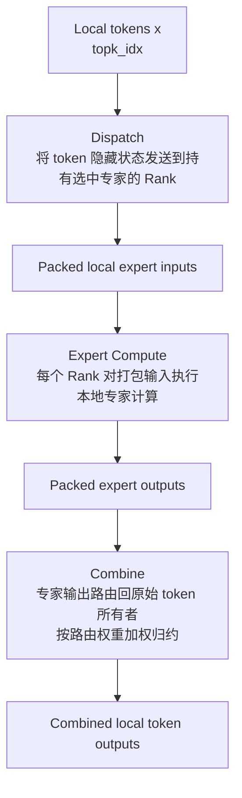

#### 2.9.2 运行时对象 {#mooncake-9-2-运行时对象}

**Python Wrapper** (`mooncake.mooncake_ep_buffer.Buffer`)
- 拥有 Process Group、Native EP Buffer 运行时、Fallback 标志和 Python 回退缓冲区

**Native Buffer** (`MooncakeEpBuffer`)
- 拥有或引用 Rank/World Size 元数据
- GDR 工作空间缓冲区
- P2P 和 RDMA 设备传输
- 通信流和 Dispatch/Combine 临时工作空间

**双缓冲布局：** 每对包含：
- RDMA Send Signal Buffer + RDMA Receive Signal Buffer
- RDMA Send Data Buffer + RDMA Receive Data Buffer

工作空间大小通过 `Buffer.get_ep_buffer_size_hint()` 获取，取决于 `num_max_dispatch_tokens_per_rank`、`hidden`、`num_ranks` 和 `num_experts`——**应以峰值 Dispatch 需求为准，而非平均请求量**。

#### 2.9.3 三条执行路径 {#mooncake-9-3-三条执行路径}

| 路径 | 条件 | 特点 |
|------|------|------|
| **IBGDA/RDMA 快速路径** | RDMA 环境 + 成功的元数据/QP 交换 | 跨节点 GPU 内存直传，最低延迟 |
| **P2P/IPC 快速路径** | 节点内 + Peer 可达 + IPC 句柄交换 | NVLink 直传，同节点最快 |
| **Python 回退** | 快速路径不可用 | PyTorch 集体通信，较慢，用于正确性验证 |

`Buffer.connect()` 的优先级：先尝试 RDMA/IBGDA → 再尝试 IPC 句柄 → 最终回退 PyTorch 集体通信。

#### 2.9.4 元数据交换 {#mooncake-9-4-元数据交换}

`connect()` 期间交换：
- RDMA 内存区域地址和密钥
- 本地 QP 编号
- LID/GID 信息
- 子网前缀和接口 ID
- CUDA IPC 句柄（本地对等访问）
- 当前活跃 Rank 掩码（来自 Backend）

交换基于 `dist.all_gather()` 和 `dist.all_to_all()`，需 Process Group 已初始化且健康。

#### 2.9.5 Dispatch 内部机制 {#mooncake-9-5-dispatch-内部机制}

**输入：**
- `x`: `[num_tokens, hidden]` token 隐藏状态
- `topk_idx`: `[num_tokens, top_k]` 全局专家 ID
- `active_ranks`: `[num_ranks]` int32 健康张量
- `num_max_dispatch_tokens_per_rank`: 每源 Rank 接收容量
- `num_experts`: 全局专家数，必须可被 `num_ranks` 整除
- `timeout_us`: 失败检测超时

**输出：**
- 打包的本池专家输入张量
- 每本池专家的接收计数
- 源/布局元数据 handle（供 `combine()` 消费）
- 事件/钩子同步辅助

**FP8 模式：** `use_fp8=True` 时，dispatch 返回打包的 FP8 数据 + FP32 缩放因子。专家代码需直接消费该格式或先反量化。

#### 2.9.6 Combine 内部机制 {#mooncake-9-6-combine-内部机制}

`combine()` 将本地专家输出发回 token 所有者 Rank 并应用路由权重。消费匹配 `dispatch()` 返回的 handle。

**零拷贝 Combine：**
1. 调用 `get_next_combine_buffer(handle)` 获取目标缓冲区
2. 将专家输出写入该缓冲区
3. 调用 `combine(..., zero_copy=True)`

Handle 不可跨不相关的 dispatch/combine 对复用。

#### 2.9.7 Rank 活跃度与超时 {#mooncake-9-7-rank-活跃度与超时}

EP 的 `active_ranks` 在 dispatch 和 combine 中均接收。原生内核轮询源 Rank 的接收信号：

- 若 `timeout_us ≠ -1` 且源 Rank 在超时前无法推进，**内核将 `active_ranks[src_rank] = 0` 并跳过该源**
- 此 EP 级张量与 Backend 级 active-rank 掩码相关但不自动一致——集成代码需一致传播健康更新

#### 2.9.8 流同步模型 {#mooncake-9-8-流同步模型}

EP 操作返回 `EventOverlap` 对象和可选钩子：

| 模式 | 用法 |
|------|------|
| 无 `return_recv_hook` | 调用 `event.current_stream_wait()` 后再使用输出 |
| `return_recv_hook=True` | 在选定重叠点调用返回的 `hook()` |
| `async_finish=True` | 封装器记录额外张量以安全管理异步生命周期 + CUDA Graph 场景 |

#### 2.9.9 恢复集成 {#mooncake-9-9-恢复集成}

Rank 故障时的四层更新：

1. **PG 活跃 Rank 状态** — 停止集体通信等待失败 Rank
2. **调度器/MoE 路由** — 停止向不可用专家分配 token
3. **替换 Rank** — 通过 PG 弹性协议加入
4. **EP Buffer** — PG 激活恢复 Rank 后调用 `update_ep_member()` 刷新对等元数据

---

### 2.10 Mooncake Backend (PG) — 容错分布式执行后端 {#mooncake-mooncake-backend-pg--容错分布式执行后端}

> Mooncake Backend 是一个 `torch.distributed` ProcessGroup 后端，提供集体通信、点对点通信、Rank 健康追踪和弹性恢复钩子，使推理系统在部分 Rank 故障后仍能继续服务。

#### 2.10.1 后端注册 {#mooncake-10-1-后端注册}

扩展模块导入时注册两个后端：
- **`mooncake-cpu`**：CPU 设备
- **`mooncake`**：加速器设备（CUDA 或 MUSA，取决于编译选项）

应用使用标准 PyTorch API：`dist.init_process_group()`, `dist.all_reduce()`, `dist.new_group()`, `dist.batch_isend_irecv()` 等。

#### 2.10.2 MooncakeBackendOptions {#mooncake-10-2-mooncakebackendoptions}

| 字段 | 用途 |
|------|------|
| `activeRanks_` | 健康张量，暴露给集体通信和用户代码。必须为 `torch.int32`，`mooncake-cpu` 在 CPU 上，`mooncake` 在加速器上 |
| `isExtension_` | 标识是否为加入/替换 Rank |
| `maxWorldSize_` | 可选预留容量；设此后 `activeRanks_` 必须匹配此大小 |

#### 2.10.3 Transfer Engine 集成 {#mooncake-10-3-transfer-engine-集成}

默认情况下 Backend 自己初始化 Transfer Engine。高级集成可在 `init_process_group()` 前通过 `pg.set_transfer_engine(engine)` 注入外部引擎，此时调用方拥有引擎所有权并须保证其生命周期。

#### 2.10.4 初始化生命周期 {#mooncake-10-4-初始化生命周期}

```
Python导入mooncake.pg → 加载原生扩展 → 注册mooncake/mooncake-cpu
  → dist.init_process_group() → 调用后端工厂 → 活跃Rank掩码初始化
  → 非扩展Rank: 发布本地对等元数据，等待连接
  → 扩展Rank: 进入local-only模式，等待join协议
```

**关键：** `max_world_size` 预留容量不会自动激活新 Rank。新 Rank 被掩码排除直到 `recover_ranks()` 激活。

#### 2.10.5 size 与 activeSize 的区别 {#mooncake-10-5-size-与-activesize-的区别}

| 概念 | 含义 |
|------|------|
| `size` | 预留容量（含不活跃槽位） |
| `activeSize` | 可见活跃组大小，`dist.get_world_size()` 返回此值 |

`max_world_size` 使 `size` 可大于 `activeSize`；不活跃槽位被掩码排除。

#### 2.10.6 两阶段弹性恢复协议 {#mooncake-10-6-两阶段弹性恢复协议}

**健康 Rank 职责：**
1. 通过 `max_world_size` 或 `extend_group_size_to()` 预留容量
2. 一致调用 `get_peer_state(backend, ranks)》` 轮询
3. 候选连通后调用 `recover_ranks(backend, ranks)》` 激活
4. 刷新高层组件（如 EP Buffer 的传输元数据）

**加入 Rank 职责：**
1. 以 `is_extension=True` 初始化
2. 通过后端 init 路径发布本地对等元数据
3. 调用 `join_group(backend)`，阻塞直到健康 Rank 发布扩展状态
4. `join_group()` 返回后重入正常集体通信

#### 2.10.7 集合通信行为 {#mooncake-10-7-集合通信行为}

| 操作 | 状态 |
|------|------|
| all-reduce, broadcast, all-gather, reduce-scatter, all-to-all | ✓ 已实现 |
| barrier, reduce, gather, scatter | ✓ 已实现 |
| P2P send/recv (via shim) | ✓ 已实现 |

**关键行为：** 活跃 Rank 参与，非活跃 Rank 被跳过。通信故障将更新 active-rank 状态。

**恢复边界：** PG 仅暴露低层恢复原语——上层系统负责替换策略、路由停止、模型状态重建等决策。`recover_ranks()` 不重建高层状态（模型权重、KV Cache、路由策略等）。

---

### 2.11 P2P Store — 去中心化检查点分发引擎 {#mooncake-p2p-store--去中心化检查点分发引擎}

> P2P Store 基于 Transfer Engine 构建，实现了 BitTorrent 式的去中心化文件分发。2025 年 9 月以 "checkpoint-engine" 名义开源。

#### 2.11.1 设计动机 {#mooncake-11-1-设计动机}

分布式训练中检查点分发的瓶颈在于中心化源站的出站带宽饱和。当数千个 GPU 同时拉取同一个检查点时，单一源节点无法承受。

Mooncake 在 K1.5 和 K2 训练中的应用结果：**1 万亿参数模型在数千 GPU 间约 20 秒完成分发**。分布式 RL 权重同步场景下，Kimi-K2 的 1T 参数模型更新实现 **7 倍提速**。

#### 2.11.2 BitTorrent 式架构 {#mooncake-11-2-bittorrent-式架构}

**无中心化 Master：** 全局元数据由外部元数据服务（etcd）维护。

核心语义直接类比 BitTorrent：

| BitTorrent | P2P Store | 说明 |
|------------|-----------|------|
| 做种（Seeding） | `Register` | 本地文件注册到全局元数据，**不发生任何数据传输** |
| 下载（Leeching） | `GetReplica` | 搜索元数据并从已有节点克隆数据 |
| — | 自动反馈 | 拉取数据的节点**本身也成为数据源**（除非 `Unregister` 或 `DeleteReplica》） |

节点越多，聚合上传带宽越大，防止单一源节点成为瓶颈。

#### 2.11.3 核心 API {#mooncake-11-3-核心-api}

| API | 用途 |
|-----|------|
| `NewP2PStore(metadataUri, localSegmentName)` | 创建实例，内部启动 Transfer Engine |
| `Register(name, addrList, sizeList, maxShardSize, location)` | 注册本地内存范围供对等下载。建议 64MB 分片粒度 |
| `GetReplica(name, addrList, sizeList)` | 拉取副本到本地内存 |
| `Unregister(name)` | 移除注册，释放内存 |
| `DeleteReplica(name)` | 停止向对等提供该文件 |
| `List(namePrefix)` | 枚举已注册文件 |

#### 2.11.4 RDMA 分片传输 {#mooncake-11-4-rdma-分片传输}

- 推荐 64MB 分片大小——在并行度与调度开销间取得平衡
- 不同分片可从不同源节点并行拉取
- 当前仅支持 RDMA 协议

#### 2.11.5 典型工作流 {#mooncake-11-5-典型工作流}

```
训练节点:  Register("k2-checkpoint-42", addr, size, 64MB, location)
           → 仅元数据注册，零数据传输

推理节点1: GetReplica("k2-checkpoint-42", addr, size)
           → 从训练节点拉取数据

推理节点2: GetReplica("k2-checkpoint-42", addr, size)
           → 从训练节点 + 推理节点1 并行拉取

推理节点3: GetReplica("k2-checkpoint-42", addr, size)
           → 从训练节点 + 推理节点1 + 推理节点2 并行拉取
           → 聚合带宽持续增长
```

---

### 2.12 EngramStore 后端 — 嵌入表存储 {#mooncake-engramstore-后端--嵌入表存储}

> EngramStore 展示了 Mooncake Store 接口向不同数据类型（嵌入表）的扩展。

#### 2.12.1 定位与边界 {#mooncake-12-1-定位与边界}

**极窄的职责：** 上传一张表、按行 ID 检索。Mooncake **不负责** tokenizer 压缩、N-gram 哈希、查询逻辑——这些由调用方实现。

#### 2.12.2 配置 {#mooncake-12-2-配置}

```python
EngramStoreConfig(
    table_vocab_sizes=[N_0, N_1, ..., N_{H-1}],  # 每头表的行数
    embedding_dim=D                                 # 行宽
)
```

Store 键模式：`engram:l{layer_id}:h{head_idx}`，每个键存储 `float32` 形状 `[N_h, D]` 的表。

#### 2.12.3 Populate 流程 {#mooncake-12-3-populate-流程}

1. 验证每个 head 提供一张表且形状为 `[N_h, D]`
2. 验证目标 head 表键不存在
3. 注册每个嵌入表缓冲区
4. 通过 `batch_put_from(...)` 上传所有 head 表
5. 注销暂存缓冲区

**严格仅创建语义：** 复用 `layer_id` 必须先调用 `remove_from_store(...)`。失败时最佳努力清理已写入的键。

#### 2.12.4 Lookup 流程 {#mooncake-12-4-lookup-流程}

1. 验证 `row_ids` 形状与边界
2. 为请求的行构建字节范围
3. 通过 `get_into_ranges(...)` 一次性物化行到输出缓冲区

NumPy 连续输入可直接从张量构建范围（免转换快速路径）。

#### 2.12.5 数据契约 {#mooncake-12-5-数据契约}

| 方向 | 形状 | 类型 |
|------|------|------|
| Populate 输入 | `[N_h, D]`（每头一张） | float32 |
| Lookup 输入 | `[B, L, H]` | int64 |
| Lookup 输出 | `[B, L, H, D]` | float32 |

---

### 2.13 统一并行张量 IO {#mooncake-统一并行张量-io}

> 设计目标：成为 Mooncake 下一代张量 IO API 的**唯一真相来源**，防止漂移为并行方式特定的接口。

#### 2.13.1 问题：API 膨胀的危机 {#mooncake-13-1-问题api-膨胀的危机}

随着 Mooncake 支持的并行方式增多，接口呈组合爆炸：
- `*_with_tp` / `*_with_ep` / `*_with_pp` / `*_with_dp`...
- `kind="mixed"` 的模糊语义

#### 2.13.2 核心模型：并行即轴列表 {#mooncake-13-2-核心模型并行即轴列表}

**ParallelAxis**：每个轴持有 `kind`（tp/dp/ep/pp）、`rank`、`size`，以及可选字段如 `split_dim`、`expert_id`、`stage_id`。

**TensorParallelism**：包含 `axes: list[ParallelAxis]`。

单轴场景纯 TP 或纯 EP 仅是列表长度为一的特例。多轴场景——如 `[DP, PP, EP, TP]`——自然而直接地表达。

**关键区分：** TP 和 EP"直接影响张量的物理布局"；PP 和 DP 更像"所有权或作用域标签"，可能不改变本地分片的字节布局。

#### 2.13.3 写入侧统一 {#mooncake-13-3-写入侧统一}

一个 API 族覆盖所有写场景：`put_tensor_with_parallelism` / `upsert_tensor_with_parallelism` + 批量变体。

`parallelism` 参数编码被存储对象的身份，而非要求每种并行方式不同方法名。

| 调用者持有 | 想要存储 | 所需 parallelism |
|-----------|---------|-----------------|
| 全量张量 | 全量张量 | `None` |
| 全量张量 | TP 分片 | `axes=[TP(rank,size,split_dim)]` |
| 全量张量 | EP 分片 | `axes=[EP(rank,size,expert_id)]` |
| 全量张量 | 组合分片 | 显式轴列表，如 `[PP(...), TP(...)]` |
| 分片张量 | 分片对象 | 描述该分片身份的轴列表 |

对于含 TP 的多轴布局，"调用者可以传入完整源张量，提供的 TP rank/layout 让 Mooncake 知道该均匀分片物化并持久化哪个分片"——无需调用者预先拆分。

#### 2.13.4 读取侧统一：ReadTarget {#mooncake-13-4-读取侧统一readtarget}

读取需要显式 `ReadTarget`，因为单凭 parallelism 有歧义：

| mode | 含义 |
|------|------|
| `as_stored` | 返回存储时的本地对象 |
| `shard` | 返回指定 parallelism 坐标的目标分片 |
| `full` | 从存储分片重建全量张量 |

**为什么必需？** 若张量以 TP 分片存储，仅凭 TP 坐标无法区分：要本地存储分片？其他分片？还是重建全量？

#### 2.13.5 源-目标布局矩阵 {#mooncake-13-5-源-目标布局矩阵}

| 源→目标 | 说明 |
|---------|------|
| TP→TP / EP→EP | 直接获取快速路径 |
| TP→full / EP→full | 从分片重建 |
| TP→EP / mixed→TP | 规划器驱动重映射 |

这些组合**不得造成公共 API 爆炸**——统一接口签名覆盖所有情况，内部通过规划器降级到 `get_into_ranges`。

#### 2.13.6 兼容性封装 {#mooncake-13-6-兼容性封装}

现有 TP 方法通过统一路径降级执行，保持接口稳定，但不再作为主要扩展方向。"薄兼容封装"。

---

### 2.14 过载调度 — 预测性早期拒绝 {#mooncake-过载调度--预测性早期拒绝}

> 回到论文的核心调度创新——如何在过载时保护系统 SLO。

#### 2.14.1 尽力服务的陷阱 {#mooncake-14-1-尽力服务的陷阱}

传统系统在过载时采用"尽力服务"策略：接受所有请求，按到达顺序处理。后果是所有请求的延迟同时劣化——TTFT 和 TPOT 全面超出 SLO。更严重的是，已经在 Prefill 阶段消耗的 GPU 计算资源完全无法回收，形成了纯粹的计算浪费。

#### 2.14.2 朴素早期拒绝与反相波动 {#mooncake-14-2-朴素早期拒绝与反相波动}

最直觉的改进是在检测到过载时拒绝新请求。但朴素拒绝导致严重的负载振荡：

1. 系统过载 → 大量拒绝
2. 被拒绝请求消失 → 队列迅速清空
3. 队列空 → 系统接受大量新请求
4. 大量涌入 → 再次过载 → 再次拒绝

这种"反相波动"使负载曲线剧烈震荡，被拒绝的请求总数反而更多——论文实验显示朴素拒绝导致 4183 个请求被拒。

#### 2.14.3 基于预测的早期拒绝 {#mooncake-14-3-基于预测的早期拒绝}

Mooncake 的解决方案是**预测性早期拒绝**：

1. **系统级负载预测**：基于当前系统状态（排队深度、活跃请求数、各节点负载）建立负载预测模型
2. **SLO 违规预判**：在请求尚未进入 Prefill 之前，预测其完成时间是否可能超出 SLO
3. **提前拒绝**：只对很可能违反 SLO 的请求执行拒绝，将其余请求正常调度

**效果验证：**
- 被拒绝请求数从 4183 降至 3589（减少 14.2%）
- TTFT 和 TPOT 的 SLO 达标率显著提升

核心思想转变：**不是"能服务就服务"，而是"不能按时完成就尽早拒绝"**——把资源留给能按时完成的请求。

---

### 2.15 Prefill 池优化 {#mooncake-prefill-池优化}

#### 2.15.1 多节点 Prefill：分块流水线并行 (Chunked Pipeline Parallelism) {#mooncake-15-1-多节点-prefill分块流水线并行-chunked-pipeline-parallelism}

对于超出单节点 GPU 显存容量的超长上下文，Mooncake 采用分块流水线并行（CPP）替代序列并行（Sequence Parallelism）：

- **CPP 的优势**：减少网络通信量（仅需发送激活值而非完整 KV Cache），简化弹性扩展逻辑
- **流水线并行在 Prefill 阶段的天然适配**：Prefill 本身具有逐层处理的流水线特性，与流水线并行的计算模式完美匹配

#### 2.15.2 层级 Prefill：计算与传输重叠 {#mooncake-15-2-层级-prefill计算与传输重叠}

在 Prefill 过程中，逐层将生成的 KV Cache 传输到目标 Decode 节点：

- **重叠机制**：计算 Layer N 的 Prefill 时，并行传输 Layer N-1 的 KV Cache
- **VRAM 占用降低**：由于传输与计算重叠，KV Cache 不需要在 VRAM 中完整缓存
- **调度简化**：启用层级 Prefill 后，调度器可以忽略 VRAM 容量约束——每层的 KV Cache 在计算完即刻传输出去

#### 2.15.3 与调度器的协同 {#mooncake-15-3-与调度器的协同}

层级 Prefill 消除了 VRAM 容量作为调度约束的必要性：

- 传统模式下，调度器必须确保目标 Decode 节点有足够 VRAM 存放完整 KV Cache
- 层级 Prefill 模式下，KV Cache 边计算边传输，调度决策简化为仅考虑计算资源和网络带宽

---

### 2.16 集成生态 {#mooncake-集成生态}

#### 2.16.1 框架集成矩阵 {#mooncake-16-1-框架集成矩阵}

| 框架 | 集成功能 |
|------|---------|
| **SGLang** | PD 分离（Transfer Engine）/ HiCache 分层缓存 / EPD 分离 / 编码器全局缓存 / RDMA P2P 权重传输（Kimi-K2 7x 提速） |
| **vLLM** | MooncakeStoreConnector（分布式 KV 缓存池）/ MooncakeTransferEngineConnector（PD 分离）/ vLLM-Omni 阶段通信 |
| **TensorRT-LLM** | PD 分离 KV Cache 传输 |
| **LMCache** | 远端连接器（支持 Mooncake Store） |
| **LMDeploy** | PD 分离后端 |
| **NIXL** | 后端插件 |
| **vLLM-Ascend** | KV Cache 注册与分离式 Prefill |
| **FlexKV** | 分布式 KV Cache 复用 |
| **TorchSpec** | 推理/训练解耦（隐藏状态管理） |
| **ROLL** | 分布式 RL 协作 |
| **LightX2V** | 编码器/变换器分离部署 |
| **xLLM** | 混合 KV 缓存管理与智能卸载/预取 |
| **llm-d** | vLLM KV offload tier 已有固定 release 示例；Mooncake P/D connector sidecar 能力已发布，但部署 overlay 仍需适配 |

v0.3.12.post1 的 Kubernetes Deployment Guide 覆盖共享 Store、Transfer Engine、SGLang P/D/HiCache、RBG 与 llm-d。指南中的 P2P handshake 适合起步；生产集群要显式固定 DaemonSet/Deployment 拓扑、host networking、RDMA device、HugeTLB、PVC/SSD 和 metadata backend。文档存在集成说明不等于目标发行版提供完整一键安装路径。

#### 2.16.2 多硬件生态 {#mooncake-16-2-多硬件生态}

Mooncake 已适配以下硬件平台：

- NVIDIA GPU（全系列支持）
- 华为昇腾（vLLM-Ascend 集成）
- AMD GPU（HIP 传输后端）
- 寒武纪 MLU
- 摩尔线程 MTT
- AWS（EFA 传输后端）
- MetaX GPU
- 平头哥
- 阿里云
- 算能
- 海光 DCU

2026 年 2 月正式加入 **PyTorch 生态**。

---

### 2.17 性能基准与生产实践 {#mooncake-性能基准与生产实践}

#### 2.17.1 Transfer Engine 性能 {#mooncake-17-1-transfer-engine-性能}

| 场景 | 数据 |
|------|------|
| RDMA vs TCP | 2.4× 和 4.6× 提速 |
| 4×200 Gbps | 87 GB/s 聚合带宽 |
| 8×400 Gbps | 190 GB/s 聚合带宽 |

#### 2.17.2 端到端推理性能 {#mooncake-17-2-端到端推理性能}

| 场景 | 结果 |
|------|------|
| 公开数据集 | 20-40% 吞吐提升 |
| 模拟长上下文 | **525% 吞吐提升** |
| 真实生产负载 | **75% 更多请求** |

#### 2.17.3 Kimi K2 生产部署 {#mooncake-17-3-kimi-k2-生产部署}

128 张 H200 GPU 部署，PD 分离 + 大规模专家并行：
- Prefill 吞吐：**224k tokens/sec**
- Decode 吞吐：**288k tokens/sec**

#### 2.17.4 P2P Store 性能 {#mooncake-17-4-p2p-store-性能}

| 场景 | 结果 |
|------|------|
| K1.5/K2 检查点分发 | 1T 参数约 20 秒 |
| Kimi-K2 RL 权重同步 | **7× 提速** |

#### 2.17.5 HiCache 性能 {#mooncake-17-5-hicache-性能}

- GPU 辅助 IO 内核：较 `cudaMemcpyAsync` 基线 **最高 3× 传输提速**
- 计算传输重叠：有效隐藏 L2↔L3 传输延迟

---

### 2.18 总结与未来方向 {#mooncake-总结与未来方向}

#### 2.18.1 核心设计原则回顾 {#mooncake-18-1-核心设计原则回顾}

| 原则 | 体现 |
|------|------|
| **KVCache 中心** | 围绕数据的存储和复用重构系统，而非围绕 GPU 计算 |
| **分离架构** | Prefill/Decode/缓存池解耦，各自独立扩展优化 |
| **分层缓存** | 借鉴 CPU 缓存智慧，L1/L2/L3 私有→共享递进 |
| **零拷贝传输** | RDMA 作为性能基石，消除不必要的内存拷贝 |
| **预测性调度** | 从尽力服务到智能拒绝，确保 SLO 承诺 |
| **弹性容错** | PG 级 Rank 健康追踪 + 弹性恢复，规模下优雅处理部分故障 |
| **接口统一** | ParallelAxis + ReadTarget 统一并行张量 IO，遏制 API 膨胀 |

#### 2.18.2 开放问题与演进方向 {#mooncake-18-2-开放问题与演进方向}

1. **更智能的缓存策略** — 当前近似 LRU 是保守选择，基于请求模式的学习型替换策略可能带来显著收益
2. **CXL 内存深度集成** — `cxl` 分配策略已实现基础支持，但 CXL 硬件的性能特性尚未完全利用
3. **跨数据中心 KV Cache 迁移** — 当前假设同数据中心，跨 DC 场景的延迟和一致性挑战尚未解决
4. **从缓存共享到计算卸载** — 未来可能将部分计算（如 prefix prefill）卸载到缓存池节点
5. **TENT 的成熟与全面替代** — 经典 TE 向 TENT 的迁移是一个渐进过程，需要更多生产验证

#### 2.18.3 社区与开源 {#mooncake-18-3-社区与开源}

- GitHub 仓库：https://github.com/kvcache-ai/Mooncake
- 开源追踪数据集（KV Cache 复用分析）：`FAST25-release/traces/` 目录
- 贡献指南与治理模型：官方文档 Community 章节
- 学术合作：ROLL 论文 (arxiv:2512.22560)

---

### 2.19 附录 {#mooncake-附录}

#### 2.19.1 附录 A：Mooncake Store Master 启动参数速查 {#mooncake-附录-amooncake-store-master-启动参数速查}

<details markdown="1">
<summary>展开完整参数表</summary>

##### 2.19.1.1 RPC 参数 {#mooncake-rpc-参数}
| 参数 | 默认值 | 说明 |
|------|-------|------|
| `--rpc_port` | 0→50051 | RPC 监听端口 |
| `--rpc_thread_num` | 0→min(4, CPU) | 工作线程数 |
| `--rpc_address` | 0.0.0.0 | 绑定地址 |
| `--rpc_interface` | 空 | 从网络接口解析地址 |
| `--rpc_conn_timeout_seconds` | 0 | 空闲连接超时（0=禁用） |
| `--rpc_enable_tcp_no_delay` | true | TCP_NODELAY |

##### 2.19.1.2 元数据服务 {#mooncake-元数据服务}
| 参数 | 默认值 | 说明 |
|------|-------|------|
| `--enable_http_metadata_server` | false | 启用内置 HTTP 元数据服务 |
| `--http_metadata_server_host` | 0.0.0.0 | |
| `--http_metadata_server_port` | 8080 | |

##### 2.19.1.3 内存与分配 {#mooncake-内存与分配}
| 参数 | 默认值 | 说明 |
|------|-------|------|
| `--memory_allocator` | offset | offset（推荐）或 cachelib |
| `--allocation_strategy` | random | random/free_ratio_first/ssd_free_ratio_first/cxl/local_first |

##### 2.19.1.4 过载与 TTL {#mooncake-过载与-ttl}
| 参数 | 默认值 | 说明 |
|------|-------|------|
| `--default_kv_lease_ttl` | 10000ms | |
| `--default_kv_soft_pin_ttl` | 1800000ms（30min） | |
| `--allow_evict_soft_pinned_objects` | true | |
| `--eviction_ratio` | 0.05 | |
| `--eviction_high_watermark_ratio` | 0.90 | |

##### 2.19.1.5 租户配额 {#mooncake-租户配额}
| 参数 | 默认值 | 说明 |
|------|-------|------|
| `--enable_multi_tenants` | false | |
| `--tenant_quota_connector_type` | file | |
| `--tenant_quota_connector_uri` | 空 | YAML 策略路径 |

##### 2.19.1.6 高可用 {#mooncake-高可用}
| 参数 | 默认值 | 说明 |
|------|-------|------|
| `--enable_ha` | false | |
| `--ha_backend_type` | etcd | etcd/redis/k8s |
| `--cluster_id` | mooncake_cluster | |

##### 2.19.1.7 分层存储 {#mooncake-分层存储}
| 参数 | 默认值 | 说明 |
|------|-------|------|
| `--enable_offload` | false | |
| `--offload_on_evict` | false | |
| `--promotion_on_hit` | false | |
| `--promotion_admission_threshold` | 2 | |
| `--root_fs_dir` | 空 | DFS 挂载目录 |
| `--enable_cxl` | false | |
| `--cxl_path` | /dev/dax0.0 | |
| `--cxl_size` | 8589934592 | |

</details>

#### 2.19.2 附录 B：Transfer Engine 关键环境变量 {#mooncake-附录-btransfer-engine-关键环境变量}

| 变量 | 用途 | 默认值 |
|------|------|-------|
| `MC_NUM_QP_PER_EP` | 每端点 QP 数 | 2 |
| `MC_MAX_EP_PER_CTX` | 每设备最大端点 | 65536 |
| `MC_SLICE_SIZE` | 请求分片粒度 | — |
| `MC_MTU` | MTU（512/1024/2048/4096） | 4096 |
| `MC_IB_TC` | RDMA Traffic Class | -1 |
| `MC_IB_SL` | IB Service Level | -1 |
| `MC_GID_INDEX` | GID 索引 | 3 |
| `MC_LOG_LEVEL` | 日志级别 | — |
| `MC_ENDPOINT_STORE_TYPE` | SIEVE 或 FIFO | SIEVE |
| `MC_TCP_SLICE_SIZE` | TCP 分片粒度 | 65536 |
| `MC_ENABLE_DEST_DEVICE_AFFINITY` | Rail-Optimized 同名 NIC 优先 | false |
| `MC_ENABLE_PARALLEL_REG_MR` | 并行 MR 注册 | -1(auto) |

#### 2.19.3 附录 C：客户端三种配置方式对比 {#mooncake-附录-c客户端三种配置方式对比}

| 方式 | 优点 | 缺点 |
|------|------|------|
| 编程 setup() | 类型安全、IDE 友好 | 代码耦合 |
| MOONCAKE_* 环境变量 | 零代码、运维友好 | 需记忆变量名 |
| mooncake_client 独立进程 | 进程完全隔离 | 多一次 RPC 开销 |

#### 2.19.4 附录 D：故障排查要点 {#mooncake-附录-d故障排查要点}

| 症状 | 可能原因 | 排查方向 |
|------|---------|---------|
| PutStart 失败 | 内存不足/超限 | 检查 `--eviction_high_watermark_ratio`，查看 `/metrics/summary` |
| 传输超时 | RDMA 连接异常 | 检查 `MC_LOG_LEVEL=TRACE`，验证 NIC 状态 `ibstat` |
| 僵尸对象堆积 | Client 崩溃残留 | 检查 `--put_start_discard_timeout_sec` 和 `--put_start_release_timeout_sec` |
| EP Dispatch 超时 | Rank 不活跃 | 检查 `active_ranks` 张量一致性，确认 PG 健康状态 |
| SSD 容量倾斜 | 分配策略不当 | 切换至 `--allocation_strategy=ssd_free_ratio_first` |
| Conductor 查询命中率低 | 事件断流 | 检查 ZMQ 连接、序列号连续性、Publisher 健康状态 |

---

> **文档版本**：基于 Mooncake `v0.3.13.post1@719735896c86b56fabec6cf3e825fb2ea640597a` 与该版本官方文档审校，2026-09-26
>
> **项目源码**：https://github.com/kvcache-ai/Mooncake/tree/719735896c86b56fabec6cf3e825fb2ea640597a
>
> **Release Notes**：https://github.com/kvcache-ai/Mooncake/releases/tag/v0.3.13.post1 | [v0.3.13 完整运行时增量](https://github.com/kvcache-ai/Mooncake/releases/tag/v0.3.13) | [固定 compare](https://github.com/kvcache-ai/Mooncake/compare/v0.3.12.post1...v0.3.13.post1)
>
> **固定文档证据**：[Store Deployment](https://github.com/kvcache-ai/Mooncake/blob/719735896c86b56fabec6cf3e825fb2ea640597a/docs/source/deployment/mooncake-store-deployment-guide.md) | [SSD Offload](https://github.com/kvcache-ai/Mooncake/blob/719735896c86b56fabec6cf3e825fb2ea640597a/docs/source/deployment/ssd/ssd-offload.md) | [NVMe KV](https://github.com/kvcache-ai/Mooncake/blob/719735896c86b56fabec6cf3e825fb2ea640597a/docs/source/deployment/ssd/nvme-kv.md) | [Multi-tenancy](https://github.com/kvcache-ai/Mooncake/blob/719735896c86b56fabec6cf3e825fb2ea640597a/docs/source/deployment/multi-tenancy.md) | [DataProto Structured Object](https://github.com/kvcache-ai/Mooncake/blob/719735896c86b56fabec6cf3e825fb2ea640597a/docs/source/api-reference/python/dataproto-structured-object-transfer.md)
>
> **滚动官方文档**：https://kvcache-ai.github.io/Mooncake/
## 第3篇：Dynamo {#dynamo}


> **面向数据中心级 LLM 推理的编排、路由、KV 缓存与弹性伸缩架构解析**
>
> 基于 Dynamo 官方仓库与文档整理：<https://github.com/ai-dynamo/dynamo>
>
> 稳定版本基线：`v1.5.0@b83b1d9304ebfc624709ac46db32b1b6f1ff1615`；ModelExpress 章节固定到其独立稳定版 `v0.6.0@e91f650aa6a1847959e7f7da1b39c19e16b312e3`；审校日期：2026-09-26。两个 tag 均为 lightweight tag，所列 commit 是 tag 直接指向的源码提交。未发布主线能力会单独标注，不计入对应版本的兼容承诺。

---

### 3.1 Dynamo 的定位 {#dynamo-dynamo-的定位}

#### 3.1.1 Dynamo 是什么 {#dynamo-1-1-dynamo-是什么}

Dynamo 是一个开源的、面向数据中心规模的推理栈。它的核心定位不是替代 vLLM、SGLang 或 TensorRT-LLM，而是在这些推理引擎之上提供一个分布式编排层，把多个 GPU、多个节点、多个推理阶段组织成一个可路由、可缓存、可扩缩、可观测的推理系统。

用一句话概括：

> **推理引擎负责“怎么在一组 GPU 上执行模型”；Dynamo 负责“怎么把很多推理引擎实例组织成稳定、高效、可扩展的服务”。**

Dynamo 官方 README 对其定位非常明确：它是 inference engines 上方的 orchestration layer。它不会让 vLLM/SGLang/TRT-LLM 失去价值，而是把这些引擎连接成一个多节点系统，并在上层加入：

| 能力 | 解决的问题 |
|------|------------|
| Disaggregated Serving | Prefill 与 Decode 资源特征不同，需要分池扩缩 |
| KV-Aware Routing | 避免重复 Prefill，提升 TTFT 与吞吐 |
| KVBM | 将 KV Cache 扩展到 GPU、Host、SSD、远端存储 |
| Planner | 用 LLM 特定指标做弹性伸缩，而不是只看 CPU/QPS |
| Operator / CRDs | 在 Kubernetes 中声明式部署推理图 |
| NIXL | 为 KV 传输、远端内存访问、存储读写提供高速数据移动层 |

#### 3.1.2 什么时候应该用 Dynamo {#dynamo-1-2-什么时候应该用-dynamo}

Dynamo 适合以下场景：

| 场景 | 为什么 Dynamo 有价值 |
|------|----------------------|
| 多 GPU 或多节点服务 | 需要服务发现、路由、组件编排、跨节点 KV 传输 |
| 长上下文或多轮会话 | KV Cache 复用和分层存储可以减少重复计算 |
| Prefill/Decode 压力不均 | 可以把 Prefill 和 Decode 拆成独立 worker 池 |
| 多租户或突发流量 | Planner 可以用 TTFT/ITL/SLA 目标调节副本 |
| 生产 Kubernetes 集群 | Operator、DGD、DGDR、Gateway API 集成降低部署复杂度 |
| 需要快速扩容和冷启动优化 | ModelExpress、Checkpoint、Grove 等生态能力可以配合使用 |

如果只是单机、单模型、单 GPU 的轻量推理，直接使用 vLLM/SGLang/TRT-LLM 通常更简单。Dynamo 的收益来自分布式协调、缓存复用和生产控制面能力，单点小规模场景未必值得引入。

#### 3.1.3 Dynamo 解决的核心矛盾 {#dynamo-1-3-dynamo-解决的核心矛盾}

P/D 资源画像、缓存复用与指标口径见[公共概念](#inference-concepts)。Dynamo 通过 CRD、Operator、健康检查、滚动更新和伸缩接口管理多 worker 生命周期，具体实现见本篇后续章节。

#### 3.1.4 设计目标 {#dynamo-1-4-设计目标}

官方架构文档把 Dynamo 的目标归纳为五类：

| 目标 | 解释 |
|------|------|
| Latency stability | 在突发流量、混合长度请求下维持 TTFT 和 ITL 稳定 |
| GPU efficiency | 分离 Prefill/Decode，让不同阶段独立扩缩 |
| Compute reuse | 通过 KV-aware routing 和缓存生命周期管理减少重复 Prefill |
| Operational resilience | 把 worker 崩溃、重启、过载视为常态并自动恢复 |
| Deployment portability | 同时支持 Kubernetes-native 和非 Kubernetes 运行方式 |

#### 3.1.5 v1.3.0 与 v1.4.0 稳定版增量 {#dynamo-1-5-v1-3-0-与-v1-4-0-稳定版增量}

`v1.3.0` 相对 `v1.2.1` 不是单纯的依赖刷新，而是同时扩展 Router、Planner、Kubernetes 控制面、强化学习和多模态路径。下表只列入 tag 内已经发布的能力：

| 领域 | v1.3.0 已发布变化 | 生产含义 |
|------|------------------|----------|
| Router | 独立 slot/selection service、Branch-Sharded KV Indexer、压缩 radix tree 热路径、拓扑感知 KV transfer、trajectory 路由和严格优先级队列 | 路由可与引擎独立扩展；大规模部署需同时治理 index shard、worker/DP rank 和拓扑元数据 |
| Planner / 仿真 | AIConfigurator（AIC）延迟预测、MTP accept-length 修正、SLA target 指标、Mooncake trace capture/replay、KVBM offload simulation | 先用真实流量回放和 AIC 校准部署，再让 Planner 执行扩缩；不能把未校准仿真结果直接当容量承诺 |
| Kubernetes | GMS 权重共享与 checkpoint/restore、DGD `v1beta1` admission webhook、agentgateway、Grove 和 DRA | GMS 依赖稳定 `resource.k8s.io/v1`，集群版本和 GPU/DRA 驱动成为明确前置条件 |
| RL / Agent | Tokens-in-Tokens-Out（TITO）、原地权重更新、worker discovery、rollout metadata、trajectory headers | 可避免 RL loop 的重复 detokenize/retokenize；该路径通过 `DYN_ENABLE_RL` 显式启用 |
| 多模态 | media-aware KV routing、SGLang 图像/视频 P/D 分离、统一 diffusion backend | 多模态 worker 必须显式启用，媒体 URL、格式和 encoder-to-prefill 契约需要单独验证 |

`v1.4.0` 在 v1.3.x 的基础上合并了 Router、Frontend、Planner、Operator 和多模态路径的大量稳定修复，并继续保留 CUDA 13 镜像约束。SGLang EFA 的 `nixl==1.3.2` / `nixl-cu13==1.3.2` wheel、三种 `-efa` runtime image 的 EFA Installer `1.49.0`（stock libfabric `2.4.0amzn5.0`）仍只属于对应 EFA 镜像；不能把该 NIXL 版本推断为所有 runtime 的统一依赖。

补丁并未消除所有 EFA 风险。release notes 仍记录两类会表现为空 HTTP 200、零 completion token 的问题：LIBFABRIC backend 可能在约 300 秒后发生无错误、无丢包计数的间歇性 stall；只申请节点部分 EFA device 时，Kubernetes 的 GPU 与 EFA 独立 device plugin 可能分配到不同 PCIe switch，约 10 到 20 秒后由 decode worker 报 `Lost connection with prefill instance`。前者等待 AWS EFA 修复；后者优先申请节点全部 EFA device，或组合 EFA DRA 与 NVIDIA DRA 做 PCIe 拓扑约束。健康检查不能只看 HTTP 状态码和网卡 drop，还应验证 completion token、decode worker 连接日志与新 worker 冷启动后的首批请求。

Dynamo 镜像从 v1.3.0 起只发布 CUDA 13 变体，不能沿用 v1.2.x 的 CUDA 12.9 运行时假设。v1.3.0 的非 EFA 核心依赖矩阵中，NIXL 随后端分别固定为 `v1.1.0`、`v1.3.0`、`v1.0.1`，UCX 为 `v1.20.x`；部署时必须以具体 runtime image 为单位核对，而不是只读 Python optional dependency。

#### 3.1.6 v1.4.0 新增行为、边界与迁移 {#dynamo-1-6-v1-4-0-新增行为-边界与迁移}

本节只记录 `v1.4.0@03014943323e78feb5bd672ef08b72caea0918ac` 已发布的实现。发布后的 `main` 可能继续改变 API 或默认值，不能把主线观察回填为 v1.4.0 的兼容承诺。

##### 3.1.6.1 Router：跨数据中心前缀与预留重放 {#dynamo-router跨数据中心前缀与预留重放}

v1.4.0 的 KV Router 把 prefix routing 的作用域从单一 worker 集群扩展到可声明的 data-center/domain。跨 DC 场景会把 prefix 的 owner、候选 endpoint 和拓扑代价一起纳入选择；它仍优先复用本地 device/host 命中，跨 DC 只在复用收益超过网络代价时发生。新请求可以携带 reservation，Router 在 endpoint 尚未完全 ready 时先保存 booking facts，并通过 **reservation replay** 在重连后重放；replay 结果包含规范化 reservation，而不是把旧 endpoint 地址当作永久事实。

KV relay 在 v1.4.0 使用带序号的 **sequenced KV relay**。relay receiver 按 sequence 丢弃重复事件、检测 gap 并触发补齐；因此 event consumer 必须持久化最后确认的 sequence，不能把 unordered UDP-like 通道直接接入索引。多 Router 的 session affinity 同步也带 request identity 和版本，避免一个 Router 的 sticky 视图覆盖另一个 Router 的新分配。

事件订阅从全局 topic 改为 **endpoint-scoped event transport**：事件 subject 同时含 endpoint/worker scope，跨 endpoint 的 stored/remove 事件不会互相污染。混合版本集群中，旧 Router 不理解 scoped subject，必须先滚动升级消费者和 publisher，再启用该模式；不能把 endpoint-scoped events 与旧版消费者混跑。

多租户部署应为每个 tenant 设置独立的 **tenant cache salt**（并在 hash 输入中保留模型/LoRA 维度），避免不同租户的相同 prompt 共享 KV。salt 不是访问控制，租户授权、存储加密和 Remove event 清理仍需独立治理。

##### 3.1.6.2 Frontend：实验协议、tokenizer cache 与 thinking 默认值 {#dynamo-frontend实验协议-tokenizer-cache-与-thinking-默认值}

Frontend 在 v1.4.0 提供实验性的 `/inference/v1/generate` token-in/token-out 接口。请求直接携带 token IDs，响应返回 token IDs 与可选的 usage/finish reason；该接口标记为 experimental，不能替代 OpenAI-compatible `/v1/chat/completions` 的稳定兼容承诺。协议协商使用新的 protocol version，老 worker 会被拒绝或回落到兼容 codec，而不会静默解释不同字段。

tokenizer prefix cache 在 v1.4.0 默认开启。它只缓存 tokenizer 输出和可复用的前缀结果，不等同于 GPU KV cache；清理、模型 revision、LoRA/tenant salt 变化都会使条目失效。部署时若希望复现实验基准，应显式记录 `--no-tokenizer-prefix-cache`（或对应配置）而不是依赖隐含默认。

Chat template 的 thinking 默认配置改为由 deployment/endpoint 配置决定，Frontend 会在请求归一化时写入明确的 thinking policy；请求级显式值优先于 deployment 默认。迁移时应检查 reasoning summary、tool-call 和 streaming response 的字段，不要把旧版“未设置即关闭”假定带入 v1.4.0。

##### 3.1.6.3 多模态与 Omni {#dynamo-多模态与-omni}

v1.4.0 将多模态 backend 的请求预处理、媒体错误和路由信号统一到 common backend。vLLM-Omni 支持通过 **NIXL RDMA 多节点分离**把 encode、prefill、decode/realtime worker 放入不同节点；NIXL stage 配置必须与实际 entry-stage engine input source 对齐，不能沿用旧的单节点路径。

Router 现在可以按模态（文本、图像、视频、音频）做 modality-aware routing，并把 encoder cache/embedding cache 的命中作为候选成本。`examples/custom_encoder` 展示了自定义 vision encoder；它只约束 encoder 输出与 prefill 的协议，不自动提供模型权重或媒体下载安全策略。Omni realtime worker 处理流式媒体输出，需单独验证 codec、NVDEC/音频依赖和 backpressure，不能按普通文本 decode worker 估算容量。

##### 3.1.6.4 Planner 与仿真 {#dynamo-planner-与仿真}

Planner/仿真路径新增实验性 **Spica**。Spica 读取 request trace，将 trace 转换为 SATF（Synthetic/Scenario Arrival Trace Format）后在候选并行形状、KV load ratio 和 throughput/load scaling 之间做搜索。它是容量评估工具，不是线上 autoscaler；实验结果必须注明硬件、backend、AIC 数据库版本和 SLA（TTFT/ITL 或 e2e）约束。

Native **G1 Mocker** 保留 SGLang radix scheduling 的 cache-hit 观察和事件顺序，可用于离线 replay；它不是实际 SGLang worker，也不会证明真实 RDMA、CUDA kernel 或 GPU 容量。request-trace 到 SATF 的转换、mock replay 和线上 Planner 执行要分别验收，避免把模拟吞吐当作生产 SLO。

##### 3.1.6.5 Kubernetes、Operator 与 Gateway {#dynamo-kubernetes-operator-与-gateway}

Operator 的 DGD 在 v1.4.0 支持声明式 **rollout strategy**（`maxUnavailable` / `maxSurge`），并在 DGD/DGDR 的 Ready condition 中返回原因（例如 webhook 未 ready、rendered config 无效、worker 未注册）。多节点 rollout 设置 `maxUnavailable=0` 时仍要预留新旧副本所需的 GPU，不能只按 Deployment 的 CPU 余量判断可滚动升级。

DGD schema 提供 `v1alpha1 → v1beta1` conversion 工具；转换只迁移字段和默认值，不替代 CRD storage-version migration。升级前必须先安装 webhook、备份 CRD/对象并检查 conversion webhook 的 TLS 与可达性。

GMS 支持 shadow-engine failover：影子 engine 先同步 checkpoint/状态，主 engine 不健康时才提升；它不是跨集群灾备，也不绕过模型版本和 KV layout 校验。XPU 场景有 DRA 示例，必须安装相应 DeviceClass/ResourceClaim 与 Intel XPU runtime，不能把 NVIDIA DRA 资源名复制过去。

Frontend image 继续包含 Gateway API Inference Extension 的 EPP；v1.4.0 同时保留 standalone EPP/standalone selector router 的方向。Volcano/Grove 的部署示例分别依赖其自身 chart、webhook 和 gang/topology 配置，Dynamo Operator 不会替用户安装或升级这些调度器。

##### 3.1.6.6 可观测性 {#dynamo-可观测性}

请求链路统一使用 `dynamo.request.trace.v1` request trace。Frontend、Router、worker 和 replay 可以把 trace 写入 OTLP sink；allowlisted headers 只允许显式列出的请求头进入 trace，禁止把 Authorization、cookie 或原始 token 写入观测系统。ITL buffer 在流式输出中记录 token 间隔，避免只看平均 ITL 遗漏尾延迟；多模态指标另行区分 encode、prefill、decode 和 media bytes。

##### 3.1.6.7 v1.4.0 兼容性与 breaking changes {#dynamo-v1-4-0-兼容性与-breaking-changes}

| 迁移项 | v1.4.0 行为 | 操作建议 |
|------|------|------|
| Router queue threshold | 默认值与 v1.3.x 不同，按 aggregate ISL/queue 信号计算 | 显式设置阈值并重新压测，不依赖旧默认 |
| `DYN_SELF_HOST_METADATA` | self-hosted metadata 默认开启 | 私有环境检查暴露面，必要时显式关闭并记录审计理由 |
| endpoint-scoped events | subject 含 endpoint scope，旧 consumer 不兼容 | 先升级全链路，再切换 publisher/consumer |
| tokenizer truncation | tokenizer 在 context limit 处执行明确 truncation/拒绝策略 | 检查长上下文请求的 finish reason 与 usage |
| NATS subchart | Helm 默认不再启用内置 NATS subchart | 预置外部 NATS/JetStream，并把连接信息写入 values/Secret |
| audit variables | 旧审计环境变量迁移到 v1.4.0 的统一命名 | 先双写/观察，再删除旧变量，避免审计链路静默缺失 |
| KVBM | v1.4.0 **deprecated** | 新生产部署优先使用后端原生 KV offload、LMCache、FlexKV 或 HiCache；不要新增 KVBM 依赖 |

官方 `agg_kvbm.yaml` 在 v1.4.0 仍有已知不可部署问题（资源/字段与当前 Operator schema 不一致）。它只能作为架构示例，必须先做 dry-run 和 schema 校验，不能直接作为生产清单。

#### 3.1.7 v1.4.1 与 v1.4.2 补丁分层 {#dynamo-1-7-v1-4-1-与-v1-4-2-补丁分层}

`v1.4.2` 是构建在 `v1.4.1` 之上的补丁基线，不能把两层 release notes 合并后误判功能在哪一版首次出现。v1.4.0 的架构、弃用项和已知问题继续适用；下面只列两个补丁层已经发布的增量。

| 层次 | 已发布变化 | 边界与升级动作 |
|------|------------|----------------|
| v1.4.1 API | Frontend 与 vLLM worker 新增 OpenAI-compatible `/v1/classify` 和 `/v1/pooling`；pooling 支持 `float`、`base64`、`bytes`、`bytes_only` 输出，预 tokenized 输入可使用 vLLM 语义的 `truncate_prompt_tokens` | classify/pooling 是独立 endpoint 和 model capability；不能把所有生成模型都当作 pooling model，也不能用生成接口的 streaming 假设解释其单响应聚合 |
| v1.4.1 Router | 修复 request-path `ResourceExhausted` 标记 worker overload 后，在 monitor 缓存集合为空时无法恢复的问题；下一次健康 load observation 会重新发布权威 overload set | 升级后仍应对 overload→healthy 做状态恢复测试；修复避免永久滞留，不代表取消 backpressure 或忽略 worker 容量 |
| v1.4.1 Frontend / Omni | `logprob_token_ids` 不再被 Frontend 当作不支持参数拒绝；vLLM-Omni 将序列化 bytes 放入可写 buffer 后再交给 `torch.frombuffer` | vLLM 仍要求 `top_logprobs` 与 pinned token ID 数量匹配；Omni 修复只覆盖序列化 NIXL object，raw tensor path 未改变 |
| v1.4.2 NIXL 镜像 | Frontend 从 PyPI 安装目标版本 NIXL，并用 `ldconfig` 注册 wheel 私有 library 目录；SGLang image 在 UCX layout scan 中执行同类处理 | 修复的是 Rust binding 裸 `dlopen("libnixl_capi.so")` 静默落入 stub 的 loader-path 缺口；应在镜像内验证实际 `.so` 解析，不能只以 Python import 成功为验收 |
| v1.4.2 EFA / 依赖 | EFA image variants 升至 EFA Installer `1.50`；Frontend/Planner 把 Pillow 固定在声明的 `12.3.0` floor，Planner 固定 `plotext<6`；移除未使用的 Nsight EFA metrics plugin | backend runtime 版本仍与 v1.4.1 相同；容器内不再支持 `nsys profile --enable=efa_metrics`，需要该观测能力时必须另建合规工具镜像 |
| v1.4.2 Enterprise | NGC 新增带 `-enterprise` 后缀的精选 artifact，可在有效 NVIDIA AI Enterprise 订阅下获得支持 | 官方说明其与开源对应 artifact 没有功能或二进制差异；support entitlement、发布位置和命名不能被写成社区 artifact 的功能差异 |

v1.4.2 的 runtime 矩阵仍固定 SGLang `v0.5.16`、TensorRT-LLM `v1.3.0rc22`、vLLM `v0.26.0` 与 UCX `v1.21.0`；NIXL 则按镜像/后端分别为 vLLM/Frontend `v1.3.2`、TensorRT-LLM `v1.3.1`、SGLang `v1.3.0`。EFA Installer `1.50` 也只属于 EFA image variants，不能扩写为所有 runtime 的统一依赖。

#### 3.1.8 v1.5.0 minor 增量与迁移 {#dynamo-1-8-v1-5-0-minor-增量与迁移}

`v1.5.0` 是新的 minor 基线（658 个合并 PR）。Router、Frontend 与 Kubernetes 面都出现结构性变化，同时带一组必须在升级前清点的破坏性迁移：

| 领域 | v1.5.0 稳定行为 | 升级与兼容边界 |
|------|------------------|----------------|
| Router 可插拔选择 | worker selection 改为原生 `WorkerScorer`/`WorkerPicker` 策略 + `worker_selection` YAML catalog；`WorkerFilter` 可组合；session affinity 支持 hard/soft（`--router-session-affinity-mode`，默认 hard） | 自定义 selection 逻辑应迁移到新 policy 接口；affinity 默认值变化会影响会话粘性分布 |
| 分层 KV 索引 | SGLang HiCache 可消费 Mooncake shared-cache events（热路径无 HTTP）；vLLM storage KV events 进入带 locality gating 的 Disk tier；短请求可条件性绕过 disaggregation | KV 层级与命中行为随配置改变，容量报告要记录 tier 拓扑与事件来源 |
| Frontend 协议 | guided tool calls 默认增量流式（`DYN_ENABLE_GUIDED_TOOL_STREAMING=0` 可退回）；Qwen3 进入 v2 unified tool-call parser；Kimi K3 原生处理；tokenizer 后端可插拔（如 `--tokenizer basetenkenizer`）；可选启用 SGLang 原生 `/generate` 直通 | 流式 chunk 形态与旧客户端不逐字节兼容；tokenizer 后端切换会改变计数口径 |
| Kubernetes | CRD storage version 升至 `nvidia.com/v1beta1`（v1alpha1 admission webhook 端点移除）；Rust EPP 成为默认且随 Frontend 镜像分发，Go EPP 移除、`eppConfig` deprecated；Snapshot standalone operator v0.1.0（`PodSnapshot`/`PodSnapshotContent`），`DynamoCheckpoint` CRD 移除、`checkpointRef` 改指 `PodSnapshot` | 自定义 webhook 配置必须改指 v1beta1 路径；升级 operator 前需先装 Snapshot chart；EPP 迁移要按 Rust EPP 契约重写 manifest |
| 工具链 | `AIConfigurator` 更名 `AISimulate`：`python -m dynamo.replay` CLI 无 shim 移除，迁往 `aisimulate predict --stack dynamo --config <file>`；Replay 返回单一 `ReplayReport`，`--report-jsonl` 更名 `--per-request-jsonl` 且 per-request capture 改为 opt-in | 依赖旧 replay/AIConfigurator 的流水线会硬失败；报告消费方要按新 schema 迁移 |
| KVBM | 重申 deprecated，官方目标 v1.6.0 移除；KVCR 尚处早期、明确不替代 KVBM | 仍按第五章边界执行退出计划，不得新增 KVBM 依赖 |
| 默认值变化 | liveness probe `failureThreshold` 1→3（runtime ≥1.5.0）；embedding tokenization 移到 worker 并默认加 special token（`DYN_EMBEDDING_TOKENIZATION_ADD_SPECIAL_TOKENS=false` 退出）；over-context 请求改为 pre-stream 非 200 拒绝；worker canary 健康检查默认开启（`DYN_HEALTH_CHECK_ENABLED=false` 退出）；`DYN_USE_KV_EVENTS` 更名 `DYN_ROUTER_USE_KV_EVENTS`（保留别名） | 每项默认值翻转都可能改变既有基线；升级清单应逐项记录 opt-out 决策 |
| runtime 矩阵 | SGLang `v0.5.18`（CUDA 13.0）、TensorRT-LLM `v1.3.0rc25`（CUDA 13.1）、vLLM `v0.28.0`（CUDA 13.0）；NIXL SGLang `v1.4.0`、TensorRT-LLM `v1.3.1`、vLLM `v1.3.2`；UCX `v1.21.0` | 矩阵只描述官方镜像组合；自组环境必须自行验证 backend 与 NIXL 版本匹配 |

已知问题里与压测/回归直接相关的两项：SGLang sidecar 每个 generate 请求返回 500（`'GenerateReqInput' object has no attribute 'batch_size'`，上游已在 SGLang v0.5.19 修复）；SGLang worker 带 `--dcp-size` 在真实 completion 请求上崩溃（官方建议 v1.5.0 不要设置 `--dcp-size`，修复目标 v1.6.0）。另外 2026-09-16/17 还出现两条 `v1.4.1-*-post.1` 变体构建 tag（k-exaone、solar-open2），它们是特定模型变体镜像，不是主线 release，不进入本文基线。

---

### 3.2 总体架构 {#dynamo-总体架构}

#### 3.2.1 三个平面 {#dynamo-2-1-三个平面}

Dynamo 可以按三个平面理解：Request Plane、Control Plane、Storage & Events Plane。

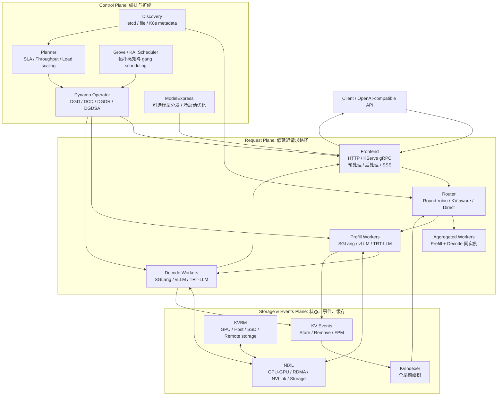

#### 3.2.2 Request Plane：请求执行路径 {#dynamo-2-2-request-plane请求执行路径}

Request Plane 是用户请求实际流经的路径，必须低延迟、低额外开销。主要组件包括：

| 组件 | 职责 |
|------|------|
| Frontend | 暴露 OpenAI-compatible HTTP、KServe gRPC，处理 tokenization、请求归一化、响应流式返回 |
| Router | 根据策略选择 worker；可用 round-robin、random、least-loaded、device-aware-weighted、kv、direct |
| Prefill Worker | 在分离式部署中专门计算 prompt KV |
| Decode Worker | 在分离式部署中专门逐 token 生成 |
| Aggregated Worker | 在聚合式部署中同时负责 Prefill 和 Decode |

Frontend 本身不需要模型权重，但需要访问模型配置和 tokenizer 文件。对于 Hugging Face 模型，Frontend 可以下载配置文件；对于私有模型，需要保证 Frontend 和 backend 可访问相同路径下的模型配置文件。

#### 3.2.3 Control Plane：期望状态与扩缩 {#dynamo-2-3-control-plane期望状态与扩缩}

Control Plane 负责把“希望系统长什么样”转化为实际 worker、服务和资源：

| 组件 | 职责 |
|------|------|
| Planner | 根据流量预测、ForwardPassMetrics、SLA、GPU budget 给出副本目标 |
| Dynamo Operator | 监听 Dynamo CRD，创建或更新 Deployment、Service、DCD 等资源 |
| Discovery | 管理 worker 注册、下线和可发现性 |
| Grove / KAI Scheduler | 多节点或 NVL72 等场景下做拓扑感知放置和 grouped scaling |
| ModelExpress | 可选模型管理与权重流式分发能力，用于降低冷启动成本 |

#### 3.2.4 Storage & Events Plane：KV 状态与数据移动 {#dynamo-2-4-storage-events-planekv-状态与数据移动}

Storage & Events Plane 让系统知道“KV 在哪里、还能不能复用、如何移动”：

| 组件 | 职责 |
|------|------|
| KV Events | worker 发出 KV block 创建/删除事件，也承载 FPM 等运行时事件 |
| KvIndexer | Router 侧维护全局 prefix tree，查询每个 worker 的 KV overlap |
| KVBM | 管理 KV block 在 GPU、Host、SSD、远端存储之间的生命周期 |
| NIXL | 为 GPU-GPU、RDMA/NVLink、Host、SSD、远端存储提供数据传输抽象 |

这也是 Dynamo 区别于简单负载均衡器的关键：路由决策不是只看请求数，而是结合 KV overlap、active decode blocks、prefill cost、worker load 和事件状态。

#### 3.2.5 Aggregated 与 Disaggregated {#dynamo-2-5-aggregated-与-disaggregated}

Dynamo 支持两类服务形态：

| 形态 | 请求执行 | 适用场景 |
|------|----------|----------|
| Aggregated | 同一个 worker 同时做 Prefill 和 Decode | 简单部署、小模型、调试、低复杂度服务 |
| Disaggregated | Prefill worker 和 Decode worker 分离 | 长上下文、高并发、大模型、需要独立扩缩 Prefill/Decode 的生产服务 |

聚合式部署不需要跨 worker 传 KV，因此路径短、实现简单。分离式部署的代价是需要高效 KV transfer，但收益是 Prefill/Decode 可以使用不同 TP、不同副本数、不同硬件布局，并避免长 Prefill 阻塞正在 Decode 的请求。

---

### 3.3 端到端请求生命周期 {#dynamo-端到端请求生命周期}

#### 3.3.1 Aggregated 模式请求路径 {#dynamo-3-1-aggregated-模式请求路径}

Aggregated 模式中，Frontend 接收请求后交给 Router，Router 选一个 worker，worker 在同一个引擎实例内完成 Prefill 和 Decode。

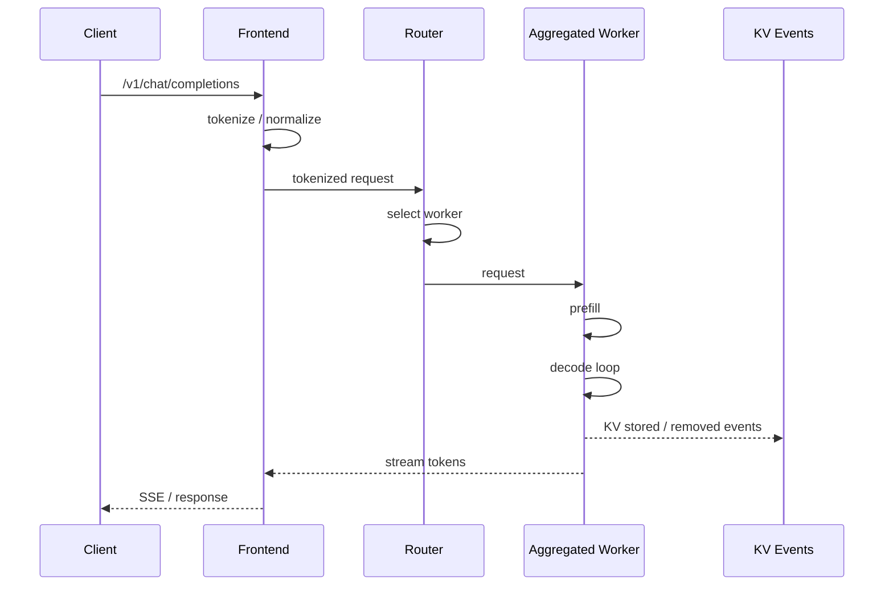

这种模式最容易启动，也最接近传统推理引擎服务。缺点是 Prefill 与 Decode 资源被绑在一起，长 prompt 可能拖慢同 worker 上的 Decode。

#### 3.3.2 Disaggregated 模式请求路径 {#dynamo-3-2-disaggregated-模式请求路径}

分离式 serving 将一个请求拆成 Prefill 和 Decode 两段。Dynamo 的 `PrefillRouter` 负责编排这个流程。

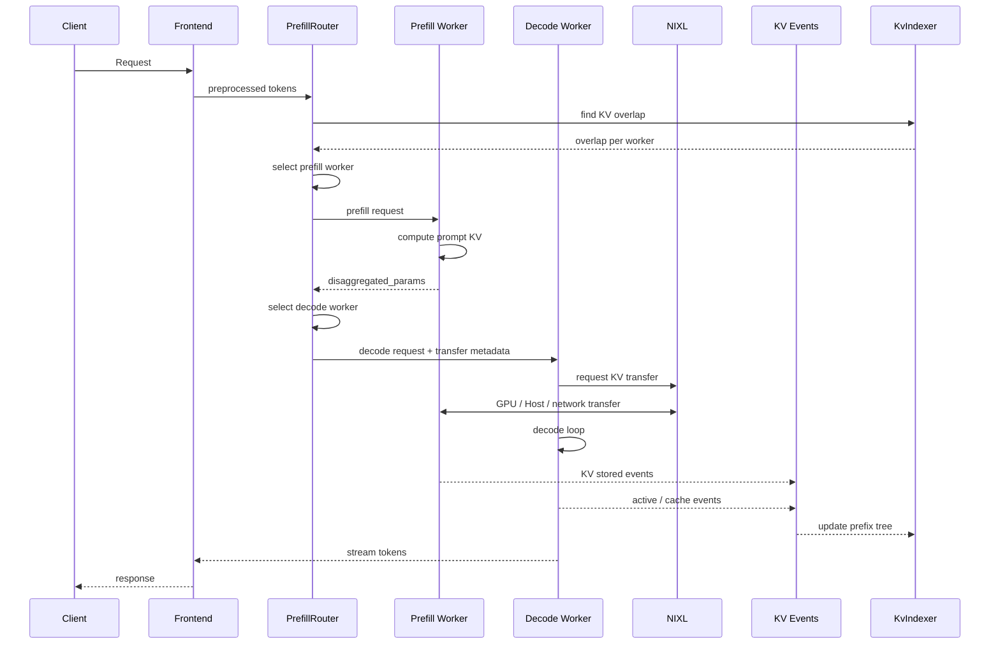

官方设计文档将分离式请求概括为三步：

1. Prefill engine 计算 prompt 阶段并生成 KV Cache。
2. Prefill engine 将 KV Cache 传给 Decode engine。
3. Decode engine 执行逐 token 生成。

高性能的关键在第二步。Dynamo 使用 NIXL 做 KV transfer，目标是从 Prefill worker 的 VRAM 直接传到 Decode worker 的 VRAM，并尽量做到非阻塞，使 GPU forward pass 可以继续服务其他请求。

#### 3.3.3 后端转移元数据差异 {#dynamo-3-3-后端转移元数据差异}

不同推理引擎暴露的 KV transfer 机制不同，因此 Dynamo 的 disaggregated metadata 也不同：

| 后端 | Metadata | 行为特征 |
|------|----------|----------|
| SGLang | `bootstrap_info`，包含 host、port、room_id | 用于 RDMA bootstrap；Prefill 可以作为后台任务运行，Decode 可更早进入并行流程 |
| vLLM | `kv_transfer_params`，包含 block IDs 和远端连接信息 | Prefill 同步运行；Decode 通常等待 Prefill 完成后继续 |
| TensorRT-LLM | `opaque_state`，序列化 TRT-LLM 内部状态 | Prefill 同步运行；Decode 等待 Prefill 完成 |

这说明 Dynamo 的抽象不是把所有后端强行改成同一种实现，而是在统一流程下适配每个后端已有的 KV transfer 能力。

#### 3.3.4 xPyD：Prefill/Decode 比例可变 {#dynamo-3-4-xpydprefill-decode-比例可变}

Dynamo 的 disaggregated serving 支持运行期可重配的 xPyD，其中 x 是 Prefill worker 数，y 是 Decode worker 数。例如：

| 拓扑 | 含义 | 适用倾向 |
|------|------|----------|
| 1P1D | 1 个 Prefill worker，1 个 Decode worker | 小规模验证 |
| 2P2D | Prefill 与 Decode 均衡扩展 | 混合长度流量 |
| 1P4D | Decode 更重 | 输出长、并发高、Decode 压力大 |
| 4P1D | Prefill 更重 | 输入长、RAG/工具上下文多、TTFT 压力大 |

新增 worker 时，worker 注册到 discovery 并发布 `RuntimeConfig`，包括 KV capacity 等信息。删除 worker 时，worker 需要 drain 活跃请求并从 discovery 注销。Router 通过 discovery 动态感知这些变化。

---

### 3.4 KV-Aware Router {#dynamo-kv-aware-router}

#### 3.4.1 Router 的核心思想 {#dynamo-4-1-router-的核心思想}

普通负载均衡会问：“哪个 worker 最空？” Dynamo KV Router 还会问：“哪个 worker 已经有这个请求的前缀 KV？”

KV-aware routing 的目标是在延迟和负载之间做平衡：

| 信号 | 含义 |
|------|------|
| Cached Blocks | 某 worker 上已经存在、可复用的前缀 KV blocks |
| Active Decoding Blocks | 某 worker 正在服务的 decode KV 负载 |
| Potential New Prefill Blocks | 如果请求路由到某 worker，需要新计算的 blocks |
| Queue / Busy 状态 | worker 或 router 队列压力 |
| DP rank / device 过滤 | 特定并行部署下的候选 worker 限制 |

#### 3.4.2 成本函数 {#dynamo-4-2-成本函数}

官方 Router 设计文档给出的核心成本公式可以抽象为：

```text
adjusted_prefill_blocks = max(
    prefill_blocks
    - overlap_score_credit * device_overlap_blocks
    - host_cache_hit_weight * host_overlap_blocks
    - disk_cache_hit_weight * disk_overlap_blocks
    - shared_cache_multiplier * shared_beyond_blocks,
    0,
)

cost = prefill_load_scale * adjusted_prefill_blocks + decode_blocks
```

解释：

| 项 | 作用 |
|----|------|
| `prefill_blocks` | 原始需要计算的 prompt blocks |
| `device_overlap_blocks` | 目标 worker GPU 本地命中的 blocks |
| `host_overlap_blocks` | Host 层可复用 blocks |
| `disk_overlap_blocks` | Disk 层可复用 blocks |
| `shared_beyond_blocks` | 共享缓存中更深层可复用 blocks |
| `decode_blocks` | 活跃 decode KV 负载 |
| `overlap_score_credit` | 越高越偏向 KV 复用，越低越偏向负载均衡 |
| `prefill_load_scale` | 调整 Prefill 成本相对 Decode 的权重 |

Router 选择成本最低的 worker。如果配置了非零 `router_temperature`，也可以用 softmax sampling 在低成本候选中引入随机性，缓解过度集中。

#### 3.4.3 KvIndexer 与全局前缀树 {#dynamo-4-3-kvindexer-与全局前缀树}

KV Router 的全局视图来自两个系统：

| 系统 | 数据来源 | 用途 |
|------|----------|------|
| Active Decoding Blocks | Router 本地跟踪请求生命周期 | 估计当前 worker decode 负载 |
| Cached Blocks | worker 通过 KVPublisher 发事件，KvIndexer 建 prefix tree | 查询每个 worker 的 KV overlap |

v1.3.0 增加独立 Router selection service 和 Branch-Sharded KV Indexer。前者通过 HTTP 提供 slot/selection 接口，并可选用 ZMQ 同步状态，使路由选择不必嵌入每个 Frontend；后者按 prefix branch 将索引工作分片并汇总候选结果，避免单棵全局树成为扩展瓶颈。压缩 radix tree 的 store/remove 热路径也得到优化。它们改变的是索引和选择服务的部署形态，不改变 KV event 必须与实际 block 生命周期一致这一前提。

KV block 管理流程大致如下：

1. 请求 prompt 被 tokenization。
2. token 序列按固定 block size 切分。
3. 每个 block 基于 token 内容计算 hash；如果使用 LoRA，adapter 名称也会参与 hash，避免不同 adapter 的 KV 混用。
4. worker 查询本地 KV cache 是否已有这些 block。
5. 未命中则分配新 block 并计算 KV。
6. block 存储完成后，KVPublisher 发出 stored event。
7. block 被驱逐或生命周期结束时，KVPublisher 发出 removed event。
8. KvIndexer 消费事件，更新 prefix tree。
9. 后续请求进入时，Router 用 token blocks 查询 prefix tree，得到每个 worker 的命中数。

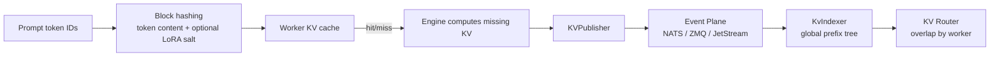

#### 3.4.4 事件传输模式 {#dynamo-4-4-事件传输模式}

Dynamo Router 支持两类 KV event 传输模式：

| 模式 | 特点 | 适用场景 |
|------|------|----------|
| NATS Core / ZMQ + Local Indexer | 默认；worker 本地维护 radix tree，Router 从 event plane 消费事件，缺失事件时可向 worker 查询补齐 | 简单、低延迟、无 JetStream 依赖 |
| JetStream durable events | worker 向持久化 NATS JetStream 发布，router 作为 durable consumer 消费，并可通过 object store 保存快照 | 多 router、副本一致性、生产环境需要事件持久化 |

JetStream 需要 Frontend 和所有 workers 同时设置 `--durable-kv-events`，否则发布侧和消费侧不匹配。

#### 3.4.5 Router 副本之间的同步 {#dynamo-4-5-router-副本之间的同步}

在多 Router 部署中，每个 Router 只能看到自己接收的请求。如果不交换状态，多个 Router 会对 active load 产生不同估计。Dynamo 使用三类事件同步：

| 事件 | 含义 |
|------|------|
| `AddRequest` | 某 Router 将请求分配给 worker，其他 Router 更新该 worker 活跃块估计 |
| `MarkPrefillCompleted` | 首 token 返回，说明 Prefill 结束，Prefill 侧负载可以更新 |
| `Free` | 请求完成，释放活跃块引用 |

这些事件带有 router ID，避免自己处理自己发出的同步事件。

#### 3.4.6 配置与限制 {#dynamo-4-6-配置与限制}

典型启动命令：

```bash
python -m dynamo.frontend --router-mode kv --http-port 8000
```

Kubernetes 中可以在 Frontend 服务设置：

```bash
DYN_ROUTER_MODE=kv
```

常用参数：

| 参数 | 默认 | 说明 |
|------|------|------|
| `--router-mode kv` | `round-robin` | 启用 KV-aware routing |
| `--load-aware` | disabled | 不使用 cache reuse signal，只使用 KV active-load 路由；隐含启用 kv 模式 |
| `--router-kv-overlap-score-credit` | `1.0` | device-local 前缀命中 credit，0.0 到 1.0 |
| `--router-prefill-load-scale` | `1.0` | Prefill load 相对 Decode blocks 的权重 |
| `--router-kv-events` / `--no-router-kv-events` | events enabled | 是否消费 worker KV events |
| `--router-queue-threshold` | unset (`None`) | 可选 backpressure queue threshold；设置数值才启用 queueing |
| `--router-queue-policy` | `fcfs` | `fcfs`、`wspt`、`lcfs` |
| `--no-router-track-prefill-tokens` | disabled | 路由负载中忽略 prompt-side Prefill tokens |

限制：

| 限制 | 说明 |
|------|------|
| 需要动态 endpoint | worker 需要用 `register_model()` 注册，并设置 `ModelInput.Tokens` |
| backend 接收 token_ids | KV Router 要求后端处理预 tokenized 请求 |
| static endpoint 不支持 KV routing | 因为 Router 需要跟踪 worker 实例和 KV 状态 |
| approximate 模式不是完整事件一致性 | `--no-router-kv-events` 可用于近似预测；部分实现中会用 TTL 过期近似状态，但不等同于真实 KV 生命周期事件 |

拓扑感知 KV transfer 使用 worker 发布的 topology domain，对 Prefill 选定结果生成 Decode `RoutingConstraints`；可选择硬约束或偏好权重。它和 Kubernetes Topology-Aware Scheduling 是两层机制：后者决定 Pod 放在哪里，前者决定已运行的 Prefill/Decode worker 之间如何路由。v1.3.0 还以 `x-dynamo-trajectory-id`、`x-dynamo-parent-trajectory-id`、`x-dynamo-trajectory-final` 表达 agent trajectory；旧 sticky-session 与 `nvext.session_control` 已移除，不能再按会话绑定 API 配置。

---

### 3.5 Dynamo 的缓存管理 {#dynamo-dynamo-的缓存管理}

#### 3.5.1 两类缓存管理不要混淆 {#dynamo-5-1-两类缓存管理不要混淆}

Dynamo 中与 KV Cache 相关的能力至少分成两层：

| 层次 | 组件 | 管什么 | 不管什么 |
|------|------|--------|----------|
| 路由可见性 | Router + KvIndexer + KV Events | 哪个 worker 拥有哪些前缀 block，当前路由到哪里更划算 | 不直接负责把 KV 从 GPU 移到 SSD |
| 存储与迁移 | KVBM + NIXL + pools | block 生命周期、分层存储、offload/onboard、远端访问 | 不直接决定用户请求路由到哪个 worker |

KV-aware routing 让系统“知道缓存在哪里并用它做调度”。KVBM 让系统“把缓存放到更多层级并在需要时搬回来”。两者互补，但不是同一个模块。

#### 3.5.2 KVBM 的定位 {#dynamo-5-2-kvbm-的定位}

Dynamo KV Block Manager 是统一的 KV block 内存层和 write-through cache。官方组件文档把它描述为跨 GPU、pinned host memory、远端 RDMA memory、本地/分布式 SSD、远端文件/对象/云存储的统一 memory API。

> **v1.5.0 状态边界：** KVBM 架构和既有代码仍保留，本文也保留其机制说明用于理解历史部署，但 v1.4.0 已将其标为 deprecated，v1.5.0 重申该状态并把移除目标定为 v1.6.0。新的生产系统不应据此新增 KVBM 依赖，应优先评估后端原生 KV offload、LMCache、FlexKV 或 SGLang HiCache，并为既有 KVBM 部署制定退出计划。

它主要解决四类问题：

| 问题 | KVBM 作用 |
|------|-----------|
| GPU HBM 放不下所有 KV | 把冷 KV offload 到 Host 或 SSD |
| 长会话反复访问大前缀 | 把可复用 prefix block 注册、匹配、onboard |
| 多 worker 或多节点共享 KV | 通过 NIXL 交换远端 block descriptors 和 memory views |
| 存储厂商或外部系统想参与治理 | 通过 event plane 订阅 Store/Remove events，建立自有索引和冷热策略 |

#### 3.5.3 KVBM 分层 {#dynamo-5-3-kvbm-分层}

KVBM 官方设计把 KV 存储抽象为 G1 到 G4：

| 层 | 名称 | 典型介质 | 作用 |
|----|------|----------|------|
| G1 | Device Pool | GPU HBM | 正在计算或马上要用的 KV block |
| G2 | Host Pool | CPU pinned memory | GPU 压力大时承接 offload，支持 H2D/D2H 高效复制 |
| G3 | Disk Pool | 本地 NVMe SSD | 更大容量，承接 Host->Disk offload，并可 Disk->Device onboard |
| G4 | Remote Storage | 远端文件系统、对象存储、云存储、远端 RDMA memory | 跨节点/跨实例/更大容量的持久或半持久 KV 存储 |

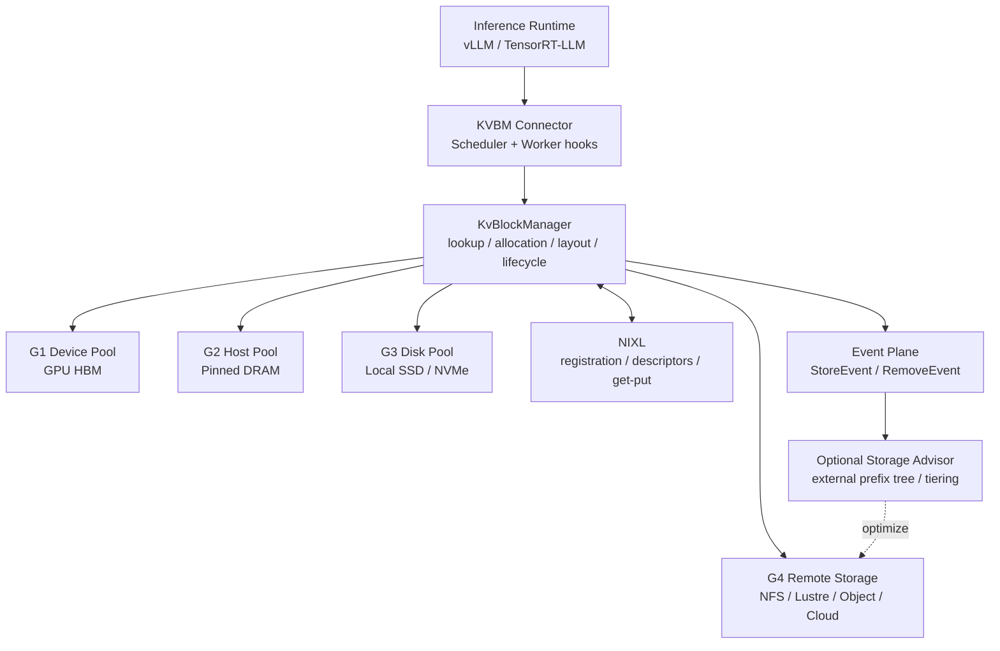

#### 3.5.4 Block 生命周期 {#dynamo-5-4-block-生命周期}

KVBM 中的 block 生命周期是强状态机，核心状态包括：

| 状态 | 含义 | 典型动作 |
|------|------|----------|
| Reset | block 未初始化或已被重置，可复用 | allocator 从 inactive pool 取出 |
| Partial | 正在填充 token，尚未完成 | `add_token()` / `add_tokens()` |
| Complete | 已完成但尚未对外可见 | `commit()` |
| Registered | 已注册，可被 lookup 和复用 | `register()`；drop 时发 Remove event |

典型过程：

1. sequence 请求一个新 KV block。
2. allocator 从 inactive pool 弹出 Reset block。
3. `init_sequence()` 将其转为 Partial。
4. token 写满后 `commit()`，状态变为 Complete。
5. `register()` 后进入 Registered，并根据 `sequence_hash` 进入 dedup/lookup 表。
6. block 被驱逐、释放或注册句柄 drop 时，触发 Remove event，block 回到 Reset。

官方设计强调 RAII：注册句柄持有生命周期，句柄 drop 时自动触发 Remove event。这避免了手动释放遗漏导致的 stale metadata。

#### 3.5.5 KVBM 的数据流 {#dynamo-5-5-kvbm-的数据流}

KVBM 的主要数据流有四条：

| 流向 | 触发 | 数据移动 |
|------|------|----------|
| Device -> Host | connector scheduler 显式请求 offload，或策略判断 GPU 压力大 | CUDA D2H 或自定义 kernel copy |
| Host -> Disk | Host block 注册后或显式 offload | NIXL Write，POSIX 或 GDS 可用时使用 |
| Host -> Device | 请求需要复用 Host 上的 block | CUDA H2D 或自定义 kernel copy |
| Disk -> Device | 请求需要直接从 SSD 回载 | NIXL Read，可能经 GDS 直达 GPU |

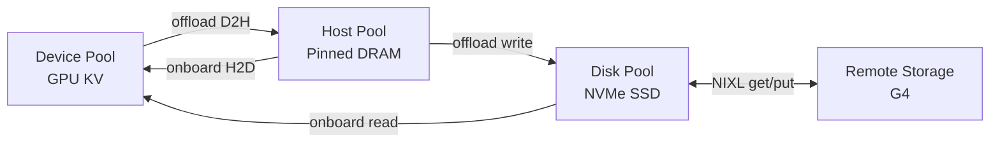

#### 3.5.6 NIXL 在缓存管理中的作用 {#dynamo-5-6-nixl-在缓存管理中的作用}

NIXL 是 Dynamo 的数据移动层。对 KVBM 来说，它提供：

| 能力 | 说明 |
|------|------|
| memory registration | 将本地 GPU/Host/Storage 区域注册成可访问 descriptor |
| descriptor serialization | 把 layout、地址、stride、device ID、dtype 等信息序列化交换 |
| remote block import/export | 让另一个 worker 理解远端 block 的布局 |
| RDMA / NVLink / storage I/O | 根据环境选择合适传输路径 |
| get/put abstraction | 对远端存储或 block device 提供块级访问接口 |

跨节点 KV transfer 不只是“知道地址”。不同 worker 可能 TP 配置不同、layout stride 不同、layer 切片不同。如果没有 layout metadata 交换，直接读远端地址会造成错位或数据损坏。因此 KVBM/NIXL 的 descriptor 包含 block layout、base offset、物理 memory descriptor、device ID、memory type 等信息。

#### 3.5.7 缓存治理策略 {#dynamo-5-7-缓存治理策略}

Dynamo 文档公开描述了 KVBM 具备 block reuse、eviction policy、offload/recall 和事件驱动生命周期能力，但不要把它误读为所有层都有一个统一的、用户直接配置的 LRU/TTL 开关。

更准确的理解是：

| 治理点 | 机制 |
|--------|------|
| GPU HBM 压力 | Device block 可以 offload 到 Host 或 Disk，释放 GPU 空间 |
| Host/Disk 容量 | Host/Disk pool 注册 immutable blocks，并可由实现策略决定淘汰或迁移 |
| KV 可见性失效 | Registered block 生命周期结束时通过 Remove event 通知订阅者 |
| Router 近似状态 | 在未消费真实 KV events 的 approximate 模式下，可以依赖近似写入和 TTL 过期 |
| 外部存储治理 | storage provider 可订阅 Store/Remove events，自建 prefix tree、LRU index、冷热迁移、压缩整理 |

对生产设计的含义：

1. **短生命周期热 KV 应尽量留在 G1/G2。** 频繁 onboard/offload 会增加数据移动开销。
2. **长前缀、共享 prompt、RAG 模板适合进入 G2/G3/G4。** 复用收益大于传输成本时才划算。
3. **G4 远端存储更适合容量扩展和跨实例复用。** 它不应该被当作等价于 GPU cache 的低延迟层。
4. **Remove event 是元数据清理信号，不等同于底层存储立刻物理擦除。** 外部存储系统需要自己定义物理文件、对象、块设备空间的清理策略。
5. **Router 的 KV 命中视图依赖事件质量。** 如果 event 丢失、延迟或配置不一致，路由决策会偏离真实缓存状态。

#### 3.5.8 KVBM 支持矩阵 {#dynamo-5-8-kvbm-支持矩阵}

根据当前官方组件文档：

| 维度 | 支持情况 |
|------|----------|
| Local deployment | 支持 |
| Kubernetes | 支持 |
| vLLM | 支持 |
| TensorRT-LLM | 支持 |
| SGLang | KVBM 文档中标为不支持；SGLang 侧可使用 HiCache 等路径 |
| Aggregated serving | 支持 |
| Disaggregated serving | 支持 |

注意：Dynamo README 的高层 feature matrix 对 KVBM 标注可能随版本演进，组件页明确给出的 KVBM 当前框架支持应作为更细粒度参考。实际部署前应以所用 release 的 feature matrix 和 backend 文档为准。

#### 3.5.9 适用场景 {#dynamo-5-9-适用场景}

KVBM 或 KV offloading 最适合：

| 场景 | 原因 |
|------|------|
| 长会话、多轮对话 | 大前缀反复使用，减少重复 Prefill |
| 高并发 | 不活跃会话可移出 GPU，让活跃请求继续运行 |
| 共享系统 prompt / 模板 / RAG 前缀 | 跨用户共享命中率高 |
| GPU 显存紧张 | 用 Host/SSD 扩展有效 KV 容量 |
| 成本敏感服务 | 用更便宜的内存/存储减少 GPU 扩容需求 |

不适合：

| 场景 | 原因 |
|------|------|
| prompt 很短且重复率低 | 传输/管理开销可能超过复用收益 |
| 极低延迟单轮请求 | HBM 本地命中更重要，offload 会引入尾延迟 |
| 缺少高速网络或本地 SSD | G3/G4 的收益会被 I/O 放大抵消 |
| 事件面不稳定 | Router/KVBM 视图不一致会导致错误决策或低命中 |

---

### 3.6 Planner 弹性伸缩 {#dynamo-planner-弹性伸缩}

#### 3.6.1 为什么 HPA/KEDA 不够 {#dynamo-6-1-为什么-hpa-keda-不够}

LLM 推理不是普通 Web 服务。传统 HPA/KEDA 常用 CPU、内存、QPS 或队列长度做扩缩，但这些指标无法直接表达：

| LLM 变量 | 影响 |
|----------|------|
| ISL，即输入长度 | 影响 Prefill 时间和 TTFT |
| OSL，即输出长度 | 影响 Decode 占用时间 |
| 当前并发序列数 | 影响 Decode KV 负载与 ITL |
| KV hit rate | 改变实际 Prefill 计算量 |
| Speculative accept length | 改变 decode 有效吞吐 |
| Prefill/Decode 比例 | 决定应该扩哪个 worker 池 |

GPU worker 扩容还很慢：调度 Pod、拉镜像、下载模型、加载权重、注册 endpoint 都可能需要分钟级时间。因此 Planner 不能只在负载已经爆了以后反应，还需要预测和容量下界。

#### 3.6.2 两种扩缩模式 {#dynamo-6-2-两种扩缩模式}

Planner 支持 throughput-based 和 load-based 两类控制循环。

| 模式 | 频率 | 数据来源 | 目标 |
|------|------|----------|------|
| Throughput-based | 较慢，默认约 180s | traffic metrics、profiling、AI Configurator、perf model | 为未来一段时间需求设置容量下界 |
| Load-based | 较快，默认约 5s | ForwardPassMetrics、队列、在线回归 | 对突发和短期 SLA 压力快速反应 |

两者一起启用时，throughput-based scaling 给出下界，load-based scaling 可以在下界之上加副本，但不会把容量降到预测下界以下。

#### 3.6.3 Runtime pipeline {#dynamo-6-3-runtime-pipeline}

Planner 的运行管线分为五个阶段：

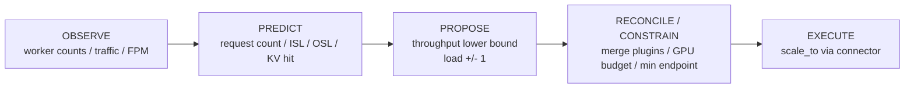

| 阶段 | 说明 |
|------|------|
| OBSERVE | 收集 worker 数量、流量、forward-pass metrics |
| PREDICT | 预测下一窗口请求数、平均 ISL/OSL、KV hit rate 等 |
| PROPOSE | throughput proposer 和 load proposer 各自给出扩缩建议 |
| RECONCILE / CONSTRAIN | 合并建议，施加 GPU budget、min_endpoint 等约束 |
| EXECUTE | 通过 KubernetesConnector 或 VirtualConnector 应用副本目标 |

#### 3.6.4 Optimization target {#dynamo-6-4-optimization-target}

Planner 用户侧提供三个 `optimization_target`：

| Target | 含义 | 是否需要 SLA | 是否需要 profiling |
|--------|------|--------------|---------------------|
| `throughput` | 默认；根据队列和 KV cache 利用率最大化吞吐 | 否 | 否 |
| `latency` | 更激进地保持低队列和低延迟 | 否 | 否 |
| `sla` | 以 TTFT/ITL 目标做精确扩缩 | 是 | 推荐 |

v1.3.0 的 SLA 路径使用 AIConfigurator latency prediction 取代需要手工维护的静态成本模型，并用 observed-versus-target Prometheus 指标/Grafana 面板暴露偏差。开启 speculative decoding 时，Planner 会使用 MTP accept length 修正 Decode latency，避免把一次 forward 产生多个有效 token 的场景仍按单 token 成本扩缩。AIC 依赖匹配的 GPU、模型、backend/version 性能数据；数据缺失或硬件不匹配时应 fail fast，而不是静默退回一个看似精确的容量结论。

SLA 模式的典型配置：

```yaml
features:
  planner:
    optimization_target: sla
    enable_throughput_scaling: true
    enable_load_scaling: true
    ttft_ms: 500.0
    itl_ms: 50.0
    pre_deployment_sweeping_mode: rapid
```

#### 3.6.5 Connector {#dynamo-6-5-connector}

Planner 通过 connector 把扩缩决策应用到运行环境：

| Connector | 作用 |
|-----------|------|
| KubernetesConnector | PATCH DGD 资源，Operator 负责将变更落实到组件部署 |
| VirtualConnector | 面向非 Kubernetes 或自定义 orchestrator；Planner 写入决策，外部系统读取并确认完成 |

VirtualConnector 的典型流程是：

1. Planner 写入 `(num_prefill, num_decode, decision_id)`。
2. 外部系统通过 client 读取决策。
3. 外部系统执行扩缩。
4. 外部系统回报 `complete(decision)`。
5. Planner 观察到 decision 已完成，再继续下一轮。

#### 3.6.6 已知限制 {#dynamo-6-6-已知限制}

| 限制 | 影响 |
|------|------|
| 扩缩间隔不能短于实际扩容耗时 | 否则下一轮 tick 会看到 in-progress transition 并 hold |
| throughput-based 使用平均 ISL/OSL | 对双峰或重尾请求分布可能估计不准 |
| 每个 Planner 主要管理单个 DGD | 多 DGD 共享集群需要 Global Planner 等额外路径 |
| scale-down 不等待所有 in-flight 请求完成 | 被终止 worker 上的请求可能失败；需要设置合理 `min_endpoint` 和保守 scale-down sensitivity |

---

### 3.7 后端集成 {#dynamo-后端集成}

#### 3.7.1 总览 {#dynamo-7-1-总览}

Dynamo 支持的核心后端是 SGLang、TensorRT-LLM 和 vLLM。它们仍然保留自己的引擎参数、执行模型和优化能力，Dynamo 在上层接入服务发现、路由、KV events、P/D disaggregation、Planner 和 Kubernetes 生命周期。

| 能力 | SGLang | TensorRT-LLM | vLLM |
|------|--------|--------------|------|
| Disaggregated Serving | 支持 | 支持 | 支持 |
| KV-Aware Routing | 支持 | 支持 | 支持 |
| SLA-Based Planner | 支持 | 支持 | 支持 |
| KVBM | KVBM 组件页标为不支持；可关注 HiCache 路径 | 支持 | 支持 |
| Multimodal | 支持 | 支持 | 支持 |
| Tool Calling | 支持 | 支持 | 支持 |

#### 3.7.2 vLLM {#dynamo-7-2-vllm}

Dynamo vLLM 后端将 vLLM engine 接入 Dynamo runtime。关键点：

| 能力 | 说明 |
|------|------|
| Disaggregated serving | 使用 NIXL 做 KV transfer |
| KV-aware routing | 利用 vLLM 原生 KV events 与 Dynamo Router |
| KVBM | 支持 KVBM、LMCache、FlexKV 等 KV offloading 路径 |
| Observability | 支持 backend 指标、ForwardPassMetrics 等 |
| DP rank routing | 支持外部 DP rank 控制 |

本地快速启动通常需要先启动 etcd/NATS：

```bash
docker compose -f dev/docker-compose.yml up -d
cd $DYNAMO_HOME/examples/backends/vllm
bash launch/agg.sh
```

Quickstart 也提供了 `--discovery-backend file` 的轻量路径，避免本地先启动 etcd。

#### 3.7.3 SGLang {#dynamo-7-3-sglang}

Dynamo SGLang 后端支持 LLM、embedding、multimodal vision 和 diffusion generation 等能力。关键点：

| 能力 | 说明 |
|------|------|
| Disaggregated serving | 支持 P/D 分离；小模型测试时 transport overhead 可能掩盖收益 |
| KV-aware routing | 支持 |
| Planner | 支持 SLA/负载相关路径 |
| Request cancellation | 聚合式完整支持；分离式 decode-only 有限制 |
| HiCache | SGLang 自身的分层缓存路径，可与 NIXL 相关能力结合 |

示例：

```bash
cd $DYNAMO_HOME/examples/backends/sglang
./launch/agg.sh
./launch/disagg.sh
```

#### 3.7.4 TensorRT-LLM {#dynamo-7-4-tensorrt-llm}

Dynamo TensorRT-LLM 后端支持 disaggregated serving、KV-aware routing、多节点部署、request cancellation，以及 TensorRT-LLM 自身的高性能推理特性。

| 能力 | 说明 |
|------|------|
| Disaggregated serving | 支持 |
| KV-aware routing | 支持 |
| SLA-Based Planner | 支持 |
| KVBM | 支持 |
| Attention DP / WideEP / GB200 | 官方后端文档中有相关支持项 |

容器和驱动版本需要严格匹配，实际部署前应查对应 release 的 support matrix。

#### 3.7.5 RL、TITO 与多模态路径 {#dynamo-7-5-rl-tito-与多模态路径}

v1.3.0 的 RL surface 由 `DYN_ENABLE_RL` 统一 gate。TITO 请求直接接收和返回 token IDs，并可返回 completion token IDs、logprobs 与 routed-expert capture；worker 还提供 `/v1/rl/workers` 发现接口、原地权重更新、sleep/wake 和 rollout metadata 写入 `fsspec` 后端。该接口面向 post-training rollout，不应替代普通 OpenAI-compatible 文本 API。

多模态需要在 Prefill 与 Decode worker 上显式传入 `--enable-multimodal`；内部独立 encoder 拓扑再组合 `--dedicated-mm-encoder` 和对应 `--disaggregation-mode`。媒体感知 hash/路由防止相同文本但不同图像或视频错误复用 KV；部署时还应验证 SSRF 防护、媒体格式 `415`、encoder-to-prefill handoff 和上下文长度限制。

---

### 3.8 Kubernetes 与 Operator {#dynamo-kubernetes-与-operator}

#### 3.8.1 为什么 Kubernetes 是生产主路径 {#dynamo-8-1-为什么-kubernetes-是生产主路径}

Dynamo 不是 Kubernetes-only，但它的生产主路径是 Kubernetes-native。原因是大规模推理服务需要：

| 能力 | Kubernetes/Dynamo 提供的机制 |
|------|------------------------------|
| 声明式部署 | DGD / DGDR |
| 多组件生命周期 | Operator -> DCD -> Pods / Services |
| 弹性伸缩 | DGDSA、Planner、HPA/KEDA 集成 |
| GPU 调度 | GPU Operator、Grove/KAI Scheduler |
| 网关与路由 | Dynamo Frontend 或 Gateway API + EPP |
| 观测与健康 | Prometheus、Grafana、health probes |

#### 3.8.2 CRD 体系 {#dynamo-8-2-crd-体系}

| CRD | 含义 | 常见使用方式 |
|-----|------|--------------|
| `DynamoGraphDeployment` (DGD) | 活跃推理图，是最终服务资源 | 直接编写或由 DGDR 生成 |
| `DynamoComponentDeployment` (DCD) | DGD 拆出的组件部署，如 frontend、worker、planner | 通常由 Operator 创建，排障时查看 |
| `DynamoGraphDeploymentRequest` (DGDR) | deploy-by-intent 请求，可 profiling 并生成 DGD | 希望 Dynamo 帮忙生成初始部署时使用 |
| `DynamoGraphDeploymentScalingAdapter` (DGDSA) | 单组件扩缩接口，暴露 Scale subresource | Planner/HPA/KEDA 驱动副本 |
| `DynamoModel` | 模型和 adapter 生命周期 | 加载/卸载 LoRA 等 |
| `DynamoCheckpoint` | GPU worker checkpoint/restore 元数据 | 用于 warm restore、降低冷启动 |
| `DynamoWorkerMetadata` | worker discovery metadata | 由系统写入，供 discovery 和 routing 使用 |

v1.3.0 将 DGD admission/storage 路径收敛到 `nvidia.com/v1beta1`，升级时必须先安装同版本 CRD 与 conversion/admission webhook，再迁移存量对象和 controller；不能只替换 Operator 镜像。该版本还把 Gateway 集成迁移到 agentgateway（GAIE），并由 Operator 管理 EPP 安装路径。

#### 3.8.3 Operator 控制器 {#dynamo-8-3-operator-控制器}

Operator 中主要 controller：

| Controller | 监听对象 | 职责 |
|------------|----------|------|
| DynamoGraphDeploymentController | DGD | 编排整个推理图 |
| DynamoComponentDeploymentController | DCD | 管理单个组件部署 |
| DynamoGraphDeploymentRequestController | DGDR | profiling/generation 流程，生成 DGD |
| DynamoGraphDeploymentScalingAdapterController | DGDSA | 为 Planner/外部 autoscaler 提供扩缩适配 |
| DynamoModelController | DynamoModel | 模型和 adapter 生命周期 |
| DynamoCheckpointController | DynamoCheckpoint | checkpoint/restore 工作流 |

GPU Memory Service（GMS）让多个 worker 复用 GPU-resident 权重，并参与 engine weight loading、checkpoint/restore 与 snapshot probe。v1.3.0 的 GMS DRA 路径要求 Kubernetes 1.34+ 的稳定 `resource.k8s.io/v1`；Operator 不再自动注入旧的 `gms-loader`/`gms-saver` sidecar，使用方需通过 `extraClientContainers` 和 `checkpoint.job.gmsClientContainers` 明确声明接入容器。

#### 3.8.4 请求入口拓扑 {#dynamo-8-4-请求入口拓扑}

Dynamo 支持两种 Kubernetes 请求入口拓扑。

| 拓扑 | 请求路径 | 适用场景 |
|------|----------|----------|
| Dynamo-native Frontend routing | Client -> Frontend -> Router -> Workers | 本地开发、单集群、希望 Dynamo 全权管理入口 |
| Gateway API + GAIE | Client -> Gateway -> EPP -> Frontend sidecar direct -> Workers | 集群平台已有 Gateway API、边缘统一做 auth/rate limit/observability |

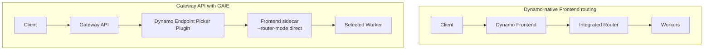

#### 3.8.5 三种部署视角 {#dynamo-8-5-三种部署视角}

从使用复杂度看，可以把 Dynamo 部署分成三种常见模式：

| 模式 | 入口 | 控制面 | 适用场景 |
|------|------|--------|----------|
| 本地/容器模式 | `python -m dynamo.frontend` + backend worker | file discovery 或本地 etcd/NATS | 快速试用、开发、单机验证 |
| Kubernetes DGD/DGDR 模式 | Dynamo Frontend | Operator + CRDs + Planner 可选 | 生产主路径、Dynamo 管理入口 |
| Kubernetes Gateway API 模式 | Gateway API + EPP | Operator + CRDs + Gateway API | 平台统一入口、多租户边缘治理 |

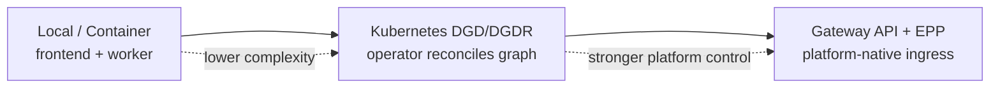

---

### 3.9 部署与运行入口 {#dynamo-部署与运行入口}

#### 3.9.1 容器 quickstart {#dynamo-9-1-容器-quickstart}

官方 quickstart 的最短路径是拉取对应后端容器，在容器内启动 Frontend 和 worker。

SGLang 示例：

```bash
docker run --gpus all --network host --rm -it nvcr.io/nvidia/ai-dynamo/sglang-runtime:1.2.1

python3 -m dynamo.frontend --http-port 8000 --discovery-backend file > /dev/null 2>&1 &
python3 -m dynamo.sglang --model-path Qwen/Qwen3-0.6B --discovery-backend file &
```

发送请求：

```bash
curl -s localhost:8000/v1/chat/completions \
  -H "Content-Type: application/json" \
  -d '{
    "model": "Qwen/Qwen3-0.6B",
    "messages": [{"role": "user", "content": "Hello!"}],
    "max_tokens": 100
  }' | jq
```

vLLM worker 示例：

```bash
python3 -m dynamo.vllm --model Qwen/Qwen3-0.6B --discovery-backend file \
  --kv-events-config '{"enable_kv_cache_events": false}'
```

#### 3.9.2 Frontend 常用入口 {#dynamo-9-2-frontend-常用入口}

HTTP:

```bash
python -m dynamo.frontend --http-port 8000
```

KServe gRPC:

```bash
python -m dynamo.frontend --kserve-grpc-server
```

KV Router:

```bash
python -m dynamo.frontend --router-mode kv --http-port 8000
```

直接路由模式通常用于 Gateway API + EPP 选好 worker 后，由 sidecar 直接转发：

```bash
python -m dynamo.frontend --router-mode direct
```

#### 3.9.3 Kubernetes quickstart {#dynamo-9-3-kubernetes-quickstart}

安装平台：

```bash
export NAMESPACE=dynamo-system
helm install dynamo-platform \
  oci://helm.ngc.nvidia.com/nvidia/ai-dynamo/charts/dynamo-platform \
  --version "1.0.2" \
  --namespace "$NAMESPACE" \
  --create-namespace
```

DGDR 示例：

```yaml
apiVersion: nvidia.com/v1beta1
kind: DynamoGraphDeploymentRequest
metadata:
  name: qwen3-quickstart
spec:
  model: Qwen/Qwen3-0.6B
  backend: auto
  image: "nvcr.io/nvidia/ai-dynamo/dynamo-planner:1.2.1"
```

应用：

```bash
kubectl apply -f qwen3-quickstart.yaml -n $NAMESPACE
kubectl get dgdr qwen3-quickstart -n $NAMESPACE -w
kubectl get dynamographdeployment -n $NAMESPACE
kubectl get dynamocomponentdeployment -n $NAMESPACE
```

#### 3.9.4 示例目录 {#dynamo-9-4-示例目录}

官方仓库中有大量 examples：

| 路径 | 说明 |
|------|------|
| `examples/backends/vllm/deploy/agg.yaml` | vLLM 聚合式 Kubernetes 部署 |
| `examples/backends/vllm/deploy/disagg.yaml` | vLLM P/D 分离部署 |
| `examples/backends/vllm/deploy/disagg_kvbm.yaml` | vLLM + KVBM |
| `examples/backends/sglang/deploy/disagg.yaml` | SGLang P/D 分离 |
| `examples/backends/trtllm/deploy/disagg.yaml` | TensorRT-LLM P/D 分离 |
| `examples/backends/*/deploy/*planner*.yaml` | 带 Planner 的部署样例 |
| `examples/deployments/GKE` / `EKS` / `AKS` | 云厂商部署示例 |

---

### 3.10 可观测性、容错与性能 {#dynamo-可观测性-容错与性能}

#### 3.10.1 可观测性 {#dynamo-10-1-可观测性}

Dynamo 的可观测性覆盖多个层次：

| 层 | 指标或工具 |
|----|------------|
| Frontend | request count、duration、TTFT、ITL、input/output sequence length |
| Router | KV hit rate、router request metrics、queue、routing decisions |
| Planner | replica counts、predicted replicas、estimated TTFT/ITL、GPU hours、decision reason |
| Operator | reconciliation duration、success/error rate、webhook metrics、resource inventory |
| Backend | engine metrics、ForwardPassMetrics、trace、Grafana dashboard |
| KVBM | block/offload/onboard 相关 metrics、KVBM Grafana dashboard |

Planner 还支持 HTML diagnostics reports，使用 Plotly 输出自包含报告，用于观察实际副本、推荐副本、SLA 估计、请求形态和扩缩决策时间线。Advisory mode 下尤其有价值，因为它可以先观察 Planner 会怎么建议扩缩，而不真正修改部署。

#### 3.10.2 容错路径 {#dynamo-10-2-容错路径}

Dynamo 的容错并不是单点机制，而是多层协同：

| 层 | 机制 | 效果 |
|----|------|------|
| Request | request migration、cancellation | in-flight work 可以继续或有意识终止 |
| Worker | health checks、graceful shutdown、endpoint draining | 终止或不健康 worker 不再接新请求 |
| System | request rejection / load shedding | 防止过载扩散 |
| Infrastructure | discovery lease expiry、event-path recovery | 移除 stale membership，恢复事件状态 |
| Router | event gap detection、local indexer dump | worker 事件缺失时补齐状态 |

#### 3.10.3 性能收益来源 {#dynamo-10-3-性能收益来源}

Dynamo 的性能收益主要来自四个方面：

| 来源 | 机制 |
|------|------|
| P/D 分离 | Prefill 和 Decode 独立扩缩，避免长 Prefill 阻塞 Decode |
| KV-aware routing | 请求路由到已有前缀缓存的 worker，减少重复 Prefill |
| KVBM | 扩大有效 KV 容量，减少长上下文和多轮对话的重复计算 |
| Planner | 用 TTFT/ITL 和 workload shape 调整副本，减少过载或过度扩容 |

值得注意的是，这些能力并非总是叠加收益。小模型、短 prompt、低并发场景中，P/D 传输开销可能高于分离收益；缓存复用率低时，KV-aware routing 也可能退化成带额外元数据管理的负载均衡。因此生产评估必须使用真实 ISL/OSL 分布、KV 命中率和并发曲线。

---

### 3.11 与周边系统的关系 {#dynamo-与周边系统的关系}

#### 3.11.1 Dynamo 与推理引擎 {#dynamo-11-1-dynamo-与推理引擎}

Dynamo 不替代推理引擎：

| 推理引擎 | Dynamo 关系 |
|----------|-------------|
| vLLM | 保留 vLLM native engine args，接入 routing、events、P/D、KVBM |
| SGLang | 保留 SGLang server args，接入 Dynamo runtime、routing、P/D |
| TensorRT-LLM | 保留 TRT-LLM 高性能 engine 能力，接入 Dynamo 编排 |

如果把推理引擎看成“执行器”，Dynamo 就是“集群级控制器 + 路由器 + KV 状态协调器”。

#### 3.11.2 Dynamo 与 Mooncake {#dynamo-11-2-dynamo-与-mooncake}

官方 architecture 文档把 Mooncake 列为相关和启发性工作之一。两者关注点有交集，但层级不同：

| 维度 | Dynamo | Mooncake |
|------|--------|----------|
| 核心定位 | 数据中心级推理编排栈 | 以 KVCache 为中心的分离式推理与缓存/传输系统 |
| 主要接口 | Frontend、Router、Planner、Operator、Backend integrations | Transfer Engine、Mooncake Store、Conductor、HiCache 等 |
| Kubernetes 生命周期 | 强，Operator/CRDs 是生产主路径 | 取决于集成方式 |
| 多后端编排 | 明确支持 SGLang/TRT-LLM/vLLM | 更偏 KV cache/传输/存储基础设施 |
| 关系 | 可以吸收 KV cache 系统思想，并与 LMCache/FlexKV等集成 | 属于 KV-centric serving 方向的代表系统 |

粗略理解：Mooncake 更像 KV cache 与数据移动基础设施的深挖，Dynamo 更像完整推理服务控制平面和运行时编排层。

#### 3.11.3 vLLM KV cache offloading 总览 {#dynamo-11-3-vllm-kv-cache-offloading-总览}

Dynamo vLLM backend 把 KV cache offloading 明确拆成三条路径：

| 路径 | 来源 | 核心定位 |
|------|------|----------|
| KVBM | Dynamo 内置 | Dynamo 自带 KV Block Manager，和 Dynamo routing、P/D disaggregation、NIXL 原生集成 |
| LMCache | LMCache 项目 | prefill-once、reuse-everywhere 的通用 KV cache engine |
| FlexKV | Tencent Cloud TACO / FlexKV | 分布式多级 KV cache runtime，面向 CPU、SSD、云存储和跨节点复用 |

三者都通过 vLLM connector 接入 Dynamo vLLM worker，但边界不同：

| 维度 | KVBM | LMCache | FlexKV |
|------|------|---------|--------|
| Dynamo 亲和度 | 最高，Dynamo built-in | 中等，通过 vLLM connector 与 sidecar/connector 集成 | 中等，通过 vLLM connector 与 FlexKV runtime 集成 |
| 典型缓存层 | GPU、CPU、Disk | L1 memory、L2 POSIX/GDS/HF3FS/Object/Azure 等 | GPU、CPU、SSD、scalable/cloud storage |
| 典型复用目标 | Dynamo 内 worker KV block 复用、offload/onboard | 跨请求、跨实例复用重复文本的 KV | 跨节点分布式 KV 复用和多级存储 |
| P/D 分离 | 原生支持 | 需要和 NIXL connector 组合 | 实验性，需要 `PdConnector` 组合 FlexKV 和 NIXL |
| 适合场景 | 想先用 Dynamo 官方内置能力 | 已采用 LMCache 生态或强调 repeated context reuse | 需要 SSD/GDS/io_uring、分布式 RadixTree、多节点 KV 池 |

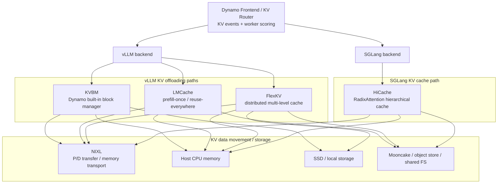

这张图的重点是：**Dynamo Router 负责让缓存状态进入调度决策，KVBM/LMCache/FlexKV/HiCache 负责不同层级和不同后端的 KV 存储与搬运。**不要把 KV-aware routing 和具体 offloading backend 混为一谈。

#### 3.11.4 KVBM：Dynamo 内置 KV Block Manager {#dynamo-11-4-kvbmdynamo-内置-kv-block-manager}

KVBM 的分层、生命周期与支持矩阵见[Dynamo 缓存管理](#dynamo-dynamo-的缓存管理)。以下保留容量与写入策略的专有配置；v1.5.0 已 deprecated，移除目标为 v1.6.0。

KVBM cache tier 主要用环境变量配置：

```bash
export DYN_KVBM_CPU_CACHE_GB=4
export DYN_KVBM_DISK_CACHE_GB=8
```

也可以用 block 数覆盖：

```bash
export DYN_KVBM_CPU_CACHE_OVERRIDE_NUM_BLOCKS=<blocks>
export DYN_KVBM_DISK_CACHE_OVERRIDE_NUM_BLOCKS=<blocks>
```

KVBM 是 write-through cache，容量配置不能只看“可用多少 CPU/SSD”。官方 guide 特别提醒：开启更多层级时容量应逐层增加。如果 GPU KV 容量是 100GB，而 `DYN_KVBM_CPU_CACHE_GB` 小于 100GB，KVBM 可能在每次 forward 后反复从 GPU offload 到 CPU，导致 churn 和性能下降，而不是收益。

Disk offloading 默认带 SSD lifespan protection：只有频率满足条件的 block 才会从 CPU 写到 disk。需要关闭时可以设置：

```bash
export DYN_KVBM_DISABLE_DISK_OFFLOAD_FILTER=true
```

对 DeepSeek 等 MLA 模型，KVBM 还提供 NCCL replicated mode：rank 0 从 G2/G3 加载 KV block，再通过 NCCL 广播给其他 GPU，避免每张 GPU 重复加载。

#### 3.11.5 LMCache：vLLM 侧 prefill-once / reuse-everywhere 缓存层 {#dynamo-11-5-lmcachevllm-侧-prefill-once-reuse-everywhere-缓存层}

LMCache 是独立 KV cache engine。Dynamo 的 LMCache integration 重点不是替代 Dynamo Router，而是让 vLLM worker 通过 LMCache connector 获得重复文本 KV 复用能力。

LMCache 的核心语义是：

| 能力 | 说明 |
|------|------|
| prefill-once | 同一段可复用文本只做一次 prefill |
| reuse-everywhere | KV 可以被其他请求或 engine instance 复用，不限于严格前缀 |
| 多级存储 | CPU RAM、local storage、Redis、GDS、InfiniStore、Mooncake 等 |
| MP sidecar | Dynamo 推荐 out-of-process `lmcache server` 模式 |

聚合式 serving 推荐路径是启动 `lmcache server`，再让 vLLM worker 使用 `LMCacheMPConnector`：

```bash
lmcache server --l1-size-gb 100 --eviction-policy LRU &

python -m dynamo.vllm \
  --model <model_name> \
  --disable-hybrid-kv-cache-manager \
  --kv-transfer-config '{"kv_connector":"LMCacheMPConnector","kv_role":"kv_both"}'
```

MP sidecar 模式的结构是：

| 组件 | 作用 |
|------|------|
| `lmcache server` | 独立 cache engine，提供 L1 memory 和可选 L2 adapter |
| vLLM worker | 通过 `LMCacheMPConnector` 读写 KV |
| Dynamo frontend/router | 仍负责请求入口、routing 和 worker 选择 |

LMCache MP server 的 L2 adapter 可接 POSIX、GDS/GDS_MT、HF3FS、Object Store、Azure Blob 等。Dynamo 文档还保留 legacy in-process 和 multiprocess metrics 脚本，但当前推荐路径是 MP sidecar。

在 P/D 分离中，LMCache 通常需要和 NIXL 组合：

| Worker | Connector 语义 |
|--------|----------------|
| Decode worker | 主要依赖 NIXL 拉取 Prefill 产生的 KV |
| Prefill worker | `PdConnector` 包装 LMCache connector 和 `NixlConnector`，既做 KV offloading，也服务 P/D transfer |

需要注意版本兼容：Dynamo 文档指出 `LMCacheMPConnector` 对 vLLM 0.20+ 的 GPU KV format 需要 LMCache 侧对应修复；在正式 release 尚未包含修复时，需要从 LMCache main 或指定 PR 构建。

#### 3.11.6 FlexKV：分布式多级 KV cache runtime {#dynamo-11-6-flexkv分布式多级-kv-cache-runtime}

FlexKV 是面向推理引擎的分布式 KV cache runtime。Dynamo FlexKV integration 侧重把 FlexKV 接入 vLLM backend，让 worker 获得 CPU/SSD/scalable storage 的分层 offloading 和跨节点复用能力。

FlexKV 的核心模块：

| 模块 | 作用 |
|------|------|
| StorageEngine | 初始化 GPU -> CPU -> SSD/Cloud 三级缓存，以 block 粒度保存 KV |
| GlobalCacheEngine | 控制面，负责 RadixTree prefix matching、空间管理和 eviction |
| TransferEngine | 数据面，执行多线程、异步、高性能 I/O 数据搬运 |

启用 FlexKV 的最小方式：

```bash
export DYNAMO_USE_FLEXKV=1
python -m dynamo.vllm \
  --model Qwen/Qwen3-0.6B \
  --kv-transfer-config '{"kv_connector":"FlexKVConnectorV1","kv_role":"kv_both"}'
```

常见配置：

| 配置 | 作用 |
|------|------|
| `DYNAMO_USE_FLEXKV=1` | 启用 Dynamo vLLM FlexKV integration |
| `FLEXKV_CPU_CACHE_GB` | CPU memory cache 容量 |
| `FLEXKV_CONFIG_PATH` | 指向 FlexKV YAML 配置 |
| `ssd_cache_gb` / `ssd_cache_dir` | SSD tier 容量和目录 |
| `enable_gds` | SSD I/O 启用 GPU Direct Storage |

FlexKV 的差异化在跨节点复用：

| 能力 | 说明 |
|------|------|
| Distributed RadixTree | 各节点维护全局索引的本地快照 |
| Lease mechanism | 保障跨节点数据有效性 |
| RDMA transfer | 分布式复用可借助 Mooncake Transfer Engine |
| io_uring / GDS | 提升 SSD 和 GPU 相关数据路径性能 |

P/D 分离下 FlexKV 仍属实验性路径。官方文档强调 Prefill worker 不能只把 `FlexKVConnectorV1` 放在顶层，而要用 `PdConnector` 包装两个子 connector：

```json
{
  "kv_connector": "PdConnector",
  "kv_role": "kv_both",
  "kv_connector_extra_config": {
    "connectors": [
      {"kv_connector": "FlexKVConnectorV1", "kv_role": "kv_both"},
      {"kv_connector": "NixlConnector", "kv_role": "kv_both"}
    ]
  },
  "kv_connector_module_path": "kvbm.vllm_integration.connector"
}
```

这里 FlexKV 负责 KV offload/onboard，NIXL 负责 P/D worker 之间的 KV transfer。

#### 3.11.7 SGLang HiCache：RadixAttention 的分层缓存扩展 {#dynamo-11-7-sglang-hicacheradixattention-的分层缓存扩展}

HiCache 的层次、RadixTree 与写回机制见[Mooncake HiCache](#mooncake-hicache--与-sglang-深度集成的分层-kv-缓存)。这里集中说明 Dynamo 的透传参数与共享缓存路由。

启动 SGLang HiCache 的参数是 SGLang-native，Dynamo 透传：

```bash
python -m dynamo.sglang \
  --model-path Qwen/Qwen3-0.6B \
  --page-size 64 \
  --enable-hierarchical-cache \
  --hicache-ratio 2 \
  --hicache-write-policy write_through \
  --hicache-storage-backend nixl \
  --skip-tokenizer-init
```

如果只是单 worker、无 shared external pool，Dynamo 不需要额外配置；worker 正常上报 KV events，Router 按已有逻辑工作。

多 worker 共享 Mooncake 等外部池时，Dynamo 可以做 tier-aware shared cache routing：

| Dynamo 增强 | 说明 |
|-------------|------|
| tier-aware routing | Router 识别 block 位于 GPU、Host、External 哪个 tier |
| shared-pool awareness | Router 并行查询 Mooncake 等共享池，把“可从外部取回”的 block 纳入评分 |
| scoring discount | `shared-cache-multiplier` 表示 shared hit 相对重新 prefill 的成本折扣 |

默认 Router 的 radix tree 只看 worker GPU HBM 上的 block。HiCache 会把 block demote 到 host 或 Mooncake，如果 Router 不知道这些 tier，就会把“可毫秒级取回的 block”和“必须重新 prefill 的 block”都当成 cold miss。Dynamo 的 HiCache integration 通过 tier 事件和 shared-pool 查询修正这个问题。

启用 shared cache routing 的前端参数：

```bash
python -m dynamo.frontend \
  --http-port 8000 \
  --router-mode kv \
  --shared-cache-type hicache \
  --shared-cache-multiplier 0.5
```

前提是 SGLang worker 以 Mooncake backend 启动，并在 registration metadata 中发布 `sglang_hicache_mooncake` 相关信息。Dynamo 文档要求 SGLang 0.5.11 或更高版本，因为早期版本不会为 host-tier residency 发送 `medium=CPU_PINNED` 事件。

#### 3.11.8 四种路径对比与选型 {#dynamo-11-8-四种路径对比与选型}

| 场景 | 推荐起点 | 原因 |
|------|----------|------|
| vLLM + Dynamo 官方内置路径 | KVBM | 和 Dynamo Router、NIXL、P/D 分离、metrics 集成最直接 |
| vLLM + 重复上下文/RAG/多轮对话 | LMCache | prefill-once / reuse-everywhere 语义更贴合重复文本复用 |
| vLLM + SSD/GDS/io_uring/跨节点 KV runtime | FlexKV | 分布式 RadixTree、多级存储和高性能 I/O 是核心优势 |
| SGLang backend + 分层 RadixAttention cache | HiCache | SGLang-native，Dynamo 主要增强 tier-aware routing |
| 单 worker、短 prompt、低复用率 | 不一定开启 offload | offload/onboard 和事件维护可能超过收益 |

落地时应先回答四个问题：

| 问题 | 决策影响 |
|------|----------|
| 后端是 vLLM 还是 SGLang？ | vLLM 选 KVBM/LMCache/FlexKV，SGLang 优先看 HiCache |
| 缓存命中来自哪里？ | 前缀复用、重复文本、跨会话、跨节点，分别适合不同路径 |
| 容量瓶颈在哪？ | GPU HBM、Host memory、SSD、外部共享池 |
| Router 是否知道缓存位置？ | 不知道 tier/location 时，offloading 只能省显存，不能充分优化调度 |

共性风险：

| 风险 | 说明 |
|------|------|
| KV-aware routing 不等于 offloading backend | Router 需要事件视图，backend 负责存储和搬运 |
| 多级缓存不是免费扩容 | CPU/SSD/L3 onboard/offload 会影响 TTFT/ITL |
| 外部池需要一致元数据 | page size、TP/PP layout、split-head layout、master address 等必须一致 |
| connector 组合容易配错 | P/D 场景通常要组合 offload connector 与 NIXL connector |
| 版本强相关 | Dynamo、vLLM、SGLang、LMCache、FlexKV 的 connector API 都会随 release 演进 |

#### 3.11.9 Dynamo 与 ModelExpress {#dynamo-11-9-dynamo-与-modelexpress}

ModelExpress 是 Dynamo 生态里的**模型权重生命周期与冷启动加速组件**。它关注的是模型文件、权重、JIT 编译产物如何更快到达新 worker；KVBM、LMCache、FlexKV、HiCache 关注的是请求运行期间产生的 KV block 如何复用、迁移和分层存储。两者都能降低延迟或扩容成本，但服务的对象完全不同。

本节固定到 ModelExpress 独立稳定版 `v0.6.0@e91f650aa6a1847959e7f7da1b39c19e16b312e3`。v0.5.0 把任意 artifact/JIT cache transfer、accelerator backend 与 XPU、版本化 source discovery、rendezvous hashing、stale-source 处理和 engine-health-gated publication 纳入稳定版；v0.5.1 回补 TensorRT-LLM 一等集成并兼容 protobuf 6 runtime；v0.6.0 再把 RL post-training 的 reshard-refit、Prometheus 基础、S3 provider、Helm/CRD/RBAC 和异构 CUDA/XPU source 纳入正式 Release。它不是 Dynamo v1.4.2 的内嵌组件或强制依赖。组合部署仍需分别固定并验证 Dynamo runtime image 与 ModelExpress image/plugin，不能仅凭两个项目各自最新就推断兼容。

##### 3.11.9.1 v0.6.0 稳定增量与升级边界 {#dynamo-v0-6-0-稳定增量与升级边界}

| 领域 | v0.6.0 行为 | 操作边界 |
|------|-------------|----------|
| RL reshard-refit | 不做全量 gather，按 slice 在不同 TP、Megatron/HuggingFace shard layout 之间重分片并原地 refit；包含 Megatron target lowering、HuggingFace zero-copy alias、FSDP/Megatron trainer publisher、RL generator client 与 peer refit strategy | 这是训练权重到推理引擎的更新平面，不是 KV cache 同步；必须固定训练 step、目标 layout、TP/EP rank 和 engine adapter，不能只按模型名匹配 |
| 正确性与生命周期 | Redis 协调 refit 生命周期，记录 stage 和 training step；coverage gate、per-shard digest 与不可能 wire-rate 检查用于拒绝不完整或异常更新 | digest 提供后续核验材料，不等于端到端模型语义验证；发布说明明确早期 M2N weight-sync 探索已被移除，不能把它写成 v0.6.0 能力 |
| 传输性能 | strided TP pull 限制 descriptor 数，peer RDMA read 可重叠，三段 refit read 合并批量提交 | source/target 仍需兼容 NIXL、registered memory 和 shard identity；source reader teardown 后 wedge 被列为 known issue，滚动升级要验证重连与回退 |
| 可观测性 | server 增加 Prometheus 基础以及 per-RPC、storage backend、download、cache、NIXL lifecycle 指标 | 指标用于定位 ModelExpress 控制面和传输面，不可替代 Dynamo Frontend/Router、engine 与 GPU 指标；升级后应重新固定 metric name 和 label cardinality |
| 模型来源 | S3 成为与 HuggingFace、NGC、GCS 并列的一等 provider；支持 pinned HuggingFace revision，并可在 worker 无共享存储时从 server cache 加载 | S3 provider 与 ModelStreamer 的对象存储路径要按实际 schema 区分；revision 必须写入 source identity 和实验元数据，避免同名模型漂移 |
| Kubernetes/Helm | chart 可安装 CRD、提供 cluster-wide metadata RBAC，image tag 默认跟随 `appVersion`，不再默认注入 NGC pull secret，并修正实际读取的 log-level 变量 | 旧集群必须先按官方说明更新 CRD；cluster-wide RBAC 会扩大权限面，应审计 ServiceAccount，而不是直接沿用开发 values |
| 异构 accelerator | NIXL weight source 可以跨 CUDA/XPU peer，延续 v0.5.0 的 `AcceleratorBackend` 抽象 | “可发现异构 source”不代表 tensor layout、dtype、kernel artifact 或运行时 ABI 自动兼容；每种 source-target 组合仍需独立验收 |
| 安全与传输 | gRPC 可用 Kubernetes ServiceAccount 鉴权；TLS 默认 rustls、OpenSSL 为 opt-in | 不应因启用 cluster-wide metadata RBAC 就省略传输鉴权；证书、ServiceAccount audience 和 namespace 授权需一起验证 |

v0.6.0 同时强化 vLLM、SGLang 与 TensorRT-LLM adapter：包括 vLLM MTP/EP 与 RDMA 后 attention scale 刷新、SGLang TVM-FFI artifact 和 TransferEngine failure fallback、原生 TensorRT-LLM adapter/P2P 示例。它们仍是各 engine 的版本组合能力；Dynamo v1.4.2 固定的 runtime 矩阵不会因为单独升级 ModelExpress 自动前移。

##### 3.11.9.2 v0.5.1 历史补丁边界 {#dynamo-v0-5-1-历史补丁边界}

| 变化 | v0.5.1 行为 | 不变项 / 操作建议 |
|------|-------------|-------------------|
| TensorRT-LLM | Python client 提供 `modelexpress.engines.trtllm` adapter/loader，使用原生 `checkpoint_format="MX"` 为 Llama-family 模型执行 P2P weight transfer；旧的 `LoadFormat.PRESHARDED`/patch 注入路径被替换 | 功能仍标为 beta；按固定示例核对 TRT-LLM 版本、TP rank、NIXL fabric 和 checkpoint layout，不能把 vLLM/SGLang 参数直接复制过来 |
| protobuf 6 | client 的生成消息/类型检查兼容 protobuf 6 runtime，同时保留既有版本下限 | 这是客户端兼容修复，不改变 server wire contract；混合环境仍应锁定 Python client 与 protobuf 组合做回归 |
| transfer plane | release notes 明确 loader、registry 和 P2P transfer plane 除上述集成外没有变化 | 既有 source discovery、rendezvous hashing、stale-source 与 health-gated publication 结论沿用 v0.5.0；不得虚构新的 registry 或传输一致性语义 |

| 维度 | ModelExpress | KV cache/offloading 系统 |
|------|--------------|--------------------------|
| 管理对象 | 模型权重、模型文件、JIT artifact、下载状态 | runtime KV block、prefix/page/block residency |
| 主要收益 | 降低冷启动、扩容、模型下载和 warmup 成本 | 降低 TTFT、减少重复 prefill、扩大有效上下文容量 |
| 典型路径 | HuggingFace/NGC/GCS -> cache -> worker，或 GPU-to-GPU RDMA | GPU HBM -> CPU -> SSD -> 外部池，或跨 worker KV transfer |
| 关键接口 | ModelExpress gRPC、CLI、vLLM/SGLang loader | vLLM connector、SGLang HiCache、Dynamo Router events |
| 与 Dynamo 的关系 | 服务于 DGD/worker 启动与扩容 | 服务于请求调度、P/D 分离与运行期缓存复用 |

##### 3.11.9.3 核心定位 {#dynamo-核心定位}

Dynamo 负责把推理服务组织成 Frontend、Router、runtime worker、Planner、Operator 和 Kubernetes CRD。ModelExpress 则补上“worker 拿到模型之前”的生命周期管理：

| 问题 | ModelExpress 的作用 |
|------|---------------------|
| 多个 worker 同时从外部仓库拉模型 | 用分布式 registry 协调下载状态，避免重复下载和外部入口流量放大 |
| 新 replica 扩容时磁盘加载慢 | 已有 replica 可作为 source，通过 NIXL/RDMA 直接传权重 |
| vLLM/Triton/DeepGEMM 等 JIT warmup 慢 | 兼容的编译缓存可作为 artifact 从 ready source 传给新 replica |
| 无共享存储或共享存储性能差 | 支持 gRPC streaming、P2P transfer、ModelStreamer/object storage 等路径 |
| Kubernetes 中需要统一模型缓存状态 | Redis 或 Kubernetes CRD 保存模型生命周期和 P2P source metadata |

这意味着 ModelExpress 不决定某个请求路由到哪个 worker，也不维护 per-request KV 命中视图。Dynamo Router 仍然根据 worker、endpoint、KV events、load metrics 等信息做调度；ModelExpress 主要影响 worker 的 ready 时间和 scale-out 成本。

##### 3.11.9.4 组件结构 {#dynamo-组件结构}

ModelExpress 当前实现以 Rust server 和 Python/Rust client 为核心：

| 组件 | 作用 |
|------|------|
| `modelexpress-server` | gRPC server，负责模型下载、cache registry、LRU eviction、P2P source metadata 协调 |
| Rust CLI/client | `modelexpress-cli health/download/list/validate/clear`，可用于 init container 或运维操作 |
| Python client | vLLM、SGLang、TRT-LLM loader/adapters，负责 source 发布、P2P 拉取和 artifact 安装 |
| metadata backend | Redis、Kubernetes CRD，或特定 P2P 场景下的 `k8s-service` 去中心发现；RL refit 生命周期使用 Redis 协调 |
| cache directory | 模型文件缓存根目录，可落在本地盘、PVC、RWX 共享卷或临时卷 |
| metrics endpoint | Prometheus per-RPC、storage、download、cache 与 NIXL lifecycle 指标 |

ModelExpress gRPC 面可以分成两类：

| 服务 | 关键 RPC | 用途 |
|------|---------|------|
| `ModelService` | `EnsureModelDownloaded`、`StreamModelFiles`、`ListModelFiles`、`DeleteModel` | 管理模型文件下载、状态流、无共享存储 streaming、清理模型记录 |
| `P2pService` | `PublishMetadata`、`ListSources`、`GetMetadata`、`UpdateStatus` | 发布和查询可作为 P2P source 的 worker metadata |
| `WorkerService` | `GetTensorManifest`、`GetArtifactManifestHeader`、`GetArtifactManifestChunks`、`PrepareArtifactChunk`、`ReleaseArtifactChunk` | source worker 侧暴露 tensor/artifact manifest，并为 NIXL chunk transfer 准备 registered buffer |

`ModelService` 解决“模型文件在不在本地 cache 里”的问题；`P2pService` 和 `WorkerService` 解决“哪一个 running worker 已经有可复用权重或 artifact，以及如何传给目标 worker”的问题。

##### 3.11.9.5 两种 Dynamo 集成路径 {#dynamo-两种-dynamo-集成路径}

ModelExpress 在 Dynamo 中有两条典型路径，生产上可以二选一，也可以组合使用。

| 路径 | 适合场景 | 数据流 | 关键代价 |
|------|----------|--------|----------|
| 模型文件缓存 | 小中模型、共享 PVC 可接受、主要瓶颈是外部下载 | ModelExpress server 下载到 cache，Dynamo worker 从 cache path 加载 | 仍然需要 worker 从磁盘/PVC 读权重 |
| P2P 权重传输 | 大模型、多副本、扩容频繁、磁盘读或 JIT warmup 成本高 | 首个 worker 加载并发布 source，后续 worker 通过 RDMA 接收权重和 JIT artifact | 需要 RDMA/NIXL、rank/layout/identity 严格一致 |

模型文件缓存路径的 Dynamo 示例是 `examples/dynamo_model_cache_k8s/agg.yaml`。它把 ModelExpress Server、Redis、VLLM Worker、Frontend 和共享模型缓存卷放在一个 DynamoGraphDeployment 风格的部署里：ModelExpress 先下载模型并建立 cache path，worker 再用这个路径启动。

P2P 权重传输路径的 Dynamo 示例是 `examples/dynamo_p2p_transfer_k8s/`。它面向 `DynamoGraphDeployment`，让 vLLM worker 使用 ModelExpress load format（常见写法是 `--load-format modelexpress`，部分较新 Dynamo/ModelExpress 镜像也文档化为 `--load-format mx`）。第一个 replica 从磁盘加载并发布 metadata，后续 replica 发现 ready source 后从已有 worker 拉取权重；如果配置 `MX_ARTIFACT_TRANSFER=1`，兼容的 JIT cache 也可以随扩容复用。

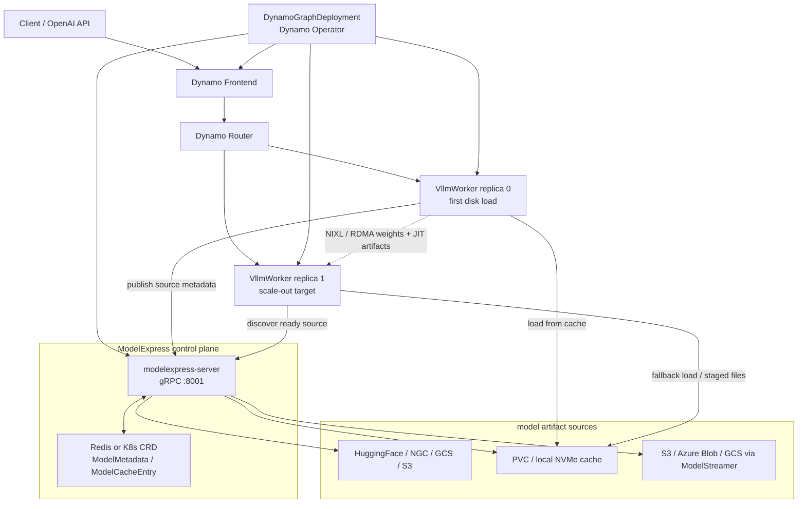

这张图的重点是：ModelExpress 的 metadata/control path 经过 server 和 Redis/CRD；真正的大块权重传输不经过 server，而是在 source worker 与 target worker 之间通过 NIXL/RDMA 走数据面。

##### 3.11.9.6 metadata 与生命周期 {#dynamo-metadata-与生命周期}

ModelExpress 保存两类 metadata：

| metadata | Redis key/CRD | 生命周期 |
|----------|---------------|----------|
| P2P source metadata | Redis `mx:source:*` 或 `ModelMetadata` CRD | source worker 发布，heartbeat 刷新，停止后进入 stale 并被 reaper 清理 |
| 模型下载/cache lifecycle | Redis `mx:model:*` 或 `ModelCacheEntry` CRD | server 记录 `DOWNLOADING`、`DOWNLOADED`、`ERROR`，供多副本协调下载和 LRU eviction |

P2P source 的身份不是简单的 model name，而是 `SourceIdentity` 的内容哈希。它包含 model、backend framework、TP/PP/EP degree、dtype、quantization、revision、framework/CUDA/Triton/GPU arch 等影响兼容性的字段。server 计算 `mx_source_id = SHA256(canonical_json(identity))[:16]`，相同 identity 的 source 才会被视为可互相复用。

这个设计很重要：如果两个 worker 的模型名相同，但量化方式、TP 切分、revision 或编译环境不同，直接复用 GPU tensor 或 JIT artifact 可能造成错误权重、layout 错位或运行时崩溃。ModelExpress 用 identity hash 把这些差异前置到发现阶段。

source 状态大致是：

| 状态 | 含义 |
|------|------|
| `INITIALIZING` | worker 已发布 metadata，但 NIXL 或 runtime readiness 尚未确认 |
| `READY` | source 可被 target 拉取权重或 artifact |
| `STALE` | source 已退出或 heartbeat 超时，metadata 等待 GC |

需要注意：Redis metadata 不依赖 Redis TTL 自动过期。P2P stale detection 和清理由 server-side reaper 处理；模型生命周期记录会在 cache eviction 删除模型时被删除。对运维来说，清理策略应看 ModelExpress registry/eviction，而不是只看 Redis key TTL。

##### 3.11.9.7 cache、存储与清理策略 {#dynamo-cache-存储与清理策略}

ModelExpress 的模型文件 cache 由 `MODEL_EXPRESS_CACHE_DIRECTORY` 指定，默认是 `./cache`。部署形态不同，cache volume 的含义也不同：

| 部署形态 | cache 形态 | 说明 |
|----------|------------|------|
| 单副本或单节点 | 本地盘或 RWO PVC | 简单，适合开发或单节点服务 |
| 多 worker 共享模型文件 | RWX PVC 或共享文件系统 | 多个 worker 可直接读同一份模型文件，但共享存储性能会成为瓶颈 |
| 多 ModelExpress server，无共享存储 | 每个 server 自己的 RWO/ephemeral cache，加 gRPC streaming | 适合不想依赖 RWX 的集群，但 client/init container 需要配合 |
| Model provider / ModelStreamer | object storage 或 PVC/local path | v0.6.0 server 可直接使用一等 S3 provider；client 侧 ModelStreamer 仍可从 S3、Azure Blob、GCS、本地路径流式加载 |
| P2P RDMA receiver | receiver 不一定需要模型落盘 | target 可直接接收 GPU 权重；source 仍通常需要磁盘或预加载来源 |

cache eviction 是 ModelExpress 自己的 registry 驱动逻辑，默认启用 LRU 方向的清理。常见配置包括：

| 配置 | 作用 |
|------|------|
| `MODEL_EXPRESS_CACHE_EVICTION_ENABLED` | 启用或关闭 cache eviction |
| `cache.max_size_bytes` | 限制 cache 总大小 |
| `eviction.policy.unused_threshold` | 删除超过指定时长未使用的模型，默认配置示例为 7 天 |
| `eviction.policy.max_models` | 限制保留模型数量 |
| `eviction.check_interval` | eviction 检查周期，默认配置示例为 1 小时 |
| `modelexpress-cli model clear <model>` | 手工删除模型 registry 记录和对应 cache |

这和 Mooncake DFS 持久化或 KV cache SSD offload 的容量治理不同。ModelExpress 清理的是模型文件和模型生命周期记录；KV cache 系统清理的是请求运行期 block/page。不要把二者的容量、命中率和驱逐策略合并成一个指标。

部署时最常见的变量如下：

| 配置 | 作用 |
|------|------|
| `MX_METADATA_BACKEND` | 选择 metadata backend，常见值为 `redis`、`kubernetes`，特定 P2P 路径可用 `k8s-service` |
| `REDIS_URL` / `MX_REDIS_HOST` / `MX_REDIS_PORT` | Redis backend 的连接配置 |
| `POD_NAMESPACE` / `MX_METADATA_NAMESPACE` | Kubernetes CRD backend 使用的 namespace |
| `MX_SERVER_ADDRESS` | ModelExpress client 推荐使用的 server 地址 |
| `MODEL_EXPRESS_URL` | 旧变量；Dynamo 示例仍会使用，和 `MX_SERVER_ADDRESS` 并设更稳妥 |
| `MODEL_EXPRESS_CACHE_DIRECTORY` | 模型文件 cache 根目录 |
| `MODEL_EXPRESS_NO_SHARED_STORAGE` | 无共享存储时走 gRPC streaming |
| `MODEL_EXPRESS_CACHE_EVICTION_ENABLED` | 启用或关闭模型 cache eviction |
| `MX_ARTIFACT_TRANSFER` | 启用兼容 JIT artifact transfer |

v0.6.0 的 Helm 默认值发生了部署层变化：新装 chart 的 image tag 跟随 `appVersion`，默认不再假定存在 NGC pull secret，Kubernetes metadata backend 可安装 CRD 并申请 cluster-wide RBAC。升级已有 release 时应先 diff 渲染后的 CRD、ClusterRole/Binding、ServiceAccount 与 imagePullSecrets；不能把新默认值直接覆盖到已有私有镜像和最小权限配置。

##### 3.11.9.8 P2P 权重和 JIT artifact 传输 {#dynamo-p2p-权重和-jit-artifact-传输}

vLLM 路径中，ModelExpress 通过 load format 接入：

```bash
vllm serve deepseek-ai/DeepSeek-V4-Pro \
  --load-format modelexpress \
  --tensor-parallel-size 8 \
  --trust-remote-code
```

ModelExpress 部署文档说明，vLLM 0.23.0 及以上已经原生识别 `modelexpress` load format，`mx` 仍可作为兼容 alias；更旧版本通常需要在镜像中安装 ModelExpress plugin，并用 `VLLM_PLUGINS=modelexpress` 注册 loader。Dynamo 文档中也存在使用 `mx`、`mx-source`、`mx-target` 的较新或较旧镜像说明，因此生产部署应以所选 runtime image 的 ModelExpress 文档为准。Dynamo 集成当前仍会使用 `MODEL_EXPRESS_URL`，而 ModelExpress 新路径推荐 `MX_SERVER_ADDRESS`；生产部署可以两个都设置，以减少版本切换风险。

P2P transfer 的关键约束：

| 约束 | 原因 |
|------|------|
| RDMA/NIXL 可用 | 大块 GPU-to-GPU 权重传输依赖高速数据面 |
| source 与 target 的 TP/PP/EP、dtype、quantization、revision 一致 | tensor layout 和内容必须兼容 |
| source 必须保持 READY 且 rkey 有效 | source 重启会让远端 key 失效，需要 reaper/重试/清理 |
| worker rank 匹配 | target 通常要找相同 rank 的 source 拉取对应 shard |
| artifact 与编译环境匹配 | torch/Triton/CUDA/GPU arch/compile config 不一致时不能安全复用 |

JIT artifact transfer 覆盖的不只是权重，还包括 TorchInductor、Triton、DeepGEMM、TileLang、CuTe DSL、FlashInfer 等 cache source type。它的价值在于扩容时不用每个新 replica 都重新编译 kernel 或重新构建 warmup 产物。

SGLang 路径中，ModelExpress 作为 `remote_instance` 的 weight loader backend：

```bash
python -m sglang.launch_server \
  --model-path deepseek-ai/DeepSeek-V3 \
  --tp 8 \
  --load-format remote_instance \
  --remote-instance-weight-loader-backend modelexpress \
  --modelexpress-config '{"transport": "nixl"}'
```

如果使用 Mooncake TransferEngine，可把 `transport` 改成 `transfer_engine`，但镜像中需要安装对应 Mooncake 包。Dynamo 自身仍负责 SGLang worker 的 runtime 接入和路由，ModelExpress 只负责权重加载路径。

##### 3.11.9.9 backend 选择 {#dynamo-backend-选择}

ModelExpress 的 metadata backend 选择会影响可支持的工作负载：

| backend | 适合场景 | 不适合场景 |
|---------|----------|------------|
| Redis | 通用生产路径、动态 worker、多 revision、多 source | 需要额外 Redis 运维 |
| Kubernetes CRD | K8s-native、希望用 `ModelMetadata` 和 `ModelCacheEntry` 做状态对象 | 需要 CRD、RBAC、controller/runtime 权限配置 |
| `k8s-service` | stable-weight inference、无中心 server、只想依赖 Service 负载均衡 | RL live refit、hot swap、长时间 mixed revision、异构 pool、per-worker 精确寻址 |

`k8s-service` 后端容易被误用。它不是 Redis/CRD 的等价轻量替代，而是为“pod 生命周期内权重不变”的同质 serving pool 做的去中心发现路径。只要需要 live weight update、训练循环 refit、同一服务内长期混跑多个模型 revision，就应选 Redis 或 Kubernetes CRD 这类 central coordinator。

##### 3.11.9.10 与 KVBM、LMCache、FlexKV、HiCache 的组合 {#dynamo-与-kvbm-lmcache-flexkv-hicache-的组合}

ModelExpress 与 KV cache 系统可以叠加：

| 组合 | 效果 |
|------|------|
| ModelExpress + KVBM | worker 更快 ready，运行期 KV block 可在 GPU/CPU/disk/NIXL 路径中复用和 offload |
| ModelExpress + LMCache | 扩容时权重和 JIT cache 更快到位，请求间重复上下文由 LMCache 复用 |
| ModelExpress + FlexKV | 权重冷启动和分布式 KV 多级存储分别优化，适合大模型、多节点、SSD/GDS 场景 |
| ModelExpress + SGLang HiCache | ModelExpress 加速 SGLang replica 权重加载，HiCache 处理 RadixAttention 的分层 KV |

如果系统瓶颈是“新 pod 启动几十分钟才 ready”，优先评估 ModelExpress。如果瓶颈是“ready 后长上下文 prefill 太贵或多轮会话重复计算”，优先评估 KV-aware routing 与 KV cache/offloading。两类优化不要互相替代。

---

### 3.12 实践建议 {#dynamo-实践建议}

#### 3.12.1 选型路径 {#dynamo-12-1-选型路径}

| 目标 | 建议起点 |
|------|----------|
| 快速试用 | container quickstart + `--discovery-backend file` |
| 单后端生产服务 | Kubernetes DGD + Dynamo-native Frontend |
| 模型冷启动或扩容慢 | ModelExpress model cache 或 P2P weight transfer |
| 长上下文服务 | KV Router + KVBM 或后端对应 KV offload |
| Prefill/Decode 压力明显不同 | Disaggregated serving + Planner |
| 平台统一入口 | Gateway API + GAIE + EPP |
| 评估 Planner | 先用 advisory mode 观察建议，再允许执行 |

#### 3.12.2 常见误区 {#dynamo-12-2-常见误区}

| 误区 | 正确理解 |
|------|----------|
| Dynamo 可以替代 vLLM/SGLang/TRT-LLM | Dynamo 是上层编排层，仍依赖后端引擎执行模型 |
| KV-aware routing 等于 KVBM | Router 负责路由可见性，KVBM 负责 block 存储与迁移 |
| ModelExpress 等于 KV cache | ModelExpress 管理模型权重、模型文件和 JIT artifact；KV block 仍由 KVBM、LMCache、FlexKV、HiCache 等路径处理 |
| P/D 分离一定更快 | 小模型或短 prompt 中传输开销可能超过收益 |
| 开启 KVBM 就能无限上下文 | 容量扩大不等于零成本，onboard/offload 会影响延迟 |
| 用 QPS 扩缩即可 | LLM 需要考虑 ISL、OSL、KV hit、TTFT、ITL |
| JetStream 可只在 Frontend 开启 | durable KV events 需要 Frontend 和所有 workers 一致配置 |
| KVBM 仍是新部署推荐路径 | v1.4.0 已 deprecated KVBM，v1.4.2 未撤销该状态；保留本文章节只为解释既有架构和迁移 |

#### 3.12.3 从 v1.2.x 升级到 v1.3.0 {#dynamo-12-3-从-v1-2-x-升级到-v1-3-0}

| 变化 | v1.3.0 行为 | 升级动作 |
|------|-------------|----------|
| CUDA | 不再发布 CUDA 12.9 runtime，裸 tag 和 `-cuda13` 均为 CUDA 13 | 升级 driver/toolkit，逐后端验证 vLLM/SGLang/TRT-LLM 镜像 |
| 多模态 | 必须显式 `--enable-multimodal`；旧 backend-specific flags 已弃用 | Prefill/Decode 都补新 flag，独立 encoder 再补 `--dedicated-mm-encoder` |
| disaggregation mode | 默认值改为 `agg`，`prefill_and_decode` 弃用 | 聚合使用 `agg`，组合 P/D 使用 `pd` |
| GMS / DRA | 要求 Kubernetes 1.34+ `resource.k8s.io/v1`，改为声明 client containers | 先升级集群与 DRA driver，再迁移 `extraClientContainers`/checkpoint 配置 |
| Router backpressure | queue threshold `4.0 -> 16.0`，active-prefill threshold fraction `10.0 -> 64.0` | 需要旧行为时显式固定旧值，并用队列/TTFT 指标重新压测 |
| Agent routing | `nvext.agent_context`、`session_control`、sticky-session 移除 | 改用 trajectory headers，不再发送旧 request-body 字段 |
| Planner key | 错拼 `decode_sacle_up_kv_rate` 移除 | 改为 `decode_scale_up_kv_rate` |
| DGD restart | 创建时的 `spec.restart.id` 视为已观察，不触发 restart | 创建后再更新 `spec.restart.id` |
| vLLM runner | 不再强制默认 `generate` | 依赖旧行为时显式传 `--runner generate` |

v1.4.0 又把 `--router-queue-threshold` 从 `16.0` 改为 unset (`None`)：不显式设置数值时 queueing 关闭。v1.4.1 修复 overload mark 的恢复，但没有恢复旧阈值。升级到 v1.4.2 不能只继承 v1.3.0 的容量结论，应根据 aggregate ISL、`max_num_batched_tokens` 和真实 TTFT/ITL 重新选择阈值，并覆盖 overload→healthy 状态转换。

##### 3.12.3.1 v1.4.2 EFA、NIXL 与 breaking-change 升级检查 {#dynamo-v1-4-2-efa-nixl-与-breaking-change-升级检查}

| 检查项 | v1.4.2 要求 |
|--------|-------------|
| 镜像 | 固定 `v1.4.2` runtime image digest；不要只替换 Dynamo wheel 而保留旧 EFA/Frontend/SGLang 镜像 |
| Frontend / SGLang | 在实际启动用户下用 dynamic loader 验证 `libnixl_capi.so` 可解析；Python `import nixl` 成功不足以证明 Rust binding 未落入 stub。各后端 NIXL 版本按 release matrix 核对，不要求统一为同一版本 |
| EFA 栈 | 确认 EFA image 使用 Installer `1.50`，同时验证 host driver/设备插件兼容；非 EFA image 不继承该版本承诺 |
| GB200 回归 | 覆盖新 decode worker、worker restart、连续 P/D KV transfer，并把空 HTTP 200/零 token 视为失败 |
| PCIe 拓扑 | 申请部分 EFA device 时验证 GPU/NIC locality；无法保证时申请整节点 EFA 或使用协同 DRA |
| 观测 | 同时检查 completion token、约 10--20 秒与约 300 秒超时特征、`Lost connection with prefill instance` 和 EFA counters |
| Router | 确认 queue threshold 从 `16.0` 变为 unset，endpoint-scoped events 不与旧 consumer 混跑 |
| Metadata | `DYN_SELF_HOST_METADATA` 从默认关闭变为默认开启；显式记录是否允许 self-host metadata |
| Helm | 内置 NATS subchart 默认关闭，预先验证外部 NATS/JetStream 地址和凭据 |
| Trace | 从 `DYN_AUDIT_*` 迁到 `DYN_REQUEST_TRACE_*`，并只配置必要的 header allowlist |
| 新 endpoint | 对 `/v1/classify`、`/v1/pooling` 分别验证模型 capability、binary encoding、截断与错误响应；不要沿用生成 endpoint 的 streaming 判据 |
| Profiling | 若流程依赖 `nsys --enable=efa_metrics`，先迁移到单独工具镜像；v1.4.2 shipped images 已移除该 plugin |

#### 3.12.4 生产落地检查清单 {#dynamo-12-4-生产落地检查清单}

| 类别 | 检查项 |
|------|--------|
| 后端 | 确认所选 release 的 backend feature matrix |
| 路由 | 动态 endpoint、`ModelInput.Tokens`、worker KV events 配置正确 |
| 缓存 | 明确 G1/G2/G3/G4 容量、清理策略、offload 成本 |
| ModelExpress | 明确 metadata backend、模型 cache 路径/PVC、provider 凭据、LRU 清理、RDMA/NIXL、vLLM/SGLang load format、CRD/RBAC |
| 网络 | 确认 NIXL 所需 RDMA/NVLink/UCX/GDS 等能力 |
| Kubernetes | GPU Operator、Dynamo Operator、CRD、webhook、Prometheus 可用 |
| Planner | SLA 目标、GPU budget、`min_endpoint`、scale-down sensitivity 合理 |
| 观测 | Frontend/Router/Backend/Planner/Operator 指标接入 Grafana |
| 容错 | graceful shutdown、request cancellation/migration、discovery lease 行为已测试 |
| 升级 | CUDA 13、DGD `v1beta1`、DRA/GMS、trajectory headers、Router 新默认值均已通过预生产回放 |

---

### 3.13 附录：关键命令与参考资料 {#dynamo-附录关键命令与参考资料}

#### 3.13.1 常用命令 {#dynamo-a-1-常用命令}

Frontend：

```bash
python -m dynamo.frontend --http-port 8000
python -m dynamo.frontend --router-mode kv --http-port 8000
python -m dynamo.frontend --kserve-grpc-server
```

SGLang：

```bash
python3 -m dynamo.sglang --model-path Qwen/Qwen3-0.6B --discovery-backend file
```

vLLM：

```bash
python3 -m dynamo.vllm --model Qwen/Qwen3-0.6B --discovery-backend file
```

TensorRT-LLM：

```bash
python3 -m dynamo.trtllm --model-path Qwen/Qwen3-0.6B --discovery-backend file
```

Kubernetes：

```bash
helm install dynamo-platform \
  oci://helm.ngc.nvidia.com/nvidia/ai-dynamo/charts/dynamo-platform \
  --version "1.0.2" \
  --namespace dynamo-system \
  --create-namespace
```

#### 3.13.2 官方参考 {#dynamo-a-2-官方参考}

| 主题 | 链接 |
|------|------|
| GitHub 仓库 | <https://github.com/ai-dynamo/dynamo> |
| 官方文档 | <https://docs.nvidia.com/dynamo/> |
| v1.5.0 Release | <https://github.com/ai-dynamo/dynamo/releases/tag/v1.5.0> |
| v1.5.0 exact source | <https://github.com/ai-dynamo/dynamo/tree/b83b1d9304ebfc624709ac46db32b1b6f1ff1615> |
| v1.4.2 Release（补丁层） | <https://github.com/ai-dynamo/dynamo/releases/tag/v1.4.2> |
| v1.4.1 Release（classify/pooling 与修复层） | <https://github.com/ai-dynamo/dynamo/releases/tag/v1.4.1> |
| v1.4.0 Release（架构增量与继承边界） | <https://github.com/ai-dynamo/dynamo/releases/tag/v1.4.0> |
| README | <https://github.com/ai-dynamo/dynamo/blob/b83b1d9304ebfc624709ac46db32b1b6f1ff1615/README.md> |
| Overall Architecture | <https://github.com/ai-dynamo/dynamo/blob/03014943323e78feb5bd672ef08b72caea0918ac/docs/fern/pages/developer-guide/knowledge-base/concepts/system-architecture/architecture-flow.md> |
| Disaggregated Serving | <https://github.com/ai-dynamo/dynamo/blob/03014943323e78feb5bd672ef08b72caea0918ac/docs/fern/pages/developer-guide/knowledge-base/concepts/system-architecture/disaggregated-serving.md> |
| Router Design | <https://github.com/ai-dynamo/dynamo/blob/03014943323e78feb5bd672ef08b72caea0918ac/docs/fern/pages/developer-guide/knowledge-base/modular-components/router/router-design.md> |
| KVBM Design | <https://github.com/ai-dynamo/dynamo/blob/03014943323e78feb5bd672ef08b72caea0918ac/docs/fern/pages/developer-guide/knowledge-base/modular-components/kvbm/kvbm-design.md> |
| Planner Design | <https://github.com/ai-dynamo/dynamo/blob/03014943323e78feb5bd672ef08b72caea0918ac/docs/fern/pages/developer-guide/knowledge-base/modular-components/planner/planner-design.md> |
| Spica（实验性） | <https://github.com/ai-dynamo/dynamo/tree/03014943323e78feb5bd672ef08b72caea0918ac/aisimulate/src/aisimulate/spica> |
| vLLM-Omni Disaggregated Serving | <https://github.com/ai-dynamo/dynamo/blob/03014943323e78feb5bd672ef08b72caea0918ac/docs/fern/pages/developer-guide/knowledge-base/modular-components/backends/vllm/vllm-omni-disaggregated-serving.md> |
| Request Traces | <https://github.com/ai-dynamo/dynamo/blob/03014943323e78feb5bd672ef08b72caea0918ac/docs/fern/pages/reference/observability/request-traces.mdx> |
| v1.4.0 Breaking Changes | <https://github.com/ai-dynamo/dynamo/blob/03014943323e78feb5bd672ef08b72caea0918ac/docs/fern/pages/reference/general/releases/deprecations.mdx> |
| Known Issues | <https://github.com/ai-dynamo/dynamo/blob/03014943323e78feb5bd672ef08b72caea0918ac/docs/fern/pages/reference/general/releases/known-issues.mdx> |
| SGLang HiCache | <https://github.com/ai-dynamo/dynamo/blob/03014943323e78feb5bd672ef08b72caea0918ac/docs/fern/pages/developer-guide/knowledge-base/modular-components/backends/sglang/hicache.md> |
| SGLang HiCache Design | <https://docs.sglang.ai/advanced_features/hicache_design.html> |
| ModelExpress GitHub | <https://github.com/ai-dynamo/modelexpress> |
| ModelExpress v0.6.0 Release | <https://github.com/ai-dynamo/modelexpress/releases/tag/v0.6.0> |
| ModelExpress v0.6.0 源码快照 | <https://github.com/ai-dynamo/modelexpress/tree/e91f650aa6a1847959e7f7da1b39c19e16b312e3> |
| ModelExpress Architecture | <https://github.com/ai-dynamo/modelexpress/blob/e91f650aa6a1847959e7f7da1b39c19e16b312e3/docs/ARCHITECTURE.md> |
| ModelExpress Deployment | <https://github.com/ai-dynamo/modelexpress/blob/e91f650aa6a1847959e7f7da1b39c19e16b312e3/docs/DEPLOYMENT.md> |
| ModelExpress Metadata | <https://github.com/ai-dynamo/modelexpress/blob/e91f650aa6a1847959e7f7da1b39c19e16b312e3/docs/metadata.md> |
| ModelExpress K8s Service Backend | <https://github.com/ai-dynamo/modelexpress/blob/e91f650aa6a1847959e7f7da1b39c19e16b312e3/docs/K8S_SERVICE_BACKEND.md> |
| ModelExpress SGLang | <https://github.com/ai-dynamo/modelexpress/blob/e91f650aa6a1847959e7f7da1b39c19e16b312e3/docs/SGLANG.md> |
| ModelExpress TensorRT-LLM client | <https://github.com/ai-dynamo/modelexpress/tree/e91f650aa6a1847959e7f7da1b39c19e16b312e3/modelexpress_client/python/modelexpress/engines/trtllm> |
| ModelExpress RL refit | <https://github.com/ai-dynamo/modelexpress/blob/e91f650aa6a1847959e7f7da1b39c19e16b312e3/modelexpress_client/python/modelexpress/refit/README.md> |
| Dynamo Model Cache with ModelExpress | <https://github.com/ai-dynamo/modelexpress/blob/e91f650aa6a1847959e7f7da1b39c19e16b312e3/examples/dynamo_model_cache_k8s/README.md> |
| Dynamo P2P Transfer with ModelExpress | <https://github.com/ai-dynamo/modelexpress/blob/e91f650aa6a1847959e7f7da1b39c19e16b312e3/examples/dynamo_p2p_transfer_k8s/README.md> |
| Dynamo Operator | <https://github.com/ai-dynamo/dynamo/blob/03014943323e78feb5bd672ef08b72caea0918ac/docs/fern/pages/developer-guide/knowledge-base/kubernetes/kubernetes-operator/dynamo-operator.md> |
| Kubernetes Installation | <https://github.com/ai-dynamo/dynamo/tree/03014943323e78feb5bd672ef08b72caea0918ac/docs/fern/pages/kubernetes/installation> |
| Container Quickstart | <https://github.com/ai-dynamo/dynamo/tree/03014943323e78feb5bd672ef08b72caea0918ac#quick-start> |
## 第4篇：压测工具与评估方法 {#benchmark}


> **AIPerf、GuideLLM、inference-perf、genai-bench、SGLang Bench、LLMPerf、Ollama Benchmark、vLLM Bench 与 EvalScope 的定位、指标、负载模型和选型解析**
>
> 面向准备做 LLM 推理服务压测、容量评估、SLO 验证、KV cache 效果验证和多框架横向对比的工程团队。
>
> 稳定版本基线：AIPerf `v0.13.0`、GuideLLM `v0.7.4`、inference-perf `v0.7.0`、genai-bench `v0.0.5`、SGLang `v0.5.20@94602c9c2b7cbdb8efd5c52802dac6a1c180089e`、LLMPerf `v2.0`、ollama-benchmark `v0.5.4`、vLLM `v0.30.0`、EvalScope `v1.12.0`；审校日期：2026-09-26。

> vLLM `v0.30.1rc0` 是 prerelease，不替代本文 `v0.30.0` 稳定基线；RC 结果只能作为候选升级验证，不能与正式版容量数据混为同一序列。

---

### 4.1 工具总览矩阵 {#benchmark-工具总览矩阵}

| 工具 | 核心定位 | 最适合场景 | 不适合场景 |
|------|----------|------------|------------|
| AIPerf | 综合生产级 GenAI 压测平台 | 复杂 workload、AgentX/DAG replay、多模态、adaptive scale、telemetry、SLO/goodput | 只想快速测单个 vLLM 参数时略重 |
| GuideLLM | SLO-aware LLM benchmarking 平台 | vLLM/OpenAI-compatible 服务优化、sweep、安全工作点、标准 JSON/CSV/HTML 报告 | Kubernetes 原生部署和 WG Serving 标准化不是重点 |
| inference-perf | Kubernetes SIG/WG Serving 背景的生产压测工具 | K8s 集群、vLLM/SGLang/TGI、公平横评、10k+ QPS、goodput、OTel/trace replay | 只做本地单机小模型体验测试时偏重 |
| genai-bench | SGLang 生态友好的 token-level benchmark | SGLang/OpenAI-compatible、多任务、Live UI、Excel/plot 报告 | 复杂 trace replay 和 K8s 标准化能力不如前几类 |
| SGLang Bench | SGLang 仓库原生 `bench_serving` 在线压测脚本 | SGLang 服务回归、后端对比、Mooncake trace、PD disaggregation fake prefill、cache/profile 调试 | 跨团队报表治理和 K8s goodput 平台 |
| LLMPerf | Ray 生态早期 LLM API benchmark | 多云 API 简单横评、load test + correctness smoke test | 现代 SLO、trace、多模态和可视化能力有限 |
| ollama-benchmark | 本地 Ollama 吞吐测试 | 个人机器、本地模型 tokens/s 快速体验 | 生产 LLM serving、K8s、OpenAI-compatible 压测 |
| vLLM Bench | vLLM 内置 benchmark 工具集 | vLLM 开发、回归、serve/latency/throughput/prefix cache/multi-turn 专项 | 跨框架生产压测平台 |
| EvalScope | ModelScope 一站式评测 + 压测 + 可视化 | 中文生态、模型能力评测与性能压测结合、vLLM Bench 对齐、多轮/多模态/API 压测 | 只需要极简本地吞吐测试时偏重 |

#### 4.1.1 能力对比 {#benchmark-4-1-能力对比}

| 维度 | AIPerf | GuideLLM | inference-perf | genai-bench | SGLang Bench | LLMPerf | Ollama Bench | vLLM Bench | EvalScope |
|------|--------|----------|----------------|-------------|--------------|---------|--------------|------------|-----------|
| OpenAI-compatible | 支持 | 支持 | 支持 | 支持 | 支持 | 支持 | 不主打 | 支持 | 支持 |
| vLLM 专项 | 可测 | 强 | 已验证 | 可测 | 可测后端 | 可测 API | 不适用 | 最强 | 强 |
| SGLang 专项 | 有教程/endpoint | 可测 | 已验证 | 强 | 原生最强 | 可测 API | 不适用 | 不主打 | 可测 |
| K8s 生产压测 | 可用 | 非重点 | 强 | 非重点 | 非重点 | 非重点 | 不适用 | 非重点 | 可用 |
| fixed concurrency | 支持 | 支持 | 支持 | 支持 | 支持 | 支持 | 极简 | 支持 | 支持 |
| request rate | 支持 | 支持 | 支持 | 较弱 | 支持 | 不主打 | 不适用 | 支持 | 支持 |
| Poisson | 支持 | 支持 | 支持 | 不主打 | 支持 | 不主打 | 不适用 | 支持 | 支持 |
| sweep | 支持 | 强 | 支持 | 支持 | 需脚本封装 | 不主打 | 不适用 | 部分支持 | 支持 |
| trace replay | AgentX、DAG、生产 trace | 发展中 | 强 | 弱 | Mooncake/agentic | 弱 | 无 | 部分脚本 | workload trace、agentic/multi-turn |
| goodput/SLO | 支持 | 强 | 强 | 基础 | 弱 | 弱 | 无 | 弱 | SLA auto tune |
| 多模态 | 强 | 强 | 支持 | 支持 | 支持 image/MMMU | 弱 | 弱 | 部分 | 强 |
| 可视化 | dashboard/plot/telemetry | HTML/CSV/JSON | analysis/png | Live UI/Excel/plot | console/JSONL/term plot | JSON | console/json | console/png | WebUI/W&B/SwanLab/ClearML |

#### 4.1.2 简化选型图 {#benchmark-4-2-简化选型图}

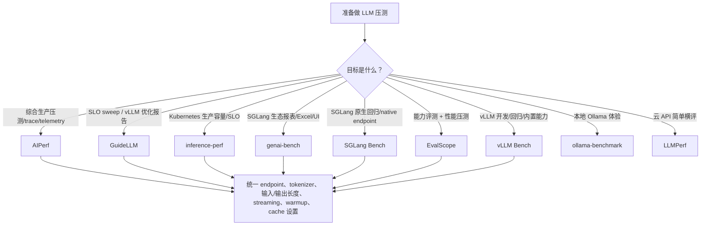

---

### 4.2 AIPerf {#benchmark-aiperf}

#### 4.2.1 定位 {#benchmark-5-1-定位}

AIPerf 是 ai-dynamo 生态中的综合 GenAI benchmark 工具。它不是简单脚本，而是一个面向生产压测的框架：支持多进程架构、ZMQ 服务间通信、实时 dashboard、headless 模式、插件系统、trace replay、多模态数据集、server metrics、GPU telemetry、MLflow/OpenTelemetry/W&B 等集成。

一句话概括：

> **AIPerf 适合把 LLM 压测当作生产工程来做，而不是只跑一次 CLI 看平均延迟。**

#### 4.2.2 能力 {#benchmark-5-2-能力}

| 能力 | 说明 |
|------|------|
| Benchmark mode | concurrency、request-rate、request-rate + max concurrency、trace replay |
| 到达分布 | constant、Poisson、gamma、fixed schedule、ramping |
| 数据集 | ShareGPT、AIMO、MMStar、MMVU、VisionArena、LLaVA-OneVision、SPEED-Bench、SpecBench、自定义、inline、raw payload |
| 多模态 | text、vision、audio、image generation、video generation |
| 协议与 agentic replay | OpenAI 系列端点、Anthropic Messages；AgentX v1.0 支持 WEKA、agentic replay 和 DAG-shaped workload |
| 负载控制 | 固定并发/速率、trace replay、ramp，以及按 SLA 单次寻找并维持边界的 adaptive scale |
| 指标 | TTFT、TTST、TTFO、ITL、ICL、request latency、Decode Duration、tokens/s、goodput、HTTP trace、GPU energy |
| 可观测 | DCGM GPU telemetry、Prometheus server metrics、OTel、MLflow、W&B |
| 扩展 | endpoint、dataset、transport、metric 等插件类别 |

#### 4.2.3 v0.12.0 稳定增量 {#benchmark-5-3-v0-12-0-稳定增量}

`v0.12.0` 把 agentic workload、协议覆盖和单次自适应压测推进到稳定 release：

| 变化 | 工程含义 |
|------|----------|
| AgentX v1.0 | 支持 WEKA、agentic replay 与 DAG-shaped workload，保留 conversation/turn 依赖和 fork 结构；应同时固定 trace corpus、随机种子、路由会话亲和及 prefix cache 状态 |
| Anthropic Messages API | `--endpoint-type messages` 直接覆盖 `/v1/messages` 的流式/非流式、top-level `system`、extended thinking、tool use 和 `raw_messages` 原样重放，不必先转换成 OpenAI Chat |
| Adaptive scale | 在一次 YAML benchmark 的 profiling phase 内按 `concurrency`、`prefill_concurrency`、`request_rate` 或 `users` 调节压力；所有 SLA filter 通过才继续升压，找到首个失败边界后在最后通过值附近 sustain |
| 多阶段与控制 | 单次 run 可定义多个 warmup/profiling phase，支持 JSON 动态 QPS、外部 router session-affinity header，并为每个 adaptive phase 输出 events、summary 和 manifest |
| 指标与分析 | 新 accumulator engine、流式响应的 client-observed Decode Duration、spec-decode per-request acceptance record，以及 `aiperf analyze` swim-lane/turn-messages viewer |

Adaptive scale 不是离线 sweep 的同义词：它在单次 run 内用窗口指标控制下一步压力，`duration`、`sustain_duration` 和至少一个 phase-level `sla` filter 都是必需项；固定 ramp 不能与同一个 control variable 并用。配置目前只支持 YAML，自动化应消费 phase-scoped `adaptive_scale_events.jsonl`、`adaptive_scale_summary.json` 与总清单，而不是依赖固定 sleep。

本版最低 Python 从 3.10 提升到 3.11，属于升级前必须检查的 breaking change。release 分支还纳入 ffmpeg CVE-2026-8461 修复、ShareGPT 批量编码超时修复、共享前缀 block 合成修复和 multi-run detailed aggregation JSONL fallback 修复；重放旧结果前应先确认依赖环境与 artifact schema。

#### 4.2.4 v0.13.0 稳定增量 {#benchmark-5-4-v0-13-0-稳定增量}

`v0.13.0` 把执行面扩展到 Kubernetes、把 speculative 与流式指标口径收紧，并继续处理依赖安全：

| 变化 | 工程含义 |
|------|----------|
| Kubernetes native execution（beta） | AIPerf 可在 Kubernetes 上以原生资源执行压测，并随行一整套 prerequisite stack；官方标注 beta，生产采用前应验证 RBAC、镜像与集群配额边界 |
| Spec-decode 指标 | per-request acceptance metrics 标准化；vLLM adapter 对齐上游 #48915 review 后的 wire format |
| Endpoint 与控制钩子 | 新增 `audio_transcription` endpoint type；`reset_kv_cache` 与 `server_profiler` 控制钩子；`AIPERF_ENDPOINT_FORCE_CONTENT_PARTS` 环境变量 |
| Workload 口径 | cache-bust 扩展到所有 structured workload；无条件 warmup prefix 被移除，改用 `WARMUP_ISOLATION_*` 目标；DAG branch 支持 per-round；新增 tracelab dataset；`PromptCorpus.RANDOM` 与 vLLM bench 对齐 |
| 指标修正 | `--per-chunk-usage` 修正捆绑首个流式 chunk 造成的 TPS/user 虚高；timing 改为高分辨率 rate-loop pacing |
| 路由 | session-affinity header 默认发送 |
| 依赖 | ffmpeg 升至 `8.1.2`（CVE-2026-8461 / GHSA-qff7-4q6c-m8h6，按最小 codec allowlist 重建）；aiohttp 最低 `3.14.3` |

三个必须迁移的口径变化：控制钩子超时不再继承 6 小时的 `endpoint.timeout`；telemetry 字段 `dcgm_url` 更名 `telemetry_source_url`；LCB dataset load 不再传 `trust_remote_code`。旧结果与 v0.13.0 结果之间的 TPS/user、warmup 行为和 telemetry 字段不能直接拼接为同一序列；升级前先重放一次固定 workload 建立对照。

#### 4.2.5 典型命令 {#benchmark-5-5-典型命令}

```bash
aiperf profile \
  --model "Qwen/Qwen3-0.6B" \
  --streaming \
  --endpoint-type chat \
  --tokenizer Qwen/Qwen3-0.6B \
  --url http://localhost:8000 \
  --concurrency 16 \
  --request-count 200
```

#### 4.2.6 适用场景 {#benchmark-5-6-适用场景}

| 场景 | 价值 |
|------|------|
| 生产压测基线 | 输出完整 JSON/CSV/log，可追踪历史 |
| KV cache 测试 | user-centric timing、prefix synthesis、多轮/agentic trace 有帮助 |
| 复杂数据源 | raw payload replay、生产 trace、SageMaker capture |
| 多模态压测 | 图像、视频、音频端点都可覆盖 |
| 观测闭环 | 可以把 client 侧指标与 GPU/server metrics 对齐 |

#### 4.2.7 限制 {#benchmark-5-7-限制}

| 限制 | 说明 |
|------|------|
| 学习成本较高 | 配置项、插件和数据模式很多 |
| 结果解释需要规范 | metric 很全，但团队需要先统一口径 |
| 客户端资源要充足 | 高并发/高请求率下压测机自身可能成为瓶颈 |

---

### 4.3 GuideLLM {#benchmark-guidellm}

#### 4.3.1 定位 {#benchmark-6-1-定位}

GuideLLM 是 vLLM 项目下的 SLO-aware benchmarking and evaluation platform。它重点不是 Kubernetes 部署，而是让团队围绕 SLO、traffic profile、dataset 和报告来优化 LLM inference。

一句话概括：

> **GuideLLM 适合系统化扫描 LLM 服务的安全工作点，并生成可比较的 JSON/CSV/HTML 报告。**

#### 4.3.2 能力 {#benchmark-6-2-能力}

| 能力 | 说明 |
|------|------|
| backend | OpenAI-compatible HTTP、vLLM Python backend |
| profile | synchronous、concurrent、throughput、constant、Poisson、sweep |
| 数据 | HuggingFace、json/csv/text file、synthetic text、synthetic image/video |
| 指标 | request status、TTFT、ITL、TPOT、request latency、output/total tokens/s、全套 percentiles |
| 输出 | console、JSON/YAML/CSV/HTML、`plot` 静态图；同一种 output 可配置多个目标文件 |
| 配置 | CLI、JSON/YAML 风格 registry 参数、scenario/config |

#### 4.3.3 v0.7.2 增量 {#benchmark-6-3-v0-7-2-增量}

`v0.7.2` 把多模态合成、报告输出和跨工作点停止语义补齐到稳定版：

| 变化 | 工程含义 |
|------|----------|
| `synthetic_image` / `synthetic_video` | 安装 `guidellm[vision]` 后可控制图像分辨率、数量、格式以及视频帧数、FPS、码率；默认按请求生成不同媒体，适合绕过多模态预处理缓存做受控 VLM 压测 |
| `--output kind=plot,path=<file>` | 生成性能 dashboard 静态图，文件后缀可选 PNG、JPG/JPEG、SVG 或 PDF；重复声明相同 output kind 时不会相互覆盖 |
| `stopping_scope=all` | 一个 rate、concurrency 或 sweep strategy 触发超饱和/错误等约束后，可跳过同一 profile 中尚未执行的更高压力点，减少已失效工作点的资源消耗 |
| `guidellm export` | 原 `guidellm benchmark from-file` 提升为顶层命令；行为基本不变，但旧命令路径应从自动化脚本中迁出 |

本版也修复了 console 显示、CSV 序列化、HTML asset、默认结果目录和 CLI help 等问题。升级时应重点检查导出命令路径；若依赖旧版逐个执行所有 rate 的行为，也要确认约束是否设置了 `stopping_scope=all`。

#### 4.3.4 v0.7.3 补丁边界 {#benchmark-6-4-v0-7-3-补丁边界}

`v0.7.3` 是在上述 v0.7.2 能力之上的安全与可用性补丁，不改变 GuideLLM 的核心 profile 模型：

| 变化 | 工程含义 |
|------|----------|
| 依赖安全 | 解决 RHAI 下游传递依赖把 `transformers` 锁在 `<5.0` 后暴露 CRITICAL/HIGH CVE 的问题；tag 中直接依赖固定为 `click~=8.4.0`，部署时仍应以最终 lockfile/SBOM 扫描结果为准 |
| Plot 输出 | 正式记录 `--output kind=plot`，路径与其他 output 一样服从 `GUIDELLM_DEFAULT_RESULTS_DIR`；显式绝对路径不受该默认目录影响 |
| 结构化 chat content | OpenAI backend 支持带 metadata 的结构化 chat content，避免把非纯字符串 message content 当成不可用输入 |
| 终态错误 | worker 对没有可消费内容的终态 LLM response 给出更清楚的 unusable response 失败，而不是留下误导性状态 |

从 v0.7.2 升级时应重点验证容器/离线镜像的完整依赖解析结果、`GUIDELLM_DEFAULT_RESULTS_DIR` 下的 plot 产物位置，以及上游网关返回结构化 content 或空终态响应时的 CI 判定。

#### 4.3.5 v0.7.4 计量修正 {#benchmark-6-5-v0-7-4-计量修正}

`v0.7.4@291a6e609c3eb52d6eadcedecc7a056e396cd5eb` 回补多项 bugfix，其中直接影响跨版本结果的是 token event 与 warmup/cooldown 窗口的关系：

| 口径 | v0.7.4 行为 | 对历史结果的影响 |
|------|--------------|------------------|
| latency 采样请求 | 只让落在正式测量窗口内的请求进入对应 latency metric sample；warmup/cooldown 边界不再沿用旧筛选行为 | 即使服务端、数据集和并发完全相同，样本集合也可能变化，P50/P99 不能与 v0.7.3 默认直接拼接 |
| token event 时间窗 | token event 只累计发生在 warmup 结束后、cooldown 开始前的 token | 跨边界请求可能只贡献测量窗内的 token event；吞吐分子与请求完成数必须一起解释，不能按完整响应 token 数反推 |
| 报告可比性 | 请求生命周期和 token event 的窗口语义被明确分开 | 报告必须记录 GuideLLM exact version、warmup/cooldown 配置和实际 measured duration；升级后应重建容量基线 |

这是一项计量正确性变化，不表示被测服务本身变快或变慢。对严格回归，建议同时保留原始请求时间戳、token event 和窗口配置，并在同一 v0.7.4 客户端上重跑对照组。

#### 4.3.6 典型命令 {#benchmark-6-6-典型命令}

```bash
guidellm run \
  --backend kind=openai_http,target=http://localhost:8000,request_format=/v1/chat/completions \
  --profile kind=sweep \
  --constraint kind=max_duration,seconds=60 \
  --data kind=synthetic_text,prompt_tokens=1024,output_tokens=256
```

固定速率示例：

```bash
guidellm run \
  --backend kind=openai_http,target=http://localhost:8000 \
  --profile kind=constant,rate=10 \
  --constraint kind=max_duration,seconds=120 \
  --data kind=synthetic_text,prompt_tokens=512,output_tokens=128
```

绘图与跨工作点提前终止示例：

```bash
guidellm run \
  --backend kind=openai_http,target=http://localhost:8000 \
  --profile '{"kind":"constant","rate":[5,10,20]}' \
  --constraint kind=max_error_rate,rate=0.05,stopping_scope=all \
  --data kind=synthetic_text,prompt_tokens=512,output_tokens=128 \
  --output kind=plot,path=results/benchmark.svg
```

#### 4.3.7 适用场景 {#benchmark-6-7-适用场景}

| 场景 | 价值 |
|------|------|
| vLLM/OpenAI-compatible 服务优化 | backend 配置简单，报告标准化 |
| SLO 容量扫描 | `sweep` profile 适合找最大安全速率 |
| CI/回归报告 | JSON/CSV/HTML 方便沉淀 |
| 受控数据实验 | synthetic + HuggingFace/file 数据都可用 |

#### 4.3.8 限制 {#benchmark-6-8-限制}

| 限制 | 说明 |
|------|------|
| K8s 原生能力不是重点 | 不像 inference-perf 那样面向 WG Serving/K8s 标准化 |
| 非 OpenAI/vLLM 后端需扩展 | 当前核心路径围绕 OpenAI-compatible 和 vLLM Python |

---

### 4.4 inference-perf {#benchmark-inference-perf}

#### 4.4.1 定位 {#benchmark-7-1-定位}

inference-perf 来自 Kubernetes SIG 生态，目标是做生产规模 GenAI inference performance benchmark，并推动 Kubernetes/model server 社区的指标和工具标准化。

一句话概括：

> **inference-perf 是更偏 Kubernetes 生产容量、goodput 和标准化横评的压测工具。**

#### 4.4.2 能力 {#benchmark-7-2-能力}

| 能力 | 说明 |
|------|------|
| server | vLLM、SGLang、TGI 已验证，任意 OpenAI-compatible 可扩展 |
| load | constant、Poisson、concurrent、multi-stage、sweep |
| 架构 | 多进程 + 多线程，目标是 10k+ QPS loadgen |
| goodput | 支持 TTFT、TPOT、ITL、NTPOT、request latency 约束 |
| API | OpenAI Completions/Chat Completions、Anthropic Messages |
| trace | Azure trace、OpenTelemetry trace、Weka agent trace、conversation replay；保留 session 依赖、header、共享前缀和工具调用 |
| K8s | 提供 deploy guide 和 container image |
| 观测与分析 | QPS vs latency/throughput/goodput 图表、Prometheus runtime metrics、客户端与服务端 token 指标 |

#### 4.4.3 v0.6.1 增量 {#benchmark-7-3-v0-6-1-增量}

`v0.6.1` 扩展了协议、服务端观测和生产 trace 的保真度：

| 变化 | 工程含义 |
|------|----------|
| Anthropic Messages API | `api.type: anthropic_messages` 可直接覆盖 `/v1/messages` 风格的流式与非流式负载，不再要求转换成 OpenAI Chat 格式 |
| 服务端 token 口径 | 报告新增 `usage.completion_tokens` 的汇总与逐请求分布；`report.request_lifecycle.use_server_output_tokens` 可让 TPOT/NTPOT、吞吐和 goodput 使用服务端计数，非流式响应也支持 |
| Prometheus runtime metrics | 可按 benchmark 生命周期采集目标 Prometheus 指标，并与 client-side latency/goodput 报告对照 |
| 阶段错误统计 | summary 与 stage 报告按错误标签聚合，并关联 request/session，便于区分某一压力阶段的超时、协议错误和会话级失败 |
| trace/session fidelity | session 数据按需加载并在完成后驱逐；conversation/shared-prefix 可注入 session header，reasoning content、tool-call replay、malformed tool call 与前序输出替换均得到修复 |

服务端 token 指标与客户端重新分词不是同一口径。生产横评应明确是否启用 `use_server_output_tokens`，并确保所有被测后端都返回可比的 usage 字段；否则工具会回退到客户端计数。

#### 4.4.4 v0.7.0 agentic、trace replay 与 token 口径 {#benchmark-7-4-v0-7-0-agentic-trace-replay-与-token-口径}

`v0.7.0@5804ea6b7ebd2bfceff29cf113311ed3af95146e` 是 correctness/hardening release，也把 agentic 与 trace replay 从零散适配推进为可报告的 workload：

| 领域 | v0.7.0 行为 | 压测含义 |
|------|-------------|----------|
| synthetic agentic | 新增多轮、tool loop、递归 sub-agent fan-out 的 `synthetic_agentic` generator | 并发单位可能是 session/turn/tool call 而非独立 prompt；报告要同时保存 session 数、turn 数和请求数 |
| OTel/Exgentic-v2 replay | workload catalog 增加 Exgentic-v2 OTel trace；streaming tool-call delta 会合并为一条 message，response 中的 tool result 得到保留 | 旧版若丢失 tool result 或按 chunk 计算调用，会改变后续 prompt 和 token；跨版本必须重放同一规范化 trace |
| session 依赖 | 可捕获并重放 session token header；predecessor wait timeout 可配置，`0` 表示无限等待；报告增加 per-session KV cache hit rate 与 Time to First User Token（TFUT） | router affinity、前序失败与会话依赖会影响整个 fan-out；单请求 TTFT 不足以说明 agent 用户感知延迟 |
| token 来源 | output token reporting 在 `server_usage` 与客户端 tokenization 间统一，文档明确哪些计数来自 server、哪些来自 client | 必须固定 token source；server usage 缺失或不同 tokenizer 的 fallback 结果不能与服务端计数混为一组 |
| trace 正确性 | Weka 生成加速、Azure replay 保留微秒精度，conversation replay 修复 max-token 截断；tool call ID 按 function name 配对而非原数组下标 | 到达时间、工具依赖和输出上限都可能改变负载形态；升级后应核对首尾时间戳、session DAG 与截断统计 |
| 失败与重试 | pre-response transport fault 使用有界重试，stage teardown 有界且超时仍产出报告；session replay failure cause 进入报告 | 重试会增加实际请求量，应同时报告 logical request 与 wire attempt；超时报告不是完整成功 run |

本版还可输出 llm-d-benchmark v0.2 partial report、按配置采集 runtime Prometheus metrics，并提供自动报告校验。它改善的是负载生成与证据完整性；不同 server、token source 或 retry 策略仍不能只因 schema 相同就视为公平横评。

#### 4.4.5 典型命令 {#benchmark-7-5-典型命令}

```bash
inference-perf \
  --server.type vllm \
  --server.base_url http://localhost:8000 \
  --data.type random \
  --load.type constant \
  --load.stages '[{"rate": 10, "duration": 60}]' \
  --api.streaming true
```

YAML 中 goodput 约束示例：

```yaml
report:
  goodput:
    constraints:
      ttft: 0.2
      tpot: 0.02
```

#### 4.4.6 适用场景 {#benchmark-7-6-适用场景}

| 场景 | 价值 |
|------|------|
| K8s 集群容量评估 | 工具背景和部署路径都贴近 Kubernetes |
| 多框架公平横评 | server-agnostic，围绕 OpenAI-compatible 指标 |
| 真实流量重放 | OTel/Weka/conversation replay 是强项 |
| SLA 容量报告 | goodput 直接回答“满足 SLO 的吞吐是多少” |

#### 4.4.7 限制 {#benchmark-7-7-限制}

| 限制 | 说明 |
|------|------|
| 配置复杂度中高 | YAML、load stage、worker 参数需要理解 |
| 小规模本地测试偏重 | 如果只是本机跑一个 Ollama 模型，没必要用它 |

---

### 4.5 genai-bench {#benchmark-genai-bench}

#### 4.5.1 定位 {#benchmark-8-1-定位}

genai-bench 是 SGLang 项目生态的 benchmark 工具，强调 token-level 指标、易用 CLI、Live UI dashboard、Excel 报告和 plot。本文固定到 `v0.0.5@4f873e03719c947a101647c6646954d5ebc3d35b`。

一句话概括：

> **genai-bench 适合 SGLang/OpenAI-compatible 服务的可视化压测和报表交付。**

#### 4.5.2 能力 {#benchmark-8-2-能力}

| 能力 | 说明 |
|------|------|
| API backend | OpenAI-compatible、SGLang、部分 hosted cloud backend |
| task | text-to-text、text-to-image、text-to-embeddings、text-to-rerank、text-to-speech、image-text-to-text、image-to-embeddings |
| traffic scenario | `D(input,output)`、`N(mean,std)/(mean,std)`、`U(min,max)/(min,max)`、`E(tokens)`、`R(doc,query)`、`A(chars)`、`I(width,height[,images])`，或有 dataset 时省略 scenario |
| prefix cache | `--prefix-len`、`--prefix-ratio`，用于共享前缀压测 |
| 指标 | TTFT、E2E latency、TPOT、output latency、input/output throughput、error rate；TTS 将首响应解释为 TTFB，并报告 Audio Throughput |
| 输出 | Live UI、rich logs、Excel、plot |

`v0.0.5` 相对 `v0.0.4` 新增 OpenAI/OCI OpenAI 的 text-to-speech 路径与 `A(num_input_chars)` 场景，并改进 vLLM Harmony、gpt-oss/SMG reasoning token 的流式解析；同时修复 Matplotlib 3.9+ 已移除 API 的兼容问题。原有 text-to-text 命令和 D/N/U/E/R/I 场景没有被替换。

#### 4.5.3 典型命令 {#benchmark-8-3-典型命令}

```bash
genai-bench benchmark \
  --api-backend openai \
  --api-base http://localhost:8000 \
  --api-model-name Qwen/Qwen3-0.6B \
  --model-tokenizer Qwen/Qwen3-0.6B \
  --task text-to-text \
  --traffic-scenario "D(1024,256)" \
  --num-concurrency 16 \
  --max-time-per-run 120
```

prefix cache 示例：

```bash
genai-bench benchmark \
  --task text-to-text \
  --traffic-scenario "D(2000,200)" \
  --prefix-len 1500 \
  --num-concurrency 10 \
  --api-backend sglang \
  --api-base http://localhost:8000 \
  --api-model-name meta-llama/Meta-Llama-3-8B-Instruct \
  --model-tokenizer meta-llama/Meta-Llama-3-8B-Instruct
```

TTS 使用字符数而不是 token 数塑造输入；官方 OpenAI backend 示例的默认 voice 是 `alloy`，其他 voice 通过 `--additional-request-params` 传入：

```bash
genai-bench benchmark \
  --api-backend openai \
  --api-base https://api.openai.com \
  --api-key "$OPENAI_API_KEY" \
  --api-model-name tts-1 \
  --model-tokenizer gpt2 \
  --task text-to-speech \
  --traffic-scenario "A(500)" \
  --num-concurrency 1 \
  --max-requests-per-run 10 \
  --additional-request-params '{"voice":"nova"}'
```

#### 4.5.4 适用场景 {#benchmark-8-4-适用场景}

| 场景 | 价值 |
|------|------|
| SGLang 服务压测 | 生态匹配，命令直观 |
| 报表交付 | Excel 和 plot 适合业务评审 |
| prefix cache 对比 | scenario + prefix 参数直观 |
| 多任务压测 | embedding、rerank、VLM、image generation、TTS 等任务可统一入口 |

#### 4.5.5 限制 {#benchmark-8-5-限制}

| 限制 | 说明 |
|------|------|
| 生产 trace 能力不如 AIPerf/inference-perf | 更偏 synthetic/file/scenario |
| K8s 原生部署不是重点 | 需要自己嵌入 Kubernetes job/CI |

---

### 4.6 SGLang Bench {#benchmark-sglang-bench}

#### 4.6.1 定位 {#benchmark-9-1-定位}

SGLang Bench 指 SGLang 仓库内置的 online serving benchmark。v0.5.20 的 Bench Serving Guide 仍保留 `python -m sglang.bench_serving` 兼容入口，但该模块只是会发出 `FutureWarning` 的包装，实现位于 `sglang.benchmark.serving`；新自动化脚本应优先使用：

```bash
python3 -m sglang.benchmark.serving
```

一句话概括：

> **SGLang Bench 适合做 SGLang 服务开发、版本回归、后端 endpoint 对比、缓存/Profiler 调试和 PD disaggregation 专项压测。**

它和 genai-bench 都来自 SGLang 生态，但侧重点不同：genai-bench 更偏“可视化报告和业务交付”，SGLang Bench 更偏“服务端开发者直接测 serving 行为”。

#### 4.6.2 支持的后端与 endpoint {#benchmark-9-2-支持的后端与-endpoint}

| backend | endpoint | 典型用途 |
|---------|----------|----------|
| `sglang` / `sglang-native` | `POST /generate` | SGLang native serving 压测，最直接 |
| `sglang-oai` | `POST /v1/completions` | SGLang OpenAI-compatible completions |
| `sglang-oai-chat` | `POST /v1/chat/completions` | SGLang OpenAI-compatible chat |
| `sglang-embedding` | `POST /v1/embeddings` | embedding 服务压测 |
| `vllm` / `vllm-chat` | `POST /v1/completions` 或 `/v1/chat/completions` | 用同一脚本测 vLLM endpoint |
| `vllm-embedding` | `POST /v1/embeddings` | 与 `sglang-embedding` 使用相同负载口径比较 vLLM embedding endpoint |
| `lmdeploy` / `lmdeploy-chat` | `POST /v1/completions` 或 `/v1/chat/completions` | LMDeploy endpoint 对比 |
| `trt` | `POST /v2/models/ensemble/generate_stream` | TensorRT-LLM streaming endpoint |
| `truss` | `POST /v1/models/model:predict` | Truss endpoint |
| `gserver` | custom | 脚本中保留接口，但当前未实现 |

连接目标有两种写法：

| 参数 | 用法 |
|------|------|
| `--host` + `--port` | 用默认 backend endpoint path 拼 URL，例如 SGLang native 的 `http://host:port/generate` |
| `--base-url` | 直接指定服务 base URL，例如 `http://127.0.0.1:8000`，脚本再按 backend 补 endpoint path |

`--model` 未指定时，OpenAI-compatible endpoint 会尝试查询 `GET /v1/models` 获取模型 ID。生产压测建议显式写 `--model` 和 `--tokenizer`，避免服务端别名、tokenizer 和报告口径不一致。

#### 4.6.3 数据集与负载模型 {#benchmark-9-3-数据集与负载模型}

| dataset | 说明 | 关键参数 |
|---------|------|----------|
| `sharegpt` | 默认数据集，加载 ShareGPT 风格问答对 | `--dataset-path`、`--sharegpt-context-len`、`--sharegpt-output-len` |
| `random` | 随机文本长度，适合固定 ISL/OSL 基准 | `--random-input-len`、`--random-output-len`、`--random-range-ratio` |
| `random-ids` | 随机 token id，长度控制更直接但文本可能无意义 | 同 `random` |
| `generated-shared-prefix` | 合成长共享 system prompt + 短问题，用于 prefix/KV cache 压测 | `--gsp-num-groups`、`--gsp-prompts-per-group`、`--gsp-system-prompt-len`、`--gsp-question-len`、`--gsp-output-len` |
| `image` | 构造 VLM 图像请求；支持固定 preset/尺寸和 `random:min_hxmin_w-max_hxmax_w` 随机边界，v0.5.20 延续并扩展多模态 processor 路径 | `--image-count`、`--image-resolution`、`--image-format`、`--image-content` |
| `mmmu` | MMMU Math split，多模态评测式请求 | 依赖 `datasets`、`pillow`、`pybase64` |
| `mooncake` | 用 Mooncake trace 评估大规模 KVCache 共享 | `--mooncake-workload`、`--mooncake-slowdown-factor`、`--mooncake-num-rounds`、`--use-trace-timestamps` |
| `agentic-trace` | agentic multi-turn trace | `--dataset-offset`、`--agentic-max-turns` |
| `custom` / `openai` / `longbench_v2` / `speed-bench` | 面向自定义、OpenAI 格式和长上下文/速度专项 | 按数据集格式和对应参数配置；`autobench` 已在 v0.5.17 移除，v0.5.18 又移除 22 个未维护 benchmark，不应继续依赖旧命令 |

SGLang Bench 的 `--request-rate` 是 open-loop 入口：默认 `inf` 表示起始时尽快发出所有请求；设成有限值时，请求间隔按 Poisson 过程采样。`--max-concurrency` 是最大在飞请求上限；当 `--request-rate` 与 `--max-concurrency` 同时使用时，如果服务端处理不过来，实际发送速率会被并发上限压低。

#### 4.6.4 关键运行参数 {#benchmark-9-4-关键运行参数}

| 参数 | 作用 |
|------|------|
| `--num-prompts` | 请求总数 |
| `--request-rate` | 目标请求到达率；有限值使用 Poisson 到达 |
| `--max-concurrency` | 最大并发在飞请求数 |
| `--disable-stream` | 切换为非流式；非流式下 TTFT 口径会退化 |
| `--warmup-requests` | 正式压测前预热请求数，默认 1 |
| `--disable-ignore-eos` | 关闭 ignore EOS；默认更偏固定输出长度压测 |
| `--temperature` / `--top-p` / `--seed` | sampling 与随机种子 |
| `--extra-request-body` | 向请求体合并额外 JSON，例如 sampling、min_tokens、top_k |
| `--apply-chat-template` | 构造 chat 请求或计数时应用 tokenizer chat template |
| `--output-file` / `--output-details` | 输出 JSONL 汇总；开启 details 会写入逐请求长度、错误、TTFT、ITL、生成文本等数组 |
| `--flush-cache` | 预热后、正式压测前清缓存；SGLang 调 `/flush_cache` 并允许服务端等待最多 10 秒进入 idle，vLLM 调 `/reset_prefix_cache`，后者要求服务端设置 `VLLM_SERVER_DEV_MODE=1` |
| `--cache-report` | 压测后收集并展示 SGLang cache 命中统计 |
| `--profile` | 调用 `/start_profile` 和 `/stop_profile`，服务端需启用 profiler |
| `--profile-prefill-url` / `--profile-decode-url` | PD 分离部署下分别 profile prefill 或 decode worker |
| `--lora-name` | 多 LoRA adapter 请求分布测试 |
| `--tokenize-prompt` | 发送 token id 而不是文本，目前只支持 `--backend sglang` |
| `--fake-prefill` | PD disaggregation decode-only 压测，需 decode server 使用 fake transfer backend |

#### 4.6.5 指标与输出 {#benchmark-9-5-指标与输出}

SGLang Bench 控制台会输出：

| 指标 | 含义 |
|------|------|
| Request throughput | 完成请求数 / wall time |
| Input token throughput | 输入 token/s，包含 text 与 vision token |
| Output token throughput | 输出 token/s |
| Total token throughput | 输入 + 输出 token/s |
| Total input text tokens / vision tokens | 文本与视觉输入 token 拆分 |
| Concurrency | 所有请求耗时之和 / wall time，可看平均在飞请求强度 |
| E2E latency | 请求端到端延迟，包含 mean/median/std/p90/p95/p99 |
| TTFT | 流式首 token 延迟，包含 mean/median/std/p90/p95/p99 |
| ITL | 相邻输出 token 间隔，包含 mean/median/std/p90/p95/p99/max |
| TPOT | 首 token 后每个输出 token 平均耗时，`(latency - ttft)/(tokens - 1)` |
| Accept length | SGLang speculative decoding 可用时报告接受长度 |
| Retokenized counts | 用指定 tokenizer 重新计数生成文本，辅助发现服务端 usage 口径差异 |

v0.5.20 延续 v0.5.16 引入的 `spec_accept_length`、`spec_cap_length`、`spec_block_accept_length` 和 `spec_cap_lens_histogram` 请求结果字段；OpenAI chat 非流式路径可从响应 `meta_info` 读取这些值，SGLang native 流式路径当前只回填 `spec_accept_length`。控制台和汇总 JSON 的 `accept_length` 仍来自 `/server_info` 中的 `avg_spec_accept_length`，不能把逐请求承载字段误写成已经完整聚合的新报表指标。vLLM Kimi 风格响应的 `reasoning` fallback 也继续用于避免 retokenized output 漏算 reasoning 文本。

v0.5.20 延续 benchmark 可复现性修复：随机文本只从按 token ID 排序后的 tokenizer vocabulary 采样，避免不同 tokenizer 版本的字典迭代顺序破坏相同 `--seed`；图像数据集在 processor 初始化后重新设置 Python 和 NumPy seed，避免初始化过程消耗全局随机状态。SGLang native stream 的 JSON 解析改为直接对 SSE bytes 使用 `orjson`，这是降低单 asyncio 客户端解析开销的实现优化，不代表服务端 TTFT/ITL 本身变快。

如果指定 `--output-file`，每次 run 会追加一个 JSON 对象；开启 `--output-details` 后还会包含 `input_lens`、`output_lens`、`ttfts`、逐请求 `itls`、`generated_texts` 和 `errors`。它适合接入 CI 或自行汇总，但不像 GuideLLM/EvalScope 那样内置完整 HTML 报告和 SLO sweep。

#### 4.6.6 典型命令 {#benchmark-9-6-典型命令}

启动 SGLang native 服务：

```bash
python3 -m sglang.launch_server \
  --model-path meta-llama/Llama-3.1-8B-Instruct \
  --host 0.0.0.0 \
  --port 30000
```

固定输入/输出长度、固定最大并发：

```bash
python3 -m sglang.benchmark.serving \
  --backend sglang \
  --host 127.0.0.1 \
  --port 30000 \
  --model meta-llama/Llama-3.1-8B-Instruct \
  --tokenizer meta-llama/Llama-3.1-8B-Instruct \
  --dataset-name random \
  --random-input-len 1024 \
  --random-output-len 256 \
  --random-range-ratio 0.0 \
  --num-prompts 1000 \
  --max-concurrency 64 \
  --warmup-requests 5 \
  --output-file sglang_random.jsonl \
  --output-details
```

OpenAI-compatible chat endpoint，例如用同一脚本测 vLLM：

```bash
python3 -m sglang.benchmark.serving \
  --backend vllm-chat \
  --base-url http://127.0.0.1:8000 \
  --model Qwen2.5-0.5B-Instruct \
  --tokenizer Qwen/Qwen2.5-0.5B-Instruct \
  --dataset-name random \
  --random-input-len 1024 \
  --random-output-len 256 \
  --num-prompts 1000 \
  --max-concurrency 64 \
  --apply-chat-template
```

open-loop Poisson 到达：

```bash
python3 -m sglang.benchmark.serving \
  --backend sglang \
  --host 127.0.0.1 \
  --port 30000 \
  --model meta-llama/Llama-3.1-8B-Instruct \
  --dataset-name random \
  --random-input-len 1024 \
  --random-output-len 256 \
  --num-prompts 5000 \
  --request-rate 100 \
  --max-concurrency 512
```

共享前缀 / prefix cache 压测：

```bash
python3 -m sglang.benchmark.serving \
  --backend sglang \
  --host 127.0.0.1 \
  --port 30000 \
  --model meta-llama/Llama-3.1-8B-Instruct \
  --dataset-name generated-shared-prefix \
  --gsp-num-groups 64 \
  --gsp-prompts-per-group 16 \
  --gsp-system-prompt-len 2048 \
  --gsp-question-len 128 \
  --gsp-output-len 256 \
  --cache-report
```

Mooncake trace / KVCache sharing 压测：

```bash
python3 -m sglang.benchmark.serving \
  --backend sglang \
  --host 127.0.0.1 \
  --port 30000 \
  --model meta-llama/Llama-3.1-8B-Instruct \
  --dataset-name mooncake \
  --mooncake-workload conversation \
  --mooncake-slowdown-factor 1.0 \
  --mooncake-num-rounds 1000 \
  --use-trace-timestamps \
  --random-output-len 256
```

PD disaggregation decode-only fake prefill：

```bash
python3 -m sglang.launch_server \
  --model-path meta-llama/Llama-3.1-8B-Instruct \
  --disaggregation-mode decode \
  --disaggregation-transfer-backend fake \
  --port 30001

python3 -m sglang.benchmark.serving \
  --backend sglang \
  --host 127.0.0.1 \
  --port 30001 \
  --model meta-llama/Llama-3.1-8B-Instruct \
  --dataset-name random \
  --num-prompts 500 \
  --random-input-len 1024 \
  --random-output-len 256 \
  --fake-prefill
```

#### 4.6.7 适用场景与限制 {#benchmark-9-7-适用场景与限制}

| 类型 | 说明 |
|------|------|
| 适合 | SGLang 版本回归、server 参数调优、native 与 OpenAI-compatible endpoint 对比、Mooncake/KV cache、PD 分离 decode-only、Profiler 调试 |
| 不适合 | 多团队标准报告、Kubernetes 原生容量平台、自动 SLO/goodput 搜索、复杂 dashboard 交付 |
| 横评风险 | 必须统一 endpoint、chat template、tokenizer、输出长度、streaming、warmup、cache 状态，否则容易把工具默认差异误判为 serving 性能差异 |
| 客户端瓶颈 | 高并发时压测机 CPU、文件描述符、端口、网络和 Python event loop 可能先到瓶颈；大规模压测要用更强客户端或分布式压测工具 |
| 兼容性 | v0.5.20 延续指南路径 `docs/docs/developer_guide/bench_serving.mdx`；指南仍展示 `sglang.bench_serving`，但源码已将其标为 deprecated，CI 应迁到 `sglang.benchmark.serving` |
| 一批请求探测 | `one_batch_server` 直连 worker 时可按 internal states 跳过超过 max-running 或 token-capacity 的组合；若目标是 PD router，拿不到 worker internal states，脚本会告警并关闭这层 skip guard，不能把它当成 router 后端的容量保护 |

#### 4.6.8 v0.5.18 运行与升级边界 {#benchmark-9-8-v0-5-18-运行与升级边界}

SGLang `v0.5.18` 的 benchmark 调用形态基本延续上一版，但 serving 运行环境有几个会直接影响可复现性的变化：

| 变化 | v0.5.18 行为 | 压测影响 |
| --- | --- | --- |
| 编译缓存目录 | Triton、FlashInfer、Inductor、DeepGEMM 和 CUDA driver cache 统一落到 `SGLANG_CACHE_DIR` | 升级后的首次启动会重新编译；预热镜像或独立 cache volume 必须迁移 `triton`、`flashinfer`、`deep_gemm`、`inductor` 和 `nv` 子目录 |
| CUDA 依赖 | CUDA PyTorch stack 升至 `torch 2.13.0`、`triton 3.7.1`，FlashInfer 为 `0.6.17`，CuTeDSL 为 `4.6.2`，`sgl-kernel` 为 `0.4.6.post1` | 必须重新构建 benchmark 客户端/服务端环境；不能把旧 wheel 的首次编译时间混入 steady-state 吞吐比较 |
| DeepEP 与 torchao | DeepEP 改用发布的 `sgl-deep-ep` wheel；`torchao` 集成和 `--torchao-config` 移除 | 固定依赖锁文件并移除旧启动参数，避免把 ImportError 当作服务端回归 |
| 模型/多模态 | 新增 Muse Glimmer、Intern-S2-Mobius、SANA-Video、LingBot-Video-MoE、LTX-2.5、Cosmos3 与 LongCat-Image cookbook；Qwen VL 原生 multimodal processing 和 content-addressed preprocessing cache 进入 release | 新模型和多模态结果应单独记录 processor、图像尺寸、cache 状态与模型能力，不与纯文本 TTFT 直接横比 |
| 旧 benchmark | 22 个未维护 benchmark 被移除 | CI 应先枚举 `python -m sglang.benchmark.serving --help` 的当前 dataset/backend，不再依赖旧脚本名 |

这些变更不新增“benchmark 指标口径”：TTFT、ITL、TPOT、accept length 和 open-loop 到达率仍按本章前文定义。缓存迁移、依赖重建和模型 processor 初始化必须在压测报告中作为环境前置条件记录。

#### 4.6.9 v0.5.19 服务能力与压测边界 {#benchmark-9-9-v0-5-19-服务能力与压测边界}

SGLang `v0.5.19` 在 serving、kernel、缓存和 Rust server 路径上有一组会直接影响容量评估的变化。它们不改变本章的指标定义，但会改变可达到的工作点和首次编译成本：

| 领域 | v0.5.19 变化 | 压测/运维影响 |
| --- | --- | --- |
| 解码与并行 | beam search、speculative decoding kernel 优化、LayerNorm sequence parallelism | beam width、accept length、输出长度和 batch 形态必须写入 manifest；beam 与 spec decode 的组合结果不能与 greedy 基线直接横比 |
| MoE 与专家并行 | DeepEP v2、Hopper W4A8 MoE 支持，DeepGEMM 相关路径更新 | 需要按 GPU 架构、量化格式、EP/TP/DP 配置分别建基线；DeepEP v2 的通信拓扑和首次编译不能混入旧版本吞吐结论 |
| Blackwell/MLA | Blackwell MLA DCP 路径增强 | Blackwell 与 Hopper 的 attention kernel、显存占用和并行切分不同，应分硬件矩阵记录 TTFT/ITL，不应把跨架构结果合并为一条曲线 |
| Radix/HiCache | unified radix tree 默认化；L3 cache 支持动态 attach/detach | 启动时记录 radix/HiCache/L3 状态、命中率和 attach 时间；cache warm/cold、L3 attach/detach 过程必须分阶段测量 |
| AMD/ROCm | AMD Lean Attention 与 ROCm DSA 相关路径更新 | ROCm 运行要固定驱动、torch/flash-attn 兼容组合并单独预热；不能用 CUDA kernel 的结果替代 AMD 基线 |
| Rust server | latency metadata 输出更完整，HTTP/2 stream/window 配置可调 | 客户端应保存 server latency metadata 与客户端 TTFT/ITL；调大 HTTP/2 window 可能改变传输排队，必须和连接数、SSE chunk 一起记录 |
| 依赖 | FlashInfer、DeepEP、DeepGEMM、Mooncake 等依赖升级 | 重新锁定 wheel/源码 commit 和 CUDA/ROCm 版本；旧 cache、旧 ABI 或旧 kernel 编译产物不可直接复用为 v0.5.19 的 steady-state 证据 |

##### 4.6.9.1 v0.5.19 benchmark 运行建议 {#benchmark-v0-5-19-benchmark-运行建议}

1. **入口固定**：CI 统一调用 `python -m sglang.benchmark.serving`；`python -m sglang.bench_serving` 仅作为兼容入口，并把 `FutureWarning` 视为迁移提示。
2. **缓存隔离**：设置 `SGLANG_CACHE_DIR` 到版本/硬件隔离的持久卷，首次运行单独记录 Triton、FlashInfer、DeepGEMM、Inductor 和 CUDA/ROCm 编译时间。切换 v0.5.18→v0.5.19 时不要把旧 ABI 目录直接当作命中缓存；建议先冷缓存，再热缓存重复一次。
3. **服务状态清单**：报告中记录 unified radix tree、HiCache/L3 是否启用、L3 attach/detach 时间、prefix 命中率、model processor、beam/speculative 参数、HTTP/2 window、DP/TP/EP 与 disaggregation 配置。
4. **容量曲线**：分别运行 closed-loop concurrency、open-loop Poisson `--request-rate`、beam search、PD disaggregation、DP attention 和 HiCache/L3 场景；每组先 warmup，再按固定 `num-prompts` 或 sustain duration 采集 p50/p99 TTFT、ITL、TPOT、goodput 和到达率。
5. **组合限制**：beam search 会改变 KV/cache 和调度压力；disaggregation、DP attention、HiCache/L3、speculative decoding 及多模态 processor 组合可能受模型/backend 限制。若服务端拒绝组合，应记录为 capability matrix 的“不支持”，不能回退到另一组合后继续声称同一 workload。
6. **横向可比性**：新模型、多模态 processor、L3 状态、不同 GPU 架构和新 kernel 不能与旧文本基准直接横比。跨版本比较必须固定 tokenizer、输入/输出长度分布、sampling、streaming、warmup、cache 状态、硬件和依赖 lockfile。

这些变化提升了 SGLang 的服务覆盖和优化空间，但没有自动改变 TTFT、ITL、TPOT、accept length、goodput 或 open-loop 到达率的定义；指标仍按第二章口径计算，并在结果中区分 client-observed 与 server-reported latency。

#### 4.6.10 v0.5.20 服务能力与压测边界 {#benchmark-9-10-v0-5-20-服务能力与压测边界}

SGLang `v0.5.20` 是 annotated tag，正文使用解引用后的 source commit `94602c9c2b7cbdb8efd5c52802dac6a1c180089e`（tag object `d158602ff1d2cb953196c95158c488d503d2470c` 仅作类型证据）。该版本包含一组直接改变部署前提与口径的破坏性变化：

| 领域 | v0.5.20 变化 | 压测/运维影响 |
| --- | --- | --- |
| CUDA 12 lane 退役 | 不再提供 `-cu129`/`-cu12` wheel 与镜像，v0.5.19 是最后一个 CUDA 12 版本 | CUDA 12 环境必须留在 v0.5.19 或整体迁移 CUDA 13；跨 CUDA lane 的吞吐对比要单独标注，不能并成一条曲线 |
| Prefill context parallelism | `SGLANG_ENABLE_CP_V2` gate、v1 runtime 与通用 v1 CLI 选项被移除，CP API 改为无版本命名；`--enable-prefill-cp` 在 HIP/NPU/MUSA 上直接被拒绝 | 使用旧 CP 参数的脚本会在启动失败；AMD/NPU 路径的 CP 结果不适用于本版结论 |
| Responses store | `/v1/responses` 默认不在内存保留结果；检索、`previous_response_id` 与后台请求需要 `--enable-response-store`，未启用时返回 400；PD 部署不能启用该 store，`background=true` + `store=false` 组合被拒绝 | Responses API 的多轮/后台用例必须先确认 store 配置；压测中 400 响应要区分“能力未启用”与“过载拒绝” |
| Sampling mask | mask 容量移到 `--sampling-mask-max-tokens`（默认 4096）；旧环境变量 `SGLANG_DISAGGREGATION_SAMPLING_MASK_MAX_TOKENS` 在启动时被拒绝；PD 下需双侧设置 `SGLANG_ENABLE_DISAGG_SAMPLING_MASK=1` | RL rollout 的 mask 行为与容量上限必须写入 manifest；默认 4096 可能低于既有 workload 需求 |
| 删除的 backend | `cutlass_mla` attention backend、非 Marlin `gptq` 量化、AWQ AOT dequantize kernel 与 Dual Chunk FlashAttention 被移除；GPTQ 统一走 `gptq_marlin` | 依赖被删 backend 的量化模型结果不可延续；升级前用目标量化格式做 smoke test |
| 配置层 | 17 个 deprecated CLI flag 被移除且 `get_global_server_args` 会直接 raise；配置层（含 `ServerArgs`）改为 `msgspec.Struct`，`dataclasses.asdict` 不再可用 | 自动化里拼接 CLI 参数或用 asdict 导出配置的脚本必须迁移；这是硬失败不是告警 |
| DCP backend 默认 | `--dcp-comm-backend` 按平台解析（Blackwell 单节点/MNNVL 用 `fi_a2a`，其余 `a2a`）；恢复旧行为需显式传 `ag_rs` | 默认通信 backend 变化会改变 DCP 的 TPOT/带宽分布；对比实验要固定 backend |
| SWA pool | 尺寸不足的 SWA pool 现在启动时抛 `ValueError`，而不是在 warmup 阶段挂起 | 旧配置可能从“慢”变成“起不来”；显存规划要按新校验重算 |
| gRPC | `GetIsReady` 被 `WatchEngineState` stream 取代 | 依赖就绪探测的客户端需要迁移 |
| 性能与模型 | Blackwell DSv4 TRT-LLM CSA/HCA kernel、`--schedule-policy hrrn`、Gumbel-max sampler、unified radix tree 的 SWA branching cache、DCP `fi_a2a`、GLM-5.3-Flash 等新模型；CPU 镜像转 Ubuntu 26.04（GCC 15.2），ROCm 10 成为默认 AMD lane | 新 kernel/调度策略改变工作点；ROCm 7.0 镜像退役，AMD 基线要重建 |
| 依赖 | `sgl-kernel` 0.4.7、`sgl-deep-gemm` 0.2.0、FlashInfer `0.6.18`（替代 in-tree MNNVL CuTe DSL port） | 按版本/硬件隔离 `SGLANG_CACHE_DIR`；旧编译缓存不可复用为 steady-state 证据 |

##### 4.6.10.1 v0.5.20 benchmark 运行建议 {#benchmark-v0-5-20-benchmark-运行建议}

1. **迁移检查**：先清点 CLI 参数与配置导出路径——17 个移除的 deprecated flag、`msgspec.Struct` 配置层和 CP v1 选项都会让旧脚本硬失败。
2. **CUDA lane 记录**：报告必须写明 CUDA 13（或停留在 v0.5.19 的 CUDA 12）；跨 lane 结果只做参考不做回归基线。
3. **Responses 场景**：需要 store 的多轮/后台用例显式启用 `--enable-response-store` 并记录 PD 不可用边界；把 400 与过载拒绝分开统计。
4. **调度与采样**：`hrrn`、sampling mask 容量与 Gumbel-max sampler 都会改变延迟分布；切换前先用默认策略跑对照。
5. **缓存与依赖**：`SGLANG_CACHE_DIR` 按新依赖栈（sgl-kernel 0.4.7、FlashInfer 0.6.18）重建，首次运行单独记录编译时间。

---

### 4.7 LLMPerf {#benchmark-llmperf}

#### 4.7.1 定位 {#benchmark-10-1-定位}

LLMPerf 是 Ray 项目下较早的 LLM API 性能评估工具。它提供 load test 和 correctness test，支持 OpenAI-compatible、Anthropic、TogetherAI、Hugging Face、LiteLLM、Vertex AI、SageMaker 等 API 路径。

一句话概括：

> **LLMPerf 适合简单云 API 横评和早期 smoke test，不适合作为现代生产压测主工具。**

#### 4.7.2 能力 {#benchmark-10-2-能力}

| 能力 | 说明 |
|------|------|
| load test | 并发请求，测 inter-token latency 和 generation throughput |
| correctness test | 随机数字文本转换，用于简单正确性检查 |
| 数据 | Shakespeare sonnets 行采样，按 mean/stddev 控制输入输出 token |
| backend | OpenAI、Anthropic、LiteLLM、Vertex AI、SageMaker 等 |
| tokenizer | README 描述使用 LlamaTokenizer 统一 token 计数 |

#### 4.7.3 典型命令 {#benchmark-10-3-典型命令}

```bash
python token_benchmark_ray.py \
  --model "meta-llama/Llama-2-7b-chat-hf" \
  --mean-input-tokens 550 \
  --stddev-input-tokens 150 \
  --mean-output-tokens 150 \
  --stddev-output-tokens 10 \
  --max-num-completed-requests 100 \
  --timeout 600 \
  --num-concurrent-requests 10 \
  --results-dir "result_outputs" \
  --llm-api openai \
  --additional-sampling-params '{}'
```

#### 4.7.4 适用场景与限制 {#benchmark-10-4-适用场景与限制}

| 类型 | 说明 |
|------|------|
| 适合 | 多云 API 基础横评、快速 correctness smoke test |
| 不适合 | open-loop、SLO/goodput、复杂 trace、多模态、K8s 生产容量评估 |
| 风险 | README 自身也提示结果可能随时段、provider backend、外部负载变化，并不一定代表硬件能力 |

---

### 4.8 ollama-benchmark {#benchmark-ollama-benchmark}

#### 4.8.1 定位 {#benchmark-11-1-定位}

ollama-benchmark 的包名是 `llm_benchmark`，面向本地 Ollama 模型吞吐测试。它会根据本机 RAM 选择或拉取一组 Ollama 模型，然后输出 tokens/s 等结果。

一句话概括：

> **ollama-benchmark 是本地 LLM 体验工具，不是生产推理服务压测工具。**

#### 4.8.2 典型命令 {#benchmark-11-2-典型命令}

```bash
llm_benchmark run
```

不上传系统信息：

```bash
llm_benchmark run --no-sendinfo
```

自定义模型列表：

```yaml
file_name: "custombenchmarkmodels.yml"
version: 2.0.custom
models:
  - model: "deepseek-r1:1.5b"
  - model: "qwen:0.5b"
```

```bash
llm_benchmark run --custombenchmark=path/to/custombenchmarkmodels.yml
```

#### 4.8.3 v0.5.3 安全补丁边界 {#benchmark-11-3-v0-5-3-安全补丁边界}

`v0.5.3` 不改变 workload、模型选择或 tokens/s 计算；该 Release 只把 `requests` 提升到 `2.33.0`、`urllib3` 提升到 `2.7.0` 以修复依赖漏洞。已有 v0.5.2 结果不应因这个补丁被解释为性能变化，但生产镜像仍需按最终依赖树和 SBOM 复核，而不是只检查这两个直接 pin。

#### 4.8.4 v0.5.4 模型卸载边界 {#benchmark-11-4-v0-5-4-模型卸载边界}

`v0.5.4@9e441efe48756928e453ff26694d6e5af1a9c71d`（lightweight tag）只有一项行为变化：每个模型的 benchmark 循环结束后无条件调用 `stop_model(ollamabin, model_name)`。此前模型可能停留在内存中，后续模型的显存/内存占用与吞吐会被前一个模型污染。多模型顺序扫描的对比必须注明所用版本：v0.5.4 之前的“后续模型变慢”可能是残留占用而不是模型本身差异；该修复不改变单模型 workload 与 tokens/s 计算口径。

#### 4.8.5 适用场景与限制 {#benchmark-11-5-适用场景与限制}

| 类型 | 说明 |
|------|------|
| 适合 | 本机 CPU/GPU/NPU 跑 Ollama 模型时，快速看 tokens/s |
| 不适合 | vLLM/SGLang/KServe/Dynamo 生产服务压测 |
| 限制 | 没有复杂 traffic profile、SLO、trace replay、OpenAI-compatible 横评能力 |

---

### 4.9 vLLM Bench {#benchmark-vllm-bench}

#### 4.9.1 定位 {#benchmark-12-1-定位}

vLLM 的 `benchmarks/` 目录是 vLLM 自带的性能测试工具集合。本文固定到 `v0.30.0@ced6857afa0ea7b2e3f0846a62e1394e90f15607`；该 lightweight tag 直接指向所列 commit。默认 benchmark 仍通过 Python CLI 使用：

```bash
vllm bench serve
vllm bench latency
vllm bench throughput
```

一句话概括：

> **vLLM Bench 是 vLLM 自身开发和回归最直接的 benchmark 工具。**

#### 4.9.2 工具类型 {#benchmark-12-2-工具类型}

| 类型 | 说明 |
|------|------|
| `vllm bench serve` | 在线服务压测，面向 OpenAI-compatible server |
| `vllm bench latency` | 单请求/本地 latency 测量 |
| `vllm bench throughput` | 离线 batch throughput 测量 |
| `vllm-bench` | v0.26.0 新增的独立 Rust serving benchmark 客户端；v0.27.0 起也可由环境变量选择性接管 `vllm bench serve`，默认仍走 Python |
| prefix caching | `benchmark_prefix_caching.py` 等专项脚本 |
| multi-turn | `benchmarks/multi_turn/benchmark_serving_multi_turn.py`，用于 KV cache offloading / 多轮场景 |
| kernels | paged attention、MoE、FP8 GEMM、RMSNorm、ROPE 等 kernel 级 benchmark |
| structured output | structured schema / guided decoding benchmark |

#### 4.9.3 典型命令 {#benchmark-12-3-典型命令}

```bash
vllm bench serve \
  --backend openai-chat \
  --host 127.0.0.1 \
  --port 8000 \
  --endpoint /v1/chat/completions \
  --model Qwen/Qwen3-0.6B \
  --dataset-name random \
  --random-input-len 1024 \
  --random-output-len 256 \
  --num-prompts 1000 \
  --max-concurrency 64 \
  --ignore-eos
```

多轮示例来自 `benchmarks/multi_turn/`：

```bash
python benchmark_serving_multi_turn.py \
  --model /models/meta-llama/Meta-Llama-3.1-8B-Instruct \
  --served-model-name Llama \
  --input-file generate_multi_turn.json \
  --num-clients 2 \
  --max-active-conversations 6
```

#### 4.9.4 v0.27.x benchmark 增量与边界 {#benchmark-12-4-v0-27-x-benchmark-增量与边界}

v0.26.0 将 `rust/src/bench` 中的原生 `vllm-bench` 纳入 release。其上游 README 将它定义为 `vllm bench serve` 的 drop-in replacement：参数和 JSON/timing 口径以 Python serving benchmark 对齐，同时增加并发/请求率 sweep、多次运行统计、多轮、结果比较和 steady-state 指标，并减少 Python 启动与高并发客户端开销。独立入口例如：

```bash
vllm-bench \
  --backend vllm \
  --base-url http://127.0.0.1:8000 \
  --model Qwen/Qwen3-0.6B \
  --dataset-name random \
  --random-input-len 1024 \
  --random-output-len 256 \
  --num-prompts 1000 \
  --max-concurrency 64
```

v0.27.0 增加了可选的 Rust CLI 委派，但不是默认切换：只有 `VLLM_USE_RUST_BENCH=1` 且 `VLLM_RUST_FRONTEND_PATH` 指向 `vllm-rs` 二进制时，`vllm bench serve` 才通过 `os.execv` 委派给 Rust；否则仍注册并运行 `vllm.benchmarks.serve`。因此不能把独立 `vllm-bench`、可选委派和默认 Python 路径混成同一个客户端。生产基线应记录实际入口，并分别验证 dataset、tokenizer、steady-state window 和输出 schema。

Rust random dataset 的 builtin tiktoken 路径也在 v0.27.0 收紧 token ID 集合：只从可解码的 base token 和已登记 special token 中采样，跳过稀疏 vocab 中未分配的 ID；同时继续演进 ordinary-text encoding、异步 tokenizer/dataset 获取和进度显示。该修复针对 Rust 客户端，不能反推 Python dataset 的实现口径完全相同。

Python `vllm bench serve` 在 v0.27.0 增加 `--probe-request-rate`。正值会以指定 RPS 并发发送单 input token、单 output token、纯文本 probe，probe 不占 `--max-concurrency` semaphore，并单独输出 completed/failed 与 median/P99/max E2EL，用来观察主流量对共享前端中无关轻请求的干扰：

```bash
vllm bench serve \
  --backend openai-chat \
  --model Qwen/Qwen2.5-VL-3B-Instruct \
  --dataset-name random-mm \
  --random-mm-bucket-config '{(2048, 2048, 1): 1.0}' \
  --request-rate 4 \
  --probe-request-rate 20
```

`--skip-tokenizer-init` 也不能被概括为“所有数据集都不需要 tokenizer”。`custom`、`custom_image`、`custom_audio` 的部分路径允许 tokenizer 为 `None`，此时只能使用退化的长度占位或数据集给定长度；`sonnet`、`hf`、`timed_trace` 及其余需要构造或精确计数 token 的数据集仍显式要求 tokenizer。跨版本结果必须记录是否跳过 tokenizer，以及由客户端还是数据集/服务端提供 token 长度。

v0.27.0 的 benchmark 文档进一步澄清 speculative decoding 指标：一个 stream chunk 可以承载多个 accepted token，ITL 只记录 chunk 之间的间隔，不为同一 chunk 内的 token 人工补零；TPOT 仍按首 token 之后的全部 output token 摊销。所以 speculative decoding 下 ITL 与 TPOT 可能显著不同，横评时应按测量点和公式解释，不能只对照指标名称。

v0.27.1 是这些 v0.27.0 benchmark 行为之上的补丁基线；它相对 v0.27.0 的代码增量主要是 quantized DSpark Markov head 支持及发布/CI 修复，没有新增 benchmark CLI 行为。release 中其他 P/D 或 serving 能力仍属于服务端：Python benchmark 没有专用的 prefill/decode 分角色模式。压测分离部署时应把请求发给统一 router/endpoint，并分别采集 prefill、decode、传输层和 router 指标。

#### 4.9.5 v0.28.0 benchmark 增量 {#benchmark-12-5-v0-28-0-benchmark-增量}

v0.28.0 沿用上述 CLI，同时收敛在线/离线数据集口径与流式解析；这些变化会影响复现实验，不能只替换 server image 而沿用旧客户端假设：

| 变化 | v0.28.0 行为 | 对结果的影响 |
|------|---------------|--------------|
| throughput 数据集 | `vllm bench throughput` 不再维护一套分叉的 dataset dispatcher，而是通过适配层复用 `bench serve` 的 `get_samples()`；旧 `--input-len`/`--output-len`/`--prefix-len` 会映射到共享 random/sonnet 参数，LoRA assignment 在采样后统一附加 | serve/throughput 对 dataset validation、采样和多模态门控更一致；升级仍须记录入口与 backend，`vllm-chat` 是 throughput 唯一允许通过多模态 gate 的 backend |
| timed trace | `timed_trace` 保留扩展后的预 tokenized `list[int]`，不再先 decode 成文本再由请求端重新 tokenize；`bench serve` 明确只允许 `vllm` 或 `openai` completions backend | 修正 decode→encode 不完全可逆造成的 prompt length/内容漂移；旧结果若依赖 tokenizer round-trip，应重跑，chat backend 会直接报错而非静默改变载荷 |
| Rust SSE | Rust `vllm-bench` 以 byte buffer 跨 chunk 累积 SSE，完整 message 后才执行 UTF-8 lossy conversion | 多字节字符被网络 chunk 切开时不再提前变成 replacement character；文本/JSON 输出与 Python 客户端更可比，非法 UTF-8 仍按 lossy 处理 |
| profiling | `vllm bench latency` 可显示并使用最小 Triton Proton profiler backend，输出目录来自 profiler config | profiler 本身会改变时延，结果必须标记是否开启；不能把 profile run 与无 profiler 的 latency baseline 直接比较 |

v0.28.0 同期包含 Kimi-K3、DeepSeek-V4 与 KV offload 的模型/服务端变化，它们只决定待测 server 的模型、内核与缓存前提，不是 benchmark 客户端的新通用能力。比较结果必须固定 server commit、模型 runner、KV offload 配置和 backend；本文不据此扩写 vLLM serving 功能清单。

#### 4.9.6 v0.29.0 服务端前提与破坏性变化 {#benchmark-12-6-v0-29-0-服务端前提与破坏性变化}

v0.29.0 的 benchmark 入口仍沿用上文，但默认被测 server 的执行路径发生了足以改变基线的变化。即使客户端参数完全相同，也必须在报告中固定这些服务端前提：

| 领域 | v0.29.0 行为 | 压测与升级影响 |
|------|--------------|----------------|
| Model Runner V2 | MRV2 对所有模型默认启用；少数 ROCm 模型或 MRV2 尚不支持的 sequence parallelism、dual-batch overlap、elastic EP、custom logits processor、部分 speculative 方法仍回退 MRV1 | 必须记录实际 runner，而不是只记镜像 tag；MRV1 已 deprecated、目标 v0.32 移除，依赖 fallback 的回归要提前迁移 |
| KV cache sizing | MRV2 通过 CUDA graph memory profiling 参与 KV cache 自动定容，并加入 batch-sharded sampling 等路径 | 相同 `gpu_memory_utilization` 可能得到不同 KV 容量和 logits 峰值内存；升级比较要保存 startup profile 与最终 block 数 |
| RL weight sync | 新增 `sharded_rdt` P2P backend，让 worker 通过 NIXL 或 Ray Direct Transport 只拉自己的 TP/EP slice；同时支持 rank-local IPC 与 sparse checkpoint-coordinate update | 在线 refit/update 会污染 steady-state；压测应把同步窗口单列，并记录训练 step、传输 backend、成功/失败及同步后的正确性检查 |
| Mamba prefix cache | internal prefill checkpoint 提供 Mamba prefix caching；Release 报告的 TTFT 改善范围为 9%-25%，`prefix_cache_retention_interval` CLI 默认 `0`，hybrid EAGLE/MTP 会恢复 dense retention | 上游百分比不是本地承诺；冷/热 cache、checkpoint interval、hybrid model 与 speculative 配置必须分别测量 |
| 新默认值 | CUDA TP group 默认启用 FlashInfer all-reduce，可用 `VLLM_ALLREDUCE_USE_FLASHINFER=0` 退出；prefix-cache `NONE_HASH` 默认 deterministic；新增 queue request/token admission limit | 默认 all-reduce 和 hash 行为会改变旧基线；要记录 opt-out、hash algorithm、`--max-num-queued-reqs` 与 `--max-num-queued-tokens` |
| breaking changes | 移除十个 deprecated architecture、PyAV video decoder、两个旧环境变量；FlexOlmo/Olmo3/Hunyuan V1/VL 转到 Transformers modeling backend；`python -m vllm.entrypoints.openai.api_server` deprecated，迁向 `vllm serve` | 启动脚本、模型 backend、媒体输入和环境变量必须先做 smoke test；不能把启动失败或 backend 迁移造成的差异归因于 benchmark 客户端 |

v0.29.0 还加入 per-request speculative acceptance stats 和 queue admission controls。前者只有显式 `--per-request-spec-decode-metrics` 才进入 OpenAI API 响应，后者会把过载从长排队改为准入拒绝；容量报告应同时呈现 accepted、rejected、failed 与 latency，不能只比较完成请求的 P99。

#### 4.9.7 v0.30.0 服务端前提与破坏性变化 {#benchmark-12-7-v0-30-0-服务端前提与破坏性变化}

v0.30.0 的 benchmark 入口（`vllm bench serve/latency/throughput`）不变，但服务端新增了会直接改变启动路径、采样与内存层级的能力，并清理了 v0.29 的 deprecated 项：

| 领域 | v0.30.0 行为 | 压测与升级影响 |
|------|--------------|----------------|
| Fast Start | 新增 per-GPU weight-cache daemon，持久化 post-quantized、TP-sharded 权重；engine 经 CUDA IPC 映射（`--load-format ipc_cache`），覆盖 FP4 checkpoint 与多节点 TP | “首次启动/加载时间”类指标出现冷/热两档；weight cache 命中与未命中必须分开记录，不能把 warm start 写成模型加载性能 |
| Watermarking | Gumbel-max 水印生成与检测（keyed PRF、per-request opt-out、示例检测 endpoint、spec-decoding 双 key 兼容） | 水印路径影响采样与延迟；容量对比要记录水印开关状态 |
| HiSparse | sparse-MLA decode 的 host-resident tier：KV 页按需溢出到 pinned host memory、per-request GPU hot buffer、`HiSparseConnector`、Prometheus counters、TP rank 共享 host cache | 引入新的内存层级后，相同 `gpu_memory_utilization` 对应的工作点不同；host cache 命中率与 PCIe/NVLink 带宽要入报告 |
| Model Runner V2 | dual-batch overlap 扩展到 eager 模式与 FULL CUDA graph；MTP、EAGLE3/DFlash/DSpark 支持 pipeline parallelism；在线 acceptance estimator 自适应验证 | spec-decode + PP 组合的结果不能与旧 runner 直接横比 |
| Scale-out endpoints | plain `vllm serve` 上改为 opt-in：`--enable-scale-out` 取代 `VLLM_ENABLE_SCALE_OUT_ENDPOINTS`（`vllm launch render` 与 `--tokens-only` 始终注册） | 依赖默认暴露 scale-out endpoint 的脚本要显式补参数 |
| breaking 清理 | GPTQ `g_idx` 激活排序移除（相关 Marlin/GPTQ/CPU/RDNA3 kernel 删除）；v0.29 deprecated 项移除（`VLLM_PREFIX_CACHE_RETENTION_INTERVAL`、`VLLM_MM_HASHER_ALGORITHM` 等改用配置字段）；Mamba `all` cache mode deprecated 回退 MRV1；`python -m vllm.entrypoints.grpc_server` deprecated 改用 `vllm serve --grpc` | 环境变量与启动脚本必须先做 smoke test；YaRN 对齐 Transformers 后部分模型派生 `max_model_len` 下降（如 TeleChat3-36B-Thinking 131072→32768），长上下文基线要重新确认 |
| Attention/DCP | attention 实现必须显式声明 DCP 支持；DCP 搭配 ROCm standard attention、Triton、FlexAttention 或 TurboQuant 会在 backend 选择时失败 | PD/DCP 组合的 capability matrix 要按新校验重建 |
| 依赖与镜像 | CUTLASS 4.7.1、Transformers 5.16.1、DeepGEMM 固定到 vllm fork 2.8.0、FlashMLA V4.1 pin；CUDA 13.0 成为默认镜像（保留 CUDA 12.9 与 Ubuntu 24.04 变体）；音频重采样默认从 PyAV 改为 torchaudio | 按版本重建依赖锁定；多模态音频输入的解码路径变化要单独验证 |

指标定义（TTFT、ITL、TPOT、goodput、到达率）不变，但 Fast Start、HiSparse 与 MRV2 扩展让“相同参数”下的服务端工作点与前版不同；跨版本比较必须在 manifest 中固定 runner、weight-cache、水印、内存层级与依赖版本。

#### 4.9.8 适用场景与限制 {#benchmark-12-8-适用场景与限制}

| 类型 | 说明 |
|------|------|
| 适合 | vLLM 参数调优、版本回归、prefix cache、KV offload、多轮专项、kernel microbenchmark |
| 不适合 | 跨框架统一报表、K8s goodput 标准化、业务 trace 统一治理 |
| 关键优势 | 和 vLLM release/内部实现同步，定位 vLLM 性能回归最直接 |

---

### 4.10 EvalScope {#benchmark-evalscope}

#### 4.10.1 定位 {#benchmark-13-1-定位}

EvalScope 是 ModelScope 社区的一站式大模型评测框架，覆盖模型能力评测、推理性能压测和可视化。它不仅能跑 MMLU、C-Eval、GSM8K、VLM/Agent/代码等能力评测，也有 `evalscope perf` 做服务压测。

一句话概括：

> **EvalScope 适合中文生态里把模型能力评测和推理压测放在同一套工具链里管理。**

#### 4.10.2 `evalscope perf` 能力 {#benchmark-13-2-evalscope-perf-能力}

| 能力 | 说明 |
|------|------|
| API | `openai`、`openai_responses`、`openai_embedding`、`openai_rerank`（`/v1/rerank` / `/rerank`）、`local`、`local_vllm`、自定义 API |
| 请求控制 | `--parallel`、`--number`、`--rate`、`--open-loop`、`--duration`、`--warmup-num` |
| SLA | `--sla-auto-tune`，可按并发或速率搜索满足 SLA 的边界 |
| 数据集 | random、OpenQA、LongAlpaca、line_by_line、custom、random_vl、embedding/rerank、多轮 ShareGPT/custom、`workload_trace` |
| 多轮 | `--multi-turn`，支持 random/share_gpt/custom/swe_smith 等 |
| 指标 | latency、TTFT、TPOT、ITL、RPS、output/total throughput、cache hit、speculative decode 指标 |
| 可视化 | WebUI、W&B、SwanLab、ClearML、HTML/报告文件、Dashboard 历史 performance archive |

#### 4.10.3 v1.9.1 基线增量 {#benchmark-13-3-v1-9-1-基线增量}

`v1.9.1` 让 `evalscope perf` 更接近生产流量复现和长期结果管理：

| 变化 | 工程含义 |
|------|----------|
| `workload_trace` | 以 open-loop 按 JSONL 原始时间戳、请求体和 headers 回放生产流量，保留突发节奏、多模型路由；支持倍速、模型映射和按记录输出长度对齐 |
| 统一 `--dataset-args` | 真实文本数据可通过 `target_input_len` / `input_len_mode` 截断或严格筛选到固定 token 长度；该参数也取代已废弃的 `--multi-turn-args` |
| Rerank API | `openai_rerank` 同时识别 OpenAI/Cohere 兼容的 `/v1/rerank` 与 `/rerank`，配合 `rerank` / `random_rerank` 数据集 |
| Performance archive | Dashboard 可发现历史 perf run，查看汇总、percentile、逐请求分页和跨 run 对比，避免每次只消费一次性 HTML |

流式路径也修复了包含 `id:` / `event:` / 多行 `data:` 的 SSE block、`delta.reasoning` 未计入首个有效输出导致 TTFT 偏大的问题；模型评测侧则把中断的 stream consumption 纳入整次请求重试边界，避免持久化部分响应。

#### 4.10.4 v1.10.0 稳定增量 {#benchmark-13-4-v1-10-0-稳定增量}

`v1.10.0` 在 v1.9.1 的 workload replay 和 archive 基线上补齐长上下文构造、统计口径和报告可靠性：

| 变化 | 工程含义 |
|------|----------|
| `prefix_file` / `prefix_role` | 为真实数据集注入共享长文本前缀；必须同时配置 `target_input_len`，默认以 `system` message 注入，也可用 `user` 模式直接前置到首条用户内容 |
| 定长与缓存语义 | 前缀按 `target_input_len - prompt tokens` 预算裁切，不足时循环填充；`input_len_mode=drop` 与前缀互斥。`system` + chat template 可精确对齐，`user` 或纯文本拼接边界可能有约正负 1 token 偏差 |
| 延迟统计 | summary 明确输出 `Avg Latency (s)`，percentile 表增加 `min` 行并保留 P1/P5/P10/P25/P50/P75/P90/P95/P99/max，便于同时观察最佳、平均和尾延迟 |
| 流式指标边界 | 混合流式/非流式 run 中，TTFT/TPOT 只使用流式行，ITL 只汇总实际 chunk interval；纯非流式 run 仍保留兼容 fallback，不能把这些值解释为真实流式首 token/逐 token 指标。另修复无固定 rate 的 open-loop HTML 报告、duration deadline 停止派发和单轮 cached token 同步 |
| Web 历史记录 | performance 列表增加输入/输出 token 列并支持删除历史记录，降低长期保留多轮结果时的人工整理成本 |

长上下文注入适合用真实低熵文本构造 128K 等固定输入、验证 Prefix Cache 或 MTP；它与只对 `random` 数据集生效的随机 `--prefix-length` 不是同一能力。跨工具对比时仍需记录 chat template 开销、实际 token 数、共享前缀比例和路由会话亲和，否则“目标长度相同”不代表缓存命中路径相同。

```bash
evalscope perf \
  --model Qwen2.5-7B-Instruct \
  --url http://127.0.0.1:8000/v1/chat/completions \
  --api openai \
  --dataset openqa \
  --tokenizer-path Qwen/Qwen2.5-7B-Instruct \
  --dataset-args '{"target_input_len": 131072, "prefix_file": "/path/to/long_text.txt", "prefix_role": "system"}'
```

#### 4.10.5 v1.11.0 与 v1.11.1 正确性增量 {#benchmark-13-5-v1-11-0-与-v1-11-1-正确性增量}

v1.11.1 累计包含 v1.11.0 的 metric/report 语义重构以及随后对性能压测路径的集中修复。它们会直接改变百分位、吞吐、失败耗时与流式 token 统计，升级前后不应把报表数字无条件拼接为同一时间序列。

| 层次 | 修复或变化 | 压测含义 |
|------|------------|----------|
| v1.11.0 metric/report | 引入统一 metric semantics、命名与聚合规则；保留 unavailable primary metric 和 structured metric identity，HTML/服务端报告按同一语义输出 | 指标缺失不再被伪装成 0 或换名；自动化消费者应按 metric identity 与 availability 解析，不依赖表格位置 |
| v1.11.0 流式 usage | streaming usage 独立于 `choices` 解析，`content=None` 不再破坏 token accounting；构造请求的 fatal error 直接终止，不伪装为可重试网络失败 | OpenAI-compatible server 把 usage 放在独立尾帧时仍能计数；配置/schema 错误不会被 retry 掩盖 |
| v1.11.0 shutdown | async loop shutdown 对超时和取消执行完整清理；中断的评测明确标为 incomplete | CI/批处理应检查退出状态与 incomplete 标记，不能把已有局部 report 当作完整 run |
| v1.11.1 closed-loop warmup | warmup 和 measured request 共用 dispatcher/semaphore，不在两阶段间把 server drain 到零；首次 measured request 真正发送时才启动 duration deadline，`warmup_num < parallel` 会告警 | 避免测量窗口开头同时释放 `parallel` 个 prefill 导致 P99 污染；固定长度请求仍可能形成同步 cohort，需改用输出长度范围或 open-loop |
| v1.11.1 SSE 与 timing | SSE 解析保留 U+2028/U+2029 等 Unicode line separator；metadata-only chunk 不参与首 token/ITL；stream finish/usage 与 cache 字段处理修正 | 网络分块和 usage-only 尾帧不再制造假 token interval 或丢失文本；跨版本 TTFT/ITL 需重新建基线 |
| v1.11.1 HTTP/retry | OpenAI-compatible model client 会识别 HTTP 200 中实际承载的 gateway error payload 并进入有界重试；Anthropic streaming 与通用 model retry 语义修正 | HTTP status 200 不再自动等同成功；仍须限制重试并记录原始错误，避免把网关持续故障变成重复负载 |
| v1.11.1 精度与结束流程 | percentile 改为 nearest-rank；失败请求记录完整 start/completed lifecycle 以修正 wall-time/QPS/throughput；拒绝非正 `parallel` 和 open-loop + multi-turn；SIGINT/SIGTERM 取消 pending work、完成 cleanup，并返回惯例信号退出码 | P99 与吞吐可能只因口径修正而变化；报告必须同时保留成功/失败数、版本和请求生命周期，信号中止不能作为成功样本 |

HTML 报告还同步 console theme，并避免在未配置 visualizer 时为每个请求构造快照。这些变化改善显示与客户端开销，但不会提高被测服务本身的吞吐；横评时应把 load generator CPU 和 visualizer 配置也记录在实验元数据中。

#### 4.10.6 v1.12.0 AgentX、PD 指标与流式修复 {#benchmark-13-6-v1-12-0-agentx-pd-指标与流式修复}

`v1.12.0@f09e55de5d5f0a0953cd90aa7b0382b45859c4f5` 在 v1.11.1 的统计修复之上增加 AgentX/AIPerf 场景和 P/D 分离观测，并再次修正流式 timing：

| 领域 | v1.12.0 行为 | 解释边界 |
|------|---------------|----------|
| AgentX replay | 新增基于 AIPerf 的 AgentX 场景，校验 dataset version、记录 run validity、脱敏 secret；可透传 `tokenizer_trust_remote_code` 与 `benchmark_grace_period` | AgentX 结果应连同数据版本、有效性记录和 grace period 保存；开启 remote code 是供应链信任选择，不是普通 tokenizer 参数 |
| P/D 指标 | 可选输出 Steady ITL、PD Handoff Latency、PD Handoff Overhead | 这些指标依赖后端暴露可识别的 P/D timing；缺失值不能按 0 处理，也不能用端到端 ITL 倒推出传输开销 |
| 流式 TTFT/ITL | reasoning output 可作为首个有效输出参与 TTFT；修复 streamed reasoning 的 timing，并避免尾部/无效事件污染 ITL | 与 v1.11.1 乃至更早版本的 TTFT/ITL 不应默认横比；必须固定是否返回 reasoning、流式协议和 chunk 形态 |
| 多轮 warmup | warmup 到 measured multi-turn workload 的交接不再先 drain，保持会话与负载连续性 | 测量窗口初态会变化；对旧报告需在同一版本重跑，而不是只校正一个常数 |
| Agent trace | Bridge 保留原模型输出、reasoning、性能指标和上游失败；带 token usage 的 trace 不再让 Predictions API 返回 500 | 修复前缺失/失败样本可能被系统性排除，成功率和延迟分布都会变化 |

因此 v1.12.0、GuideLLM v0.7.4 与 inference-perf v0.7.0 都涉及“哪些 token、请求或 session 进入统计”的变化。跨工具对比必须先对齐 token source、warmup/cooldown、reasoning 首输出、重试和失败样本，旧结果不能仅按列名相同直接合并。

#### 4.10.7 典型命令 {#benchmark-13-7-典型命令}

```bash
evalscope perf \
  --parallel 1 10 50 100 \
  --number 10 100 500 1000 \
  --model Qwen2.5-0.5B-Instruct \
  --url http://127.0.0.1:8000/v1/chat/completions \
  --api openai \
  --dataset random \
  --max-tokens 256 \
  --min-tokens 256 \
  --min-prompt-length 1024 \
  --max-prompt-length 1024 \
  --tokenizer-path Qwen/Qwen2.5-0.5B-Instruct \
  --extra-args '{"ignore_eos": true}'
```

open-loop 示例：

```bash
evalscope perf \
  --open-loop \
  --rate 5 10 20 \
  --number 500 1000 2000 \
  --model Qwen2.5-0.5B-Instruct \
  --url http://127.0.0.1:8000/v1/chat/completions \
  --api openai \
  --dataset random \
  --max-tokens 256 \
  --min-prompt-length 1024 \
  --max-prompt-length 1024 \
  --tokenizer-path Qwen/Qwen2.5-0.5B-Instruct \
  --extra-args '{"ignore_eos": true}'
```

生产 workload trace 回放示例：

```bash
evalscope perf \
  --dataset workload_trace \
  --dataset-path trace.jsonl \
  --url http://127.0.0.1:8000/v1/chat/completions \
  --open-loop \
  --dataset-args '{"speed": 2.0, "model_mapping": {"gpt-4": "qwen-max"}}'
```

#### 4.10.8 vLLM Bench 对齐 {#benchmark-13-8-vllm-bench-对齐}

EvalScope 官方文档提供了 `evalscope perf` 与 `vllm bench serve` 的参数映射，关键是：

| vLLM Bench | EvalScope |
|------------|-----------|
| `--max-concurrency` | `--parallel` |
| `--num-prompts` | `--number` |
| `--backend openai-chat` + `--endpoint /v1/chat/completions` | `--api openai` + `--url http://host:port/v1/chat/completions` |
| `--dataset-name random --random-input-len N --random-output-len M` | `--dataset random --min-prompt-length N --max-prompt-length N --max-tokens M` |
| `--tokenizer` | `--tokenizer-path` |
| `--ignore-eos` | `--extra-args '{"ignore_eos": true}'` |

这使 EvalScope 很适合在中文团队中做“先用 vLLM Bench 建基线，再用 EvalScope 做多并发、多轮、可视化和能力评测联动”的流程。

#### 4.10.9 限制 {#benchmark-13-9-限制}

| 限制 | 说明 |
|------|------|
| 功能面很宽 | 需要区分 `eval` 能力评测与 `perf` 服务压测，不要混淆结果 |
| 依赖可选项多 | perf、service、多模态、Agent 等能力需要安装对应 extras |
| 横向压测仍需统一口径 | 与其他工具比较时仍要统一 endpoint、tokenizer、输出长度、cache 和 warmup |

---

### 4.11 统一 vLLM endpoint 的可比压测模板 {#benchmark-统一-vllm-endpoint-的可比压测模板}

下面是一组可比性模板，用同一个 OpenAI-compatible chat endpoint 做固定输入/输出长度测试。实际运行前需替换模型名、tokenizer 和端口。

#### 4.11.1 启动 vLLM 服务 {#benchmark-14-1-启动-vllm-服务}

```bash
vllm serve Qwen/Qwen2.5-0.5B-Instruct \
  --served-model-name Qwen2.5-0.5B-Instruct \
  --host 0.0.0.0 \
  --port 8000 \
  --trust-remote-code
```

统一约束：

| 参数 | 建议 |
|------|------|
| endpoint | `/v1/chat/completions` |
| prompt tokens | 1024 |
| output tokens | 256 |
| streaming | 开启 |
| output control | 使用 `ignore_eos` 或 `min_tokens` 让输出长度稳定 |
| tokenizer | `Qwen/Qwen2.5-0.5B-Instruct` |
| warmup | 每轮正式压测前先跑少量请求 |

#### 4.11.2 vLLM Bench {#benchmark-14-2-vllm-bench}

```bash
vllm bench serve \
  --backend openai-chat \
  --host 127.0.0.1 \
  --port 8000 \
  --endpoint /v1/chat/completions \
  --model Qwen2.5-0.5B-Instruct \
  --dataset-name random \
  --random-input-len 1024 \
  --random-output-len 256 \
  --tokenizer Qwen/Qwen2.5-0.5B-Instruct \
  --num-prompts 1000 \
  --max-concurrency 64 \
  --ignore-eos
```

#### 4.11.3 EvalScope {#benchmark-14-3-evalscope}

```bash
evalscope perf \
  --parallel 64 \
  --number 1000 \
  --model Qwen2.5-0.5B-Instruct \
  --url http://127.0.0.1:8000/v1/chat/completions \
  --api openai \
  --dataset random \
  --max-tokens 256 \
  --min-tokens 256 \
  --min-prompt-length 1024 \
  --max-prompt-length 1024 \
  --tokenizer-path Qwen/Qwen2.5-0.5B-Instruct \
  --extra-args '{"ignore_eos": true}'
```

#### 4.11.4 GuideLLM {#benchmark-14-4-guidellm}

```bash
guidellm run \
  --backend '{"kind":"openai_http","target":"http://127.0.0.1:8000","model":"Qwen2.5-0.5B-Instruct","request_format":"/v1/chat/completions","stream":true,"extras":{"body":{"ignore_eos":true,"min_tokens":256}}}' \
  --profile kind=concurrent,streams=64 \
  --constraint kind=max_requests,count=1000 \
  --data kind=synthetic_text,prompt_tokens=1024,output_tokens=256 \
  --tokenizer kind=huggingface_auto,model=Qwen/Qwen2.5-0.5B-Instruct
```

#### 4.11.5 inference-perf {#benchmark-14-5-inference-perf}

```bash
inference-perf \
  --server.type vllm \
  --server.base_url http://127.0.0.1:8000 \
  --data.type random \
  --load.type concurrent \
  --load.stages '[{"num_requests": 1000, "concurrency_level": 64}]' \
  --api.streaming true
```

如果要测 open-loop 容量，把 `load.type` 改为 `constant` 或 `poisson`，用 `rate` 和 `duration` 定义 stage。

#### 4.11.6 AIPerf {#benchmark-14-6-aiperf}

```bash
aiperf profile \
  --model Qwen2.5-0.5B-Instruct \
  --streaming \
  --endpoint-type chat \
  --tokenizer Qwen/Qwen2.5-0.5B-Instruct \
  --url http://127.0.0.1:8000 \
  --concurrency 64 \
  --request-count 1000
```

需要严格固定输入/输出长度时，建议使用 AIPerf YAML config 或 synthetic dataset 配置，把 ISL/OSL、`ignore_eos`、warmup 和随机种子写入配置文件，而不是只靠 CLI 默认值。

#### 4.11.7 genai-bench {#benchmark-14-7-genai-bench}

```bash
genai-bench benchmark \
  --api-backend openai \
  --api-base http://127.0.0.1:8000 \
  --api-model-name Qwen2.5-0.5B-Instruct \
  --model-tokenizer Qwen/Qwen2.5-0.5B-Instruct \
  --task text-to-text \
  --traffic-scenario "D(1024,256)" \
  --num-concurrency 64 \
  --max-requests-per-run 1000
```

#### 4.11.8 SGLang Bench {#benchmark-14-8-sglang-bench}

```bash
python3 -m sglang.benchmark.serving \
  --backend vllm-chat \
  --base-url http://127.0.0.1:8000 \
  --model Qwen2.5-0.5B-Instruct \
  --tokenizer Qwen/Qwen2.5-0.5B-Instruct \
  --dataset-name random \
  --random-input-len 1024 \
  --random-output-len 256 \
  --random-range-ratio 0.0 \
  --num-prompts 1000 \
  --max-concurrency 64 \
  --warmup-requests 5 \
  --apply-chat-template \
  --output-file sglang_bench_vllm_chat.jsonl
```

如果测 SGLang native `/generate`，把 `--backend vllm-chat --base-url http://127.0.0.1:8000` 改为 `--backend sglang --host 127.0.0.1 --port 30000`。为了和 vLLM Bench 保持可比，必须确认 tokenizer、chat template、streaming、输出长度控制和 cache 状态一致。

---

### 4.12 附录：官方参考与当前快照 {#benchmark-附录官方参考与当前快照}

#### 4.12.1 稳定版本快照 {#benchmark-a-1-稳定版本快照}

| 工具 | Release | 提交 |
|------|---------|------|
| AIPerf | `v0.13.0` | `794f8bb75f8582f22e412d7e650fc71ca2a3d21a` |
| GuideLLM | `v0.7.4` | `291a6e609c3eb52d6eadcedecc7a056e396cd5eb` |
| inference-perf | `v0.7.0` | `5804ea6b7ebd2bfceff29cf113311ed3af95146e` |
| genai-bench | `v0.0.5` | `4f873e03719c947a101647c6646954d5ebc3d35b` |
| SGLang Bench | `v0.5.20` | `94602c9c2b7cbdb8efd5c52802dac6a1c180089e` |
| LLMPerf | `v2.0` | `1eac866f91773bff401f96e74c1cf20c38778329` |
| ollama-benchmark | `v0.5.4` | `9e441efe48756928e453ff26694d6e5af1a9c71d` |
| vLLM Bench | `v0.30.0` | `ced6857afa0ea7b2e3f0846a62e1394e90f15607` |
| EvalScope | `v1.12.0` | `f09e55de5d5f0a0953cd90aa7b0382b45859c4f5` |

#### 4.12.2 关键参考 {#benchmark-a-2-关键参考}

| 主题 | 链接 |
|------|------|
| AIPerf v0.13.0 Release | <https://github.com/ai-dynamo/aiperf/releases/tag/v0.13.0> |
| AIPerf README | <https://github.com/ai-dynamo/aiperf/blob/794f8bb75f8582f22e412d7e650fc71ca2a3d21a/README.md> |
| AIPerf AgentX | <https://github.com/ai-dynamo/aiperf/blob/794f8bb75f8582f22e412d7e650fc71ca2a3d21a/docs/tutorials/agentx-mvp.md> |
| AIPerf Anthropic Messages | <https://github.com/ai-dynamo/aiperf/blob/794f8bb75f8582f22e412d7e650fc71ca2a3d21a/docs/tutorials/anthropic-messages-endpoint.md> |
| AIPerf Adaptive Scale | <https://github.com/ai-dynamo/aiperf/blob/794f8bb75f8582f22e412d7e650fc71ca2a3d21a/docs/tutorials/adaptive-scale.md> |
| AIPerf Metrics | <https://github.com/ai-dynamo/aiperf/blob/794f8bb75f8582f22e412d7e650fc71ca2a3d21a/docs/metrics-reference.md> |
| GuideLLM v0.7.4 Release | <https://github.com/vllm-project/guidellm/releases/tag/v0.7.4> |
| GuideLLM README | <https://github.com/vllm-project/guidellm/blob/291a6e609c3eb52d6eadcedecc7a056e396cd5eb/README.md> |
| GuideLLM Synthetic Visual Data | <https://github.com/vllm-project/guidellm/blob/291a6e609c3eb52d6eadcedecc7a056e396cd5eb/docs/guides/multimodal/synthetic_vision.md> |
| GuideLLM Outputs | <https://github.com/vllm-project/guidellm/blob/291a6e609c3eb52d6eadcedecc7a056e396cd5eb/docs/guides/outputs.md> |
| GuideLLM v0.7 Migration | <https://github.com/vllm-project/guidellm/blob/291a6e609c3eb52d6eadcedecc7a056e396cd5eb/docs/guides/v0.7.0_migration_guide.md> |
| GuideLLM dependency declaration | <https://github.com/vllm-project/guidellm/blob/291a6e609c3eb52d6eadcedecc7a056e396cd5eb/pyproject.toml> |
| inference-perf v0.7.0 Release | <https://github.com/kubernetes-sigs/inference-perf/releases/tag/v0.7.0> |
| inference-perf README | <https://github.com/kubernetes-sigs/inference-perf/blob/v0.7.0/README.md> |
| inference-perf Configuration | <https://github.com/kubernetes-sigs/inference-perf/blob/v0.7.0/docs/config.md> |
| inference-perf Reports | <https://github.com/kubernetes-sigs/inference-perf/blob/v0.7.0/docs/reports.md> |
| inference-perf OTel Trace Replay | <https://github.com/kubernetes-sigs/inference-perf/blob/v0.7.0/docs/otel_trace_replay.md> |
| genai-bench v0.0.5 Release | <https://github.com/sgl-project/genai-bench/releases/tag/v0.0.5> |
| genai-bench README | <https://github.com/sgl-project/genai-bench/blob/v0.0.5/README.md> |
| genai-bench Tasks | <https://github.com/sgl-project/genai-bench/blob/v0.0.5/docs/getting-started/task-definition.md> |
| genai-bench Metrics | <https://github.com/sgl-project/genai-bench/blob/v0.0.5/docs/getting-started/metrics-definition.md> |
| genai-bench Scenario | <https://github.com/sgl-project/genai-bench/blob/v0.0.5/docs/user-guide/scenario-definition.md> |
| SGLang v0.5.20 Release | <https://github.com/sgl-project/sglang/releases/tag/v0.5.20> |
| SGLang Bench Serving Guide | <https://github.com/sgl-project/sglang/blob/94602c9c2b7cbdb8efd5c52802dac6a1c180089e/docs/docs/developer_guide/bench_serving.mdx> |
| SGLang deprecated entry wrapper | <https://github.com/sgl-project/sglang/blob/94602c9c2b7cbdb8efd5c52802dac6a1c180089e/python/sglang/bench_serving.py> |
| SGLang benchmark serving source | <https://github.com/sgl-project/sglang/blob/94602c9c2b7cbdb8efd5c52802dac6a1c180089e/python/sglang/benchmark/serving.py> |
| LLMPerf README | <https://github.com/ray-project/llmperf/blob/v2.0/README.md> |
| ollama-benchmark v0.5.4 Release | <https://github.com/aidatatools/ollama-benchmark/releases/tag/v0.5.4> |
| ollama-benchmark README | <https://github.com/aidatatools/ollama-benchmark/blob/v0.5.4/README.md> |
| vLLM v0.30.0 Release | <https://github.com/vllm-project/vllm/releases/tag/v0.30.0> |
| vLLM benchmarks | <https://github.com/vllm-project/vllm/tree/ced6857afa0ea7b2e3f0846a62e1394e90f15607/benchmarks> |
| vLLM Python Benchmark CLI | <https://github.com/vllm-project/vllm/blob/ced6857afa0ea7b2e3f0846a62e1394e90f15607/docs/benchmarking/cli.md> |
| vLLM Rust benchmark README | <https://github.com/vllm-project/vllm/blob/ced6857afa0ea7b2e3f0846a62e1394e90f15607/rust/src/bench/README.md> |
| EvalScope v1.12.0 Release | <https://github.com/modelscope/evalscope/releases/tag/v1.12.0> |
| EvalScope README | <https://github.com/modelscope/evalscope/blob/f09e55de5d5f0a0953cd90aa7b0382b45859c4f5/README_zh.md> |
| EvalScope Stress Test Quick Start | <https://github.com/modelscope/evalscope/blob/f09e55de5d5f0a0953cd90aa7b0382b45859c4f5/docs/zh/user_guides/stress_test/quick_start.md> |
| EvalScope Parameters | <https://github.com/modelscope/evalscope/blob/f09e55de5d5f0a0953cd90aa7b0382b45859c4f5/docs/zh/user_guides/stress_test/parameters.md> |
| EvalScope Examples | <https://github.com/modelscope/evalscope/blob/f09e55de5d5f0a0953cd90aa7b0382b45859c4f5/docs/zh/user_guides/stress_test/examples.md> |
| EvalScope vs vLLM Bench | <https://github.com/modelscope/evalscope/blob/f09e55de5d5f0a0953cd90aa7b0382b45859c4f5/docs/zh/user_guides/stress_test/vs_vllm_bench.md> |
## 第5篇：组合架构与选型 {#inference-selection}

先确定计算、路由、缓存和测量各层的职责，再选择组件与容量验证方法。

### 5.1 领域组合路径 {#inference-architecture}

| 需求 | 起点 | 验证边界 |
| --- | --- | --- |
| 单机模型服务 | vLLM / SGLang | 固定模型、CUDA lane、runner、缓存状态及 token 口径 |
| 多节点缓存复用与数据移动 | Mooncake Store / Transfer Engine | 租户对象、DFS 生命周期、SSD / NVMe-oF 成熟度 |
| 多 worker 编排和独立 P/D 扩缩 | Dynamo Router / Planner / Operator | 后端版本、NIXL、路由事件与稳定版 CRD |
| Kubernetes 上多角色推理 | 推理编排与平台调度组合 | [平台职责](Kubernetes-AI-Schedulers-Deep-Dive.md)，最终 Bind 与设备所有权唯一 |
| 生产容量与 SLO | 本文压测工具 | open-loop、失败计数、goodput 与重放基线 |

缓存 backend 的详细比较见[Dynamo 四种路径对比](#dynamo-11-8-四种路径对比与选型)，文件系统底座见[AI 存储](Lustre-3FS-Deep-Dive.md)。

### 5.2 生产选型建议 {#benchmark-生产选型建议}

#### 5.2.1 按目标选工具 {#benchmark-15-1-按目标选工具}

| 目标 | 推荐工具 | 原因 |
|------|----------|------|
| vLLM 版本或参数回归 | vLLM Bench | 和 vLLM 内部同步，最直接 |
| SGLang 版本或 server 参数回归 | SGLang Bench | 和 SGLang serving 代码同仓，native endpoint、cache、profile、PD fake-prefill 支持最直接 |
| vLLM/SGLang/KServe 生产容量 | inference-perf 或 AIPerf | 支持生产级 load、goodput、trace、报告 |
| 找满足 SLO 的最大安全工作点 | GuideLLM、inference-perf、EvalScope SLA auto tune | sweep/goodput/SLO 更直接 |
| 评估 prefix/KV cache 效果 | SGLang Bench、genai-bench、vLLM multi-turn、AIPerf、EvalScope multi-turn | 都能表达共享前缀或多轮；SGLang Bench 还可结合 cache report、Mooncake trace |
| 需要中文模型能力评测 + 压测 | EvalScope | 评测基准和 perf 在同一工具链 |
| SGLang 服务压测和报表 | genai-bench | 生态贴合，Excel/plot 方便；若重点是服务端回归，用 SGLang Bench |
| 本地 Ollama 模型速度 | ollama-benchmark | 简单直接 |
| 多云 API 粗略横评 | LLMPerf | provider 路径多，但现代能力有限 |

#### 5.2.2 建议的压测流程 {#benchmark-15-2-建议的压测流程}

1. 单请求 smoke test：确认 endpoint、model name、streaming、tokenizer、输出长度都正确。
2. 低并发 warmup：排除模型加载、JIT 编译、cache 初始化。
3. fixed concurrency 扫描：看并发升高时 TTFT、ITL、TPOT、P99 如何变化。
4. open-loop rate 扫描：找固定到达率下的排队边界。
5. goodput/SLO 判定：不要只看最大吞吐，要看满足 TTFT/TPOT/P99 的吞吐。
6. 真实 workload 回放：用 ShareGPT、业务 trace、agentic multi-turn 或 prefix cache 数据验证。
7. 服务端指标对齐：同时采集 GPU 利用率、显存、KV cache hit、batch size、queue time。

#### 5.2.3 报告模板 {#benchmark-15-3-报告模板}

正式报告至少包含：

| 项目 | 内容 |
|------|------|
| 服务端版本 | vLLM/SGLang/TGI/Dynamo/KServe release、镜像、启动参数 |
| 模型 | 权重、量化、TP/PP/EP、max model len |
| 客户端 | 压测工具版本、机器规格、网络位置 |
| workload | 数据集、token 分布、streaming、sampling、warmup |
| load | closed/open loop、并发、速率、阶段、持续时间 |
| 指标 | TTFT、ITL、TPOT、latency、RPS、tokens/s、goodput、error rate |
| 缓存 | prefix cache/KV cache/offload 是否开启，命中率如何 |
| 结论 | 推荐工作点、SLO 边界、瓶颈判断、下一步优化 |

---

### 5.3 常见误区 {#benchmark-常见误区}

| 误区 | 正确做法 |
|------|----------|
| 用 QPS 代替 tokens/s | LLM 请求长度差异巨大，必须同时看 input/output tokens/s |
| 只看平均延迟 | 必须看 P90/P99/P999 和错误/超时 |
| 不固定输出长度 | 使用 `ignore_eos`、`min_tokens` 或数据集控制 OSL |
| 不开 streaming 还测 TTFT | TTFT 依赖流式 chunk，非流式只能测整体响应 |
| 混用 chat/completions 端点 | chat template 会改变输入 token，必须统一 |
| 忽略 tokenizer 差异 | 不同 tokenizer 计数不同，ISL/OSL 不可比 |
| closed-loop 结果当真实到达流量 | 真实容量要用 open-loop rate/goodput 验证 |
| 压测机太弱 | 客户端 CPU、连接数、网络会先成为瓶颈 |
| 不记录服务端参数 | 没有服务端版本和启动参数，结果不可复现 |
| 把工具默认结果直接横比 | 必须统一 endpoint、workload、sampling、cache、warmup |

---

