# Kubernetes AI 平台深度文档

> 审校日期：2026-09-26。沿用各组件固定证据，正式 Release、Alpha/Beta、tag-only 与未发布主线快照分别记录；本次为结构与编辑整理。

## 第1篇：版本演进 {#k8s-history}


> **Kubernetes v1.24—v1.37、Gateway API、AI/Agent 平台、控制面性能、安全与运维的 Blog 历史审计**
>
> 本文基于 Kubernetes 官方 Blog 2022 年起（约 v1.24）至 2026-09-26 的年份归档、RSS、sitemap，以及对应的 Release 页面、文档、KEP 和 v1.37.1 源码整理。它关注跨 SIG 的平台能力，不替代本仓库的 [Kubernetes 原生调度器深度技术文档](Kubernetes-AI-Platform-Deep-Dive.md#k8s-scheduler) 或 [Kubernetes AI 调度器深度对比](Kubernetes-AI-Platform-Deep-Dive.md#ai-schedulers)。
>
> 稳定版本基线：Kubernetes <code>v1.37.1@f78e722310e50bcaca9276be22276d9e91d91308</code>；v1.36 作为仍影响 v1.37 升级和生产落地的前置版本回溯；审校日期：2026-09-26。<code>v1.37.1</code> 是 annotated tag，正文以解引用后的 source commit 为准，不把 tag object 当作源码提交。

> **先给结论：** v1.37 的重要变化不是某一个孤立 API，而是把平台的“可管理单位”逐步从单个 Pod 推向 Workload、设备、资源拓扑、控制面状态和工作负载身份。Stable 能力已经可以进入常规生产基线；Beta 仍要逐集群验证默认 gate、组件版本和生态实现；Alpha 以及 Blog 中的生态项目只能作为试验或架构方向，不能自动写入稳定兼容承诺。

---

### 1.1 RSS 范围与证据边界 {#k8s-history-rss-范围与证据边界}

#### 1.1.1 这篇综述读取了什么 {#k8s-history-1-1-这篇综述读取了什么}

RSS 和年份归档是发现入口，不是版本合同。本文的时间窗口是 2022-01-01 至 2026-09-26 已发布的文章，重点选择以下四类：

| 类型 | 纳入方式 | 证据边界 |
| --- | --- | --- |
| Kubernetes release/feature Blog | 纳入 v1.24—v1.37 的 API、feature gate、控制器和节点能力 | 以对应文章、Release 页面、KEP 与目标 source commit 交叉核对；无独立 Blog 的节点标记为 Release/KEP |
| Gateway API/etcd 等上游项目文章 | 纳入与 Kubernetes 平台直接相关的版本和迁移影响 | 项目版本独立于 Kubernetes minor 版本，不能只看 Kubernetes release |
| AI/Agent/Headlamp 生态文章 | 提炼 CRD、扩展接口、操作模型和采用边界 | 明确标为生态/提案/教程，不把它们写成 Kubernetes Core API |
| 观点、访谈、路线图和预告 | 只保留能影响平台决策的事实 | “计划”“建议”“roadmap”不等于已发布实现 |

RSS XML 的 <code>description</code> 是文章摘要或 HTML 片段，不能代替网页正文；正文以对应官方页面为准。链接、日期和成熟度也应以审校时的 RSS 与 Release 页面为准，未来文章发布不会自动改变本文的历史截止边界。

#### 1.1.2 截至 2026-09-26 的近期文章地图 {#k8s-history-1-2-截至-2026-09-26-的近期文章地图}

下表列出本文的主要证据入口。它不是把 RSS 文章长段复制到仓库，而是把相互关联的文章按平台问题重新组织。

| RSS 日期 | 官方文章 | 本文归类 | 主要结论 |
| --- | --- | --- | --- |
| 2026-09-22 | [Spotlight on SIG Apps](https://kubernetes.io/blog/2026/09/22/sig-apps-spotlight/) | 社区 / 观点 | SIG Apps 访谈：workload 韧性、Node Lifecycle WG 与 JobSet/LWS/Agent Sandbox 的 AI 工作负载方向；文中提及 KEP-4443（PodFailurePolicyRule 可选 `Name` 字段）拟以 1.38 为目标，当前未实现、无 gate |
| 2026-09-21 | [PVC Last-Used-Time Beta](https://kubernetes.io/blog/2026/09/21/kubernetes-v1-37-pvc-last-used-time/) | v1.37 / 存储 | `PersistentVolumeClaimUnusedSinceTime` 升 Beta/default-on；PVC 保护控制器维护 `Unused` condition（`NoPodsUsingPVC`/`PodUsingPVC`），终止态 Pod 不计入使用，供孤儿 PVC 清理与成本回收 |
| 2026-09-16 | [Hardening Container Storage](https://kubernetes.io/blog/2026/09/16/kubernetes-v1-37-hardening-container-storage/) | v1.37 / 存储安全 | `VolumeBindMountOptions` 与 `EmptyDirVolumeMode` 均为 Alpha/default-off；分别控制容器 bind mount flags 与 `emptyDir` 初始 mode |
| 2026-09-15 | [Pod-Level Resource Managers Beta](https://kubernetes.io/blog/2026/09/15/kubernetes-v1-37-pod-level-resource-managers-beta/) | v1.37 / 节点资源 | kubelet CPU/Memory/Topology Manager 可消费 Pod 级预算；Beta 但默认关闭，PodResources API 增加 Pod 顶层 CPU/memory assignment |
| 2026-09-14 | [Memory QoS Beta](https://kubernetes.io/blog/2026/09/14/kubernetes-v1-37-memory-qos-graduates-to-beta/) | v1.37 / cgroups v2 | gate 默认开但配置默认不写 `memory.high/min/low`；throttling 与 tiered reservation 仍需显式开启 |
| 2026-09-14 | [Changed Block Tracking Beta Differences](https://kubernetes.io/blog/2026/09/14/csi-changed-block-tracking-beta/) | CSI 生态 / 备份 | external-snapshot-metadata v1.0.0 把 CRD 升到 `v1beta1` 并移除 `v1alpha1`，没有自动 conversion |
| 2026-09-11 | [Native Histograms Beta](https://kubernetes.io/blog/2026/09/11/kubernetes-v1-37-native-histograms-beta/) | v1.37 / 可观测性 | `NativeHistograms` Beta/default-on，以 Protobuf dual exposition 保留 classic buckets 并新增 native spans |
| 2026-09-10 | [Scheduler Preemption for In-Place Pod Resize](https://kubernetes.io/blog/2026/09/10/kubernetes-v1-37-scheduler-preemption-for-in-place-pod-resize-alpha/) | v1.37 / 调度 | Alpha gate 允许 scheduler 为同节点 Deferred resize 抢占低优先级 Pod；不是迁移或跨节点重调度 |
| 2026-09-09 | [Node Lifecycle Conditions](https://kubernetes.io/blog/2026/09/09/kubernetes-v1-37-node-lifecycle-conditions/) | v1.37 / 节点运维 | 预留 drain/maintenance/shutdown 五种 well-known condition；Alpha gate 在 v1.37 实际 no-op，Core controller 尚不消费 |
| 2026-09-08 | [Advancing Workload-Aware Scheduling](https://kubernetes.io/blog/2026/09/08/kubernetes-v1-37-advancing-workload-aware-scheduling/) | v1.37 / Workload 调度 | Workload/PodGroup/Gang、WAP 与 PodGroup shared DRA claim 进入 Beta；CompositePodGroup/多层 TAS 仍是 Alpha |
| 2026-09-04 | [KubeletInUserNamespace Graduates to Beta](https://kubernetes.io/blog/2026/09/04/kubernetes-v1-37-rootless-beta/) | v1.37 / 节点安全 | 节点组件可在预先建立的 Linux user namespace 中以非 root 主机用户运行；gate 默认开启不等于集群自动 rootless |
| 2026-09-03 | [DRA Updates](https://kubernetes.io/blog/2026/09/03/kubernetes-v1-37-dra-updates/) | v1.37 / 设备资源 | DRA extended resource、设备状态、设备 taint/toleration 和标准 NUMA 属性进入 Stable；Workload claim 与更多设备配对能力仍分层演进 |
| 2026-09-02 | [HPA Scale-to-Zero](https://kubernetes.io/blog/2026/09/02/kubernetes-v1-37-hpa-scale-to-zero-beta/) | v1.37 / 弹性 | <code>HPAScaleToZero</code> 进入 Beta，支持对象指标或外部指标驱动的 <code>minReplicas: 0</code> |
| 2026-09-01 | [etcd RangeStream](https://kubernetes.io/blog/2026/09/01/kubernetes-v1-37-etcd-range-stream/) | v1.37 / 控制面 | 与 etcd 3.7 配合，把大集合读取从一次性缓冲改为分块流式读取 |
| 2026-08-31 | [Storage Version Migration Enabled by Default](https://kubernetes.io/blog/2026/08/31/kubernetes-v1-37-storage-version-migration-ga/) | v1.37 / API 生命周期 | <code>storagemigration.k8s.io/v1</code> 和内置迁移控制器进入 GA 并默认启用 |
| 2026-08-28 | [Pod Certificates and Cluster Trust Bundles](https://kubernetes.io/blog/2026/08/28/kubernetes-v1-37-pod-certificates-and-cluster-trust-bundles/) | v1.37 / 身份 | Pod 可通过 projected volume 获得由 signer 签发和轮换的 X.509 凭据与 trust bundle |
| 2026-08-27 | [Metrics API graduates to stable](https://kubernetes.io/blog/2026/08/27/kubernetes-v1-37-metrics-api-ga/) | v1.37 / 可观测性 | <code>metrics.k8s.io/v1</code> Stable；资源类型和字段与 <code>v1beta1</code> 相同 |
| 2026-08-26 | [Kubernetes v1.37: Garhwal](https://kubernetes.io/blog/2026/08/26/kubernetes-v1-37-release/) | v1.37 / 总览 | 67 项增强：16 Stable、23 Beta、27 Alpha、1 项弃用/移除 |
| 2026-08-11 | [KYAML](https://kubernetes.io/blog/2026/08/11/how-to-pretty-print-kubernetes-yaml-as-kyaml/) | v1.37 / CLI | KYAML 是兼容 YAML 的更严格子集，<code>kubectl get -o kyaml</code> 进入 Stable |
| 2026-08-03 | [Gateway API v1.6](https://kubernetes.io/blog/2026/08/03/gateway-api-v1-6-release/) | 网络 / API | TCPRoute 和 UDPRoute 进入 Standard；实验资源迁移到独立的 <code>x-k8s</code> API group |
| 2026-07-29 | [controller-runtime Cache](https://kubernetes.io/blog/2026/07/29/controller-runtime-cache-explained/) | 控制器开发 | <code>Get/List</code> 默认走本地 list/watch cache，低 API 请求成本与内存、陈旧读、隐藏扫描是同一个设计的两面 |
| 2026-07-14 | [Custom Metrics Exporter](https://kubernetes.io/blog/2026/07/14/custom-metrics-exporter-kubernetes/) | 可观测性 / HPA | 自定义指标适配器是 HPA 的外部依赖，不是 Kubernetes Core 指标 API 的自动扩展 |
| 2026-07-13 | [Headlamp Kubeflow Plugin](https://kubernetes.io/blog/2026/07/13/introducing-headlamp-plugin-for-kubeflow/) | AI 平台生态 | 让 Notebook、TrainJob、Katib 等 CRD 在通用 Kubernetes UI 中可观测 |
| 2026-07-13 | [Kubernetes Dashboard to Headlamp](https://kubernetes.io/blog/2026/07/13/kubernetes-dashboard-to-headlamp/) | UI 生态迁移 | Dashboard 项目迁移建议和 Headlamp 采用路径；不改变 API server、RBAC 默认值或 Core UI API |
| 2026-07-08 | [Announcing etcd v3.7.0](https://kubernetes.io/blog/2026/07/08/announcing-etcd-3.7/) | etcd 生态版本 | etcd 3.7 正式版包含 RangeStream 等存储层能力；其版本独立于 Kubernetes，v1.37 `EtcdRangeStream` 需要该版本或兼容实现 |
| 2026-06-25 | [Cluster API Headlamp](https://kubernetes.io/blog/2026/06/25/headlamp-cluster-api-plugin/)、[Headlamp Volcano Plugin](https://kubernetes.io/blog/2026/06/25/visual-context-volcano-headlamp-plugin/) 与 [Headlamp Knative Plugin](https://kubernetes.io/blog/2026/06/25/headlamp-knative-plugin/) | 平台 UI 生态 | 插件展示 CAPI、批调度和 serverless CRD，不替代各自 controller、scheduler 或 admission |
| 2026-06-01 | [Dashboard to Headlamp transition](https://kubernetes.io/blog/2026/06/01/dashboard-to-headlamp/) | UI 生态迁移 | 解释项目迁移背景和权限/部署差异，不改变 Core API |
| 2026-05-13 至 2026-04-22 | [v1.36 Workload-Aware Scheduling](https://kubernetes.io/blog/2026/05/13/kubernetes-v1-36-advancing-workload-aware-scheduling/)、[DRA](https://kubernetes.io/blog/2026/05/07/kubernetes-v1-36-dra-136-updates/)、[Server-Side Sharded List and Watch](https://kubernetes.io/blog/2026/05/06/kubernetes-v1-36-server-side-sharded-list-and-watch/)、[Declarative Validation](https://kubernetes.io/blog/2026/05/05/kubernetes-v1-36-declarative-validation-ga/)、[Memory QoS](https://kubernetes.io/blog/2026/04/29/kubernetes-v1-36-memory-qos-tiered-protection/) 等 | v1.36 前置能力 | v1.37 的 Workload、设备、控制面和 cgroups v2 变化都建立在这批 Alpha/Beta/GA 演进上 |
| 2026-05-15 至 2026-04-27 | [Mixed Version Proxy](https://kubernetes.io/blog/2026/05/15/kubernetes-1-36-feature-mixed-version-proxy-beta/)、[Service ExternalIPs 弃用/移除](https://kubernetes.io/blog/2026/05/14/kubernetes-v1-36-deprecation-and-removal-of-service-externalips/)、[Cloud Controller Manager Route Sync 指标](https://kubernetes.io/blog/2026/05/15/ccm-new-metric-route-sync-total/)、[PSI Metrics GA](https://kubernetes.io/blog/2026/05/12/kubernetes-v1-36-psi-metrics-ga/)、[Controllers Staleness Mitigation](https://kubernetes.io/blog/2026/04/28/kubernetes-v1-36-staleness-mitigation-for-controllers/)、[Mutable Pod Resources for Suspended Jobs](https://kubernetes.io/blog/2026/04/27/kubernetes-v1-36-mutable-pod-resources-for-suspended-jobs/) | v1.36 兼容/运维 | 代理混版本、网络弃用、节点压力指标、控制器陈旧度和挂起 Job 资源修改必须分别验证，不能合并成一个 feature gate |
| 2026-03-20 至 2026-03-09 | [Agent Sandbox](https://kubernetes.io/blog/2026/03/20/running-agents-on-kubernetes-with-agent-sandbox/)、[Ingress2Gateway 1.0](https://kubernetes.io/blog/2026/03/20/ingress2gateway-1-0-release/)、[AI Gateway Working Group](https://kubernetes.io/blog/2026/03/09/announcing-ai-gateway-wg/) | AI/网络生态 | AI agent 的隔离状态工作负载、迁移工具和 AI 流量标准仍处于生态项目/提案边界 |
| 2026-03-18 | [Securing Production Debugging](https://kubernetes.io/blog/2026/03/18/securing-production-debugging-in-kubernetes/) | 安全/运维 | 以临时凭据、最小 RBAC、审计和 JIT 流程约束 `exec`、`port-forward` 与节点调试；不是新 Core API |
| 2026-03-17 | [Image Promoter rewrite](https://kubernetes.io/blog/2026/03/17/image-promoter-rewrite/) | 项目维护 | 解释 Kubernetes 发布镜像推广基础设施重写；不改变集群 API 或 workload 行为，列作维护证据 |

RSS 里还有大量社区 spotlight、项目维护和教程文章。它们可以帮助理解生态方向，但本文不会把 Headlamp 插件、AI Gateway proposal、Agent Sandbox CRD 或某个 Gateway controller 的实现误写成 Kubernetes <code>v1.37.1</code> 的 Core API。

#### 1.1.3 成熟度的读法 {#k8s-history-1-3-成熟度的读法}

| 标签 | 可以说明什么 | 不能说明什么 |
| --- | --- | --- |
| Stable / GA | API 或行为达到长期兼容承诺，默认状态和弃用策略由 Kubernetes API policy 约束 | 不保证 CSI、CRI、CNI、DRA driver 或 Gateway controller 已经实现 |
| Beta | API 形态相对稳定，通常已有集成测试；可能默认开启，也可能仍默认关闭 | 不等于所有平台都应该打开；版本混跑、性能和回滚仍需验证 |
| Alpha | 设计或实现仍可能变化，通常默认关闭 | 不能作为生产兼容合同、跨 minor 回滚依据或第三方生态前置条件 |
| Ecosystem / proposal | 上游项目或社区正在围绕 Kubernetes 构建能力 | 不属于 Kubernetes Core 的 feature gate、API server 或 kubelet 默认行为 |

特别要区分“进入 Beta”和“默认开启”。例如 v1.37 的 <code>GenericWorkload</code>、<code>DRAWorkloadResourceClaims</code>、<code>PodLevelResourceManagers</code>、<code>PodAndContainerStatsFromCRI</code> 虽然是 Beta，但最终配置仍有默认关闭的项目；反过来 <code>HPAScaleToZero</code>、<code>MemoryQoS</code> 和 <code>EtcdRangeStream</code> 是 Beta 且默认开启。最终判断以目标版本 source 中的 <code>defaultVersionedKubernetesFeatureGates</code> 和组件配置为准。

---

### 1.2 Kubernetes 版本历史时间线（v1.24—v1.37） {#k8s-history-kubernetes-版本历史时间线v1-24--v1-37}

#### 1.2.1 历史审计范围和字段约定 {#k8s-history-历史审计范围和字段约定}

本章把 Blog 的发布时间与 Kubernetes minor release 分开记录。`Blog` 是发现和解释来源；`Release/KEP/source` 是成熟度、默认 gate 和兼容性的校验来源。没有独立 Blog 的版本节点不会被伪装成 Blog 报道，而是明确标记为“Release/KEP（非 Blog）”。“进入 Beta/GA”和“默认开启”是两个独立事实：前者描述 API/行为的稳定性，后者描述目标版本的默认配置。

纳入规则是：标题或正文明确对应 Kubernetes minor release，或者介绍 API、feature gate、组件行为、迁移、弃用、性能、安全和运维能力；Gateway API、etcd、AI Gateway、Inference Extension、Agent Sandbox、Headlamp 等直接影响 Kubernetes 平台组合的生态专题另列，不把它们冒充 Core。人物访谈、社区 spotlight、维护者故事、无实现的路线图和一般教程不进入特性正文，在 [附录 A.8 排除项](Kubernetes-AI-Platform-Deep-Dive.md#k8s-history-a-8-排除项与审计统计) 统计。

表中“当前边界”均以 `v1.37.1@f78e722310e50bcaca9276be22276d9e91d91308` 为准；“仍稳定”指 Core API 或行为可作为 v1.37 兼容基线，不表示 CSI、CRI、CNI、DRA driver 或生态 controller 已自动支持。

#### 1.2.2 v1.24（2022-05-03） {#k8s-history-v1-242022-05-03}

| Kubernetes 版本 | Blog/发布日期 | 特性 | 成熟度/当时默认 | 演进作用 | 当前边界与证据 |
| --- | --- | --- | --- | --- | --- |
| v1.24 | [Release 2022-05-03](https://kubernetes.io/blog/2022/05/03/kubernetes-1-24-release-announcement/) | Dockershim 移除 | Stable 行为变更，无独立 gate | 把 CRI runtime 作为唯一节点运行时入口，迫使迁移到 containerd/CRI-O | v1.37 仍是前置兼容边界；[Release notes](https://github.com/kubernetes/kubernetes/blob/release-1.24/CHANGELOG/CHANGELOG-1.24.md) |
| v1.24 | [Non-Graceful Node Shutdown Alpha](https://kubernetes.io/blog/2022/05/20/kubernetes-1-24-non-graceful-node-shutdown-alpha/)（2022-05-20） | Non-graceful node shutdown | Alpha，`NonGracefulNodeShutdown` default-off | 首次为云平台/硬件断电后的 Pod 重调度定义恢复语义 | v1.26 升为 Beta、v1.28 GA；v1.37 仍稳定，但 provider 与 StatefulSet 恢复策略必须配套；[KEP-2000](https://kep.k8s.io/2000) |
| v1.24 | Release/KEP（非 Blog） | cgroups v2 支持 | Beta，Linux/runtime 依赖 | 为 Memory QoS、CRI stats 和 rootless 路径提供内核基础 | v1.37 的 MemoryQoS 仍只对 cgroups v2 有意义；[KEP-2254](https://kep.k8s.io/2254) |
| v1.24 | Release/KEP（非 Blog） | CSI migration（AWS/GCE 等） | Stable/逐 driver 默认启用 | 让 in-tree volume plugin 迁移到 CSI，保留旧 API 兼容层 | v1.37 只承诺 CSI API，不承诺已退休 driver 的实现；[CSI migration](https://kubernetes.io/docs/concepts/storage/volumes/#csi-migration) |
| v1.24 | Release notes（非 Blog） | Kubelet credential provider | Beta，`KubeletCredentialProviders` default-on | 将镜像 registry 凭据从静态配置转为 exec plugin | v1.26 API/feature gate 已 GA 并移除 gate；[Release notes](https://github.com/kubernetes/kubernetes/blob/release-1.24/CHANGELOG/CHANGELOG-1.24.md) |

#### 1.2.3 v1.25（2022-08-23） {#k8s-history-v1-252022-08-23}

| Kubernetes 版本 | Blog/发布日期 | 特性 | 成熟度/当时默认 | 演进作用 | 当前边界与证据 |
| --- | --- | --- | --- | --- | --- |
| v1.25 | [Pod Security Admission Stable](https://kubernetes.io/blog/2022/08/25/pod-security-admission-stable/)（2022-08-25） | Pod Security Admission | Stable/GA，`PodSecurity` default-on | 从 PodSecurityPolicy 迁移到内置的 namespace label admission | v1.37 仍是 Core 安全基线；策略仍需按 namespace/豁免项审计；[KEP-2579](https://kep.k8s.io/2579) |
| v1.25 | Release/KEP（非 Blog） | Ephemeral containers | Stable/GA，无独立 gate | 固化 `kubectl debug` 的临时容器 API 和 RBAC 边界 | v1.37 仍稳定，但生产调试需遵守 [Securing Production Debugging](https://kubernetes.io/blog/2026/03/18/securing-production-debugging-in-kubernetes/) |
| v1.25 | Release/KEP（非 Blog） | User namespaces for Pods | Alpha，`UserNamespacesSupport` default-off | 首次允许 Pod 内 root 映射为非 root 主机 uid | v1.36 GA；早期仅支持 stateless Pod，不能据此推断 volume/hostNetwork 支持；[KEP-127](https://kep.k8s.io/127) |
| v1.25 | Release/KEP（非 Blog） | CronJob timeZone | Beta，`CronJobTimeZone` default-on | 让调度时区从 controller 本地时区变成对象字段，避免跨地域歧义 | v1.37 稳定；旧客户端仍应处理 `.spec.timeZone` 缺省；[KEP-3140](https://kep.k8s.io/3140) |
| v1.25 | [KMS v2 Improvements](https://kubernetes.io/blog/2022/09/09/kms-v2-improvements/)（2022-09-09） | KMS v2 alpha 与 encryption provider | Alpha，default-off | 为低延迟 envelope encryption 和密钥轮换铺路 | v1.37 KMSv2 已 GA，不能以 v1.25 alpha 配置回滚；[KEP-3299](https://kep.k8s.io/3299) |
| v1.25 | [cgroup v2 GA](https://kubernetes.io/blog/2022/08/31/cgroupv2-ga-1-25/)（2022-08-31） | cgroups v2 | Stable/GA，无独立 gate | 为 Memory QoS、CRI stats 和 rootless 路径提供内核基础 | v1.37 的 MemoryQoS 仍只对 cgroups v2 有意义；runtime/kernel 需独立验证 |

#### 1.2.4 v1.26（2022-12-09） {#k8s-history-v1-262022-12-09}

| Kubernetes 版本 | Blog/发布日期 | 特性 | 成熟度/当时默认 | 演进作用 | 当前边界与证据 |
| --- | --- | --- | --- | --- | --- |
| v1.26 | [Dynamic Resource Allocation Alpha](https://kubernetes.io/blog/2022/12/15/dynamic-resource-allocation/)（2022-12-15） | Dynamic Resource Allocation | Alpha，`DynamicResourceAllocation` default-off | 首次把 GPU/NIC 等结构化设备 claim 引入 Core 调度和 kubelet | v1.37 DRA 已 GA，但 Workload claim、拓扑和健康扩展仍分层；[KEP-3063](https://kep.k8s.io/3063) |
| v1.26 | [Validating Admission Policies](https://kubernetes.io/blog/2022/12/20/validating-admission-policies-alpha/)（2022-12-20） | ValidatingAdmissionPolicy | Alpha，default-off | 以 CEL 表达式在 API server 内执行参数化 admission | v1.37 已 GA；迁移前需检查 CEL 类型检查与旧 webhook 顺序；[KEP-3488](https://kep.k8s.io/3488) |
| v1.26 | [Kubelet Credential Providers GA](https://kubernetes.io/blog/2022/12/22/kubelet-credential-providers/)（2022-12-22） | Kubelet credential provider | Stable/GA，无独立 gate | `v1beta1` plugin/config API 升为 `v1`，行为保持兼容 | v1.37 稳定路径仍要求 exec plugin、缓存和 registry 版本一致；[KEP-2133](https://kep.k8s.io/2133) |
| v1.26 | [Device Manager GA](https://kubernetes.io/blog/2022/12/19/devicemanager-ga/)（2022-12-19） | Device Manager | Stable/GA，无独立 gate | 固定 kubelet device plugin manager 的分配、重启和资源上报路径 | v1.37 DRA 是更结构化的设备合同，旧 device plugin 仍受支持 |
| v1.26 | [Non-Graceful Node Shutdown Beta](https://kubernetes.io/blog/2022/12/16/kubernetes-1-26-non-graceful-node-shutdown-beta/)（2022-12-16） | Non-graceful node shutdown | Beta，`NonGracefulNodeShutdown` default-on | 将 alpha 恢复路径推进为可灰度的节点生命周期能力 | v1.28 GA；v1.37 仍需 provider、PDB 和 StatefulSet 演练；[KEP-2000](https://kep.k8s.io/2000) |

#### 1.2.5 v1.27（2023-04-11） {#k8s-history-v1-272023-04-11}

| Kubernetes 版本 | Blog/发布日期 | 特性 | 成熟度/当时默认 | 演进作用 | 当前边界与证据 |
| --- | --- | --- | --- | --- | --- |
| v1.27 | [In-place Pod Resize Alpha](https://kubernetes.io/blog/2023/05/12/in-place-pod-resize-alpha/)（2023-05-12） | In-place Pod resize | Alpha，`InPlacePodVerticalScaling` default-off | 首次允许调整运行中 Pod 的 requests/limits，不必重建 Pod | v1.35 GA；v1.37 的 suspended Job/Pod-level resize 仍需分别检查 gate 和 kubelet/runtime；[KEP-1287](https://kep.k8s.io/1287) |
| v1.27 | [Query Node Logs](https://kubernetes.io/blog/2023/04/21/node-log-query-alpha/)（2023-04-21） | Node log query | Alpha，`NodeLogQuery` default-off | 允许 kubelet 直接查询节点日志，减少 hostPath 调试 | v1.37 仍不是跨发行版日志合同；按节点 RBAC 和审计启用；[KEP-2802](https://kep.k8s.io/2802) |
| v1.27 | [KMS v2 Moves to Beta](https://kubernetes.io/blog/2023/05/16/kms-v2-moves-to-beta/)（2023-05-16） | KMS v2 | Beta，`KMSv2` default-on | 将 v1 alpha 实现推进为可轮换、可观测的加密路径 | v1.29 KMSv2/KMSv2KDF GA；旧 KMS v1 仅作迁移过渡；[KEP-3299](https://kep.k8s.io/3299) |
| v1.27 | [Efficient SELinux relabeling](https://kubernetes.io/blog/2023/04/18/kubernetes-1-27-efficient-selinux-relabeling-beta/)（2023-04-18） | SELinux volume relabel | Beta，`SELinuxMount` default-off | 通过 mount context 避免大卷逐 inode 重标记 | v1.36 GA、v1.37 默认路径；共享 volume label 仍需回归；[KEP-1710](https://kep.k8s.io/1710) |
| v1.27 | Release/KEP（非 Blog） | API server tracing | Beta，`APIServerTracing` gate default-on（trace 本身 default-off） | 固定 OpenTelemetry 配置入口和采样边界 | v1.34 `APIServerTracing` GA；采样和 payload 脱敏仍需独立配置；[KEP-647](https://kep.k8s.io/647) |

#### 1.2.6 v1.28（2023-08-15） {#k8s-history-v1-282023-08-15}

| Kubernetes 版本 | Blog/发布日期 | 特性 | 成熟度/当时默认 | 演进作用 | 当前边界与证据 |
| --- | --- | --- | --- | --- | --- |
| v1.28 | [Native Sidecar Containers](https://kubernetes.io/blog/2023/08/25/native-sidecar-containers/)（2023-08-25） | Sidecar containers | Alpha，default-off | 通过 restartable init containers 解决日志代理、服务 mesh 和 Job sidecar 退出问题 | v1.37 Stable；不能把 v1.28 alpha manifest 当作跨版本合同；[KEP-753](https://kep.k8s.io/753) |
| v1.28 | [UserNS Stateful Pods](https://kubernetes.io/blog/2023/09/13/userns-alpha/)（2023-09-13） | User namespaces for Pods | Alpha，`UserNamespacesSupport` default-off（由 stateless gate 重命名） | 让 Pod 内 uid 0 映射到非 root 主机 uid，缩小容器逃逸影响面，并扩展到 stateful volume | v1.36 Pod User Namespaces GA；与 v1.37 kubelet rootless 是两条独立链；[KEP-127](https://kep.k8s.io/127) |
| v1.28 | Release/KEP（非 Blog） | ValidatingAdmissionPolicy | Beta，`ValidatingAdmissionPolicy` default-on | CEL admission 进入可集成阶段，支持参数引用和 failurePolicy | v1.37 GA；仍需审计 CEL 版本、参数 CRD 和 webhook 顺序；[KEP-3488](https://kep.k8s.io/3488) |
| v1.28 | Release/KEP（非 Blog） | DRA scheduler integration | Alpha，`DynamicResourceAllocation` default-off | scheduler plugin 开始读取 ResourceClaim 并参与预留/分配 | v1.37 DRA Core GA，但 driver/API group 兼容仍需单独验证；[KEP-3063](https://kep.k8s.io/3063) |

#### 1.2.7 v1.29（2023-12-13） {#k8s-history-v1-292023-12-13}

| Kubernetes 版本 | Blog/发布日期 | 特性 | 成熟度/当时默认 | 演进作用 | 当前边界与证据 |
| --- | --- | --- | --- | --- | --- |
| v1.29 | [Release 2023-12-13](https://kubernetes.io/blog/2023/12/13/kubernetes-v1-29-release/) | Sidecar containers | Beta，`SidecarContainers` default-on | 让 sidecar ordering、termination 和 readiness 在 Job/Deployment 中可灰度使用 | v1.37 Stable；旧 controller 仍可能不理解 restartable init；[KEP-753](https://kep.k8s.io/753) |
| v1.29 | [ReadWriteOncePod Stable](https://kubernetes.io/blog/2023/12/18/read-write-once-pod-access-mode-ga/)（2023-12-18） | ReadWriteOncePod | Stable/GA，gate locked-on | 用 CSI 驱动保证单 Pod 独占 PVC，而非仅单节点独占 | v1.37 稳定；CSI sidecar 版本仍是必要依赖；[KEP-1498](https://kep.k8s.io/1498) |
| v1.29 | Release/KEP（非 Blog） | API Priority and Fairness | Stable，`APIPriorityAndFairness` locked-on | 将 API server 并发配额从简单 inflight limit 推进为 FlowSchema/PriorityLevel | v1.37 稳定；v1beta3 API 按 v1.32 移除计划迁移；[KEP-1040](https://kep.k8s.io/1040) |
| v1.29 | Release/KEP（非 Blog） | kube-proxy nftables mode | Alpha，`NFTablesProxyMode` default-off | 引入 nftables 数据平面，为大 Service 数量降低规则更新开销 | v1.31 Beta、v1.33 GA；v1.37 继续增强 netlink 并规划 ipvs retirement；[KEP-3866](https://kep.k8s.io/3866) |

#### 1.2.8 v1.30（2024-04-17） {#k8s-history-v1-302024-04-17}

| Kubernetes 版本 | Blog/发布日期 | 特性 | 成熟度/当时默认 | 演进作用 | 当前边界与证据 |
| --- | --- | --- | --- | --- | --- |
| v1.30 | [Validating Admission Policy GA](https://kubernetes.io/blog/2024/04/24/validating-admission-policy-ga/)（2024-04-24） | ValidatingAdmissionPolicy | Stable/GA，`ValidatingAdmissionPolicy` locked-on | CEL admission 成为 Core API，减少简单策略对 webhook 的依赖 | v1.37 稳定；复杂外部调用仍需要 webhook；[KEP-3488](https://kep.k8s.io/3488) |
| v1.30 | Release/KEP（非 Blog） | AppArmor fields | Stable/GA，无 gate | 将 AppArmor profile 从 annotation 迁移到结构化 Pod securityContext | v1.37 仍稳定；旧 annotation 兼容和 runtime profile 需盘点；[KEP-24](https://kep.k8s.io/24) |
| v1.30 | [Structured Authentication Beta](https://kubernetes.io/blog/2024/04/25/structured-authentication-moves-to-beta/)（2024-04-25） | Structured authentication configuration | Beta，`StructuredAuthenticationConfiguration` default-on | 以文件/API version 表达 JWT issuer、audience 和 claim mapping | v1.37 仍是 beta/逐组件验证能力；不能与 RBAC 自动等同；[KEP-3331](https://kep.k8s.io/3331) |
| v1.30 | Release/KEP（非 Blog） | User namespaces for Pods | Beta，`UserNamespacesSupport` default-off | 从 stateless alpha 扩展到 volume 等组合，并准备 kubeadm/rootless 路径 | v1.33 默认开启、v1.36 GA；节点 runtime/kernel 仍是前置条件；[KEP-127](https://kep.k8s.io/127) |
| v1.30 | Release/KEP（非 Blog） | Container restart rules | Alpha，`ContainerRestartRules` default-off | 允许按容器退出码声明 restart 行为，补足 Job/sidecar 生命周期 | v1.37 仍需逐 gate 灰度；不应写入 Stable 兼容合同；[KEP-5307](https://kep.k8s.io/5307) |

#### 1.2.9 v1.31（2024-08-13） {#k8s-history-v1-312024-08-13}

| Kubernetes 版本 | Blog/发布日期 | 特性 | 成熟度/当时默认 | 演进作用 | 当前边界与证据 |
| --- | --- | --- | --- | --- | --- |
| v1.31 | [Release 2024-08-13](https://kubernetes.io/blog/2024/08/13/kubernetes-v1-31-release/) | nftables kube-proxy | Beta，`NFTablesProxyMode` default-on | 从 alpha 数据平面进入可灰度生产路径，改善规则编程和本地流量处理 | v1.37 继续增强 netlink 和 localhost NodePort；[KEP-3866](https://kep.k8s.io/3866) |
| v1.31 | [VolumeAttributesClass](https://kubernetes.io/blog/2024/08/15/kubernetes-1-31-volume-attributes-class/)（2024-08-15） | VolumeAttributesClass | Beta，`VolumeAttributesClass` default-on | 允许 PVC 绑定后引用 CSI 参数类，支持在线性能/类型策略选择 | v1.37 稳定性取决于 CSI driver；不是通用 storage migration；[KEP-3751](https://kep.k8s.io/3751) |
| v1.31 | Release/KEP（非 Blog） | PersistentVolume lastPhaseTransitionTime | Beta，default-on | 给容量运维和回收控制器提供 PV 状态变化时间 | v1.37 稳定；旧客户端应忽略新增字段；[KEP-2644](https://kep.k8s.io/2644) |
| v1.31 | Release/KEP（非 Blog） | Pod lifecycle sleep action | Beta，`PodLifecycleSleepAction` default-on | 为 preStop/postStart 提供可观测、可限制的 sleep，而非 shell hack | v1.37 仍需结合 terminationGracePeriodSeconds 验证；[KEP-3960](https://kep.k8s.io/3960) |

#### 1.2.10 v1.32（2024-12-11） {#k8s-history-v1-322024-12-11}

| Kubernetes 版本 | Blog/发布日期 | 特性 | 成熟度/当时默认 | 演进作用 | 当前边界与证据 |
| --- | --- | --- | --- | --- | --- |
| v1.32 | [Release 2024-12-11](https://kubernetes.io/blog/2024/12/11/kubernetes-v1-32-release/) | Dynamic Resource Allocation | Beta，`DynamicResourceAllocation` default-on | DRA API、scheduler、kubelet claim lifecycle 进入可灰度阶段 | v1.37 Core DRA GA；Workload claim、health、topology 仍分别演进；[KEP-3063](https://kep.k8s.io/3063) |
| v1.32 | Release/KEP（非 Blog） | SupplementalGroupsPolicy | Beta，default-on | 让 kubelet 明确控制容器 supplementary groups，减少宿主 `/etc/group` 泄漏 | v1.37 稳定；需在 CRI/runtime 上验证 Strict 模式；[KEP-3619](https://kep.k8s.io/3619) |
| v1.32 | Release/KEP（非 Blog） | Image volumes | Beta，`ImageVolume` default-on | 把 OCI artifact 作为只读 volume 挂载，支持模型/配置分发 | v1.37 仍需 runtime、registry 和签名策略；[KEP-4639](https://kep.k8s.io/4639) |
| v1.32 | [Volume Group Snapshots Beta](https://kubernetes.io/blog/2024/12/18/kubernetes-1-32-volume-group-snapshot-beta/)（2024-12-18） | Volume Group Snapshots | Beta，CSI driver 依赖 | 让多个 PVC 形成 crash-consistent snapshot group | v1.36 GA Blog；CSI snapshotter/controller 版本仍必须匹配；[KEP-3476](https://kep.k8s.io/3476) |
| v1.32 | [Memory Manager GA](https://kubernetes.io/blog/2024/12/13/memory-manager-goes-ga/)（2024-12-13） | Memory Manager | Stable/GA，无独立 gate | 将 NUMA 内存分配与 CPU/Topology manager 的节点策略固定 | v1.37 仍稳定；Pod-level manager 是后续独立 gate |
| v1.32 | Release/KEP（非 Blog） | User namespaces | Beta 路径持续修复，默认按节点能力 | 解决 idmap、volume、网络和安全上下文的组合问题 | v1.36 才 GA；历史 beta 不等于所有 CSI/CNI 可用；[KEP-127](https://kep.k8s.io/127) |

#### 1.2.11 v1.33（2025-04-23） {#k8s-history-v1-332025-04-23}

| Kubernetes 版本 | Blog/发布日期 | 特性 | 成熟度/当时默认 | 演进作用 | 当前边界与证据 |
| --- | --- | --- | --- | --- | --- |
| v1.33 | [Release 2025-04-23](https://kubernetes.io/blog/2025/04/23/kubernetes-v1-33-release/) | Sidecar containers | Stable/GA，gate locked-on | 完成从 restartable init alpha→beta→stable 的生命周期演进 | v1.37 可作为 Core 合同，但服务 mesh/Job controller 仍需版本测试；[KEP-753](https://kep.k8s.io/753) |
| v1.33 | [In-Place Pod Resize Beta](https://kubernetes.io/blog/2025/05/16/kubernetes-v1-33-in-place-pod-resize-beta/)（2025-05-16） | In-place Pod resize | Beta，`InPlacePodVerticalScaling` default-on | 允许调整运行中 Pod 资源并由 kubelet/runtime 执行 resize | v1.35 GA；v1.37 对 suspended Job、Pod-level manager 有额外 gate；[KEP-1287](https://kep.k8s.io/1287) |
| v1.33 | [User Namespaces Enabled by Default](https://kubernetes.io/blog/2025/04/25/userns-enabled-by-default/)（2025-04-25） | User namespaces | Beta，`UserNamespacesSupport` default-on | 在节点能力满足时默认启用 Pod user namespace | v1.36 GA；hostNetwork/volume/CNI/CSI 仍需逐项兼容；[KEP-127](https://kep.k8s.io/127) |
| v1.33 | Release/KEP（非 Blog） | SupplementalGroupsPolicy | Stable/GA，default-on | 将 Strict/外部 group 语义固定为 Pod security API | v1.37 稳定；CRI 仍需支持 `status` 反馈；[KEP-3619](https://kep.k8s.io/3619) |
| v1.33 | Release/KEP（非 Blog） | DRA device binding/health groundwork | Beta，部分 gate default-on | 为设备状态、taint、健康和 driver helper 铺设升级路径 | v1.37 的 DRA Updates 才把多项设备能力提升 Stable；[DRA v1.33 notes](https://github.com/kubernetes/kubernetes/blob/release-1.33/CHANGELOG/CHANGELOG-1.33.md) |

#### 1.2.12 v1.34（2025-08-27） {#k8s-history-v1-342025-08-27}

| Kubernetes 版本 | Blog/发布日期 | 特性 | 成熟度/当时默认 | 演进作用 | 当前边界与证据 |
| --- | --- | --- | --- | --- | --- |
| v1.34 | [DRA Graduates to GA](https://kubernetes.io/blog/2025/09/01/kubernetes-v1-34-dra-updates/)（2025-09-01） | Dynamic Resource Allocation | Stable/GA，`DynamicResourceAllocation` locked-on | 将 ResourceClaim/DeviceClass/ResourceSlice 的 Core contract 固定 | v1.37 仍是稳定基线；Workload claim 与拓扑组合不是自动 GA；[KEP-3063](https://kep.k8s.io/3063) |
| v1.34 | [Pod Level Resources Beta](https://kubernetes.io/blog/2025/09/22/kubernetes-v1-34-pod-level-resources/)（2025-09-22） | Pod-level resources | Beta，`PodLevelResources` default-on | 允许 Pod 总体 requests/limits，给 topology/resource manager 更完整的预算 | v1.37 Pod-level manager 另有 beta/default-off gate；[KEP-2837](https://kep.k8s.io/2837) |
| v1.34 | Release/KEP（非 Blog） | User namespaces | Beta/默认按 runtime 能力 | 继续补齐 volume ownership、procfs、hostNetwork 和 securityContext 交互 | v1.36 Pod User Namespaces GA，v1.37 kubelet rootless 仍独立；[KEP-127](https://kep.k8s.io/127) |
| v1.34 | Release/KEP（非 Blog） | Resilient watch cache initialization | Stable，默认开启 | 把 API server cache 冷启动的 429/backoff 行为固定下来 | v1.37 与 RangeStream、ConcurrentWatchObjectDecode 组合；[KEP-4569](https://kep.k8s.io/4569) |
| v1.34 | Release/KEP（非 Blog） | API server tracing | Stable/GA，`APIServerTracing` locked-on | 固定 `TracingConfiguration` v1 配置入口 | v1.37 稳定；采样、传输和 payload 脱敏仍由运维配置；[KEP-647](https://kep.k8s.io/647) |

#### 1.2.13 v1.35（2025-12-17） {#k8s-history-v1-352025-12-17}

| Kubernetes 版本 | Blog/发布日期 | 特性 | 成熟度/当时默认 | 演进作用 | 当前边界与证据 |
| --- | --- | --- | --- | --- | --- |
| v1.35 | [Workload Aware Scheduling](https://kubernetes.io/blog/2025/12/29/kubernetes-v1-35-introducing-workload-aware-scheduling/)（2025-12-29） | Workload API / PodGroup groundwork | Alpha，`GenericWorkload` default-off | 把 PodSet、minCount、group status 和 gang 调度从生态约定带入上游 API | v1.37 `scheduling.k8s.io/v1beta1` 仍需显式 gate；[KEP-3385](https://kep.k8s.io/3385) |
| v1.35 | Release/KEP（非 Blog） | Pod-level resource managers | Alpha，`PodLevelResourceManagers` default-off | 让 CPU/Memory/Topology manager 在 Pod 总预算上协同 | v1.37 Beta 但仍 default-off；[KEP-5526](https://kep.k8s.io/5526) |
| v1.35 | Release/KEP（非 Blog） | In-place Pod resize | Stable/GA，gate locked-on | 完成运行中 Pod 资源调整的 API、kubelet 和 runtime 合同 | v1.37 稳定；suspended Job、Pod-level manager 是独立能力；[KEP-1287](https://kep.k8s.io/1287) |
| v1.35 | Release/KEP（非 Blog） | Volume group snapshots | Beta/CSI extension 过渡 | 为多卷 crash-consistent backup 补齐 CSI controller/driver 合同 | v1.36 Blog 宣布 GA 的 Kubernetes 侧集成；CSI snapshotter 版本仍必须匹配；[KEP-3476](https://kep.k8s.io/3476) |
| v1.35 | Release/KEP（非 Blog） | Declarative validation | Beta/逐 API 迁移 | 用 `+k8s:` marker 生成 native validation，减少手写校验漂移 | v1.36 GA；v1.37 只承诺已迁移 API；[KEP-5073](https://kep.k8s.io/5073) |

#### 1.2.14 v1.36（2026-04-22 至 2026-05-15） {#k8s-history-v1-362026-04-22-至-2026-05-15}

| Kubernetes 版本 | Blog/发布日期 | 特性 | 成熟度/当时默认 | 演进作用 | 当前边界与证据 |
| --- | --- | --- | --- | --- | --- |
| v1.36 | [Release 2026-04-22](https://kubernetes.io/blog/2026/04/22/kubernetes-v1-36-release/) | Pod User Namespaces | Stable/GA，按 Linux/runtime 能力 | 将容器 uid 0 与主机 root 解耦，建立 rootless Pod 生产边界 | v1.37 稳定；不是 kubelet 自身 rootless；[User Namespaces Blog](https://kubernetes.io/blog/2026/04/23/kubernetes-v1-36-userns-ga/) |
| v1.36 | [Fine-Grained Kubelet API Authorization GA](https://kubernetes.io/blog/2026/04/24/kubernetes-v1-36-fine-grained-kubelet-authorization-ga/)（2026-04-24） | Fine-Grained Kubelet API Authorization | Stable，`KubeletFineGrainedAuthz` locked-on | 用 `nodes/metrics`、`nodes/stats` 等子资源替代宽泛 `nodes/proxy` | v1.37 稳定；监控/日志 RBAC 仍需重新签发 |
| v1.36 | [Tiered Memory Protection with Memory QoS](https://kubernetes.io/blog/2026/04/29/kubernetes-v1-36-memory-qos-tiered-protection/)（2026-04-29） | Memory QoS | Beta，`MemoryQoS` default-on | 引入 `memory.min/low/high` 分层保护，区分 reservation 与 throttling | v1.37 仍 beta，`memoryThrottlingFactor` 默认不主动设置 |
| v1.36 | [Declarative Validation GA](https://kubernetes.io/blog/2026/05/05/kubernetes-v1-36-declarative-validation-ga/)（2026-05-05） | Declarative Validation | Stable/default-on | 将 API 约束生成代码化并保留 validation warning | v1.37 稳定；旧客户端 apply/patch 要做兼容回归 |
| v1.36 | 2026-05-06 至 05-13 | Sharded list/watch、DRA、Workload-aware scheduling | Alpha/Beta，按 gate 分层 | 把过滤、设备状态和调度单位从 Pod 推向 controller/Workload | v1.37 Workload/DRA 仍有 default-off 组合，不能按 Blog 预告整体开启；[Release notes](https://github.com/kubernetes/kubernetes/blob/release-1.36/CHANGELOG/CHANGELOG-1.36.md) |

#### 1.2.15 v1.37（2026-08-26 至 2026-09-22） {#k8s-history-v1-372026-08-26-至-2026-09-22}

| Kubernetes 版本 | Blog/发布日期 | 特性 | 成熟度/当时默认 | 演进作用 | 当前边界与证据 |
| --- | --- | --- | --- | --- | --- |
| v1.37 | 2026-08-27 | `metrics.k8s.io/v1` | Stable/GA | 固定资源指标 API 的 versioned contract | v1.37 稳定，但不替代 custom/external metrics；[Blog](https://kubernetes.io/blog/2026/08/27/kubernetes-v1-37-metrics-api-ga/) |
| v1.37 | 2026-08-28 | Pod Certificates、ClusterTrustBundles | Stable/GA | 为 Pod 提供可轮换 X.509 signer/trust 投影 | v1.37 稳定，signer/controller/应用 mTLS 仍需配套；[Blog](https://kubernetes.io/blog/2026/08/28/kubernetes-v1-37-pod-certificates-and-cluster-trust-bundles/) |
| v1.37 | 2026-08-31 至 09-01 | Storage Version Migration、etcd RangeStream | GA/default-on、Beta/default-on | 同时治理旧存储版本迁移和大集合 list 的内存峰值 | RangeStream 需要 etcd 3.7，旧 etcd 走 unary fallback；[Blogs](https://kubernetes.io/blog/2026/09/01/kubernetes-v1-37-etcd-range-stream/) |
| v1.37 | 2026-09-02 至 09-04 | HPA scale-to-zero、DRA Updates、KubeletInUserNamespace | Beta/Stable 混合，gate 需逐项核对 | 将零副本弹性、设备 taint/NUMA/health 和节点 rootless 推入生产灰度 | Beta/default-on 不代表 driver/runtime 自动兼容；[Release](https://kubernetes.io/blog/2026/08/26/kubernetes-v1-37-release/) |
| v1.37 | 2026-09-08 | Workload/PodGroup/Gang、WAP、shared DRA claim | Beta；`GenericWorkload` 等 gate 仍需显式核对 | 把 PodGroup 变成调度队列一等对象，并让 `minCount` 可变 | CompositePodGroup/multi-level TAS 仍为 Alpha；[Blog](https://kubernetes.io/blog/2026/09/08/kubernetes-v1-37-advancing-workload-aware-scheduling/) |
| v1.37 | 2026-09-09 | Node Lifecycle Conditions | Alpha/no-op gate | 给 drain、maintenance、graceful shutdown 建立 Kubernetes-owned status vocabulary | 只报告状态；不替代 cordon/drain/taint，Core controller 尚不消费；[Blog](https://kubernetes.io/blog/2026/09/09/kubernetes-v1-37-node-lifecycle-conditions/) |
| v1.37 | 2026-09-10 | In-place resize scheduler preemption | Alpha/default-off | 为同节点高优先级 Deferred resize 主动释放 headroom | 只在当前 Node 选 victim，仍受 PDB/priority/graceful termination；[Blog](https://kubernetes.io/blog/2026/09/10/kubernetes-v1-37-scheduler-preemption-for-in-place-pod-resize-alpha/) |
| v1.37 | 2026-09-11 | Native Histograms | Beta/default-on | component-base metrics 同时暴露 classic/native histogram | collector 必须协商 Protobuf；迁移期保留 classic series；[Blog](https://kubernetes.io/blog/2026/09/11/kubernetes-v1-37-native-histograms-beta/) |
| CSI 生态 | 2026-09-14 | Changed Block Tracking v1.0.0 | Beta，独立项目版本 | block-volume backup 可读取 allocated/delta metadata stream | CRD `v1alpha1` 被移除且无 conversion；需 Kubernetes 1.33+、CSI 1.10+；[Blog](https://kubernetes.io/blog/2026/09/14/csi-changed-block-tracking-beta/) |
| v1.37 | 2026-09-14 至 09-15 | Memory QoS、Pod-Level Resource Managers | Beta；前者 default-on、后者 default-off | cgroups v2 保护与 Pod 级 NUMA/CPU/memory assignment 进入生产试验层 | 默认配置不启用 throttling/reservation；PodResources consumer 需更新；[Blogs](https://kubernetes.io/blog/2026/09/15/kubernetes-v1-37-pod-level-resource-managers-beta/) |
| v1.37 | 2026-09-16 | bind mount options、`emptyDir.mode` | Alpha/default-off | 在 Pod API 表达 `noexec/nosuid/nodev` 与 sticky/private directory mode | Linux/runtime/node-feature/version-skew 边界不同，默认行为不变；[Blog](https://kubernetes.io/blog/2026/09/16/kubernetes-v1-37-hardening-container-storage/) |
| v1.37 | 2026-09-21 | PVC last-used-time（KEP-5541） | Beta/default-on | PVC `Unused` condition 标记无活跃 Pod 引用的卷，`lastTransitionTime` 可用于识别长期闲置卷 | 终止态 Pod（Succeeded/Failed）不算使用；condition 只报告状态，不自动删除或回收 PVC；[Blog](https://kubernetes.io/blog/2026/09/21/kubernetes-v1-37-pvc-last-used-time/) |

### 1.3 跨版本能力演进矩阵 {#k8s-history-跨版本能力演进矩阵}

下表把“首次出现 → 成熟度/默认变化 → 当前兼容边界”串成可以审计的链。`Blog` 只表示文章解释过该节点；没有文章的箭头使用 KEP/Release 明确标注。

| 能力域 | 演进链（按版本） | v1.37 当前边界 |
| --- | --- | --- |
| Workload、PodGroup、Gang、workload-aware preemption | v1.35 `GenericWorkload`/PodGroup alpha → v1.36 Workload-aware scheduling 与 scheduling cycle（Blog + KEP-5732）→ v1.37 `scheduling.k8s.io/v1beta1`、Gang/preemption beta（部分 gate default-off） | Core API/调度插件仍需显式开启和版本对齐；Kueue/Volcano 的 queue、quota、fairness 不是 Core 自动提供 |
| DRA、ResourceClaim、设备状态/taint/NUMA/Workload claim | v1.26 DRA alpha → v1.32 DRA beta → v1.34 DRA Core GA → v1.36 driver/设备状态增强 → v1.37 extended resource、device status、taint、标准 NUMA Stable，Workload claims beta/default-off | DRA GA 不等于所有 driver 支持 health、topology、shared claim；`DRAWorkloadResourceClaims` 需与 `GenericWorkload` 联合验证 |
| HPA scale-to-zero、指标 API | resource/custom/external metrics 早期 API → v1.29+ HPA 行为和 external metric 生态 → v1.37 `metrics.k8s.io/v1` GA + `HPAScaleToZero` beta/default-on | zero Pod 时必须有 object/external signal；metrics API GA 不会替代 adapter、queue 或 request buffering |
| Memory QoS、cgroups v2、Pod-level resources/resource managers | v1.24 cgroups v2 beta → v1.34 Pod-level resources beta → v1.35/1.36 Memory QoS alpha/beta → v1.37 `MemoryQoS` beta/default-on、PodLevelResourceManagers beta/default-off | 仅 Linux cgroups v2；`memory.high`/throttling、CPU/Memory/Topology manager policy 和 runtime 要共同验收 |
| User Namespaces、rootless kubelet、kubelet fine-grained authz | v1.25/1.28 Pod UserNS alpha/beta → v1.36 Pod UserNS GA（Blog）→ v1.36 kubelet authz GA → v1.37 `KubeletInUserNamespace` beta/default-on | Pod rootless、kubelet rootless、节点 API 权限是三条不同链；CNI/CSI/GPU DaemonSet 需节点池级隔离 |
| Pod Certificates、ClusterTrustBundles、身份轮换 | v1.26/1.27 KEP 提案 → v1.29 CTB projection alpha（Release notes）→ v1.36/1.37 signer、projected volume、trust bundle 稳定化 → v1.37 Blog 宣布 Stable | API GA 仍要求 signer、RBAC、rotation、trust distribution 和应用 reload；不等同于 ServiceAccount JWT 移除 |
| Storage Version Migration、Declarative Validation、Admission Policy | v1.25+ SVM KEP → v1.26 VAP alpha → v1.28 VAP beta → v1.30 VAP GA → v1.35 declarative validation beta → v1.36 declarative validation GA → v1.37 SVM GA/default-on | API 版本迁移、对象重写、CEL policy、CRD conversion 是不同操作，不能以 SVM 代替不再 served API 的清理 |
| Volume Group Snapshots、SELinux volume relabel | v1.25 CSI group snapshot 外部扩展 → v1.35 beta/CSI driver → v1.36 Group Snapshot GA（Blog）；SELinux relabel KEP-1710 alpha/beta → v1.36 GA → v1.37 mount-context 默认路径 | CSI snapshotter 和 driver 版本独立；SELinux mount 一个 volume 只能有一个 context，`Recursive` 是兼容回退 |
| Gateway API、Ingress2Gateway、Inference Extension | Gateway API v0.x experimental → v1.5 (2026-04) ListenerSet/TLSRoute 等 Standard → v1.6 (2026-08) TCPRoute/UDPRoute Standard；Ingress2Gateway 1.0 (2026-03)；Inference Extension Blog (2025-06) | Gateway API 项目 release/controller conformance 独立于 Kubernetes；Inference Extension、AI Gateway WG 和 Ingress2Gateway 都是生态扩展/工具 |
| etcd RangeStream、sharded list/watch、watch-cache init/controller cache | watch cache/list 传统整批读取 → v1.34 resilient init Stable → v1.36 sharded list/watch alpha + controller staleness metrics → etcd 3.7 (2026-07) → v1.37 RangeStream beta/default-on | RangeStream 需要 etcd 3.7，旧版本 fallback；controller-runtime cache 仍可能陈旧、占内存和触发全量扫描 |
| KYAML、Native Histograms、CRI-full stats | YAML 输出/Prometheus classic histogram/cAdvisor stats → v1.36 PSI/CRI stats 逐步成熟 → v1.37 KYAML Stable、NativeHistograms beta、`PodAndContainerStatsFromCRI` beta/default-off | 工具、监控后端、CRI/runtime 需分别支持；API/输出格式稳定不等于数据采集组件已升级 |
| Node lifecycle、drain 与 resize preemption | Readiness/taint/cordon/drain 的间接信号 → v1.35 in-place resize GA → v1.37 well-known lifecycle conditions Alpha + Deferred resize preemption Alpha | lifecycle condition 当前只报告状态；resize preemption 只在原 Node 选择 victim，两者都不自动迁移 workload 或取代维护控制器 |
| Changed Block Tracking | CSI snapshot/backup 全量路径 → 2025 Alpha SnapshotMetadata API → external-snapshot-metadata v1.0.0 Beta | 独立 CSI 生态 API，只覆盖 block volume；`v1alpha1 -> v1beta1` 无 conversion，driver/sidecar/client 必须一起升级 |
| Volume bind hardening、`emptyDir` mode | PV filesystem mount options/init-container chmod → v1.37 `VolumeBindMountOptions`/`EmptyDirVolumeMode` Alpha | bind flags 依赖 CRI `mount_options`/Node Declared Features；`emptyDir.mode` 与 `fsGroup` 交互，Windows 不生效 |
| Agent Sandbox、AI Gateway WG、Headlamp | 2025 Gateway Inference Extension → 2026-03 Agent Sandbox、AI Gateway WG、Ingress2Gateway → 2026-06/07 Headlamp CAPI/Kubeflow/Volcano/Knative plugins | 全部是生态 CRD、proposal、controller 或 UI plugin；不扩大 Kubernetes Core v1.37 API、隔离、调度或 AI 路由承诺 |

### 1.4 Kubernetes v1.37 总览 {#k8s-history-kubernetes-v1-37-总览}

#### 1.4.1 Garhwal release 的数量和主线 {#k8s-history-2-1-garhwal-release-的数量和主线}

官方 v1.37 Release 页面把本版本命名为 Garhwal，并统计：

| 维度 | 数量 | 解读 |
| --- | ---: | --- |
| 全部增强 | 67 | 包含 API、控制器、kubelet、scheduler、CLI 和弃用/移除 |
| Stable | 16 | 多为把已有 Beta 能力固定为生产接口或默认路径 |
| Beta | 23 | 重点集中在 HPA、Workload/DRA、控制面读路径、Memory QoS、统计和安全 |
| Alpha | 27 | 包括复杂 Workload 组合、DRA 拓扑/可见性、StatefulSet Recreate 等 |
| 弃用/移除 | 1 | 需要结合 v1.37 的 deprecation/removal notes 做升级盘点 |

从平台工程视角，v1.37 有五条主线：

1. **大规模控制面更可预测。** <code>RangeStream</code>、watch cache 初始化保护、并发 watch object decode 和 API 指标把“大列表/大 watch”从内存尖峰问题推进到可观测、可退化路径。
2. **资源管理从 Pod 级走向 Workload 和设备拓扑。** Workload/PodGroup、Gang Scheduling、workload-aware preemption、DRA claim、NUMA 属性和节点资源管理开始组合成一条链。
3. **弹性从“至少一个 Pod”走向真正闲时为零。** HPA scale-to-zero 将队列、批处理和 GPU worker 的 idle 成本治理纳入 Core，但要求有独立于 Pod 的对象/外部指标。
4. **安全从静态凭据和粗权限走向身份、隔离和恢复。** User Namespaces、rootless kubelet、Pod Certificates、ClusterTrustBundles、细粒度 kubelet API 授权和不可解密资源处置各自解决不同层面的 blast radius。
5. **网络和开发体验开始收敛接口。** Gateway API 的 Standard channel 扩展、KYAML、<code>metrics.k8s.io/v1</code>、contextual logging 和 controller-runtime 的缓存认知，减少实现特有配置和操作盲点。

#### 1.4.2 稳定能力、默认能力和生态能力的分层 {#k8s-history-2-2-稳定能力-默认能力和生态能力的分层}

下面三层是 v1.37 落地时最实用的心智模型：

    Stable API / locked gate
        ├─ 可进入平台基线，但仍需验证 driver/controller 兼容
    Beta API / default on
        ├─ 可在灰度集群试用，记录指标和退回开关
    Beta API / default off
        ├─ 先做显式 gate、版本混跑、回滚和数据对象演练
    Alpha 或生态项目
        └─ 只在隔离环境验证，不能写入 Stable 兼容承诺

v1.37 不是把所有“新特性”同时打开。尤其对于 AI 平台，要把 <code>GenericWorkload</code>、<code>DRAWorkloadResourceClaims</code>、<code>TopologyAwareWorkloadScheduling</code>、<code>PodLevelResourceManagers</code> 和 DRA 的若干 Alpha gate 当作独立开关，并验证它们的依赖关系。

#### 1.4.3 与已有两篇调度文档的分工 {#k8s-history-2-3-与已有两篇调度文档的分工}

| 文档 | 关注点 | 本文只保留的交集 |
| --- | --- | --- |
| [Kubernetes 原生调度器深度技术文档](Kubernetes-AI-Platform-Deep-Dive.md#k8s-scheduler) | scheduler queue、Scheduling Framework、DRA 插件、Workload/PodGroup 调度周期和源码 | 只总结 v1.37 的成熟度、升级和跨 SIG 依赖 |
| [Kubernetes AI 调度器深度对比](Kubernetes-AI-Platform-Deep-Dive.md#ai-schedulers) | Koordinator、Kueue、Grove、KAI-Scheduler、Volcano 的架构和选型 | 只说明这些项目可以如何消费上游 Workload、DRA、Gateway 和 metrics 能力 |
| 本文 | Blog/RSS 中跨 SIG 的 API、节点、网络、安全、存储和生态变化 | 给出全局平台组合、成熟度和升级检查 |

---

### 1.5 控制面与 API Server {#k8s-history-控制面与-api-server}

#### 1.5.1 etcd RangeStream：大列表的内存峰值从“整页”变成“分块” {#k8s-history-3-1-etcd-rangestream大列表的内存峰值从-整页-变成-分块}

传统 etcd unary <code>Range</code> 会先把结果集合组装在内存中，再一次性通过 gRPC 返回。对于包含大量 Pod、CRD 或较大对象的 list，etcd 侧的 key-value slice、序列化 protobuf 和发送 buffer 可能同时存在；API server 还要持有并解码这批数据。分页只限制 key 数，不能保证每页字节数稳定。

v1.37 的 <code>EtcdRangeStream</code> 把读取路径改为 server-streaming RPC：

- etcd 3.7 的 <code>RangeStream</code> 复用 <code>RangeRequest</code>，把结果分成多个 chunk；
- chunk 大小依据对象 value 大小自适应，释放已解码的 chunk；
- API server 在同一个 MVCC revision 上合并结果，保持 snapshot consistency；
- watch cache 初始化和不能从 cache 服务的直接 list 都可以消费流；
- API server 在 etcd 返回 <code>Unimplemented</code> 时回退到 unary <code>Range</code>，所以旧 etcd 不会因为这个 gate 直接失去 list 能力。

它是 <code>kube-apiserver</code> 侧的 Beta 能力，<code>EtcdRangeStream</code> 在 v1.37 默认开启，但要真正使用需要 etcd <code>v3.7+</code>：

    client List
       │
       ▼
    kube-apiserver ── watch cache init / direct list
       │
       ├── EtcdRangeStream=true + etcd >= 3.7 ──► chunk 1 ─► decode/release
       │                                           chunk 2 ─► decode/release
       │                                           ...
       └── old etcd / Unimplemented ─────────────► unary Range fallback

可以用下面的指标检查流式路径是否实际命中：

    etcd_request_duration_seconds_count{operation="listStream"}

生产含义：

1. RangeStream 降低的是大集合读取的内存占用和尖峰，不是把所有 list/watch 变成低成本操作；错误的高频全量 list 仍然会伤害 API server。
2. 应把 etcd 3.7 升级、API server gate、<code>apiserver_storage_list_duration_seconds</code> 和 etcd listStream 指标作为一个变更单元。
3. 兼容旧 etcd 的 fallback 有利于渐进升级，但混合状态下性能不一致，容量测试不能只在 fallback 路径完成。
4. 通过 <code>MaxRequestBytes</code>、对象大小和大规模 Pod/CRD 数据集进行压测，才能判断实际峰值，而不是只验证 RPC 成功。

证据：[RangeStream Blog](https://kubernetes.io/blog/2026/09/01/kubernetes-v1-37-etcd-range-stream/)、[KEP-5966](https://kep.k8s.io/5966)、[v1.37 source](https://github.com/kubernetes/kubernetes/tree/f78e722310e50bcaca9276be22276d9e91d91308)。

#### 1.5.2 Resilient Watch Cache Initialization：把恢复风暴变成有界拒绝 {#k8s-history-3-2-resilient-watch-cache-initialization把恢复风暴变成有界拒绝}

watch cache 在 API server 启动和重新初始化时需要从 etcd 读取资源全集。旧行为可能让大量 list/watch 同时压到 etcd，或者在 cache 尚未 ready 时让请求积压，最终消耗 API Priority and Fairness 容量。

v1.37 完成了 resilient watch cache initialization 的成熟化：

- <code>ResilientWatchCacheInitialization</code> 已在 v1.34 Stable；
- <code>WatchCacheInitializationPostStartHook</code> 在 v1.37 进入 Stable 并锁定为开启；
- v1.36 起默认启用，启动和恢复时会对请求进行有界处理；
- API server 可以对暂时无法服务的请求返回 <code>HTTP 429</code>，客户端必须尊重 <code>Retry-After</code> 并采用指数退避；
- <code>ConcurrentWatchObjectDecode</code> 在 v1.37 默认开启的 Beta 路径中，用有界 worker pool 并发 decode/transform，再按原顺序交付事件。

并发 decode 能减少 CRD conversion webhook 或单个慢事件阻塞整个冷 cache 的风险，但它会把转换并发度从单路提高到默认约十路。升级前应确认 conversion webhook 自己的并发限制、CPU 额度、超时和失败策略，不能只看到 API server 初始化变快。

这里的关键不是“所有 429 都是故障”，而是客户端是否有可恢复的 backoff 设计。自研 controller、operator 和数据采集器若把 429 当作永久错误，会把一个有界的控制面保护机制放大成业务中断。

#### 1.5.3 Storage Version Migration：API 版本升级必须有存储迁移闭环 {#k8s-history-3-3-storage-version-migrationapi-版本升级必须有存储迁移闭环}

<code>Storage Version Migration</code>（SVM）在 v1.37 进入 GA，API 为 <code>storagemigration.k8s.io/v1</code>，内置 <code>StorageVersionMigrator</code> controller 默认启用。它解决的是“API 已经有新 preferred/storage version，但 etcd 中仍有旧序列化对象”的问题。

典型场景是 CRD 从 <code>v1alpha1</code>/<code>v1beta1</code> 迁移到 <code>v1</code>，或者启用/轮换 encryption at rest 后需要通过 API server 重写已有对象。只更新 CRD <code>storage: true</code> 并不会自动保证每个旧对象都已经被重新序列化。

迁移流程可以是：

    apiVersion: storagemigration.k8s.io/v1
    kind: StorageVersionMigration
    metadata:
      name: crontabs-migration
    spec:
      resource:
        group: example.com
        resource: crontabs

控制面会观察 <code>StorageVersionMigration</code>，逐步重写目标资源并更新 status。生产检查至少包括：

- <code>status.conditions</code> 中 <code>Succeeded=True</code>；
- CRD 的 <code>.status.storedVersions</code> 已不再包含准备移除的旧版本；
- 迁移期间没有并发修改 CRD storage version 或 conversion webhook 合同；
- 迁移后的对象能用新版本读写，并经过 admission、conversion 和业务 controller 回归；
- encryption key rotation 后，按安全团队要求验证旧密钥不可用时的恢复路径。

SVM 是通用的存储迁移 API，不是升级工具的万能自动修复。对于 v1.36 Workload/PodGroup 的 <code>scheduling.k8s.io/v1alpha2</code> 到 v1.37 <code>v1beta1</code> 迁移，必须遵守该 API 自己的移除和对象清理要求；不能假设 SVM 会在不再 served 的版本上替代 API 兼容迁移。

证据：[Storage Version Migration Blog](https://kubernetes.io/blog/2026/08/31/kubernetes-v1-37-storage-version-migration-ga/)、[KEP-4192](https://kep.k8s.io/4192)、[Storage Version Migration 文档](https://kubernetes.io/docs/tasks/manage-kubernetes-objects/storage-version-migration/)。

#### 1.5.4 Server-side sharded list/watch：把过滤前移到 API server {#k8s-history-3-4-server-side-sharded-list-watch把过滤前移到-api-server}

v1.36 引入的 Server-side sharded list/watch 是 Alpha，feature gate 为 <code>ShardedListAndWatch</code>，默认关闭。它针对的是横向扩展 controller 的常见浪费：每个 replica 都接收全集事件、反序列化全集，然后丢弃不属于自己的对象。

开启后，客户端在 <code>ListOptions</code> 中传递 <code>shardSelector</code>，API server 使用确定性的 64-bit FNV-1a hash 过滤资源。当前支持的字段路径是：

- <code>object.metadata.uid</code>
- <code>object.metadata.namespace</code>

示意：

    shardSelector := "shardRange(object.metadata.uid, '0x0000000000000000', '0x8000000000000000')"
    factory := informers.NewSharedInformerFactoryWithOptions(
        client,
        resyncPeriod,
        informers.WithTweakListOptions(func(opts *metav1.ListOptions) {
            opts.ShardSelector = shardSelector
        }),
    )

如果响应 metadata 带有 <code>shardInfo.selector</code>，说明 API server 确实应用了 shard；没有该字段时，客户端要准备好收到完整集合并做 client-side fallback。生产 controller 还要解决 shard ownership、replica 变更、hash range 重平衡、watch 重连和对象迁移期间的重复/遗漏审计。它不是“给所有 list 加一个 selector”就结束的性能开关。

证据：[v1.36 Server-Side Sharded List and Watch](https://kubernetes.io/blog/2026/05/06/kubernetes-v1-36-server-side-sharded-list-and-watch)、[KEP-5866](https://kep.k8s.io/5866)。

#### 1.5.5 Declarative Validation：把 native API 约束变成可读的契约 {#k8s-history-3-5-declarative-validation把-native-api-约束变成可读的契约}

Declarative Validation 在 v1.36 进入 GA。它通过 <code>+k8s:</code> marker 把 required、minimum、maximum、list type、union、immutable 等规则写在 Go type 定义附近，由 <code>validation-gen</code> 生成验证代码。<code>DeclarativeValidation</code> gate 在 v1.36 已默认开启并锁定。

这会改善三件事：

1. API reviewer 和客户端可以在类型定义、OpenAPI 和生成代码之间建立更清晰的对应关系；
2. 新 API 不必继续堆积大量手写验证函数；
3. validation ratcheting 可以在更新旧对象时区分“字段未变”和“新写入非法值”，减小收紧规则对存量对象的冲击。

它不是允许客户端绕过 webhook、CEL 或 CRD schema 的新通道。自定义 API 仍要分别检查 OpenAPI schema、CEL、conversion、admission 和 controller 对字段的语义。升级后如果对象在过去依赖宽松验证，必须对 update、patch、server-side apply 和旧 client 做回归。

证据：[Declarative Validation Blog](https://kubernetes.io/blog/2026/05/05/kubernetes-v1-36-declarative-validation-ga)、[API validation 文档](https://kubernetes.io/docs/reference/using-api/declarative-validation/)。

#### 1.5.6 Manifest-based admission：在 API server 启动前加载不可由 API 删除的策略 {#k8s-history-3-6-manifest-based-admission在-api-server-启动前加载不可由-api-删除的策略}

<code>ManifestBasedAdmissionControlConfig</code> 在 v1.36 是 Alpha，v1.37 升为 Beta 并默认开启。管理员可以在 <code>AdmissionConfiguration</code> 中设置 <code>staticManifestsDir</code>，让 API server 从磁盘读取 <code>ValidatingAdmissionPolicy</code>、binding 和 admission webhook 等资源。

最重要的特性不是“换一种写 YAML 的方式”，而是两个启动/自保护性质：

- 这些策略在 API server 开始对外服务前加载，即使 etcd 暂时不可用也可以执行；
- 静态 manifest 中的策略可以保护 API 中的 admission 配置资源，防止有权限的用户把关键策略删除或修改；
- 静态对象要求使用 <code>.static.k8s.io</code> 后缀，避免和 API 管理的对象发生名称混淆；
- 修复策略的恢复路径在文件系统和 API server 重启，不依赖被策略本身拦截的 API 操作。

示意：

    apiVersion: apiserver.config.k8s.io/v1
    kind: AdmissionConfiguration
    plugins:
    - name: ValidatingAdmissionPolicy
      configuration:
        apiVersion: apiserver.config.k8s.io/v1
        kind: ValidatingAdmissionPolicyConfiguration
        staticManifestsDir: /etc/kubernetes/admission/validating-policies/

这把策略文件分发、权限、checksum、原子替换、回滚和启动失败处理都纳入控制面供应链。生产中应把目录内容纳入 GitOps 或镜像构建，测试坏 YAML、坏 CEL、冲突名称和 API server 重启；不要让“无法由 API 删除”演化成“没有紧急修复负责人”。

证据：[Admission Policies That Can't Be Deleted](https://kubernetes.io/blog/2026/05/04/kubernetes-v1-36-manifest-based-admission-control)、[KEP-5793](https://kep.k8s.io/5793)。

#### 1.5.7 Node Declared Features：让控制面感知节点的能力边界 {#k8s-history-3-7-node-declared-features让控制面感知节点的能力边界}

Node Declared Features 在 v1.37 进入 Stable。kubelet 根据启动时的 feature gate 和静态配置填充 <code>Node.status.declaredFeatures</code>，scheduler、admission controller 或 API server 可以据此处理节点版本混跑。

对平台的价值是把“这台 Node 是否具备某个节点侧 Beta 能力”从 label 猜测变成 Kubernetes 认识的状态。对运维的要求是：

- gate 或静态配置变化通常需要重启 kubelet 才会重新计算；
- 特性进入 Stable 且版本 skew 窗口可以假定所有节点支持后，节点可能不再报告该特性；
- DRA 的 node allocatable 等能力依赖节点声明时，调度端不能只检查 control-plane gate；
- rootless、cgroups v2、DRA driver 和 CPU/Topology manager 的实际能力仍要结合运行时检查。

这项能力减少了混合节点版本的误判，但不替代节点镜像、CRI、CNI、CSI 和 device plugin 的兼容矩阵。

---

### 1.6 弹性、调度和资源管理 {#k8s-history-弹性-调度和资源管理}

#### 1.6.1 HPA Scale-to-Zero：<code>minReplicas: 0</code> 的条件和边界 {#k8s-history-4-1-hpa-scale-to-zerominreplicas-0-的条件和边界}

<code>HPAScaleToZero</code> 在 v1.37 进入 Beta，<code>kube-apiserver</code> 和 <code>kube-controller-manager</code> 默认开启。HPA 可以在配置了对象指标或外部指标时，把 workload 从一个或多个副本缩到零，再在指标恢复时扩回去。

最小可读示例：

    apiVersion: autoscaling/v2
    kind: HorizontalPodAutoscaler
    metadata:
      name: queue-worker
    spec:
      scaleTargetRef:
        apiVersion: apps/v1
        kind: Deployment
        name: queue-worker
      minReplicas: 0
      maxReplicas: 10
      metrics:
      - type: External
        external:
          metric:
            name: queue_consumer_lag
            selector:
              matchLabels:
                name: worker_tasks
          target:
            type: Value
            value: "30"

必须同时理解这些条件：

1. CPU 和 memory resource metrics 依赖运行中的 Pod；Pod 为零时没有可计算的 worker signal。因此 <code>minReplicas: 0</code> 至少需要 object metric 或 external metric。
2. 外部指标必须在 <code>external.metrics.k8s.io</code> 可读，通常需要 Prometheus Adapter 或其他 metrics adapter。adapter 不可用时，HPA 会显示 <code>ScalingActive=False</code>，不会凭空唤醒 worker。
3. HPA 用 <code>ScaledToZero=True</code> 区分“自己缩到零”和“管理员手动把 Deployment 设为零”。后者仍被视为暂停，不应被 HPA 自动唤醒。
4. 默认 downscale stabilization window 仍然生效，短暂的队列下降不应立即清空所有 worker；需要结合队列持久性、冷启动时间和 <code>spec.behavior.scaleDown</code> 调整。
5. Kubernetes Service 不会在没有 ready Pod 时替 HTTP 请求做持久缓冲。在线同步推理、Agent 对话和 streaming API 要么保持 warm replica，要么引入队列/网关/激活器，不能把 scale-to-zero 当作无感知 serverless。

升级和回滚顺序很明确：在两类控制面组件都支持并开启 <code>HPAScaleToZero</code> 前，不要新建 <code>minReplicas: 0</code> HPA；禁用 gate 或回滚到没有 condition 语义的版本前，把 HPA 改回至少 1，并把当前为零的 workload 手动拉起。

这项能力最适合队列消费者、批处理 worker、低频 GPU worker 和可接受冷启动的内部服务。对请求驱动的 LLM serving，冷启动包括指标发现、调度、镜像/模型加载和 cache 预热，必须单独测量。

#### 1.6.2 Workload/PodGroup 与 Gang Scheduling：调度单位上移 {#k8s-history-4-2-workload-podgroup-与-gang-scheduling调度单位上移}

版本演进：v1.36 区分 Workload 静态模板与 PodGroup 运行时状态；v1.37 核心 API 为 `scheduling.k8s.io/v1beta1`。API、feature gate、Gang/TAS 和抢占算法以[原生工作负载调度](#k8s-scheduler-v1-37-工作负载级原生调度)为主讲。

v1.36 产生的 <code>scheduling.k8s.io/v1alpha2</code> 存量对象是 v1.37 升级重点。升级前应导出并删除不再 served 的 v1alpha2 Workload/PodGroup，再用 v1beta1 schema 重建；不要依靠通用 storage migration 掩盖 API 版本已被移除的对象问题。

9 月 8 日的专题还补充了几个会影响 controller 集成的细节：PodGroup 现在作为一等对象进入 scheduling queue，不再只把成员 Pod 分散排队；Gang 的 <code>minCount</code> 可变，允许 controller 调整弹性最低规模；独立 <code>WorkloadAwarePreemption</code> gate 合并进 <code>GenericWorkload</code>，default preemption 也会尊重 PodGroup <code>disruptionMode</code>。Beta API 使用 <code>single</code>/<code>all</code> 命名，而 Alpha 清理路径以 <code>v1alpha3</code> 替代 <code>v1alpha2</code>；CompositePodGroup、多层 TAS 和 <code>PodGroupPreemptionPolicy</code> 仍须按各自 Alpha gate 处理。out-of-tree controller 可复用 controller integration types 与 <code>workloadbuilder</code>，但共享 Go library 不是 API compatibility 的替代品。

#### 1.6.3 DRA 组合：从扩展资源到 Workload 共享 claim {#k8s-history-4-3-dra-组合从扩展资源到-workload-共享-claim}

DRA 核心自 v1.34 GA。v1.37 的历史增量和成熟度摘要如下；对象模型、分配过程、gate 默认值与联合调度见[原生 DRA](#k8s-scheduler-gpu-与-dynamic-resource-allocation)。

##### 1.6.3.1 Stable 能力 {#k8s-history-stable-能力}

| 能力 | v1.37 语义 | 实际落地注意 |
| --- | --- | --- |
| DRA Extended Resource | DeviceClass 可以绑定 <code>example.com/gpu</code> 这类传统 extended resource，Pod 无需显式 ResourceClaim 也能由 DRA driver 完成设备匹配 | 旧 workload YAML 可保持不变，但 driver、DeviceClass 和节点 ResourceSlice 必须先验证 |
| ResourceClaim <code>.status.devices</code> | driver 可以报告每个已分配设备的状态，网络设备还可以暴露 interface、MAC、IP 等信息 | controller 要区分 allocation status、device status 和 Pod condition，不能只看 claim 是否 Bound |
| DRA device taints/tolerations | driver 或 <code>DeviceTaintRule</code> 可以把设备标为维护、退化或不可分配；claim 可以声明容忍 | 既有 Pod 是否被驱逐取决于 taint/toleration 和 driver/controller 策略，需要演练维护窗口 |
| <code>resource.kubernetes.io/numaNode</code> | 统一跨 driver 的 NUMA node device attribute | 只是统一命名/注册，不自动保证 scheduler 已做完整 NUMA placement |
| DRA resource health | kubelet/DRA health API 和 Pod/Container status 可以传达设备健康 | 驱动侧接口和 helper 版本要与 kubelet 版本一起升级 |

<code>DRAExtendedResource</code>、<code>DRAResourceClaimDeviceStatus</code> 以及设备 taint 相关 gate 在 v1.37 已到 Stable/default-on 路径；部分 gate 的 LockToDefault 时间不同，升级时仍应阅读最终 feature-gate 表。

##### 1.6.3.2 Beta：Workload 级 ResourceClaim {#k8s-history-betaworkload-级-resourceclaim}

<code>DRAWorkloadResourceClaims</code> 在 v1.37 进入 Beta，但默认关闭，并依赖 <code>DynamicResourceAllocation</code> 和 <code>GenericWorkload</code>。开启后，Workload/PodGroup 可以关联 ResourceClaim 或 ResourceClaimTemplate，使一个 claim 在一组 Pod 间共享或由 PodGroup 自动创建，而不是为每个 Pod 单独保留一份 claim。

这解决了大规模 workload 的 per-Pod reservation 上限和重复 claim 问题，但带来新的生命周期合同：

- claim owner 是 Pod、PodGroup 还是 Workload；
- PodGroup 扩缩时 claim 的 reservedFor 如何变化；
- controller 重试和删除时谁负责清理 template-created claim；
- scheduler、kubelet、driver 对共享和 consumer 数量是否支持；
- 失败时是整组重试、部分回滚还是由 controller 进入 suspended。

##### 1.6.3.3 Alpha：更细的设备配对和资源可见性 {#k8s-history-alpha更细的设备配对和资源可见性}

v1.37 DRA Blog 还列出一组 Alpha/Alpha 2 能力：

| 能力 | Feature gate | 价值 | 不能承诺的部分 |
| --- | --- | --- | --- |
| List type attributes | <code>DRAListTypeAttributes</code> | 一个属性可以持有多个值，表达跨 PCIe root 或重叠拓扑 | driver、selector、distinct semantics 仍可能变化 |
| Node allocatable resource requests | <code>DRANodeAllocatableResources</code> | 把 DRA 管理的 CPU、memory、hugepages 与普通节点资源统一计量，避免重复计算 | 仍需 scheduler、kubelet、Node Declared Features、driver 协同 |
| Resource availability visibility | <code>DRAResourcePoolStatus</code> | 用 <code>ResourcePoolStatusRequest</code> 获取时间点快照 | 不是连续监控 API；刷新要删除并重建 request |
| Optional Node Operations | <code>DRAOptionalNodeOperations</code> | 不需要本地准备/清理的 allocation 可以跳过 kubelet prepare/unprepare | driver 必须明确声明真的没有 node-local side effect |
| Derived Attributes | <code>DRADerivedAttributes</code> | 用 CEL 从设备属性派生虚拟属性，跨 vendor 配对 GPU/NIC/NUMA | CEL 规则、错误和性能都要纳入 driver 测试 |
| Device Compatibility Groups | <code>DRADeviceCompatibilityGroups</code> | 让 scheduler 在分配前识别 MIG/vGPU 等不可共存 partition | 默认关闭；不兼容的 driver 不能仅靠此 gate 自愈 |
| PreQueueingHint | <code>SchedulerPreQueueingHints</code> | DRA ResourceClaim 事件只重新评估受影响 Pod，减少全量扫描 | v1.37 final source 中为 Alpha、默认关闭，不能按早期 release note 的 Beta 预告配置 |

<code>DRAFractionalCapacityRange</code> 在 v1.37 进入 Beta，用于 CapacityRequestPolicyRange 的 fractional/milli-unit 值；它和 consumable capacity 的整数溢出、负数、精度及 allocator 回溯都需要定向测试。

#### 1.6.4 Pod-level Resource Managers：NUMA 对齐的对象从 container 变成 Pod {#k8s-history-4-4-pod-level-resource-managersnuma-对齐的对象从-container-变成-pod}

Pod-level resource requests 在 v1.34 已进入 Beta；v1.36 引入 <code>PodLevelResourceManagers</code> Alpha，v1.37 升为 Beta，但最终 gate 默认关闭。开启后，Topology Manager、CPU Manager 和 Memory Manager 可以在 Pod 总资源预算上做对齐，同时仍为特定 container 划分独占资源。

它解决的是现代 AI Pod 的常见矛盾：主 worker 需要独占、NUMA-aligned 的 CPU/memory，sidecar、日志 agent、监控 exporter 又不值得各自拿一组整数 CPU。Pod 级资源管理可以先为整个 Pod 预留一个 NUMA-aligned pool，再给主容器独占部分，剩余给 sidecar 共享。

生产试验必须固定：

- <code>PodLevelResources</code> 与 <code>PodLevelResourceManagers</code> 的 gate 和 API schema；
- Topology Manager scope、CPU Manager policy、Memory Manager policy；
- sidecar 是否会进入共享池、是否被 in-place resize 影响；
- QoS class、OOM score、<code>memory.min</code>/<code>memory.low</code> 和 cgroup 层级；
- DRA node allocatable resource 与 Pod-level resource 是否重复计账。

Beta 还扩展了 kubelet PodResources v1 gRPC：<code>PodResources</code> 顶层可返回 <code>cpu_ids</code> 和 <code>memory</code>，让 device plugin/监控组件读取 Pod 级 exclusive assignment，而不是把 container assignment 相加后重复计数。consumer 必须兼容字段缺失和 mixed-version node；开启 gate 不代表旧 PodResources client 会自动理解新层级。

不能因为 release Blog 的 use case 是 AI/ML 就直接在所有 GPU 节点打开。先对单节点、单 NUMA、混合 sidecar、in-place resize 和节点重启做 e2e。

#### 1.6.5 Memory QoS 与 cgroups v2 {#k8s-history-4-5-memory-qos-与-cgroups-v2}

Memory QoS 在 v1.37 进入 Beta，<code>MemoryQoS</code> 默认开启，但只对 Linux cgroups v2 有意义。它使用 <code>memory.min</code>、<code>memory.low</code> 和 <code>memory.high</code> 为请求、QoS class 和阈值提供不同层次的保护。

v1.36 将 reservation 与 throttling 分开：

- <code>memoryReservationPolicy: None</code> 是默认，不写 <code>memory.min</code>/<code>memory.low</code>；
- <code>TieredReservation</code> 才会按 Guaranteed、Burstable、BestEffort 写入不同强度的保护；
- v1.37 的 <code>memoryThrottlingFactor</code> 默认是 <code>nil</code>，因此 <code>memory.high</code> 不会仅因升级就被意外设置；需要显式配置才开启 throttling threshold；
- memory QoS、in-place resize、DRA node allocatable 和 Pod-level managers 会共同作用到 cgroup，必须观测实际文件和 OOM 行为。

Beta 默认开启本身不会改变 cgroup：默认 <code>memoryThrottlingFactor=null</code>、<code>memoryReservationPolicy=None</code>，所以不会写 <code>memory.high/min/low</code>。已有配置若显式保留旧 <code>0.9</code> 则会继续 throttling；关闭 gate 前要移除不兼容的 reservation/throttling 配置。<code>TieredReservation</code> 是节点级策略，无法逐 Pod opt-out，并会把 page cache 一起计入 protected cgroup；混合节点池需要单独容量和 reclaim 测试。

迁移检查：

    stat -fc %T /sys/fs/cgroup
    mount | grep cgroup
    kubectl get --raw /api/v1/nodes

cgroups v1 仍有兼容路径，但上游已把它放在维护/退场方向。不能用 cgroup v1 的历史行为推断 Memory QoS、Pod-level resource manager 或新 DRA accounting 的效果。

#### 1.6.6 cAdvisor-less、CRI-full stats {#k8s-history-4-6-cadvisor-less-cri-full-stats}

<code>PodAndContainerStatsFromCRI</code> 在 v1.37 是 Beta、默认关闭。目标是让 kubelet 直接从 CRI 获取 Kubernetes 所需的 Pod/container stats，减少 cAdvisor 与 CRI 两套来源之间的歧义和重复采集。

它要求：

- CRI runtime 实现所需的统计接口和字段；
- kubelet、runtime、metrics-server/监控 pipeline 一起测试；
- 对 filesystem、network、CPU、memory、restart 和 container lifecycle 的历史指标做差异基线；
- gate 关闭时保留旧路径，不能把“Beta”当作所有 runtime 都已经 CRI-full。

对于依赖 <code>kubectl top</code> 或 HPA 的集群，应该把 Metrics API <code>v1</code> 的 API 版本迁移和底层 stats source 迁移拆成两个变更，避免同时发生时无法定位指标变化。

#### 1.6.7 其他与调度/资源相关的 v1.37 变化 {#k8s-history-4-7-其他与调度-资源相关的-v1-37-变化}

- <code>PodGroupPreemptionPolicy</code> 是默认关闭的 Alpha，用于表达 PodGroup 级 preemption policy；不要把它和已经进入 Beta 的 workload-aware preemption 混成一个成熟度。
- <code>TopologyAwareWorkloadScheduling</code> 仍是默认关闭的 Alpha，支持在多个 placement 中选择更合适的拓扑布局；它依赖 <code>GenericWorkload</code>。
- <code>CompositePodGroup</code> 是默认关闭的 Alpha，用层级 group 表达多级 gang、拓扑和抢占；它依赖 <code>GenericWorkload</code> 与拓扑调度。
- Job controller 的 <code>WorkloadWithJob</code> 仍是 Alpha/default-off 方向；显式 <code>spec.scheduling</code> 允许 Job 选择 Basic/Gang 等策略，但 controller integration 不等于所有 Job 自动拥有 gang 语义。
- <code>InPlacePodVerticalScalingSchedulerPreemption</code> 是 Alpha，解决 in-place resize 因节点容量不足而 Deferred 后由 scheduler 触发抢占的问题；必须单独验证 disruption。

#### 1.6.8 Node Lifecycle Conditions 与 resize preemption 的责任边界 {#k8s-history-4-8-node-lifecycle-conditions-与-resize-preemption-的责任边界}

v1.37 预留五个 well-known Node condition：<code>DrainInProgress</code>、<code>Drained</code>、<code>MaintenancePlanned</code>、<code>MaintenanceInProgress</code>、<code>GracefulNodeShutdownInProgress</code>。<code>NodeLifecycleConditions</code> 是 Alpha/default-off，但在 v1.37 实际为 no-op：不启用 gate 也能由有权限的 controller 写 condition，没有 Core controller 会因此自动停止调度、驱逐 Pod 或改变 rollout。平台必须继续使用 cordon、drain、taint 和 workload-specific control 执行动作，并为每个 condition 设唯一 writer、稳定 reason 与清理规则。

<code>InPlacePodVerticalScalingSchedulerPreemption</code> 处理另一个窄问题：运行中 Pod 的合法 scale-up 因本节点 headroom 不足进入 <code>Deferred</code> 后，scheduler 可在**同一 Node**抢占低优先级 victim，并把 resize 增量视为已预留以避免 double allocation。它不会把 Pod 迁到别的 Node；即使清空所有 eligible victim 仍放不下，resize 继续 Deferred。该 Alpha gate 要在 API server、scheduler、kubelet 对齐，并结合 PriorityClass、PDB、graceful termination 与 Node <code>spec.podPreemptionPolicy.disableResizePreemption</code> 验证。

---

### 1.7 安全、身份和隔离 {#k8s-history-安全-身份和隔离}

#### 1.7.1 User Namespaces GA：Pod 内的 root 不再等于主机 root {#k8s-history-5-1-user-namespaces-gapod-内的-root-不再等于主机-root}

v1.36 将 Pod User Namespaces 提升到 GA。Pod 设置：

    apiVersion: v1
    kind: Pod
    metadata:
      name: isolated-workload
    spec:
      hostUsers: false
      containers:
      - name: app
        image: example/app:stable
        securityContext:
          runAsUser: 0

<code>hostUsers: false</code> 让 Pod 内的 UID/GID 和 capabilities 处于 Linux user namespace 中。容器内的 UID 0 可以管理 namespace 内资源，但不再直接等同于主机 UID 0；ID-mapped mount 还可以避免为大卷递归 <code>chown</code>。

它是 Linux-only 的隔离层，不是万能 sandbox：

- 内核漏洞、错误的 hostPath、设备直通、特权配置和错误的 runtime 仍可能扩大风险；
- CSI/CNI、存储所有权、host network、host PID、GPU/RDMA、调试和监控 agent 都要单独验证；
- <code>hostUsers: false</code> 是 Pod 级 user namespace，不代表 kubelet、CRI、CNI 已经 rootless；
- 结合 seccomp、Pod Security、RBAC、NetworkPolicy 和节点隔离使用，不能单靠 user namespace 处理不可信代码。

#### 1.7.2 KubeletInUserNamespace：节点组件 rootless Beta {#k8s-history-5-2-kubeletinusernamespace节点组件-rootless-beta}

v1.37 将 <code>KubeletInUserNamespace</code> 提升到 Beta，并默认开启 feature gate。它与 Pod User Namespaces 是两个不同的功能：

| 能力 | 对象 | 作用 |
| --- | --- | --- |
| User Namespaces / <code>hostUsers: false</code> | Pod workload | 把容器进程放进 user namespace，节点组件通常仍是 root |
| <code>KubeletInUserNamespace</code> | kubelet、CRI/OCI runtime、CNI、kube-proxy | 让这些节点组件在预先建立的 Linux user namespace 中以非 root 主机用户运行 |

rootless mode 的 user namespace 必须在 Kubernetes 外部准备，所有相关节点组件还要位于相容的 namespace/runtime 环境。feature gate 本身主要让 kubelet 忽略在 user namespace 中无法设置部分 sysctl、读取 <code>/dev/kmsg</code> 等 root-only 操作；开启 gate 不会自动把一个 rootful 节点变成 rootless。

v1.37 还在 Node system info 中报告 <code>runningInUserNamespace</code>，管理员可以据此设置 label/taint，避免把需要真实 host root 的 CNI installer、CSI driver、GPU/RDMA 初始化器调度到 rootless 节点。

兼容性清单：

- Linux kernel、ID-mapped mount、cgroup namespace 和 writable cgroup；
- rootless Docker/containerd/Podman/nerdctl 与 OCI runtime；
- CNI 是否需要修改 host link、iptables/nftables、sysctl 或加载内核模块；
- CSI 是否需要 host mount、device node、udev 或特权 helper；
- NVIDIA device plugin、MIG、RDMA、InfiniBand、VFIO、GPU Operator/HAMi；
- kube-proxy、NodeLocal DNS、监控 agent 和 debug/exec 路径；
- 容器内 UID/GID、volume ownership 和日志/审计采集。

因此 Rootless mode 更适合隔离开发集群、共享机器、嵌套 Kubernetes 和高风险 agent 试验；生产推广要以节点池分区、污点、驱动兼容矩阵和可回滚镜像为前提。

证据：[KubeletInUserNamespace Blog](https://kubernetes.io/blog/2026/09/04/kubernetes-v1-37-rootless-beta/)、[KEP-2033](https://kep.k8s.io/2033)、[Pod User Namespaces 文档](https://kubernetes.io/docs/concepts/workloads/pods/user-namespaces/)。

#### 1.7.3 Pod Certificates 与 ClusterTrustBundles：从 bearer JWT 到可轮换 X.509 {#k8s-history-5-3-pod-certificates-与-clustertrustbundles从-bearer-jwt-到可轮换-x-509}

Pod Certificates 和 <code>ClusterTrustBundles</code> 在 v1.37 进入 Stable。它们为 Pod 提供一套可轮换的 X.509/mTLS 投影机制：

1. Pod spec 声明 <code>podCertificate</code> projected volume 和 signer name；
2. kubelet 为 Pod 生成私钥并创建 <code>PodCertificateRequest</code>；
3. signer controller 根据自己的授权策略签发 certificate chain，并设置 refresh 时间；
4. kubelet 把私钥和证书 bundle 写入 Pod 文件系统；
5. Pod 可通过 <code>clusterTrustBundle</code> projected volume 取得匹配的 trust anchors；
6. signer/controller 与 kubelet 负责刷新，应用必须通过 inotify 或 polling 重新加载。

GA 的是 Kubernetes 这套 request、projection、rotation 和 trust bundle 机械结构，不等于集群自动拥有一个适合所有用途的 CA/signer。生产还要定义：

- signer name 的租户边界、subject/SAN 和用途；
- signer controller 的 RBAC、审批、审计和高可用；
- 私钥生成位置、文件权限和应用 reload 行为；
- 证书最大生命周期、刷新窗口和 signer 故障时的服务行为；
- 与 SPIFFE、service account token、Gateway TLS、外部 CA 的互操作。

证书轮换对长生命周期的 AI agent、模型 gateway、内部工具 API 和跨 namespace 服务特别重要，但应用如果只在启动时读一次证书，GA API 也不能替它完成热更新。

证据：[Pod Certificates and Cluster Trust Bundles Blog](https://kubernetes.io/blog/2026/08/28/kubernetes-v1-37-pod-certificates-and-cluster-trust-bundles/)、[KEP-4317](https://kep.k8s.io/4317)、[KEP-3257](https://kep.k8s.io/3257)。

#### 1.7.4 Fine-Grained Kubelet API Authorization：不要再广泛授予 <code>nodes/proxy</code> {#k8s-history-5-4-fine-grained-kubelet-api-authorization不要再广泛授予-nodes-proxy}

Fine-grained kubelet API authorization 在 v1.36 GA，<code>KubeletFineGrainedAuthz</code> 已锁定为开启。它允许监控、日志和健康检查只申请对应 kubelet 子资源，而不是为读 metrics 获得可间接访问 exec 的广泛 <code>nodes/proxy</code>。

常见映射包括：

| kubelet endpoint | RBAC resource/subresource |
| --- | --- |
| <code>/stats/*</code> | <code>nodes/stats</code> |
| <code>/metrics/*</code> | <code>nodes/metrics</code> |
| <code>/logs/*</code> | <code>nodes/log</code> |
| <code>/pods</code>、<code>/runningPods/</code> | <code>nodes/pods</code>，兼容 fallback 为 <code>nodes/proxy</code> |
| <code>/healthz</code> | <code>nodes/healthz</code>，兼容 fallback 为 <code>nodes/proxy</code> |
| <code>/configz</code> | <code>nodes/configz</code>，兼容 fallback 为 <code>nodes/proxy</code> |
| <code>/spec/*</code> | <code>nodes/spec</code> |
| <code>/checkpoint/*</code> | <code>nodes/checkpoint</code> |
| 其他未细分路径 | <code>nodes/proxy</code> |

新授权检查失败时，部分 endpoint 仍会回退到 <code>nodes/proxy</code> 以保持旧 workload 兼容。因此升级后不能只看请求“仍然成功”，要审计旧 ClusterRole，把监控 agent、日志 collector 和 metrics scraper 迁移到最小权限，确认它们没有不必要的 <code>pods/exec</code>、<code>pods/portforward</code> 或 kubelet proxy 能力。

#### 1.7.5 不可解密资源的 API 处置 {#k8s-history-5-5-不可解密资源的-api-处置}

v1.37 为无法被 API server 解密的资源提供 Beta 处置路径。过去 encryption key 丢失或配置错误时，资源可能仍留在 etcd 中，但 API server 无法正常读取、更新或删除，管理员被迫直接修改 etcd 文件。

新路径允许管理员通过 Kubernetes API 识别并删除确认不可解密的资源，并提供核验保护。它不是解密工具，也不恢复丢失的密钥。生产流程应是：

1. 先恢复/确认 encryption provider、key material、配置和权限；
2. 列出受影响的 resource type、namespace、name 和审计证据；
3. 通过隔离身份和人工审批确认确实不可恢复；
4. 备份可用元数据，记录删除原因；
5. 删除后观察 controller、ownerReference、quota 和业务数据的一致性。

此能力面向灾难恢复，不应被普通 operator 自动调用。它与 manifest-based admission 一样，把“恢复路径不依赖正常 API 读写”作为安全设计的一部分。

#### 1.7.6 Admission Policy 与生产调试的安全边界 {#k8s-history-5-6-admission-policy-与生产调试的安全边界}

ValidatingAdmissionPolicy、webhook、RBAC、Pod Security 和审计日志分别负责不同层：

- Admission 决定对象能否进入 API；
- RBAC 决定主体可以对哪些资源执行哪些 verb；
- Pod Security 限制 workload 的安全上下文；
- NetworkPolicy 控制网络路径；
- 审计记录谁在什么时间做了什么；
- 生产 debug 的临时权限还需要过期时间、审批、命令限制和 session 记录。

官方生产调试建议的 JIT access broker 可以放在 Kubernetes RBAC 之上，给 on-call 工程师短时、身份绑定的 <code>pods/log</code>、<code>pods/exec</code>、<code>pods/portforward</code> 权限。RBAC 能限制“是否能 exec”，但不能限制 exec session 内实际执行的 shell 命令；不要把一个长期 <code>cluster-admin</code> token 或共享 bastion 当作调试方案。

对 AI agent 尤其要保持边界：Admission Policy 可以阻止危险 Pod，User Namespace 可以降低部分 host root 风险，Agent Sandbox 可以提供另一个工作负载抽象，但三者都不能替代 egress 控制、工具授权、短期凭据、命令审计和隔离执行环境。

---

### 1.8 存储、网络和工作负载生命周期 {#k8s-history-存储-网络和工作负载生命周期}

#### 1.8.1 Volume Group Snapshots：CSI 侧的崩溃一致性恢复点 {#k8s-history-6-1-volume-group-snapshotscsi-侧的崩溃一致性恢复点}

v1.36 将 Volume Group Snapshots 提升到 GA。它依赖 CSI group snapshot extension APIs，用 label selector 把多个 PVC 组织成组，在同一时间点创建 crash-consistent snapshots，并支持用这组 snapshots 恢复新卷或恢复现有卷。

它只适用于支持相应 CSI group snapshot RPC/API 的 driver。Kubernetes API 达到 GA 不表示所有云盘、分布式文件系统或本地存储都实现同样的 crash-consistency。生产验证：

- driver 是否实现 group snapshot controller/node 能力；
- 多 PVC 是否属于同一应用恢复边界；
- snapshot class、保留策略和跨 namespace 访问；
- restore 后数据一致性、应用日志 replay 和 checkpoint；
- snapshot 创建期间 I/O、Pod disruption 和容量成本。

对分布式训练和大模型服务，volume group snapshot 可以给 checkpoint、tokenizer/cache 和元数据提供一致恢复点，但不等于 GPU memory、KV cache 或外部对象存储事务也被快照。

证据：[v1.36 Volume Group Snapshots Blog](https://kubernetes.io/blog/2026/05/08/kubernetes-v1-36-volume-group-snapshot-ga)、[CSI Snapshotter 文档](https://kubernetes-csi.github.io/docs/snapshot-controller.html)。

#### 1.8.2 SELinux 高效 volume relabel：快，但可能暴露共享标签冲突 {#k8s-history-6-2-selinux-高效-volume-relabel快-但可能暴露共享标签冲突}

SELinux mount/relabel 路径在 v1.37 进入 Stable/default-on 路径，但广泛 mount 行为需要 CSI driver opt-in。满足条件时，kubelet 通过 <code>-o context=&lt;label&gt;</code> 在 mount 级别应用标签，避免对 volume 中每个 inode 递归 relabel。

改变行为的核心字段和条件：

- CSI driver 的 <code>CSIDriver.spec.seLinuxMount: true</code>；
- Pod/PodTemplate 的 <code>spec.securityContext.seLinuxChangePolicy</code>；
- Pod 或 container 提供足够的 SELinux level；
- Linux kernel、runtime、volume plugin 支持 mount context；
- SELinux 确实处于启用/enforcing 相关路径。

风险是一个 mount 只能承载一个 SELinux context。过去依赖递归 relabel、让不同 SELinux label 的 Pod 共享同一 volume 的 workload 可能在升级后无法启动。若业务必须保留旧模型，可对特定 Pod 设置：

    spec:
      securityContext:
        seLinuxChangePolicy: Recursive

没有 SELinux 的节点不受影响；有 SELinux 的集群必须对共享 PVC、ReadWriteOncePod、不同 namespace、privileged/unprivileged Pod 和滚动更新做实测。性能收益应与安全标签语义一起验收，不能只看 mount 时间。

证据：[SELinux Volume Label Changes](https://kubernetes.io/blog/2026/04/22/breaking-changes-in-selinux-volume-labeling)、[KEP-1710](https://kep.k8s.io/1710)。

#### 1.8.3 StatefulSet <code>Recreate</code> Alpha 与 <code>maxUnavailable</code> 恢复 {#k8s-history-6-3-statefulset-recreate-alpha-与-maxunavailable-恢复}

v1.37 新增 <code>StatefulSetRecreateStrategy</code> Alpha。StatefulSet 过去主要是 <code>RollingUpdate</code> 和 <code>OnDelete</code>；Recreate 会先删除该 StatefulSet 的所有 Pod，再创建使用新 template 的 Pod。

它适合需要整组停机、避免新旧版本同时运行或状态协议不支持滚动切换的 workload，但会产生明确 downtime。PVC 通常保留，Pod identity 会按 ordinal 重建；应用要处理 leader、fencing、连接重建和数据恢复。

同时，<code>maxUnavailable</code> 行为在 v1.37 默认重新启用。v1.36 曾出现 faulty initial revision 卡住、纠正后的 revision 无法推进、Pod 长期 <code>CrashLoopBackOff</code> 的问题；升级后应重新验证：

- <code>MaxUnavailableStatefulSet</code> gate 和 controller 行为；
- <code>maxUnavailable</code> 与 partition、readiness、PDB 的组合；
- 首个 revision 不 ready 后修复 template 的恢复；
- Recreate 与 PVC、headless Service、应用 leader election 的交互。

<code>Recreate</code> 的 feature gate、<code>maxUnavailable</code> 的默认行为和应用数据恢复必须写入回滚手册。Alpha API 不应成为所有 StatefulSet 的默认 strategy。

#### 1.8.4 Gateway API v1.5/v1.6：标准网络 API 的边界继续扩大 {#k8s-history-6-4-gateway-api-v1-5-v1-6标准网络-api-的边界继续扩大}

Gateway API 是独立于 Kubernetes Core release 的 SIG Network 项目。Kubernetes Blog 中的 v1.5/v1.6 文章说明了标准 channel 的演进，但实际可用性仍取决于 Gateway controller 的版本和 conformance。

##### 1.8.4.1 v1.5：六项进入 Standard {#k8s-history-v1-5六项进入-standard}

Gateway API v1.5（项目于 2026-02-27 发布，Blog 于 2026-04-21 介绍）把这些能力推进 Standard：

- ListenerSet；
- TLSRoute；
- HTTPRoute CORS Filter；
- Client Certificate Validation；
- Certificate Selection for Gateway TLS Origination；
- ReferenceGrant。

同时项目采用 release train，feature freeze 时只交付已经准备好实现和文档的能力。生产升级要把 CRD bundle、controller、conformance 和回滚顺序固定在同一 release。

##### 1.8.4.2 v1.6：TCPRoute/UDPRoute 标准化 {#k8s-history-v1-6tcproute-udproute-标准化}

Gateway API v1.6.0 于 2026-06-30 发布，Blog 于 2026-08-03 发布。核心变化是：

- TCPRoute 和 UDPRoute 从 Experimental 进入 Standard；
- API version 使用 <code>gateway.networking.k8s.io/v1</code>；
- 原 <code>v1alpha2</code> 版本进入 deprecated，未来会移除；
- 实验资源迁移到 <code>gateway.networking.x-k8s.io</code>，通过 <code>X</code> 前缀把实验边界显式化；
- <code>XBackend</code> 为 ExternalHostname/egress 等扩展提供实验性方向，但不是生产 Standard API。

TCP/UDP 业务的最小形态是 Gateway listener 声明 <code>protocol: TCP/UDP</code> 和 <code>allowedRoutes</code>，Route 再通过 <code>parentRefs</code>、<code>sectionName</code>、<code>backendRefs</code> 指向 Service。Raw L4 路由不会理解 L7 HTTP 语义，数据库、DNS、VoIP、游戏和 IoT 等场景仍要验证 load balancer、health check、proxy protocol、TLS passthrough 和 connection draining。

#### 1.8.5 Ingress-NGINX retirement 与 Ingress2Gateway {#k8s-history-6-5-ingress-nginx-retirement-与-ingress2gateway}

官方 Blog 已宣布 Ingress-NGINX 在 2026 年 3 月退休，并连续发布行为迁移提醒。要区分：

- Ingress-NGINX 是 Kubernetes 社区维护的 controller；
- NGINX Ingress 是 F5 的另一个产品，两者不是同一个项目；
- Kubernetes Core 的 <code>networking.k8s.io/v1 Ingress</code> API 不会因为一个 controller retirement 自动被删除；
- Ingress annotations、ConfigMap、regex、rewrite、CORS、timeout、backend TLS 等 implementation-specific 行为不能靠 API 类型一对一翻译。

Ingress2Gateway 1.0 是迁移助手，不是无审查的一键替换。它可以识别并转换大量常见 Ingress-NGINX annotation，输出 Gateway API manifest，并对无法转换的配置发出 warning；官方还为支持的 annotation 组合做 controller-level integration test。

安全迁移流程：

1. 盘点 Ingress class、annotation、ConfigMap、CRD、TLS、rewrite、regex 和 session 行为；
2. 用 <code>ingress2gateway print</code> 生成候选 Gateway/HTTPRoute；
3. 逐条阅读 warning，处理没有等价 Gateway API 字段的配置；
4. 在双 controller、影子流量和真实长连接/streaming 场景测试；
5. 对响应码、重试、header、timeout、WebSocket、HTTP/2、TLS 和源 IP 做行为对比；
6. 最后再切换 DNS/load balancer 和删除旧 controller。

证据：[Ingress2Gateway 1.0](https://kubernetes.io/blog/2026/03/20/ingress2gateway-1-0-release)、[Ingress-NGINX 迁移行为](https://kubernetes.io/blog/2026/02/27/ingress-nginx-before-you-migrate/)、[Gateway API 官网](https://gateway-api.sigs.k8s.io/)。

#### 1.8.6 kube-proxy nftables：规则管理性能和本地 NodePort {#k8s-history-6-6-kube-proxy-nftables规则管理性能和本地-nodeport}

v1.37 对 nftables backend 有两类变化：

- kube-proxy 默认使用 kernel netlink 操作和读取 nftables rule，减少调用/解析 <code>nft</code> 命令的开销；<code>NFTablesNetlink</code> 是 Beta/default-on 路径；
- <code>KubeProxyNFTablesLocalhostNodePorts</code> 是 Alpha，可在 <code>--nodeport-addresses</code> 包含 <code>localhost</code> 或 loopback 时，通过 userspace proxy 让 localhost IPv4/IPv6 NodePort 可访问。

这不会改变 iptables/ipvs backend 的既有行为。迁移时要测量大量 Service、规则同步时间、长 Service name、NodePort 本地访问、hostNetwork Pod 和发行版 nftables 版本，不要把 nftables rule programming 变快误解成业务流量一定变快。

v1.37 还开始弃用 kube-proxy 的 ipvs mode，后续版本计划关闭默认并最终移除。现有 ipvs 集群应记录 mode、iptables 依赖、CNI 和 cloud load balancer 行为，为 nftables 或其他受支持路径做迁移验证。

#### 1.8.7 Changed Block Tracking Beta：独立 CSI 生态 API {#k8s-history-6-7-changed-block-tracking-beta独立-csi-生态-api}

Changed Block Tracking 不是 Kubernetes Core v1.37 API，而是 external-snapshot-metadata v1.0.0 的 Beta 能力。它由 CSI <code>SnapshotMetadata</code> gRPC service、<code>SnapshotMetadataService</code> CRD 和 driver sidecar 组成，当前只覆盖 block volume，不覆盖 file volume 或 network share。升级 Alpha 时必须重新应用 <code>cbt.storage.k8s.io/v1beta1</code> CRD、修改对象和 client/controller；<code>v1alpha1</code> 已被移除且没有 conversion webhook，不能依赖 API server 自动转换。

最低组合为 Kubernetes 1.33、CSI spec 1.10+、<code>registry.k8s.io/sig-storage/csi-snapshot-metadata:v1.0.0</code>，并要求 CSI driver 实现 metadata service。backup 产品调用 <code>GetMetadataAllocated</code>/<code>GetMetadataDelta</code> 前仍要验证 snapshot consistency、stream interruption、iterator resume 和 driver-specific block extent 语义。

#### 1.8.8 Volume bind mount 与 emptyDir mode：Alpha 存储加固 {#k8s-history-6-8-volume-bind-mount-与-emptydir-modealpha-存储加固}

v1.37 新增两个 default-off Alpha gate：<code>VolumeBindMountOptions</code> 让 <code>volumeMount.bindMountOptions</code> 表达 <code>noexec</code>/<code>nosuid</code>/<code>nodev</code>；<code>EmptyDirVolumeMode</code> 让 <code>emptyDir.mode</code> 设置初始 Unix mode，例如共享 <code>/tmp</code> 的 <code>01777</code> sticky bit 或更窄的 <code>0750</code>。前者是 container bind mount flag，不等于 PV <code>mountOptions</code> 的 filesystem/CSI 层选项。

bind mount option 依赖 CRI <code>mount_options</code> 和 runtimeFeatures，scheduler 用 Node Declared Features 避免不兼容节点；若仍到达不支持节点，kubelet 拒绝而不是静默降级。<code>emptyDir.mode</code> 不依赖 runtime，但 API server 开 gate、kubelet 未开时可能被接受后回退 <code>0777</code>；<code>fsGroup</code> 还会覆盖 group permission。两者仅适用于 Linux，默认不变，必须用 version-skew、runtime、admission policy 和实际 mount/cgroup 检查验收。

---

### 1.9 AI、Agent 和云原生平台生态 {#k8s-history-ai-agent-和云原生平台生态}

#### 1.9.1 Agent Sandbox：面向长生命周期 agent singleton 的生态 API {#k8s-history-7-1-agent-sandbox面向长生命周期-agent-singleton-的生态-api}

[2026-03-20 官方 Blog](https://kubernetes.io/blog/2026/03/20/running-agents-on-kubernetes-with-agent-sandbox/)介绍 singleton、持久 workspace、稳定网络身份与 warm pool。Agent Sandbox 属于独立生态项目，CRD 不自动提供 microVM，隔离取决于 runtime、Pod security 和节点池。生命周期、scoped-token、v1beta1 迁移与稳定基线 v1.0.4 的完整说明集中在[Sandbox 文档](E2B-Deep-Dive.md#第十二章选型结论)。Agent 编排权限见[Multica](Multica-Deep-Dive.md#第八章安全模型与无-sandbox-边界)。

#### 1.9.2 AI Gateway Working Group：标准化 AI 流量基础设施，而不是发布一个产品 {#k8s-history-7-2-ai-gateway-working-group标准化-ai-流量基础设施-而不是发布一个产品}

[AI Gateway Working Group](https://kubernetes.io/blog/2026/03/09/announcing-ai-gateway-wg/) 的目标是在 Gateway API 基础上讨论 AI traffic 的标准和最佳实践。文章提出的需求包括：

- token-based rate limiting；
- inference API 的细粒度访问控制；
- 对完整 request/response payload 做 inspection、transform、guardrail；
- 依据语义做 routing、cache 和 RAG context enhancement；
- 可靠地把请求 egress 到 OpenAI、Vertex AI、Bedrock 等外部服务；
- token injection、区域合规、跨集群路由和 failover。

截至本文审校日，这些仍是 Working Group charter、proposal 和各 gateway 项目的实现方向。不能因为 Blog 使用 “AI Gateway” 这个名字，就为 Kubernetes API server、Gateway API <code>v1</code> 或某个 controller 添加一个不存在的 Core kind。生产采用时应把：

    Gateway API Standard
        ├─ HTTPRoute/TCPRoute/UDPRoute stable routing
        ├─ controller-specific policy/extensions
        ├─ AI inference extension / endpoint selection
        └─ organization-specific auth, quota, payload and egress policy

分开记录版本、conformance、权限和回滚。

#### 1.9.3 Gateway API Inference Extension：模型感知路由的上下文 {#k8s-history-7-3-gateway-api-inference-extension模型感知路由的上下文}

[Gateway API Inference Extension](https://kubernetes.io/blog/2025/06/05/introducing-gateway-api-inference-extension/) 是 RSS 历史文章中仍影响 2026 AI 平台讨论的重要上下文。它在 Gateway API 的 Gateways/HTTPRoutes 模型之上定义了 inference-specific CRD 和 Endpoint Selection Extension：

- <code>InferencePool</code> 面向平台管理员，描述一组 model server Pod 及其负载/扩缩/均衡；
- <code>InferenceModel</code> 面向模型 owner，把公开模型名映射到 pool 内的模型、adapter 或优先级；
- endpoint selection 可以根据 queue length、memory、loaded adapter 等实时信息选择具体 Pod；
- roadmap 讨论 prefix-cache aware routing、LoRA rollout、criticality/fairness、HPA aggregate metrics、异构 accelerator 和 disaggregated serving。

这些对象是 Gateway API ecosystem extension，不是 <code>gateway.networking.k8s.io/v1</code> 的稳定 Core resource。KServe、llm-d、Envoy Gateway、独立 EPP 或自研 controller 的支持矩阵必须独立审计。它适合解释为什么 LLM 请求不能只用 round-robin，但不提供一个可跨 controller 无条件迁移的 API 合同。

#### 1.9.4 AI 平台插件生态：Headlamp、Kubeflow、Volcano、Knative {#k8s-history-7-4-ai-平台插件生态headlamp-kubeflow-volcano-knative}

2026 RSS 的 Headlamp 文章体现了另一类平台演进：不是增加底层 scheduler，而是把 CRD 的“操作真相”呈现给不同角色。

| 项目/插件 | 展示对象 | 价值 | 边界 |
| --- | --- | --- | --- |
| Headlamp Kubeflow | Notebook、Pipeline/Run、Katib、TrainJob、TrainingRuntime | 从 ML 用户视图回到 Pod、PVC、事件和失败原因 | 不改变 Kubeflow controller、Kueue 或 scheduler |
| Headlamp Volcano | Volcano Job、PodGroup、Queue、Pod 状态 | 快速查看批任务、队列和调度上下文 | 不替代 Volcano scheduler 或 queue quota |
| Headlamp Knative | Service、Revision、Route、autoscaling 状态 | 操作 serverless 服务及其 Kubernetes 底层对象 | 不使 HPA scale-to-zero 或 KEDA 语义自动一致 |
| Headlamp/Cluster API | CAPI cluster、machine、control plane | 统一集群生命周期观测 | 不替代 CAPI controller 的升级策略 |

对于多租户 AI 平台，UI 的最小权限、namespace scope、审计和 secret 脱敏与底层 API 一样重要。一个能够看到 GPU claim 或 Pod log 的 UI 不应默认拥有修改 Workload、Queue、Gateway 或 signer 的权限。

#### 1.9.5 Kubernetes 对 AI 工作负载的抽象上移 {#k8s-history-7-5-kubernetes-对-ai-工作负载的抽象上移}

把 v1.36/v1.37 Blog 串起来，可以看到一个清晰方向：

    Pod
     ├─ requests/limits, affinity, PVC
     └─ device plugin / simple scheduler
           ↓
    Workload + PodGroup
     ├─ Gang Scheduling
     ├─ workload-aware preemption
     ├─ DRA shared claims
     └─ topology placement
           ↓
    Platform
     ├─ queue/quota/fairness (Kueue/Volcano/Koordinator 等)
     ├─ inference gateway / external metrics
     ├─ identity/certificates
     ├─ sandbox/runtime isolation
     └─ UI, audit, cost and SLO

上游 Kubernetes 正在把 workload、设备和节点资源的表示能力补齐；队列、公平、模型路由、microVM、GPU virtualisation 和组织成本治理仍由生态项目组合完成。平台选型应从接口和状态机出发，而不是从某个 Blog 标题推断“上游已经替我们实现完整 AI 平台”。

---

### 1.10 KYAML、可观测性与开发者体验 {#k8s-history-kyaml-可观测性与开发者体验}

#### 1.10.1 KYAML Stable：更严格的 YAML 方言，不是新配置语言 {#k8s-history-8-1-kyaml-stable更严格的-yaml-方言-不是新配置语言}

KYAML 在 v1.37 进入 Stable。它是 YAML 的严格子集，所有 KYAML 文件仍是有效 YAML，现有 <code>kubectl</code>、Helm、Kustomize 和 YAML parser 不需要改成另一套 parser。它主要减少：

- 不必要的 YAML 类型推断；
- 模板缩进造成的结构误读；
- 同一 API manifest 的多种写法；
- review、lint 和生成工具之间的不确定性。

<code>kubectl get -o kyaml</code> 可以输出更一致的 manifest。它不会改变 API server 的 schema、defaulting、admission 或 server-side apply ownership；把现有 YAML 格式化为 KYAML 也不会自动发现业务语义错误。落地时在 Git review、生成器和 policy checker 中统一风格即可，不必把所有输入 pipeline 一次性重写。

证据：[KYAML Blog](https://kubernetes.io/blog/2026/08/11/how-to-pretty-print-kubernetes-yaml-as-kyaml)、[KEP-5295](https://kep.k8s.io/5295)。

#### 1.10.2 <code>metrics.k8s.io/v1</code> Stable：API 版本稳定不等于监控系统升级完成 {#k8s-history-8-2-metrics-k8s-io-v1-stableapi-版本稳定不等于监控系统升级完成}

<code>metrics.k8s.io</code> API 在 v1.37 从 Beta 进入 Stable：

- <code>NodeMetrics</code> 提供节点 CPU/memory usage；
- <code>PodMetrics</code> 提供 Pod 和 per-container usage；
- <code>v1</code> 的资源类型、字段和数值含义与 <code>v1beta1</code> 相同；
- <code>kubectl top</code> 和基于 resource metrics 的 HPA 使用这类数据；
- 它不是 Prometheus 全量监控，也不是 <code>custom.metrics.k8s.io</code> 或 <code>external.metrics.k8s.io</code> 的替代。

迁移时先确认 metrics-server/adapter、RBAC、APIService、客户端 discovery 和 HPA controller 的访问路径，再逐步切换 URL：

    kubectl get --raw /apis/metrics.k8s.io/v1/nodes
    kubectl get --raw /apis/metrics.k8s.io/v1/namespaces/default/pods
    kubectl top nodes
    kubectl top pods -A

如果目标是 HPA scale-to-zero，<code>metrics.k8s.io/v1</code> 只解决 CPU/memory 的资源指标稳定访问，仍不能提供零 Pod 时所需的 queue/object/external signal。

#### 1.10.3 Native Histograms：为高基数延迟指标降低采样成本 {#k8s-history-8-3-native-histograms为高基数延迟指标降低采样成本}

Kubernetes v1.37 将 <code>NativeHistograms</code> 推进到 Beta，默认开启。Kubernetes metrics 可以同时暴露 classic histogram 和 native histogram 形态，便于在 Prometheus 等支持系统中以更低的 series/cardinality 成本表达延迟分布。

component-base 默认使用 <code>BucketFactor: 1.1</code> 与 <code>MaxBucketNumber: 160</code>，并通过 Protobuf dual exposition 在同一 MetricFamily 中提供 classic bucket 与 native span。普通 text/OpenMetrics scrape 仍只拿 classic bucket；Prometheus 3.x 需要按 job 设置 <code>scrape_native_histograms: true</code>，迁移期同时设置 <code>always_scrape_classic_histograms: true</code>，否则现有依赖 <code>_bucket/_count/_sum</code> 的 dashboard/alert 会突然失去序列。

采用时要注意：

- 监控后端、remote write、聚合规则和告警引擎必须支持 native histogram；
- 同一指标在迁移期间可能有 classic/native 两种消费路径，告警不要重复计算；
- 不能只用平均 latency 替代 p95/p99/goodput，尤其是 LLM token streaming；
- exporter、scrape、recording rule 和 dashboard 要做兼容性回归。

上游给出的“最多约 90% series 减少”和量化误差界限是设计/示例结果，不是每个集群的存储合同。先双采集，对比 classic <code>histogram_quantile(..._bucket...)</code> 与 native <code>histogram_quantile(metric)</code>，再停止 classic ingestion；collector 侧关闭 native scrape 可以即时回退，关闭 Kubernetes feature gate 则需要重启组件。

#### 1.10.4 Custom Metrics Exporter：HPA 的外部信号供应链 {#k8s-history-8-4-custom-metrics-exporterhpa-的外部信号供应链}

RSS 的 [Building a Custom Metrics Exporter](https://kubernetes.io/blog/2026/07/14/custom-metrics-exporter-kubernetes/) 是实践型文章。它说明一个 exporter/adapter 如何把业务系统指标映射为 Kubernetes custom metrics API，供 HPA 使用。

在 AI 平台中常见的 external metric 是：

- queue depth / consumer lag；
- model request backlog；
- token rate、active sequence、GPU memory pressure；
- per-tenant concurrency；
- warm pool available capacity。

指标链路是：

    queue / gateway / model server
            │
            ▼
    Prometheus or metrics backend
            │
            ▼
    custom/external metrics adapter
            │
            ▼
    HPA controller ──► Deployment replicas

任何一环 discovery、label selector、RBAC、TLS 或 freshness 出错，HPA 都可能停在零、缩容过慢或给出错误容量。exporter Blog 是实现指南，不会把 custom metrics API 提升为 Core Stable，也不会替平台定义指标单位、租户隔离和数据保留。

#### 1.10.5 controller-runtime Cache：低读延迟换来的内存和一致性责任 {#k8s-history-8-5-controller-runtime-cache低读延迟换来的内存和一致性责任}

官方 controller-runtime Cache 文章特别提醒 controller 作者：

- <code>r.Get()</code>/<code>r.List()</code> 通常读本地 informer cache，不是每次直连 API server；
- list/watch cache 降低了控制面请求量，但每种 watched object 都会占用内存；
- selector、namespace、metadata-only cache 和 uncached client 的选择影响内存、网络和一致性；
- cache 可能陈旧，写入后立即从 cache 读取不能当成 read-your-write；
- hidden O(n) scan、错误的 watch 范围和重复 cache 会在规模变大后放大。

自研 AI controller 应明确：

1. 哪些对象需要全量 cache，哪些只需 metadata；
2. 哪些 get 允许 eventual consistency，哪些必须 live GET；
3. predicate、indexer 和 ownerReference 是否足以避免全量扫描；
4. cache warm-up、watch 断线、API 429 和 resync 的 backoff；
5. reconciliation metrics 是否包含 queue wait、cache age、API latency 和 write conflict。

这与 v1.37 的 watch cache/RangeStream 变化相互影响：API server 大列表读更节省内存，不代表一个 controller 可以无限制 watch 全集。

#### 1.10.6 client-go context handling 与 contextual logging {#k8s-history-8-6-client-go-context-handling-与-contextual-logging}

v1.37 release notes 记录 client-go 的 context propagation 和 contextual logging 工作基本完成。对 controller/operator 的价值是把 request ID、namespace/name、cluster/tenant 等上下文带入日志和 downstream call，而不是继续使用全局 logger。

迁移时：

- 每次 API call、webhook、queue worker 和 external metric 查询都传递有界 deadline；
- 不把 secret、token、完整 prompt 或 payload 写入 contextual fields；
- 保持日志 key 稳定，避免把高基数 object UID 无限制放到 metrics label；
- 对认证插件仍可能使用 global klog 的少数调用单独评估。

### 1.11 v1.36/v1.37 Blog 补全审计 {#k8s-history-v1-36-v1-37-blog-补全审计}

本节逐条补充 RSS 中容易被版本总览掩盖的文章。它们有些是 Core feature，有些是弃用/迁移或运维说明；文章出现于同一周不代表共享 feature gate，也不代表都进入 Stable。

#### 1.11.1 v1.36 Mixed Version Proxy（2026-05-15） {#k8s-history-v1-36-mixed-version-proxy2026-05-15}

[Mixed Version Proxy Graduates to Beta](https://kubernetes.io/blog/2026/05/15/kubernetes-1-36-feature-mixed-version-proxy-beta/) 描述 kube-apiserver 在控制面组件版本不一致窗口内代理请求的行为。它解决的是升级期间旧 kube-apiserver 不认识新 API group、客户端却通过统一 endpoint 访问资源的问题；它不是允许任意 minor 版本长期混跑的兼容合同。

| 项目 | v1.36 记录 |
| --- | --- |
| 成熟度 | Beta；以 release branch 的 feature-gate 表和 `--runtime-config` 共同判断 |
| 默认状态 | 由目标组件配置决定，不能仅凭 Blog 标题推断 default-on |
| 兼容边界 | 只覆盖 API aggregation/proxy 的已定义路径；对象 schema、admission、storage version 和 webhook 仍需按最老组件验证 |
| v1.37 处理 | 升级窗口结束后仍应收敛到受支持的 skew；把代理指标、429/5xx 和 discovery 缓存纳入回滚演练 |

#### 1.11.2 v1.36 Service ExternalIPs 弃用与移除（2026-05-14） {#k8s-history-v1-36-service-externalips-弃用与移除2026-05-14}

[Deprecation and removal of Service ExternalIPs](https://kubernetes.io/blog/2026/05/14/kubernetes-v1-36-deprecation-and-removal-of-service-externalips/) 是 API 行为和安全边界调整，不是新 service type。`spec.externalIPs` 允许把任意节点上的地址作为 Service 入口，历史上容易绕过云负载均衡和网络策略；迁移应使用 `LoadBalancer`、Gateway API、NodePort 或明确的外部 ingress。

| 阶段 | 事实 |
| --- | --- |
| v1.36 | Blog 宣布弃用/移除路径；旧对象读取和更新要对照 release notes、API discovery 与 admission 行为 |
| v1.37 | 不把 externalIPs 当作新增能力；现有集群必须盘点字段、iptables/nftables 规则和云 provider 依赖 |
| 迁移 | 先建立等价的 `LoadBalancer`/Gateway/Ingress 流量，再删除字段；验证源 IP、健康检查、TLS 和 NetworkPolicy |

#### 1.11.3 v1.36 Cloud Controller Manager Route Sync 指标（2026-05-15） {#k8s-history-v1-36-cloud-controller-manager-route-sync-指标2026-05-15}

[New Metric for Route Sync](https://kubernetes.io/blog/2026/05/15/ccm-new-metric-route-sync-total/) 增加 route sync 成功/失败和耗时的可观测性。它是 cloud-controller-manager 的组件指标，不是 Kubernetes API；provider 仍决定路由表、重试和最终一致性。

建议至少记录 `cloudprovider_route_sync_total`（按 provider、result 分类）、sync latency、API throttling 和节点/Service 数量，并把指标与 Gateway/LoadBalancer 事件关联。v1.37 只承诺已发布组件暴露的指标名称和帮助文本，不能假设所有 cloud provider 都实现同一 label 集合。

#### 1.11.4 v1.36 PSI Metrics GA（2026-05-12） {#k8s-history-v1-36-psi-metrics-ga2026-05-12}

[PSI Metrics for Kubernetes Graduates to GA](https://kubernetes.io/blog/2026/05/12/kubernetes-v1-36-psi-metrics-ga/) 将 Linux Pressure Stall Information 从实验采集路径提升为稳定 kubelet/cAdvisor 指标。PSI 的 `some`/`full` pressure 表示任务等待资源的时间比例，不能直接当作 CPU 使用率或 OOM 计数。

使用边界：仅 Linux 内核开启 PSI 的节点能提供值；Windows、旧内核或禁用 cgroup/PSI 的节点可能返回缺失；采集端、Prometheus recording rule 和告警需允许 absent series。它可辅助解释 GPU/CPU/内存争用和 scale-out 延迟，但不替代 HPA resource/custom metrics。

#### 1.11.5 v1.36 Staleness Mitigation and Observability for Controllers（2026-04-28） {#k8s-history-v1-36-staleness-mitigation-and-observability-for-controllers2026-04-28}

[Staleness Mitigation and Observability for Controllers](https://kubernetes.io/blog/2026/04/28/kubernetes-v1-36-staleness-mitigation-for-controllers/) 讨论 informer/controller cache 陈旧读和控制器重试风暴。重点是暴露 cache freshness、workqueue latency、resource version gap，并在 watch 断线、compaction、API 429 时退避和重新 list。

这篇文章是控制器工程指南，不是新 Core API。v1.37 的 RangeStream 和 watch-cache 初始化只降低 API server 侧峰值；自研 controller 仍要选择 namespace/selector/metadata-only cache，明确哪些 reconcile 必须 live GET，避免把缓存陈旧误判成对象删除。

#### 1.11.6 v1.36 Mutable Pod Resources for Suspended Jobs（2026-04-27） {#k8s-history-v1-36-mutable-pod-resources-for-suspended-jobs2026-04-27}

[Mutable Pod Resources for Suspended Jobs](https://kubernetes.io/blog/2026/04/27/kubernetes-v1-36-mutable-pod-resources-for-suspended-jobs/) 允许 Job 在 suspended 状态下调整 Pod template 的资源请求，再恢复执行。这是批作业/队列系统根据实际 GPU、CPU 或内存配额做 admission 的过渡能力。

- 资源修改只在 Job 未启动或被挂起的条件下有定义，不能当作通用在线 resize；
- scheduler、kubelet、runtime 仍要支持最终 Pod resources，DRA claim 的 allocation 不会自动随资源字段重算；
- v1.37 的 `InPlacePodVerticalScaling`、`PodLevelResourceManagers` 和 Workload claim 是不同 gate，升级/回滚不能混为一个 API；
- 使用时记录 Job suspend/resume、template hash、Pod UID、claim reservation 和失败原因。

#### 1.11.7 v1.36 总览与 v1.37 Sneak Peek {#k8s-history-v1-36-总览与-v1-37-sneak-peek}

[Kubernetes v1.36: Haru](https://kubernetes.io/blog/2026/04/22/kubernetes-v1-36-release/) 是版本边界的总览文章；[v1.36 Sneak Peek](https://kubernetes.io/blog/2026/03/30/kubernetes-v1-36-sneak-peek/) 和 [v1.37 Sneak Peek](https://kubernetes.io/blog/2026/07/31/kubernetes-v1-37-sneak-peek/) 是 release 前预告。预告中的 proposal、Alpha 和预计名称只能作为历史线索，最终成熟度、默认 gate 和 API 字段必须回到对应 CHANGELOG、KEP 和 exact source。

#### 1.11.8 etcd v3.7.0 与 RangeStream 的关系 {#k8s-history-etcd-v3-7-0-与-rangestream-的关系}

[Announcing etcd v3.7.0](https://kubernetes.io/blog/2026/07/08/announcing-etcd-3.7/) 是 etcd 项目自己的正式 release；[v3.7.0-beta.0](https://kubernetes.io/blog/2026/05/20/etcd-370-beta/) 只属于 prerelease 证据。Kubernetes v1.37 的 `EtcdRangeStream` 依赖 etcd 3.7 的 server-streaming RPC，但 etcd release 不会自动升级 kube-apiserver，也不改变 Kubernetes API 版本。生产记录应分别保存 Kubernetes `v1.37.1@f78e7223...`、etcd `v3.7.0`、容器镜像 digest 和 gate，旧 etcd 的 `Unimplemented` fallback 仍需容量测试。

#### 1.11.9 Securing Production Debugging（2026-03-18） {#k8s-history-securing-production-debugging2026-03-18}

[Securing Production Debugging in Kubernetes](https://kubernetes.io/blog/2026/03/18/securing-production-debugging-in-kubernetes/) 是安全运维指南，围绕 ephemeral container、`exec`、`port-forward`、节点 shell 和临时凭据给出 JIT 授权、最小 RBAC、审计与过期回收流程。它没有新增 API 或 feature gate；v1.37 平台应把 `nodes/proxy`、细粒度 kubelet authz、audit policy 和 break-glass 身份一起验收。

#### 1.11.10 Dashboard → Headlamp 迁移（2026-06-01、2026-07-13） {#k8s-history-dashboard-headlamp-迁移2026-06-01-2026-07-13}

[From Kubernetes Dashboard to Headlamp](https://kubernetes.io/blog/2026/06/01/dashboard-to-headlamp/) 与 [Step-by-Step Guide](https://kubernetes.io/blog/2026/07/13/kubernetes-dashboard-to-headlamp/) 记录 UI 项目和部署路径迁移。Headlamp 是独立 CNCF 项目，插件通过 Kubernetes API 读取 CRD；迁移不改变 API server、RBAC、audit 或控制器语义。迁移验收应核对 namespace scope、impersonation、secret 脱敏、plugin 版本和反向代理，而不是只比较页面是否能打开。

---

### 1.12 Stable/Beta/Alpha 对照矩阵 {#k8s-history-stable-beta-alpha-对照矩阵}

下表只列本文覆盖的关键能力；不是 v1.37 67 项 enhancement 的逐条替代清单。默认状态按 v1.37.0 source/官方 Release 文章审校，组件或发行版可以额外限制。

#### 1.12.1 Stable 与可直接纳入基线的能力 {#k8s-history-9-1-stable-与可直接纳入基线的能力}

| 特性 | 版本 | API/gate | v1.37 默认 | 生产成熟度与场景 | 升级/回滚风险 |
| --- | --- | --- | --- | --- | --- |
| DRA core | v1.34 GA，v1.37 继续 | <code>resource.k8s.io/v1</code> | 开启 | GPU/FPGA/NIC 等结构化设备 | driver 版本、ResourceSlice 和 kubelet plugin 兼容 |
| DRA Extended Resource | v1.37 GA | <code>DRAExtendedResource</code> | 开启/GA | 保持 <code>example.com/gpu</code> 旧请求形态并由 DRA 分配 | DeviceClass 映射错会让旧 Pod 调度到错误设备 |
| DRA ResourceClaim device status | v1.37 GA | <code>DRAResourceClaimDeviceStatus</code> | 开启/锁定方向 | 设备状态、网络接口地址、故障排查 | status writer RBAC、driver helper API |
| DRA device taints/tolerations | v1.37 GA | <code>DRADeviceTaints</code>、<code>DRADeviceTaintRules</code> | 默认开启，部分 gate 尚待锁定 | 单设备维护、降级设备隔离 | 既有 Pod 驱逐和 claim tolerance 必须演练 |
| DRA <code>numaNode</code> | v1.37 GA | <code>resource.kubernetes.io/numaNode</code> | 无独立行为 gate | 跨 driver 比较设备 NUMA | 命名统一不等于 placement 自动完成 |
| <code>metrics.k8s.io/v1</code> | v1.37 GA | API version | 可用 | <code>kubectl top</code>、resource metrics、HPA | v1beta1 过渡、metrics-server/APIService |
| KYAML | v1.37 GA | <code>kubectl get -o kyaml</code> | 可用 | manifest review、生成和格式统一 | 不改变 schema/defaulting，工具仍需回归 |
| Storage Version Migration | v1.37 GA | <code>storagemigration.k8s.io/v1</code>、<code>StorageVersionMigrator</code> | 开启 | CRD/API storage version 和加密重写 | 迁移未完成不能删除 old served/stored version |
| Node Declared Features | v1.37 GA | <code>NodeDeclaredFeatures</code> | 开启/锁定方向 | 节点版本 skew 和能力声明 | gate 配置变化需 kubelet restart |
| resilient watch cache initialization | v1.37 完成 GA | <code>WatchCacheInitializationPostStartHook</code> | 开启/锁定 | 控制面启动/恢复保护 | controller 必须处理 429/Retry-After |
| Declarative Validation | v1.36 GA | <code>DeclarativeValidation</code> | 开启/锁定 | native API validation、生成代码 | 旧对象 update/patch 语义需回归 |
| User Namespaces | v1.36 GA | <code>UserNamespacesSupport</code>、<code>hostUsers: false</code> | GA 路径 | Pod root 隔离、idmapped mounts | Linux、runtime、CNI、CSI、GPU 兼容 |
| Fine-grained kubelet authz | v1.36 GA | <code>KubeletFineGrainedAuthz</code> | 锁定开启 | 替代广泛 <code>nodes/proxy</code> | 旧 RBAC fallback 可能掩盖过权 |
| Volume Group Snapshots | v1.36 GA | CSI group snapshot APIs | 取决于 CSI | 多 PVC crash-consistent checkpoint | driver 能力、容量和恢复一致性 |
| SELinux efficient mount/relabel | v1.37 Stable 路径 | <code>SELinuxMount</code>、<code>SELinuxChangePolicy</code> | 默认路径，driver opt-in | 大卷启动性能、标签隔离 | 同卷不同 label 可能无法共存 |

#### 1.12.2 Beta：可以灰度，但要确认 default-on/default-off {#k8s-history-9-2-beta可以灰度-但要确认-default-on-default-off}

| 特性 | 版本 | API/gate | v1.37 默认 | 适用场景 | 主要限制 |
| --- | --- | --- | --- | --- | --- |
| HPA Scale-to-Zero | v1.37 Beta | <code>HPAScaleToZero</code> | 开启 | queue worker、batch、低频 GPU worker | 需要 object/external metric；冷启动；Service 不缓存请求 |
| etcd RangeStream | v1.37 Beta | <code>EtcdRangeStream</code> | 开启 | 大列表、watch cache init | etcd 3.7+ 才命中流式；旧版本 fallback |
| concurrent watch object decode | v1.37 Beta | <code>ConcurrentWatchObjectDecode</code> | 开启 | CRD conversion 多对象初始化 | conversion webhook 并发压力上升 |
| manifest-based admission | v1.37 Beta | <code>ManifestBasedAdmissionControlConfig</code> | 开启 | bootstrap/self-protect policy | 文件分发、命名后缀和启动失败治理 |
| Generic Workload / Gang | v1.37 Beta | <code>GenericWorkload</code> | 关闭 | Workload/PodGroup、基础 Gang | gate 依赖、API 迁移、scheduler/controller 一致 |
| Workload-aware preemption | v1.37 Beta 路径 | Generic Workload 相关 scheduler path | 关闭 | 按 PodGroup 选择 preemption victims | 不等于 queue fairness 或无中断 |
| DRA Workload ResourceClaims | v1.37 Beta | <code>DRAWorkloadResourceClaims</code> | 关闭 | PodGroup/Workload 共享 ResourceClaim | 依赖 GenericWorkload/DRA，owner 生命周期复杂 |
| Memory QoS | v1.37 Beta | <code>MemoryQoS</code> | 开启 | cgroups v2 memory protection/throttling | v1/v2 差异；<code>memory.high</code> 需显式配置 |
| Pod-level Resource Managers | v1.37 Beta | <code>PodLevelResourceManagers</code> | 关闭 | Pod 总预算下 NUMA/CPU/Memory manager | 依赖 PodLevelResources；sidecar/QoS/cgroup 需实测 |
| CRI-full stats | v1.37 Beta | <code>PodAndContainerStatsFromCRI</code> | 关闭 | cAdvisor-less kubelet stats | runtime 必须支持完整 CRI stats |
| Native Histograms | v1.37 Beta | <code>NativeHistograms</code> | 开启 | latency distribution、降低 series 成本 | 后端、remote write、告警和 dashboard 兼容 |
| DRA fractional capacity | v1.37 Beta | <code>DRAFractionalCapacityRange</code> | 按最终 gate config | fractional consumable device capacity | 精度、溢出、负数和 allocator 回溯 |
| ClusterTrustBundle/Pod Certificate | v1.37 Stable/GA transition | <code>ClusterTrustBundle</code>、<code>PodCertificateRequest</code> | 默认开启/lock timing 独立 | mTLS、trust bundle、Pod identity | signer、rotation、应用 reload 仍外置 |

#### 1.12.3 Alpha、默认关闭或生态项目 {#k8s-history-9-3-alpha-默认关闭或生态项目}

| 特性 | 版本/状态 | Gate 或接口 | 生产判断 |
| --- | --- | --- | --- |
| Server-side sharded list/watch | v1.36 Alpha | <code>ShardedListAndWatch</code> | 只在能管理 shard ownership 的 controller 试验 |
| Topology-Aware Workload Scheduling | v1.36/v1.37 Alpha | <code>TopologyAwareWorkloadScheduling</code> | 结合 PodGroup placement 做隔离压测 |
| CompositePodGroup | v1.37 Alpha | <code>CompositePodGroup</code> | 多级 gang/拓扑/抢占设计验证 |
| PodGroupPreemptionPolicy | v1.37 Alpha | <code>PodGroupPreemptionPolicy</code> | 不当作 Beta workload preemption 的默认字段 |
| WorkloadWithJob | v1.36/v1.37 Alpha | <code>WorkloadWithJob</code> | Job controller integration 需单独打开 |
| DRA ListTypeAttributes | v1.37 Alpha 2 | <code>DRAListTypeAttributes</code> | 等 driver/selector 语义稳定 |
| DRA node allocatable | v1.37 Alpha 2 | <code>DRANodeAllocatableResources</code> | CPU/memory/hugepages 计账需全链路验证 |
| DRA resource availability | v1.37 Alpha 2 | <code>DRAResourcePoolStatus</code> | 时间点查询，不是监控数据源 |
| DRA Optional Node Operations | v1.37 Alpha | <code>DRAOptionalNodeOperations</code> | 仅无 node-local side effect 的 driver |
| DRA Derived Attributes | v1.37 Alpha | <code>DRADerivedAttributes</code> | CEL 跨 driver 配对实验 |
| DRA Device Compatibility Groups | v1.37 Alpha | <code>DRADeviceCompatibilityGroups</code> | MIG/vGPU 等不可兼容 partition 预检 |
| Scheduler PreQueueingHint | v1.37 Alpha final | <code>SchedulerPreQueueingHints</code> | 不采用早期 Beta 预告，按 source gate 试验 |
| Node Lifecycle Conditions | v1.37 Alpha/no-op | <code>NodeLifecycleConditions</code> + five well-known conditions | 只作状态信号；Core controller 尚不消费，不能替代 cordon/drain/taint |
| Resize scheduler preemption | v1.37 Alpha | <code>InPlacePodVerticalScalingSchedulerPreemption</code> | 只为当前 Node 的 Deferred resize 选 victim；PDB/priority/终止时序需实测 |
| Volume bind mount options | v1.37 Alpha | <code>VolumeBindMountOptions</code> | 依赖 CRI mount_options 与 Node Declared Features；不支持 image volume/Windows |
| emptyDir permission mode | v1.37 Alpha | <code>EmptyDirVolumeMode</code> | API/kubelet skew 可回退 0777；fsGroup 会覆盖 group permission |
| StatefulSet Recreate | v1.37 Alpha | <code>StatefulSetRecreateStrategy</code> | 会删除全部 Pod，先做停机/恢复演练 |
| localhost nftables NodePort | v1.37 Alpha | <code>KubeProxyNFTablesLocalhostNodePorts</code> | 只给明确依赖 localhost NodePort 的节点池 |
| Pod checkpoint/restore | v1.37 Alpha | CRI <code>CheckpointPod</code>/<code>RestorePod</code> | runtime 必须实现新 RPC，不能作为通用备份 |
| Agent Sandbox | ecosystem | Sandbox/SandboxClaim CRD | 不是 Kubernetes Core sandbox 或 microVM |
| Changed Block Tracking | CSI ecosystem Beta | <code>cbt.storage.k8s.io/v1beta1</code>、external-snapshot-metadata v1.0.0 | 只覆盖 block volume；alpha API 被移除且无 conversion，独立于 Core release |
| AI Gateway Working Group | proposal/ecosystem | Gateway API extensions | proposal 不等于 stable API |
| Gateway API Inference Extension | ecosystem extension | InferencePool/InferenceModel/EPP | controller/conformance/版本独立审计 |
| Headlamp Kubeflow/Volcano/Knative plugins | ecosystem | UI plugins | 只改变观察和操作入口，不改变调度语义 |

---

### 1.13 AI 平台组合落地 {#k8s-history-ai-平台组合落地}

#### 1.13.1 参考架构：GPU worker、外部指标、Workload 和设备 claim {#k8s-history-10-1-参考架构gpu-worker-外部指标-workload-和设备-claim}

一个以队列为入口、以 GPU worker 为执行单元的参考组合如下：

<div class="mermaid">
flowchart LR
    Client[Client or Agent] --> Gateway[Gateway API Controller]
    Gateway --> Queue[Durable Queue]
    Queue --> Metric[External Metrics Adapter]
    Metric --> HPA[HPA minReplicas 0..N]
    HPA --> Workload[Workload / PodGroup]
    Workload --> Gang[Gang Scheduling]
    Workload --> Claim[DRA ResourceClaim or Template]
    Gang --> Scheduler[kube-scheduler]
    Claim --> Scheduler
    Scheduler --> Node[NUMA aware GPU Node]
    Node --> Runtime[GPU runtime / kubelet / Memory QoS]
    Runtime --> Worker[Inference or Training Worker]
    Worker --> Queue
    Worker --> Gateway
</div>

推荐把配置分成四个层次：

1. **流量层：** Gateway/HTTPRoute 或 inference extension 处理认证、路由、长连接和外部 egress；
2. **弹性层：** HPA 读取 queue lag、active request 或模型 backlog，控制 worker 数量；
3. **调度层：** Workload/PodGroup + Gang 保证 worker 组的最小可运行规模，DRA 描述 GPU/NIC/拓扑；
4. **节点层：** kubelet、device plugin/DRA driver、CPU/Topology/Memory manager、cgroups v2 和 runtime 兑现资源合同。

任何一层的 status 都不能代替另一层的 status。例如 HPA 已把 Deployment 调到 5，不代表 5 个 GPU 已被 DRA 分配；DRA claim Bound 也不代表 Pod 已 ready；Gateway backend 有 endpoints 也不代表模型已加载。

#### 1.13.2 GPU 训练：DRA + Workload/PodGroup + Gang {#k8s-history-10-2-gpu-训练dra-workload-podgroup-gang}

适用情形：一个训练任务需要 leader、多个 worker、GPU/NIC/本地 NVMe，并且部分启动才有意义。

建议：

- 用 Workload/PodGroup 表示 PodSets、minCount、priority 和 disruption；
- 用 Gang Scheduling 先确保整组可放置，减少只启动半组造成的 deadlock；
- 用 DRA claim 描述 GPU、NIC、partition、health、NUMA 和共享规则；
- 若依赖 Workload claim，共同打开 <code>GenericWorkload</code> 和 <code>DRAWorkloadResourceClaims</code>，并把两个 gate 的对象/控制器版本固定；
- 有复杂拓扑时，再在隔离环境评估 <code>TopologyAwareWorkloadScheduling</code> 和 <code>CompositePodGroup</code>；
- queue/quota/fair sharing 仍由 Kueue、Volcano 或其他项目治理，不由上游 Gang 自动提供。

失败场景至少覆盖：

- GPU 数量够但 NIC/NUMA 不满足；
- 一个 Pod 的 claim 已 reserve，另一个 Pod 失败；
- PodGroup 触发 preemption 后 victim 未完全退出；
- driver status 延迟、ResourceSlice 删除、kubelet prepare 失败；
- controller 重启后 template claim 重复创建或无法回收。

#### 1.13.3 推理 worker：HPA scale-to-zero + Gateway {#k8s-history-10-3-推理-workerhpa-scale-to-zero-gateway}

适用情形：低频内部模型、批量 embedding、离线队列消费者或可接受冷启动的 GPU worker。

要点：

- 用 durable queue 或独立 object metric 作为零副本时仍存在的 signal；
- 设置 <code>minReplicas: 0</code> 前先验证 <code>external.metrics.k8s.io</code> 的 label selector 和单位；
- <code>ScaledToZero</code> 只表示 HPA 认为自己拥有 zero 状态，不表示模型 gateway 会保存请求；
- Gateway/activator/queue 必须能在 worker 为零时接收、持久化、重试和限流；
- 记录 queue age、scale decision、Pod scheduling latency、image/model load、first-token latency 和 error rate；
- 对 streaming 请求设置明确的最长等待、取消和 drain 行为。

如果是面向终端用户的同步 LLM API，常见做法是保留一个小 warm pool，把 HPA scale-to-zero 只用于后台 worker 或弹性 overflow pool，而不是让所有请求直接撞到零副本 Service。

#### 1.13.4 NUMA/GPU 节点：Pod-level manager + 标准 NUMA 属性 {#k8s-history-10-4-numa-gpu-节点pod-level-manager-标准-numa-属性}

适用情形：Pod 有主 GPU/CPU worker 和多个轻量 sidecar，要求主容器在同一 NUMA 节点，sidecar 又不能浪费独占 CPU。

组合条件：

1. Pod spec 使用 Pod-level resources；
2. <code>PodLevelResourceManagers</code> 显式开启并锁定 kubelet 配置；
3. Topology Manager、CPU Manager、Memory Manager 的 policy/scope 相容；
4. DRA driver 发布统一 <code>resource.kubernetes.io/numaNode</code> 或必要的 derived attribute；
5. device plugin、GPU runtime、RDMA 和 CSI 都能在目标节点兑现 allocation；
6. 观测 <code>cpuset.cpus</code>、<code>memory.numa_stat</code>、DRA status、OOM/eviction 和 GPU locality。

在没有这些验证前，用 label/taint 和传统 Pod-level requests 表达一个“尽量靠近”的意图，不要宣称已经获得跨设备原子 NUMA placement。

#### 1.13.5 cgroups v2 Memory QoS + AI agent/模型缓存 {#k8s-history-10-5-cgroups-v2-memory-qos-ai-agent-模型缓存}

Memory QoS 可以减轻模型加载、tokenizer、KV cache 和 sidecar 争抢内存时的节点压力，但它也可能把内存不足更早暴露为 throttling 或 OOM。建议：

- 为模型 worker、cache sidecar、日志/telemetry sidecar 设清晰 request/limit；
- 首先使用默认 <code>memoryReservationPolicy: None</code> 建立现状；
- 逐步启用 TieredReservation，比较 <code>memory.min</code>/<code>memory.low</code>、reclaim 和 tail latency；
- 只有明确理解 workload 的 memory burst 后才设置 <code>memoryThrottlingFactor</code>；
- 对 in-place resize、DRA node allocatable 和 Pod-level manager 做联合测试；
- 对 Agent Sandbox 或代码执行 Pod 额外限制临时文件、编译 cache 和外部下载。

#### 1.13.6 RangeStream + controller cache + storage migration {#k8s-history-10-6-rangestream-controller-cache-storage-migration}

大规模 AI 平台往往同时有数十万 Pod、Job、Workload、ResourceClaim 和自定义状态。推荐组合：

- etcd 3.7 + <code>EtcdRangeStream</code> 降低大列表读取峰值；
- watch cache resilient initialization 保护 API server 恢复；
- controller-runtime 使用 namespace/selector/metadata-only cache，避免无边界全集 watch；
- list/watch client 处理 429、bookmark、resourceVersion、compaction 和 reconnect；
- CRD schema 升级先创建 StorageVersionMigration，再移除 old served/stored version；
- 使用 <code>apiserver_storage_list_duration_seconds</code>、cache sync latency、controller workqueue depth、etcd backend commit/fsync latency 做容量基线。

这套组合把控制面“能不能读取”和 controller“如何消费”同时治理。只升级 etcd 或只增加 controller replicas 都不能解决另一半问题。

#### 1.13.7 多租户安全：Admission + Pod Certificates + Kubelet authz {#k8s-history-10-7-多租户安全admission-pod-certificates-kubelet-authz}

对共享 GPU/AI 集群，最小安全组合可以是：

- manifest-based admission 固化禁止 privileged/hostPath/危险 host namespace 的基线；
- API-based admission 承载可动态变更的团队/项目策略；
- Pod Certificates/ClusterTrustBundles 发行内部 mTLS identity 和 trust；
- RBAC 使用 namespace、Group、ServiceAccount 和短生命周期；
- kubelet fine-grained authz 让监控只能读 <code>nodes/metrics</code>/<code>nodes/stats</code>；
- audit log 和 JIT debug gateway 记录临时 <code>exec</code>/portforward；
- User Namespace、runtime sandbox、NetworkPolicy 和 egress gateway 缩小 agent 逃逸/数据外传路径。

这些 controls 之间没有“一个开启就全安全”的关系。应分别做 policy bypass、凭据泄露、节点入侵、debug overreach 和 tenant cross-read 演练。

---

### 1.14 升级、回滚与验证清单 {#k8s-history-升级-回滚与验证清单}

#### 1.14.1 版本和对象盘点 {#k8s-history-11-1-版本和对象盘点}

- [ ] 记录 control plane、kubelet、etcd、CRI、CNI、CSI、device plugin/DRA driver、metrics-server、Gateway controller 的精确版本和镜像 digest。
- [ ] 固定 Kubernetes v1.37.1 source <code>f78e722310e50bcaca9276be22276d9e91d91308</code>，并阅读 [CHANGELOG-1.37](https://github.com/kubernetes/kubernetes/blob/f78e722310e50bcaca9276be22276d9e91d91308/CHANGELOG/CHANGELOG-1.37.md) 的 urgent upgrade notes。
- [ ] 盘点所有 <code>Workload</code>/<code>PodGroup</code> 的 API version；从 v1.36 升级前导出并清理不再 served 的 <code>scheduling.k8s.io/v1alpha2</code> 对象。
- [ ] 盘点 HPA、外部/对象指标、metrics adapter、Gateway routes、Ingress annotations、StatefulSet strategies、DRA ResourceClaim/Template 和 CRD <code>.status.storedVersions</code>。
- [ ] 记录现有 feature gate，不用“当前 API 能创建”推断“相关 controller/scheduler/kubelet 行为已启用”。

#### 1.14.2 HPA Scale-to-Zero {#k8s-history-11-2-hpa-scale-to-zero}

- [ ] 只让队列、批处理或可接受冷启动的 workload 使用 <code>minReplicas: 0</code>。
- [ ] 确认 object/external metric 在 zero Pod 时仍存在，且 selector、单位、freshness、RBAC、TLS 都正确。
- [ ] <code>kubectl get --raw '/apis/external.metrics.k8s.io/v1beta1/...'</code> 返回有效值。
- [ ] 检查 <code>ScaledToZero=True/False</code>、<code>ScalingActive</code>、<code>ScalingLimited</code> 和 HPA events。
- [ ] 在 controller manager 和 API server 版本混跑期间，不新建依赖 zero condition 的 HPA。
- [ ] 回滚前将 HPA <code>minReplicas</code> 改为至少 1，并拉起当前 zero workload；不要先关 gate 再处理对象。

#### 1.14.3 etcd、API server 和 controller 性能 {#k8s-history-11-3-etcd-api-server-和-controller-性能}

- [ ] etcd 至少为 3.7，确认 <code>EtcdRangeStream</code> 真实命中 <code>operation="listStream"</code>；如果只看到 fallback，要按 fallback 峰值容量规划。
- [ ] 记录 <code>apiserver_storage_list_duration_seconds</code>、etcd backend commit/fsync、watch cache init、429、API Priority and Fairness 和 conversion webhook concurrency。
- [ ] 所有 controller/client 对 429、<code>Retry-After</code>、watch 断线、compaction 和 resourceVersion 失效有 backoff/重新 list 逻辑。
- [ ] 只有在能稳定分配 shard owner、处理 replica 数变化和 fallback 的 controller 上试验 <code>ShardedListAndWatch</code>。
- [ ] controller-runtime cache 做对象类型、namespace、selector、metadata-only、uncached read 的内存和延迟基线。
- [ ] 把 <code>DeclarativeValidation</code> 的 validation warning/error 和旧客户端 patch/apply 回归纳入升级测试。

#### 1.14.4 DRA、GPU 和资源拓扑 {#k8s-history-11-4-dra-gpu-和资源拓扑}

- [ ] DRA driver 支持目标 Kubernetes 的 ResourceSlice、ResourceClaim、device status、health API 和 kubelet plugin helper。
- [ ] 如果使用 DRA ResourceHealth v1，检查 driver 是否实现新 helper interface 的 <code>WatchHealthStatus</code>，并验证 v1/v1alpha1 过渡。
- [ ] extended resource → DRA DeviceClass 映射不改变旧 workload 的设备选择和计费。
- [ ] 对 DeviceTaintRule、claim tolerance、既有 Pod 驱逐和 maintenance repair 做实测。
- [ ] 对 <code>resource.kubernetes.io/numaNode</code>、derived attribute、MIG/vGPU compatibility group 进行跨 driver 设备配对测试。
- [ ] 开启 <code>GenericWorkload</code>/<code>DRAWorkloadResourceClaims</code> 前，确认 API server、scheduler、controller、kubelet 和 driver 的 gate/版本一致。
- [ ] 对 shared claim 的 owner、reservedFor、扩缩、controller restart、失败重试和删除做 orphan 检查。
- [ ] GPU Operator、HAMi、RDMA、NVIDIA device plugin、CSI、CNI 在 rootless/kubelet user namespace 节点池上分别验证。

#### 1.14.5 Workload、Gang 和抢占 {#k8s-history-11-5-workload-gang-和抢占}

- [ ] 用 v1beta1 schema 重建 Workload/PodGroup，不把 v1.36 的 v1alpha2 存量对象留给升级后的 apiserver。
- [ ] 明确 Basic scheduling 与 Gang scheduling 的 <code>minCount</code>、PodSet、readiness 和 completion 语义。
- [ ] 验证整个 PodGroup 的 placement、DRA claim reservation、PDB、priority、preemption victims 和失败重试。
- [ ] 不把 Workload-aware preemption 当作 Kueue/Volcano 的 queue fairness、quota 或 capacity guarantee。
- [ ] <code>TopologyAwareWorkloadScheduling</code>、<code>CompositePodGroup</code>、<code>PodGroupPreemptionPolicy</code>、<code>WorkloadWithJob</code> 逐个 gate、逐个场景验收。

#### 1.14.6 Rootless、cgroups v2、SELinux 和存储 {#k8s-history-11-6-rootless-cgroups-v2-selinux-和存储}

- [ ] <code>KubeletInUserNamespace</code> 只在预先构造好的 rootless runtime/user namespace 中启用；gate 默认开启不会自动迁移节点。
- [ ] 用 <code>runningInUserNamespace</code> 建立 node label/taint，隔离需要真实 host root 的 DaemonSet。
- [ ] 验证 CNI 修改网络、iptables/nftables、sysctl、内核模块和 kube-proxy 的能力。
- [ ] 验证 CSI mount、fsGroup、idmapped mount、volume ownership、snapshot、设备节点和卸载。
- [ ] cgroups v2 下记录 <code>memory.min</code>、<code>memory.low</code>、<code>memory.high</code>、OOM、reclaim 和 throttling；不要把 <code>memory.high</code> 的旧默认行为当成 v1.37 默认。
- [ ] SELinux 集群测试 shared volume、多 label Pod、CSI <code>seLinuxMount</code>、<code>MountOption</code> 与 <code>Recursive</code> fallback。
- [ ] StatefulSet <code>Recreate</code> 只在允许 downtime 的 workload 上启用；先演练 PVC、leader、PDB 和回滚。

#### 1.14.7 Gateway、Ingress 和 admission {#k8s-history-11-7-gateway-ingress-和-admission}

- [ ] 固定 Gateway API CRD bundle、controller image、conformance report 和 controller-specific extension 版本。
- [ ] TCPRoute/UDPRoute 从 v1alpha2 迁移到 <code>gateway.networking.k8s.io/v1</code>，同时确认 controller 已实现 Standard channel。
- [ ] 用 Ingress2Gateway 生成候选文件，逐条审查 annotation、regex、rewrite、CORS、timeout、TLS 和 session 行为。
- [ ] Ingress-NGINX retirement 迁移采用双栈/影子流量/行为对比，不把 YAML 转换成功当作流量等价。
- [ ] manifest-based admission 目录有 checksum、权限、原子发布、启动失败和紧急回滚流程；所有静态对象符合 <code>.static.k8s.io</code> 命名约束。
- [ ] 测试 etcd 不可用、API server restart、坏 policy、CEL error、policy self-protection 和人工修复。

#### 1.14.8 回滚前置条件 {#k8s-history-11-8-回滚前置条件}

回滚 Kubernetes minor 版本不能简单理解为替换二进制。至少要先回答：

| 问题 | 必须有的答案 |
| --- | --- |
| 新 API 对象能否被旧版本读取 | Workload/PodGroup、StorageVersionMigration、DRA、Pod Certificate、CTB、Gateway CRD 分别确认 |
| 新 gate 是否可关闭 | 关闭顺序、现有对象/运行中 Pod 的行为、component skew 窗口 |
| etcd 数据是否已经重写 | storage version、encryption、SVM status、backup/restore |
| workload 是否已经使用 zero/gang/shared claim | 先恢复为旧版本可理解的 replicas、Pod/claim ownership 和调度模式 |
| 节点是否已经 rootless/cgroups v2 | 回滚后的 kubelet、CRI、CNI、CSI 和 GPU 栈能否继续启动 |
| 网络 API 是否已切换 | Gateway controller/CRD、Ingress fallback、TCP/UDP v1/v1alpha2 |
| Admission 是否由静态文件保护 | 旧 API server 是否认识配置格式和静态目录，坏配置如何恢复 |

如果答案依赖“旧版本也许会 fallback”，就必须把 fallback 当成单独的容量和安全模式测试，而不是把它写成无损回滚。

---

### 1.15 结论 {#k8s-history-结论}

截至 2026-09-26，Kubernetes Blog/RSS 展示的核心趋势可以概括为：

1. **控制面更重视峰值和恢复。** RangeStream、watch cache protection、concurrent decode 和 storage migration 共同处理大规模 API server 的内存、恢复和版本生命周期。
2. **AI 调度的上游基础开始成形。** Workload/PodGroup、Gang、workload-aware preemption、DRA claim、标准 NUMA 属性和 Pod-level manager 让 Kubernetes 可以表达更多 AI/HPC 资源关系，但许多组合仍默认关闭。
3. **弹性开始允许零副本。** HPA Scale-to-Zero 对队列 worker 很有价值，不能被误读成 Kubernetes Service 或 LLM streaming 自动具备 request buffering。
4. **安全能力分层而非单点解决。** Pod User Namespaces、rootless kubelet、细粒度 kubelet authz、Pod Certificates/ClusterTrustBundles、Admission 和 JIT debug 各自缩小不同的风险面。
5. **网络和 AI 生态正在标准化，但仍有扩展边界。** Gateway API Standard、Ingress2Gateway、AI Gateway WG、Inference Extension 和 Agent Sandbox 是一条生态链，不是一组已经全部进入 Kubernetes Core 的 API。

生产平台的正确落地方式，是先把 Stable 能力纳入版本基线，再把 Beta/default-off 能力按 gate、组件、对象迁移和回滚条件逐个灰度；Alpha 与生态项目保持隔离实验和明确的非兼容标记。对 GPU 训练、LLM serving 和 AI agent，最终的系统合同必须同时覆盖请求、控制、存储、身份、设备、拓扑、隔离和运维，而不能只从一个 Blog 标题选择 feature。

---

### 1.16 附录：RSS 清单、版本和官方参考 {#k8s-history-附录rss-清单-版本和官方参考}

#### 1.16.1 版本快照 {#k8s-history-a-1-版本快照}

| 项目 | 快照 |
| --- | --- |
| Kubernetes stable release | <code>v1.37.1</code> |
| Annotated tag object | <code>d2b770f4c94636a992534a8d3156b6b2d8e82ac3</code> |
| Tag 解引用后的 exact source commit | <code>f78e722310e50bcaca9276be22276d9e91d91308</code> |
| v1.37 enhancement count | 67 |
| Stable / Beta / Alpha / deprecation | 16 / 23 / 27 / 1 |
| RSS feed | <https://kubernetes.io/feed.xml> |
| 审校日期 | 2026-09-26 |

<code>v1.37.1</code> 的 tag object 和 source commit 是两个不同的 Git object。本文以及仓库渲染元数据使用 source commit；tag object 仅保留在本表作为 Git ref 复核信息。Blog 中的 Beta/Alpha、Working Group proposal、生态 CRD 和主线实现均不扩大 <code>v1.37.1</code> 的 Stable 兼容承诺。

上表的 67 项 enhancement 与 16/23/27/1 成熟度计数是 v1.37.0 minor 的历史事实。`v1.37.1` 是 patch release：仅含构建工具链升级（Go 1.26.8）、1 个 Failing Test 修复与 4 个 Bug fix，其中两个与 DRA/调度相关——无 `spec.deviceSelector` 的 DeviceTaintRule 误匹配全部设备、ResourceClaim 请求计数溢出导致 kube-scheduler crash；不新增 feature gate，也不改变任何成熟度。

#### 1.16.2 Kubernetes v1.37 官方文章 {#k8s-history-a-2-kubernetes-v1-37-官方文章}

| 主题 | 官方链接 |
| --- | --- |
| v1.37 Release / Garhwal | <https://kubernetes.io/blog/2026/08/26/kubernetes-v1-37-release/> |
| Workload-Aware Scheduling | <https://kubernetes.io/blog/2026/09/08/kubernetes-v1-37-advancing-workload-aware-scheduling/> |
| Node Lifecycle Conditions | <https://kubernetes.io/blog/2026/09/09/kubernetes-v1-37-node-lifecycle-conditions/> |
| In-Place Resize Scheduler Preemption | <https://kubernetes.io/blog/2026/09/10/kubernetes-v1-37-scheduler-preemption-for-in-place-pod-resize-alpha/> |
| Native Histograms | <https://kubernetes.io/blog/2026/09/11/kubernetes-v1-37-native-histograms-beta/> |
| Memory QoS Beta | <https://kubernetes.io/blog/2026/09/14/kubernetes-v1-37-memory-qos-graduates-to-beta/> |
| Changed Block Tracking Beta | <https://kubernetes.io/blog/2026/09/14/csi-changed-block-tracking-beta/> |
| Pod-Level Resource Managers Beta | <https://kubernetes.io/blog/2026/09/15/kubernetes-v1-37-pod-level-resource-managers-beta/> |
| Container Storage Hardening | <https://kubernetes.io/blog/2026/09/16/kubernetes-v1-37-hardening-container-storage/> |
| HPA Scale-to-Zero | <https://kubernetes.io/blog/2026/09/02/kubernetes-v1-37-hpa-scale-to-zero-beta/> |
| DRA Updates | <https://kubernetes.io/blog/2026/09/03/kubernetes-v1-37-dra-updates/> |
| KubeletInUserNamespace | <https://kubernetes.io/blog/2026/09/04/kubernetes-v1-37-rootless-beta/> |
| etcd RangeStream | <https://kubernetes.io/blog/2026/09/01/kubernetes-v1-37-etcd-range-stream/> |
| Storage Version Migration | <https://kubernetes.io/blog/2026/08/31/kubernetes-v1-37-storage-version-migration-ga/> |
| Pod Certificates / ClusterTrustBundles | <https://kubernetes.io/blog/2026/08/28/kubernetes-v1-37-pod-certificates-and-cluster-trust-bundles/> |
| Metrics API | <https://kubernetes.io/blog/2026/08/27/kubernetes-v1-37-metrics-api-ga/> |
| KYAML | <https://kubernetes.io/blog/2026/08/11/how-to-pretty-print-kubernetes-yaml-as-kyaml/> |
| v1.37 Sneak Peek | <https://kubernetes.io/blog/2026/07/31/kubernetes-v1-37-sneak-peek/> |

#### 1.16.3 Kubernetes v1.36 前置文章 {#k8s-history-a-3-kubernetes-v1-36-前置文章}

| 主题 | 官方链接 |
| --- | --- |
| Workload-Aware Scheduling | <https://kubernetes.io/blog/2026/05/13/kubernetes-v1-36-advancing-workload-aware-scheduling/> |
| DRA v1.36 | <https://kubernetes.io/blog/2026/05/07/kubernetes-v1-36-dra-136-updates/> |
| Volume Group Snapshots | <https://kubernetes.io/blog/2026/05/08/kubernetes-v1-36-volume-group-snapshot-ga/> |
| Server-Side Sharded List and Watch | <https://kubernetes.io/blog/2026/05/06/kubernetes-v1-36-server-side-sharded-list-and-watch/> |
| Declarative Validation | <https://kubernetes.io/blog/2026/05/05/kubernetes-v1-36-declarative-validation-ga/> |
| Manifest-based Admission | <https://kubernetes.io/blog/2026/05/04/kubernetes-v1-36-manifest-based-admission-control/> |
| Pod-Level Resource Managers | <https://kubernetes.io/blog/2026/05/01/kubernetes-v1-36-feature-pod-level-resource-managers-alpha/> |
| Memory QoS | <https://kubernetes.io/blog/2026/04/29/kubernetes-v1-36-memory-qos-tiered-protection/> |
| Fine-Grained Kubelet Authorization | <https://kubernetes.io/blog/2026/04/24/kubernetes-v1-36-fine-grained-kubelet-authorization-ga/> |
| User Namespaces GA | <https://kubernetes.io/blog/2026/04/23/kubernetes-v1-36-userns-ga/> |
| SELinux volume labeling | <https://kubernetes.io/blog/2026/04/22/breaking-changes-in-selinux-volume-labeling/> |

#### 1.16.4 Gateway、Agent 和 AI 生态文章 {#k8s-history-a-4-gateway-agent-和-ai-生态文章}

| 主题 | 官方链接 |
| --- | --- |
| Gateway API v1.5 | <https://kubernetes.io/blog/2026/04/21/gateway-api-v1-5/> |
| Gateway API v1.6 | <https://kubernetes.io/blog/2026/08/03/gateway-api-v1-6-release/> |
| Gateway API project | <https://gateway-api.sigs.k8s.io/> |
| Ingress2Gateway 1.0 | <https://kubernetes.io/blog/2026/03/20/ingress2gateway-1-0-release/> |
| Ingress-NGINX migration behaviors | <https://kubernetes.io/blog/2026/02/27/ingress-nginx-before-you-migrate/> |
| AI Gateway Working Group | <https://kubernetes.io/blog/2026/03/09/announcing-ai-gateway-wg/> |
| Gateway API Inference Extension | <https://kubernetes.io/blog/2025/06/05/introducing-gateway-api-inference-extension/> |
| Agent Sandbox | <https://kubernetes.io/blog/2026/03/20/running-agents-on-kubernetes-with-agent-sandbox/> |
| Headlamp Kubeflow plugin | <https://kubernetes.io/blog/2026/07/13/introducing-headlamp-plugin-for-kubeflow/> |
| Headlamp Volcano plugin | <https://kubernetes.io/blog/2026/06/25/visual-context-volcano-headlamp-plugin/> |
| Headlamp Knative plugin | <https://kubernetes.io/blog/2026/06/25/headlamp-knative-plugin/> |

#### 1.16.5 官方 KEP 与文档 {#k8s-history-a-5-官方-kep-与文档}

| 能力 | KEP/文档 |
| --- | --- |
| HPA scale-to-zero | <https://kep.k8s.io/2021> |
| etcd RangeStream | <https://kep.k8s.io/5966> |
| Storage Version Migration | <https://kep.k8s.io/4192> |
| Server-side sharded list/watch | <https://kep.k8s.io/5866> |
| Manifest-based admission | <https://kep.k8s.io/5793> |
| Node Declared Features | <https://kep.k8s.io/5328> |
| Pod Certificates | <https://kep.k8s.io/4317> |
| ClusterTrustBundles | <https://kep.k8s.io/3257> |
| User Namespaces | <https://kep.k8s.io/127> |
| Kubelet in UserNS | <https://kep.k8s.io/2033> |
| Fine-grained kubelet authz | <https://kep.k8s.io/2862> |
| DRA extended resources | <https://kep.k8s.io/5004> |
| DRA Workload claims | <https://kep.k8s.io/5729> |
| DRA standard NUMA attribute | <https://kep.k8s.io/6072> |
| DRA derived attributes | <https://kep.k8s.io/6080> |
| DRA compatibility groups | <https://kep.k8s.io/5963> |
| Pod-level resource managers | <https://kep.k8s.io/5526> |
| Workload-aware scheduling | <https://kep.k8s.io/5732> |
| Job/Workload integration | <https://kep.k8s.io/5547> |
| PodGroup preemption policy | <https://kep.k8s.io/5710> |
| Volume group snapshots | <https://kubernetes-csi.github.io/docs/group-snapshot-restore-feature.html> |
| SELinux mount changes | <https://kep.k8s.io/1710> |
| StatefulSet Recreate | <https://kep.k8s.io/3541> |
| kube-proxy nftables | <https://kep.k8s.io/3866> |
| localhost nftables NodePort | <https://kep.k8s.io/6032> |
| Memory QoS | <https://kep.k8s.io/2570> |
| CRI-full stats | <https://kep.k8s.io/2371> |
| KYAML | <https://kep.k8s.io/5295> |
| Metrics API | <https://kep.k8s.io/5207> |

#### 1.16.6 v1.37 exact source and API references {#k8s-history-a-6-v1-37-exact-source-and-api-references}

| 主题 | v1.37.1 exact source |
| --- | --- |
| Kubernetes v1.37.1 source | <https://github.com/kubernetes/kubernetes/tree/f78e722310e50bcaca9276be22276d9e91d91308> |
| Release notes | <https://github.com/kubernetes/kubernetes/blob/f78e722310e50bcaca9276be22276d9e91d91308/CHANGELOG/CHANGELOG-1.37.md> |
| Feature gates and final defaults | <https://github.com/kubernetes/kubernetes/blob/f78e722310e50bcaca9276be22276d9e91d91308/pkg/features/kube_features.go> |
| Workload/PodGroup v1beta1 types | <https://github.com/kubernetes/kubernetes/blob/f78e722310e50bcaca9276be22276d9e91d91308/staging/src/k8s.io/api/scheduling/v1beta1/types.go> |
| DRA resource v1 types | <https://github.com/kubernetes/kubernetes/blob/f78e722310e50bcaca9276be22276d9e91d91308/staging/src/k8s.io/api/resource/v1/types.go> |
| DRA scheduler plugin | <https://github.com/kubernetes/kubernetes/blob/f78e722310e50bcaca9276be22276d9e91d91308/pkg/scheduler/framework/plugins/dynamicresources/dynamicresources.go> |
| Workload/PodGroup scheduling cycle | <https://github.com/kubernetes/kubernetes/blob/f78e722310e50bcaca9276be22276d9e91d91308/pkg/scheduler/schedule_one_podgroup.go> |
| DRA kubelet manager | <https://github.com/kubernetes/kubernetes/blob/f78e722310e50bcaca9276be22276d9e91d91308/pkg/kubelet/cm/dra/manager.go> |
| StatefulSet controller | <https://github.com/kubernetes/kubernetes/blob/f78e722310e50bcaca9276be22276d9e91d91308/pkg/controller/statefulset/stateful_set_control.go> |
| kube-proxy nftables | <https://github.com/kubernetes/kubernetes/tree/f78e722310e50bcaca9276be22276d9e91d91308/pkg/proxy/nftables> |
| API server storage | <https://github.com/kubernetes/kubernetes/tree/f78e722310e50bcaca9276be22276d9e91d91308/staging/src/k8s.io/apiserver/pkg/storage> |

#### 1.16.7 相关仓库内文档 {#k8s-history-a-7-相关仓库内文档}

- [Kubernetes 原生调度器深度技术文档](Kubernetes-AI-Platform-Deep-Dive.md#k8s-scheduler)
- [Kubernetes AI 调度器深度对比](Kubernetes-AI-Platform-Deep-Dive.md#ai-schedulers)
- [Volcano 升级与 Feature 兼容性](Kubernetes-AI-Platform-Deep-Dive.md#volcano-upgrade)
- [KServe 深度技术文档](Kubernetes-AI-Platform-Deep-Dive.md#kserve)
- [Kubeflow 深度技术文档](Kubernetes-AI-Platform-Deep-Dive.md#kubeflow)
- [NVIDIA GPU Operator 深度技术文档](Kubernetes-AI-Platform-Deep-Dive.md#gpu-operator)
- [HAMi 深度技术文档](Kubernetes-AI-Platform-Deep-Dive.md#hami)
- [E2B AI Sandbox 深度技术文档](E2B-Deep-Dive.html)
- [Multica 深度技术文档](Multica-Deep-Dive.html)

#### 1.16.8 排除项与审计统计 {#k8s-history-a-8-排除项与审计统计}

年份归档和 RSS 中的文章先按标题、正文和发布日期去重，再按下表分类。统计是截至 2026-09-26 的审计快照；由于 Blog RSS 只保留近期条目，2022—2025 的候选来自年份归档、sitemap 和文章页面，不把当前 feed 的截断误判为历史文章不存在。

| 分类 | 处理 | 2022—2026 快照数量/说明 |
| --- | --- | --- |
| Release/feature | 纳入正文和时间线，交叉 Release/KEP/source | 14 个 minor release 总览，另有 30+ 个 feature/migration Blog |
| Gateway、etcd、AI/Agent、Headlamp | 纳入生态章节，独立记录项目版本、CRD/API group 和 conformance | Gateway API v1.5/v1.6、etcd v3.7.0、Inference Extension、Agent Sandbox、4 类 Headlamp plugin |
| 教程/实践 | 只在能影响平台行为时引用，否则列索引 | Custom Metrics Exporter、controller-runtime Cache 等；不改变 Core API |
| 访谈、社区 spotlight、维护者故事 | 排除正文，保留标题和类别以证明 RSS 检查没有遗漏 | 例如 WG Device Management、SIG Storage spotlight、open source maintainership |
| 路线图、proposal、prerelease | 不计入 Stable；仅作为未发布或历史证据 | AI Gateway WG、etcd 3.7.0-beta.0、v1.36/v1.37 Sneak Peek |
| 第三方产品宣传 | 没有上游 API/KEP/conformance 证据时排除 | 不把某个 Gateway controller、GPU 产品或 UI 功能写成 Kubernetes Core |

排除项的判断不是质量评价：spotlight 和教程可能很有价值，但它们不能证明 API maturity、feature gate 默认值或跨 minor 兼容性。正文只引用它们解释操作方法，并在表格中标明“教程/生态”。

#### 1.16.9 2022—2026 全量范围索引（按年份） {#k8s-history-a-9-2022--2026-全量范围索引按年份}

下表是本次历史审计的纳入索引。每个 minor 至少有一条官方 Release 文章作为锚点；同一行列出的 feature 文章是本文正文实际使用的官方来源，`Release/KEP` 明确表示该节点没有独立 Blog。

| 年份/版本 | Blog 日期与文章 | 领域 | 分类 |
| --- | --- | --- | --- |
| 2022 / v1.24 | 2022-05-03 [Kubernetes 1.24 Release Announcement](https://kubernetes.io/blog/2022/05/03/kubernetes-1-24-release-announcement/)；Dockershim removal、Non-graceful node shutdown | 节点、运行时 | Core Release/KEP |
| 2022 / v1.25 | 2022-08-23 [Kubernetes v1.25 Release](https://kubernetes.io/blog/2022/08/23/kubernetes-v1-25-release/)；Pod Security Admission、CronJob timeZone | 安全、控制器 | Core Release/KEP |
| 2022 / v1.26 | 2022-12-09 [Kubernetes v1.26 Release](https://kubernetes.io/blog/2022/12/09/kubernetes-v1-26-release/)；Dynamic Resource Allocation、ValidatingAdmissionPolicy | 设备、准入 | Core Release/KEP |
| 2023 / v1.27 | 2023-04-11 [Kubernetes v1.27 Release](https://kubernetes.io/blog/2023/04/11/kubernetes-v1-27-release/)；In-place Pod resize、NodeLogQuery、KMSv2 beta | 资源、节点、加密 | Core Release/KEP |
| 2023 / v1.28 | 2023-08-15 [Kubernetes v1.28 Release](https://kubernetes.io/blog/2023/08/15/kubernetes-v1-28-release/)；Sidecar containers、User namespaces、VAP beta、DRA scheduler | 生命周期、安全、准入、设备 | Core Release/KEP |
| 2023 / v1.29 | 2023-12-13 [Kubernetes v1.29 Release](https://kubernetes.io/blog/2023/12/13/kubernetes-v1-29-release/)；Sidecar beta、ReadWriteOncePod GA、nftables alpha | 存储、网络、生命周期 | Core Release/KEP |
| 2024 / v1.30 | 2024-04-17 [Kubernetes v1.30 Release](https://kubernetes.io/blog/2024/04/17/kubernetes-v1-30-release/)；VAP GA、AppArmor fields、structured auth | 准入、安全 | Core Release/KEP |
| 2024 / v1.31 | 2024-08-13 [Kubernetes v1.31 Release](https://kubernetes.io/blog/2024/08/13/kubernetes-v1-31-release/)；nftables beta、VolumeAttributesClass、PV transition time | 网络、存储 | Core Release/KEP |
| 2024 / v1.32 | 2024-12-11 [Kubernetes v1.32 Release](https://kubernetes.io/blog/2024/12/11/kubernetes-v1-32-release/)；DRA beta、ImageVolume、SupplementalGroupsPolicy | 设备、镜像、安全 | Core Release/KEP |
| 2025 / v1.33 | 2025-04-23 [Kubernetes v1.33 Release](https://kubernetes.io/blog/2025/04/23/kubernetes-v1-33-release/)；Sidecar GA、in-place resize beta、supplemental groups GA | 生命周期、资源、安全 | Core Release/KEP |
| 2025 / v1.34 | 2025-08-27 [Kubernetes v1.34 Release](https://kubernetes.io/blog/2025/08/27/kubernetes-v1-34-release/)；DRA GA、Pod-level resources、watch-cache resilience | 设备、资源、控制面 | Core Release/KEP |
| 2025 / v1.35 | 2025-12-17 [Kubernetes v1.35 Release](https://kubernetes.io/blog/2025/12/17/kubernetes-v1-35-release/)；Workload/PodGroup groundwork、declarative validation beta | 调度、API machinery | Core Release/KEP |
| 2025 / Gateway | 2025-06-05 [Gateway API Inference Extension](https://kubernetes.io/blog/2025/06/05/introducing-gateway-api-inference-extension/) | AI 流量 | 生态 extension |
| 2026 / v1.36 | 2026-04-22 [Haru Release](https://kubernetes.io/blog/2026/04/22/kubernetes-v1-36-release/)；04-22 至 05-15 的 UserNS、SELinux、Memory QoS、VAP、DRA、Workload、PSI、Mixed Proxy、ExternalIPs | Core 与迁移 | Core Blog/Release |
| 2026 / Gateway | 2026-04-21 [Gateway API v1.5](https://kubernetes.io/blog/2026/04/21/gateway-api-v1-5/)、03-20 [Ingress2Gateway 1.0](https://kubernetes.io/blog/2026/03/20/ingress2gateway-1-0-release/) | 网络迁移 | Gateway project/tool |
| 2026 / AI/Agent | 2026-03-20 [Agent Sandbox](https://kubernetes.io/blog/2026/03/20/running-agents-on-kubernetes-with-agent-sandbox/)、03-09 [AI Gateway WG](https://kubernetes.io/blog/2026/03/09/announcing-ai-gateway-wg/) | AI/Agent | 生态/提案 |
| 2026 / etcd/UI | 2026-07-08 [etcd v3.7.0](https://kubernetes.io/blog/2026/07/08/announcing-etcd-3.7/)、06-01/07-13 [Dashboard→Headlamp](https://kubernetes.io/blog/2026/06/01/dashboard-to-headlamp/) | 存储、UI | 独立项目 |
| 2026 / v1.37 | 2026-08-26 [Garhwal Release](https://kubernetes.io/blog/2026/08/26/kubernetes-v1-37-release/)；08-27 至 09-16 metrics API、CTB/Pod Certificates、SVM、RangeStream、HPA zero、DRA、rootless、WAS、Node lifecycle、resize preemption、Native Histograms、Memory QoS、Pod-level managers、storage hardening | Core/CSI | Core Blog/Release + CBT ecosystem |

##### 1.16.9.1 1 历史 Feature Blog 交叉索引 {#k8s-history-a-9-1-历史-feature-blog-交叉索引}

以下链接是年份归档中与本文能力域直接相关的 Feature Blog；它们补足“Release 总览 + KEP”之间的可读证据。文章中的成熟度文字仍以同版本 Release notes/source 为准。

| 日期 | Feature Blog | 能力与版本节点 |
| --- | --- | --- |
| 2022-05-05 | [Volume Expansion Now Stable](https://kubernetes.io/blog/2022/05/05/volume-expansion-ga/) | v1.24 存储扩容 GA |
| 2022-05-06 | [Storage Capacity Tracking GA](https://kubernetes.io/blog/2022/05/06/storage-capacity-ga/) | v1.24 CSI capacity scheduling GA |
| 2022-05-16 | [Volume Populators Beta](https://kubernetes.io/blog/2022/05/16/volume-populators-beta/) | v1.24 外部数据源填充 PVC beta |
| 2022-05-20 | [Non-Graceful Node Shutdown Alpha](https://kubernetes.io/blog/2022/05/20/kubernetes-1-24-non-graceful-node-shutdown-alpha/) | v1.24 节点异常关机 alpha |
| 2022-07-13 | [Gateway API Graduates to Beta](https://kubernetes.io/blog/2022/07/13/gateway-api-graduates-to-beta/) | Gateway API 项目 beta，独立于 Core minor |
| 2022-08-25 | [Pod Security Admission Stable](https://kubernetes.io/blog/2022/08/25/pod-security-admission-stable/) | v1.25 PSA GA |
| 2022-08-31 | [cgroup v2 GA](https://kubernetes.io/blog/2022/08/31/cgroupv2-ga-1-25/) | v1.25 节点 cgroups v2 支持 GA |
| 2022-09-09 | [KMS v2 Improvements](https://kubernetes.io/blog/2022/09/09/kms-v2-improvements/) | v1.25 KMS v2 alpha |
| 2022-12-15 | [Dynamic Resource Allocation Alpha](https://kubernetes.io/blog/2022/12/15/dynamic-resource-allocation/) | v1.26 ResourceClaim/DRA alpha |
| 2022-12-16 | [Non-Graceful Node Shutdown Beta](https://kubernetes.io/blog/2022/12/16/kubernetes-1-26-non-graceful-node-shutdown-beta/) | v1.26 节点异常关机 beta |
| 2022-12-19 | [Device Manager GA](https://kubernetes.io/blog/2022/12/19/devicemanager-ga/) | v1.26 device plugin manager GA |
| 2022-12-20 | [Validating Admission Policies](https://kubernetes.io/blog/2022/12/20/validating-admission-policies-alpha/) | v1.26 CEL admission alpha |
| 2022-12-22 | [Kubelet Credential Providers GA](https://kubernetes.io/blog/2022/12/22/kubelet-credential-providers/) | v1.26 镜像凭据 provider GA |
| 2023-04-21 | [Query Node Logs](https://kubernetes.io/blog/2023/04/21/node-log-query-alpha/) | v1.27 NodeLogQuery alpha |
| 2023-05-12 | [In-place Pod Resize Alpha](https://kubernetes.io/blog/2023/05/12/in-place-pod-resize-alpha/) | v1.27 在线资源调整 alpha |
| 2023-05-16 | [KMS v2 Moves to Beta](https://kubernetes.io/blog/2023/05/16/kms-v2-moves-to-beta/) | v1.27 KMSv2 beta |
| 2023-08-25 | [Native Sidecar Containers](https://kubernetes.io/blog/2023/08/25/native-sidecar-containers/) | v1.28 restartable init/sidecar alpha |
| 2023-09-13 | [UserNS Stateful Pods](https://kubernetes.io/blog/2023/09/13/userns-alpha/) | v1.28 UserNamespacesSupport 扩展到 stateful alpha |
| 2023-12-18 | [ReadWriteOncePod Stable](https://kubernetes.io/blog/2023/12/18/read-write-once-pod-access-mode-ga/) | v1.29 单 Pod PVC 独占 GA |
| 2024-04-22 | [User Namespaces Beta](https://kubernetes.io/blog/2024/04/22/userns-beta/) | v1.30 Pod user namespace beta |
| 2024-04-24 | [Validating Admission Policy GA](https://kubernetes.io/blog/2024/04/24/validating-admission-policy-ga/) | v1.30 VAP GA |
| 2024-04-25 | [Structured Authentication Beta](https://kubernetes.io/blog/2024/04/25/structured-authentication-moves-to-beta/) | v1.30 结构化认证 beta |
| 2024-08-15 | [VolumeAttributesClass](https://kubernetes.io/blog/2024/08/15/kubernetes-1-31-volume-attributes-class/) | v1.31 CSI 参数类 beta |
| 2024-12-13 | [Memory Manager GA](https://kubernetes.io/blog/2024/12/13/memory-manager-goes-ga/) | v1.32 Memory Manager GA |
| 2024-12-18 | [Volume Group Snapshots Beta](https://kubernetes.io/blog/2024/12/18/kubernetes-1-32-volume-group-snapshot-beta/) | v1.32 CSI group snapshot beta |
| 2025-02-28 | [NFTables kube-proxy](https://kubernetes.io/blog/2025/02/28/nftables-kube-proxy/) | v1.33 nftables GA 前的实现/运维说明 |
| 2025-04-25 | [User Namespaces Enabled by Default](https://kubernetes.io/blog/2025/04/25/userns-enabled-by-default/) | v1.33 UserNamespacesSupport default-on |
| 2025-05-16 | [In-Place Pod Resize Beta](https://kubernetes.io/blog/2025/05/16/kubernetes-v1-33-in-place-pod-resize-beta/) | v1.33 resize beta |
| 2025-06-05 | [Gateway API Inference Extension](https://kubernetes.io/blog/2025/06/05/introducing-gateway-api-inference-extension/) | Gateway 生态 InferencePool/InferenceModel |
| 2025-09-01 | [DRA Graduates to GA](https://kubernetes.io/blog/2025/09/01/kubernetes-v1-34-dra-updates/) | v1.34 DRA structured parameters GA |
| 2025-09-22 | [Pod Level Resources Beta](https://kubernetes.io/blog/2025/09/22/kubernetes-v1-34-pod-level-resources/) | v1.34 `PodLevelResources` beta/default-on |
| 2025-12-29 | [Workload Aware Scheduling](https://kubernetes.io/blog/2025/12/29/kubernetes-v1-35-introducing-workload-aware-scheduling/) | v1.35 Workload/Gang alpha |

#### 1.16.10 特性首次出现与成熟度索引 {#k8s-history-a-10-特性首次出现与成熟度索引}

“首次 Blog”是官方文章第一次解释该能力的日期；“首次 KEP”有些早于 Blog，表示设计提案而不是已发布 API；Alpha/Beta/GA 版本来自 Release notes 或目标版本源码。对同一能力的多个 gate，不把其中一个 gate 的 GA 推断为全部扩展 GA。

| 特性 | 首次 Blog/首次 KEP | Alpha | Beta | Stable/GA | v1.37 判定 |
| --- | --- | --- | --- | --- | --- |
| Pod Security Admission | v1.25 Release / KEP-2579 | v1.22 | v1.23 | v1.25 | Core stable/default-on |
| Dynamic Resource Allocation | v1.26 Release / KEP-3063 | v1.26 | v1.32 | v1.34（Core） | Workload claims/拓扑另计 |
| ValidatingAdmissionPolicy | v1.26 Release / KEP-3488 | v1.26 | v1.28 | v1.30 | Core stable，CEL/参数需验证 |
| Sidecar containers | v1.28 Release / KEP-753 | v1.28 | v1.29 | v1.33 | Core stable |
| In-place Pod resize | v1.27 Release / KEP-1287 | v1.27 | v1.33 | v1.35 | Core stable；suspended Job/manager 另有 gate |
| User Namespaces for Pods | v1.25 Release notes / KEP-127 | v1.25 | v1.30 | v1.36 | Core stable；v1.33 default-on，kubelet rootless 独立 |
| ReadWriteOncePod | v1.29 Release / KEP-1498 | v1.22 | v1.25 | v1.29 | Core stable，CSI 依赖 |
| KMS v2 | v1.27 Release / KEP-3299 | v1.25 | v1.27 | v1.29 | KMSv2/KMSv2KDF stable |
| Kubelet credential provider | v1.24 Release notes / KEP-2133 | v1.20 | v1.24 | v1.26 | Core stable；v1.28 移除 gate |
| API server tracing | v1.27 Release notes / KEP-647 | v1.22 | v1.27 | v1.34 | Core stable；配置与采样独立 |
| kube-proxy nftables | v1.29 Release / KEP-3866 | v1.29 | v1.31 | v1.33 | Core stable；v1.37 增强 netlink，ipvs 退场规划 |
| Pod-level resources | v1.34 Release / KEP-2837 | v1.27 proposal | v1.34 | 未 GA | API beta/default-on；manager gate default-off |
| Memory QoS | v1.36 Blog / KEP-2570 | v1.22 | v1.36 | 未 GA | Beta/default-on，cgroups v2 |
| Workload/Gang | v1.35 Release、v1.36 Blog / KEP-3385/5732 | v1.35 | v1.37 部分路径 | 未 GA | API v1beta1 但 gate 分层 |
| HPA scale-to-zero | v1.37 Blog / KEP-2021 | v1.23 proposal | v1.37 | 未 GA | Beta/default-on，需 object/external metrics |
| Pod Certificates/ClusterTrustBundles | v1.29 CTB notes / KEP-4317/3257 | v1.29 | v1.36 | v1.37 | signer、RBAC、rotation 仍外置 |
| Storage Version Migration | KEP-4192 | v1.28 | v1.31 | v1.37 | API `storagemigration.k8s.io/v1`，controller default-on |
| Declarative Validation | v1.35 Release / KEP-5073 | v1.32 proposal | v1.35 | v1.36 | 仅已迁移 API |
| Volume Group Snapshots | CSI extension / KEP-3476 | 外部 | v1.35 | v1.36 | CSI controller/driver 依赖 |
| etcd RangeStream | v1.37 Blog / KEP-5966 | v1.36 proposal | v1.37 | 未 GA | etcd 3.7+，fallback unary |

#### 1.16.11 Core、生态项目和独立版本边界 {#k8s-history-a-11-core-生态项目和独立版本边界}

| 项目 | 自身版本/日期 | API group 或接口 | 与 Kubernetes Core 的关系 |
| --- | --- | --- | --- |
| Kubernetes | `v1.37.1@f78e722310e50bcaca9276be22276d9e91d91308`，2026-09-23 | `*.k8s.io` Core API、feature gates | 本文唯一的 Stable 兼容基线 |
| etcd | `v3.7.0`，2026-07-08 Blog | etcd v3 gRPC `RangeStream` | 存储项目独立发布；是 v1.37 RangeStream 的外部依赖 |
| Gateway API | v1.5 / v1.6（2026） | `gateway.networking.k8s.io/v1`、实验 `gateway.networking.x-k8s.io` | SIG Network 独立 release train；controller conformance 另审计 |
| Ingress2Gateway | 1.0，2026-03-20 | CLI converter | 迁移工具，不是 apiserver API 或 controller |
| Inference Extension | 2025-06 Blog | `InferencePool`、`InferenceModel`、EPP | Gateway ecosystem extension，CRD/controller 独立 |
| Agent Sandbox | 2026-03 Blog；项目自身版本另行固定 | Sandbox/SandboxClaim CRD | 生态项目，不提供 Core microVM 或默认隔离 |
| Headlamp | 2026 plugin articles | UI plugin、Kubernetes REST API | Dashboard/UI 迁移和插件不改变 Core API/RBAC |
| Kueue、Volcano、Koordinator、Grove、KAI | 各自 release/tag | Workload/Queue/PodGroup 等扩展 | 可消费上游 Workload/DRA，但 queue、quota、fairness 属于生态 |

#### 1.16.12 Blog 声明与 Release/KEP/source 差异记录 {#k8s-history-a-12-blog-声明与-release-kep-source-差异记录}

| 差异 | 文章表述 | 审计采用的事实和处理 |
| --- | --- | --- |
| Beta 与 default-on 混淆 | Sneak Peek 或摘要常写“available” | 以目标版本 `defaultVersionedKubernetesFeatureGates`、组件 config 和 CHANGELOG 为准，矩阵同时写 maturity/default |
| DRA “下一代”叙述 | v1.36/v1.37 DRA Blog 将多个 driver、health、taint、NUMA 能力并列 | 只把 v1.34 Core DRA 和 v1.37 明确 Stable 的 gate 写入稳定基线，Workload claim、topology、derived attribute 保留 beta/alpha |
| Workload/PodGroup API | Blog 可能使用 Workload、PodGroup、Gang 统称 | 按 `scheduling.k8s.io/v1beta1`、具体 gate 和 controller 分拆；不把 Kueue/Volcano 行为归给 Core |
| RangeStream 依赖 | Kubernetes Blog 以 v1.37 feature 描述 | etcd v3.7.0 是独立前置，旧 etcd `Unimplemented` fallback 作为性能降级而非等价实现 |
| User namespaces 与 rootless | “rootless”标题容易把 Pod 和 kubelet 混为一谈 | Pod UserNS v1.36 GA、KubeletInUserNamespace v1.37 Beta 分开记录；runtime/CNI/CSI/GPU 仍需节点级验证 |
| ExternalIPs 弃用 | Blog 标题同时出现 deprecation/removal | 以 v1.36/v1.37 discovery、release notes 和现有对象迁移步骤为准，不宣称 Service API 整体移除 |
| Headlamp/Dashboard | 迁移文章可能被读成 Core UI 替换 | 记录为生态部署和权限迁移；API server、RBAC、审计和 controller 语义不变 |
| etcd prerelease | v3.7.0-beta.0 文章先于正式版 | beta 仅作为 prerelease 证据，正式兼容记录固定 v3.7.0 |

#### 1.16.13 未发布主线、proposal、prerelease 与 tag-only 审计区 {#k8s-history-a-13-未发布主线-proposal-prerelease-与-tag-only-审计区}

- `v1.36/v1.37 Sneak Peek`、AI Gateway WG charter、Inference Extension roadmap 和 Agent Sandbox 快照只证明审校时的设计/实现形态；它们不扩大 `v1.37.1` Stable 承诺。
- etcd `v3.7.0-beta.0` 是 prerelease，正式 RangeStream 依赖固定到 `v3.7.0`；不要用 beta 性能数字作为生产容量合同。
- Gateway API `x-k8s` 实验 group、Inference Extension CRD、Headlamp plugin 和 Kueue/Volcano/Grove/KAI 的自身 tag 都有独立版本；升级 Kubernetes 时不能只看 minor 号。
- 没有 GitHub Release 的生态 tag、分支 commit 或 proposal 若需要复现实验，应记录 exact commit、日期和“未发布/审计证据”标签；它们不得写入本文 v1.37 Stable 表。
- 未来 Blog 不会自动纳入本版本文档；下一轮审校应重新抓取年份归档、RSS、sitemap，并更新截止日期、文章索引和差异表。

## 第2篇：原生调度 {#k8s-scheduler}


> **kube-scheduler 架构、Scheduling Framework、工作负载级调度与 AI 调度器对比**
>
> 基于 Kubernetes 官方 Scheduling、Preemption and Eviction 文档、调度配置参考与 v1.37.1 源码整理
>
> 版本基线：Kubernetes `v1.37.1@f78e722310e50bcaca9276be22276d9e91d91308`；审校日期：2026-09-26。`v1.37.1` 为 annotated tag，正文使用解引用后的 source commit，不使用 tag object。AI 调度器对照同步至 Kueue `v0.19.6`、Grove `v0.1.0-alpha.13` 与 KAI-Scheduler `v0.18.0`。

---

### 2.1 先明确 kube-scheduler 的边界 {#k8s-scheduler-先明确-kube-scheduler-的边界}

#### 2.1.1 调度器真正负责什么 {#k8s-scheduler-1-1-调度器真正负责什么}

Kubernetes 调度是把尚未分配节点的 Pod 与合适的 Node 匹配，并把选择结果写回 API Server。默认实现 `kube-scheduler` 运行在控制面，核心输入是 Pod 的资源请求、调度约束和集群快照，核心输出是 Pod 到 Node 的绑定。

一次普通调度可以概括为：

```text
Pending Pod
  -> 进入调度队列
  -> Filter 找可行节点
  -> Score 对可行节点排序
  -> Reserve / Permit / PreBind
  -> Bind Pod 到 Node
  -> kubelet 观察到绑定并启动 Pod
```

调度器不负责拉取镜像、创建容器、执行健康检查，也不保证应用已经 Ready。它只决定 Pod 应该由哪个 kubelet 接管，并协调卷、设备等在绑定前必须完成的控制面动作。

#### 2.1.2 调度、抢占、驱逐和 descheduler 不是一回事 {#k8s-scheduler-1-2-调度-抢占-驱逐和-descheduler-不是一回事}

| 机制 | 触发方 | 核心动作 | 是否由 kube-scheduler 主导 |
|------|--------|----------|----------------------------|
| Scheduling | 新建或重新进入队列的未绑定 Pod | 选择 Node 并绑定 | 是 |
| Preemption | 高优先级 Pod 无法调度 | 提名节点并删除较低优先级 Pod | 是，默认由 `DefaultPreemption` 执行 |
| API-initiated Eviction | 管理员、控制器或工具调用 Eviction API | 请求驱逐 Pod，遵守 PDB 等规则 | 否 |
| Node-pressure Eviction | kubelet 检测内存、磁盘、PID 压力 | 从本节点终止 Pod | 否 |
| Taint-based Eviction | 节点控制器或独立 controller | 根据 `NoExecute` taint 驱逐 | 否 |
| Descheduling | descheduler 发现已有放置不理想 | 驱逐 Pod，等待调度器重新放置 | 否，重新放置仍由 scheduler 完成 |

一个常见误解是“调度器会持续优化所有运行中 Pod”。默认 kube-scheduler 不会主动搬迁已经绑定的 Pod；集群状态变化后，需要 eviction、descheduler、控制器重建等机制让 Pod 再次进入调度路径。

#### 2.1.3 控制面中的位置 {#k8s-scheduler-1-3-控制面中的位置}

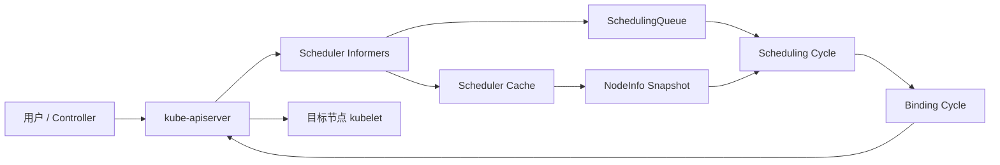

生产上通常运行多个 kube-scheduler 副本并开启 leader election，但同一时刻只有 leader 执行默认调度。这种高可用解决的是进程故障接管，不等于多个副本并行提高调度吞吐。

#### 2.1.4 原生能力的三个层次 {#k8s-scheduler-1-4-原生能力的三个层次}

讨论“原生调度器能否承载 AI”时，需要分开三个层次：

| 层次 | v1.37.1 原生能力 | 成熟度 |
|------|-----------------|--------|
| 单 Pod 放置 | Scheduling Framework、亲和性、污点、拓扑分布、优先级、卷、DRA | 主体稳定 |
| 多 Pod 工作负载放置 | Workload/PodGroup、Gang、TAS、workload-aware preemption、CompositePodGroup | Workload/PodGroup 与基础 Gang/抢占为 Beta gate，TAS/Composite 仍为 Alpha；均默认关闭 |
| 租户队列与应用编排 | 团队配额借用、公平排队、多集群准入、推理组件图和启动顺序 | 不是 kube-scheduler 的完整职责 |

因此，“原生完全没有 Gang”在 v1.37 已不准确；但“API 升到 Beta 就已无条件替代成熟批调度器”同样不准确。

---

### 2.2 从 Pod 到 Node 的完整数据流 {#k8s-scheduler-从-pod-到-node-的完整数据流}

#### 2.2.1 Pod 如何进入调度队列 {#k8s-scheduler-2-1-pod-如何进入调度队列}

kube-scheduler 通过 informer 观察 Pod、Node、PersistentVolume、PVC、StorageClass、ResourceClaim 等对象。未指定 `.spec.nodeName` 且 `.spec.schedulerName` 匹配某个 profile 的 Pod，才是该 scheduler 的候选对象。

调度队列不是单一 FIFO：

| 逻辑区域 | 含义 |
|----------|------|
| activeQ | 可以立即尝试调度，按 `queueSort` 插件排序 |
| backoffQ | 最近失败，需要等待退避时间后重试 |
| unschedulablePods | 已确认当前条件下不可调度，等待相关集群事件或超时刷新 |
| gated | 被 `PreEnqueue` 或 `schedulingGates` 阻止，尚未真正进入调度尝试 |

默认 `PrioritySort` 先比较 Pod Priority，再结合进入队列时间保持顺序。高优先级只影响先尝试谁，并不自动保证它一定能放置；资源、亲和性、卷和设备约束仍必须满足。

#### 2.2.2 SchedulingGates 避免无效重试 {#k8s-scheduler-2-2-schedulinggates-避免无效重试}

Pod Scheduling Readiness 在 v1.30 已稳定。控制器可以在 Pod 创建时写入 `.spec.schedulingGates`，等外部条件准备好后删除 gate。带 gate 的 Pod 不进入正常调度循环，可避免自动扩容、配额准入或应用编排尚未完成时反复产生 `FailedScheduling`。

```yaml
apiVersion: v1
kind: Pod
metadata:
  name: gated-worker
spec:
  schedulingGates:
  - name: platform.example.com/quota-ready
  containers:
  - name: worker
    image: registry.k8s.io/pause:3.10
```

gate 只能在 Pod 创建时添加，后续只能删除，不能再新增。这使其适合作为准入层到节点调度层的单向交接信号。

#### 2.2.3 Cache、Snapshot 与 API 状态的关系 {#k8s-scheduler-2-3-cache-snapshot-与-api-状态的关系}

调度热路径不会为每个候选节点同步查询 API Server。informer 把对象送入本地 cache，调度周期从 cache 创建一致的 `NodeInfo` snapshot，再对 snapshot 运行插件。

这带来两个重要语义：

- 调度依据是最终一致的本地视图，不是对 API Server 的强一致事务查询。
- Filter 看到的“可用资源”主要是 Node allocatable 减去已绑定和已 assumed Pod 的 requests，不是瞬时 CPU/GPU 利用率。

如果要按实时负载调度，需要自定义插件或 Koordinator 一类额外系统提供指标与资源治理；仅观察 requests 无法识别一个 request 很大但实际空闲的 Pod。

#### 2.2.4 调度算法的主路径 {#k8s-scheduler-2-4-调度算法的主路径}

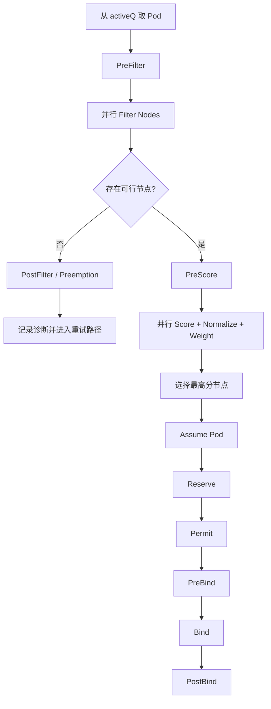

Filter 得到 feasible nodes；Score 插件通常把每个节点归一到框架分数区间，再乘插件权重求和。若多个节点最终总分相同，scheduler 从最高分候选中选择一个，而不应依赖固定的节点字典序。

#### 2.2.5 Assume 为什么重要 {#k8s-scheduler-2-5-assume-为什么重要}

选定节点后，scheduler 先在本地 cache 中把 Pod 标记为 assumed，并写入目标 `nodeName`，然后异步执行 binding cycle。这样下一个调度周期会把该 Pod 的资源算作已占用，不必等待 API Server 完成 Bind。

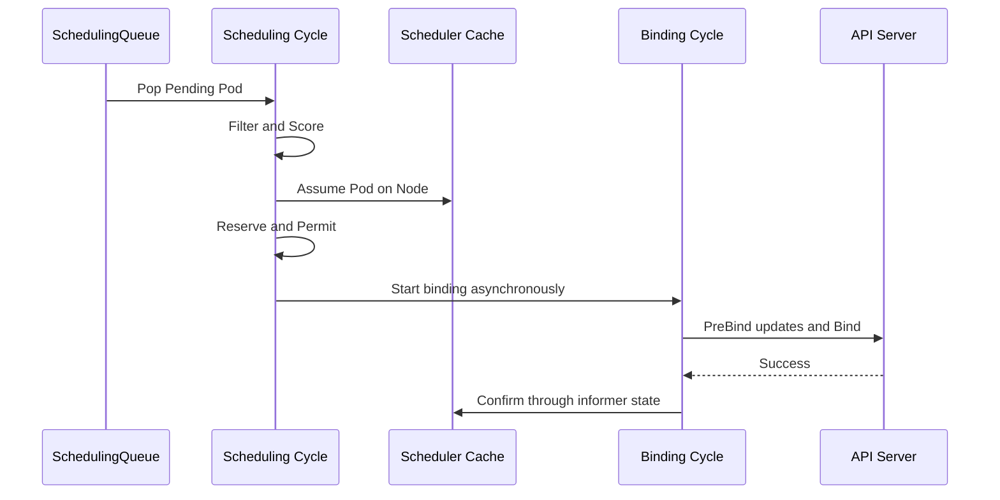

普通 Pod 的 scheduling cycle 串行执行，以便每次决策都能看到前一个 assumed Pod；binding cycle 可以并发。如果 Reserve、Permit、PreBind 或 Bind 失败，框架按逆序调用 `Unreserve`，并从 cache 中 Forget assumed Pod，释放乐观占用。

#### 2.2.6 失败重试与 QueueingHint {#k8s-scheduler-2-6-失败重试与-queueinghint}

调度失败会记录是哪些插件判定 Unschedulable。插件可以注册与自己相关的集群事件和 QueueingHint，例如 Node label 改变、Pod 删除、PVC 完成绑定。事件到来时，仅把可能因此变得可调度的 Pod 移回 activeQ/backoffQ，减少全队列无差别重试。

v1.37 增加 `SchedulerPreQueueingHints`，允许插件在更早的 PreQueue 阶段缩小需要响应某类事件的 entity 集合，DRA 插件可借此减少 `ResourceClaimTemplate` workload 的无效重试。该 gate 曾准备按 Beta 默认开启，但因发布前发现问题，v1.37.0 最终源码将它定为 **Alpha、默认关闭**；部署与文档必须服从 tag 内 feature-gate 表，不能照抄较早的 release-note 草稿。

诊断时要区分：

- `Unschedulable`：当前集群条件不满足，是正常调度结果。
- `UnschedulableAndUnresolvable`：抢占等动作也不能解决，例如必须的 node label 根本不存在。
- `Error`：插件、API 调用或内部处理失败，需要排查控制面。
- `Wait`：Permit/PreBind 等扩展点有意等待外部批准，不等同于失败。

---

### 2.3 Scheduling Framework {#k8s-scheduler-scheduling-framework}

#### 2.3.1 两个周期与扩展点 {#k8s-scheduler-3-1-两个周期与扩展点}

Scheduling Framework 把调度拆为插件扩展点。v1.37.1 的主要扩展点如下：

| 扩展点 | 所在阶段 | 作用 | 失败后的关键行为 |
|--------|----------|------|------------------|
| `preEnqueue` | 入队前 | 决定 Pod 是否可进入 activeQ | 留在 gated/unschedulable 路径 |
| `queueSort` | 队列 | 定义 Pending Pod 顺序 | 一个 scheduler 只能有一套兼容排序 |
| `preFilter` | 调度周期 | 预计算状态或提前拒绝 Pod | 不再遍历节点 |
| `filter` | 调度周期 | 判断单个 Node 是否可行 | 汇总失败插件与原因 |
| `postFilter` | 无可行节点后 | 尝试抢占或其他补救 | 成功时重新进入后续调度 |
| `preScore` | 评分前 | 为评分预计算共享状态 | 中止本次尝试 |
| `score` | 调度周期 | 为 feasible Node 打分并归一化 | 中止本次尝试 |
| `reserve` | 调度周期末 | 为选定节点预留外部/内部状态 | 失败或后续失败调用 `Unreserve` |
| `permit` | 两周期之间 | 批准、拒绝或等待绑定 | Reject 时 Unreserve；Wait 后异步批准 |
| `preBind` | 绑定周期 | 绑定前准备资源或写 API | 失败时 Unreserve/Forget |
| `bind` | 绑定周期 | 执行 Pod 到 Node 的绑定 | 首个成功处理的 Bind 插件终止链路 |
| `postBind` | 绑定后 | 通知、指标等收尾 | 不改变已完成绑定 |
| `placementGenerate` | PodGroup Alpha 路径 | 为一组 Pod 生成候选节点集合 | 依赖工作负载级 feature gate |
| `placementScore` | PodGroup Alpha 路径 | 对候选 placement 整体打分 | 依赖工作负载级 feature gate |

`multiPoint` 不是运行时阶段，而是配置字段：一个插件若实现多个扩展点，可以一次启用到全部适用位置。具体扩展点的显式配置优先级更高，可覆盖 MultiPoint 展开结果。

#### 2.3.2 v1.37.1 默认插件 {#k8s-scheduler-3-2-v1-37-1-默认插件}

默认 profile 通过 MultiPoint 加载以下核心插件。权重是 v1.37.1 源码默认值，不应直接套用到其他版本：

| 插件 | 主要职责 | Score 权重或特殊说明 |
|------|----------|----------------------|
| `SchedulingGates` | 阻止未就绪 Pod 入队 | 不评分 |
| `PrioritySort` | 按优先级和时间排序 | `queueSort` |
| `NodeUnschedulable` | 排除不可调度节点 | 不评分 |
| `NodeName` | 检查显式 `.spec.nodeName` | 不评分 |
| `TaintToleration` | 检查 taint/toleration 并偏好更少软 taint | 3 |
| `NodeAffinity` | nodeSelector、required/preferred node affinity | 2 |
| `NodePorts` | 检查 hostPort 冲突 | 不评分 |
| `NodeResourcesFit` | 资源可容纳性与资源评分 | 1 |
| `VolumeRestrictions` | 卷提供方限制 | 不评分 |
| `NodeVolumeLimits` | CSI 可挂载卷数量限制 | 不评分 |
| `VolumeBinding` | 延迟绑定、容量和拓扑协同 | 特定 feature 下参与评分 |
| `VolumeZone` | 卷 zone 约束 | 不评分 |
| `PodTopologySpread` | 拓扑分布约束 | 2 |
| `InterPodAffinity` | Pod 亲和与反亲和 | 2 |
| `DefaultPreemption` | 无可行节点时执行默认抢占 | `postFilter` |
| `NodeResourcesBalancedAllocation` | 偏好 CPU/内存占用比例更均衡 | 1 |
| `ImageLocality` | 偏好已有镜像的节点 | 1 |
| `DefaultBinder` | 调用默认 Bind | 至少需要一个 Bind 插件 |

DRA 稳定且默认开启时，`DynamicResources` 插件会进入默认集合；它在 PostFilter 中位于 `DefaultPreemption` 之前，优先尝试释放空闲 ResourceClaim，而不是先驱逐正在工作的 Pod。

Gang、TAS 插件只有相应 Alpha feature gate 开启后才加入：`GangScheduling`、`TopologyPlacement` 和 `PodGroupPodsCount` 不属于默认生产路径。

#### 2.3.3 Framework Status 与短路 {#k8s-scheduler-3-3-framework-status-与短路}

插件链不是“所有插件总会执行”：

- Filter 插件一旦确定节点不可行，可短路该节点的后续 Filter。
- PostFilter 按配置顺序尝试补救；某插件把 Pod 变回可调度后，后续插件不再执行。
- Bind 插件返回 Skip 时继续找下一个；某插件完成绑定后终止 Bind 链。
- Reserve 的 `Unreserve` 以与 Reserve 相反的顺序执行，插件必须把它设计成幂等操作。
- Permit 的 Wait 允许外部 controller 在超时前批准或拒绝 Pod，是实现 coscheduling 的传统扩展点之一，但等待一批已 assumed Pod 会占用 scheduler cache 中的资源。

#### 2.3.4 扩展 kube-scheduler 的四条路径 {#k8s-scheduler-3-4-扩展-kube-scheduler-的四条路径}

| 方式 | 特征 | 适用场景 | 风险 |
|------|------|----------|------|
| 配置内置插件 | 不编译代码，调整权重和参数 | 资源装箱、亲和性、拓扑等常规策略 | 改错默认插件可能使 Pod 永久 Pending |
| 编译 out-of-tree Framework 插件 | 与 scheduler 进程内运行 | 低延迟、需要 Reserve/Permit/Bind 的深度扩展 | 必须跟随 Kubernetes/Framework API 版本构建和升级 |
| Scheduler Extender | HTTP 调用外部 Filter/Prioritize/Bind | 兼容旧集成、厂商设备方案 | 网络延迟、有限接口、状态一致性与故障处理更复杂 |
| 独立 scheduler | 自有 Deployment 和 `schedulerName` | 完整不同的批调度或设备调度模型 | HA、缓存、RBAC、升级和对象所有权都需独立治理 |

多个 scheduler 可以共存，但每个 Pod 只能由 `.spec.schedulerName` 选中一个最终调度器。多个 webhook、extender 或 binder 同时声称拥有具体 GPU 分配，很容易产生重复分配或 annotation 冲突。

---

### 2.4 配置、Profile 与策略 {#k8s-scheduler-配置-profile-与策略}

#### 2.4.1 KubeSchedulerConfiguration v1 {#k8s-scheduler-4-1-kubeschedulerconfiguration-v1}

调度器配置使用稳定的 `kubescheduler.config.k8s.io/v1`。旧 `v1beta3` 已在 Kubernetes v1.29 移除，不能因为旧博客仍有示例就继续使用。

下面的配置展示两个 profile，并调整默认资源评分。它是说明结构的最小示例，生产中还需合并发行版提供的认证、leader election 和 kubeconfig 设置：

```yaml
apiVersion: kubescheduler.config.k8s.io/v1
kind: KubeSchedulerConfiguration
leaderElection:
  leaderElect: true
clientConnection:
  kubeconfig: /etc/kubernetes/scheduler.conf
percentageOfNodesToScore: 50
profiles:
- schedulerName: default-scheduler
- schedulerName: ai-binpack-scheduler
  plugins:
    score:
      enabled:
      - name: NodeResourcesFit
        weight: 5
  pluginConfig:
  - name: NodeResourcesFit
    args:
      scoringStrategy:
        type: MostAllocated
        resources:
        - name: cpu
          weight: 1
        - name: memory
          weight: 1
        - name: nvidia.com/gpu
          weight: 4
```

使用第二个 profile 的 Pod：

```yaml
apiVersion: v1
kind: Pod
metadata:
  name: gpu-worker
spec:
  schedulerName: ai-binpack-scheduler
  containers:
  - name: worker
    image: registry.k8s.io/pause:3.10
    resources:
      limits:
        nvidia.com/gpu: 1
```

#### 2.4.2 多 Profile 的真实边界 {#k8s-scheduler-4-2-多-profile-的真实边界}

一个 kube-scheduler 进程可以运行多个 profile，每个 profile 有唯一 `schedulerName` 和插件配置。但它们共享同一个 pending queue，因此所有 profile 必须使用相同的 `queueSort` 插件和参数。

这意味着 profile 适合表达“同一调度引擎中的几套放置策略”，不适合表达彼此完全独立的租户队列和公平算法。若需要分片、独立故障域或不同全局队列，通常要评估独立 scheduler 或 Kueue/KAI/Volcano 等系统。

#### 2.4.3 修改默认插件的安全规则 {#k8s-scheduler-4-3-修改默认插件的安全规则}

配置可用 `disabled: [{name: "*"}]` 清空某扩展点，也能重新启用插件改变顺序或权重。生产操作要遵守：

1. 至少保留一个可处理请求的 Bind 插件，否则 Pod 无法完成绑定。
2. 禁用 Filter 插件不会移除对应 API 约束的风险；它可能让 Pod 被放到运行时无法工作的节点。
3. Score 权重只改变可行节点之间的偏好，不能让 Filter 已拒绝的节点复活。
4. `MostAllocated` 是装箱策略，不代表节点实际利用率高；它依据 requests 计算。
5. 修改插件集合后用真实 Pod 约束回放，不只验证配置文件能启动。

#### 2.4.4 `schedulerName` 与绕过调度器 {#k8s-scheduler-4-4-schedulername-与绕过调度器}

- 未设置 `.spec.schedulerName` 时，API Server 默认写入 `default-scheduler`。
- 设置不存在的 scheduler 名称时，Pod 会长期 Pending，且不会被默认 scheduler 接管。
- 直接设置 `.spec.nodeName` 会绕过正常 scheduler 选点；NodeName 绑定还可能绕过部分调度约束，应只用于非常受控的系统场景。
- `nodeSelector`、node affinity 和 taint toleration 是约束 scheduler 的方式，不等同于直接指定 nodeName。

---

### 2.5 资源、亲和性、拓扑与卷 {#k8s-scheduler-资源-亲和性-拓扑与卷}

#### 2.5.1 scheduler 计算的是 requests {#k8s-scheduler-5-1-scheduler-计算的是-requests}

对普通 app container，scheduler 以有效 requests 做容量判断；若只设置 limit，准入/defaulting 可能使 request 等于 limit，具体取决于资源和集群策略。Pod 的调度资源还要考虑：

- app containers 的 requests 总和。
- init containers 的有效峰值，而不是简单把全部 init request 相加。
- Pod overhead，例如 RuntimeClass 对 sandbox 的额外开销。
- 已绑定和已 assumed Pod 的 requests。
- DRA 设备分配对节点可用性的约束。

`kubectl top` 显示的是运行时使用量，不能直接解释 `Insufficient cpu`。排查时应对比 Node allocatable、Pod requests 和 scheduler cache 观察到的对象。

#### 2.5.2 Node 选择约束 {#k8s-scheduler-5-2-node-选择约束}

| API | 语义 | 强制程度 |
|-----|------|----------|
| `nodeSelector` | 所有 label 键值都必须匹配 | required |
| `requiredDuringSchedulingIgnoredDuringExecution` | 布尔组合的 node affinity | required |
| `preferredDuringSchedulingIgnoredDuringExecution` | 匹配项增加 Score | preferred |
| `nodeName` | 直接指定 kubelet 节点 | 绕过常规选点 |

`IgnoredDuringExecution` 表示节点 label 后续变化时，已经运行的 Pod 通常不会因此自动驱逐。若安全隔离依赖 label，必须同时治理谁能修改节点标签，并使用受 NodeRestriction 保护的 label 前缀。

#### 2.5.3 Taint 与 Toleration {#k8s-scheduler-5-3-taint-与-toleration}

Taint 是节点排斥，toleration 只是允许 Pod 不被对应 taint 拒绝，并不保证 Pod 会选择该节点：

| effect | 调度/运行语义 |
|--------|---------------|
| `NoSchedule` | 新 Pod 若不容忍则不能调度到节点 |
| `PreferNoSchedule` | 软约束，评分时尽量避开 |
| `NoExecute` | 不仅阻止新 Pod，还可驱逐不容忍的已有 Pod |

GPU 节点常用 taint 防止普通 Pod 占用昂贵节点，再配合 node affinity 或 ResourceFlavor 选择节点类别。只有 toleration 而没有正向选择条件时，Pod 仍可能落到普通节点。

#### 2.5.4 Pod 亲和与反亲和 {#k8s-scheduler-5-4-pod-亲和与反亲和}

InterPodAffinity 根据已有 Pod label 和 topologyKey 约束共置或分散。它表达力强，但需要扫描匹配 Pod 和拓扑域，大规模集群中比简单 node affinity 更昂贵。

AI 场景应谨慎区分：

- “worker 与 driver 在同一 zone”可以使用 Pod affinity。
- “8 个 worker 必须同时启动”是 Gang，不是 affinity。
- “8 个 GPU 位于同一 NVLink fabric”需要设备/拓扑模型，普通 node label 不一定足够。
- “副本跨 zone 均匀分布”更适合 topology spread constraints。

#### 2.5.5 Pod Topology Spread {#k8s-scheduler-5-5-pod-topology-spread}

Topology spread 以 label selector、`topologyKey`、`maxSkew` 和 `whenUnsatisfiable` 控制分布：

- `DoNotSchedule` 是硬约束，可能让 Pod Pending。
- `ScheduleAnyway` 是软偏好，通过 Score 改善分布。
- 多条 constraint 是合取关系，必须同时满足。
- 缺失 topology label 的节点可能被排除或形成意外域，节点标签治理是前提。

它解决的是同类 Pod 在拓扑域间的偏斜，不等于对一个多 Pod workload 做原子选址。v1.37 中仍为 Alpha 的 TAS placement 是另一个层级。

#### 2.5.6 卷与节点选择是联合问题 {#k8s-scheduler-5-6-卷与节点选择是联合问题}

`VolumeBinding` 协调 Pod 节点选择与 PVC/PV 拓扑。StorageClass 使用 `WaitForFirstConsumer` 时，卷绑定或动态供给推迟到 scheduler 已评估 Pod 的 node affinity、资源与 zone 之后，避免先把卷固定在不可用 zone。

调度失败可能来自：

- PVC 未绑定或 StorageClass 不匹配。
- PV node affinity 与 Pod 可行节点没有交集。
- CSI node volume limit 已满。
- 所在 zone 没有可供给容量。

因此看到 `FailedScheduling` 时不能只查 CPU/GPU；卷插件的失败原因同样属于调度诊断。

---

### 2.6 评分、装箱与性能 {#k8s-scheduler-评分-装箱与性能}

#### 2.6.1 Score 不是单一算法 {#k8s-scheduler-6-1-score-不是单一算法}

每个 Score 插件独立评价 feasible nodes，框架归一化后乘权重求和。默认结果同时包含资源空闲、CPU/内存平衡、软 taint、node affinity、Pod affinity、拓扑分布和镜像本地性等信号。

一个节点“GPU 最合适”仍可能因 topology spread、taint 或 affinity 总分落后。生产调优应该查看具体插件分数或用 scheduler simulator 重放，而不是只观察最终节点猜测算法。

#### 2.6.2 NodeResourcesFit 三种策略 {#k8s-scheduler-6-2-noderesourcesfit-三种策略}

| 策略 | 倾向 | 典型目标 | 主要风险 |
|------|------|----------|----------|
| `LeastAllocated` | 选择 request 占用较低的节点 | 分散负载、保留余量 | 容易扩大活跃节点数量 |
| `MostAllocated` | 选择 request 占用较高但仍可容纳的节点 | 装箱、给 autoscaler 留出整节点 | 可能形成热点，仍需运行时隔离与监控 |
| `RequestedToCapacityRatio` | 自定义利用率到分数的曲线 | 针对不同资源设计非线性偏好 | 配置和验证复杂 |

扩展资源可以参与评分。例如给 `nvidia.com/gpu` 更高权重可增强 GPU 装箱，但标准扩展资源通常只表示整数数量，不能自动理解 GPU 型号、显存、NVLink 路径或 MIG 实例之间的关系。

#### 2.6.3 `percentageOfNodesToScore` {#k8s-scheduler-6-3-percentageofnodestoscore}

大集群不必为每个 Pod 给所有节点评分。scheduler 找到足够多 feasible nodes 后可以停止 Filter：

- 未显式配置时，自动公式在 100 节点约为 50%，5000 节点约为 10%，自动值下限 5%。
- 少于 100 个 feasible nodes 时仍会检查全部节点。
- 设置 100 表示对全部节点评分。
- 设得过低可提高吞吐，但最佳节点可能根本未进入 Score，放置质量会下降。

节点遍历使用轮转起点，并在多 zone 间交错，避免每次只让列表前部节点获得候选机会。调优应同时观察调度 p99、吞吐、碎片率和业务 SLO，不能只追求单次延迟。

#### 2.6.4 Opportunistic Batching {#k8s-scheduler-6-4-opportunistic-batching}

v1.37.1 中 `OpportunisticBatching` 仍为 Beta 且默认开启。对连续到达、调度约束等价的 Pod，scheduler 可以短时复用 Filter/Score 结果，减少重复计算。

当前能力有明确限制：带 inter-Pod affinity、topology spread、DRA claim、DRA backing extended resource 等 Pod 不适用；自定义插件还需要正确实现签名相关接口。它是吞吐优化，不改变 Gang 的原子语义。

---

### 2.7 优先级、抢占与中断 {#k8s-scheduler-优先级-抢占与中断}

#### 2.7.1 PriorityClass 的两个作用 {#k8s-scheduler-7-1-priorityclass-的两个作用}

Pod Priority 同时影响：

1. `PrioritySort` 的队列顺序，高优先级 Pod 更早尝试。
2. 无可行节点时的 preemption，高优先级 Pod 可能驱逐较低优先级 Pod。

`preemptionPolicy: Never` 可以让高优先级 Pod 排在队列前面，但禁止它通过抢占获得资源。它仍会遵守调度 backoff，不会无限紧循环。

#### 2.7.2 默认抢占流程 {#k8s-scheduler-7-2-默认抢占流程}

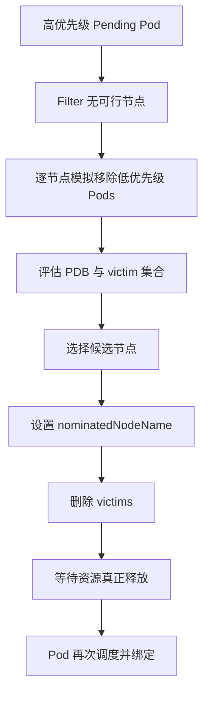

抢占不是同步搬迁事务。`nominatedNodeName` 是提示而非资源锁；victim 终止期间集群仍会变化，提名 Pod 可能再次失败或改选节点。

#### 2.7.3 PDB 不是绝对保护 {#k8s-scheduler-7-3-pdb-不是绝对保护}

默认抢占会尽量选择不违反 PodDisruptionBudget 的 victim 组合，但在没有其他可行办法时，抢占仍可能违反 PDB。PDB 也不约束节点故障、kubelet node-pressure eviction 等所有非自愿中断。

AI 平台不应把 PDB 当作训练 checkpoint 或推理副本保护的唯一机制。需要结合 controller 重建、checkpoint、优雅终止、优先级分层和队列策略。

#### 2.7.4 为什么 Pod 级抢占不等于 Job 级公平 {#k8s-scheduler-7-4-为什么-pod-级抢占不等于-job-级公平}

默认抢占一次主要为一个 Pod 找空间。它不了解团队累计用量、Job 是否只差最后一个 worker、租户是否长期超额，也没有 DRF/Cohort/层次队列语义。

对分布式训练，逐 Pod 抢占可能让低优先级 Job 只丢部分成员，既无法继续工作又残留资源。v1.37 的 workload-aware preemption 已随 `GenericWorkload` 进入 Beta 路径，但该 gate 仍默认关闭。

---

### 2.8 GPU 与 Dynamic Resource Allocation {#k8s-scheduler-gpu-与-dynamic-resource-allocation}

#### 2.8.1 Device Plugin 扩展资源路径 {#k8s-scheduler-8-1-device-plugin-扩展资源路径}

传统 Device Plugin 把设备数量作为 Node allocatable 扩展资源，例如 `nvidia.com/gpu`。Pod 通常在 limits 中请求整数设备，scheduler 用 `NodeResourcesFit` 判断数量是否足够，kubelet 再让 device plugin 选择并注入具体设备。

这条路径简单成熟，但调度器看到的信息有限：

- 通常只看到资源名和整数容量。
- 具体 device ID 多在 kubelet Allocate 阶段决定。
- 设备属性、共享容量、跨设备约束和网络拓扑难以统一表达。
- 调度记账不自动提供容器内显存或算力硬隔离。

MIG、MPS、HAMi 或厂商 device plugin/runtime 仍可能是必要组成部分。DRA 不是 Device Plugin 的简单改名：它把“选哪台节点”和“选哪些具体设备”放进同一个 scheduler 决策，但不替代设备驱动与运行时隔离。

#### 2.8.2 DRA 对象模型与 source of truth {#k8s-scheduler-8-2-dra-对象模型与-source-of-truth}

Dynamic Resource Allocation 的核心 API 在 v1.34 GA，`DynamicResourceAllocation` 从 v1.35 起锁定为开启。v1.37.1 的稳定 API 是 `resource.k8s.io/v1`，五类对象共同构成声明、库存、分配和消费链路：

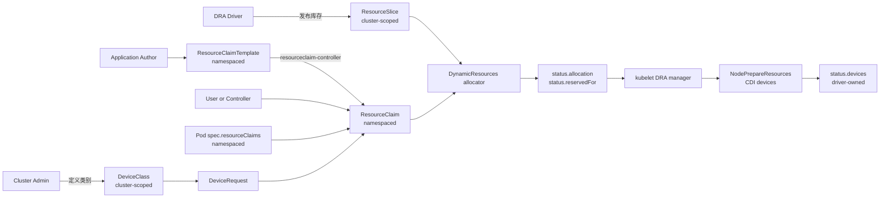

| 对象或字段 | Scope | 主要写入者 | source of truth 与关键约束 |
|------|-------|------------|-----------------------------|
| `ResourceSlice` | Cluster | DRA driver/controller | 设备库存、属性、容量、pool generation 和节点可访问范围；不是用户请求 |
| `DeviceClass` | Cluster | 管理员或受信任的 driver controller | 稳定类别名、CEL selectors、driver config；spec 可变，但只影响后续分配 |
| `ResourceClaim` | Namespace | 用户、resourceclaim-controller、scheduler、driver | 不可变 spec 是请求真相；scheduler 写 allocation/reservation，driver 写各自的 device status |
| `ResourceClaimTemplate` | Namespace | 应用作者/controller | 不可变模板；控制面复制其 spec 创建 claim，之后不持续同步模板变更 |
| Pod `spec.resourceClaims` | Namespace | 用户/controller | Pod 内逻辑名到同 namespace claim/template 的引用；字段不可变 |
| Pod `status.resourceClaimStatuses` | Namespace | resourceclaim-controller | template 实际生成的 claim 名；不能把模板名当成最终 claim 名 |

`ResourceSlice` 和 `DeviceClass` 是 cluster-scoped；`ResourceClaim`、`ResourceClaimTemplate`、Pod 与后文的 Workload/PodGroup 都是 namespaced，而且 claim 引用不能跨 namespace。对象的“所有者”也不能混写：driver 拥有库存事实，管理员拥有类别策略，应用/controller 拥有请求，scheduler 拥有分配与 reservation 决策，节点 driver 只拥有 `status.devices` 中属于自己的条目。

#### 2.8.3 从 ResourceSlice 到 Pod 的完整 API 链 {#k8s-scheduler-8-3-从-resourceslice-到-pod-的完整-api-链}

下面使用通用 accelerator 演示真实字段。driver 先发布两个 node-local 设备；`pool.generation` 与 `resourceSliceCount` 描述同一代 pool 的完整性：

```yaml
apiVersion: resource.k8s.io/v1
kind: ResourceSlice
metadata:
  name: node-a-accelerators-07
spec:
  driver: accelerator.example.com
  pool:
    name: node-a
    generation: 7
    resourceSliceCount: 1
  nodeName: node-a
  devices:
  - name: accel-0
    attributes:
      model:
        string: x200
      fabric:
        string: fabric-a
      numa:
        int: 0
    capacity:
      memory:
        value: 80Gi
  - name: accel-1
    attributes:
      model:
        string: x200
      fabric:
        string: fabric-a
      numa:
        int: 1
    capacity:
      memory:
        value: 80Gi
```

管理员再用 `DeviceClass` 把 vendor-specific 属性封装成稳定类别。CEL 中不应直接读取一个可能不存在的属性；生产表达式应先检查字段是否存在：

```yaml
apiVersion: resource.k8s.io/v1
kind: DeviceClass
metadata:
  name: high-memory-accelerator
spec:
  selectors:
  - cel:
      expression: >-
        device.driver == "accelerator.example.com" &&
        has(device.capacity["accelerator.example.com"].memory) &&
        device.capacity["accelerator.example.com"].memory.compareTo(quantity("64Gi")) >= 0
  config:
  - opaque:
      driver: accelerator.example.com
      parameters:
        runtimeProfile: compute
```

用户可以直接创建 `ResourceClaim`，也可以通过 template 为每个 Pod 或 PodGroup 生成 claim。下面的 template 同时展示 `exactly`、`count`、claim-level constraint、driver config 和 prioritized subrequests。API 中没有名为 `Exact` 的字段：字段叫 `exactly`，计数模式叫 `ExactCount`；文中“Exact 请求”只是机制简称。

```yaml
apiVersion: resource.k8s.io/v1
kind: ResourceClaimTemplate
metadata:
  name: training-accelerators
spec:
  spec:
    devices:
      requests:
      - name: workers
        exactly:
          deviceClassName: high-memory-accelerator
          allocationMode: ExactCount
          count: 2
          selectors:
          - cel:
              expression: device.attributes["accelerator.example.com"].model == "x200"
      - name: coordinator
        firstAvailable:
        - name: high-memory
          deviceClassName: high-memory-accelerator
          count: 1
        - name: compatible
          deviceClassName: compatible-accelerator
          count: 1
      constraints:
      - requests:
        - workers
        matchAttribute: accelerator.example.com/fabric
      config:
      - requests:
        - workers
        opaque:
          driver: accelerator.example.com
          parameters:
            mode: exclusive
```

Pod 引用 template 后，resourceclaim-controller 创建一个由该 Pod 拥有的 `ResourceClaim`，并把实际名字写入 Pod status。容器必须再通过 `resources.claims` 指明需要访问 claim 中的哪些 request；仅在 Pod 顶层引用 claim 不代表所有容器自动获得设备：

```yaml
apiVersion: v1
kind: Pod
metadata:
  name: trainer-0
spec:
  resourceClaims:
  - name: accelerators
    resourceClaimTemplateName: training-accelerators
  containers:
  - name: trainer
    image: registry.k8s.io/pause:3.10
    resources:
      claims:
      - name: accelerators
        request: workers
      - name: accelerators
        request: coordinator
```

这些字段的语义边界如下：

| 字段 | 调度语义 | 容易误解之处 |
|------|----------|--------------|
| `exactly` + `ExactCount` | 从指定 class 选精确 `count` 个满足全部 selectors 的设备；默认 count 为 1 | `exactly` 不是按设备 ID 精确点名 |
| `allocationMode: All` | 选择某个 pool 内所有匹配设备，至少要有一个，普通请求遇到已占设备会失败 | 不是“跨集群所有设备”；完整 pool 视图是必要条件 |
| `selectors` | DeviceClass selectors 与 request selectors 全部为 AND，逐设备执行 CEL | CEL 错误会中止本次分配，不只是把该设备判为不匹配 |
| `constraints.matchAttribute` | 多个 request 分配出的设备必须共享某属性，例如 fabric/NUMA | 它不验证真实链路性能，只比较 driver 发布的属性 |
| `constraints.distinctAttribute` | 要求设备属性两两不同 | 受 `DRAConsumableCapacity` 控制，不能当作所有版本的核心字段 |
| `config` | 分配时不参与筛选；分配后把 class/claim config 交给相应 driver | opaque 参数 schema 由 driver 定义，API Server 不理解其业务含义 |
| `firstAvailable` | 按声明顺序尝试 subrequest；allocation result 用 `request/subrequest` 记录选择 | 这是优先列表，不是全局最优搜索；`Score` 只偏好更靠前的可行项 |

`All` 与 AdminAccess 的典型管理请求应隔离到专用 namespace，而不是混入普通 workload template：

```yaml
apiVersion: resource.k8s.io/v1
kind: ResourceClaim
metadata:
  name: accelerator-diagnostics
  namespace: device-admin
spec:
  devices:
    requests:
    - name: inspect
      exactly:
        deviceClassName: high-memory-accelerator
        allocationMode: All
        adminAccess: true
```

#### 2.8.4 ResourceClaim 生命周期与状态机 {#k8s-scheduler-8-4-resourceclaim-生命周期与状态机}

一个 template claim 从创建到回收跨越 controller、scheduler、kubelet 和 driver，不能只用“Pending/Bound”两个词概括：

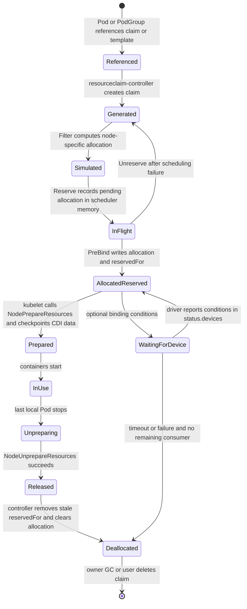

状态写入时机必须区分：

1. **生成 claim。** 对 `resourceClaimTemplateName`，kube-controller-manager 的 resourceclaim-controller 创建 claim、设置 Pod 或 PodGroup ownerReference，并把生成名写入 `pod.status.resourceClaimStatuses` 或 `podgroup.status.resourceClaimStatuses`。直接引用 `resourceClaimName` 时，claim 必须由用户/controller 预先创建。
2. **模拟分配。** `Filter` 对每个候选节点调用 structured allocator，结果只保存在该 scheduling cycle 的内存中；此时 API 上的 `status.allocation` 仍为空。
3. **内存预留。** `Reserve` 把选定结果登记为 in-flight allocation，防止并发调度周期重复使用设备；它仍不承诺 API 更新已经成功。
4. **持久化分配和消费者。** `PreBind` 先添加 Kubernetes delete-protection finalizer，再以 status update 写入 `status.allocation` 与 `status.reservedFor`。并发 scheduler 更新同一 claim 时只有满足 API resourceVersion/validation 的写入成功，失败一方回到 backoff。
5. **driver 状态。** `status.devices` 由对应 driver 写入，可包含 driver-specific data、network data 或 binding conditions。scheduler 不能把自己的 allocation 决策伪装成 driver 健康状态。
6. **节点准备。** kubelet 先验证 claim 已分配且为 Pod/PodGroup reserved，然后按 driver 批量调用 `NodePrepareResources`，保存返回的 CDI device 信息和 checkpoint，再把设备注入容器。
7. **终止与回收。** Pod 停止后 kubelet 对最后一个本地引用调用幂等的 `NodeUnprepareResources`。resourceclaim-controller 移除已终止/已删除 consumer；最后一个 reservation 消失后清空 scheduler allocation、移除 finalizer。template claim 最终随 Pod/PodGroup owner 被 GC，手工 claim 则继续存在，直到用户删除。

节点重启不会把准备状态完全交给内存猜测：kubelet DRA manager 维护 checkpoint，并周期性把不再属于 active Pod 的残留 claim 送入 Unprepare。反过来，driver 长期不可用会让 Prepare/Unprepare 重试，删除 Pod 并不保证物理设备在同一瞬间已经清理完毕。

#### 2.8.5 DynamicResources 插件调用链 {#k8s-scheduler-8-5-dynamicresources-插件调用链}

v1.37.1 的 `DynamicResources` 同时实现 `PreEnqueue`、`PreFilter`、`Filter`、`PostFilter`、`Score`、`Reserve`、`Unreserve` 和 `PreBind`。默认插件列表以权重 2 把它放在 `DefaultPreemption` 之前，因此无可行节点时会先尝试释放无消费者的失效 allocation，再考虑抢占普通 Pod。

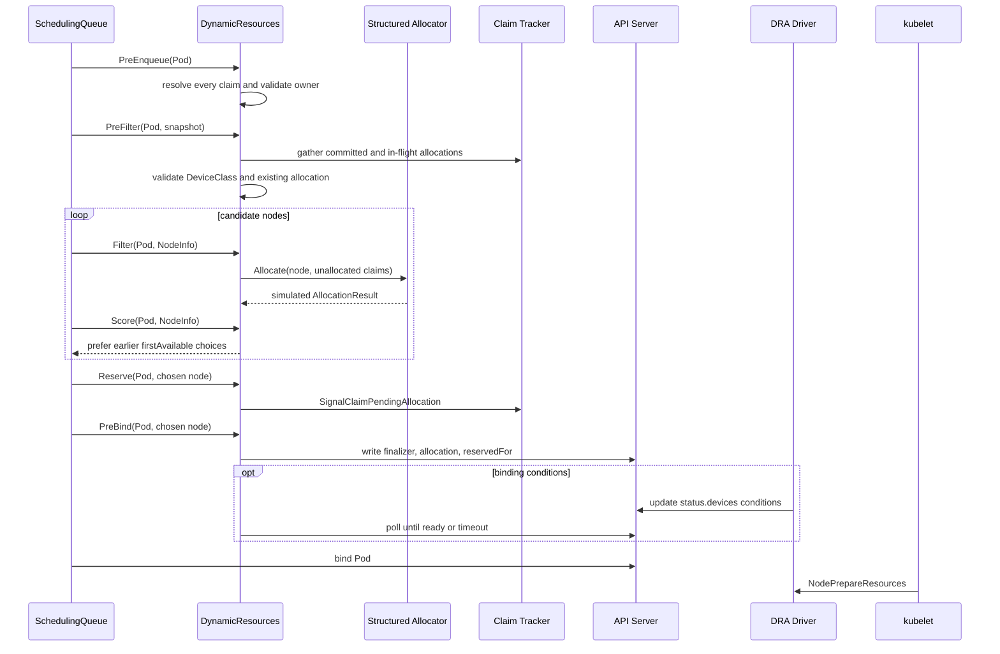

| 扩展点 | v1.37.1 行为 | 失败与恢复 |
|--------|---------------|------------|
| `PreEnqueue` | 解析 Pod 中所有 claim，验证生成 claim 的 owner、删除状态和存在性 | claim/template 尚未生成时留在 gated/unschedulable 路径，相关 claim 或 Pod status 事件重新激活 |
| `PreFilter` | 读取 claims、已有 allocation、reservation、DeviceClass、PodGroup binding；汇总 committed 与 in-flight 设备，构造 allocator | claim 已被不兼容消费者占用、class 不存在、CEL/状态非法时短路 |
| `Filter` | 对已分配 claim 检查 allocation node selector；对未分配 claim 按候选节点模拟结构化分配 | 只缓存 node-specific result，不写 API；incomplete pool 或设备不足使该节点不可行 |
| `Score` | 仅在 `DRAPrioritizedList` 启用时，根据选中的 subrequest 顺序加分并 normalize | 不替代普通 Node score，也不对任意设备组合做全局最优搜索 |
| `Reserve` | 把选定 allocation 放入 claim tracker 的 in-flight map；PodGroup 内可共享 pending allocation | 后续阶段失败时 `Unreserve` 减少 sharer、恢复 assume cache；最后一个 sharer 才真正释放 |
| `PreBind` | 以冲突重试持久化 `status.allocation` 和 consumer 到 `status.reservedFor`；可等待 binding conditions | API conflict、driver failure condition 或 timeout 返回 Error，binding cycle 调用 `Unreserve`，Pod 进入 backoff |
| `PostFilter` | 无节点可行时随机选一个无其他消费者的 unavailable claim，清空 allocation/reservation/device status；也可释放尚未被组内成员使用的 PodGroup reservation | 让下次尝试重新选设备；不会清理仍有真实 consumer 的 claim |

一个关键一致性点是：`Reserve` 的“预留”是 scheduler 本地并发保护，`PreBind` 的 status update 才是集群可见承诺。若把两者视为同一时刻，就无法解释 scheduler 崩溃、API conflict 或 Gang 统一回滚时为何没有泄漏一份已持久化 allocation。

v1.36.4 修复了结构化 allocator 在 `allocateDevice` 候选搜索中的 reserved-state 回滚：候选被拒绝或回溯时，共享 counter 的临时 reservation 必须完整撤销；共享设备的 in-use marker 也不能提前丢失，否则后续 share 会把同一 counter 重复计费。v1.36.2 的错误可能把仍有容量的 counter set 判断为耗尽，使 Pod 在本可满足的节点上持续 Pending。该修复属于默认 DRA allocator 路径，不需要新 feature gate，但升级后应重放使用 `DRAConsumableCapacity`/`DRAPartitionableDevices` 的共享设备场景。

#### 2.8.6 ResourceSlice pool 与一致性边界 {#k8s-scheduler-8-6-resourceslice-pool-与一致性边界}

设备唯一身份是 `(driver, pool, device)` 三元组，不是 `ResourceSlice.metadata.name`。driver 可以在 reconciliation 中把同一设备移到另一个 slice，但同一 pool 内 device name 必须唯一。

| 机制 | scheduler 解释 | driver 的责任 |
|------|----------------|---------------|
| `pool.generation` | 同一 pool 只消费观察到的最高 generation，旧 slice 静默忽略 | pool 任一设备事实变化时统一提升所有新 slice 的 generation |
| `resourceSliceCount` | 当前 generation 收到的 slice 数不足即标记 incomplete，不从该 pool 分配 | 先声明准确总数，再持续 reconcile 到全部 slice 可见 |
| 节点范围 | `nodeName`、`nodeSelector`、`allNodes`、`perDeviceNodeSelection` 四选一 | 准确表达设备在哪些节点可访问；标签陈旧会直接制造错误可行性 |
| 清单有效性 | 重复 device name 等问题使 pool invalid | 修正 slice；不能指望 scheduler 自动挑一个重复项 |
| 变更传播 | informer 更新 scheduler cache；下一 scheduling cycle 重新汇总 pool | driver 必须幂等发布并处理 API Server 暂时失败 |

v1.37 默认启用的 Beta/GA DRA 能力会选择包含确定性排序的 allocator 路径：pool 按 driver/pool 名排序，pool 内 ResourceSlice 按名字排序，然后执行 first-fit 搜索。名称因此可能影响优先命中的 pool/slice，但这不是性能评分 API；driver 不应把脆弱的命名技巧当作拓扑或健康策略。设备在单个 slice 内仍按 driver 发布顺序参与搜索，也不能据此宣称“总会选设备名最小者”。

scheduler cache 不是独立真相。它把 informer 中已持久化 allocation 与 claim tracker 中尚未到达 informer 的 in-flight/assumed allocation 合并，避免同一设备被重复选中；若采集期间检测到并发 revision 变化，会短暂重试。driver 更新期间，`generation + resourceSliceCount` 只能让 scheduler 识别“不完整”，不能提供跨多个 API 对象的事务快照。生产 driver 必须持续 reconcile，scheduler 则宁可暂时判不可分配，也不应消费半套 inventory。

#### 2.8.7 三种 claim 所有权与共享模型 {#k8s-scheduler-8-7-三种-claim-所有权与共享模型}

| 模式 | claim owner | `status.reservedFor` | 生命周期与适用场景 |
|------|-------------|----------------------|--------------------|
| 手工共享 claim | 无自动 owner，通常由用户/controller 管理 | 每个 Pod 一项 | 名字预先已知，可跨多个 Pod 复用；最多 256 个 reservation，最后一个 Pod 结束后 claim 可重新分配但对象不会自动删除 |
| 每 Pod template claim | Pod | 每个 claim 通常只有该 Pod 一项 | resourceclaim-controller 为每 Pod 生成；Pod 结束后清理并由 owner GC，隔离清晰但对象数量较多 |
| 每 PodGroup template/shared claim | PodGroup | 整组仅一项 PodGroup reference | `DRAWorkloadResourceClaims` Beta、默认关闭；组内所有匹配 Pod 共用 claim，Pod 数可超过 256，reservation 与 allocation 持续到 PodGroup 删除 |

PodGroup 共享不是仅仅“多个 Pod 写同一个 claim 名”。PodGroup `spec.resourceClaims` 和 Pod `spec.resourceClaims` 的 `name`、`resourceClaimName`/`resourceClaimTemplateName` 必须逐字段相同；匹配时 scheduler 把 consumer 绑定到 PodGroup UID，不匹配的 Pod claim 仍按普通 Pod reservation 处理。PodGroup 最多定义 4 个共享 claim。

`reservedFor` 的 256 项上限约束的是 consumer reference 条目，不是设备数。手工 claim 给 300 个 Pod 逐一 reservation 会撞上限制；同一 PodGroup 的 300 个 Pod 只占一个 reservation，但会把设备释放时机延长到 PodGroup 删除。平台 controller 因此必须可靠删除已经结束的 PodGroup，否则共享设备会被有意保留。

#### 2.8.8 v1.37.1 feature maturity 矩阵 {#k8s-scheduler-8-8-v1-37-1-feature-maturity-矩阵}

主分支文档会继续演进，下面只按 `v1.37.1` 的 `defaultVersionedKubernetesFeatureGates` 与依赖表判断。`默认开启` 不等于 GA，也不代表某个具体 driver 已支持该字段。

| Feature gate / API | v1.37.1 状态 | 默认 | 依赖 | 影响范围 |
|--------------|---------------|------|------|----------|
| `DynamicResourceAllocation` | GA，锁定 | 开 | 无 | `resource.k8s.io/v1` 核心、scheduler/kubelet DRA 路径 |
| `DRAAdminAccess` | GA，锁定 | 开 | `DynamicResourceAllocation` | `adminAccess` 与 admin namespace 校验 |
| `DRAPrioritizedList` | GA，锁定 | 开 | `DynamicResourceAllocation` | `firstAvailable` subrequests 与 DRA Score |
| `DRAConsumableCapacity` | Beta | 开 | `DynamicResourceAllocation` | 多 allocation、capacity、share ID、`distinctAttribute` |
| `DRADeviceBindingConditions` | Beta | 开 | DRA + `DRAResourceClaimDeviceStatus` | `bindsToNode`、PreBind 等待与失败恢复 |
| `DRADeviceTaints` / `DRADeviceTaintRules` | GA | 开 | `DynamicResourceAllocation` / device taints | device taints/tolerations、独立 DeviceTaintRule API 与 NoExecute 处理；v1.37 尚未锁定，预计下一版本锁定 |
| `DRAExtendedResource` | GA，锁定 | 开 | `DynamicResourceAllocation` | DeviceClass 映射传统 extended resource 请求 |
| `DRAPartitionableDevices` | Beta | 开 | `DynamicResourceAllocation` | per-device node selection、shared counters、动态分区 |
| `DRAFractionalCapacityRange` | Beta | 开（1.37 compatibility） | `DynamicResourceAllocation` | capacity range 的 milli-unit `min/max/step` |
| `DRAResourceClaimDeviceStatus` | GA，锁定 | 开 | 对 DRA 为软依赖 | driver 写 `status.devices`；binding conditions 的硬依赖之一 |
| `DRAResourceClaimGranularStatusAuthorization` | Beta | 开 | DRA + device status | allocation/reservation 与 driver device status 的细粒度授权 |
| `DRASchedulerFilterTimeout` | Beta | 开 | `DynamicResourceAllocation` | 限制每节点 DRA Filter 计算时间 |
| `DRANodeAllocatableResources` | Alpha | 关 | `DynamicResourceAllocation` + node-declared capability | DRA 对 CPU/内存/hugepages 的 direct/overhead allocation、cgroup/OOM/MemoryQoS 与 resize 协同 |
| `DRAListTypeAttributes` | Alpha | 关 | `DynamicResourceAllocation` | list attributes 与集合式 match/distinct 语义 |
| `DRADerivedAttributes` | Alpha | 关 | `DynamicResourceAllocation` | 以 CEL 定义虚拟属性，协调 GPU/NIC 等不同 driver 的拓扑属性 |
| `DRADeviceCompatibilityGroups` | Alpha | 关 | DRA + `DRAPartitionableDevices` | 在 scheduler 阶段拒绝 shared counter 上无交集的 compatibility group |
| `DRAOptionalNodeOperations` | Alpha | 关 | DRA + `NodeDeclaredFeatures` | 通过 `SkipNodeOperations` 跳过 node prepare/unprepare；目标节点必须声明支持 |
| `DRAResourcePoolStatus` | Alpha（第二版） | 关 | `DynamicResourceAllocation` | 查询 pool 完整性与 partition/shareable availability；v1.37 修正 v1.36 计数语义 |
| `DRAWorkloadResourceClaims` | Beta | **关** | DRA + `GenericWorkload` | PodGroup 级 claim 生成、reservation 与共享；Beta 不等于默认开启 |

DRA device metadata API 在 v1.37 升为 `v1beta1`，driver 必须显式声明输出的 metadata API version；tag 内仍保留 `v1alpha1` 兼容实现。`DRAResourceHealth` kubelet gRPC API 则升为 v1：helper 的 `DRAPlugin.WatchHealthStatus` 成为必须实现的方法，不支持 health 的 driver 应返回 `ErrHealthNotSupported` 或用 `HealthService(false)` 关闭服务。helper 默认同时 serve v1/v1alpha1，kubelet 优先 v1，并在过渡期继续消费旧 driver 的 v1alpha1。这里的“API Beta/v1”分别描述 metadata schema 与 kubelet plugin RPC，不等价于对应硬件 driver 已支持健康上报。

启用依赖 gate 需要在实际消费该字段的组件上保持一致，通常至少涉及 kube-apiserver、kube-scheduler、kube-controller-manager 和 kubelet；只打开 API Server 可能让对象可创建，却让 scheduler 或 kubelet 按旧语义处理。Alpha gate 更应使用独立集群/profile 做版本锁定和回滚演练。

#### 2.8.9 安全边界与绕过 scheduler 的 Pod {#k8s-scheduler-8-9-安全边界与绕过-scheduler-的-pod}

`adminAccess: true` 会忽略普通 claim 对设备的占用，并可能让 driver 暴露额外管理权限。v1.37.0 虽已 GA，也不意味着普通租户应该获得它。API Server 要求 ResourceClaim/Template 位于带有以下精确标签的 namespace，同时调用者仍必须通过 RBAC 的 create/update 授权：

```bash
kubectl label namespace device-admin resource.kubernetes.io/admin-access=true
```

推荐把 admin namespace、ServiceAccount、ResourceQuota/准入策略和可引用 DeviceClass 一起隔离。不要仅靠 DeviceClass 名称实现权限控制：能创建任意 ResourceClaim 的用户仍可能引用其他已存在的 class；需要 RBAC、admission policy 与 namespace 边界共同约束。

`DRAResourceClaimGranularStatusAuthorization` 把 status 写入按责任拆开：scheduler/controller 更新 allocation 和 reservation 需要 synthetic `resourceclaims/binding` 权限；driver 更新 `status.devices` 使用 `resourceclaims/driver` 以及 associated-node 或 arbitrary-node 动词前缀。不要给 node plugin 对所有 claim status 的通配写权限，否则一个受陷节点可能伪造其他 driver 或其他节点的设备状态。

当 Pod 直接设置 `.spec.nodeName` 时，kube-scheduler 完全被绕过，也就没有 `DynamicResources` 为其分配或 reservation。若 claim 不存在、未 allocation 或未 reserved，目标 kubelet 会拒绝启动并周期性重查；它不会替 scheduler 自动补齐状态。可信控制器若必须预选节点，应优先写 `nodeSelector`/required node affinity 后仍交给 scheduler，或自己完整实现 claim allocation、reservation 与冲突处理。

#### 2.8.10 故障模式与恢复 {#k8s-scheduler-8-10-故障模式与恢复}

| 症状 | 机制原因 | 恢复与检查重点 |
|------|----------|----------------|
| `ResourceClaim` 不存在或 template 尚未生成 | `PreEnqueue`/`PreFilter` 无法解析 claim，或 resourceclaim-controller 失败 | 查看 Pod `status.resourceClaimStatuses`、controller 事件与 template RBAC；claim/Pod status 更新会重新激活 Pod |
| pool 长期 incomplete | 最高 generation 的 slice 数少于 `resourceSliceCount`，driver rollout 中断 | 对比同一 driver/pool 的 generation/count；修复 driver reconciliation，不能手工混用两代 slice |
| DeviceClass 存在但一直无匹配设备 | CEL 读取错误属性、类型不一致、node scope 不匹配或库存陈旧 | 检查 CEL、ResourceSlice attributes/capacity 和目标节点 label；类变更只影响新 allocation |
| 两个 Pod 竞争同一共享 claim | 两个 scheduler 都在 Reserve 模拟成功，`PreBind` status update 只有一方满足 reservation 上限/冲突检查 | 失败方执行 `Unreserve` 并进入 backoff；核对 claim UID、resourceVersion 和 `reservedFor` |
| shared counter 看似耗尽但物理容量仍在 | v1.36.2 structured allocator 在候选拒绝/回溯时可能残留 counter reservation，或丢失 in-use marker 后重复扣费 | v1.36 线至少升级到 v1.36.4；升到 v1.37.0 后仍重建相同 ResourceSlice/Claim 组合并确认候选回滚与 compatibility group 计数 |
| binding condition 超时或失败 | allocation 已写入，但 driver 未及时在 `status.devices.conditions` 报 True，或报告 failure condition | PreBind 返回 Error；下一周期把无其他 consumer 的 unavailable claim 交给 PostFilter 清空并重新分配 |
| Pod 已绑定但卡在创建容器 | kubelet 找不到 plugin、`NodePrepareResources` 失败、CDI 响应错误或 driver 崩溃 | 查看 kubelet/DRA driver 日志与 `dra_grpc_operations_duration_seconds`；kubelet 重试，scheduler 不会自动改绑已绑定 Pod |
| Pod 删除后设备未释放 | `NodeUnprepareResources` 失败、kubelet checkpoint 残留、PodGroup reservation 仍在 | 修复 driver 后让幂等 Unprepare/reconcile 重试；共享 claim 要确认 PodGroup 是否已删除 |
| 高优先级 DRA Pod 长期 Pending | v1.37 scheduler 仍不支持为 DRA resource 执行默认抢占 | 等待/删除冲突 Pod，或由队列准入保证容量；Priority 本身不能夺回设备 |
| `nodeName` Pod 一直起不来 | 绕过 scheduler 后 claim 没有 allocation/reservation 或设备不在该节点 | 改用 scheduler 约束；若由自研 controller 预调度，必须完成整个 DRA 协议 |

这里最重要的生产限制是：**Kubernetes v1.37 的默认抢占不支持 DRA 资源。** 正在使用 DRA device 的低优先级 Pod，不会因为另一个高优先级且同样需要该 device 的 Pod 而被 scheduler 自动抢占。队列层、容量预留或显式运维动作仍然必要。

#### 2.8.11 可观测性与排障命令 {#k8s-scheduler-8-11-可观测性与排障命令}

先从 API 对象沿着 inventory、request、allocation、reservation、node preparation 的顺序检查：

```bash
# 类别和 driver 发布的库存
kubectl get deviceclasses.resource.k8s.io -o wide
kubectl get resourceslices.resource.k8s.io \
  -o custom-columns='NAME:.metadata.name,DRIVER:.spec.driver,POOL:.spec.pool.name,GEN:.spec.pool.generation,COUNT:.spec.pool.resourceSliceCount,NODE:.spec.nodeName'

# claim 的请求、具体分配、consumer 和 driver-owned device status
kubectl get resourceclaims.resource.k8s.io -A
kubectl get resourceclaim.resource.k8s.io -n <namespace> <claim> \
  -o jsonpath='{.status.allocation}{"\n"}{.status.reservedFor}{"\n"}{.status.devices}{"\n"}'

# template 生成名、PodGroup 共享名以及 Pod 是否已绑定
kubectl get pod -n <namespace> <pod> \
  -o jsonpath='{.status.resourceClaimStatuses}{"\n"}{.status.extendedResourceClaimStatus}{"\n"}{.spec.nodeName}{"\n"}'
kubectl get podgroup.scheduling.k8s.io -n <namespace> <podgroup> \
  -o jsonpath='{.status.resourceClaimStatuses}{"\n"}{.status.conditions}{"\n"}'

# 事件和关键控制面/节点日志
kubectl describe pod -n <namespace> <pod>
kubectl describe resourceclaim.resource.k8s.io -n <namespace> <claim>
kubectl -n kube-system logs <kube-scheduler-pod> --since=30m | grep -E 'DynamicResources|resourceclaim|BindingConditions'
journalctl -u kubelet --since '30 min ago' | grep -E 'dra-manager|NodePrepareResources|NodeUnprepareResources'
kubectl -n <driver-namespace> logs <dra-driver-pod> --since=30m
```

调度器通用的 `scheduler_plugin_execution_duration_seconds` 可按 `plugin="DynamicResources"` 和 extension point 分解耗时；v1.37.1 还提供以下专项指标：

| 指标 | 用途 |
|------|------|
| `scheduler_dra_bindingconditions_allocations_total` | 按 profile/driver/status 统计 binding condition 成功、失败和超时 |
| `scheduler_dra_bindingconditions_wait_duration_seconds` | PreBind 等待 driver condition 的时延 |
| `scheduler_resourceclaim_creates_total` | DRA-backed extended resource 的 scheduler claim 创建结果 |
| `dra_operations_duration_seconds` | kubelet Pod 级 PrepareResources/UnprepareResources 时延与错误 |
| `dra_grpc_operations_duration_seconds` | 按 driver/method/gRPC code 分解 kubelet 到节点插件的调用 |
| `dra_resource_claims_in_use` | kubelet 当前使用中的 claim 数，按 driver 观察 |

指标只说明“哪一步慢或失败”，不能替代对象核对。例如 scheduler 已成功写 allocation 而 kubelet Prepare 失败时，调度指标可能正常，真正信号在 kubelet/driver 指标和 Pod event。

#### 2.8.12 GPU、NVLink 与运行时隔离边界 {#k8s-scheduler-8-12-gpu-nvlink-与运行时隔离边界}

| 需求 | 原生基础 | 通常仍需的扩展 |
|------|----------|----------------|
| 整卡数量 | Device Plugin 扩展资源或 DRA | NVIDIA/厂商驱动与 device plugin |
| GPU 型号/属性 | Node label 或 DRA DeviceClass | 驱动准确发布属性 |
| MIG 实例 | 扩展资源或 DRA | MIG Manager、device plugin/runtime |
| 显存/算力份额 | DRA 可表达容量方向 | HAMi、MPS、厂商 runtime 隔离 |
| GPU 与 NIC/NUMA 联合选择 | DRA 与节点拓扑是基础 | topology-aware driver、NUMA/Topology Manager 集成 |
| 多节点 NVLink/NVSwitch 域 | Node label、PodGroup TAS 可表达部分域 | fabric topology controller、AI scheduler 或专用插件 |

调度成功只说明“系统分配了声明的资源”，不自动证明带宽、隔离、故障域和性能 SLO 达标。

---

### 2.9 v1.37 工作负载级原生调度 {#k8s-scheduler-v1-37-工作负载级原生调度}

#### 2.9.1 成熟度快照 {#k8s-scheduler-9-1-成熟度快照}

| 能力 | v1.37.1 状态 | 默认 | 关键 feature gate |
|------|----------|---------------|-------------------|
| Workload / PodGroup API | `scheduling.k8s.io/v1beta1`；`GenericWorkload` Beta | 关 | `GenericWorkload` |
| Gang Scheduling / workload-aware preemption | 随 `GenericWorkload` 进入 Beta 路径；v1.36 的独立 `GangScheduling` / `WorkloadAwarePreemption` gate 已移除 | 关 | `GenericWorkload` |
| Topology-Aware Workload Scheduling | Alpha | 关 | `GenericWorkload`、`TopologyAwareWorkloadScheduling` |
| CompositePodGroup | `v1alpha3` 资源与 v1beta1 Workload template 支持，Alpha | 关 | `CompositePodGroup`、`GenericWorkload`、`TopologyAwareWorkloadScheduling` |
| PodGroup preemption policy | Alpha | 关 | `GenericWorkload`、`PodGroupPreemptionPolicy` |
| Job 自动生成 Workload/PodGroup | Alpha | 关 | `GenericWorkload`、`WorkloadWithJob` |

Workload/PodGroup 的主 API 在 v1.37.0 升为 `scheduling.k8s.io/v1beta1`，但 `GenericWorkload` 仍默认关闭；API maturity 和默认启用是两件事。v1.36 的 `v1alpha2` 在 v1.37 不再 serve，也没有跨该删除点的自动存储迁移：升级前必须在 v1.36 集群删除全部 `v1alpha2` Workload/PodGroup 对象，再升级控制面并以 v1beta1 schema 重建。`DRAWorkloadResourceClaims` 同步升为 Beta但仍默认关闭，并依赖 `DynamicResourceAllocation + GenericWorkload`。

#### 2.9.2 Workload PodGroup 与 Pod 对象链 {#k8s-scheduler-9-2-workload-podgroup-与-pod-对象链}

四层结构分别承担模板、运行时状态和成员引用，全部位于同一 namespace：

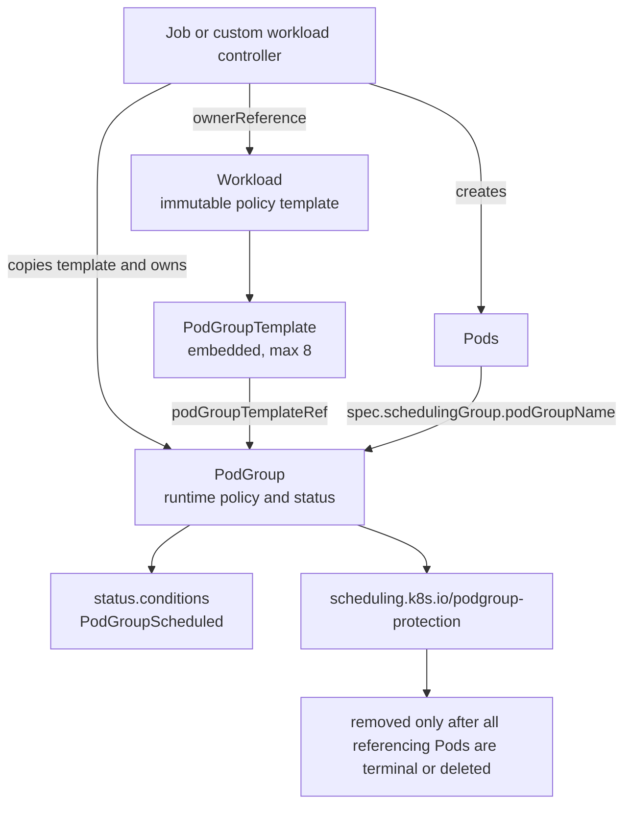

| 对象/字段 | 用途 | 所有权、可变性与限制 |
|-----------|------|----------------------|
| `Workload` | 长期调度策略入口 | namespaced；通常由 workload controller 拥有；整个 spec 不可变，最多 8 个 template |
| `PodGroupTemplate` | `Workload.spec` 内嵌模板 | 不是独立 API 对象；定义 `basic/gang`、TAS、共享 claim、priority/disruption 等策略 |
| `PodGroup` | 一次运行实例与 scheduler 状态 | namespaced；由 workload controller 拥有；policy、template ref、constraints、claim、priority/disruption 均不可变 |
| Pod `spec.schedulingGroup` | 成员到 PodGroup 的运行时引用 | Pod 创建后不可变；引用对象可以稍后出现，但同名 PodGroup 被重建可能带来策略漂移 |
| `PodGroupScheduled` | 初始组调度结果 | 成功后不会因成员后续失败、驱逐或缩容回退为 False，不是持续健康状态 |

v1.37 还加入 CompositePodGroup building block：Workload 可以声明 `compositePodGroupTemplates`，树深最多 4，并以 CompositePodGroup 把多个子组纳入统一调度/抢占策略。该资源仍走 `scheduling.k8s.io/v1alpha3` 且依赖默认关闭的 `CompositePodGroup` 与 TAS gate；不能因为父 Workload 已是 v1beta1 就把整个组合 API 称为 Beta。

controller 的正确创建顺序是 **Workload -> PodGroup -> Pods**。带 `podGroupTemplateRef` 的 PodGroup 若引用不存在或正在删除的 Workload，API Server 拒绝创建；Pod 先于 PodGroup 出现则会 Pending，PodGroup Add 事件再把它激活。

典型 controller 会把 Workload 和 PodGroup 都设为高层 workload 的 owner；PodGroup 还可保存指向 Workload 的非 controller ownerReference 便于追踪。API admission 在 PodGroup 创建时加入 `scheduling.k8s.io/podgroup-protection` finalizer；删除期间只要仍有非终态 Pod 引用它，保护 controller 就保留 finalizer，所有成员进入 `Succeeded/Failed` 或被删除后才解除。

完整策略与运行实例示例。它同时使用 Gang 与 TAS，必须在 API Server、scheduler 和相关 controller 上一致启用 `GenericWorkload` 与 `TopologyAwareWorkloadScheduling`；基础 Gang 已归入 GenericWorkload，不再配置 v1.36 的独立 `GangScheduling` gate。以下清单因包含 TAS 字段仍只适合锁定 v1.37.1 的隔离验证环境：

```yaml
apiVersion: scheduling.k8s.io/v1beta1
kind: Workload
metadata:
  name: training-policy
spec:
  controllerRef:
    apiGroup: batch
    kind: Job
    name: distributed-training
  podGroupTemplates:
  - name: workers
    schedulingPolicy:
      gang:
        minCount: 4
    schedulingConstraints:
      topology:
      - key: topology.example.com/fabric-block
---
apiVersion: scheduling.k8s.io/v1beta1
kind: PodGroup
metadata:
  name: training-workers-0
spec:
  podGroupTemplateRef:
    workload:
      workloadName: training-policy
      podGroupTemplateName: workers
  schedulingPolicy:
    gang:
      minCount: 4
  schedulingConstraints:
    topology:
    - key: topology.example.com/fabric-block
---
apiVersion: v1
kind: Pod
metadata:
  name: worker-0
spec:
  schedulerName: default-scheduler
  schedulingGroup:
    podGroupName: training-workers-0
  containers:
  - name: worker
    image: registry.k8s.io/pause:3.10
    resources:
      requests:
        cpu: "4"
        memory: 16Gi
```

手工使用时必须创建足够多的同组 Pod；这个片段只展示一个成员。所有成员必须引用同一 namespace 中的 PodGroup，并使用相同 `.spec.schedulerName`。

#### 2.9.3 basic 与 gang policy {#k8s-scheduler-9-3-basic-与-gang-policy}

`PodGroupSchedulingPolicy` 是 union，必须且只能设置 `basic` 或 `gang`：

| 语义 | `basic: {}` | `gang.minCount` |
|------|-------------|-----------------|
| 调度单元 | 同一 cycle 收集、观察和模拟组内 Pod | 同一 cycle 收集并以 quorum 判定可行性 |
| 部分放置 | 允许；可调度成员可以进入 binding，其余回队列 | 初次决定不足 `minCount` 时一个也不绑定 |
| 组级 constraints | 可使用 TAS 等约束 | 可使用 TAS 等约束 |
| 适用 | 统一观察、状态、共享 claim 或未来组约束，但应用能容忍部分启动 | 紧耦合 worker 至少达到最小运行规模才有价值 |

`minCount` 只表示“本次 group scheduling decision 至少要找到多少个可放置成员”，它不等于：

- controller 的期望副本数；组内可以有多于 `minCount` 的 Pod。
- 已经 Running 或 Ready 的 Pod 数；Bind、镜像拉取和容器启动发生在之后。
- Job 的 completions；弹性任务可以有完全不同的完成语义。
- 应用层 rendezvous、MPI world size 或服务发现完成；这些仍由应用/controller 保证。

当已调度成员达到 quorum 后，后来新增的 extra Pod 会在新的 cycle 中考虑已有占用并单独加入；`PodGroupScheduled=True` 不会因为 extra Pod 放不下而回退。

#### 2.9.4 PodGroup scheduling cycle 源码路径 {#k8s-scheduler-9-4-podgroup-scheduling-cycle-源码路径}

传统路径一次 pop 一个 Pod；启用 `GenericWorkload` 后，scheduler 对引用 PodGroup 的 Pod 组装 `QueuedPodGroupInfo`，并执行如下过程：

1. 从 scheduling queue 取出同组当前可见的 unscheduled Pods，按 Priority 和 scheduler 首次观察时间确定性排序。
2. 校验组内 `.spec.schedulerName` 一致，并选择对应 framework profile。
3. 为整个 PodGroup 更新一次 NodeInfo/PodGroupState snapshot；同一 group cycle 的每个 Pod 都读这一快照及之前的临时 assume 结果。
4. 逐 Pod 执行普通 PreFilter/Filter/Score/PostFilter。可行 Pod 被临时 Assume 并运行 Reserve；若需要默认抢占，其 nominated node 也会在模拟中当作建议位置。
5. 运行 Permit。对 gang，`GangScheduling` 根据 snapshot 中 scheduled/assumed 数判断 `minCount`；对 basic，没有 gang quorum 阻塞。
6. 模拟结束时所有临时 Assume/Reserve 都通过 deferred revert 执行 Unreserve/Forget。若组级决定成功，scheduler 再为每个成功成员准备真实 binding cycle，并异步执行 PreBind/Bind；失败则整组回 unschedulable queue/backoff。

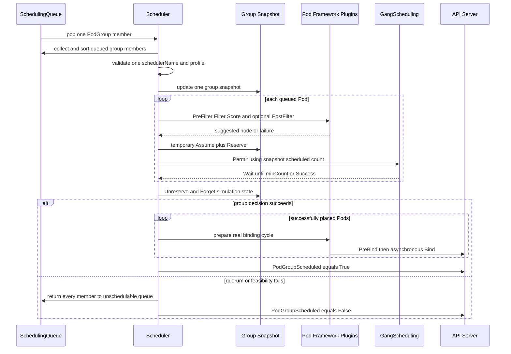

“原子”发生在**是否提交整组初始放置的 scheduler 决策**，不是 API Server 中一个包含多个 Pod binding 的 ACID 事务。成功决定之后，各 Pod 的 binding cycle 在独立 goroutine 中运行；极端的 API、PreBind 或节点故障仍可能让部分 bind 成功、部分失败。因此 controller 重建、应用容错和 reconcile 仍不可省略。

#### 2.9.5 GangScheduling 插件与失败路径 {#k8s-scheduler-9-5-gangscheduling-插件与失败路径}

`GangScheduling` 只实现 `PreEnqueue` 与 `Permit`，但依赖 PodGroup cycle 提供整组 snapshot 和统一提交：

| 阶段/故障 | v1.37.1 行为 | 恢复触发 |
|-----------|---------------|----------|
| PodGroup 尚未创建 | `PreEnqueue` 返回 `UnschedulableAndUnresolvable`，Pod 不进入 active queue | 匹配 PodGroup Add |
| 已创建同组 Pod 少于 `minCount` | gang Pod 在 `PreEnqueue` 等待，避免每个成员空转 | 匹配 Pod Add 使总数达到 quorum |
| PodGroup 为 `basic` | 找到 PodGroup 后插件不做 quorum 检查 | 进入 PodGroup cycle，允许部分放置 |
| schedulerName 不一致 | 无法为整组选择唯一 framework，整组拒绝 | controller 重建错误成员；字段不可变，不能原地修正 |
| 某个异构 Pod 无可行节点 | 若最终 Permit 未达到成功条件，所有初始成员回滚 | Node/Pod/claim 等相关事件或 backoff 重试 |
| 组内 affinity/anti-affinity | 固定 Pod 顺序可能错过实际存在的组合解 | 调整 workload 约束/角色拆分；当前实现不做完整组合搜索 |
| Permit 等待 | plugin 的普通 Permit timeout 为 5 分钟；group simulation 读取 Wait/Success 状态，不靠逐 Pod 长期占住节点完成原子性 | 达到 quorum 时 Allow 同组 waiting Pods；否则 cycle 回滚 |

成功与失败的资源效果可以概括为：

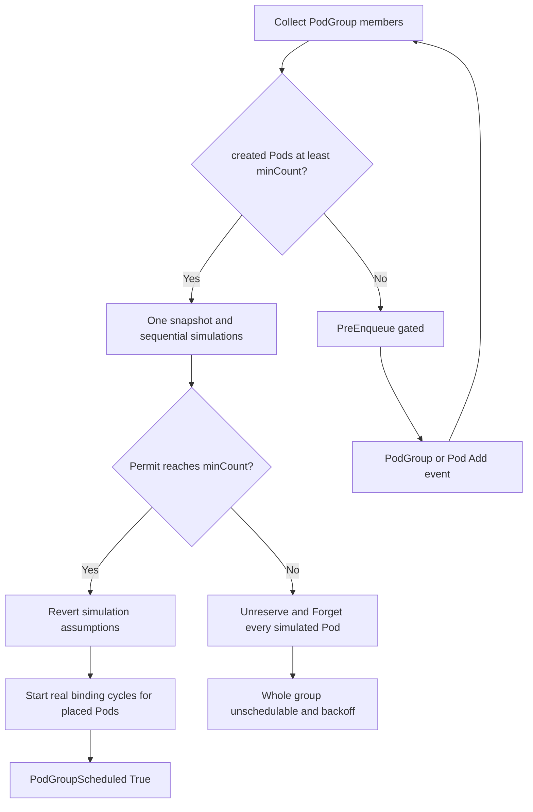

它避免两个任务各占一半资源后都无法启动的经典死锁，但不保证绑定后同时 Running/Ready，不会在一个成员后续失败时自动终止其他成员，也不替代 rendezvous、checkpoint、弹性伸缩、队列配额与公平份额。

#### 2.9.6 Topology-Aware Workload Scheduling {#k8s-scheduler-9-6-topology-aware-workload-scheduling}

TAS 是 PodGroup 的 placement algorithm，不是 PodTopologySpread 的别名。`TopologyPlacement` 以 PodGroup 唯一 topology constraint 的 label key 分组节点，生成每个 label value 对应的候选 placement；每个 placement 内再完整模拟 PodGroup，最后用 placement-level plugins 选域。

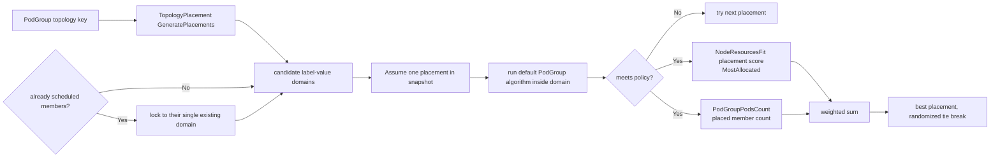

关键细节：

- API 最多允许一个 topology constraint；它表达“整组共置在同一 domain”，不表达多层 rack/host/NVLink 递归约束。
- 节点缺少该 topology label 时不属于任何候选域。标签必须由可靠 controller 发布；陈旧 fabric/机架标签会产生错误放置。
- 已有成员必须全部位于同一个 domain；新成员被锁到该域。若已有成员横跨多个域，placement generation 报错。
- `NodeResourcesFit` 的 Pod-level scoring strategy 可配置为 LeastAllocated 等，但 **placement scoring 固定用 `MostAllocated`**；CPU/内存等 resource weights 继承同一 `NodeResourcesFit` 配置。
- `NodeResourcesFit` 与 `PodGroupPodsCount` 的默认 placement weight 都是 1；后者按已有 scheduled 数加 proposed assignment 数评分，偏好容纳更多成员的域。
- `basic` policy 即使某个域只能放部分成员也可成功，`PodGroupPodsCount` 只是用分数偏好更多成员，不把部分放置升级成 Gang 保证。
- v1.37 会在带 scheduling constraints 的 PodGroup 整组调度失败后运行 PodGroup preemption，修复 v1.36 直接拒绝该组合的限制；仍须验证候选 placement、PDB 与跨节点 victim 选择，不能把它视为队列级容量保证。

对 NVLink/NVSwitch、rail、rack 或 network block，TAS 只消费 node label。它不发现真实 fabric，不检查链路健康，也不把 DRA device-level `fabric` 属性自动提升为 node topology domain；设备与节点两层 source of truth 必须由平台 controller/driver 保持一致。

#### 2.9.7 Workload-Aware Preemption {#k8s-scheduler-9-7-workload-aware-preemption}

启用 `GenericWorkload` 后，一个无法调度的 gang PodGroup 可以作为单一 preemptor，在整个集群而非单节点范围选择 victims；v1.37 已移除 v1.36 的独立 `WorkloadAwarePreemption` gate。若要使用 PodGroup 自己的 `preemptionPolicy` 字段，还要单独启用 Alpha `PodGroupPreemptionPolicy`：

1. 读取所有 NodeInfo，把普通 Pod 作为独立 victim unit；仅当 PodGroup 的 `disruptionMode: PodGroup` 时，才把该组当前成员合并为跨节点 victim unit。默认/`Pod` 模式仍逐 Pod disruption。
2. 只保留 priority 严格低于 preemptor PodGroup 的 victim units。若任一 preemptor Pod 设置 `preemptionPolicy: Never`，整组无资格发起抢占。
3. 在 snapshot 中先移除所有潜在 victims，重新运行不含 PostFilter 的 PodGroup scheduling algorithm；仍不可行则抢占无帮助。
4. 按 PDB violation 分组，从更重要到更不重要逐个尝试 reprieve，保留尽可能多的工作负载。最终 victim 可以分布在多个节点。
5. 执行删除并给 PodGroup 写 `DisruptionTarget=True, reason=PreemptionByScheduler`，preemptor 整组回队列等待资源真正释放后重试。

victim “更重要”的严格排序是：更高 Priority；同 Priority 下 PodGroup 优先于单 Pod；两个 PodGroup 之间成员更多者优先；再以更早启动者优先。单 Pod 之间则以更早启动者优先。这个排序用于“尽量 reprieve 谁”，不是租户公平或历史用量算法。

PodGroup 的 `priorityClassName/priority` 和 `disruptionMode` 只在这条 workload-aware 路径中闭环。v1.37 的普通单 Pod 默认抢占如果把某个 PodGroup 成员当 victim，**不会尊重 PodGroup 级 priority 或 disruptionMode**；若平台依赖整组不可拆，必须避免让普通高优先级 Pod 绕过这条边界。

#### 2.9.8 WorkloadWithJob 自动集成边界 {#k8s-scheduler-9-8-workloadwithjob-自动集成边界}

`WorkloadWithJob` 只为满足全部条件的新 Job 自动生成对象：

- feature gate 开启，且 `GenericWorkload` 可用。
- `.spec.parallelism > 1`。
- `.spec.completionMode: Indexed`。
- `.spec.completions == .spec.parallelism`。
- Pod template 尚未设置 `spec.schedulingGroup`。
- Job 还没有 Pod、`startTime`、成功/失败计数或历史 `Suspended` condition；中途开启 gate 不接管已启动 Job。

Job controller 先创建由 Job controller-owner 的 Workload，内含一个 template；再创建同时由 Job controller-owner、并非 controller-owner 地引用 Workload 的 PodGroup；最后给 Job Pods 写 scheduling group。生成 gang 的 `minCount` 等于 parallelism。出现多个歧义 Workload/PodGroup、owner UID 不匹配或 Workload template 结构不受支持时，Alpha 实现保守回退到普通调度。

v1.37 的 Job controller 已改用 `workloadbuilder` library 对接 Workload building blocks，但适用条件和 `WorkloadWithJob` 默认关闭的 Alpha 边界不变。这不是所有 workload controller 的自动协议。JobSet、Ray、Kubeflow Trainer、MPI controller、Grove 或自定义训练 controller 必须明确实现 `Workload -> PodGroup -> Pods` 的创建、owner/finalizer、失败重建与版本兼容；仅给 Pod 加一个同名 annotation 不会触发上游集成。

#### 2.9.9 DRA 与 Gang 的联合链路 {#k8s-scheduler-9-9-dra-与-gang-的联合链路}

`DRAWorkloadResourceClaims` 让 PodGroup 成为 claim consumer。PodGroup 和每个成员 Pod 必须使用完全匹配的 claim 定义；以下清单还要求一致启用 `GenericWorkload` 与 `DRAWorkloadResourceClaims`：

```yaml
apiVersion: scheduling.k8s.io/v1beta1
kind: PodGroup
metadata:
  name: training-workers
spec:
  schedulingPolicy:
    gang:
      minCount: 4
  resourceClaims:
  - name: fabric
    resourceClaimTemplateName: training-fabric
---
apiVersion: v1
kind: Pod
metadata:
  name: worker-0
spec:
  schedulingGroup:
    podGroupName: training-workers
  resourceClaims:
  - name: fabric
    resourceClaimTemplateName: training-fabric
  containers:
  - name: worker
    image: registry.k8s.io/pause:3.10
    resources:
      claims:
      - name: fabric
```

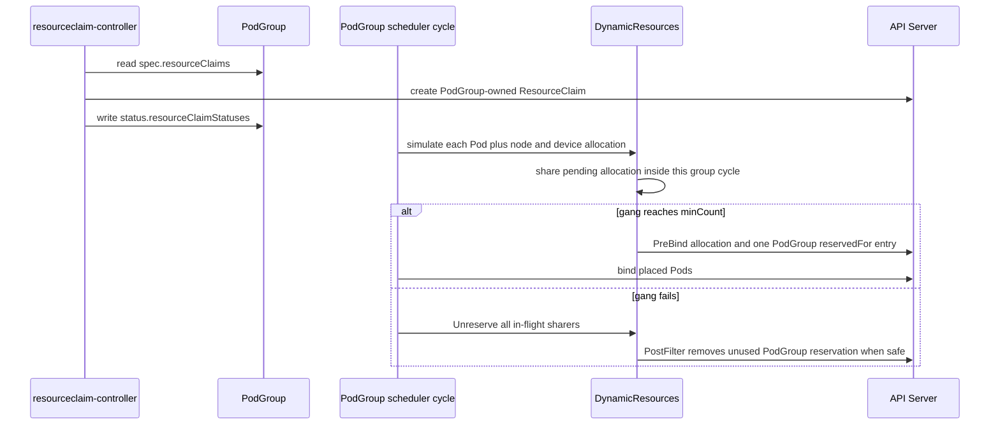

这条链路联合解决三件事：同一 snapshot 内验证 CPU/内存、节点约束与具体 device；同一 cycle 内让多个成员复用尚未持久化的 pending allocation；以一条 PodGroup reservation 避免 256 Pod 上限。它也有明确恢复语义：

- 模拟 Gang 失败时，`Unreserve` 逐 sharer 释放 in-flight allocation，最后一个 sharer 才删除 tracker 状态。
- 已持久化但组内尚无 assumed/assigned Pod 时，下一次 `PostFilter` 可移除 PodGroup reservation，让失败的 binding-condition allocation 重新选择。
- 任一成员已经真正 scheduled 后，不会为重新尝试的其他成员随意释放整组 claim。
- 成功后的 reservation 即使暂时没有 Pod 也持续到 PodGroup 删除，resourceclaim-controller 随后清理 reservation/allocation，template claim 由 owner GC。

DRA + Gang 仍不提供 Kueue 的 ClusterQueue/Cohort 配额、公平排队、Job admission，也不保证容器内显存/带宽硬隔离。前者属于队列控制面，后者属于 DRA driver、CDI/runtime、MIG/HAMi/MPS 等节点实现。

#### 2.9.10 生产采用与升级边界 {#k8s-scheduler-9-10-生产采用与升级边界}

- `GenericWorkload` 和 `DRAWorkloadResourceClaims` 在 v1.37 为默认关闭的 Beta；TAS、CompositePodGroup、PodGroup preemption policy 与 Job integration 仍为默认关闭的 Alpha。不要把 Beta 等同默认开启，也不要继续传已移除的 `GangScheduling` / `WorkloadAwarePreemption` gate。
- API Server、scheduler、controller-manager 与所有相关 kubelet 需要一致的 gate/版本；mixed-version upgrade 必须先验证字段 drop、informer 和 controller 行为。
- 从 v1.36 升级前先导出并删除所有 `v1alpha2` Workload/PodGroup；v1.37 不再 serve 该版本。启用 v1beta1 后按新 schema 重建，并在降级演练中明确对象与 shared claim 的清理责任。
- 使用独立 scheduler profile 只能隔离 Pod 入口，不能隔离 cluster-scoped feature gate、API storage 或 controller-manager 行为。
- 真实验证需覆盖异构角色、intra-group affinity、DRA conflict、driver failure、leader 切换、PodGroup 删除保护、TAS 标签漂移和 partial Bind。
- 没有 Kueue 式 quota admission、Cohort 借用、层次队列或成熟 DRF；多角色启动顺序、服务发现和成组扩缩仍是 Grove/JobSet/Trainer 等 controller 的职责。

对生产 AI 集群，合理做法是先在隔离环境锁定 patch 版本和 driver/controller 组合，保留成熟 admission/queue 与 workload controller，并用故障注入验证默认关闭的 Beta/Alpha 路径，而不是仅凭 API 已进入主仓库就替换现有批调度控制面。

---

### 2.10 生产部署、可观测性与排障 {#k8s-scheduler-生产部署-可观测性与排障}

#### 2.10.1 高可用与安全 {#k8s-scheduler-12-1-高可用与安全}

- 开启 leader election，并监控 leader 切换和 API Server 连通性。
- scheduler kubeconfig/RBAC 只授予所需对象权限；Bind、Event、Lease、PVC/PV、ResourceClaim 等权限缺失会在不同阶段失败。
- 自定义插件与 scheduler 在同一进程，插件 panic、阻塞或内存泄漏会影响整个调度器。
- Extender 是网络依赖；配置 `ignorable` 前先确认失败时跳过它不会造成设备重复分配或安全绕过。
- 多 scheduler 共存时，监控每个 `schedulerName` 是否有健康实例消费。

#### 2.10.2 核心指标 {#k8s-scheduler-12-2-核心指标}

v1.37.1 中值得建立 dashboard 的指标包括：

| 指标 | 用途 |
|------|------|
| `scheduler_pending_pods{queue=...}` | active、backoff、unschedulable、gated 队列深度 |
| `scheduler_schedule_attempts_total{result,profile}` | 成功、不可调度和内部错误速率 |
| `scheduler_scheduling_attempt_duration_seconds` | 单次尝试总延迟 |
| `scheduler_scheduling_algorithm_duration_seconds` | Filter/Score 等算法延迟 |
| `scheduler_pod_scheduling_sli_duration_seconds` | 从入队到成功的端到端延迟 |
| `scheduler_framework_extension_point_duration_seconds` | 每个扩展点总耗时 |
| `scheduler_plugin_execution_duration_seconds` | 具体插件热点 |
| `scheduler_unschedulable_pods{plugin,profile}` | 按失败插件定位积压 |
| `scheduler_preemption_attempts_total` | 抢占频率 |
| `scheduler_cache_size{type}` | Node、Pod、assumed Pod cache 状态 |

启用 GenericWorkload 后还有 Alpha 的 `scheduler_podgroup_schedule_attempts_total`、`scheduler_podgroup_scheduling_attempt_duration_seconds` 等指标，不能与普通 Pod 指标混为同一稳定性等级。

#### 2.10.3 排障路径 {#k8s-scheduler-12-3-排障路径}

```bash
# 查看 Pending Pod 使用哪个 scheduler、有什么 gate 和提名节点
kubectl get pod -A --field-selector=status.phase=Pending \
  -o custom-columns='NS:.metadata.namespace,NAME:.metadata.name,SCHED:.spec.schedulerName,GATES:.spec.schedulingGates,NOMINATED:.status.nominatedNodeName'

# 查看结构化调度条件与事件
kubectl describe pod -n <namespace> <pod>
kubectl get events -A --field-selector=reason=FailedScheduling \
  --sort-by=.lastTimestamp

# 查看节点 allocatable、taint、label 和已有 requests
kubectl describe node <node>

# 查看默认静态 Pod 部署的 scheduler 日志
kubectl logs -n kube-system -l component=kube-scheduler --tail=300

# 启用 Alpha Workload API 后查看组状态
kubectl get workloads,podgroups -A
kubectl describe podgroup -n <namespace> <podgroup>
```

#### 2.10.4 常见 FailedScheduling 原因 {#k8s-scheduler-12-4-常见-failedscheduling-原因}

| 事件片段 | 首要检查 | 不应误判为 |
|----------|----------|------------|
| `Insufficient cpu/memory` | requests、init container、overhead、allocatable | 当前 CPU/内存使用率必然很高 |
| `Insufficient nvidia.com/gpu` | resource name、Node allocatable、device plugin、已分配 requests | GPU 物理卡一定故障 |
| `untolerated taint` | taint key/value/effect 与 toleration | node affinity 问题 |
| `didn't match Pod's node affinity/selector` | label、required terms、多个表达式逻辑 | Score 权重问题 |
| `didn't match pod topology spread` | selector、topologyKey、eligible domains、maxSkew | Gang 一定失败 |
| `volume node affinity conflict` | PV zone、StorageClass、PVC 绑定模式 | 计算资源不足 |
| `preemption is not helpful` | 是否存在可由低优先级 victims 释放的可行节点 | 抢占功能未运行 |
| 一直没有 FailedScheduling | schedulerName、schedulingGates、scheduler 健康 | Filter 插件一定拒绝 |

#### 2.10.5 升级检查 {#k8s-scheduler-12-5-升级检查}

1. 锁定 Kubernetes minor/patch、发行版静态 Pod 或 Deployment 的 scheduler 参数。
2. 校验 `KubeSchedulerConfiguration` API、插件名、参数 schema 和 feature gate 状态。
3. out-of-tree 插件必须用目标版本 Framework 重新构建并通过兼容测试。
4. 升级前导出 Workload/PodGroup；从 v1.36 到 v1.37 必须先删除不再 serve 的 `v1alpha2` 对象，再以 v1beta1 schema 重建。
5. 验证 leader 切换、assumed Pod 回收、Permit 等待项和 DRA claim 状态。
6. 对共享 counter/partitionable device 做候选回溯与 compatibility group 测试，确认 v1.36.4 引入的 reserved-state rollback 在 v1.37.1 继续生效。
7. 对关键 Pod 做调度回放，比较目标版本插件默认值和分数变化。
8. 回滚方案必须同时覆盖二进制、配置、feature gate 和 Alpha API 对象。

---

### 2.11 常见误区与结论 {#k8s-scheduler-常见误区与结论}

#### 2.11.1 常见误区 {#k8s-scheduler-13-1-常见误区}

| 误区 | 正确理解 |
|------|----------|
| scheduler 按实时 CPU/GPU 利用率选节点 | 默认主要依据 allocatable 与 requests；实时负载需要额外数据和插件 |
| toleration 会把 Pod 吸引到带 taint 节点 | toleration 只取消排斥，仍需 affinity/selector/resource 形成正向选择 |
| Score 权重可以覆盖硬约束 | Filter 拒绝的节点不会进入 Score |
| Priority 等于资源预留 | Priority 只影响顺序和抢占，不创建长期容量保证 |
| PDB 能阻止所有抢占和故障 | 默认抢占尽量尊重 PDB，但不是绝对；节点故障等也不受其完整保护 |
| DRA 稳定意味着所有设备扩展都稳定 | DRA 核心稳定，多个高级子能力仍有独立 feature state |
| v1.37 原生已完整替代批调度器 | Workload/PodGroup 虽升为 Beta，但 gate 默认关闭；TAS/Composite 仍为 Alpha，队列公平和多种 workload controller 编排也未完整覆盖 |
| Kueue 和 kube-scheduler 二选一 | Kueue 通常负责准入，kube-scheduler 负责最终放置 |
| Grove 是 GPU scheduler | Grove 描述推理工作负载，具体节点和设备由 backend/driver 选择 |
| 多装几个 scheduler 会自动协同 | `schedulerName` 只分流 Pod，配额、webhook、设备所有权仍需显式设计 |

#### 2.11.2 核心结论 {#k8s-scheduler-13-2-核心结论}

1. kube-scheduler 是稳定、可扩展的单 Pod 放置引擎，Scheduling Framework、profile、DRA 和标准约束足以覆盖大量生产工作负载。
2. 它的热路径依赖本地 cache、snapshot、assume 和异步 binding；理解这些机制比只记 Filter/Score 更有助于定位一致性与性能问题。
3. Kubernetes v1.37 已把 Workload/PodGroup、基础 Gang 与 workload-aware preemption 推进到默认关闭的 Beta 路径；TAS、CompositePodGroup、PodGroup preemption policy 和 Job 自动集成仍是默认关闭的 Alpha，不能只看 API 版本判断生产就绪。
4. AI 调度的缺口往往在队列公平、工作负载原子性、设备拓扑、运行时隔离和应用编排，不应期待一个 `schedulerName` 独立解决所有层。
5. 选型的正确方式是先画清准入、编排、节点放置和设备隔离的责任边界，再决定保留原生 scheduler、组合 Kueue/Grove，还是采用 Koordinator/KAI/Volcano。

---

### 2.12 附录：版本、命令与官方参考 {#k8s-scheduler-附录版本-命令与官方参考}

#### 2.12.1 版本快照 {#k8s-scheduler-a-1-版本快照}

| 项目 | 快照 |
|------|------|
| Kubernetes release | `v1.37.1` |
| Annotated release tag object | `d2b770f4c94636a992534a8d3156b6b2d8e82ac3` |
| Tag 解引用后的 source commit | `f78e722310e50bcaca9276be22276d9e91d91308` |
| DRA | v1.34 GA；v1.35 起锁定为默认开启 |
| GenericWorkload（含基础 Gang/组级抢占） | v1.37 Beta，默认关闭 |
| TopologyAwareWorkloadScheduling | v1.36 Alpha，默认关闭 |
| CompositePodGroup / PodGroupPreemptionPolicy | v1.37 Alpha，默认关闭 |
| DRAWorkloadResourceClaims | v1.37 Beta，默认关闭 |
| SchedulerPreQueueingHints | v1.37 Alpha，默认关闭 |
| OpportunisticBatching | v1.35 Beta，v1.37.0 默认开启 |
| 审校日期 | 2026-09-26 |

`v1.37.1` 是 annotated tag：tag object 为 `d2b770f4c94636a992534a8d3156b6b2d8e82ac3`，解引用后的源码 commit 为 `f78e722310e50bcaca9276be22276d9e91d91308`。本文页头和站点元数据使用后者；保留 tag object 仅用于复核 Git ref，不把它当作 source commit。

v1.37.0 是新的 minor baseline：除 Workload/PodGroup v1beta1 与工作负载级 scheduler 路径外，还升级了 DRA metadata、ResourceHealth 和多个 allocator 扩展。`SchedulerPreQueueingHints` 曾在 release notes 中先宣布 Beta 默认开启，随后因发布前发现问题回退为 Alpha 默认关闭；本文以最终 tag 内 `defaultVersionedKubernetesFeatureGates` 为准。升级不能跳过 v1.36 `v1alpha2` 对象清理，也不能把默认关闭的 Beta/Alpha gate 当作稳定默认能力。

`v1.37.1` 是 v1.37.0 的 patch release：按官方 CHANGELOG 仅含 1 个 feature（构建工具链升至 Go 1.26.8）、1 个 Failing Test 修复与 4 个 Bug fix，其中两个直接影响调度/DRA 平台——无 `spec.deviceSelector` 的 DeviceTaintRule 此前会错误匹配集群内全部设备并让所有 DRA 设备不可调度（现改为不匹配任何设备，需显式空 `deviceSelector: {}` 才全量命中）；ResourceClaim 设备请求计数溢出 int 范围不再让 kube-scheduler crash，改为报错并继续 `firstAvailable` fallback。其余为 Windows kube-proxy（winkernel）枚举无端口映射 HNS load balancer 时的 panic 修复和 kubeadm 不再把节点级 systemd-resolved resolvConf 写进集群级 kubelet-config。本补丁不改变任何 feature gate 默认值与上表成熟度状态。

#### 2.12.2 Kubernetes 调度官方参考 {#k8s-scheduler-a-2-kubernetes-调度官方参考}

| 主题 | 官方链接 |
|------|----------|
| Scheduling, Preemption and Eviction | <https://kubernetes.io/docs/concepts/scheduling-eviction/> |
| Kubernetes Scheduler | <https://kubernetes.io/docs/concepts/scheduling-eviction/kube-scheduler/> |
| Scheduling Framework | <https://kubernetes.io/docs/concepts/scheduling-eviction/scheduling-framework/> |
| Scheduler Configuration | <https://kubernetes.io/docs/reference/scheduling/config/> |
| KubeSchedulerConfiguration v1 API | <https://kubernetes.io/docs/reference/config-api/kube-scheduler-config.v1/> |
| Scheduler Performance Tuning | <https://kubernetes.io/docs/concepts/scheduling-eviction/scheduler-perf-tuning/> |
| Pod Priority and Preemption | <https://kubernetes.io/docs/concepts/scheduling-eviction/pod-priority-preemption/> |
| Pod Scheduling Readiness | <https://kubernetes.io/docs/concepts/scheduling-eviction/pod-scheduling-readiness/> |
| Dynamic Resource Allocation | <https://kubernetes.io/docs/concepts/scheduling-eviction/dynamic-resource-allocation/> |

#### 2.12.3 工作负载级调度官方参考 {#k8s-scheduler-a-3-工作负载级调度官方参考}

| 主题 | 官方链接 |
|------|----------|
| Workload API | <https://kubernetes.io/docs/concepts/workloads/workload-api/> |
| PodGroup API | <https://kubernetes.io/docs/concepts/workloads/podgroup-api/> |
| PodGroup Scheduling | <https://kubernetes.io/docs/concepts/scheduling-eviction/podgroup-scheduling/> |
| Gang Scheduling | <https://kubernetes.io/docs/concepts/scheduling-eviction/gang-scheduling/> |
| Topology-Aware Workload Scheduling | <https://kubernetes.io/docs/concepts/scheduling-eviction/topology-aware-scheduling/> |
| Workload-Aware Preemption | <https://kubernetes.io/docs/concepts/scheduling-eviction/workload-aware-preemption/> |

#### 2.12.4 源码参考 {#k8s-scheduler-a-4-源码参考}

| 主题 | v1.37.1 源码 |
|------|--------------|
| v1.37.1 exact source | <https://github.com/kubernetes/kubernetes/tree/f78e722310e50bcaca9276be22276d9e91d91308> |
| 调度与绑定主流程 | <https://github.com/kubernetes/kubernetes/blob/f78e722310e50bcaca9276be22276d9e91d91308/pkg/scheduler/schedule_one.go> |
| DRA `resource.k8s.io/v1` API 类型 | <https://github.com/kubernetes/kubernetes/blob/f78e722310e50bcaca9276be22276d9e91d91308/staging/src/k8s.io/api/resource/v1/types.go> |
| DynamicResources 调度插件 | <https://github.com/kubernetes/kubernetes/blob/f78e722310e50bcaca9276be22276d9e91d91308/pkg/scheduler/framework/plugins/dynamicresources/dynamicresources.go> |
| ResourceClaim controller | <https://github.com/kubernetes/kubernetes/blob/f78e722310e50bcaca9276be22276d9e91d91308/pkg/controller/resourceclaim/controller.go> |
| kubelet DRA manager | <https://github.com/kubernetes/kubernetes/blob/f78e722310e50bcaca9276be22276d9e91d91308/pkg/kubelet/cm/dra/manager.go> |
| 默认插件集合 | <https://github.com/kubernetes/kubernetes/blob/f78e722310e50bcaca9276be22276d9e91d91308/pkg/scheduler/apis/config/v1/default_plugins.go> |
| 调度指标 | <https://github.com/kubernetes/kubernetes/blob/f78e722310e50bcaca9276be22276d9e91d91308/pkg/scheduler/metrics/metrics.go> |
| Workload/PodGroup v1beta1 API 类型 | <https://github.com/kubernetes/kubernetes/blob/f78e722310e50bcaca9276be22276d9e91d91308/staging/src/k8s.io/api/scheduling/v1beta1/types.go> |
| CompositePodGroup v1alpha3 API 类型 | <https://github.com/kubernetes/kubernetes/blob/f78e722310e50bcaca9276be22276d9e91d91308/staging/src/k8s.io/api/scheduling/v1alpha3/types.go> |
| PodGroup scheduling cycle | <https://github.com/kubernetes/kubernetes/blob/f78e722310e50bcaca9276be22276d9e91d91308/pkg/scheduler/schedule_one_podgroup.go> |
| GangScheduling 插件 | <https://github.com/kubernetes/kubernetes/blob/f78e722310e50bcaca9276be22276d9e91d91308/pkg/scheduler/framework/plugins/gangscheduling/gangscheduling.go> |
| TopologyPlacement 插件 | <https://github.com/kubernetes/kubernetes/blob/f78e722310e50bcaca9276be22276d9e91d91308/pkg/scheduler/framework/plugins/topologyaware/topology_placement.go> |
| Workload-aware preemption | <https://github.com/kubernetes/kubernetes/blob/f78e722310e50bcaca9276be22276d9e91d91308/pkg/scheduler/framework/preemption/podgrouppreemption.go> |
| Job 自动集成 | <https://github.com/kubernetes/kubernetes/blob/f78e722310e50bcaca9276be22276d9e91d91308/pkg/controller/job/job_scheduling_manager.go> |
| Workload builder | <https://github.com/kubernetes/kubernetes/tree/f78e722310e50bcaca9276be22276d9e91d91308/staging/src/k8s.io/component-helpers/scheduling/schedulingv1/workloadbuilder> |
| DRA metadata v1beta1 | <https://github.com/kubernetes/kubernetes/tree/f78e722310e50bcaca9276be22276d9e91d91308/staging/src/k8s.io/dynamic-resource-allocation/api/metadata/v1beta1> |
| DRA ResourceHealth v1 | <https://github.com/kubernetes/kubernetes/tree/f78e722310e50bcaca9276be22276d9e91d91308/staging/src/k8s.io/kubelet/pkg/apis/dra/v1> |
| Feature gates | <https://github.com/kubernetes/kubernetes/blob/f78e722310e50bcaca9276be22276d9e91d91308/pkg/features/kube_features.go> |

#### 2.12.5 关联文档 {#k8s-scheduler-a-5-关联文档}

- [Kubernetes AI 调度器深度对比](Kubernetes-AI-Platform-Deep-Dive.md#ai-schedulers)
- [HAMi 异构设备虚拟化与调度](Kubernetes-AI-Platform-Deep-Dive.md#hami)
- [NVIDIA GPU Operator 深度技术文档](Kubernetes-AI-Platform-Deep-Dive.md#gpu-operator)
- [Volcano 升级与 Feature 兼容性](Kubernetes-AI-Platform-Deep-Dive.md#volcano-upgrade)

## 第3篇：GPU Operator {#gpu-operator}


> **Kubernetes GPU 节点软件栈、`ClusterPolicy` 调谐、设备暴露、共享隔离与生产运维解析**
>
> 基于 NVIDIA GPU Operator 官方仓库与 26.7 官方文档整理：<https://github.com/NVIDIA/gpu-operator>
>
> 文档快照：GPU Operator `v26.7.1`，源码提交 `dbacf43d4938816fefe62690ab868a640a195282`（annotated tag 解引用；tag object `ea2c14903a9aa3379880bd65511c353bcb233335` 仅作类型证据），审校日期：2026-09-26

---

### 3.1 定位与边界 {#gpu-operator-定位与边界}

#### 3.1.1 GPU Operator 是什么 {#gpu-operator-1-1-gpu-operator-是什么}

Kubernetes 的 Device Plugin 框架允许厂商向 kubelet 注册 GPU 等扩展资源，但它不负责安装内核驱动、配置容器运行时、发现设备特征、部署监控或协调 MIG。直接维护 GPU 节点通常需要人工拼装多个版本相关的组件，节点扩容、内核升级和驱动升级也容易产生配置漂移。

NVIDIA GPU Operator 使用 Kubernetes Operator 模式，把这套节点软件栈声明为一个集群级策略并持续调谐：

| 层次 | Operator 管理的典型能力 |
|------|-------------------------|
| 硬件发现 | Node Feature Discovery（NFD）发现 NVIDIA PCI 设备 |
| 内核与主机 | NVIDIA Driver、可选 GDS/GDRCopy、驱动升级控制器 |
| 容器运行时 | NVIDIA Container Toolkit、CDI、可选 NRI、RuntimeClass |
| Kubernetes 设备 | NVIDIA Device Plugin 注册 `nvidia.com/gpu` 或 MIG 资源 |
| 节点元数据 | GPU Feature Discovery（GFD）发布型号、显存、MIG 等标签 |
| 监控与验证 | DCGM、DCGM Exporter、Operator Validator、Operator metrics |
| GPU 分区 | MIG Manager、Device Plugin time-slicing、实验性 MPS |
| 虚拟化与机密计算 | 可选 KubeVirt/vGPU/VFIO、Kata、CC Manager |

一句话概括：

> **GPU Operator 是 NVIDIA GPU 节点软件栈的生命周期控制面；它让 GPU 可被 Kubernetes 使用，但不替 Kubernetes 决定业务队列、公平性或复杂作业拓扑。**

#### 3.1.2 它解决哪些生产问题 {#gpu-operator-1-2-它解决哪些生产问题}

| 问题 | 手工管理时的风险 | GPU Operator 的处理方式 |
|------|------------------|-------------------------|
| 新 GPU 节点上线 | 驱动、Toolkit、Device Plugin 步骤不一致 | 依据 NFD 标签自动部署节点 Operand |
| 版本组合 | 驱动、Toolkit、插件、DCGM 各自漂移 | Chart 固定并交付经过组合的组件版本 |
| 内核变化 | 模块编译失败或驱动与内核不匹配 | Driver 容器按节点 OS/内核构建，或使用预编译驱动 |
| GPU 不可调度 | kubelet 没有 `nvidia.com/gpu` | Device Plugin 注册并持续报告设备健康 |
| MIG 重配置 | 需要停 GPU 客户端、改几何并可能重启 | MIG Manager 以节点标签驱动状态机 |
| 可观测性 | 指标与节点/Pod 关系分散 | DCGM Exporter 暴露 Prometheus 指标 |
| 驱动滚动升级 | 卸载模块前必须停止客户端 | Upgrade Controller 逐节点 cordon、驱逐、验证、uncordon |

#### 3.1.3 它不是什么 {#gpu-operator-1-3-它不是什么}

| 不属于 GPU Operator 的职责 | 正确的责任方 |
|----------------------------|--------------|
| 队列准入、配额借用、公平共享、Gang Scheduling | Kueue、Volcano、KAI-Scheduler、Koordinator 等 |
| 按显存/算力做细粒度调度和通用软件限额 | HAMi 或其他 GPU 虚拟化/调度系统 |
| 训练、推理、Notebook 与 Pipeline | Kubeflow、KServe、训练框架、推理引擎 |
| 应用级 CUDA 正确性和模型性能 | 应用、框架和性能工程体系 |
| 网络设备驱动与 RDMA Device Plugin 的完整部署 | NVIDIA Network Operator 或主机网络栈 |
| 云厂商 GPU 节点池、IOMMU、BIOS 和物理 Fabric 的创建 | 云平台、裸金属平台与集群生命周期系统 |

GPU Operator 与 HAMi 也不是简单替代关系。GPU Operator 擅长部署 NVIDIA 的底层驱动、Toolkit、Device Plugin、MIG 和监控栈；HAMi 在此基础上补充细粒度显存/算力调度与软件隔离。若 HAMi 接管 NVIDIA Device Plugin 或容器注入链路，必须按 HAMi 的集成文档禁用冲突组件，不能让两个系统同时注册同名资源。

#### 3.1.4 快照与阅读约定 {#gpu-operator-1-4-快照与阅读约定}

本文固定到以下事实基线，不把 `latest` 页面未来可能新增的行为倒灌进正文：

- GPU Operator Release：`v26.7.1`。
- Git 标签解引用提交：`dbacf43d4938816fefe62690ab868a640a195282`（`v26.7.1` 是 annotated tag）。
- 官方 Chart：`gpu-operator-v26.7.1.tgz`，`version` 与 `appVersion` 均为 `v26.7.1`。
- 官方文档：NVIDIA GPU Operator 26.7 版本路径（v26.7.1 复用 26.7 门户）。
- 组件默认版本以 `v26.7.1` Chart `values.yaml` 为准。

文中的“默认启用”有两层含义：Helm Values 中的布尔值，以及满足父级功能门控和节点选择器后真正创建/运行的 Operand。两者不总是相同，例如 `ccManager.enabled=true`，但默认 `sandboxWorkloads.enabled=false`，所以默认容器工作负载安装不会实际运行 CC Manager。

#### 3.1.5 v26.7 的 DRA 与升级行为 {#gpu-operator-1-5-v26-7-的-dra-与升级行为}

`v26.7.0` 把 NVIDIA DRA Driver 纳入 GPU Operator 的正式管理面：新增 `GPUCluster` 自定义资源，可管理 DRA driver、ComputeDomain（含 Multi-Node NVLink）、DCGM、DCGM Exporter 和 DRA validation workload。`ResourceClaim` 可以申请整卡或预配置 MIG，并按设备属性选择。`GPUCluster` 使用 Operator 管理的 `NVIDIADriver`，或引用主机预装的 driver；同一集群不能同时使用 `GPUCluster` 和 `ClusterPolicy`。

这条路径有明确前置条件：Kubernetes `v1.34.2+`、NVIDIA driver `580+` 和 CDI-compatible container runtime；部分 DRA 能力仍是 Alpha、默认关闭。KubeVirt 也可以通过 DRA `ResourceClaim` 申请整卡做 VFIO passthrough，但需要单独核对 Fabric Manager、IOMMU 和虚拟机安全边界。

v26.7.0 还新增 `nvidia.com/gpu.deploy.client` node label，允许 Operator 在 driver upgrade 或 MIG 变更时重启持有 GPU handle 的第三方 client DaemonSet；当 driver 配置 digest 未变化时，driver-upgrade controller 会原地重启 driver Pod，不驱逐业务 workload。`NVIDIADriver` CRD 的 `upgradePolicy` 可以逐资源覆盖 Helm 默认策略，`hostPaths.kubeletRootDir` 支持非 `/var/lib/kubelet` 根目录。

NRI 开启时，`NRI_MANAGEMENT_CDI_DEVICE_NAMESPACES` 默认只允许 Operator 所在 namespace 请求 management CDI device；immutable host 上不要再挂载 NRI 不需要的 containerd 配置路径。`devicePlugin.config.create=true` 但 name/data 为空现在会被 chart 拒绝，避免产生引用不存在 ConfigMap 的 Pod。

#### 3.1.6 v26.7.1 组件补丁与驱动边界 {#gpu-operator-1-6-v26-7-1-组件补丁与驱动边界}

`v26.7.1` 是 `v26.7.x` 的组件补丁 release，不改架构、API 或 feature gate；文档门户仍复用 26.7 路径。关键变化：

| 领域 | v26.7.1 行为 | 升级与兼容边界 |
|------|--------------|----------------|
| 组件版本 | Driver Manager `v0.12.1`、Container Toolkit `v1.20.1`、Device Plugin/GFD `v0.20.1`、DCGM `4.6.1-1`、DCGM Exporter `4.6.1-4.8.4`、MIG Manager `v0.15.1`、vGPU Device Manager `v0.5.1`、VFIO Manager `v0.12.1`、CC Manager `v0.4.4`；GDS/GDRCopy/Kata/DRA driver 不变 | 镜像 digest 与 SBOM 要按新组件版本重建；跨 v26.7.0→v26.7.1 的对比必须固定组件矩阵 |
| 驱动支持 | 新增 Data Center GPU Driver `615.71.09`（默认仍为 `595.91.07`） | 新驱动按 R615+ 提供 per-GPU CUDA memory limit 与 R615 固件注入；升级驱动前先看下方 MIG 注意事项 |
| CUDA memory limit | `NVIDIA_GPU_MEMORY_REQUEST` / `NVIDIA_GPU_MEMORY_LIMIT` 环境变量按 GPU 施加 soft/hard CUDA 内存上限（需 R615+ 驱动） | 这是容器内 CUDA 层限制，不是 GPU 分区或 MIG 替代；硬超限行为按 CUDA 语义处理 |
| H100 MIG 升级注意 | 从 `595.91.07` 升到 `615.71.09` 且不重启/复位 GPU 时，后续 MIG 重新配置可能失败（`NVML ERROR_UNKNOWN`、Xid 119） | 官方建议升级驱动后先重启节点再改 MIG；无重启路径需按顺序：MIG `all-disabled` → 暂停 GPU operands → 升驱动 → `nvidia-smi -r` 复位 → 恢复 labels → 重新应用 MIG 配置 |
| ComputeDomain | deprecated 的 `spec.numNodes` 改为可选，缺省 `0` | 依赖该字段的自动化可以去掉强制填写，但不要把缺省当作新语义 |
| 修复 | GFD 可删除 `NodeFeature`（修复 `OwnerReferencesPermissionEnforcement` 启用时的更新失败）；GPU operands 等待 driver 校验完成再启动（修复 MIG Manager `ERROR_LIBRARY_NOT_FOUND`）；Driver Manager cordon/uncordon 对瞬时 API 错误做有界退避；CDI hook 修复 Podman userns 映射（crun 1.27+）；`nvidia-ctk runtime configure` 不再覆盖既有 Docker feature flags | 升级后回归：GFD RBAC、driver 重启后的 operand 顺序、节点 cordon 状态与 CDI 特殊运行时 |

---

### 3.2 总体架构与组件依赖 {#gpu-operator-总体架构与组件依赖}

#### 3.2.1 控制面、节点面与工作负载面 {#gpu-operator-2-1-控制面-节点面与工作负载面}

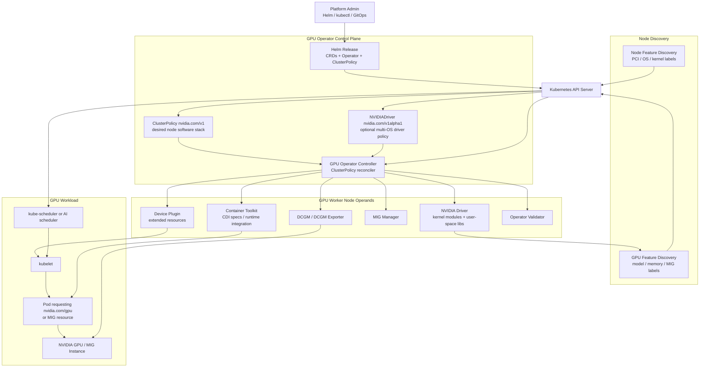

这三层的故障含义不同：

- Operator Controller 不健康：新策略和节点变化不能继续收敛。
- Operand 不健康：对应节点的驱动、注入、注册、监控或验证链路不可用。
- 已运行 GPU Pod：可能在控制器短暂故障时继续运行，但驱动重载、节点重启或运行时配置变化会中断它。

#### 3.2.2 核心组件 {#gpu-operator-2-2-核心组件}

| 组件 | Kubernetes 形态 | 主要职责 | 默认状态 |
|------|-----------------|----------|----------|
| GPU Operator | Deployment | watch `ClusterPolicy`、Node、受管 DaemonSet，生成并更新 Operand | 启用 |
| NFD master/worker/GC | Deployment/DaemonSet | 发现 PCI、OS、kernel 等节点特征 | `nfd.enabled=true` |
| NVIDIA Driver | DaemonSet，或每 CR/OS 一个 DaemonSet | 安装用户态库和内核模块，提供 `/run/nvidia/driver` | `driver.enabled=true` |
| Container Toolkit | DaemonSet | 生成 CDI 规范并配置 containerd/CRI-O 或 NRI | `toolkit.enabled=true` |
| Device Plugin | DaemonSet | 向 kubelet 注册整卡/MIG/共享资源，执行 Allocate | `devicePlugin.enabled=true` |
| GFD | DaemonSet | 通过 NFD/GFD 机制发布 GPU 属性标签 | `gfd.enabled=true` |
| DCGM | DaemonSet/Service | 独立 `nv-hostengine` | `dcgm.enabled=false` |
| DCGM Exporter | DaemonSet/Service | 默认内嵌 hostengine，导出 Prometheus 指标 | `dcgmExporter.enabled=true` |
| Validator | DaemonSet + validation Pod | 分阶段验证 driver、toolkit、plugin、CUDA | 始终调谐 |
| MIG Manager | DaemonSet | 监听 MIG 配置标签，协调重配置 | `migManager.enabled=true`，仅 MIG 节点运行 |
| MPS Control Daemon | DaemonSet | 为配置了 MPS 的整卡启动 CUDA MPS 服务 | 随 Device Plugin 状态调谐，未配置 MPS 时不提供共享 |
| Node Status Exporter | DaemonSet/ServiceMonitor | 导出节点状态相关指标 | `nodeStatusExporter.enabled=false` |

#### 3.2.3 关键依赖顺序 {#gpu-operator-2-3-关键依赖顺序}

GPU 节点不是一组互不相关的 DaemonSet。最实用的依赖顺序是：

```text
NFD labels
  -> Operator identifies GPU node and applies deploy labels
  -> Driver loads modules and exposes libraries
  -> Toolkit configures CDI/runtime integration
  -> Validator checks driver and toolkit
  -> Device Plugin discovers devices and registers resources
  -> GFD publishes detailed labels
  -> MIG Manager/DCGM Exporter/other GPU clients converge
  -> CUDA workload can start
```

因此“其他 Pod 全部卡在 Init”往往不是多个独立问题，而是上游 Driver 或 Toolkit 未就绪的结果。排障应沿依赖链从前到后，而不是同时重启所有 Pod。

#### 3.2.4 节点标签是部署契约 {#gpu-operator-2-4-节点标签是部署契约}

NFD 检测到 NVIDIA PCI Vendor ID `10de` 后发布类似标签：

```text
feature.node.kubernetes.io/pci-10de.present=true
```

Controller 再为节点维护 `nvidia.com/gpu.present=true` 及各 Operand 的 deploy 标签。常见控制标签包括：

| 标签 | 作用 |
|------|------|
| `nvidia.com/gpu.present=true` | Controller 识别出的 GPU 节点 |
| `nvidia.com/gpu.deploy.operands=false` | 禁止该节点部署全部通用 GPU Operand |
| `nvidia.com/gpu.deploy.driver=false` | 仅禁止 Operator Driver |
| `nvidia.com/gpu.deploy.device-plugin=true` | 允许 Device Plugin 运行 |
| `nvidia.com/gpu.deploy.gpu-feature-discovery=true` | 允许 GFD 运行 |
| `nvidia.com/gpu.deploy.mig-manager=true` | MIG-capable 节点运行 MIG Manager |
| `nvidia.com/gpu.workload.config` | `container`、`vm-passthrough` 或 `vm-vgpu` |

这些标签属于 Operator 的控制协议。生产自动化可以观察它们，但不要用另一个控制器无条件覆盖，否则两个调谐循环会反复争夺状态。

---

### 3.3 从 ClusterPolicy 到节点收敛 {#gpu-operator-从-clusterpolicy-到节点收敛}

#### 3.3.1 Helm 交付了什么 {#gpu-operator-3-1-helm-交付了什么}

默认 Helm 安装至少完成四件事：

1. 安装 `clusterpolicies.nvidia.com` 和 `nvidiadrivers.nvidia.com` CRD。
2. 创建 GPU Operator Deployment、RBAC 和 ServiceAccount。
3. 从 Helm Values 渲染单例 `ClusterPolicy/cluster-policy`。
4. 默认安装 NFD 子 Chart。

Helm 不直接为每个 GPU 节点静态生成全部 Driver/Toolkit/Plugin Pod；后续节点软件栈由 Controller 根据 `ClusterPolicy`、节点标签和运行环境动态调谐。

#### 3.3.2 Controller 调谐流程 {#gpu-operator-3-2-controller-调谐流程}

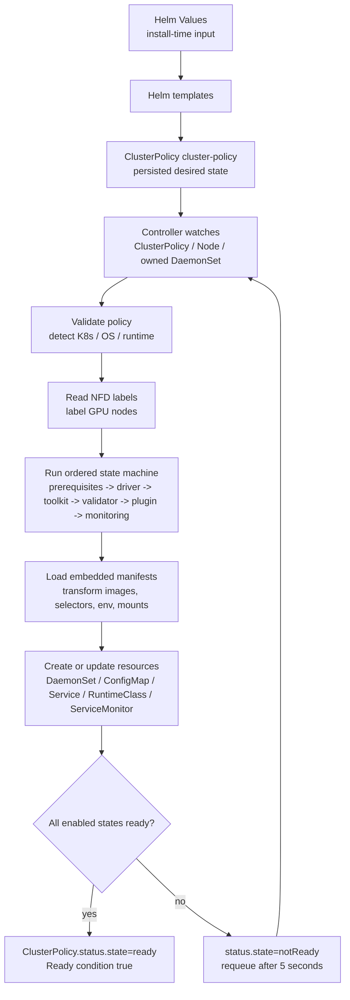

源码中的主要 state 顺序为：

```text
pre-requisites
state-operator-metrics
state-driver
state-container-toolkit
state-operator-validation
state-device-plugin
state-mps-control-daemon
state-dcgm
state-dcgm-exporter
gpu-feature-discovery
state-mig-manager
state-node-status-exporter
...sandbox/vGPU/VFIO/Kata/CC states
```

每个 state 都有功能开关。禁用 Driver、Toolkit 或 Device Plugin 时，对应 state 不创建 Operand；启用 `NVIDIADriver` CRD 路径时，`ClusterPolicy` Controller 跳过并清理自己拥有的 Driver DaemonSet，由独立 `NVIDIADriver` Controller 管理驱动。

#### 3.3.3 触发调谐的事件 {#gpu-operator-3-3-触发调谐的事件}

| 事件 | 为什么需要重新调谐 |
|------|--------------------|
| `ClusterPolicy.spec` generation 变化 | 应用新镜像、开关、环境变量、资源和策略 |
| 新 Node 或 GPU/NFD 标签变化 | 为新 GPU 节点补齐 Operand，或更新 workload 类型 |
| 受管 DaemonSet 变化 | 检查 Operand 是否 Ready，修复配置漂移 |
| 定时 requeue | 等待尚未 Ready 的资源，或轮询尚无 NFD 标签的集群 |

Controller 只允许一个主 `ClusterPolicy`；额外实例会被标记为 `ignored`。平台应把 `cluster-policy` 当作集群单例，而不是为每个租户创建一份。

#### 3.3.4 Ready 不等于 CUDA 一定可用 {#gpu-operator-3-4-ready-不等于-cuda-一定可用}

源码允许在“没有 GPU 节点”或“NFD 标签缺失”时把已经创建的控制资源标为 Ready，并在条件中记录 `NoGPUNodes` 或 `NFDLabelsMissing`。因此必须分三层验收：

| 层次 | 检查 | 能证明什么 |
|------|------|------------|
| Operator 健康 | Operator Deployment、日志、`ClusterPolicy.status` | Controller 可以完成调谐 |
| Operand 就绪 | GPU 节点上的 Driver/Toolkit/Plugin/GFD/DCGM/Validator | 节点软件链路基本收敛 |
| 工作负载可用 | allocatable 资源、实际 CUDA Pod、应用日志 | 调度、注入、驱动和 CUDA 端到端可用 |

只检查 `kubectl get clusterpolicy` 不足以作为 GPU 平台验收。

---

### 3.4 ClusterPolicy API 与 Helm Values {#gpu-operator-clusterpolicy-api-与-helm-values}

#### 3.4.1 两个配置层不要混淆 {#gpu-operator-4-1-两个配置层不要混淆}

`values.yaml` 是 Helm Chart 的输入；`ClusterPolicy.spec` 是运行时 Controller 的 API。Chart 模板会把一部分 Values 转成 `ClusterPolicy`，还会用另一些 Values 生成 Operator Deployment、NFD 子 Chart、ConfigMap 或 Helm Hook。

| 配置 | 所在位置 | 谁读取 | 典型例子 |
|------|----------|--------|----------|
| Helm Values | release values | Helm templates | `nfd.enabled`、`operator.resources`、`operator.upgradeCRD` |
| `ClusterPolicy.spec` | Kubernetes API | GPU Operator Controller | `driver.enabled`、`toolkit.enabled`、`mig.strategy` |
| Device Plugin Config | ConfigMap data 中的插件 `version: v1` 配置 | Device Plugin 与 GFD | `sharing.timeSlicing`、`sharing.mps` |
| MIG Parted Config | ConfigMap `config.yaml` | MIG Manager/mig-parted | MIG profile 与几何 |
| `NVIDIADriver.spec` | 独立 `nvidia.com/v1alpha1` CR | NVIDIADriver Controller | 每组节点的驱动类型、版本和 selector |

例如 `nfd.enabled=false` 不会成为 `ClusterPolicy.spec.nfd.enabled=false`，因为 `ClusterPolicy` 根本没有 `nfd` 字段；它只控制 Helm 是否安装 NFD 子 Chart。

#### 3.4.2 顶层字段地图 {#gpu-operator-4-2-顶层字段地图}

`nvidia.com/v1` 的 `ClusterPolicy.spec` 在该快照中的主要字段如下：

| 字段 | 作用 | 默认有效状态 |
|------|------|--------------|
| `operator` | RuntimeClass、OpenShift Driver Toolkit 等控制器行为 | 启用，`runtimeClass=nvidia` |
| `hostPaths` | 主机根目录与驱动安装目录 | `/`、`/run/nvidia/driver` |
| `daemonsets` | Operand 公共 labels、annotations、tolerations、更新策略 | `RollingUpdate`；Driver 始终 `OnDelete` |
| `driver` | Driver 镜像、版本、内核模块、RDMA、升级策略 | 启用，`580.126.20`，`kernelModuleType=auto` |
| `toolkit` | Container Toolkit 与运行时集成 | 启用，`v1.19.1` |
| `devicePlugin` | Device Plugin 与共享配置引用 | 启用，`v0.19.3` |
| `gfd` | GPU 标签发现 | 启用，`v0.19.3` |
| `dcgm` | 独立 DCGM hostengine | 禁用 |
| `dcgmExporter` | Prometheus GPU 指标 | 启用，ServiceMonitor 默认禁用 |
| `validator` | driver/toolkit/plugin/CUDA 等验证 | 始终调谐 |
| `mig` | Device Plugin 的 MIG 策略 | `single` |
| `migManager` | MIG 几何管理和 ConfigMap | 启用，仅匹配 MIG 节点 |
| `cdi` | CDI 与可选 NRI | CDI 启用，NRI 禁用 |
| `gds` | GPUDirect Storage sidecar | 禁用，实验性 API 注释 |
| `gdrcopy` | GDRCopy 内核模块 sidecar | 禁用 |
| `nodeStatusExporter` | 节点状态 exporter | 禁用 |
| `sandboxWorkloads` | KubeVirt/Kata 工作负载总开关和模式 | 禁用，默认 workload 为 `container` |
| `vgpuManager` | vGPU host manager | 禁用 |
| `vfioManager` | GPU passthrough 的 VFIO 管理 | Values 为启用，但受 sandbox 总开关门控 |
| `sandboxDevicePlugin` | KubeVirt GPU Device Plugin | Values 为启用，但受 sandbox/KubeVirt 门控 |
| `kataSandboxDevicePlugin` | Kata sandbox device plugin | Values 为启用，但受 sandbox/Kata 门控 |
| `kataManager` | 准备 NVIDIA Kata runtime | 禁用 |
| `ccManager` | Confidential Computing GPU 模式 | Values 为启用，但受 sandbox/Kata 门控 |

#### 3.4.3 公共 DaemonSet 配置 {#gpu-operator-4-3-公共-daemonset-配置}

以下是 Chart Values 片段，不是完整 `ClusterPolicy` 清单：

```yaml
daemonsets:
  priorityClassName: system-node-critical
  updateStrategy: RollingUpdate
  rollingUpdate:
    maxUnavailable: "1"
  tolerations:
    - key: nvidia.com/gpu
      operator: Exists
      effect: NoSchedule
```

这组值会进入 `spec.daemonsets` 并应用到多个 Operand。需要注意：

- `daemonsets.tolerations` 是完整列表，生产覆盖时要保留已有 GPU taint 容忍。
- Driver DaemonSet 为避免无意中断，固定使用 `OnDelete`；驱动更新由专用 Upgrade Controller 协调。
- 业务节点还有自定义 taint 时，必须补齐 toleration，否则 DaemonSet `DESIRED=0`。

#### 3.4.4 Driver 配置与 NVIDIADriver CRD {#gpu-operator-4-4-driver-配置与-nvidiadriver-crd}

默认路径使用 `ClusterPolicy.spec.driver`，适用于 GPU 节点 OS 版本一致且全局使用同一驱动类型/版本的集群：

```yaml
apiVersion: nvidia.com/v1
kind: ClusterPolicy
metadata:
  name: cluster-policy
spec:
  driver:
    enabled: true
    version: "580.126.20"
    kernelModuleType: auto
    useNvidiaDriverCRD: false
```

独立 Driver CRD 路径通过 Helm 开启：

```bash
helm upgrade --install gpu-operator nvidia/gpu-operator \
  --namespace gpu-operator \
  --create-namespace \
  --version=v26.7.1 \
  --set driver.nvidiaDriverCRD.enabled=true
```

开启后，Chart 默认创建一个匹配全部 GPU 节点的 `NVIDIADriver/default`。若要自己创建互斥的节点选择器，应同时设置：

```text
--set driver.nvidiaDriverCRD.deployDefaultCR=false
```

自定义资源使用不同 API：

```yaml
apiVersion: nvidia.com/v1alpha1
kind: NVIDIADriver
metadata:
  name: ubuntu22-gpu
spec:
  driverType: gpu
  version: "580.126.20"
  repository: nvcr.io/nvidia
  image: driver
  kernelModuleType: auto
  nodeSelector:
    driver.config: ubuntu22
```

两条路径不能同时管理同一节点。官方 26.7 文档明确不支持把已有集群从 `ClusterPolicy` Driver 原地迁移到 `NVIDIADriver` 而不中断；切换会立即终止旧 Driver Pod 并重新部署，应当作为新集群设计或维护窗口变更。

#### 3.4.5 直接编辑与 GitOps {#gpu-operator-4-5-直接编辑与-gitops}

可以执行 `kubectl edit clusterpolicy cluster-policy`，Controller 会动态应用变更。但如果 Helm/GitOps 仍把 Values 当作源，下一次 `helm upgrade` 可能把在线修改覆盖。

生产建议明确单一事实源：

1. 用版本化 Values 管理长期策略。
2. 紧急在线 patch 后，把同样变更立即回写 Values/Git。
3. 用 `helm get values` 与 `kubectl get clusterpolicy -o yaml` 分别审计安装输入和运行时结果。
4. 共享 ConfigMap、MIG ConfigMap 和 `NVIDIADriver` 也纳入 GitOps，不只备份 ClusterPolicy。

---

### 3.5 安装、运行时配置与三层验证 {#gpu-operator-安装-运行时配置与三层验证}

#### 3.5.1 前置条件与支持边界 {#gpu-operator-5-1-前置条件与支持边界}

安装前至少确认：

- `kubectl`、Helm 3 与集群管理员权限可用。
- GPU 节点和 GPU 型号在 26.7 [Platform Support](https://docs.nvidia.com/datacenter/cloud-native/gpu-operator/26.7/platform-support.html) 范围内。
- 一般 Kubernetes 验证范围为 1.32 到 1.36；平台发行版、OS 和内核仍须逐项查矩阵。
- 节点使用受支持的 containerd 或 CRI-O；26.7 表中 containerd 范围为 1.7 到 2.2。
- 默认 `ClusterPolicy` Driver 路径要求所有 GPU 节点使用相同 OS 版本；混合 OS 应使用预装驱动或 `NVIDIADriver` CRD。
- Driver 容器能获得匹配运行内核的 headers/devel 包和构建依赖，或选用受支持的预编译 Driver。
- `nouveau` 不占用设备；Secure Boot、代理、离线仓库、vGPU、Kata 等场景先满足专门文档的前置条件。
- Operator Namespace 允许特权 Pod。启用 Pod Security Admission 的集群需要 `privileged` enforcement。

```bash
kubectl create namespace gpu-operator
kubectl label --overwrite namespace gpu-operator \
  pod-security.kubernetes.io/enforce=privileged
```

#### 3.5.2 NFD 去重 {#gpu-operator-5-2-nfd-去重}

GPU Operator 默认安装 NFD。集群已有 NFD 时必须禁用子 Chart，防止两套 master/worker 争夺标签和资源：

```bash
kubectl get nodes -o json \
  | jq '.items[].metadata.labels | keys | any(startswith("feature.node.kubernetes.io"))'
```

如果确认已有 NFD：

```bash
helm upgrade --install gpu-operator nvidia/gpu-operator \
  --namespace gpu-operator \
  --create-namespace \
  --version=v26.7.1 \
  --set nfd.enabled=false
```

不要因为看到任意 `feature.node.kubernetes.io/*` 标签就盲目禁用；还应确认现有 NFD worker 覆盖 GPU 节点、PCI source 包含 NVIDIA 设备类别，并且 master 允许 `nvidia.com` 标签命名空间。

#### 3.5.3 固定版本的默认安装 {#gpu-operator-5-3-固定版本的默认安装}

```bash
helm repo add nvidia https://helm.ngc.nvidia.com/nvidia
helm repo update nvidia

helm upgrade --install gpu-operator nvidia/gpu-operator \
  --namespace gpu-operator \
  --create-namespace \
  --version=v26.7.1 \
  --wait
```

生产不要省略 `--version`。Chart 版本固定并不等于所有外部依赖永久可拉取，还应在发布前锁定镜像 digest、镜像仓库策略和离线缓存。

#### 3.5.4 预装驱动与 Toolkit {#gpu-operator-5-4-预装驱动与-toolkit}

仅预装 Driver：

```bash
helm upgrade --install gpu-operator nvidia/gpu-operator \
  --namespace gpu-operator \
  --create-namespace \
  --version=v26.7.1 \
  --set driver.enabled=false \
  --wait
```

Driver 与 Container Toolkit 都已预装：

```bash
helm upgrade --install gpu-operator nvidia/gpu-operator \
  --namespace gpu-operator \
  --create-namespace \
  --version=v26.7.1 \
  --set driver.enabled=false \
  --set toolkit.enabled=false \
  --wait
```

这两个布尔值表达不同边界：

- `driver.enabled=false` 只阻止 Operator 管理驱动；节点仍必须有兼容 Driver。
- `toolkit.enabled=false` 只阻止 Operator 配置运行时/CDI；节点仍必须有正确的 Toolkit 和运行时配置。
- 两者都禁用时，Operator 仍可部署 Device Plugin、GFD、DCGM Exporter 和 Validator，但它们依赖主机软件先正确工作。

#### 3.5.5 containerd、CRI-O、CDI 与 NRI {#gpu-operator-5-5-containerd-cri-o-cdi-与-nri}

`v26.7.1` 默认 `cdi.enabled=true`。标准 Device Plugin 工作负载仍然请求 `nvidia.com/gpu`，设备注入由支持 CDI 的 containerd/CRI-O 处理，对应用通常透明。

默认 NRI 关闭。开启 NRI 需要 CDI，并要求 containerd `v1.7.30+`、`v2.1.x`、`v2.2.x`，或 CRI-O `v1.34+`：

```bash
helm upgrade --install gpu-operator nvidia/gpu-operator \
  --namespace gpu-operator \
  --create-namespace \
  --version=v26.7.1 \
  --set cdi.nriPluginEnabled=true \
  --wait
```

NRI 模式下，Toolkit 不再修改运行时配置，不创建 `nvidia` RuntimeClass；NRI 主要为绕开 Device Plugin/DRA 分配、通过 `NVIDIA_VISIBLE_DEVICES` 访问 GPU 的管理容器注入 CDI 设备。普通业务不应靠 `NVIDIA_VISIBLE_DEVICES=all` 绕过 Kubernetes 分配。

对于非标准 containerd 路径，未采用 NRI 时可以给 Toolkit 指定配置和 socket：

```bash
helm upgrade --install gpu-operator nvidia/gpu-operator \
  --namespace gpu-operator \
  --create-namespace \
  --version=v26.7.1 \
  --set toolkit.env[0].name=CONTAINERD_CONFIG \
  --set toolkit.env[0].value=/etc/containerd/config.toml \
  --set toolkit.env[1].name=CONTAINERD_SOCKET \
  --set toolkit.env[1].value=/run/containerd/containerd.sock \
  --set toolkit.env[2].name=RUNTIME_CONFIG_SOURCE \
  --set toolkit.env[2].value=command\,file
```

路径必须来自实际节点，不要照搬 RKE2、K3s 或 MicroK8s 的示例。修改前备份运行时配置，并确认 Toolkit 能使运行时重新加载。

#### 3.5.6 节点范围控制 {#gpu-operator-5-6-节点范围控制}

默认 Operand 运行于所有被识别的 GPU 节点。需要临时隔离某节点时：

```bash
kubectl label node gpu-worker-01 \
  nvidia.com/gpu.deploy.operands=false --overwrite
```

仅跳过 Driver：

```bash
kubectl label node gpu-worker-01 \
  nvidia.com/gpu.deploy.driver=false --overwrite
```

标签变化会触发 Controller。恢复前先确认主机驱动和 GPU 客户端状态；不要把这类标签当成业务排队机制。

#### 3.5.7 第一层：Operator 健康 {#gpu-operator-5-7-第一层operator-健康}

```bash
kubectl get deployment -n gpu-operator -l app=gpu-operator
kubectl get clusterpolicy cluster-policy
kubectl describe clusterpolicy cluster-policy
kubectl logs -n gpu-operator deployment/gpu-operator --tail=200
```

预期：Operator Deployment Ready，`ClusterPolicy` 状态为 `ready`，Conditions 没有持续的 `ReconcileFailed` 或 `OperandNotReady`。

#### 3.5.8 第二层：Operand 与扩展资源 {#gpu-operator-5-8-第二层operand-与扩展资源}

```bash
kubectl get pods -n gpu-operator -o wide
kubectl get daemonsets -n gpu-operator
kubectl get nodes -l nvidia.com/gpu.present=true \
  -o custom-columns=NAME:.metadata.name,GPU:.status.allocatable.nvidia\.com/gpu
```

默认安装应看到 Driver、Toolkit、Device Plugin、GFD、DCGM Exporter、Validator；MIG Manager 只在 MIG-capable 节点有期望副本。CUDA Validator 可能显示 `Completed`，这不是异常。

#### 3.5.9 第三层：真实 CUDA Pod {#gpu-operator-5-9-第三层真实-cuda-pod}

```yaml
apiVersion: v1
kind: Pod
metadata:
  name: cuda-vectoradd
spec:
  restartPolicy: Never
  containers:
    - name: cuda-vectoradd
      image: nvcr.io/nvidia/k8s/cuda-sample:vectoradd-cuda12.5.0-ubuntu22.04
      resources:
        limits:
          nvidia.com/gpu: 1
```

```bash
kubectl apply -f cuda-vectoradd.yaml
kubectl wait --for=jsonpath='{.status.phase}'=Succeeded \
  pod/cuda-vectoradd --timeout=5m
kubectl logs pod/cuda-vectoradd
kubectl delete -f cuda-vectoradd.yaml
```

日志应包含 `Test PASSED`。若 Pod Pending，先看 scheduler event；若 Sandbox/ContainerCreating 失败，看 Toolkit/CDI；若容器启动后 CUDA 失败，看 Driver、设备注入与应用镜像兼容性。

---

### 3.6 驱动生命周期与 NVIDIADriver {#gpu-operator-驱动生命周期与-nvidiadriver}

#### 3.6.1 容器化 Driver 的工作方式 {#gpu-operator-6-1-容器化-driver-的工作方式}

Driver Pod 以特权方式访问主机内核、`/dev`、`/lib/modules` 等路径，在节点上构建或取得匹配的 NVIDIA kernel modules，加载模块，并把用户态 Driver 文件放到默认 `/run/nvidia/driver`。其他 Operand 通过该目录使用驱动库。

容器化不意味着驱动与主机内核解耦。以下仍然决定安装是否成功：

- OS 发行版及版本。
- 正在运行的 kernel release、headers/devel 包。
- 编译器、模块签名和 Secure Boot 策略。
- GPU 型号与 Driver 分支兼容性。
- `nouveau`、现有 NVIDIA 模块和活跃 GPU 客户端。
- 网络/代理/软件源是否允许 Driver 容器下载依赖。

#### 3.6.2 open、proprietary 与 auto {#gpu-operator-6-2-open-proprietary-与-auto}

`driver.kernelModuleType` 可取：

| 值 | 含义 | 使用注意 |
|----|------|----------|
| `auto` | 根据 Driver 分支和 GPU 自动选推荐模块 | 该 Chart 默认值；需要支持 auto 的 Driver 容器 |
| `open` | NVIDIA Open GPU Kernel Modules | GDS 新版本等场景可能要求；仍需硬件/Driver 支持 |
| `proprietary` | 闭源内核模块 | 用于不支持 open 的设备或明确兼容矩阵 |

旧字段 `driver.useOpenKernelModules` 在 25.3 起已废弃并成为 no-op，不要继续用它表达生产意图。

#### 3.6.3 预编译 Driver {#gpu-operator-6-3-预编译-driver}

`driver.usePrecompiled=true` 选择已经针对特定 kernel 变体构建的镜像，可减少启动时编译和外部软件源依赖。但它不是“任意内核都可运行”的通用镜像：

- 只适用于支持矩阵列出的 OS、架构、kernel flavor/release 与 Driver branch。
- `driver.version` 需要按文档填写 Driver branch，例如 `580`，而不是普通容器路径中的完整版本。
- 节点 kernel 自动升级后，若没有对应预编译镜像，Driver Pod 会失败。
- 自建预编译镜像需要把镜像签名、SBOM 和重建流程纳入供应链治理。

#### 3.6.4 默认 Driver 与多 OS Driver CRD {#gpu-operator-6-4-默认-driver-与多-os-driver-crd}

| 能力 | `ClusterPolicy.spec.driver` | `NVIDIADriver` CRD |
|------|-----------------------------|--------------------|
| 集群内 Driver 类型/版本 | 单一 | 可按 Node selector 多组 |
| GPU 节点 OS 版本 | 要求一致 | 可为每个 OS 生成 DaemonSet |
| 预编译镜像 | 全局 | 可按 CR/节点组选择 |
| driver type | 通常 `gpu` | `gpu`、`vgpu`、`vgpu-host-manager` |
| 新集群推荐场景 | 同质简单集群 | 混合 OS、Driver 类型或版本 |
| 原地互转 | 不支持无中断切换 | 不应与旧路径重叠 |

`NVIDIADriver` Controller 会为“CR × OS 版本”生成 Driver DaemonSet；使用预编译镜像时还会按 kernel version 区分。Node selector 必须互斥，默认 CR 没有 selector，会匹配全部 GPU 节点。

#### 3.6.5 Driver 升级控制器 {#gpu-operator-6-5-driver-升级控制器}

Driver Pod 重启不能像普通无状态 DaemonSet 那样直接滚动，因为必须先停止所有 GPU 客户端并卸载模块。默认 `driver.upgradePolicy.autoUpgrade=true`，关键默认值为：

```yaml
driver:
  upgradePolicy:
    autoUpgrade: true
    maxParallelUpgrades: 1
    maxUnavailable: 25%
    waitForCompletion:
      timeoutSeconds: 0
      podSelector: ""
    gpuPodDeletion:
      force: false
      timeoutSeconds: 300
      deleteEmptyDir: false
    drain:
      enable: false
      force: false
      podSelector: ""
      timeoutSeconds: 300
      deleteEmptyDir: false
```

`drain.enable` 是最后手段：它会逐个处理节点上的 GPU 与非 GPU Pod。优先调整 `gpuPodDeletion`，只有无法停止 GPU 客户端时才在维护窗口启用 drain。

#### 3.6.6 驱动升级时序 {#gpu-operator-6-6-驱动升级时序}

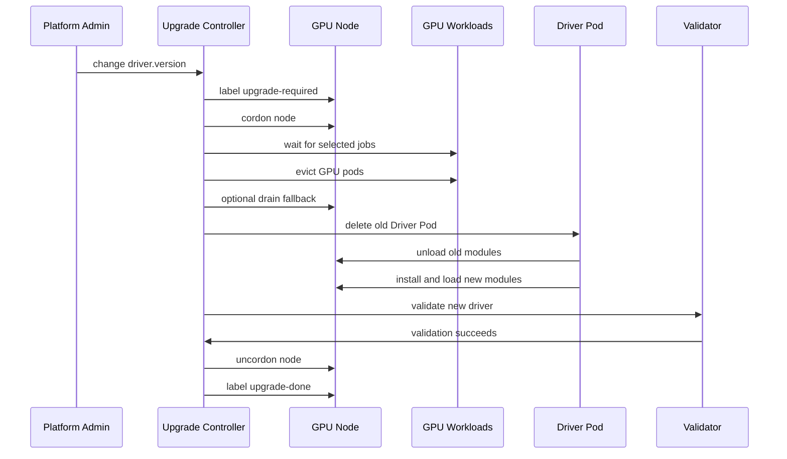

节点通过 `nvidia.com/gpu-driver-upgrade-state` 暴露 `upgrade-required`、`cordon-required`、`pod-deletion-required`、`drain-required`、`pod-restart-required`、`validation-required`、`uncordon-required`、`upgrade-done` 或 `upgrade-failed`。

#### 3.6.7 失败恢复 {#gpu-operator-6-7-失败恢复}

```bash
kubectl get nodes -l nvidia.com/gpu.present=true \
  -o custom-columns=NAME:.metadata.name,STATE:.metadata.labels.nvidia\.com/gpu-driver-upgrade-state

kubectl get nodes \
  -l nvidia.com/gpu-driver-upgrade-state=upgrade-failed
```

修复根因后可把节点重新置为待升级：

```bash
kubectl label node gpu-worker-01 \
  nvidia.com/gpu-driver-upgrade-state=upgrade-required --overwrite
```

先检查节点是否仍 cordon、旧 GPU Pod 是否残留、Driver 模块能否卸载、Validator 为什么失败。不要只反复删除 Driver Pod，否则可能扩大中断。

---

### 3.7 从 Pod 请求到 GPU 注入 {#gpu-operator-从-pod-请求到-gpu-注入}

#### 3.7.1 Device Plugin 注册资源 {#gpu-operator-7-1-device-plugin-注册资源}

Device Plugin 通过 kubelet Device Plugin gRPC API 报告设备与健康状态。默认整卡资源为：

```text
nvidia.com/gpu
```

这是整数扩展资源，通常只放在 `limits`；Kubernetes 会让 request 等于 limit。默认 scheduler 只比较可用数量，不理解显存剩余、GPU 利用率、NVLink 拓扑或队列公平。

#### 3.7.2 端到端数据路径 {#gpu-operator-7-2-端到端数据路径}

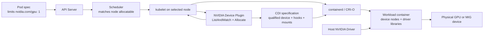

故障定位可以按边界切分：

- Pod 一直 Pending 且 event 为 Insufficient：调度/资源注册问题。
- Pod 已绑定但 FailedCreatePodSandBox：RuntimeClass、Toolkit、CDI 或运行时问题。
- Pod ContainerCreating 卡住：Device Plugin Allocate、CDI spec、设备节点或镜像问题。
- Pod 运行后 `libcuda.so`/NVML 失败：Driver root、库挂载或镜像问题。
- `nvidia-smi` 正常但应用 CUDA kernel 失败：CUDA/Driver 兼容或应用问题。

#### 3.7.3 CDI、RuntimeClass 与 legacy 路径 {#gpu-operator-7-3-cdi-runtimeclass-与-legacy-路径}

从 GPU Operator 25.10 起，CDI 默认为普通 workload 的设备注入机制。`v26.7.1` 中：

- `cdi.enabled=true`：Device Plugin 分配结果交给支持 CDI 的运行时。
- 未启用 NRI 时，仍创建 `nvidia` RuntimeClass，供 GPU 管理容器通过 `NVIDIA_VISIBLE_DEVICES` 访问设备；标准 Device Plugin Pod 不必显式写 RuntimeClass。
- `cdi.nriPluginEnabled=true`：NRI 处理管理容器注入，不再创建 `nvidia` RuntimeClass，也不修改 containerd 配置。
- `cdi.default` 已废弃；CDI 开关本身已经表达默认注入路径。

不要把 `runtimeClassName: nvidia` 当作 GPU 资源请求。它不执行调度记账；业务 Pod 仍应请求 Device Plugin 或 DRA 资源。

#### 3.7.4 GFD 标签与调度 {#gpu-operator-7-4-gfd-标签与调度}

GFD 发布类似以下标签：

```text
nvidia.com/gpu.product=NVIDIA-H100-80GB-HBM3
nvidia.com/gpu.memory=81559
nvidia.com/cuda.driver.major=580
nvidia.com/mig.capable=true
nvidia.com/gpu.sharing-strategy=none
```

它们可用于 node affinity、队列 flavor 或资源分组，但标签是静态能力描述，不是实时空闲量。需要拓扑或队列语义时，把 GFD 标签作为上层调度器的输入，而不是误以为 GFD 自己会调度。

---

### 3.8 整卡、Time-Slicing、MPS 与 MIG {#gpu-operator-整卡-time-slicing-mps-与-mig}

#### 3.8.1 四种模式的边界 {#gpu-operator-8-1-四种模式的边界}

| 模式 | Kubernetes 资源 | 隔离 | 重配置影响 | 典型场景 |
|------|-----------------|------|------------|----------|
| 整卡 | `nvidia.com/gpu` | 独占设备，最简单 | 无共享重配置 | 训练、大模型推理、性能敏感任务 |
| Time-Slicing | 默认仍是 `nvidia.com/gpu`，可改成 `.shared` | 无显存/故障硬隔离 | 重启 Plugin/GFD，运行中 workload 不自动迁移 | 低风险开发、突发小任务、高并发轻载 |
| MPS | `nvidia.com/gpu` 或 `.shared` | 每 replica 等比例约束显存与计算；仍非 VM/MIG 安全边界 | 依赖 MPS control daemon；整节点同一策略 | 协作式 CUDA 多进程、小任务；实验性 |
| MIG | `single` 时通常仍为 `nvidia.com/gpu`；`mixed` 为 `nvidia.com/mig-<profile>` | 硬件级显存与故障隔离 | 停 GPU clients，可能重启节点 | 支持 MIG 的数据中心 GPU、多租户稳定切片 |

Operator 负责部署与配置 Device Plugin/MIG Manager，不提供队列公平、抢占策略、租户配额借用或跨节点 GPU topology scheduling。

#### 3.8.2 Time-Slicing 配置 {#gpu-operator-8-2-time-slicing-配置}

以下 ConfigMap 把每张整卡复制为 4 个共享访问槽，并用 `.shared` 显式区分资源：

```yaml
apiVersion: v1
kind: ConfigMap
metadata:
  name: nvidia-device-plugin-config
  namespace: gpu-operator
data:
  time-slicing: |-
    version: v1
    flags:
      migStrategy: none
    sharing:
      timeSlicing:
        renameByDefault: true
        failRequestsGreaterThanOne: true
        resources:
          - name: nvidia.com/gpu
            replicas: 4
```

让 Device Plugin/GFD 使用该配置：

```bash
kubectl apply -f nvidia-device-plugin-config.yaml
kubectl patch clusterpolicy cluster-policy --type=merge \
  -p '{"spec":{"devicePlugin":{"config":{"name":"nvidia-device-plugin-config","default":"time-slicing"}}}}'
```

业务请求改为：

```yaml
resources:
  limits:
    nvidia.com/gpu.shared: 1
```

关键语义：

- `replicas: 4` 是可分配访问槽数量，不是每个 Pod 保证 25% 算力。
- `failRequestsGreaterThanOne=true` 防止用户误以为请求两个 replica 就得到双倍算力。
- 不启用 `renameByDefault` 时，资源仍叫 `nvidia.com/gpu`，但 GFD product 通常追加 `-SHARED`；这容易让用户把共享槽误认为独占整卡。
- Operator 不监控外部 ConfigMap 的内容变化。修改后需要在维护窗口滚动重启 Device Plugin；当前运行 workload 不会因此自动重建。
- Time-Slicing 没有显存或故障隔离，同卡一个进程可能 OOM 或触发影响其他进程的错误。

#### 3.8.3 MPS 配置 {#gpu-operator-8-3-mps-配置}

Device Plugin `v0.20.1` 的 MPS 仍标为实验性，与 Time-Slicing 互斥，不支持启用了 MIG 的设备，并且只支持完整 `nvidia.com/gpu` 资源。示例：

```yaml
apiVersion: v1
kind: ConfigMap
metadata:
  name: nvidia-device-plugin-mps
  namespace: gpu-operator
data:
  mps: |-
    version: v1
    flags:
      migStrategy: none
    sharing:
      mps:
        renameByDefault: true
        resources:
          - name: nvidia.com/gpu
            replicas: 4
```

```bash
kubectl apply -f nvidia-device-plugin-mps.yaml
kubectl patch clusterpolicy cluster-policy --type=merge \
  -p '{"spec":{"devicePlugin":{"config":{"name":"nvidia-device-plugin-mps","default":"mps"}}}}'
```

MPS Control Daemon 将每个 replica 的显存与计算能力限制为大致相等份额。该限制改善资源治理，但仍要评估 CUDA 应用兼容性、错误传播、MPS server 生命周期、监控归因和安全边界；不能把它描述为 MIG 等价物。

#### 3.8.4 MIG 策略与资源名 {#gpu-operator-8-4-mig-策略与资源名}

| `mig.strategy` | 节点条件 | 暴露方式 |
|----------------|----------|----------|
| `none` | 不使用 MIG | 完整 `nvidia.com/gpu` |
| `single` | 节点上所有 MIG-capable GPU 使用一致 profile | 每个 MIG device 作为 `nvidia.com/gpu` |
| `mixed` | 节点可同时暴露不同 profile | `nvidia.com/mig-1g.10gb` 等 profile 资源 |

`single` 简化工作负载清单，但资源名隐藏 profile；平台应通过 node labels/队列 flavor 保证规格一致。`mixed` 更明确、更灵活，但上层调度和配额必须认识每种资源名。

#### 3.8.5 MIG Manager 动态重配置 {#gpu-operator-8-5-mig-manager-动态重配置}

26.7 起，MIG Manager 会按节点硬件动态生成 `<node-name>-mig-config` ConfigMap，包含 `all-disabled`、`all-enabled`、`all-balanced` 与硬件支持的 profile。老 Driver 无法在 MIG disabled 时查询 profile 时，会回退到静态配置。

启用 mixed 策略：

```bash
helm upgrade --install gpu-operator nvidia/gpu-operator \
  --namespace gpu-operator \
  --create-namespace \
  --version=v26.7.1 \
  --set mig.strategy=mixed \
  --wait
```

选择节点 profile：

```bash
kubectl label node gpu-worker-01 \
  nvidia.com/mig.config=all-balanced --overwrite

kubectl get node gpu-worker-01 \
  -o jsonpath='{.metadata.labels.nvidia\.com/mig\.config\.state}{"\n"}'
```

成功后状态为 `success`，并出现 `nvidia.com/mig-<profile>.count` 标签。禁用 MIG：

```bash
kubectl label node gpu-worker-01 \
  nvidia.com/mig.config=all-disabled --overwrite
```

#### 3.8.6 MIG 重配置不是无损操作 {#gpu-operator-8-6-mig-重配置不是无损操作}

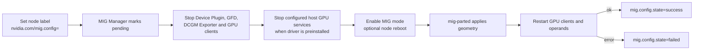

生产重配置前应 drain/迁移业务、确认 PDB 和队列准入、监控 `mig.config.state`，并为可能重启准备节点恢复流程。预装 Driver 时还要维护 MIG Manager 的 GPU client systemd service ConfigMap。

#### 3.8.7 共享模式选择 {#gpu-operator-8-7-共享模式选择}

| 需求 | 首选 | 原因 |
|------|------|------|
| 单任务稳定性能、训练或大模型 | 整卡 | 语义简单、干扰最少 |
| 硬件支持且需要可靠显存/故障隔离 | MIG | 硬件边界与显式 profile |
| 非 MIG 卡、开发环境、容忍干扰 | Time-Slicing | 部署简单、覆盖设备广 |
| 应用兼容且希望等份显存/计算治理 | MPS 试点 | 比 Time-Slicing 更强，但仍实验性 |
| 需要任意显存/算力粒度和调度语义 | HAMi | 软件限额和专用调度路径 |

---

### 3.9 GPUDirect、虚拟化、机密计算与 DRA {#gpu-operator-gpudirect-虚拟化-机密计算与-dra}

#### 3.9.1 高级能力默认都不是“开箱即用” {#gpu-operator-9-1-高级能力默认都不是-开箱即用}

高级字段存在于 `ClusterPolicy` 不代表环境已经具备硬件、内核、网络或虚拟化前提。应把它们看作 Operator 对特定节点软件的编排入口：

| 能力 | GPU Operator 管理部分 | 仍需外部提供 |
|------|-----------------------|--------------|
| GPUDirect RDMA | 可构建/加载 `nvidia-peermem`，或配合 DMA-BUF | NIC Driver、RDMA device plugin、拓扑、Network Operator |
| GPUDirect Storage | Driver Pod 中的 `nvidia-fs` sidecar | 支持的 Driver/open module、CUDA、文件系统和存储栈 |
| GDRCopy | Driver Pod 中的 `gdrdrv` sidecar | 兼容的 Driver、应用库与性能验证 |
| vGPU | vGPU Manager、vGPU Device Manager | NVIDIA AI Enterprise 许可、定制 vGPU Manager 镜像、支持的 hypervisor |
| KubeVirt passthrough | VFIO Manager、sandbox device plugin | IOMMU/VT-d/AMD-Vi、KubeVirt、PCI 资源配置 |
| Kata | Kata Manager、Kata sandbox device plugin | Kata runtime、hypervisor、节点 BIOS/IOMMU 配置 |
| Confidential Containers | CC Manager、NFD rules、Kata 路径 | 支持的 CPU/GPU、attestation 与参考架构 |
| DRA | Operator 安装 Driver/CDI/NFD/GFD 前提 | 独立 DRA Driver Chart、Kubernetes DRA API 和 ResourceClaim |

#### 3.9.2 GPUDirect RDMA {#gpu-operator-9-2-gpudirect-rdma}

现代支持路径优先使用 DMA-BUF，可能不需要 `driver.rdma.enabled=true`。只有必须使用 legacy peer-memory path 时才启用：

```text
--set driver.rdma.enabled=true
```

若 MLNX_OFED 已由主机安装，再根据官方矩阵设置 `driver.rdma.useHostMofed=true`。GPU Operator 不会自动把网络接口变成可分配的 RDMA 资源；通常要与 NVIDIA Network Operator 协同，且 GPU、NIC、PCIe/NUMA 拓扑必须在性能验收中验证。

#### 3.9.3 GDS 与 GDRCopy {#gpu-operator-9-3-gds-与-gdrcopy}

Chart 默认：

```yaml
gds:
  enabled: false
gdrcopy:
  enabled: false
```

GDS 使存储到 GPU memory 的 DMA 路径避免 CPU bounce buffer；26.7 Chart 的 GDS 版本要求 NVIDIA Open GPU Kernel Modules。GDRCopy 面向 CPU/GPU 小数据低延迟复制。这两项都会给 Driver Pod 增加内核相关 sidecar，必须先验证支持矩阵和 Driver 路径，再在小范围节点池启用。

#### 3.9.4 KubeVirt、vGPU 与 Kata {#gpu-operator-9-4-kubevirt-vgpu-与-kata}

沙箱工作负载总开关是：

```yaml
sandboxWorkloads:
  enabled: true
  defaultWorkload: container
  mode: kubevirt
```

节点的 `nvidia.com/gpu.workload.config` 决定软件栈：

- `container`：Driver、Toolkit、Device Plugin、GFD 等容器路径。
- `vm-passthrough`：VFIO Manager 与 sandbox device plugin 路径。
- `vm-vgpu`：vGPU Manager、vGPU Device Manager 与 sandbox device plugin 路径。

Kata 使用 `mode: kata`，并部署 Kata-specific device plugin；它不是把普通 GPU Pod 自动变成 VM。业务 Pod 仍需正确 RuntimeClass，节点还要满足 IOMMU、hypervisor 和 Kata 版本要求。

`ccManager.enabled=true` 的 Values 默认值也不会单独启用机密计算。源码 state gate 要求 `sandboxWorkloads.enabled=true` 且 mode 为 `kata`；此外还需要 `nfd.nodefeaturerules=true`、支持的硬件与 NVIDIA Confidential Containers 参考架构。

#### 3.9.5 DRA 的位置 {#gpu-operator-9-5-dra-的位置}

Dynamic Resource Allocation（DRA）通过 `DeviceClass`、`ResourceClaim` 等 API 表达更灵活的设备请求和动态配置。26.7 中 DRA Driver for NVIDIA GPUs 是独立安装的项目，不是 `ClusterPolicy.spec` 的一个内嵌 `dra.enabled` 字段。

典型集成边界：

1. GPU Operator 管理 Driver、CDI、NFD 和 GFD。
2. 安装 GPU Operator 时禁用传统 `devicePlugin.enabled`，避免两套系统同时负责 GPU allocation。
3. 单独安装指定版本的 NVIDIA DRA Driver。
4. 用 DRA Node label 和 Driver Manager eviction 环境变量解决驱动升级时 kubelet plugin 驱逐问题。
5. 用 ResourceClaim 申请 GPU；需要兼容传统 `nvidia.com/gpu` 时确认 Kubernetes `DRAExtendedResource` feature gate。

26.7 文档要求 DRA 集成使用 Kubernetes `v1.34.2+` 和 Driver `580+`。A100 的 MIG 变化不会自动驱逐 DRA kubelet plugin，重配置后需按文档重启插件。DRA 改变的是设备分配 API，不自动提供 Kueue/Volcano 的队列治理。

---

### 3.10 可观测性、安全与供应链 {#gpu-operator-可观测性-安全与供应链}

#### 3.10.1 DCGM 指标链路 {#gpu-operator-10-1-dcgm-指标链路}

默认 `dcgm.enabled=false`、`dcgmExporter.enabled=true`。此时每个 Exporter 在本地启动 embedded `nv-hostengine` 并暴露 Prometheus 格式指标：

```text
GPU hardware / NVML
  -> embedded DCGM hostengine
  -> DCGM Exporter
  -> Kubernetes Service
  -> Prometheus scrape or ServiceMonitor
  -> dashboard / alert / capacity data
```

若启用 standalone DCGM，Exporter 会通过 `nvidia-dcgm:5555` 连接它；NetworkPolicy 或网络防火墙必须允许通信。不要同时误判 embedded 与 standalone 两条路径。

#### 3.10.2 ServiceMonitor 与指标基数 {#gpu-operator-10-2-servicemonitor-与指标基数}

Chart 默认只创建 Exporter Service，不默认创建 ServiceMonitor：

```text
--set dcgmExporter.serviceMonitor.enabled=true
```

启用前确认 Prometheus Operator CRD 已安装，并用 `additionalLabels` 匹配 Prometheus 的 selector。默认 `enablePodLabels=false`、`enablePodUID=false`；启用后 Operator 会创建可 `get/list/watch pods` 的集群级 RBAC，并增加指标维度。生产必须用 `podLabelAllowlistRegex` 控制 label cardinality，避免租户自定义 label 使 Prometheus 时序爆炸。

Time-Slicing 下，DCGM Exporter 不能可靠把指标关联到具体容器。共享卡的 GPU 利用率也不能直接等价为单 Pod 使用量，容量报表必须声明归因限制。

#### 3.10.3 推荐监控信号 {#gpu-operator-10-3-推荐监控信号}

| 层次 | 关键对象/信号 | 典型告警 |
|------|---------------|----------|
| Controller | Deployment Ready、reconcile error、last success | Operator 不可用或持续 NotReady |
| Driver | Driver Pod、`nvidia-smi`、kernel log | 模块加载失败、Xid、GPU fallen off bus |
| 设备注册 | Node capacity/allocatable、Plugin log | GPU 数量下降、资源消失 |
| MIG | `mig.config.state` | 长期 pending/rebooting 或 failed |
| Driver upgrade | upgrade state labels、upgrade metrics | `upgrade-failed`、升级长期 pending |
| GPU telemetry | 温度、功耗、ECC、Xid、utilization、memory | 热/功耗异常、ECC/Xid、容量过载 |
| 工作负载 | Pending event、容器启动失败、CUDA smoke test | 调度不足、CDI 注入失败、CUDA 不可运行 |

只告警 Pod phase 会漏掉“DaemonSet Running 但 GPU 被 Device Plugin 标记 unhealthy”的情况。

#### 3.10.4 特权与 hostPath 风险 {#gpu-operator-10-4-特权与-hostpath-风险}

官方安全文档明确指出多个 Operand 需要：

- `privileged: true`。
- `hostPID: true` 或 `hostIPC: true`（按组件需要）。
- 主机文件系统、设备节点、运行时 socket 和 systemd 访问。
- 加载/卸载 kernel modules。

这是 GPU 节点管理的功能需要，也意味着 Operator Namespace 是高权限安全域。攻击者若能修改 Operand DaemonSet、ConfigMap、镜像或 `ClusterPolicy`，影响可能扩大到所有 GPU 节点。

#### 3.10.5 最小权限与最小部署面 {#gpu-operator-10-5-最小权限与最小部署面}

生产基线建议：

1. 只允许平台管理员和受审计的 GitOps ServiceAccount 写 Operator Namespace、ClusterPolicy、NVIDIADriver 与 GPU Node labels。
2. Namespace 明确应用 PSA privileged，同时用 RBAC 和 NetworkPolicy 缩小访问面；不能靠 PSA 把 Driver Pod 降为 restricted。
3. 不用的 GDS、GDRCopy、sandbox、vGPU、Kata、NRI、standalone DCGM 维持关闭。
4. 集群已有 Driver/Toolkit/NFD 时禁用相应 Operator 部署，避免重复特权组件。
5. 镜像从批准的 registry mirror 拉取，固定 digest，扫描 CVE，保留 SBOM 与签名验证记录。
6. Secret 只通过 `imagePullSecrets`、Driver `secretEnv` 等引用，不写进 Values Git、命令历史或本文档。
7. 限制 `dcgmExporter.enablePodLabels` 带来的额外集群级 Pod 读取权限。
8. 为 Runtime socket、`/run/nvidia/driver`、CDI spec 目录和主机根目录建立文件完整性监控。

#### 3.10.6 镜像和版本不是单一数字 {#gpu-operator-10-6-镜像和版本不是单一数字}

GPU Operator Release 不是 Driver Release 的别名。`v26.7.1` Chart 默认组合包括：

| 组件 | 该 Chart 默认版本 |
|------|------------------|
| GPU Operator/Validator | `v26.7.1`（未覆写时使用 Chart AppVersion） |
| NVIDIA Driver | `595.91.07`（默认；`615.71.09` 亦受支持） |
| Driver Manager | `v0.12.1` |
| Container Toolkit | `v1.20.1` |
| Device Plugin | `v0.20.1` |
| DCGM | `4.6.1-1` |
| DCGM Exporter | `v4.6.1-4.8.4` |
| MIG Manager | `v0.15.1` |
| Node Feature Discovery | `v0.19.0` |
| GPU Feature Discovery | `v0.20.1` |
| GDS | `v2.29.4` |
| Confidential Computing Manager | `v0.4.4` |
| GDRCopy | `v2.6` |
| Kata Sandbox Device Plugin | `v0.0.5` |

升级或安全响应必须分别跟踪这些组件，而不是看到 Operator 版本新就假设所有 Operand 都满足目标 CVE 修复或硬件要求。

---

### 3.11 升级、兼容与卸载 {#gpu-operator-升级-兼容与卸载}

#### 3.11.1 四个独立版本维度 {#gpu-operator-11-1-四个独立版本维度}

| 维度 | 变更影响 |
|------|----------|
| Helm Chart/Operator | Controller、CRD、模板与默认 Values |
| ClusterPolicy/CRD schema | API 字段、默认值、validation 与 status |
| Driver | CUDA compatibility、内核模块、GPU/Fabric 支持 |
| Operand 镜像 | Toolkit、Device Plugin、DCGM、MIG、Validator 行为 |

因此一次“升级 GPU Operator”至少要回答：CRD 如何升级、Values 如何迁移、Driver 是否同时变化、哪些 Operand 会重启、GPU 业务是否被驱逐。

#### 3.11.2 升级前检查 {#gpu-operator-11-2-升级前检查}

- 阅读目标版本 Release Notes、Platform Support、Known Issues 与组件矩阵。
- 保存 `helm get values gpu-operator -n gpu-operator`、当前 `ClusterPolicy`、`NVIDIADriver`、共享/MIG ConfigMap。
- 检查所有 GPU 节点 Ready、Driver Upgrade state 完成、MIG state 为 success。
- 对比新旧 `values.yaml`，不要把旧文件直接覆盖到新 Chart 而忽略新增默认值。
- 检查 CRD schema diff，尤其是 deprecated/no-op 字段和新 required/enum。
- 确认镜像已镜像/预拉取，Driver 依赖包在代理或离线源可用。
- 安排 CUDA canary、回滚版本与节点恢复步骤。

#### 3.11.3 CRD 升级 {#gpu-operator-11-3-crd-升级}

Helm 对 `crds/` 下已有 CRD 不会自动升级。GPU Operator 从 24.9 起默认启用 pre-upgrade Hook（`operator.upgradeCRD=true`）。使用 Hook 升级 26.7.3 时，官方要求加入 `--disable-openapi-validation`：

```bash
helm repo update nvidia

helm upgrade gpu-operator nvidia/gpu-operator \
  --namespace gpu-operator \
  --version=v26.7.1 \
  --disable-openapi-validation \
  --reuse-values
```

`--reuse-values` 只适合已完成新旧 Values diff 且明确希望保留所有旧值的环境。更稳妥的做法是生成并评审目标版本 Values 文件：

```bash
helm show values nvidia/gpu-operator \
  --version=v26.7.1 > gpu-operator-v26.7.1-values.yaml
```

若组织不允许 Hook，先从固定 tag 手工 `kubectl apply` 两个 NVIDIA CRD 和 NFD CRD，再执行 Helm upgrade。不要从 `main` 或 `latest` 拉 CRD 配固定 Release。

#### 3.11.4 Operator 升级和 Driver 升级解耦 {#gpu-operator-11-4-operator-升级和-driver-升级解耦}

可以先固定 `driver.version` 升级 Operator/Operand，再单独升级 Driver；这样把控制面变化与 GPU 客户端中断拆开。若目标 Chart 默认 Driver 与现有不同，必须显式保留旧 Driver 版本，否则 Helm 更新 ClusterPolicy 会触发 Driver Upgrade Controller。

推荐顺序：

1. canary 节点池或测试集群验证新 Chart。
2. 升级 CRD 与 Operator，观察所有非 Driver Operand 收敛。
3. 运行整卡、MIG/共享场景的 CUDA canary。
4. 在独立维护窗口修改 Driver version，限制并发升级。
5. 观察 upgrade state、Xid、业务 SLO，再扩大范围。

#### 3.11.5 回滚边界 {#gpu-operator-11-5-回滚边界}

`helm rollback` 不能自动降级 CRD schema，也不能保证已经升级的 Driver modules 安全回退。回滚计划至少区分：

- Operator/Chart 回滚：旧 Controller 是否理解新 CRD/ClusterPolicy 字段。
- Operand 镜像回滚：运行时配置、CDI spec 或 ConfigMap 是否兼容。
- Driver 回滚：节点上 GPU 客户端停止、模块卸载、旧镜像可用和重新验证。
- MIG 回滚：目标 profile 是否仍存在，是否涉及重启。

#### 3.11.6 卸载 {#gpu-operator-11-6-卸载}

```bash
helm uninstall gpu-operator --namespace gpu-operator
```

默认 `operator.cleanupCRD=false`，CRD 和 CR 可能保留。清理 CRD 是破坏性动作，会删除所有对应自定义资源，应在确认不再需要配置和状态后单独执行。

更重要的是 Driver 生命周期：如果业务仍运行或主机仍依赖容器化 Driver，直接卸载会移除 Driver DaemonSet 和节点软件，导致 GPU 访问中断。官方卸载流程提供保留 Driver 的操作顺序；生产前必须决定：

- 先停止全部 GPU workload。
- 迁移为主机预装 Driver，还是保留 Driver Pod。
- 清理 Toolkit 对 containerd/CRI-O 的配置是否会影响存量容器。
- 是否删除 NFD、CDI specs、RuntimeClass、共享/MIG ConfigMap 和节点标签。
- CRD/Namespace 是否由其他系统共用。

“Helm release 已删除”不等于节点已恢复到安装前状态。

---

### 3.12 故障排查方法 {#gpu-operator-故障排查方法}

#### 3.12.1 严格按依赖顺序检查 {#gpu-operator-12-1-严格按依赖顺序检查}

```text
1. Node Ready / taints / NFD labels
2. Operator and ClusterPolicy conditions
3. Driver and kernel logs
4. Toolkit / CDI / container runtime
5. Device Plugin and allocatable resources
6. GFD labels
7. MIG or sharing configuration
8. DCGM / Validator
9. Scheduler events and real CUDA workload
```

建议先保存现场：

```bash
kubectl get nodes -o wide
kubectl get pods,daemonsets -n gpu-operator -o wide
kubectl describe clusterpolicy cluster-policy
kubectl get events -n gpu-operator --sort-by=.lastTimestamp
```

官方提供 `hack/must-gather.sh` 收集资源与日志。生产执行前审查脚本固定 tag、输出内容和敏感信息处理，不要直接运行漂移的 `main` 脚本后上传未脱敏归档。

#### 3.12.2 NFD 或标签缺失 {#gpu-operator-12-2-nfd-或标签缺失}

症状：没有 Driver/Operand Pod，DaemonSet `DESIRED=0`，ClusterPolicy 提示无 GPU 节点，Node 没有 `nvidia.com/gpu.present`。

```bash
kubectl get node gpu-worker-01 --show-labels
kubectl get pods -A -l app.kubernetes.io/name=node-feature-discovery
kubectl get node gpu-worker-01 \
  -o jsonpath='{.metadata.labels.feature\.node\.kubernetes\.io/pci-10de\.present}{"\n"}'
```

检查 NFD worker 是否覆盖该节点、PCI source/设备类别、RBAC 和 master allowlist。也检查 `nvidia.com/gpu.deploy.operands=false` 是否被遗留。

#### 3.12.3 Driver Pod 失败 {#gpu-operator-12-3-driver-pod-失败}

```bash
kubectl get pods -n gpu-operator -l app=nvidia-driver-daemonset -o wide
kubectl logs -n gpu-operator ds/nvidia-driver-daemonset \
  -c nvidia-driver-ctr --tail=300
kubectl logs -n gpu-operator ds/nvidia-driver-daemonset \
  -c k8s-driver-manager --tail=300
```

节点侧重点：

```bash
uname -r
lsmod | grep -E 'nvidia|nouveau'
sudo dmesg | grep -Ei 'NVRM|Xid|nvidia|nouveau'
```

常见根因：headers/devel 与运行 kernel 不匹配、软件源不可达、`nouveau` 已加载、Secure Boot 阻止未签名模块、旧 GPU client 让模块无法卸载、GPU/Driver branch 不兼容。

不要在不了解节点 OS 的情况下复制 `update-initramfs` 命令；Debian/Ubuntu、RHEL 系和不可变 OS 的 initramfs/模块管理方式不同。

#### 3.12.4 “no runtime for nvidia” 或 Pod Sandbox 失败 {#gpu-operator-12-4-no-runtime-for-nvidia-或-pod-sandbox-失败}

症状通常是：

```text
failed to get sandbox runtime: no runtime for "nvidia" is configured
```

检查：

```bash
kubectl logs -n gpu-operator ds/nvidia-container-toolkit-daemonset \
  -c nvidia-container-toolkit-ctr --tail=300
kubectl get runtimeclass nvidia -o yaml
```

在节点上检查 containerd `config dump` 或 CRI-O `crio status config`，确认实际生效的 handler/CDI 配置，而不是只看磁盘模板。CDI+NRI 模式本来就不创建 RuntimeClass；如果旧 workload 强制写 `runtimeClassName: nvidia`，需按模式调整。

#### 3.12.5 `nvidia.com/gpu` 未注册 {#gpu-operator-12-5-nvidia-com-gpu-未注册}

```bash
kubectl get ds -n gpu-operator nvidia-device-plugin-daemonset
kubectl logs -n gpu-operator ds/nvidia-device-plugin-daemonset \
  -c nvidia-device-plugin --tail=300
kubectl describe node gpu-worker-01
```

区分三种情况：

- Device Plugin Pod 不存在：deploy labels、taint/toleration 或 `devicePlugin.enabled=false`。
- Pod 失败：Driver/NVML、CDI 配置或不合法的 sharing/MIG 配置。
- Pod Running 但数量少：Xid health event 使某 GPU 标记 unhealthy，或 MIG/sharing 改变了资源名和数量。

若启用了 `renameByDefault=true`，资源可能是 `nvidia.com/gpu.shared`；mixed MIG 则是 `nvidia.com/mig-<profile>`。此时查询 `nvidia.com/gpu` 得到空并不一定是插件故障。

#### 3.12.6 Pod Pending {#gpu-operator-12-6-pod-pending}

```bash
kubectl describe pod <pod-name>
kubectl get node -o custom-columns=NAME:.metadata.name,GPU:.status.allocatable.nvidia\.com/gpu
```

关注 event：

- `Insufficient nvidia.com/gpu`：资源真的不足、资源名错误或 Plugin 未注册。
- node affinity 不匹配：GFD product/MIG/shared label 与清单冲突。
- taint 不容忍：业务 Pod 缺 toleration。
- Kueue 未准入或 Volcano PodGroup 未满足：上层队列/调度器，不是 Operator。
- mixed MIG + full GPU 且使用已知受影响 R570 Driver：26.7 Troubleshooting 记录了 `570.124.06`、`570.133.20`、`570.148.08`、`570.158.01` 的 NVML regression，应按官方建议选择修复版本/规避版本。

#### 3.12.7 MIG 卡在 pending/failed {#gpu-operator-12-7-mig-卡在-pending-failed}

```bash
kubectl get node gpu-worker-01 \
  -o jsonpath='{.metadata.labels.nvidia\.com/mig\.config}{"\t"}{.metadata.labels.nvidia\.com/mig\.config\.state}{"\n"}'
kubectl logs -n gpu-operator -l app=nvidia-mig-manager \
  -c nvidia-mig-manager --tail=300
```

检查 profile 是否存在于该节点的 `<node-name>-mig-config`、Driver 是否支持动态查询、GPU clients 是否成功停止、节点是否等待 reboot。不要在重配置中途反复改 label；先让状态机成功或按官方恢复步骤回到 `all-disabled`。

#### 3.12.8 Time-Slicing/MPS 配置未生效 {#gpu-operator-12-8-time-slicing-mps-配置未生效}

```bash
kubectl get clusterpolicy cluster-policy \
  -o jsonpath='{.spec.devicePlugin.config}{"\n"}'
kubectl get configmap -n gpu-operator nvidia-device-plugin-config -o yaml
kubectl get node gpu-worker-01 --show-labels \
  | grep -E 'replicas|sharing-strategy|SHARED'
```

外部 ConfigMap 内容更新不会触发 Operator 自动重启插件。确认 key 与 `default` 完全一致、ConfigMap 与 Operator 同 Namespace、插件配置是 `version: v1`。MPS 还需确认没有启用 MIG，且只配置完整 `nvidia.com/gpu`。

#### 3.12.9 Validator 与 Fabric Manager {#gpu-operator-12-9-validator-与-fabric-manager}

NVSwitch 系统上 Validator 报 `error code system not yet initialized`，通常意味着 Fabric Manager 未正确启动。检查：

```bash
kubectl exec -n gpu-operator ds/nvidia-driver-daemonset \
  -c nvidia-driver-ctr -- nvidia-smi -q
kubectl logs -n gpu-operator -l app=nvidia-operator-validator \
  --all-containers --tail=300
```

若 `Fabric State` 长期 `In Progress`，继续看 Driver Pod 的 Fabric Manager 安装与 `/var/log/fabricmanager.log`。DGX/HGX 的 NVSwitch/Fabric 初始化是 GPU 可用性的硬前提。

#### 3.12.10 Xid 与 GPU 数量下降 {#gpu-operator-12-10-xid-与-gpu-数量下降}

Device Plugin 会监听 NVML event stream，并在关键 Xid 后把设备标为 unhealthy，使 Node allocatable 数量下降：

```bash
sudo dmesg | grep -i xid
kubectl logs -n gpu-operator ds/nvidia-device-plugin-daemonset \
  -c nvidia-device-plugin | grep -i xid
```

Xid 是硬件/Driver 诊断线索，不应简单通过重启插件清除。记录 PCI Bus ID、GPU UUID、Xid code、Driver/Firmware 版本和发生时 workload，按 NVIDIA Xid 文档决定 reset、节点隔离、固件/Driver 变更或硬件更换。

#### 3.12.11 DCGM Exporter CrashLoop {#gpu-operator-12-11-dcgm-exporter-crashloop}

默认 embedded 模式与 standalone DCGM 模式的检查不同：

- embedded：看 Exporter 自身 NVML/DCGM 初始化与 Driver。
- standalone：确认 `nvidia-dcgm:5555` Service/endpoints、NetworkPolicy 与跨节点网络。
- Time-Slicing：Pod 级归因缺失是已知限制，不是 Exporter CrashLoop 根因。
- ServiceMonitor 不存在：先确认 Prometheus Operator CRD 与 Helm value，不要重启 Exporter。

#### 3.12.12 大集群 Operator OOM {#gpu-operator-12-12-大集群-operator-oom}

官方 Troubleshooting 指出约 300+ 节点的大集群可能超过默认 Operator 内存限制（Chart 默认 limit `350Mi`）。不要长期直接 patch Deployment，因为 Helm 会覆盖；在 Values 中根据监控调整：

```yaml
operator:
  resources:
    requests:
      cpu: 200m
      memory: 600Mi
    limits:
      cpu: 500m
      memory: 1400Mi
```

用长期工作集设置 request，用 reconciliation 峰值设置 limit，并观察 Go runtime/容器 OOM 指标。

---

### 3.13 生产设计与运维清单 {#gpu-operator-生产设计与运维清单}

#### 3.13.1 分层节点池 {#gpu-operator-13-1-分层节点池}

不要把所有 GPU 功能塞进同一节点池。常见拆分：

| 节点池 | GPU 模式 | 主要策略 |
|--------|----------|----------|
| `gpu-full` | 整卡 | 稳定 Driver、禁止共享、训练/高性能推理 |
| `gpu-mig` | MIG | 固定 profile 或受控维护窗口重配置 |
| `gpu-shared` | Time-Slicing/MPS | 显式 `.shared` 资源、限制租户与 SLO |
| `gpu-vm` | KubeVirt/Kata | IOMMU、VFIO/vGPU/Kata 专用安全基线 |
| `gpu-canary` | 测试 | 新 Driver、Toolkit、Operator 首批验证 |

节点池标签/taint、Kueue ResourceFlavor、业务 node affinity 和 Operator 配置应保持同一语义。

#### 3.13.2 安装基线 {#gpu-operator-13-2-安装基线}

- [ ] 固定 `--version=v26.7.1`，保存 Chart digest 和所有镜像 digest。
- [ ] 核对硬件、OS、kernel、Kubernetes、containerd/CRI-O 支持矩阵。
- [ ] 选择 `ClusterPolicy` Driver 或 `NVIDIADriver`，不重叠管理。
- [ ] 确认 NFD 只有一套且覆盖 GPU 节点。
- [ ] Namespace PSA 设置为 privileged，并收紧 RBAC。
- [ ] 预装 Driver/Toolkit 时显式关闭对应 Operand。
- [ ] 记录 CDI/NRI 模式和运行时配置文件/socket。
- [ ] 配置 registry mirror、proxy、CA、imagePullSecrets，但不把 Secret 明文写进 Git。
- [ ] 默认关闭不使用的 GDS/GDRCopy/sandbox/vGPU/Kata/standalone DCGM。

#### 3.13.3 验收基线 {#gpu-operator-13-3-验收基线}

- [ ] Operator Deployment Ready，ClusterPolicy conditions 合理。
- [ ] 每个节点池至少一台节点完成 Driver/Toolkit/Plugin/GFD/Validator 检查。
- [ ] Node allocatable 与物理整卡/MIG/sharing 设计一致。
- [ ] 整卡、每种 MIG profile、每种 shared resource 都有 CUDA canary。
- [ ] DCGM 指标能被抓取，GPU UUID/Node/Pod 维度符合设计。
- [ ] 模拟 Xid/Plugin unavailable、Driver Pod restart、Node reboot 的告警路径。
- [ ] 上层 Kueue/Volcano/KServe workload 端到端验证，而不只运行裸 Pod。

#### 3.13.4 变更基线 {#gpu-operator-13-4-变更基线}

- [ ] Operator、Driver、Toolkit、Device Plugin、MIG profile 分开做变更单。
- [ ] 新 Chart 先 diff Values 和 CRD，后做 canary。
- [ ] Driver upgrade 并发不超过容量冗余，检查 PDB 与 `maxUnavailable`。
- [ ] `drain.enable` 仅在明确维护窗口开启。
- [ ] MIG 重配置前清空 GPU clients，并允许节点 reboot。
- [ ] sharing ConfigMap 更新后受控重启 Device Plugin/GFD。
- [ ] 回滚方案包含 CRD、Driver modules、runtime/CDI 和节点标签，不只 Helm revision。

#### 3.13.5 日常巡检 {#gpu-operator-13-5-日常巡检}

```bash
kubectl get clusterpolicy cluster-policy
kubectl get pods,daemonsets -n gpu-operator
kubectl get nodes -l nvidia.com/gpu.present=true \
  -o custom-columns=NAME:.metadata.name,GPU:.status.allocatable.nvidia\.com/gpu,UPGRADE:.metadata.labels.nvidia\.com/gpu-driver-upgrade-state,MIG:.metadata.labels.nvidia\.com/mig\.config\.state
kubectl get events -n gpu-operator --sort-by=.lastTimestamp | tail -50
```

再结合 DCGM 的 Xid/ECC/温度/功耗与调度 Pending 率，形成“硬件健康—资源注册—调度—应用”四层巡检。

---

### 3.14 附录 A：常用命令速查 {#gpu-operator-附录-a常用命令速查}

#### 3.14.1 查看固定版本 Chart {#gpu-operator-a-1-查看固定版本-chart}

```bash
helm show chart nvidia/gpu-operator --version=v26.7.1
helm show values nvidia/gpu-operator --version=v26.7.1
```

#### 3.14.2 查看策略与组件 {#gpu-operator-a-2-查看策略与组件}

```bash
kubectl get clusterpolicy cluster-policy -o yaml
kubectl get nvidiadrivers -o wide
kubectl get pods,daemonsets,services -n gpu-operator
kubectl get runtimeclass
```

#### 3.14.3 查看节点 GPU 能力 {#gpu-operator-a-3-查看节点-gpu-能力}

```bash
kubectl get nodes -l nvidia.com/gpu.present=true --show-labels
kubectl describe node gpu-worker-01
kubectl exec -n gpu-operator ds/nvidia-driver-daemonset \
  -c nvidia-driver-ctr -- nvidia-smi -L
```

#### 3.14.4 查看关键日志 {#gpu-operator-a-4-查看关键日志}

```bash
kubectl logs -n gpu-operator deployment/gpu-operator --tail=300
kubectl logs -n gpu-operator ds/nvidia-driver-daemonset \
  -c nvidia-driver-ctr --tail=300
kubectl logs -n gpu-operator ds/nvidia-container-toolkit-daemonset \
  -c nvidia-container-toolkit-ctr --tail=300
kubectl logs -n gpu-operator ds/nvidia-device-plugin-daemonset \
  -c nvidia-device-plugin --tail=300
kubectl logs -n gpu-operator -l app=nvidia-mig-manager \
  -c nvidia-mig-manager --tail=300
```

---

### 3.15 附录 B：官方资料与源码入口 {#gpu-operator-附录-b官方资料与源码入口}

本文以以下官方资料交叉验证：

- [GPU Operator 26.7 Overview](https://docs.nvidia.com/datacenter/cloud-native/gpu-operator/26.7/overview.html)
- [Getting Started](https://docs.nvidia.com/datacenter/cloud-native/gpu-operator/26.7/getting-started.html)
- [Platform Support](https://docs.nvidia.com/datacenter/cloud-native/gpu-operator/26.7/platform-support.html)
- [GPU Sharing](https://docs.nvidia.com/datacenter/cloud-native/gpu-operator/26.7/gpu-sharing.html)
- [Multi-Instance GPU](https://docs.nvidia.com/datacenter/cloud-native/gpu-operator/26.7/gpu-operator-mig.html)
- [GPU Driver CRD](https://docs.nvidia.com/datacenter/cloud-native/gpu-operator/26.7/gpu-driver-configuration.html)
- [GPU Driver Upgrades](https://docs.nvidia.com/datacenter/cloud-native/gpu-operator/26.7/gpu-driver-upgrades.html)
- [CDI and NRI Support](https://docs.nvidia.com/datacenter/cloud-native/gpu-operator/26.7/cdi.html)
- [DRA Driver for NVIDIA GPUs](https://docs.nvidia.com/datacenter/cloud-native/gpu-operator/26.7/dra-intro-install.html)
- [GPUDirect RDMA and Storage](https://docs.nvidia.com/datacenter/cloud-native/gpu-operator/26.7/gpu-operator-rdma.html)
- [Security Considerations](https://docs.nvidia.com/datacenter/cloud-native/gpu-operator/26.7/security.html)
- [Upgrade](https://docs.nvidia.com/datacenter/cloud-native/gpu-operator/26.7/upgrade.html)
- [Uninstall](https://docs.nvidia.com/datacenter/cloud-native/gpu-operator/26.7/uninstall.html)
- [Troubleshooting](https://docs.nvidia.com/datacenter/cloud-native/gpu-operator/26.7/troubleshooting.html)
- [GPU Operator `v26.7.1` source snapshot](https://github.com/NVIDIA/gpu-operator/tree/dbacf43d4938816fefe62690ab868a640a195282)
- [`ClusterPolicy` Go type](https://github.com/NVIDIA/gpu-operator/blob/dbacf43d4938816fefe62690ab868a640a195282/api/nvidia/v1/clusterpolicy_types.go)
- [`v26.7.1` Helm Values](https://github.com/NVIDIA/gpu-operator/blob/dbacf43d4938816fefe62690ab868a640a195282/deployments/gpu-operator/values.yaml)
- [NVIDIA Device Plugin `v0.20.1`](https://github.com/NVIDIA/k8s-device-plugin/tree/v0.20.1)

版本和平台支持会变化。落地时应同时检查目标 GPU 型号、Driver 分支、Linux kernel、Kubernetes 发行版、容器运行时与云平台的当前兼容矩阵；不要把本文的固定快照当作未来版本的兼容承诺。

## 第4篇：HAMi {#hami}


> **Kubernetes 上的异构 AI 计算虚拟化、中间件调度与 GPU 共享机制解析**
>
> 基于 HAMi 官方仓库与官网文档整理：<https://github.com/Project-HAMi/HAMi>
>
> 稳定版本基线：`v2.10.0@4707fb02c91c545bc7343ce26dba4c32919f9a3e`，审校日期：2026-09-26。主线中的后续实现不作为 v2.10.0 的稳定能力；本轮复核稳定 Release 未变化。

---

### 4.1 HAMi 的定位 {#hami-hami-的定位}

#### 4.1.1 HAMi 是什么 {#hami-1-1-hami-是什么}

HAMi 全称 **Heterogeneous AI Computing Virtualization Middleware**，中文可理解为“异构 AI 计算虚拟化中间件”。它的前身是 `k8s-vGPU-scheduler`，目标是在 Kubernetes 集群中让 GPU、NPU、DCU、MLU、GCU、XPU 等异构 AI 加速器可以被更细粒度地共享、隔离和调度。

一句话概括：

> **Kubernetes 默认只能按整数个设备调度 GPU；HAMi 在 Kubernetes 之上补齐“显存、算力、设备型号、UUID、拓扑、厂商差异”等设备语义，并在容器内执行资源隔离。**

HAMi 不是一个训练框架，也不是推理引擎。它主要服务平台层：

| 层次 | HAMi 作用 |
|------|-----------|
| Kubernetes 调度层 | 让调度器知道设备细节，并按显存/算力/拓扑做设备选择 |
| Device Plugin 层 | 向 kubelet 注册虚拟化后的设备资源，并按调度结果注入设备 |
| 容器运行时层 | 注入 HAMi-Core 或厂商特定虚拟化组件，限制容器内显存和算力 |
| 多厂商适配层 | 把 NVIDIA、Ascend、Cambricon、Hygon、Iluvatar、MetaX、Mthreads、Enflame 等设备接入统一调度工作流 |

#### 4.1.2 为什么 Kubernetes 原生 GPU 调度不够 {#hami-1-2-为什么-kubernetes-原生-gpu-调度不够}

Kubernetes 的标准 Device Plugin 机制可以让硬件厂商向 kubelet 注册扩展资源，例如 `nvidia.com/gpu`。但它有一个根本限制：**ListAndWatch 主要向 kubelet 报告设备数量，调度器只能看到整数个设备，不知道设备内部容量和拓扑细节。**

这带来几个问题：

| 问题 | 表现 |
|------|------|
| 整卡分配浪费 | 推理服务可能只用 20% 到 40% GPU 算力，却独占整张卡 |
| 无显存配额 | 标准 `nvidia.com/gpu: 1` 不表达“只需要 10GiB 显存” |
| 无设备细节 | 调度器看不到 GPU 型号、UUID、NUMA、MIG 模式、显存容量 |
| 多租户隔离弱 | 普通 time-slicing 可共用设备，但不能严格阻止显存互相挤爆 |
| 异构设备分散 | 不同厂商 device plugin 的资源语义、调度行为和隔离能力不统一 |

HAMi 的设计思路是绕开这些限制：Device Plugin 仍然负责向 kubelet 注册资源，但更丰富的设备规格通过 **Node Annotations** 传给 HAMi Scheduler；调度结果通过 **Pod Annotations** 传给 HAMi Device Plugin；真正的显存和算力限制在容器内由 HAMi-Core 或厂商组件执行。

#### 4.1.3 HAMi 适合哪些场景 {#hami-1-3-hami-适合哪些场景}

| 场景 | HAMi 的价值 |
|------|-------------|
| 多租户 Notebook | 多个用户共享同一 GPU，按显存/算力分配 |
| vLLM / 推理服务 | 多个小模型或低负载服务共用一张 GPU |
| 训练/推理混部 | 小任务不再整卡占用，提高集群利用率 |
| 私有 AI 云平台 | 提供统一的 GPU 配额、设备选择和隔离能力 |
| 多厂商异构集群 | 用统一调度路径管理 NVIDIA、昇腾、寒武纪、海光等设备 |
| 批处理队列 | 与 Volcano、Kueue 等系统协作处理 AI batch workload |

不适合或需要谨慎的场景：

| 场景 | 原因 |
|------|------|
| 强隔离安全边界 | 软件层 API 拦截不能等价于硬件虚拟化或 MIG 的强边界 |
| 对性能抖动极敏感 | 多 workload 共卡可能引入资源争用和尾延迟 |
| 未被支持的驱动/硬件组合 | 隔离能力依赖具体厂商后端 |
| 需要完整硬件可见性 | 容器内 `nvidia-smi` 等工具会被虚拟化显示，排障时要理解视角差异 |

#### 4.1.4 与 NVIDIA Time-Slicing、MIG、MPS 的关系 {#hami-1-4-与-nvidia-time-slicing-mig-mps-的关系}

| 技术 | 共享方式 | 隔离强度 | 适用性 |
|------|----------|----------|--------|
| NVIDIA Time-Slicing | 多 Pod 时间片共享 GPU | 无显存硬隔离 | 简单共享，但一个任务 OOM 可能影响同卡任务 |
| NVIDIA MIG | 硬件切分 GPU 实例 | 强隔离 | A100/H100 等支持 MIG 的数据中心卡 |
| NVIDIA MPS | 多进程共享 CUDA context/资源 | 中等，偏计算共享 | 适合部分 CUDA 多进程场景 |
| HAMi-Core | CUDA/NVML API 拦截与限额 | 软件层隔离 | 不改应用，适合更广泛的共享场景 |
| HAMi Dynamic MIG | 按需求动态选择 MIG profile | 依赖 MIG 硬隔离 | 希望在 MIG 和 HAMi-Core 间统一调度 |

HAMi 的核心价值不是取代所有机制，而是把这些机制纳入 Kubernetes 调度语义，并在 Pod 级别提供统一资源请求方式。

---

### 4.2 总体架构 {#hami-总体架构}

#### 4.2.1 四个核心组件 {#hami-2-1-四个核心组件}

HAMi 的官方架构由四类组件组成：

| 组件 | 形态 | 职责 |
|------|------|------|
| HAMi MutatingWebhook | Admission webhook，嵌在 scheduler 服务中 | 扫描 Pod 资源请求，必要时改写 `schedulerName`，注入运行时配置 |
| HAMi Scheduler Extender | 调度扩展服务，通常与 kube-scheduler 同 Pod | 实现 Filter/Bind，维护全局设备视图，选择节点和具体设备 |
| HAMi Device Plugin | DaemonSet，每个设备节点运行 | 注册虚拟资源，读取 Pod annotations，向容器注入设备、环境变量和挂载 |
| In-container control | HAMi-Core 或厂商特定组件 | 在容器内限制显存、算力，提供监控和硬/软隔离 |

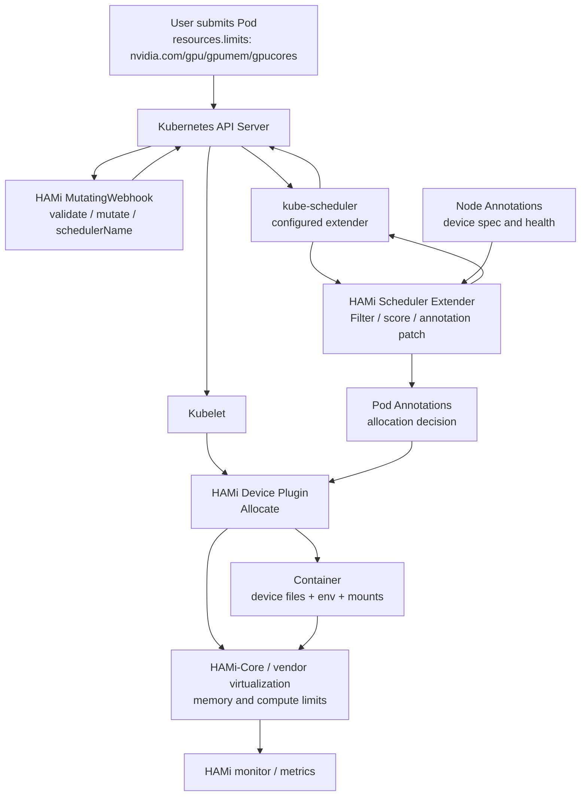

#### 4.2.2 调度控制面 {#hami-2-2-调度控制面}

HAMi Scheduler 本质上是 kube-scheduler 的 extender。Helm chart 默认会在 `hami-scheduler` Pod 中同时运行 kube-scheduler 容器和 extender 容器：

| 组件 | 默认配置 |
|------|----------|
| `schedulerName` | `hami-scheduler` |
| kube-scheduler enabled | `true` |
| scheduler extender image | `projecthami/hami` |
| Admission webhook | enabled |
| leader election | enabled |
| metrics bind address | `:9395` |
| service monitor port | `31993` |

这种部署方式的优点是：HAMi 可以拥有一个独立 schedulerName，不必替换集群默认 scheduler；MutatingWebhook 只会把 HAMi 能识别的设备 workload 改写到 `hami-scheduler`。

#### 4.2.3 节点代理面 {#hami-2-3-节点代理面}

每个 GPU/加速器节点上运行 HAMi Device Plugin。它承担两类任务：

1. **向 kubelet 注册可调度资源。** 对 NVIDIA，默认资源名包括 `nvidia.com/gpu`、`nvidia.com/gpumem`、`nvidia.com/gpumem-percentage`、`nvidia.com/gpucores`。
2. **向 HAMi Scheduler 报告设备细节。** 通过 node annotations 周期性写入设备 UUID、虚拟切分数量、总显存、总算力、型号、NUMA、健康状态、模式等信息。

#### 4.2.4 容器内隔离面 {#hami-2-4-容器内隔离面}

对 NVIDIA，HAMi-Core 通过 `libvgpu.so` 等组件在容器内拦截 CUDA/NVML 相关调用。典型注入内容包括：

| 注入内容 | 作用 |
|----------|------|
| `/dev/nvidia*` 设备文件 | 让容器访问分配到的物理 GPU |
| `libvgpu.so` | CUDA/NVML API 拦截与限额 |
| `/etc/ld.so.preload` | 让容器内进程透明加载 `libvgpu.so` |
| `CUDA_DEVICE_MEMORY_LIMIT_<index>` | 每个容器视角下的显存上限 |
| `CUDA_DEVICE_SM_LIMIT` | GPU compute/SM 使用上限 |
| `NVIDIA_VISIBLE_DEVICES` | 控制容器可见设备 |

如果容器设置 `CUDA_DISABLE_CONTROL=true`，部分注入/控制会被跳过，应谨慎使用。

---

### 4.3 端到端工作流 {#hami-端到端工作流}

#### 4.3.1 Pod 提交流程 {#hami-3-1-pod-提交流程}

官方 README 将 HAMi 的工作流概括为：

```text
Pod submission
  -> HAMi mutating webhook
  -> HAMi scheduler filter / score / bind
  -> device allocation written to pod annotations
  -> device plugin Allocate()
  -> container runtime environment
  -> HAMi monitor and metrics
```

更细地展开：

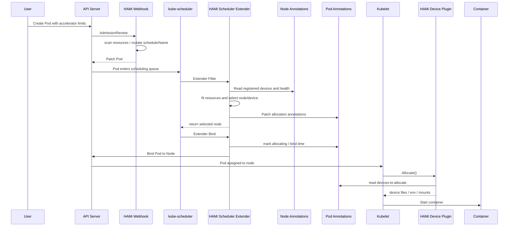

#### 4.3.2 MutatingWebhook {#hami-3-2-mutatingwebhook}

Webhook 的职责不是分配设备，而是判断这个 Pod 是否应该走 HAMi 路径。

代码中的行为包括：

| 行为 | 说明 |
|------|------|
| 解码 Pod | AdmissionReview 进入后解析 Pod |
| 检查 containers | 没有容器则拒绝 |
| 尊重已有 schedulerName | 如果用户显式指定了不同 scheduler，且未允许强制覆盖，则跳过 |
| 遍历设备后端 | 每个后端执行 `MutateAdmission()` |
| 改写 schedulerName | 如果发现 HAMi 资源，并配置了 schedulerName，则设为 `hami-scheduler` |
| 资源配额检查 | 对 NVIDIA memory/core 等做 namespace quota 适配 |

Helm 中 `scheduler.forceOverwriteDefaultScheduler=true`，意味着默认 schedulerName 可以被 HAMi 覆盖；如果用户显式指定了其他 scheduler，则通常不会强行接管。

#### 4.3.3 Scheduler Filter {#hami-3-3-scheduler-filter}

HAMi 的 Filter 阶段不是单纯过滤候选节点。它会完成大量实际决策：

1. 从 Pod containers 解析设备请求。
2. 从 scheduler 缓存拿到各节点设备状态。
3. 按 nodeSelector、taints、affinity、unschedulable 等规则过滤。
4. 为每个候选节点构造 `NodeUsage`。
5. 逐容器、逐设备类型调用设备后端的 `Fit()`。
6. 在节点内部选择具体设备 UUID。
7. 计算节点分数。
8. 排序后选择目标节点。
9. 将目标节点、时间戳、设备分配结果写入 Pod annotations。
10. 将分配写入 scheduler 本地 PodManager 和 QuotaManager 缓存。
11. 返回单个目标 node 给 kube-scheduler。

这意味着 HAMi 的“Filter”实际上承担了 **Filter + Score + Reserve-like + Annotation Patch** 的复合职责。

#### 4.3.4 Scheduler Bind {#hami-3-4-scheduler-bind}

Bind 阶段继续做保护性操作：

| 步骤 | 说明 |
|------|------|
| 读取当前 Pod | 从 informer cache 获取最新 Pod |
| 获取目标 Node | 从 node lister 获取 node |
| LockNode | 对涉及的设备类型加节点锁，避免并发分配冲突 |
| Patch Pod annotations | 写入 `allocating` 阶段与 `bind-time` |
| 调用 Kubernetes Bind | 创建 `corev1.Binding`，绑定 Pod 到 Node |
| 失败回滚 | 释放 node lock，记录失败事件 |

节点锁对多 Pod 并发调度非常关键。HAMi 的调度状态不完全依赖 kube-scheduler 原生 Reserve 插件，因此需要额外同步来避免同一设备被重复分配。

#### 4.3.5 Device Plugin Allocate {#hami-3-5-device-plugin-allocate}

当 kubelet 在目标节点上启动 Pod 时，会调用该节点 HAMi Device Plugin 的 `Allocate()`。Device Plugin 读取 scheduler 写入的 annotations，做以下工作：

| 工作 | 说明 |
|------|------|
| 解析设备分配结果 | 读取 `hami.io/*-devices-to-allocate` |
| 注入设备文件 | 挂载对应 `/dev/*` |
| 注入环境变量 | 如显存限制、算力限制、可见设备 |
| 注入虚拟化库 | NVIDIA 路径挂载 `libvgpu.so` 和 `ld.so.preload` |
| 更新 annotations | 分配完成后清理或更新 to-allocate 状态 |
| 生成监控视图 | 供 HAMi monitor 读取容器用量 |

---

### 4.4 资源模型 {#hami-资源模型}

#### 4.4.1 NVIDIA 默认资源名 {#hami-4-1-nvidia-默认资源名}

Helm chart 中 NVIDIA 默认资源名：

| 资源名 | 含义 |
|--------|------|
| `nvidia.com/gpu` | 请求物理 GPU 数量；安装 HAMi 后节点上注册值默认为 vGPU 数量 |
| `nvidia.com/gpumem` | 每个请求 GPU 分配的显存，单位通常按 MiB/MB 理解 |
| `nvidia.com/gpumem-percentage` | 每个请求 GPU 分配的显存百分比 |
| `nvidia.com/gpucores` | 每个请求 GPU 分配的计算能力百分比 |
| `nvidia.com/priority` | 任务优先级，供监控/反馈逻辑使用 |

最小示例：

```yaml
apiVersion: v1
kind: Pod
metadata:
  name: gpu-pod
spec:
  containers:
    - name: ubuntu-container
      image: ubuntu:22.04
      command: ["bash", "-c", "sleep 86400"]
      resources:
        limits:
          nvidia.com/gpu: 1
          nvidia.com/gpumem: 3000
          nvidia.com/gpucores: 30
```

#### 4.4.2 `nvidia.com/gpu` 的语义变化 {#hami-4-2-nvidia-com-gpu-的语义变化}

HAMi 安装后，节点向 Kubernetes 注册的 `nvidia.com/gpu` 默认是虚拟化后的数量。例如一张物理 GPU 可以按 `deviceSplitCount=10` 注册成 10 个可调度 slot。

但 Pod 中的资源语义需要注意：

| 位置 | `nvidia.com/gpu` 含义 |
|------|----------------------|
| Node allocatable | 由 HAMi device plugin 上报的 vGPU slot 数量，默认每物理卡 10 |
| Pod limits | 当前 Pod 需要几张物理 GPU 上的分配份额，常见写 1 |
| Scheduler 内部 | 结合 gpumem/gpucores 判断这份额能否放到某物理卡 |

官方 README 特别提示：安装 HAMi 后节点注册的 `nvidia.com/gpu` 默认为 vGPU 数；Pod 申请时 `nvidia.com/gpu` 表示当前 Pod 所需物理 GPU 数量。

#### 4.4.3 显存请求：绝对值与百分比 {#hami-4-3-显存请求绝对值与百分比}

HAMi 支持两种显存表达：

| 方式 | 示例 | 适用场景 |
|------|------|----------|
| 绝对显存 | `nvidia.com/gpumem: 3000` | 需要固定显存上限，例如模型推理服务 |
| 百分比显存 | `nvidia.com/gpumem-percentage: 50` | 希望按卡容量比例分配，适配不同显存型号 |

如果同时不设置显存，代码路径会使用默认配置；若没有默认显存，则可能按 100% 处理。生产中建议显式写出显存请求，避免不同节点、不同卡型上行为不一致。

#### 4.4.4 算力请求 {#hami-4-4-算力请求}

`nvidia.com/gpucores` 对 NVIDIA 表达的是 compute/SM 使用上限百分比。例：

```yaml
nvidia.com/gpucores: 30
```

HAMi-Core 通过内核提交拦截和速率限制，使容器整体 GPU compute 使用收敛到限制值附近。需要注意：

| 事实 | 影响 |
|------|------|
| 它是软件层限速 | 不等同于硬件级 SM 物理切分 |
| 对 workload 形态敏感 | 不同 kernel、batch、框架可能有不同抖动 |
| core > 100 会被限制到 100 | 代码中会记录错误并夹到 100 |
| 独占语义 | 当 `gpucores=100` 且设备已被使用时，不允许冲突分配 |

#### 4.4.5 默认补全逻辑 {#hami-4-5-默认补全逻辑}

NVIDIA 后端有几个容易忽略的默认行为：

| 行为 | 说明 |
|------|------|
| 只写 gpumem/gpucores | 如果 `DefaultGPUNum > 0`，Webhook 可补 `nvidia.com/gpu` |
| 请求整卡显存或未设置显存 | 如果没有显式 `gpucores`，可能补 `gpucores=100` 形成独占 compute 语义 |
| `gpumem-percentage` 必须 0 到 100 | 超出范围 Admission 阶段会报错 |
| `gpumem-percentage` 内部哨兵值 101 | 代码用 101 表示未设置百分比 |

建议生产 Pod 模板总是显式写出 `gpu`、`gpumem` 或 `gpumem-percentage`、`gpucores`，避免依赖默认推断。

#### 4.4.6 指定设备类型和 UUID {#hami-4-6-指定设备类型和-uuid}

NVIDIA 后端支持通过 annotations 约束设备选择：

| Annotation | 含义 |
|------------|------|
| `nvidia.com/use-gputype` | 只使用匹配型号关键字的 GPU |
| `nvidia.com/nouse-gputype` | 排除匹配型号关键字的 GPU |
| `nvidia.com/use-gpuuuid` | 只使用指定 GPU UUID |
| `nvidia.com/nouse-gpuuuid` | 排除指定 GPU UUID |
| `nvidia.com/numa-bind` | 要求多卡选择时按 NUMA 约束 |
| `nvidia.com/vgpu-mode` | 指定 `hami-core`、`mig`、`mps` 等模式 |

这些约束会在设备后端的 `Fit()` 逻辑中参与过滤。

---

### 4.5 Node 与 Pod Annotation 协议 {#hami-node-与-pod-annotation-协议}

#### 4.5.1 为什么需要 Annotation 协议 {#hami-5-1-为什么需要-annotation-协议}

标准 Device Plugin 上报给 kubelet 的信息过少，无法携带完整设备属性；kube-scheduler 原生分配给 device plugin 的也主要是设备 ID，而不携带 HAMi 所需的显存/算力限额。因此 HAMi 用 annotations 建立自己的控制协议：

| 通道 | 方向 | 作用 |
|------|------|------|
| Node annotations | Device Plugin -> Scheduler | 报告设备规格、健康状态、握手状态 |
| Pod annotations | Scheduler -> Device Plugin | 传递调度结果、设备 UUID、显存和算力限制 |

#### 4.5.2 设备注册协议 {#hami-5-2-设备注册协议}

设计文档中的通用协议：

```text
hami.io/node-handshake-{device-type}: Reported_{device_node_current_timestamp}
hami.io/node-{device-type}-register: {Device 1}:{Device2}:...:{Device N}
```

每个设备字段：

```text
{Device UUID},{device split count},{device memory limit},{device core limit},{device type},{device numa},{healthy}
```

当前代码中 NVIDIA 更常见的 annotation 是：

| Annotation | 内容 |
|------------|------|
| `hami.io/node-handshake` | NVIDIA 设备握手状态 |
| `hami.io/node-nvidia-register` | NVIDIA device info JSON |
| `hami.io/node-nvidia-score` | GPU pair topology score |

`DeviceInfo` 中包含：

| 字段 | 含义 |
|------|------|
| `id` | 设备 UUID |
| `index` | 设备 index |
| `count` | 可切分/可共享数量 |
| `devmem` | 总显存 |
| `devcore` | 总算力，NVIDIA 常为 100 |
| `type` | 型号或厂商类型 |
| `numa` | NUMA 节点 |
| `mode` | `hami-core` / `mig` / `mps` |
| `health` | 健康状态 |
| `devicepairscore` | 多 GPU 拓扑评分 |

#### 4.5.3 健康检查与握手 {#hami-5-3-健康检查与握手}

Scheduler 会周期性检查 node annotations。设计文档写的是 5 分钟超时，当前代码里也有 `nodeLockExpire` 等配置；具体握手健康判断还会结合 allocatable 和 handshake 状态。

握手状态大致含义：

| 状态 | 含义 |
|------|------|
| `Reported_*` | device plugin 主动报告设备状态 |
| `Requesting_*` | scheduler 请求节点更新设备状态 |
| `Deleted_*` | 设备或节点状态已被清理，可能等待恢复 |

如果设备节点长时间没有更新注册信息，scheduler 会将对应设备视为不可用或从缓存清理，避免把 workload 调度到不可靠设备上。

#### 4.5.4 调度结果协议 {#hami-5-4-调度结果协议}

Scheduler 写入 Pod annotations，典型 key：

| Annotation | 含义 |
|------------|------|
| `hami.io/vgpu-node` | Scheduler 选择的目标节点 |
| `hami.io/vgpu-time` | 调度时间戳 |
| `hami.io/bind-time` | Bind 阶段时间戳 |
| `hami.io/vgpu-devices-to-allocate` | 待 device plugin 处理的分配结果 |
| `hami.io/vgpu-devices-allocated` | 已分配设备记录 |
| `hami.io/vgpu-bind-phase` | 分配阶段，例如 `allocating` |

NVIDIA 分配结果格式：

```text
GPU-uuid,NVIDIA,3000,30:;
```

字段依次是：

| 字段 | 含义 |
|------|------|
| `GPU-uuid` | 物理 GPU UUID，MIG 时可能带模板/实例后缀 |
| `NVIDIA` | 设备类型 |
| `3000` | 分配显存 |
| `30` | 分配算力百分比 |
| `:` | 同一 container 多设备分隔 |
| `;` | 同一 Pod 多 container 分隔 |

#### 4.5.5 多容器 Pod 的索引保持 {#hami-5-5-多容器-pod-的索引保持}

代码中特别注意：解析 Pod devices annotation 时不能跳过空 container entry。原因是 annotation 使用 `;` 分隔容器，如果某个容器不用设备，也必须保留空占位，否则分配结果和 container index 会错位。

这对 sidecar 模式很重要。例如 vLLM benchmark 的 Pod 可能包含 server 和 client 两个容器，只有 server 需要 GPU，annotation 仍要保留容器索引关系。

---

### 4.6 调度策略 {#hami-调度策略}

#### 4.6.1 两级调度策略 {#hami-6-1-两级调度策略}

HAMi 将调度策略分为两个维度：

| 维度 | 控制对象 | 默认值 |
|------|----------|--------|
| `node-scheduler-policy` | 选择哪个节点 | `binpack` |
| `gpu-scheduler-policy` | 节点内选择哪张卡 | `spread` |

Helm 默认：

```yaml
scheduler:
  defaultSchedulerPolicy:
    nodeSchedulerPolicy: binpack
    gpuSchedulerPolicy: spread
```

Pod 可以通过 annotations 覆盖：

```yaml
metadata:
  annotations:
    hami.io/node-scheduler-policy: "spread"
    hami.io/gpu-scheduler-policy: "binpack"
```

#### 4.6.2 Node binpack / spread {#hami-6-2-node-binpack-spread}

节点分数综合设备数量、算力和显存使用率：

```text
Node Score = (Used Devices / Total Devices
            + Used Compute / Total Compute
            + Used VRAM / Total VRAM) * 10
```

策略含义：

| 策略 | 选择倾向 | 适合 |
|------|----------|------|
| node binpack | 选更满的节点 | 集中负载，释放空闲节点，利于缩容 |
| node spread | 选更空的节点 | 分散热点，降低单节点争用 |

代码中的排序逻辑与这个语义一致：spread 倾向低使用率，binpack 倾向高使用率。

#### 4.6.3 GPU binpack / spread {#hami-6-3-gpu-binpack-spread}

设备分数综合请求后的使用率：

```text
GPU Score = ((request.core + used.core) / allocatable.core
           + (request.mem + used.mem) / allocatable.mem) * 10
```

策略含义：

| 策略 | 选择倾向 | 适合 |
|------|----------|------|
| GPU binpack | 尽量把多个 workload 放到同一张卡 | 集中碎片，保留完整空卡 |
| GPU spread | 尽量分散到不同 GPU | 降低同卡争用，默认策略 |

#### 4.6.4 Topology-aware {#hami-6-4-topology-aware}

NVIDIA 后端支持 `hami.io/node-nvidia-score` 表示 GPU pair score。调度时如果启用 topology 相关策略，多 GPU 请求会从候选设备组合中选择更优组合。

典型场景：

| 请求 | 策略 |
|------|------|
| 单卡请求 | 可选择与其他卡连接较弱的卡，保留高互联组合 |
| 多卡请求 | 选择互联更优的卡组合 |
| NUMA-sensitive workload | 配合 `nvidia.com/numa-bind` 约束 |

#### 4.6.5 调度失败原因 {#hami-6-5-调度失败原因}

NVIDIA `Fit()` 路径会记录多种不满足原因：

| 原因类型 | 含义 |
|----------|------|
| card not healthy | 设备不健康 |
| card type mismatch | 型号或模式不匹配 |
| card UUID mismatch | use/no-use UUID 约束不满足 |
| time slicing exhausted | device split count 已用完 |
| insufficient memory | 剩余显存不足 |
| insufficient core | 剩余算力不足 |
| exclusive conflict | 请求独占但设备已有 workload |
| quota not fit | namespace quota 不满足 |
| custom filter rule not fit | MIG 或厂商特定规则不满足 |

这些原因会进入调度事件，便于排障。

---

### 4.7 NVIDIA 虚拟化与 HAMi-Core {#hami-nvidia-虚拟化与-hami-core}

#### 4.7.1 显存隔离 {#hami-7-1-显存隔离}

HAMi-Core 在容器内通过 CUDA/NVML API 拦截实现显存视图和分配限制：

| 拦截方向 | 效果 |
|----------|------|
| `nvmlDeviceGetMemoryInfo` | 让 `nvidia-smi` 等工具看到分配给容器的显存上限 |
| `cuMemAlloc*` | 分配前检查当前使用量 + 新请求是否超过限额 |
| OOM 返回 | 超过限额时返回 CUDA OOM，而不是占用整张物理卡显存 |

这就是为什么容器内 `nvidia-smi` 可能显示一张 V100 只有 10GiB 显存：这不是物理卡变小，而是 HAMi-Core 虚拟化后的视角。

#### 4.7.2 算力限制 {#hami-7-2-算力限制}

对 compute limit，HAMi-Core 会拦截 kernel submission，并通过速率限制控制 kernel 提交节奏：

| 机制 | 说明 |
|------|------|
| 拦截 `cuLaunchKernel` 等调用 | kernel 提交前进入 limiter |
| 维护全局 token/counter | 用 kernel grid 等粒度消耗配额 |
| 后台线程补充配额 | 根据实际 GPU utilization 和上限动态补充 |
| 超额时等待 | 通过 sleep/spin 等方式推迟提交 |

这是一种软件层的使用率控制，目标是让容器整体 compute 使用收敛到 `CUDA_DEVICE_SM_LIMIT`，不是硬件物理隔离。

#### 4.7.3 `libvgpu.so` 注入路径 {#hami-7-3-libvgpu-so-注入路径}

官方 GPU virtualization 文档中描述的注入链路：

1. Device Plugin 在 Allocate 响应中返回设备文件。
2. 将 host 上的 `libvgpu.so` 挂载进容器。
3. 将 host 上的 `ld.so.preload` 挂载到容器 `/etc/ld.so.preload`。
4. 容器进程启动时 Linux dynamic linker 自动预加载 `libvgpu.so`。
5. `libvgpu.so` 覆盖 `dlsym`，拦截 `cu*`、`nvml*` 等函数。

优势是无需修改应用代码；代价是它依赖动态链接和 CUDA/NVML 调用路径，对某些静态链接、非标准 runtime 或直接访问底层设备的工具可能不完全生效。

#### 4.7.4 Monitor 与共享内存 {#hami-7-4-monitor-与共享内存}

HAMi monitor 会读取容器路径下的 cache 文件和共享内存结构，采集容器级用量。代码中 `pkg/monitor/nvidia/v1/spec.go` 包含共享区域字段，例如：

| 字段 | 含义 |
|------|------|
| `limit` | 每设备显存限制 |
| `smLimit` | SM/compute 限制 |
| `procs` | 容器内进程槽 |
| `deviceUtil` | SM/编码/解码等利用率 |
| `priority` | 任务优先级 |
| `lastKernelTime` | 最近 kernel 时间 |

这些信息支撑 HAMi 的监控和 Grafana 展示。

---

### 4.8 Dynamic MIG、MPS 与 DRA {#hami-dynamic-mig-mps-与-dra}

#### 4.8.1 Dynamic MIG 的目标 {#hami-8-1-dynamic-mig-的目标}

NVIDIA MIG 的 profile 是固定组合，传统做法通常要提前配置实例。HAMi Dynamic MIG 的目标是：用户仍然按 HAMi 资源方式请求 `nvidia.com/gpu` 和 `nvidia.com/gpumem`，系统根据需求选择合适 MIG geometry，必要时动态创建 MIG slice。

设计文档目标包括：

| 目标 | 说明 |
|------|------|
| CPU/Memory/GPU 联合调度 | 不只看 GPU |
| GPU dynamic slice | 支持 HAMi-Core 和 MIG 两种切分 |
| node-level binpack/spread | 按 GPU memory、CPU、Mem 做节点策略 |
| 统一 vGPU pool | 对不同虚拟化技术提供统一池化抽象 |
| workload 可选择模式 | Pod 可指定只用 MIG、只用 HAMi-Core 或两者 |

#### 4.8.2 MIG 配置 {#hami-8-2-mig-配置}

Dynamic MIG 依赖 config map 中的 `knownMigGeometries`：

```yaml
nvidia:
  resourceCountName: nvidia.com/gpu
  resourceMemoryName: nvidia.com/gpumem
  resourceCoreName: nvidia.com/gpucores
  knownMigGeometries:
  - models: ["A100-40GB-PCIe"]
    allowedGeometries:
      - 
        - name: 1g.5gb
          memory: 5120
          count: 7
      - 
        - name: 2g.10gb
          memory: 10240
          count: 3
        - name: 1g.5gb
          memory: 5120
          count: 1
```

节点还可以指定 operating mode：

```yaml
nodeconfig:
  - name: nodeA
    operatingmode: hami-core
  - name: nodeB
    operatingmode: mig
```

#### 4.8.3 Pod 选择模式 {#hami-8-3-pod-选择模式}

示例：

```yaml
metadata:
  annotations:
    nvidia.com/vgpu-mode: "mig"
spec:
  containers:
    - resources:
        limits:
          nvidia.com/gpu: 2
          nvidia.com/gpumem: 8000
```

当节点上有空 A100-PCIE-40GB，且请求两个 8GiB vGPU 时，Dynamic MIG 可能选择 `2g.10gb` profile，给容器分配两个 2g.10gb 实例。

#### 4.8.4 MPS {#hami-8-4-mps}

NVIDIA 后端代码中定义了 `mps` 模式。MPS 的核心价值是提升多 CUDA 进程共享 GPU 的效率，但它不是所有 workload 的万能方案。实际是否使用 MPS，需要看设备模式、驱动、Pod annotations 和 HAMi 配置。

#### 4.8.5 DRA 方向 {#hami-8-5-dra-方向}

Kubernetes Dynamic Resource Allocation 在 v1.34 进入 GA。DRA 提供 `ResourceClaim`、`DeviceClass`、`ResourceSlice` 等 API，让调度器能直接读取设备属性。HAMi `v2.10.0` 已将 DRA components 从 HAMi 主 Chart 移除（release note: **Remove DRA components from HAMi main chart**）；不能再用 `dra.enabled=true` 期待主 Chart 同时安装 DRA driver。需要 DRA 的集群必须独立部署对应 driver（例如 Ascend 的 `ascend-dra-driver`），并单独管理其 `DeviceClass`、RBAC、ResourceSlice 和升级节奏。

这说明 HAMi 正在向 Kubernetes 原生细粒度设备 API 演进：

| v2.10.0 默认路径 | 独立 DRA 路径 |
|----------|----------|
| Node annotations 承载设备规格 | ResourceSlice 承载设备属性 |
| Pod annotations 传递分配结果 | ResourceClaim 表达资源声明 |
| Scheduler extender 读取自定义协议 | Scheduler 读取 DRA API |
| 对旧 Kubernetes 友好 | 需要 Kubernetes 1.34+、独立 driver 与 CRD/RBAC |

#### 4.8.6 v2.10.0 调度与设备增量 {#hami-8-6-v2-10-0-调度与设备增量}

`v2.10.0` 的稳定 release 还把以下能力纳入主线实现：

| 能力 | 稳定行为 | 生产边界 |
| --- | --- | --- |
| Init-container 资源记账 | scheduler 按 Kubernetes init/app 资源语义计算设备需求，并把 init-container 资源纳入调度与 ResourceQuota 交互 | 升级后需重放多容器、init + app 资源不同的 Pod；不能只看主容器 limits 判断配额 |
| PodGroup/Gang | Bind 阶段对 PodGroup 成员重试 `NodeLock`，并适配 Kubernetes v1.36+ `gangScheduling` feature gates | 仍依赖外部 PodGroup controller/调度器的启用方式；HAMi 不单独提供完整 gang admission |
| Dynamic MIG | 支持 MIG instance dynamic allocation/deallocation，允许在满足节点/驱动约束时回收并重建实例 | 动态重配会影响已有 workload；应在维护窗口验证 CDI、device-plugin 和 MIG Manager 状态 |
| mutex policy | 新增 `mutex` GPU scheduling policy，防止多个调度策略同时修改同一共享设备状态 | mutex 是 HAMi scheduler 内部互斥，不是跨 scheduler 的分布式锁 |
| policy 组合 | `gpu-scheduler-policy` 支持逗号分隔（comma-separated）的组合策略，按配置顺序执行 | 组合顺序会改变 score/filter 结果；必须固定配置并回放冲突场景 |
| NUMA 对齐 | vGPU replica 可选择启用 CPU/GPU NUMA topology 对齐 | 这是 opt-in；需要 kubelet Topology Manager、节点拓扑标签和设备插件协同 |

v2.10.0 同时补充 Biren GPU、AMD Mi300x vGPU、Ascend 910C `vir05_1c_16g`/`vir10_3c_32g` 模板、Vastai 等设备支持，并改进 vNPU compatibility mode。设备支持是厂商后端能力，不等于所有型号共享相同的显存/算力隔离或 DRA 语义；落地必须以对应 device plugin、driver 和 release matrix 为准。

---

### 4.9 异构设备支持 {#hami-异构设备支持}

#### 4.9.1 官方支持矩阵 {#hami-9-1-官方支持矩阵}

HAMi 官网 v2.10.0 支持矩阵列出的设备包括：

| 类型 | 厂商 | 型号 | 显存隔离 | 算力隔离 | 多卡支持 |
|------|------|------|----------|----------|----------|
| GPU | NVIDIA | All | Yes | Yes | Yes |
| MLU | Cambricon | 370, 590 | Yes | Yes | No |
| DCU | Hygon | All | Yes | Yes | No |
| NPU | Huawei Ascend | 910B, 910B3, 910C, 310P | Yes | Yes | No |
| GPU | Iluvatar | All | Yes | Yes | No |
| GPU | Mthreads | MTT S4000 | Yes | Yes | No |
| GPU | MetaX | MXC500 | Yes | Yes | No |
| GCU | Enflame | S60 | Yes | Yes | No |
| XPU | Kunlunxin | P800 | Yes | Yes | No |
| GPU | Vastai | VA16 | Yes | Yes | No |
| DPU | Teco | Checking | In progress | In progress | No |

实际能力会随硬件型号、驱动和厂商插件变化，生产前应以所用 HAMi release 的官网支持矩阵与对应设备文档为准。

#### 4.9.2 多厂商后端代码结构 {#hami-9-2-多厂商后端代码结构}

仓库中 `pkg/device` 下包含多个后端：

| 路径 | 设备 |
|------|------|
| `pkg/device/nvidia` | NVIDIA GPU |
| `pkg/device/ascend` | Huawei Ascend NPU |
| `pkg/device/cambricon` | Cambricon MLU |
| `pkg/device/hygon` | Hygon DCU |
| `pkg/device/iluvatar` | Iluvatar GPU |
| `pkg/device/metax` | MetaX GPU / sGPU |
| `pkg/device/mthreads` | Moore Threads GPU |
| `pkg/device/enflame` | Enflame GCU |
| `pkg/device/kunlun` | Kunlunxin XPU |
| `pkg/device/awsneuron` | AWS Neuron |
| `pkg/device/biren` | Biren GPU |
| `pkg/device/vastai` | Vastai VA |
| `pkg/device/amd` | AMD GPU 设计/实现方向 |

#### 4.9.3 资源名差异 {#hami-9-3-资源名差异}

Helm values 中默认资源名：

| 厂商 | 设备数量资源 | 显存资源 | 算力资源 |
|------|--------------|----------|----------|
| NVIDIA | `nvidia.com/gpu` | `nvidia.com/gpumem` / `nvidia.com/gpumem-percentage` | `nvidia.com/gpucores` |
| Cambricon | `cambricon.com/vmlu` | `cambricon.com/mlu.smlu.vmemory` | `cambricon.com/mlu.smlu.vcore` |
| Hygon | `hygon.com/dcunum` | `hygon.com/dcumem` | `hygon.com/dcucores` |
| MetaX | `metax-tech.com/sgpu` | `metax-tech.com/vmemory` | `metax-tech.com/vcore` |
| Enflame | `enflame.com/drs-gcu` | `enflame.com/gcu-memory` | `enflame.com/gcu-core` |
| Kunlunxin | `kunlunxin.com/xpu` / `kunlunxin.com/vxpu` | `kunlunxin.com/vxpu-memory` | 依后端 |
| Vastai | `vastaitech.com/va` | 依后端 | 依后端 |
| Biren | `birentech.com/gpu` | 依后端 | 依后端 |

#### 4.9.4 AMD 方向的特殊点 {#hami-9-4-amd-方向的特殊点}

AMD 设计文档提出使用 `LD_AUDIT` 而不是 `LD_PRELOAD`，原因是在 ROCm 7.x 原型中 `LD_PRELOAD` 拦截 HIP 符号会导致递归重入。AMD 方案还提出通过 `ROC_GLOBAL_CU_MASK` 做 CU 级别分配。

限制包括：

| 限制 | 说明 |
|------|------|
| `amd-smi` / `rocm-smi` 不虚拟化 | 这些工具读取 sysfs/drm，不走 HIP 拦截路径 |
| CU mask 非重叠是目标 | 但零干扰不保证 |
| node lock enforcement 仍有 TODO | 设计文档中说明相关实现待完善 |

---

### 4.10 安装、配置与运行 {#hami-安装-配置与运行}

#### 4.10.1 前置条件 {#hami-10-1-前置条件}

NVIDIA 路径常见前置条件：

| 组件 | 要求 |
|------|------|
| NVIDIA Driver | README 写 >= 440 |
| CUDA | 官网 Helm guide 写 v10.2+ |
| nvidia-docker / nvidia-container-toolkit | 需要配置 NVIDIA runtime |
| Kubernetes | README 写 >= 1.23；官网 Helm guide 对 kubectl 写 v1.16+ |
| Helm | v3+ |
| 节点标签 | 可按示例使用 `gpu=on` 限制调度范围；chart 默认 selector 为空 |

#### 4.10.2 Helm 安装 {#hami-10-2-helm-安装}

如果希望 HAMi 只处理显式标记的 GPU 节点，可以先标记节点：

```bash
kubectl label nodes <node-name> gpu=on
```

添加 Helm 仓库：

```bash
helm repo add hami-charts https://project-hami.github.io/HAMi/
helm repo update
```

安装：

```bash
helm install hami hami-charts/hami -n kube-system
```

官网 Helm guide 建议设置 kube-scheduler image tag 与集群版本匹配。例如 Kubernetes 1.29.0：

```bash
helm install hami hami-charts/hami \
  --set scheduler.kubeScheduler.imageTag=v1.29.0 \
  -n kube-system
```

验证：

```bash
kubectl get pods -n kube-system
```

期望 `hami-device-plugin` 和 `hami-scheduler` 处于 Running。

#### 4.10.3 关键 Helm 配置 {#hami-10-3-关键-helm-配置}

| 配置 | 默认 | 说明 |
|------|------|------|
| `global.imageTag` | `v2.10.0` | chart 默认镜像 tag |
| `schedulerName` | `hami-scheduler` | Webhook 改写的 schedulerName |
| `scheduler.defaultSchedulerPolicy.nodeSchedulerPolicy` | `binpack` | 默认节点策略 |
| `scheduler.defaultSchedulerPolicy.gpuSchedulerPolicy` | `spread` | 默认 GPU 策略 |
| `scheduler.admissionWebhook.enabled` | `true` | 是否安装 webhook |
| `scheduler.admissionWebhook.failurePolicy` | `Ignore` | webhook 异常时是否阻断 |
| `devicePlugin.deviceSplitCount` | `10` | 单 GPU 默认切分 slot 数 |
| `devicePlugin.migStrategy` | `none` | MIG 策略 |
| `devicePlugin.disablecorelimit` | `false` | 是否禁用 core limit |
| `devicePlugin.deviceListStrategy` | `envvar` | 设备列表传递策略 |
| DRA components | 不由主 Chart 安装 | 需独立 DRA driver、DeviceClass、RBAC 和生命周期治理 |

#### 4.10.4 Webhook 选择器 {#hami-10-4-webhook-选择器}

Chart 支持 namespace 和 object 选择器：

| 配置 | 作用 |
|------|------|
| `scheduler.admissionWebhook.whitelistNamespaces` | 排除命名空间 |
| `scheduler.admissionWebhook.namespaceSelector` | 控制哪些 namespace 应用 webhook |
| `scheduler.admissionWebhook.objectSelector` | 控制哪些 Pod 应用 webhook |

默认注释中提示可以用 `hami.io/webhook: ignore` 之类标签排除 webhook。

#### 4.10.5 与 NVIDIA GPU Operator 共存 {#hami-10-5-与-nvidia-gpu-operator-共存}

HAMi README 明确提到可以与 NVIDIA GPU Operator 共存：GPU Operator 负责驱动等底层组件，HAMi 负责调度和共享。实际部署时要避免两个 device plugin 注册同名资源冲突，确保由 HAMi 的设备插件负责 `nvidia.com/gpu` 等资源。

---

### 4.11 可观测性与 WebUI {#hami-可观测性与-webui}

#### 4.11.1 Metrics {#hami-11-1-metrics}

HAMi 暴露 Prometheus metrics。安装后 scheduler monitor endpoint 默认：

```text
http://<scheduler-ip>:<monitor-port>/metrics
```

默认端口：

| 配置 | 默认 |
|------|------|
| `scheduler.service.monitorPort` | `31993` |
| `scheduler.service.monitorTargetPort` | `9395` |
| `scheduler.metricsBindAddress` | `:9395` |

仓库中的 `pkg/metrics/metrics.go` 定义了 `hami_build_info`，用于暴露版本、revision、build date、Go 版本、编译器和平台等信息。

#### 4.11.2 NVIDIA 容器用量监控 {#hami-11-2-nvidia-容器用量监控}

HAMi monitor 会扫描容器目录，例如 Helm 默认：

```yaml
devicePlugin:
  monitor:
    ctrPath: /usr/local/vgpu/containers
```

它会读取容器 cache 和共享内存区域，聚合：

| 指标方向 | 含义 |
|----------|------|
| device memory context/module/buffer/offset/total | 容器 GPU 显存使用拆分 |
| SM utilization | 容器侧计算利用率 |
| memory limit | 容器分配显存上限 |
| SM limit | 容器分配 compute 上限 |
| process slots | 容器内进程级信息 |

#### 4.11.3 Grafana 与 WebUI {#hami-11-3-grafana-与-webui}

HAMi 提供：

| 组件 | 作用 |
|------|------|
| HAMi-WebUI | 可视化集群和设备管理 |
| Grafana dashboard | 展示 vGPU 使用、显存、利用率等 |
| benchmark material | 对比 HAMi vGPU 与 native NVIDIA device plugin |

#### 4.11.4 Benchmark {#hami-11-4-benchmark}

仓库 `benchmarks/README.md` 提供 vLLM benchmark，用 sidecar Pod 运行：

| 容器 | 作用 |
|------|------|
| `vllm-server` | 运行 OpenAI-compatible vLLM server |
| `benchmark-client` | 发送 streaming 请求，记录 TTFT 和 per-token latency |

它支持对比：

| 部署 | 说明 |
|------|------|
| `job-on-hami.yml` | HAMi vGPU 路径 |
| `job-on-nvidia-device-plugin.yml` | 原生 NVIDIA device plugin baseline |

这类 benchmark 适合评估共享 GPU 对 TTFT、per-token latency 和尾延迟的影响。

---

### 4.12 生态集成 {#hami-生态集成}

#### 4.12.1 vLLM {#hami-12-1-vllm}

vLLM 是 HAMi 的典型推理场景。通过显存上限，可以让多个 vLLM server 或多个小模型共用一张 GPU。

实践建议：

| 建议 | 原因 |
|------|------|
| 明确设置 `gpumem` | vLLM 的 KV Cache 会吃显存，必须留足上限 |
| 控制并发和 max model length | 防止 vLLM 内部调度突破 HAMi 配额后频繁 OOM |
| benchmark 真实负载 | 共享后的 TTFT/ITL 与 batch、prompt 长度高度相关 |
| 区分开发和生产策略 | 开发可 spread，生产可按碎片/缩容目标选择 binpack |

#### 4.12.2 Volcano {#hami-12-2-volcano}

HAMi 可与 Volcano 配合，用于 batch-oriented AI workload：

| Volcano 能力 | 与 HAMi 结合方式 |
|--------------|------------------|
| Gang scheduling | 多 Pod 训练任务整体调度 |
| Queue | 多租户队列管理 |
| Batch scheduling | 作业级调度 |
| HAMi vGPU | 设备细粒度资源共享和隔离 |

#### 4.12.3 Kueue {#hami-12-3-kueue}

README 提到 Kueue 可通过 ResourceTransformation 暴露 HAMi 资源，实现 batch job queueing。适合希望用 Kubernetes 原生 batch queue 管理 AI 资源的团队。

#### 4.12.4 Prometheus / Grafana {#hami-12-4-prometheus-grafana}

HAMi 原生暴露 metrics，并提供 dashboard 样例。生产落地时建议至少监控：

| 指标类别 | 关注点 |
|----------|--------|
| 节点设备注册 | 是否有节点设备未上报或健康异常 |
| Pod 分配状态 | 是否长期停留 allocating |
| GPU 显存用量 | 是否接近配额或物理上限 |
| GPU 利用率 | 是否共享后争用明显 |
| 调度失败原因 | 是否大量 memory/core/type/UUID 不匹配 |
| Webhook 错误 | 是否 Admission 异常导致 Pod 未被 HAMi 接管 |

---

### 4.13 生产实践与限制 {#hami-生产实践与限制}

#### 4.13.1 生产落地检查清单 {#hami-13-1-生产落地检查清单}

| 类别 | 检查项 |
|------|--------|
| Runtime | NVIDIA runtime 是否配置为默认 runtime，或 runtimeClass 是否正确 |
| 节点标签 | GPU 节点是否有 `gpu=on` 或 chart 指定 selector |
| 资源名 | 是否只有 HAMi device plugin 注册 `nvidia.com/gpu` |
| Webhook | namespace/object selector 是否覆盖目标 workload |
| Scheduler | `schedulerName` 是否为 `hami-scheduler` |
| Helm image | kube-scheduler image tag 是否匹配集群版本 |
| 设备注册 | node annotations 是否有 `hami.io/node-nvidia-register` |
| Pod 分配 | pod annotations 是否有 `vgpu-devices-allocated` |
| 隔离验证 | 容器内 `nvidia-smi` 显示的显存上限是否符合请求 |
| 监控 | Prometheus 是否采集 scheduler/device plugin/monitor 指标 |

#### 4.13.2 常见误区 {#hami-13-2-常见误区}

| 误区 | 正确理解 |
|------|----------|
| HAMi 等于 MIG | HAMi-Core 是软件层隔离；MIG 是硬件切分；HAMi 可以调度 MIG |
| `nvidia.com/gpu: 1` 永远表示一整张卡 | HAMi 安装后节点 allocatable 是 vGPU slot；Pod 里还要结合 gpumem/gpucores |
| 只看 kubelet allocatable 就能知道显存 | 显存和设备属性主要在 HAMi node annotations 中 |
| `nvidia-smi` 看到的显存就是物理显存 | 容器内可能是 HAMi-Core 虚拟化后的视图 |
| 软件限速等于硬件隔离 | compute limit 是软件层控制，不能完全消除干扰 |
| 所有厂商能力一致 | 支持矩阵显示各厂商显存/算力/多卡能力不同 |

#### 4.13.3 限制与风险 {#hami-13-3-限制与风险}

| 限制 | 说明 |
|------|------|
| 软件拦截边界 | 对不经过 CUDA/NVML/HIP 等标准路径的访问可能不生效 |
| 驱动/框架兼容性 | CUDA、ROCm、厂商 runtime 版本会影响拦截和监控 |
| 调度状态一致性 | Scheduler cache、Pod annotations、Device Plugin Allocate 需要保持一致 |
| 共享性能抖动 | 多 workload 共享同卡会引入 cache、memory bandwidth、SM 争用 |
| 故障恢复复杂 | Pod 删除、节点删除、handshake 过期、annotation 残留都可能影响资源回收 |
| 多厂商差异 | 不同设备后端功能成熟度不一，不能按 NVIDIA 路径类推 |

#### 4.13.4 排障路径 {#hami-13-4-排障路径}

如果 Pod Pending：

1. 查看 Pod events，确认是否由 `hami-scheduler` 调度。
2. 查看 Pod annotations 是否被 webhook 改写。
3. 查看 node labels 是否匹配 `gpu=on`。
4. 查看 node annotations 是否存在设备注册信息。
5. 查看 scheduler 日志中的 failed reason。
6. 检查是否有显存、算力、UUID、型号、NUMA 或 quota 不满足。

如果 Pod Running 但隔离不生效：

1. 查看 Device Plugin Allocate 日志。
2. 检查容器内 `/etc/ld.so.preload`。
3. 检查 `CUDA_DISABLE_CONTROL` 是否被设置。
4. 检查 `CUDA_DEVICE_MEMORY_LIMIT_*` 和 `CUDA_DEVICE_SM_LIMIT`。
5. 确认应用是否走 CUDA/NVML 动态链接路径。
6. 对 AMD/其他厂商检查对应 runtime 环境变量和厂商插件。

---

### 4.14 附录：关键命令与参考资料 {#hami-附录关键命令与参考资料}

#### 4.14.1 常用命令 {#hami-a-1-常用命令}

安装：

```bash
kubectl label nodes <node-name> gpu=on
helm repo add hami-charts https://project-hami.github.io/HAMi/
helm repo update
helm install hami hami-charts/hami -n kube-system
```

指定 kube-scheduler image：

```bash
helm install hami hami-charts/hami \
  --set scheduler.kubeScheduler.imageTag=v1.29.0 \
  -n kube-system
```

查看组件：

```bash
kubectl get pods -n kube-system | grep hami
```

查看节点设备注册：

```bash
kubectl get node <node-name> -o jsonpath='{.metadata.annotations.hami\.io/node-nvidia-register}'
```

查看 Pod 分配：

```bash
kubectl get pod <pod-name> -o yaml | grep -A8 "hami.io"
```

查看 metrics：

```bash
curl http://<scheduler-ip>:31993/metrics
```

#### 4.14.2 官方参考 {#hami-a-2-官方参考}

| 主题 | 链接 |
|------|------|
| GitHub 仓库 | <https://github.com/Project-HAMi/HAMi> |
| v2.10.0 源码快照 | <https://github.com/Project-HAMi/HAMi/tree/4707fb02c91c545bc7343ce26dba4c32919f9a3e> |
| 官网文档 | <https://project-hami.io/docs> |
| HAMi 是什么 | <https://project-hami.io/docs/> |
| 架构 | <https://project-hami.io/docs/core-concepts/architecture> |
| GPU Virtualization Principles | <https://project-hami.io/docs/core-concepts/gpu-virtualization> |
| Helm 安装 | <https://project-hami.io/docs/get-started/deploy-with-helm> |
| 支持设备矩阵 | <https://project-hami.io/docs/userguide/device-supported> |
| README | <https://github.com/Project-HAMi/HAMi/blob/4707fb02c91c545bc7343ce26dba4c32919f9a3e/README.md> |
| 中文 README | <https://github.com/Project-HAMi/HAMi/blob/4707fb02c91c545bc7343ce26dba4c32919f9a3e/README_cn.md> |
| Design | <https://github.com/Project-HAMi/HAMi/blob/4707fb02c91c545bc7343ce26dba4c32919f9a3e/docs/develop/design.md> |
| Protocol | <https://github.com/Project-HAMi/HAMi/blob/4707fb02c91c545bc7343ce26dba4c32919f9a3e/docs/develop/protocol.md> |
| Scheduler Policy | <https://github.com/Project-HAMi/HAMi/blob/4707fb02c91c545bc7343ce26dba4c32919f9a3e/docs/develop/scheduler-policy.md> |
| Dynamic MIG | <https://github.com/Project-HAMi/HAMi/blob/4707fb02c91c545bc7343ce26dba4c32919f9a3e/docs/develop/dynamic-mig.md> |
| Helm Chart Values | <https://github.com/Project-HAMi/HAMi/blob/4707fb02c91c545bc7343ce26dba4c32919f9a3e/charts/hami/README.md> |

## 第5篇：AI 调度器 {#ai-schedulers}


> **Koordinator、Kueue、Grove、KAI-Scheduler 与 Volcano 的架构、调度语义和生产选型解析**
>
> 基于五个项目的官方仓库、官方文档和 CNCF 资料整理
>
> 稳定版本基线：Koordinator `v1.8.0@989ca85`、Kueue `v0.19.6@f0e95cea51b5591e0177fbe0fa06a299f36db548`、Grove `v0.1.0-alpha.13@af2df1ffff0ae7a1135554564a6240a3f22f2c35`、KAI-Scheduler `v0.18.0@2df9a1ffca535d602d57023074b824606e312797`、Volcano `v1.15.2@1462fb7`；审校日期：2026-09-26。未发布辅助快照为 Koordinator `main@618b581b32668e317b0d18523d46cf9f55b549d8`。Volcano 官网证据固定到 `master@f5258704d7ef5bda28f31ba51950cdea9adbe921`；Helm Chart 使用 `volcano-1.15.2@c2050e3debe58dbcdf9bb75b667799eec9409513`。主线快照只作证据，不扩大稳定版本承诺。

---

### 5.1 先明确“调度器”的边界 {#ai-schedulers-先明确-调度器-的边界}

#### 5.1.1 五个项目并不处于同一层 {#ai-schedulers-1-1-五个项目并不处于同一层}

Koordinator、Kueue、Grove、KAI-Scheduler 和 Volcano 经常一起出现在 Kubernetes AI 平台选型中，但把它们都叫作“调度器”会掩盖最重要的架构差异。

| 项目 | 核心定位 | 是否负责最终节点绑定 | 主要决策对象 |
|------|----------|----------------------|--------------|
| Koordinator | Kubernetes QoS、混部和精细资源编排系统 | 是，`koord-scheduler` 是独立 scheduler profile | Pod、Reservation、设备、NUMA、ElasticQuota |
| Kueue | Job 级队列、配额和准入控制器 | 通常否，准入后仍由 kube-scheduler 或其他调度器放置 Pod | Workload、PodSet、ClusterQueue、ResourceFlavor |
| Grove | 复杂 AI 推理工作负载的声明式编排 API | 否，通过 KAI、Volcano 等 scheduler backend 执行放置 | PodCliqueSet、PodClique、ScalingGroup、PodGang |
| KAI-Scheduler | 面向 GPU/AI 集群的批调度器 | 是，使用独立 `schedulerName` | PodGroup、Queue、Pod、GPU、拓扑域 |
| Volcano | 面向 AI/HPC/大数据的 Kubernetes 批处理系统 | 是，`volcano` scheduler 完成节点绑定 | Volcano Job、PodGroup、Queue、Pod、HyperNode |

一句话概括：

> **Kueue 决定工作负载什么时候可以开始，Grove 决定复杂推理系统由哪些协同组件组成，Koordinator/KAI/Volcano 更接近决定 Pod 最终放到哪里。**

它们不是必然互斥。例如 Kueue 可以负责多租户队列准入，Koordinator 负责准入后的节点、NUMA 和设备放置；Grove 可以表达一个多节点 Prefill/Decode 系统，再把 PodGang 翻译成 KAI 的 PodGroup。

#### 5.1.2 Kubernetes 原生稳定能力还缺什么 {#ai-schedulers-1-2-kubernetes-原生稳定能力还缺什么}

标准 kube-scheduler 擅长对单个 Pending Pod 执行 Filter、Score、Reserve、Permit、PreBind 和 Bind。Kubernetes v1.37 已把 Workload/PodGroup 与基础 Gang/workload-aware preemption 推进到默认关闭的 Beta 路径，TAS 与 CompositePodGroup 仍为默认关闭的 Alpha。因此，以默认配置为生产基线时，AI 与批处理工作负载通常还有六类集群级问题：

| 问题 | v1.37.0 默认能力的缺口 |
|------|----------------------------|
| 多 Pod 原子启动 | 默认仍逐 Pod 调度；原生 PodGroup/Gang 可解决部分问题，但 `GenericWorkload` 虽为 Beta仍默认关闭 |
| 团队队列和配额 | `ResourceQuota` 限制命名空间总量，但不直接提供集群队列、公平借用和排队顺序 |
| GPU 精细语义 | DRA 核心已稳定，但具体 GPU driver、共享容量、隔离和部分高级设备能力仍需额外实现 |
| 通信拓扑 | 普通 affinity 难以表达整体可容纳性；原生 PodGroup TAS 在 v1.37 仍为 Alpha，且拓扑标签仍需可靠数据源 |
| 弹性任务 | 训练或推理副本往往有最小可运行规模、最大规模和成组扩缩关系 |
| 混部治理 | 在线服务、批任务和系统进程需要不同 QoS、资源超卖、驱逐与运行时隔离策略 |

这些问题分属不同控制层，不能靠一个 `schedulerName` 全部解决。

kube-scheduler 的完整调度周期、默认插件、DRA、原生 PodGroup/Gang/TAS 成熟度及与本篇五个项目的逐项对比，见 [Kubernetes 原生调度器深度技术文档](Kubernetes-AI-Platform-Deep-Dive.md#k8s-scheduler)。

#### 5.1.3 统一分层模型 {#ai-schedulers-1-3-统一分层模型}

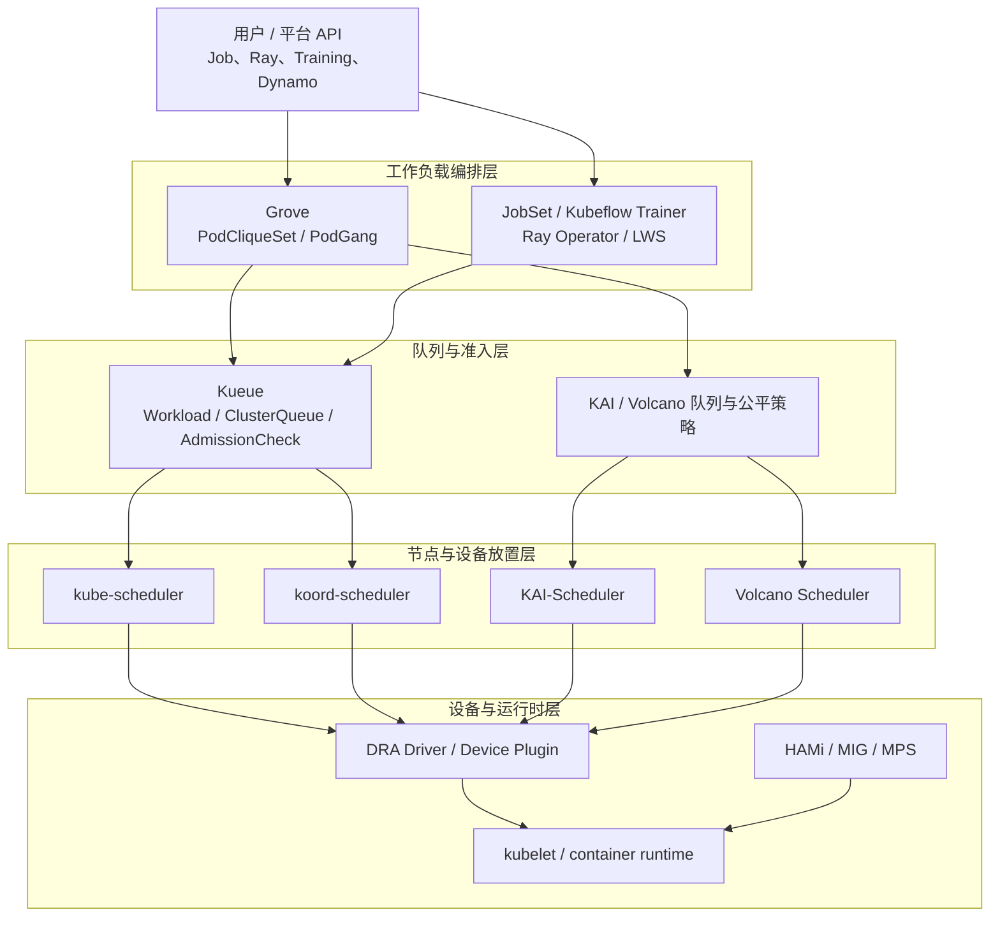

#### 5.1.4 Gang Scheduling 与队列准入不是一回事 {#ai-schedulers-1-4-gang-scheduling-与队列准入不是一回事}

这两个概念经常被混用：

- **队列准入**先判断整个工作负载是否拥有配额、资源 flavor 和外部许可。Kueue 的核心就在这里。
- **Gang Scheduling**保证一组 Pod 达到最小成员数后才整体进入绑定/运行阶段，避免只占住一部分资源。
- **层次化 Gang**进一步表达“一个服务由多个角色构成，每个角色内部又有多 Pod 实例”的约束。Grove + KAI 重点解决这一类推理系统。
- **All-or-nothing admission**不一定等于调度事务。Kueue 可以预留总配额并等待 Pods Ready，但最终 Pod 仍可能由另一个调度器逐个放置。

生产设计必须同时回答三个问题：工作负载何时获准启动、多少 Pod 一起启动、获准后放到哪些节点和设备。

---

### 5.2 Koordinator {#ai-schedulers-koordinator}

#### 5.2.1 定位与适用范围 {#ai-schedulers-3-1-定位与适用范围}

Koordinator 是一个基于 QoS 的 Kubernetes 工作负载编排系统，目标是在同一集群中安全地提高在线服务和批任务的部署密度、资源利用率与性能稳定性。它不只是一个调度器，而是一套从控制面到节点运行时的资源治理系统。

Koordinator 更适合以下场景：

- 在线服务、离线训练、数据处理任务共用节点，需要资源超卖和干扰控制。
- GPU/异构设备需要按显存、算力、型号、PCIe、NUMA 或 NVLink 关系选择。
- 调度需要使用实时/历史节点负载，而不只看 requests。
- 平台需要 Reservation、细粒度 CPU/NUMA 编排、重调度和多层配额。

如果目标只是让 Job 进入队列并按部门配额控制开始时间，引入整套 Koordinator 通常比使用 Kueue 更重。

#### 5.2.2 总体架构 {#ai-schedulers-3-2-总体架构}

| 组件 | 运行位置 | 核心职责 |
|------|----------|----------|
| `koord-scheduler` | 控制面 | 基于 Kubernetes Scheduling Framework 执行负载感知、设备、NUMA、Reservation、Coscheduling 等插件 |
| `koord-manager` | 控制面 | 管理 CRD、SLO、资源画像、弹性配额、迁移和 admission 逻辑 |
| `koordlet` | 每个节点 | 采集资源指标、管理 cgroup/QoS、执行资源抑制、驱逐和 runtime hooks |
| `koord-descheduler` | 控制面 | 识别不合理放置并通过迁移/驱逐恢复期望状态 |
| `koord-device-daemon` | 设备节点 | 发现和上报 GPU 等异构设备信息 |

```mermaid
flowchart LR
    Pod["Pod / Workload"] --> Manager["koord-manager<br/>admission / SLO / controllers"]
    Manager --> API["Kubernetes API<br/>Device / NodeMetric / Reservation / ElasticQuota"]
    Pod --> Scheduler["koord-scheduler"]
    API --> Scheduler
    Scheduler --> Bound["Pod bound to node"]
    Device["koord-device-daemon"] --> API
    Koordlet["koordlet<br/>metrics / QoS / runtime hooks"] --> API
    Bound --> Koordlet
    Descheduler["koord-descheduler"] --> API
    API --> Descheduler
```

#### 5.2.3 Scheduler Framework 插件 {#ai-schedulers-3-3-scheduler-framework-插件}

Koordinator v1.8.0 中的关键 scheduler plugins 包括：

| 插件 | 作用 |
|------|------|
| `loadaware` | 根据 NodeMetric 和估算负载过滤/打分，避免 requests 看起来空闲但实际繁忙的节点 |
| `coscheduling` | 使用 PodGroup 或 annotation 实现 Gang/Coscheduling |
| `elasticquota` | 多层 ElasticQuota 树、配额借用和运行时配额管理 |
| `reservation` | 将预留资源建模为一等对象，支持资源预留、复用和抢占 |
| `deviceshare` | 选择具体 GPU/RDMA 等设备，支持份额和设备拓扑约束 |
| `nodenumaresource` | 按 NUMA、CPU topology 和 kubelet Topology Manager 策略放置 |
| `noderesourcefitplus` | 为不同资源配置更细的 Fit/Score 策略 |
| `scarceresourceavoidance` | 避免普通任务消耗稀缺硬件节点 |
| `schedulinghint` | 利用队列提示降低无效重试 |

Koordinator 复用上游 Scheduling Framework，因此其扩展点仍遵循 PreFilter、Filter、Score、Reserve、Permit、PreBind 等 kube-scheduler 语义，而不是另起一套 Session/Action 框架。

#### 5.2.4 设备模型与 GPU 调度 {#ai-schedulers-3-4-设备模型与-gpu-调度}

Koordinator 使用节点级 `Device` CR 保存设备实例信息，并通过 Pod annotations 传递精细分配意图和结果。常用资源包括：

| 资源/接口 | 含义 |
|-----------|------|
| `koordinator.sh/gpu` | 组合 GPU 资源语义 |
| `koordinator.sh/gpu-core` | GPU 算力比例 |
| `koordinator.sh/gpu-memory` | GPU 显存绝对量 |
| `koordinator.sh/gpu-memory-ratio` | GPU 显存比例 |
| `koordinator.sh/device-allocate-hint` | 型号、设备选择、拓扑和分配策略提示 |
| `koordinator.sh/device-joint-allocate` | GPU、RDMA 等设备联合分配 |
| `koordinator.sh/gpu-partition-spec` | GPU 分区/NVLink 分组偏好或强约束 |

DeviceShare 可以在 Device、PCIe、NUMA Node、Node 等层级表达拓扑范围，也可以选择 NVIDIA、AMD、Hygon、Ascend 等已接入后端。它负责“选择哪张设备”，但是否严格限制显存仍取决于 MIG、HAMi-Core 或厂商运行时。

#### 5.2.5 Gang 与弹性配额 {#ai-schedulers-3-5-gang-与弹性配额}

Koordinator 的 Coscheduling 支持两种常见入口：

- 使用兼容 scheduler-plugins 的 `PodGroup` CRD。
- 通过 gang name、min available、wait time 等 annotations 让普通控制器生成的 Pods 成组调度。

ElasticQuota 不只是命名空间硬上限。它可以形成多层 quota tree，表达团队、项目、子项目之间的 `min`、`max`、共享权重和运行时可借用额度。多棵 quota tree 还能隔离不同资源池或组织域。

#### 5.2.6 Reservation 与 NUMA {#ai-schedulers-3-6-reservation-与-numa}

`Reservation` 把“未来要给某类工作负载使用的一组资源”建模为独立对象。典型用途包括：

- 为即将启动的大训练任务预留整机或 GPU。
- 让多个 owner 匹配并复用预留资源。
- 预留 CPU、内存和设备的组合，而不是仅靠假 Pod 占位。
- 在抢占和重调度过程中保持资源意图。

NodeNUMAResource 会结合 CPU Manager、Topology Manager 和 NodeResourceTopology 信息，完成 CPU socket/NUMA 对齐、独占 CPU、放大资源与设备亲和。它适合对 PCIe/NUMA 跨域延迟敏感的训练和推理工作负载。

#### 5.2.7 最小示例 {#ai-schedulers-3-7-最小示例}

以下示例请求一张完整 GPU，并明确使用 Koordinator 调度器：

```yaml
apiVersion: v1
kind: Pod
metadata:
  name: koord-gpu-demo
spec:
  schedulerName: koord-scheduler
  containers:
  - name: worker
    image: nvcr.io/nvidia/cuda:12.8.0-base-ubuntu22.04
    command: ["bash", "-c", "nvidia-smi && sleep 3600"]
    resources:
      limits:
        koordinator.sh/gpu-core: "100"
        koordinator.sh/gpu-memory-ratio: "100"
```

实际资源名和隔离方式必须与已安装的 Koordinator release、device daemon 和 GPU runtime 配置一致。

#### 5.2.8 优势与限制 {#ai-schedulers-3-8-优势与限制}

**优势：** 调度、节点 QoS、混部、设备、NUMA、Reservation 和重调度形成闭环；适合平台工程团队做统一资源治理。

**限制：** 组件多、策略面广，部署和参数治理成本高；队列准入和 Job 生命周期不是它唯一或最强的抽象；部分新能力依赖 proposal、feature gate 或特定硬件上报链路，必须按 release 验证。

---

### 5.3 Kueue {#ai-schedulers-kueue}

#### 5.3.1 Kueue 不是 kube-scheduler 的替代品 {#ai-schedulers-4-1-kueue-不是-kube-scheduler-的替代品}

Kueue 是 Kubernetes SIG Scheduling 项目，官方定义是 Job queueing 的 API 和 controller。它在 Job/Workload 层决定：

- 工作负载是否进入某个队列。
- 当前是否有足够配额和合适的 ResourceFlavor。
- 是否需要等待云资源供给、多集群调度或其他 AdmissionCheck。
- 何时允许 Job 创建/恢复活动 Pods，以及何时停止并释放配额。

Kueue 通常不选择具体节点，也不执行 Bind。工作负载被 admitted 后，Pod 继续交给 `default-scheduler`、`koord-scheduler` 或其他 scheduler。

#### 5.3.2 核心对象 {#ai-schedulers-4-2-核心对象}

| 对象 | 作用域 | 作用 |
|------|--------|------|
| `LocalQueue` | Namespace | 用户提交入口，指向一个 ClusterQueue |
| `ClusterQueue` | Cluster | 定义可用资源、flavor、队列策略、namespace 范围和抢占策略 |
| `Workload` | Namespace | Kueue 的统一调度对象，包含一个或多个 PodSet 及其总资源需求 |
| `ResourceFlavor` | Cluster | 把配额映射到某类节点、污点、GPU 型号或容量来源 |
| `Cohort` | Cluster | 让多个 ClusterQueue 在治理边界内借出/借入闲置配额 |
| `WorkloadPriorityClass` | Cluster | 独立于 Pod PriorityClass 的排队优先级 |
| `AdmissionCheck` | Cluster | 将外部容量供给、MultiKueue 或自定义审批接入准入流程 |
| `Topology` | Cluster | 定义机房、block、rack、host 等层级标签 |

当前快照中生产 API 已进入 `kueue.x-k8s.io/v1beta2`，README 要求 Kubernetes 1.29 或更新版本。升级时需要按 Kueue 的 API 迁移和 Kubernetes deprecation policy 处理旧版对象。

#### 5.3.3 端到端准入流程 {#ai-schedulers-4-3-端到端准入流程}

```mermaid
sequenceDiagram
    participant U as User / Job Controller
    participant K as Kueue Controller
    participant CQ as ClusterQueue
    participant AC as AdmissionChecks
    participant S as Pod Scheduler

    U->>K: Submit Job with LocalQueue
    K->>K: Build or observe Workload / PodSets
    K->>CQ: Evaluate order, quota, flavor, cohort
    CQ-->>K: Reserve quota and assign flavors
    K->>AC: Run provisioning / MultiKueue / custom checks
    AC-->>K: Ready
    K->>U: Mark Workload Admitted / unsuspend Job
    U->>S: Create or release Pods
    S->>S: Filter, score and bind each Pod
    S-->>K: Pods become Ready
    K->>K: Track completion, eviction or reclaim
```

Kueue 把不同框架的 Job 转换成统一 Workload 视图。内建集成包括 Kubernetes Job、JobSet、Kubeflow Training Jobs、RayJob/RayCluster/RayService、LeaderWorkerSet、普通 Pod/PodGroup、Deployment 和 StatefulSet 等；不同集成的 suspend、PodSet 和 completion 语义并不完全相同。

#### 5.3.4 配额、Flavor 与 Cohort {#ai-schedulers-4-4-配额-flavor-与-cohort}

ClusterQueue 的 `resourceGroups` 把一组资源和多个 flavor 关联起来。例如 CPU、内存和 `nvidia.com/gpu` 可绑定到 `a100`、`h100`、`spot-h100` 等 flavor。每个资源可配置：

- `nominalQuota`：队列名义拥有的额度。
- `borrowingLimit`：最多可从 Cohort 其他队列借多少。
- `lendingLimit`：最多允许其他队列借走多少。

Flavor fungibility 策略决定首选 flavor 不足时是尝试抢占，还是先尝试下一个 flavor。Cohort 则为配额共享定义边界，避免把所有团队放进一个全局争用池。

#### 5.3.5 排队、公平与抢占 {#ai-schedulers-4-5-排队-公平与抢占}

Kueue 提供 `StrictFIFO` 和 `BestEffortFIFO` 等队列策略：

- StrictFIFO 强调队首顺序，但大作业可能造成 head-of-line blocking。
- BestEffortFIFO 允许暂时跳过当前无法准入的工作负载，提高资源利用率。

抢占策略可处理同队列优先级、Cohort 内借用回收以及公平共享。Fair Sharing 使用队列 share 衡量资源占用，让长期超占的队列更可能成为回收目标。它解决的是准入配额，而不是节点级 Pod 抢占的全部细节。

#### 5.3.6 Topology-Aware Scheduling {#ai-schedulers-4-6-topology-aware-scheduling}

Kueue TAS 在准入时计算每个 topology domain 的可用容量，为 PodSet 写入 topology assignment，再通过 node selector/affinity 约束最终调度。当前快照中 `TopologyAwareScheduling` 为 Beta 且默认开启。

用户可表达：

- preferred topology：尽量收敛到给定层级，放不下时逐级放宽。
- required topology：必须位于指定 topology domain。
- unconstrained topology：只要求整体容量可容纳，不限制收敛域。
- PodSet group：多个 PodSet 共同在同一拓扑域内拟合。
- slice/multi-layer constraints：为大规模训练表达分片和多层拓扑需求，具体成熟度受 feature gate 限制。

TAS 先做容量准入，再让 kube-scheduler 执行最终绑定，因此集群中其他非 Kueue Pod、节点变化和调度插件仍可能影响结果。`waitForPodsReady` 与失败恢复配置用于处理已准入但迟迟无法 Ready 的情况。

v0.19.0 将 `TASAssignmentsEncodingByHostnamePrefix` 与 `TASMultiLayerTopology` 提升为 Beta 并默认开启；前者压缩 hostname-level assignment，可支撑远超旧单 slice 上限的节点规模，后者允许 workload 表达多层 slice constraint。升级前要确认自研 controller/审计工具能读取新 encoding，不能依赖旧 assignment 的逐 hostname 展开形态。

#### 5.3.7 AdmissionCheck 与 MultiKueue {#ai-schedulers-4-7-admissioncheck-与-multikueue}

AdmissionCheck 是 Kueue 的重要扩展边界：配额已预留，不代表立即启动。工作负载还可以等待：

- Cluster Autoscaler 的 ProvisioningRequest 创建新节点。
- MultiKueue 在多个 worker cluster 中寻找容量并分发 Job。
- 外部许可、数据就绪、合规审批或平台自定义 controller。

临时失败可释放配额、重新排队并退避重试；永久失败会拒绝并停用 Workload，避免无限占用准入状态。

v0.19.0 的 MultiKueue `ClusterProfile` 优先使用 `accessProviders`；旧 `credentialsProviders` 仍可读但已弃用，且二者不能同时设置。incremental dispatcher 按 `MultiKueueConfig.spec.clusters` 顺序选择 worker cluster，并支持 `stepSize`，可显式表达 on-prem 优先、公有云溢出等策略；新增 dispatched/admitted metrics 用于区分“已创建远端 Workload”和“远端已准入”。

#### 5.3.8 最小示例 {#ai-schedulers-4-8-最小示例}

管理员创建 flavor、ClusterQueue 和 LocalQueue：

```yaml
apiVersion: kueue.x-k8s.io/v1beta2
kind: ResourceFlavor
metadata:
  name: h100
spec:
  nodeLabels:
    accelerator: nvidia-h100
---
apiVersion: kueue.x-k8s.io/v1beta2
kind: ClusterQueue
metadata:
  name: research
spec:
  namespaceSelector: {}
  queueingStrategy: BestEffortFIFO
  resourceGroups:
  - coveredResources: ["cpu", "memory", "nvidia.com/gpu"]
    flavors:
    - name: h100
      resources:
      - name: cpu
        nominalQuota: "256"
      - name: memory
        nominalQuota: 2Ti
      - name: nvidia.com/gpu
        nominalQuota: "32"
---
apiVersion: kueue.x-k8s.io/v1beta2
kind: LocalQueue
metadata:
  namespace: team-a
  name: gpu-queue
spec:
  clusterQueue: research
```

用户只需把 Job 指向 LocalQueue：

```yaml
apiVersion: batch/v1
kind: Job
metadata:
  namespace: team-a
  name: training
  labels:
    kueue.x-k8s.io/queue-name: gpu-queue
spec:
  suspend: true
  template:
    spec:
      restartPolicy: Never
      containers:
      - name: trainer
        image: registry.k8s.io/e2e-test-images/agnhost:2.53
        resources:
          requests:
            cpu: "4"
            memory: 16Gi
            nvidia.com/gpu: "1"
```

#### 5.3.9 优势与限制 {#ai-schedulers-4-9-优势与限制}

**优势：** 不需要替换现有 scheduler；API 与 Kubernetes Job 生态结合紧密；配额、flavor、Cohort、MultiKueue 和 AdmissionCheck 适合公有云与多租户平台。

**限制：** 不直接解决具体 GPU/NUMA 设备选择和运行时隔离；复杂 Gang 的最终原子放置仍依赖 Pod scheduler 或 PodsReady 恢复策略；集成对象多，升级前要检查对应 Job framework 的版本和 suspend 语义。

#### 5.3.10 v0.19.0 升级前置与默认值 {#ai-schedulers-4-10-v0-19-0-升级前置与默认值}

| 项目 | v0.19.0 变化 | 升级动作 |
|------|--------------|----------|
| DRA gate | 删除旧 `DynamicResourceAllocation` gate，改用 `KueueDRAIntegration`；ExtendedResource/PartitionableDevices 为 Beta 默认开 | 清理旧 gate，核对 `deviceClassMappings` 与 counter source 配置 |
| WaitForPodsReady | 新装和未显式配置的升级实例默认开启，timeout/recovery timeout 均为 30 分钟 | 先按作业启动时间显式配置；临时回退可使用 `DisableWaitForPodsReady` gate |
| MultiKueue path kubeconfig | `locationType=Path` 限制在 `/etc/multikueue/kubeconfigs` | 移动文件，或迁移到 Secret/ClusterProfile；删除 insecure kubeconfig gate |
| Kueue Populator Helm | 新 chart 不会接管旧 hook 创建的 ConfigMap/RBAC | 升级前定向删除旧 `*-kueue-hook-*` 与 `*-kueue-resources` 对象 |
| Ray quota | autoscaler sidecar、SidecarMode submitter 资源开始计入 head PodSet | 为 ClusterQueue 补 CPU/内存 headroom，避免升级后 Workload 无法准入 |
| API/library | 自研 integration 调用 `RestorePodSetsInfo` 时必须传 Kubernetes context；API 使用 `SchemeGroupVersion` | 先重新编译 out-of-tree integration，再升级 controller |
| Workload shape | 单 Workload 最大 PodSets 从 10 提升到 18；负 `subGroupCount` 先 warning，v0.20 将拒绝 | 修复非法对象，不把 warning 当长期兼容承诺 |

v0.19.0 还提高默认 client QPS/burst 与 Workload/LQ/CQ reconcile concurrency。大型集群可能受益，但 API Server 较小或 webhook 较慢的环境应监控 throttling、workqueue depth 和 reconciliation latency，而不是无条件沿用新并发值。

#### 5.3.11 v0.19.1 补丁升级前必读 {#ai-schedulers-4-11-v0-19-1-补丁升级前必读}

`v0.19.1` 是 `v0.19.0` 上的补丁 release，**不会替代上一节的 minor API、feature gate、Ray 配额和 Helm 清理要求**。从更早版本升级时必须先完成 `v0.19.0` 前置，再处理下面三项新增约束；v0.19.2 仍继承这些前置。

| 项目 | v0.19.1 行为 | 升级动作 |
|------|---------------|----------|
| LeaderWorkerSet group size | Beta `LWSImmutableGroupSize` 默认开启；受 Kueue 管理时 `spec.leaderWorkerTemplate.size` 不可变，`spec.replicas` 仍可变 | 要改变每组 Pod 数量就重建 LWS；不要为了保留原地更新而关闭 gate，因为关闭会同时恢复已知配额绕过 |
| TAS slice size | `podSetSliceRequiredTopology` 必须与大于 0 的 `podSetSliceSize` 同时出现；未指定 required topology 时不能单独设置 size；每个 constraint size 也必须大于 0 | 升级前扫描直接创建或自研 controller 生成的 Workload；分阶段只能临时关闭 `TASValidateWorkloadSliceSize`，清理后重新开启 |
| TAS gate 依赖 | `TASRecomputeAssignmentWithinSchedulingCycle` 依赖 `TopologyAwareScheduling` | 若关闭 TAS，升级前必须同时显式设 `TASRecomputeAssignmentWithinSchedulingCycle=false`，否则配置校验失败 |

LWS 限制修复的是明确的 quota bypass：旧行为允许已 admitted 的 LWS 增大每组 size，让实际启动 Pod 超过已预留配额。关闭默认 gate 不是无害兼容开关，而是重新接受这个资源超发风险。

#### 5.3.12 v0.19.1 资源正确性与调度修复 {#ai-schedulers-4-12-v0-19-1-资源正确性与调度修复}

本补丁集中修复了会改变准入、公平、计费或可观测结论的问题：

- **资源输入与总量**：负 request/limit 默认被 `WorkloadValidateResourcesAreNonNegative` 拒绝且计费时 floor 到 0，避免制造配额 credit；所有资源的 quantity conversion 都做饱和钳制，resource transformation 负输出不能再冲减原始请求或 DRA logical charge；Requests 的 Add/Sub 和 TAS count 对超大总量饱和，避免 `int64`/`int32` wrap 后被视为零或负需求。
- **DRA 计费**：多个 DeviceClass 映射同一 `extendedResourceName` 时，quota 改为计到 scheduler 实际会分配的 DeviceClass；ResourceSlice API 不可用时相关 gate 不再导致 controller 启动崩溃。
- **Admission Fair Sharing**：小于一个 milli-unit 的 CPU/GPU 等累计值不再截断为零；修复 AdmissionCheck entry penalty 泄漏、非 usage-based ClusterQueue 的错误 penalty、LocalQueue 缺失时非传递排序和缓存 Workload 被原地修改。升级后公平顺序和 `consumedResources` 可能变化，这是纠正旧统计，不应按旧 dashboard 阈值判回归。
- **flavor 与 preemption**：默认开启的 `PreserveFlavorScanProgress` 保留跨 scheduling cycle 的 flavor 扫描位置，避免 busy Cohort 中反复提名同一 flavor；无 victim 的 preemption flavor 不再压过真正 fit 的后续 flavor；`RecomputeAssignmentUponPreemptionTargetsOverlap` 可在同周期 victim 重叠时重算 assignment，并修复 concurrent-admission variant 的 preemption gate 顺序。
- **弹性任务与 TAS**：修复 chain-root/slice 删除或 rollover 后 Pod 长时间留在 `SchedulingGated`、已在 eviction 的 slice 仍 ungate 新 Pod、failed-node replacement 回到坏节点、scale-up 覆盖 leader topology assignment，以及 ResourceFlavor 重建、非 TAS Pod resize/migration/termination造成的 TAS 容量陈旧。
- **租户与 RBAC**：Kueue 自身 webhook configuration/CRD 的 ClusterRole 权限按 `resourceNames` 收敛；MultiKueue 示例 worker RBAC 补齐 elastic RayCluster/Workload 的必要 update/patch。前者缩小 controller 权限，后者只修复示例多集群弹性更新所需权限，不能合并成宽泛 ClusterRole。

可观测性也需同步复核：超大 quota/usage metric 不再整数溢出，无限 quota 显示 `+Inf`；LocalQueue 删除、ClusterQueue terminating、重复 pending bucket 和 JSON Lines 日志均有修复。升级窗口应同时观察 admission 顺序、quota reserved/used、AFS usage、TAS pending reason、preemption/ungating 和 controller restart，而不能只看“Pod 最终是否启动”。

#### 5.3.13 v0.19.2 TAS、DRA 与队列修复 {#ai-schedulers-4-13-v0-19-2-tas-dra-与队列修复}

从 `v0.19.1` 到 `v0.19.2` 的 patch release 还包含以下稳定行为。它们不替代 `v0.19.0` 的 minor migration 和 feature-gate 前置：

| 区域 | v0.19.2 行为 | Feature gate/升级边界 |
| --- | --- | --- |
| TAS cache | snapshot creation 复用未变化的 topology tree，减少 CPU 和内存分配 | `TASCacheTopologyTree` 为 Alpha、默认关闭；打开前应比较 snapshot latency 与 cache invalidation |
| Scheduler library | TAS node readiness 与 `spec.unschedulable` 检查委托给 scheduler-library | `SchedulerLibraryIntegration` 为 Alpha、默认关闭；关闭时保留旧 cache 检查路径 |
| AFS | 修复 Workload re-admit/exit 未结算时的 entry-penalty accounting leak | 升级后 LocalQueue fair-sharing usage 可能下降，这是纠正历史累计，不应按旧 usage 直接回归 |
| DRA quota | 丢弃负 extended-resource request；修复同一 `deviceClassMappings` key 跨容器请求导致的 quota undercount | 仅在关闭 `WorkloadValidateResourcesAreNonNegative` 或历史对象中可能遇到负值；仍应保持 validation 开启 |
| FairSharing | 合并每 candidate 的 preemption log；dominant resource share 为 `+Inf` 时跳过无意义 tournament | Prometheus/日志采集需接受 `+Inf`，不能将其解析为有限数或 0 |
| PodGroup | 只接收带 `kueue.x-k8s.io/is-group-workload` stamp 的 framework Workload，阻断伪造 `pod-group-name` 绕过 ClusterQueue quota | 外部 PodGroup controller 必须使用 framework stamp；仅写同名 annotation 不再获得 Kueue adoption |
| Ray/Spark | `ValidateRayAndSparkJobUpdates`（Beta、默认开启）拒绝删除仍运行作业的 queue label，避免 Pod 继续运行却脱离 quota | 升级前检查 controller 是否会清理 queue label；不要用 label 删除作为“停止管理”手段 |
| MultiKueue | 清理 stale `status.nominatedClusterNames`，并避免延迟 watch response 让 watch 建立永久阻塞 | 仍需验证外部 dispatcher 的 SSA field manager 与 worker/manager 网络超时 |
| Preemption/TAS | `PrioritizePreemptorWorkloads`（Alpha、默认关闭）缓解 eviction completion 不同步导致的 preemption loop；修复 TAS node replacement、cross-flavor domain 和 sibling topology prefix 误判 | 需要显式开启 gate 才有新 queue priority；默认关闭时仍应监控 preemption thrashing |

因此，`v0.19.2` 的新增项主要是 cache 优化、资源正确性、安全收紧和调度循环修复；它没有把 Alpha TAS 或 preemption gate 变成稳定 API，也没有改变 Kueue 与 kube-scheduler/其他 scheduler backend 的职责边界。

#### 5.3.14 v0.19.3 资源转换与准入修复 {#ai-schedulers-4-14-v0-19-3-资源转换与准入修复}

`v0.19.3` 是 `v0.19.x` 的正式 patch release，不能跳过 `v0.19.0` 的 minor migration、feature gate、Ray 配额和 Helm 清理前置。该版本最需要在升级前审计的是资源转换和 Workload 注解：

| 区域 | v0.19.3 稳定行为 | 升级动作与边界 |
| --- | --- | --- |
| DRA/resource transformation | 当 DRA device-class mapping 或 resource transformation 使用保留资源名 `pods` 时，旧版本可能静默丢弃配置或让 Workload 永久 pending；v0.19.3 启动校验会拒绝这类配置 | 升级前删除或重命名 `pods` mapping/output，并同步修改 ClusterQueue `nominalQuota`；不能把保留名当作普通扩展资源 |
| WorkloadAwareScheduler | 在 `SchedulerLibraryIntegration` gate 开启时，Kueue-managed Job 创建的 Pod 会带 `kueue.x-k8s.io/workload` annotation；此前只有 TAS 路径添加该标记 | 仅在 scheduler profile 与 controller 明确协同时使用；annotation 不会替代 `schedulerName`、Gang 或最终 Pod binding |
| AdmissionCheck / FairSharing | 修复 AdmissionCheck 状态传播、fair-sharing share/penalty 更新和 re-admit 边界，避免 stale condition 影响排序 | 升级后重新基线 ClusterQueue share、pending reason 和 AdmissionCheck condition；短期顺序变化属于统计纠正，不是配额扩大 |
| DRA 校验 | 收紧 DeviceClass、ResourceClaim 与 resource transformation 的 schema/引用校验，避免非法 claim 进入准入 | 在 staging 用真实 DeviceClass/ResourceSlice/claim 组合做 dry-run；DRA driver 仍负责设备分配和隔离 |
| MultiKueue / RayService | 修复 worker/manager Workload 派发、远端状态回写和 RayService 更新竞态 | 验证 worker cluster 断连、重复 watch、RayService 扩缩与回滚；不改变 MultiKueue “准入后由目标集群 scheduler 放置”边界 |
| Pod finalizer / scheduling | 修复 Pod finalizer 清理、scheduling gate removal、Workload completion 与重排队时序，避免资源长期泄漏或重复 admission | 关注 terminating Pod、eviction、retry 和 controller 重启后的 quota accounting；不要仅以 Pod 是否最终 Running 判定升级成功 |
| TrainJob 与集成 | 修复 Kubeflow TrainJob/JobSet 等 integration 的 PodSet 计算、失败状态和更新校验 | 重新运行训练框架集成测试，确认 suspend/unsuspend、弹性副本和 owner/finalizer 仍由对应 controller 管理 |

升级顺序仍是：先完成 v0.19.0 minor migration，再应用 v0.19.1/v0.19.2 的 gate 与对象修复，最后升级到 v0.19.3 并执行上述资源转换、DRA、MultiKueue、RayService 和 TrainJob 回归。patch release 不会自动迁移错误的 `pods` transformation 配置。

#### 5.3.15 v0.19.4 TAS slicing、MultiKueue 与配额修复 {#ai-schedulers-4-15-v0-19-4-tas-slicing-multikueue-与配额修复}

`v0.19.4`（annotated tag，tag object `9176f58965ebaaef97f63540377be5ecd8551d7d`）继续继承 v0.19.0-v0.19.3 的全部升级前置，并新增两项 gated feature：

| 区域 | v0.19.4 行为 | 升级与验证边界 |
| --- | --- | --- |
| TAS grouped slicing | `TASGroupedPodSetSlicing` Alpha gate 允许同一 workload 把 grouped leader PodSets 与 sliced worker PodSets 共置，面向 LeaderWorkerSet 等一主多 worker 形态 | 默认关闭；同时回归 group、slice size、required topology、跨 flavor 和 preemption，不能把 Alpha gate 当成现有 LWS 的默认行为 |
| MultiKueue client config | `MultiKueueReuseClientConnectionConfigForWorkers` Alpha gate 可让 worker cluster 复用 manager 的 QPS/Burst clientConnection 配置；per-worker REST client 共享一个 rate limiter | 大规模 worker 数量下重新压测 API throttling 和故障隔离；共享 limiter 会改变并发形态，不是提高 QPS 的承诺 |
| DRA/effective resources | deactivating pending Workload 不再把 RuntimeClass overhead、LimitRange default、由 limit 派生的 request 写回用户 spec；backoff 后 requeue 按 effective resources 重新计费 | 升级前检查已被旧版污染的对象；修复阻止新的 spec mutation/配额漏算，但不会自动还原历史字段 |
| StatefulSet quota | StatefulSet scale-to-zero 后再扩到不同 replica 数时，Workload Pod count 会刷新，不再按原副本数 admission/charge quota | 回归 `0 -> N`、`N -> 0 -> M`、controller 重启和并发 scale；旧的 admitted Workload 需人工核对 reserved quota |
| TAS reclaim/hot swap | completed PodSet 通过 `ReclaimablePods` 释放 topology domain；修复 NodeHotSwap 卡住和 overlapping flavor/preemption assignment 重算 | gate 组合和完成时序仍会改变 domain 可用量；需观测 topology assignment、replacement 和 pending reason |
| 调度/集成 | mixed covered/uncovered resource 会持久化 `NoMatchingFlavor`；TrainJob 不再累积 runtimePatch，且保留 runtime-defined toleration；无 controller owner 的越权 Workload 不再导致 controller crash | 错误 reason、webhook patch 和 namespace RBAC 要分别验收，不能只看最终 Pod Running |
| CLI/观测 | `kueuectl` 接受 decimal quota、正确筛选 pending Workload、合并分页 JSON/YAML；修复 `CustomMetricLabels` 特定路径 panic | 自动化脚本可依赖有效单文档输出，但升级时仍固定 `KUEUECTL_LIST_REQUEST_LIMIT` 与 client/server minor |

#### 5.3.16 v0.19.5 TAS 可行性与集成修复 {#ai-schedulers-4-16-v0-19-5-tas-可行性与集成修复}

`v0.19.5`（annotated tag，tag object `cd936efcde6c76cfd21475c150d726b236ff5070`，源码 `8e60d76a91bb9a45754218e569de1088f862ac75`）继续继承 v0.19.0-v0.19.4 的全部升级前置：

| 区域 | v0.19.5 行为 | 升级与验证边界 |
| --- | --- | --- |
| TAS | leader 不再被 admit 到不可行 domain（`TASLeaderPodSetFeasibility` gate）；修复 Node `kubernetes.io/hostname` 标签与对象名不一致时的 node replacement、TAS × ElasticJobsViaWorkloadSlices 的 topology usage 重复计数与 replacement Pod 卡在 topology-gated | gate 默认关闭；leader 可行性与弹性 slice 组合要单独回归 |
| 自定义集成 | ComposableJob 实现方的 `Load` 方法签名改为返回 `(*jobframework.LoadResult, error)`，用 `jobframework.NewLoadResult(shouldFinalize, found)` 构造 | 携带自定义 jobframework 集成的部署必须先改代码再升级，否则编译失败 |
| Job 删除 | 孤儿 finalization 改为等待 owner Job 真正不存在后才 finalize Workload | 升级窗口内 Job 删除与 Workload 清理时序变化，需观测 finalizer 队列 |
| FindMatchingWorkloads | 只匹配被 reconciled job 拥有的 Workload，修复 nil-pointer、error-loop 与越权删除/覆盖他人 Workload | 多框架共存集群升级后重放 job 更新/删除场景 |
| 其余修复 | `parallelism > completions` 时不再释放仍在运行 Pod 的配额；ProvisioningRequest 截断名循环创建/删除；kueuectl quota flag 丢失/重复资源校验；ClusterQueue/Cohort/LocalQueue 状态不再每次 reconcile 都写 API | 配额相关修复意味着部分集群升级后“可用配额”会变小（旧版本多算了）；压测前重新核对 nominal quota |

#### 5.3.17 v0.19.6 Spark 配额与 DRA 记账变化 {#ai-schedulers-4-17-v0-19-6-spark-配额与-dra-记账变化}

`v0.19.6@f0e95cea51b5591e0177fbe0fa06a299f36db548` 是 annotated tag 解引用后的正式 patch source；tag object 为 `e28d01afc0aae90ec5ad8f0bc00ee6ab9294b11b`。两个记账变化必须在升级前评估：

| 区域 | v0.19.6 行为 | 升级与验证边界 |
| --- | --- | --- |
| SparkApplication 配额 | Kueue 此前忽略 Spark 的 `cores`、`memoryOverhead` 与默认 memory overhead；现在每个 Pod 会按 `cores` 记 CPU、按至少 `384Mi` 的额外内存记账 | **必须提高 ClusterQueue 配额**再升级，否则既有 Spark workload 会被拒；memory 值必须用 Spark 接受的 Java 格式（`512m`/`2g`），Kubernetes 风格 `512Mi` 会被拒绝 |
| DRA 配额记账 | `extendedResourceName` 下的残余资源（chargeable Pod overhead、transformation 输出）保留而不是回收；`deviceClassMappings` 改名 DeviceClass 时 ClusterQueue 必须覆盖逻辑名；带 1 单位 chargeable overhead 的请求现在记 2 而不是 1；sidecar 设备改为累加而不是取 max | 记账变化按 Workload 被评估时逐个生效，不会一次性改写既有 reservation；升级后核对 ClusterQueue usage 与 flavor 余量 |
| 并发与配额泄漏 | 修复 ConcurrentAdmission 在父 Workload 名不含 `-` 时 panic、evicted StatefulSet/LeaderWorkerSet 零 Pod Workload 持有配额、ResourceTransformations 排除输入绕过配额、Pod 级请求低于容器聚合请求时按聚合请求+overhead 记账 | 修复方向都是收紧配额；升级后队列可能变满，属预期不是回归 |
| RBAC/gates | `kueue-batch-admin-role` 恢复 AdmissionCheck 等 5 种资源访问；新 gate：`TASPartialSlices`（Alpha，默认开启）、`PodIntegrationCountSucceededPodsAsReady`、`DeploymentJobUIDLabel`、`EnforceProvisioningPodTemplateContents`（Alpha，默认关闭） | `TASPartialSlices` 默认开启会改变 slice 非整数倍 PodSet 的 placement；其余 gate 按需评估 |

`v0.20.0-rc.1` 是 prerelease，不进入稳定基线。它可以用于迁移预演，但不能替代 v0.19.6 的正式 Release、CRD、Chart 或兼容承诺。

---

### 5.4 Grove {#ai-schedulers-grove}

#### 5.4.1 Grove 是推理编排 API，不是通用队列调度器 {#ai-schedulers-5-1-grove-是推理编排-api-不是通用队列调度器}

Grove 的口号是“One API. Any inference architecture”。它允许用户用一个 `PodCliqueSet` 描述单 Pod、单节点、多节点、Prefill/Decode 分离或包含路由器的完整推理系统，并由 operator 生成一组有关联的控制器、Pod、Service 和 PodGang。

Grove 主要补齐 Kubernetes Deployment/StatefulSet 不擅长表达的四件事：

1. 多 Pod 才构成一个可用副本，扩缩单位不是单 Pod。
2. 一个推理服务内部存在多层 Gang，例如整个 P/D pipeline 和每个多节点 worker 都有最小成员约束。
3. leader、worker、router、prefill、decode 之间可能有明确启动顺序。
4. 组件需要按 NVLink 域、机架或其他网络拓扑整体放置。

#### 5.4.2 四个核心概念 {#ai-schedulers-5-2-四个核心概念}

| 概念 | 语义 |
|------|------|
| `PodClique` | 相同 Pod 模板的一组副本，代表 frontend、leader、worker、prefill 或 decode 等角色 |
| `PodCliqueScalingGroup` | 多个 PodClique 按固定关系共同扩缩，适合一个 leader + N workers 的多节点实例 |
| `PodCliqueSet` | 顶层服务对象，包含组成完整系统的 cliques 和 scaling groups |
| `PodGang` | Grove 调度 API，描述一个或多个 Pod group 的最小可用成员，交给 scheduler backend |

三级扩缩对应不同业务含义：

- 扩 `PodCliqueSet`：复制整个推理系统实例。
- 扩 `PodCliqueScalingGroup`：增加一套多节点组件实例。
- 扩 `PodClique`：调整某个角色的 Pod 数量。

#### 5.4.3 控制器与调度后端 {#ai-schedulers-5-3-控制器与调度后端}

```mermaid
flowchart TB
    PCS["PodCliqueSet"] --> Operator["Grove Operator"]
    Operator --> PCLQ["PodCliques"]
    Operator --> PCSG["PodCliqueScalingGroups"]
    Operator --> Services["Headless Services / discovery env"]
    Operator --> PG["PodGang hierarchy"]
    PG --> Backend["Scheduler Backend Framework"]
    Backend --> KAIPG["KAI PodGroup"]
    Backend --> VolcanoPG["Volcano PodGroup"]
    KAIPG --> KAI["KAI-Scheduler"]
    VolcanoPG --> Volcano["Volcano Scheduler"]
    KAI --> Nodes["Nodes / topology domains"]
    Volcano --> Nodes
```

Grove scheduler backend 的职责是：

- 将 Grove PodGang 翻译为后端调度器理解的 PodGroup/API。
- 给 Pods 设置正确的 `schedulerName`、group 标记和 scheduling gates。
- 同步创建、更新和删除后端资源。
- 将 Grove 的拓扑绑定映射到后端 topology API。

Grove v0.1.0-alpha.13 已提供可插拔 scheduler backend profile，API 列出的有效 profile 包括 `default-scheduler`、`kai-scheduler`、`volcano` 和 `lpx-scheduler`；alpha.12 首次将 KAI backend 与“一条 Grove PodGang 对应一个 KAI PodGroup”的转换纳入 release，alpha.13 在此基础上修复 map 重建和 backend 依赖。该版本仍是 Alpha，各 backend 对 Gang、拓扑和状态回传的语义并不完全等价，部署前必须按固定 release 的 backend 文档和 CRD 验证。

#### 5.4.4 启动顺序与服务发现 {#ai-schedulers-5-4-启动顺序与服务发现}

PodClique 支持同配置 Pod 的稳定命名，Grove 还能注入环境变量，使组件发现同 clique、父 PodCliqueSet 和其他角色。启动类型包括：

- `AnyOrder`：各 clique 可并行启动。
- `InOrder`：按声明顺序启动。
- `Explicit`：通过 `startsAfter` 表达依赖图。

调度成功与应用就绪是两回事。启动顺序负责控制 Pod 何时解除 gate/创建，readiness probe 和应用协议仍负责确认 worker、router 或 rendezvous 服务真正可用。

#### 5.4.5 拓扑与多节点 NVLink {#ai-schedulers-5-5-拓扑与多节点-nvlink}

Grove 通过 ClusterTopologyBinding 建立自己的拓扑层级与后端 topology resource 的映射。它可以描述从广到窄的层级，例如 zone、rack、host、NVLink domain，并决定后端资源由 Grove 管理还是由平台外部管理。

对 GB200/GB300 等 Multi-Node NVLink 场景，v0.1.0-alpha.13 的 API 和设计文档包含 DRA `ResourceClaimTemplate`、ComputeDomain 和多 Pod 共享 claim，但 `autoMNNVLEnabled` 默认关闭。这类 Alpha 能力涉及三层契约：

1. Grove 表达哪些组件共享资源声明。
2. scheduler backend 保证这些组件按 Gang 和拓扑放置。
3. NVIDIA DRA driver 等设备驱动实际分配 compute domain 和设备。

#### 5.4.6 最小示例 {#ai-schedulers-5-6-最小示例}

```yaml
apiVersion: grove.io/v1alpha1
kind: PodCliqueSet
metadata:
  name: disaggregated-demo
spec:
  replicas: 1
  template:
    cliques:
    - name: frontend
      spec:
        roleName: frontend
        replicas: 1
        podSpec:
          containers:
          - name: frontend
            image: example.invalid/frontend:v1
    - name: decode-leader
      spec:
        roleName: decode-leader
        replicas: 1
        podSpec:
          containers:
          - name: leader
            image: example.invalid/decode:v1
    - name: decode-worker
      spec:
        roleName: decode-worker
        replicas: 3
        podSpec:
          containers:
          - name: worker
            image: example.invalid/decode:v1
    podCliqueScalingGroups:
    - name: decode-group
      cliqueNames: ["decode-leader", "decode-worker"]
      replicas: 1
```

示例只展示对象关系；字段细节和 backend 配置应以目标 Grove release 的 API reference 与 samples 为准，不能直接把概念示例当成生产清单。

#### 5.4.7 滚动更新与扩缩边界 {#ai-schedulers-5-7-滚动更新与扩缩边界}

普通 Deployment 可以多创建一个 Pod 再删除旧 Pod，但多节点推理副本必须成组更新。Grove 的 rolling update 需要保持 clique/scaling group 的一致性、Gang 可用性和启动顺序。当前路线还包括更节省资源的 rolling update、topology spread 和自动拓扑发现。

自动扩缩也不是简单对所有组件设相同 HPA：PodClique、ScalingGroup 和 PodCliqueSet 三个层次有不同 selector 与最小规模约束。生产中必须指定由谁拥有每个层次的副本数，避免 HPA、Dynamo Planner 和人工修改同时写同一字段。

#### 5.4.8 优势与限制 {#ai-schedulers-5-8-优势与限制}

**优势：** 用单一 CR 表达多组件、多节点推理系统；层次化 Gang、成组扩缩、启动顺序和服务发现比手写多个 Deployment 更一致；与 Dynamo/KAI 的组合紧密。

**限制：** API 仍以 `v1alpha1` 为主，迭代速度快；它不提供 Kueue 式全局配额，也不独立完成节点放置；backend、拓扑和 DRA 能力必须按具体版本核对。

#### 5.4.9 v0.1.0-alpha.12 稳定增量 {#ai-schedulers-5-9-v0-1-0-alpha-12-稳定增量}

alpha.12 仍是正式 Alpha release，不应按语义化版本号把它写成 GA。与 alpha.11 相比，主要增量是：

- PodGang 改用 epoch-based name，并新增 `PodGangMap` 保存 logical gang 到当前 PodGang 的映射；operator 带一次性自动迁移，升级前应备份 CRD/对象并验证回滚版本能否读取新映射。
- PodGang status 增加 `LastScheduled`、`LastReady`；`Scheduled`/`Ready` 现在反映实时状态并可回到 False，timestamp 才记录最近一次重新达到条件的时间。`Initialized` 仍保持一次性 latch。
- 新增 KAI scheduler backend，以一条 Grove PodGang 对应一个 KAI PodGroup；原有 Volcano/default/lpx backend 的语义并未因此统一。
- operator 准备 backend gate 时保留其他 controller 已写入的 scheduling gate；这避免误删 Kueue 等外部系统的准入门控，但也要求各 controller 使用独立 gate name 并明确移除责任。
- PodCliqueSet 暴露 scale selector 供用户管理的 HPA 使用；scale-in 排除 terminating Pod，scale-out rolling update 跳过 generation hash 已匹配的 PCLQ。
- Helm 默认开启 operator 健康探针，支持 operator Pod `imagePullSecrets` 与 security context；依赖更新修复 CVE-2026-39821。

PodGang epoch migration、KAI backend 与 operator/CRD 必须按同一 alpha.12 构建部署，不能让 alpha.11/alpha.12 controller 并发写同一 PodCliqueSet。

#### 5.4.10 v0.1.0-alpha.13 稳定增量 {#ai-schedulers-5-10-v0-1-0-alpha-13-稳定增量}

`v0.1.0-alpha.13` 是正式发布的 Alpha 版本，继续不提供 GA 兼容承诺。相对 alpha.12，升级重点集中在 PodGangMap 的稳定性、缩容恢复和拓扑 CRD 兼容：

- **PodGangMap 重建去 churn**：重建/恢复 PodGangMap 时优先复用仍匹配的 PodGang，不再因为 controller 重启或 map 重算为同一逻辑 gang 生成无谓的新 epoch。这样可减少 Pod 重建、服务发现抖动和 backend 重新准入；升级后应验证旧 map、缺失 map 与部分对象恢复三种场景。
- **standalone PodClique 的 1:N 映射**：没有 ScalingGroup 的 standalone PodClique 可以映射到一个逻辑 PodGang 下的多个实例，PodGangMap 明确记录 clique 到 gang 的 1:N 关系。依赖该映射的 backend 必须按 map 条目和 owner/reference 处理，不能假设一对一。
- **低于 `MinAvailable` 的恢复**：当成员缩减使 PodGang 低于 `MinAvailable`，controller 会重新建立可调度状态并恢复缺失成员，而不是把 PodGang 永久留在不一致的 scheduled/ready 状态。缩容、节点故障和 rolling update 需联合测试，确认不会绕过 Gang 门槛。
- **ClusterTopologyBinding short name**：修复 CRD short name 升级/生成问题，使 `ClusterTopologyBinding` 的 kubectl short name 在安装、升级和回滚后保持可发现。现有脚本应使用完整 kind 或重新读取 discovery，不要依赖旧 short name 的偶然行为。
- **KAI backend 依赖**：alpha.13 将 KAI Scheduler 依赖升级到 `v0.16.9`，backend image/CRD 必须与该依赖和 alpha.13 operator 一起对齐，不能混装旧 KAI API。KAI 仍负责 PodGroup 的最终调度，Grove 只负责转换和生命周期。

升级前导出 PodCliqueSet、PodGang、PodGangMap 和 ClusterTopologyBinding；先在 staging 验证 map 重建、standalone 1:N、成员缩减恢复、backend claim/gate 清理，再滚动升级 operator 与 backend。alpha.13 的修复减少 churn，但不改变 Grove 的 Alpha API、Kueue 配额或 scheduler backend 职责边界。

---

### 5.5 KAI-Scheduler {#ai-schedulers-kai-scheduler}

#### 5.5.1 项目沿革与治理 {#ai-schedulers-6-1-项目沿革与治理}

KAI-Scheduler 是面向大规模 GPU 集群和高吞吐 AI/ML 工作负载的 Kubernetes scheduler。项目源自 Run:ai Scheduler；Run:ai 被 NVIDIA 收购后，项目曾在 NVIDIA GitHub 组织和 NVIDIA/Run:ai 团队推动下开源，随后贡献给 CNCF，目前位于 `kai-scheduler` 组织并成为 CNCF Sandbox 项目。

因此，“KAI-Scheduler 由 NVIDIA 捐赠”描述的是其进入 CNCF 的项目贡献和治理变化；技术沿革仍应注明最初来自 Run:ai，不能简单写成 NVIDIA 从零创建。

KAI 可与集群其他 scheduler 并存，只有指定其 `schedulerName` 或被 admission/pod grouper 接管的工作负载走 KAI 调度路径。

#### 5.5.2 总体架构 {#ai-schedulers-6-2-总体架构}

| 组件 | 职责 |
|------|------|
| Scheduler | 维护集群快照，执行 allocate、reclaim、preempt、consolidation 等调度动作 |
| Queue Controller | 管理层级 Queue、配额、状态和默认队列 |
| Pod Grouper | 将 Job、JobSet、Grove 等工作负载归并为 PodGroup/SubGroup |
| Binder | 执行 PreBind/Bind、GPU sharing reservation 和设备分配信息注入 |
| Admission | 校验/变更 Pod、队列和 GPU 份额相关字段 |
| Operator | 通过 Config、SchedulingShard 等 API 部署和管理 KAI 组件 |
| Node Scale Adjuster | 为 GPU sharing workload 构造扩容信号，协同 Cluster Autoscaler |

```mermaid
flowchart LR
    Workload["Job / Pod / Grove"] --> Admission["Admission + Pod Grouper"]
    Admission --> PG["PodGroup / hierarchical SubGroups"]
    Queue["Hierarchical Queues"] --> Scheduler["KAI Scheduler"]
    PG --> Scheduler
    Topology["Topology / DRA / GPU inventory"] --> Scheduler
    Scheduler --> Binder["KAI Binder"]
    Binder --> Node["Node + concrete GPU"]
    Operator["KAI Operator / SchedulingShard"] --> Scheduler
    Scheduler --> Metrics["Events / metrics / benchmarks"]
```

#### 5.5.3 PodGroup 与 Gang Scheduling {#ai-schedulers-6-3-podgroup-与-gang-scheduling}

KAI 基于 kube-batch 演进，PodGroup 是核心调度单元。它记录最小成员、队列、优先级、资源需求和状态。Scheduler 只有在组满足可调度条件时才整体分配，避免分布式任务部分启动。

层次化 PodGroup 使用 SubGroup 表达多级结构。例如一个 Grove 服务可以是：

```text
PodCliqueSet gang
  prefill scaling group
    leader subgroup
    worker subgroup
  decode scaling group
    leader subgroup
    worker subgroup
  frontend subgroup
```

每一层都能有 `minMember` 或最小子组约束。这比只有一个扁平 `minAvailable` 更适合 P/D 分离、agentic pipeline 和多个多节点模型组成的系统。

#### 5.5.4 层级队列与公平共享 {#ai-schedulers-6-4-层级队列与公平共享}

KAI 的 Queue 可以构成组织层级，并配置：

- quota：队列保障额度。
- limit：最大可使用资源。
- over-quota weight：分享剩余资源的权重。
- priority：队列间的相对优先级。
- reclaim/preempt policy：何时回收跨队列借用或抢占任务。

公平算法以 Dominant Resource Fairness 为基础，同时支持 priority-based、time-based fairshare 等扩展。Time-based Fairshare 把历史使用量和时间衰减纳入当前 share，避免团队通过短时释放资源重置公平状态；这是比只看瞬时 usage 更复杂的治理模型，需要可靠的 metrics/TSDB 和明确的失效降级策略。

#### 5.5.5 优先级、抢占与最小运行时间 {#ai-schedulers-6-5-优先级-抢占与最小运行时间}

KAI 将“调度优先级”和“是否可被抢占”分成可独立配置的策略，避免高优先级自动等于不可抢占。调度器可以执行：

- queue 内高优任务抢占低优任务。
- 回收其他队列超出保障额度的借用资源。
- consolidation，通过迁移可抢占 workload 减少 GPU 碎片。
- minimum guaranteed runtime，在任务启动后的一段时间内抑制 reclaim/preempt。

生产中必须为 checkpoint 成本、训练恢复时间和在线推理 SLO 设置合理保护期，否则提高公平性可能以频繁重启和 GPU 空转为代价。

v0.17.0 又增加了 preemption delay，用于解决 Pending workload、Cluster Autoscaler 和抢占之间的竞态。Pod/owner annotation `kai.scheduler/preemption-delay: "5m"` 或 PodGroup `spec.preemptionDelay: 5m` 会设置最小等待窗口；窗口内 workload 不能通过 preempt、reclaim 或 consolidation 驱逐别人，但仍可使用空闲容量，也仍可在运行后被其他 workload 驱逐。窗口从 PodGroup 创建时间起算；每次 eviction 后，scheduler 写入 `kai.scheduler/last-eviction-timestamp` 并重新计时，给下一次 autoscaler 扩容新的机会。

#### 5.5.6 GPU Sharing、DRA 与隔离 {#ai-schedulers-6-6-gpu-sharing-dra-与隔离}

KAI 支持整卡和 fractional GPU 调度，Binder 为共享 GPU 创建 reservation/分配信息。当前文档还包含与 HAMi-Core 集成的显存限制路径。

关键边界：

- GPU sharing 的“份额记账”不自动等于 CUDA 显存隔离。
- 使用 HAMi-Core 时，KAI 把份额转换为显存限制并由注入库执行；小数换算可能有取整误差。
- 使用 MPS 时，需要节点预先运行 MPS server，并理解其隔离模型。
- 使用 DRA 时，ResourceClaim/ComputeDomain 由对应 driver 分配，KAI 负责把 claim 和 PodGroup 调度约束纳入决策。

#### 5.5.7 Topology-Aware Scheduling {#ai-schedulers-6-7-topology-aware-scheduling}

KAI TAS 可以按节点标签/拓扑树计算 workload 是否能装入目标域，并为层次化 PodGroup 做组合放置。典型目标包括 host、rack、NVLink domain 和多节点 NVLink compute domain。

拓扑优化必须与 Gang 一起考虑：单独给每个 Pod 选“局部最优节点”，可能让最后一个 worker 无法放入同一域。KAI 先以 workload/subgroup 为单位评估域容量，再选择具体节点，可减少这类碎片。

#### 5.5.8 Scheduling Shards 与规模 {#ai-schedulers-6-8-scheduling-shards-与规模}

KAI Operator 使用 `SchedulingShard` 管理调度分片。不同 shard 可以按 node pool、scheduler profile 或工作负载范围隔离缓存和调度循环，面向数千节点、高提交吞吐的场景降低单实例压力。

分片不是无成本水平扩展：队列公平、全局资源视图、PodGroup 归属和 node pool 标签必须有唯一规则，避免同一 Pod 或节点被多个 shard 同时管理。KAI 提供持续 scale tests 和 benchmark dashboard，生产容量仍应使用自己的对象规模、队列深度和 topology 复杂度压测。

#### 5.5.9 最小示例 {#ai-schedulers-6-9-最小示例}

KAI 通常由 Pod Grouper 根据上层 Job 自动创建 PodGroup。以下 Job 由 Pod Grouper 自动归组，并通过 `batch-min-member` 要求至少两个 Pod 构成可调度 Gang：

```yaml
apiVersion: batch/v1
kind: Job
metadata:
  name: kai-training
  annotations:
    kai.scheduler/batch-min-member: "2"
spec:
  parallelism: 4
  completions: 4
  template:
    metadata:
      labels:
        kai.scheduler/queue: default-queue
    spec:
      schedulerName: kai-scheduler
      restartPolicy: Never
      containers:
      - name: worker
        image: nvcr.io/nvidia/cuda:12.8.0-base-ubuntu22.04
        command: ["bash", "-c", "nvidia-smi && sleep 3600"]
        resources:
          limits:
            nvidia.com/gpu: "1"
```

如果 PodGroup 由 Grove 等外部控制器创建，则 Pod template 使用 `pod-group-name` annotation 关联，并设置 `kai.scheduler/skip-podgrouper: "true"` 防止 KAI Pod Grouper 覆盖外部状态。PodGroup API group、labels/annotations 和自动分组行为在版本间有演进，生产清单必须以安装版本的 quickstart、CRD 和 migration guide 为准。

#### 5.5.10 优势与限制 {#ai-schedulers-6-10-优势与限制}

**优势：** GPU 优先的资源模型、层级队列、公平回收、层次化 PodGroup、拓扑、DRA 和 Grove 集成覆盖现代训练与分离式推理；可与其他 scheduler 并存。

**限制：** 项目快速演进且 API/Helm migration 需要持续跟踪；GPU sharing 的隔离依赖外部运行时；相比 Volcano，其通用 HPC Job 生命周期和非 AI 生态覆盖更窄。

#### 5.5.11 v0.16.5 至 v0.16.7 补丁修复 {#ai-schedulers-6-11-v0-16-5-至-v0-16-7-补丁修复}

| 版本 | 修复 | 生产影响 |
|------|------|----------|
| v0.16.5 | `ResourceVector.SetMax` 可扩展到较长资源向量 | 只存在于部分节点的 extended resource 不再因 Node map 迭代顺序被误判为全局不可用 |
| v0.16.5 | root-level queue 跨 hierarchy branch reclaim message 不再 panic | reclaim 控制循环不会因空 `ParentQueue` 构造 eviction message 崩溃 |
| v0.16.5 | GPU-sharing volume name 对含点号 Pod 做合法化且保持 ConfigMap 引用 | 修复 fractional GPU Pod 因非法 volume name 无法创建的问题 |
| v0.16.5 | scheduler snapshot 在 cycle 间也携带 plugin config | `/get-snapshot` 输出不再让 replay tool 因 `config: null` panic |
| v0.16.5 | PyTorch/LWS 拒绝负 replica/worker index，并限制 block segmentation 最多 10,000 subgroups | 防止非法索引与无界 PodGroup fan-out |
| v0.16.6 | segmented PyTorch/LWS PodGrouper 在 parent SubGroup 使用 `minSubGroup` | 修复 admission webhook 拒绝分段 PodGroup 的问题 |
| v0.16.7 | segmented elastic PyTorchJob 只把 `minReplicas` 覆盖到的 worker segments 标为必需 | 不再因每个 worker segment 的 `MinAvailable` 都大于 0 而要求全部 workers 到齐 |

`v0.16.7` 先计算 `workerMinAvailable = max(0, totalMinAvailable - masterReplicas)`，再以 `mandatorySegments = ceil(workerMinAvailable / segmentSize)` 决定必需分段；超过该范围的分段设为 `MinAvailable=0`。例如 1 个 master、8 个 workers、`elasticPolicy.minReplicas=5`、segment size 为 2 时，4 个 worker segments 的 `MinAvailable` 依次为 `2, 2, 0, 0`。总 PodGroup 的 `MinAvailable` 仍为 5，parent worker subgroup 的 `MinSubGroup` 仍记录全部 4 个子分段；修复的是 elastic segments 不再阻塞调度，而不是取消层次化分组约束。

这些 patch 不改变 KAI 的总体架构，但直接影响资源可见性、reclaim 可用性、GPU sharing 和分组对象合法性。使用 PyTorch/LWS segmentation 或异构 extended resource 的集群不应停留在 v0.16.4；使用 segmented elastic PyTorchJob 的集群不应停留在 v0.16.6。升级到 v0.16.7 后，应同时重放 `minReplicas` 不是 segment size 整数倍、`minReplicas` 小于 worker replicas，以及 master/worker 数量不同的案例。该修复不改变普通非 elastic Job 的分组语义，也不取消 parent `minSubGroup`。

#### 5.5.12 v0.17.0 稳定增量 {#ai-schedulers-6-12-v0-17-0-稳定增量}

| 能力或修复 | 生产影响 |
|------------|----------|
| Preemption delay | 为 autoscaler 预留扩容窗口；只延迟 workload 发起 eviction，不延迟空闲容量分配，也不是运行后免抢占保护 |
| Topology level alias | workload 可用 `rack` 等 alias 代替原始 node label key；alias 在同一 Topology 内必须唯一，且不能与 `nodeLabel` 冲突 |
| DRA-backed extended resources | 支持 KEP-5004 的 `DeviceClass.extendedResourceName` 请求路径，不要求 workload 显式创建 ResourceClaim |
| NUMA-aware scoring 与场景去重 | 偏好占用更少 NUMA zone，并跳过同一 Pending Job 已失败的等价 victim set，减少重复 simulation |
| Karta fallback podgrouper | 可把 Karta `gangScheduling.podGroup` 指令转换成 KAI PodGroup/SubGroups；原生 KAI plugin 优先 |
| FIPS 与 GitOps 安装 | 发布 `<version>-fips` 镜像，并增加 ArgoCD/离线渲染与外部管理 ServiceAccount、Namespace、PriorityClass 的 Helm 开关 |

v0.17.0 同时修复 operator 全集群缓存导致的内存增长、DRA device count 溢出、root queue reclaim panic、异构 extended resource 丢失、GPU sharing 资源上限判断、部分节点 GPU memory 计算、reclaim victim 排序和 401 token 失效后无限重试等问题。升级验证除原有 segmented workload 外，还应覆盖 preemption delay 到期/重置、Topology alias webhook、DRA extended resource、NUMA 与大规模 reclaim 内存曲线。

#### 5.5.13 v0.17.1 稳定增量 {#ai-schedulers-6-13-v0-17-1-稳定增量}

`v0.17.1` 是 v0.17 系列的正式 patch release，保持 v0.17.0 的 API/Helm 形态，同时修复调度正确性和运维边界：

- Helm 将全局 FIPS 配置键从 `global.fips` 重命名为 `global.fipsMode`；升级时迁移 values/GitOps 模板并检查渲染结果，旧键不应继续作为兼容别名依赖。
- PodGroup 允许在没有 gang requirement 时使用 `minMember=0`/`minSubGroup=0`，便于表达可选角色；有真实 Gang 约束的 workload 仍必须显式设置正数并回归 admission。
- Operator controller 的 client QPS/burst 配置会传播到实际 controller，避免只改 Helm values 却仍受默认限流；升级后观察 API throttling、workqueue depth 和 reconcile latency。
- DRA ResourceClaim 被多个 Pod 共享 GPU 时修复单节点计数，避免同一 claim 被重复计入或错误拒绝；需用共享 claim、多节点 claim 与释放/重试场景验证 quota 和 device accounting。
- Gang 成功完成后不再触发 stale gang eviction，避免已完成 workload 被遗留状态再次驱逐；仍需测试失败、取消、重试和 controller 重启后的 stale gang 清理。

这些修复不改变 KAI 的独立 scheduler、PodGroup/Gang、队列公平或 DRA driver 职责。升级前应同时验证 FIPS values、零 gang requirement、controller 限流、共享 ResourceClaim 计数和 successful completion 的 eviction 行为。

#### 5.5.14 v0.17.2 Gang floor、namespace 与打分修复 {#ai-schedulers-6-14-v0-17-2-gang-floor-namespace-与打分修复}

`v0.17.2` 是 lightweight tag 直接指向的正式 patch source。它不改变 v0.17.0 的 preemption-delay/DRA/FIPS 主能力，集中修复四个会改变调度结果的问题：

- allocation 和 stale-gang eviction 现在尊重 hierarchical gang floors，不能为了局部可分配或清理旧 gang 而把任一层压到最低成员数以下；升级后应重放 parent/subgroup 不同 floor、partial completion、controller restart 与 eviction。
- 同名 PodGroup 按 Kubernetes namespace 隔离，避免跨 namespace cache/lookup 误关联。审计脚本和 metrics 也必须以 `namespace/name` 为 identity，不能只按 name 聚合。
- releasing Pods 不再阻塞 required inter-pod anti-affinity，因此 reclaim/preempt 释放中的旧 Pod 不会让 replacement/victim placement 永久判冲突；仍需验证 terminating grace period 与实际节点资源释放。
- 不请求 GPU 的 Pod 不再获得 GPU-sharing node score，避免 CPU-only/system Pod 因错误加分挤入稀缺 GPU 节点；节点 taint、affinity 和其他 score plugin 仍可独立影响最终排序。

这些是 correctness 修复，升级前后 placement、victim 和 GPU 节点占用可能变化；不能把变化一概判断为吞吐回归。

#### 5.5.15 v0.18.0 GPU sharing、半抢占与运维面增量 {#ai-schedulers-6-15-v0-18-0-gpu-sharing-半抢占与运维面增量}

`v0.18.0@2df9a1ffca535d602d57023074b824606e312797` 是 lightweight tag 直接指向的正式 source，也是本轮新进入稳定基线的 minor release。它叠加在 v0.17.x 的 gang floor/namespace 修复之上：

| 区域 | v0.18.0 行为 | 升级与验证边界 |
| --- | --- | --- |
| NvFractions GPU sharing | 可调度/绑定 GPU memory request 与 device，sharing mode 可配置并做 memory-annotation 校验；typed fractional GPU group API、compute-mode 强制与 GPU-sharing readiness gating；gpu-sharing 以 OCI subchart 安装 | GPU memory 记账与 time-slicing/MPS 共存的集群要先在 staging 验证；annotation 由 `gpu-compute-sharing-mode` 改为按容器的 `nvidia.com/container..gpu-compute.mode` 并带校验，旧注解必须迁移 |
| 半抢占（alpha） | minimal shape 不可抢占且在配额内，surplus 部分弹性可抢；gang staleness 尊重 `minSubGroup` | Alpha 语义；开启前重放部分失败/扩缩容场景 |
| 就地扩缩与插件 | in-place pod resize 记账（KEP-1287）加 queue admission webhook；新 `gpujoborder` plugin 提供基于 GPU 的 JobOrderFn 平局裁决；background pods plugin 跳过维护 Pod 并在被挤占时驱逐 | webhook 是新的准入面，注意与既有 admission 的顺序 |
| 运维/镜像 | Admission Service 名可配置（迁移期保住 webhook DNS/cert 身份）；`images.yaml` 按平台发布镜像 digest；镜像 base 从 distroless 改为 `scratch`（resource-reservation 仍用 distroless）；`crd-upgrader` hook 被 `helm-hooks` Go 二进制取代；scheduler/binder 在 API discovery 失败时 fail-fast | base 镜像与 hook 变化影响安全扫描与升级脚本；fail-fast 意味着 API 抖动会让组件退出而不是静默降级 |
| Helm/breaking | `global.fips` 更名 `global.fipsMode`（off/on/only，only 强制 `GODEBUG=fips140=only`）；`binder.podDisruptionBudget`、`queuecontroller.podDisruptionBudget` 新值；queue allocated 状态把 init-container 峰值与 sidecar 请求计入；Deployment 默认把全部 Pod 归入单一 podgroup | Helm 值迁移在升级前完成；单 podgroup 默认改变既有 Deployment 的 gang 语义，需要显式评估 |

#### 5.5.16 v0.20.1 tag-only 边界 {#ai-schedulers-6-16-v0-20-1-tag-only-边界}

截至本轮审校，仓库已有 `v0.20.1@5922dc7d1a4661d3fc43d60943f92a775c892bdc` tag，但它没有对应的正式 GitHub Release；按本文“最新非 draft、非 prerelease Release”规则，正文稳定基线使用 `v0.18.0@2df9a1ffca535d602d57023074b824606e312797`。不能仅按 tag 排序把 v0.19-v0.20 的 CRD、Chart 或 scheduler 行为纳入兼容承诺。

历史上 GitHub “latest” 也曾指向旧维护分支 `v0.16.9@724da8388358b7673495a935948ea0a67a86140b`；这同样说明 release channel、维护分支与 tag 序列必须分开审计。需要评估 v0.20.1 时，应等价地把它作为 tag-only 测试快照，独立检查 migration、CRD、镜像与 Helm chart，而不是覆盖本文的 v0.18.0 Release 基线。

---

### 5.6 Volcano {#ai-schedulers-volcano}

#### 5.6.1 定位 {#ai-schedulers-7-1-定位}

Volcano 是 CNCF Incubating 项目，定位为 Kubernetes 原生批处理系统，面向机器学习、深度学习、HPC、生物信息和大数据任务。它不仅提供 scheduler，还提供 Volcano Job、队列、admission、controllers、JobFlow 和插件化调度框架。

Volcano 同样源于 kube-batch，但经过多年演进形成了自己的 Session、Action、Plugin 模型和广泛框架集成。

#### 5.6.2 三个核心控制面组件 {#ai-schedulers-7-2-三个核心控制面组件}

| 组件 | 职责 |
|------|------|
| `volcano-scheduler` | 监听 PodGroup/Queue/Node，按 actions 和 plugins 执行分配、回收、抢占和绑定 |
| `volcano-controllers` | 管理 Volcano Job、Queue、PodGroup、JobFlow、HyperNode 等对象生命周期 |
| `volcano-admission` | 校验和变更 Volcano CRD、Pod/PodGroup，阻止非法配置进入系统 |

```mermaid
flowchart TB
    User["vcjob / Job / Spark / Ray / MPI"] --> Admission["Volcano Admission"]
    Admission --> API["Job / PodGroup / Queue / HyperNode"]
    API --> Controllers["Volcano Controllers"]
    Controllers --> Pods["Pods with schedulerName=volcano"]
    API --> Scheduler["Volcano Scheduler"]
    Pods --> Scheduler
    Scheduler --> Session["Scheduling Session"]
    Session --> Actions["enqueue / allocate / backfill<br/>reclaim / preempt / shuffle"]
    Actions --> Plugins["gang / drf / proportion / predicates<br/>nodeorder / deviceshare / numaaware"]
    Plugins --> Bind["Bind Pods"]
```

#### 5.6.3 核心 CRD {#ai-schedulers-7-3-核心-crd}

| CRD | 用途 |
|-----|------|
| `batch.volcano.sh/Job` | 批任务模板、多个 Task、最小可用成员、生命周期和 plugin 配置 |
| `scheduling.volcano.sh/PodGroup` | Gang 调度单元，也可由其他 Job controller 使用 |
| `scheduling.volcano.sh/Queue` | 队列权重、保障/容量、层级和状态 |
| `topology.volcano.sh/HyperNode` | 描述机房网络或硬件的层次化性能域 |
| `nodeinfo.volcano.sh/Numatopology` | NUMA 资源视图 |
| `flow.volcano.sh/JobFlow` | 表达多个 Job 的依赖和工作流 |
| `flow.volcano.sh/JobTemplate` | 可复用 Job 模板 |

Volcano Job 可以包含多个 Task，例如 parameter server、worker 和 chief，并为每个 Task 配置副本、策略和退出行为。对于已有 JobSet、Spark、Ray 或 Kubeflow Training Operator，也可以只使用 Volcano PodGroup/scheduler，而不强制改成 Volcano Job。

#### 5.6.4 Session、Action 与 Plugin {#ai-schedulers-7-4-session-action-与-plugin}

每个调度周期创建 Session，加载当前 Node、Queue、Job/PodGroup 和 Task 快照。Action 决定调度周期做什么，Plugin 为 Action 提供排序、过滤、资源公平和可抢占判断。

Volcano v1.15.2 的主要 actions 延续 v1.15.0 基线，包括：

| Action | 作用 |
|--------|------|
| `enqueue` | 判断 Job 是否可以进入可调度状态 |
| `allocate` | 为待调度 Task 分配节点 |
| `backfill` | 利用暂时空闲资源运行不阻塞高优任务的小任务 |
| `reclaim` | 从超用队列回收资源给应获得保障的队列 |
| `preempt` | 在 Job/Queue 内为高优先级 Task 选择 victims |
| `gangreclaim` / `gangpreempt` | 以 Gang 语义执行回收和抢占 |
| `shuffle` | 重新整理任务放置以改善碎片或策略目标 |

常用 plugins 包括 gang、drf、proportion、capacity、predicates、nodeorder、binpack、priority、deviceshare、numaaware、network-topology-aware、task-topology、resourcequota、overcommit 和 sla。插件顺序和启用组合会直接改变行为，不应照搬示例配置到生产。

#### 5.6.5 Gang、DRF 与队列 {#ai-schedulers-7-5-gang-drf-与队列}

Gang plugin 根据 PodGroup `minMember` 和 `minResources` 判断任务组是否拥有整体启动条件。它与 enqueue/allocate 配合，避免未达到最低规模的 Job 消耗节点。

队列公平可以采用不同模型：

- DRF 比较每个 Job/Queue 的 dominant share，适合 CPU、内存、GPU 混合资源。
- Proportion 按 queue weight、deserved、allocated 和 request 计算应得份额，并支持层级队列方向。
- Capacity 更接近 Kubernetes capacity scheduling 的保障/借用模型。
- Reclaim/Preempt 决定如何把已借出的资源拿回来。

选择算法前应先定义组织规则：保障额度、最大额度、借用、优先级和抢占成本。如果这些规则没有定清，切换 DRF 或 Proportion 只会改变不可预测性的形式。

#### 5.6.6 拓扑、NUMA 与设备 {#ai-schedulers-7-6-拓扑-numa-与设备}

Volcano 的拓扑能力覆盖多个层次：

- NUMA-aware plugin 使用 Numatopology 和 CPU/内存视图减少跨 NUMA 分配。
- Network Topology Aware Scheduling 使用 HyperNode 表达 rack、switch、block 等层次，并支持 hard/soft、highest-tier-allowed 等放置策略。
- DeviceShare 可扩展 GPU sharing、Dynamic MIG 和厂商设备分配。
- task-topology 表达 Job 内 Task 的 affinity/anti-affinity 顺序。

这些能力依赖节点发现、设备插件和 CRD 数据准确性。调度器看到的 topology 如果落后于物理网络或 MIG 重配置状态，算法再复杂也会做出错误判断。

#### 5.6.7 生态集成 {#ai-schedulers-7-7-生态集成}

Volcano 的优势之一是批处理生态覆盖广。官方仓库列出 Spark、Flink、KubeRay、PyTorch、TensorFlow、Kubeflow Trainer、MPI、Horovod、PaddlePaddle、Argo、LeaderWorkerSet 等集成。

集成通常有三种方式：

1. 框架直接生成 `schedulerName: volcano` 和 PodGroup。
2. 使用 Volcano Job plugin 驱动框架任务。
3. 由 admission/controller 为普通 workload 创建 PodGroup。

选型时要核实所用框架版本真正支持哪一种，不要只根据生态列表判断兼容性。

#### 5.6.8 最小示例 {#ai-schedulers-7-8-最小示例}

```yaml
apiVersion: batch.volcano.sh/v1alpha1
kind: Job
metadata:
  name: volcano-training
spec:
  minAvailable: 2
  schedulerName: volcano
  queue: default
  policies:
  - event: PodEvicted
    action: RestartJob
  tasks:
  - replicas: 2
    name: worker
    template:
      spec:
        restartPolicy: Never
        containers:
        - name: worker
          image: nvcr.io/nvidia/cuda:12.8.0-base-ubuntu22.04
          command: ["bash", "-c", "nvidia-smi && sleep 3600"]
          resources:
            limits:
              nvidia.com/gpu: "1"
```

#### 5.6.9 安装、升级与兼容性事实 {#ai-schedulers-7-9-安装-升级与兼容性事实}

本章负责 Volcano 架构与当前能力；`v1.8.2 → v1.15.2` 的 chart/manifest、Queue 迁移、Webhook、Agent、GHSA-j38h-7pfq-cxmw、安全与调度补丁、故障处置及验收集中到[Volcano 升级篇](#volcano-upgrade)。正式稳定基线仍为 v1.15.2；prerelease 不计入稳定承诺。

#### 5.6.10 优势与限制 {#ai-schedulers-7-10-优势与限制}

**优势：** 完整批处理系统、成熟 Gang/Queue/DRF 插件、HPC/大数据生态广、Job 生命周期和拓扑能力丰富。

**限制：** 控制面和 CRD 面较大，插件组合需要专业治理；不同历史安装方式、chart 和 CRD 使升级测试复杂；对现代多组件推理的声明式层次模型不如 Grove 专门。

---

### 5.7 生产部署与升级 {#ai-schedulers-生产部署与升级}

#### 5.7.1 上线前建立资源语义合同 {#ai-schedulers-10-1-上线前建立资源语义合同}

平台团队应先写清楚以下合同，再安装调度器：

| 项目 | 必须明确的内容 |
|------|----------------|
| 资源名 | `nvidia.com/gpu`、fractional GPU、MIG、HAMi 和 DRA claim 分别代表什么 |
| 容量来源 | Node allocatable、Device CR、ResourceSlice、NodeMetric、HyperNode 谁是 source of truth |
| 队列规则 | 保障、上限、借用、优先级、公平和抢占成本 |
| Gang 规则 | 最小成员、超时、部分准入、失败重试和退出策略 |
| 拓扑规则 | required/preferred、域层级、数据更新者和故障域退化方式 |
| 隔离边界 | 调度记账、显存限制、算力限制、安全隔离分别由谁执行 |

#### 5.7.2 多调度器共存 {#ai-schedulers-10-2-多调度器共存}

多 scheduler 共存并不复杂，复杂的是 admission ownership。建议：

- 每类 workload 明确唯一 `schedulerName`，并对默认值建立 policy。
- 审计所有 mutating webhooks，确认不会相互覆盖 `schedulerName`、resources、gates 和 annotations。
- 系统组件、调度器自身 Pod 和普通 Deployment 保留明确的默认调度路径。
- 每个 scheduler 使用独立 ServiceAccount、leader election resource 和 metrics endpoint。
- 对同一个 PodGroup 只允许一个 controller 创建/更新，Grove/KAI 集成尤其需要配置 skip-podgrouper。

#### 5.7.3 高可用不等于调度无中断 {#ai-schedulers-10-3-高可用不等于调度无中断}

控制器通常通过 leader election 部署多个 replicas，但 failover 仍会有 informer 重建、cache 恢复和正在进行的 bind/reconcile 重试。需要测试：

- leader 在 Allocate/Bind 中间退出。
- webhook 不可用时 API Server 的 failurePolicy 行为。
- scheduler cache 与实际 Pod/Node/Device 状态不一致后的恢复。
- PodGroup 已 admitted，但部分 Pod 被删除或节点失联。
- Queue/ClusterQueue 被停用或删除时存量 workload 的行为。

#### 5.7.4 升级标准流程 {#ai-schedulers-10-4-升级标准流程}

1. 锁定源版本、目标版本、Kubernetes 版本和 chart 来源，阅读全部 migration/release notes。
2. 导出 CRD schema、所有自定义资源、webhook、RBAC、ConfigMap、Helm values 和镜像 digest。
3. 对比 API group/version、字段默认值、conversion webhook、废弃 annotation 和 feature gate。
4. 在 staging 使用真实对象规模验证排队、Gang、抢占、拓扑、运行中任务和回滚。
5. 暂停会改变全局状态的自动化，例如大规模抢占、consolidation 或批量扩缩。
6. 先确认新旧控制面不会同时管理同一对象，再按官方顺序升级 CRD、webhook、controllers 和 scheduler。
7. 验证 metrics、events、queue usage、pending reason、PodGroup 状态和设备分配，而不只看 Pod Ready。
8. 保留回滚所需旧镜像和配置；如果 CRD storage version 已迁移，确认回滚是否仍然兼容。

#### 5.7.5 Volcano 升级的准确处理 {#ai-schedulers-10-5-volcano-升级的准确处理}

升级的六层验收、CRD/Webhook、队列和节点状态回滚见[Volcano 升级篇](#volcano-upgrade)。调度组合另按本篇各组件的版本和控制器所有权验证。

#### 5.7.6 可观测性 {#ai-schedulers-10-6-可观测性}

至少建立以下仪表盘和告警：

| 层次 | 指标/状态 |
|------|-----------|
| 准入 | pending Workloads、admission latency、quota reservation、AdmissionCheck failures |
| 队列 | nominal/borrowed/used、dominant share、reclaim/preempt 次数、队首阻塞 |
| 调度 | scheduling attempts、E2E latency、unschedulable reason、cache size、bind errors |
| Gang | PodGroup phase、minMember gap、等待时长、partial ready、超时重排 |
| 拓扑 | 每域容量、assignment failures、fallback 层级、HyperNode/Topology freshness |
| 设备 | GPU allocation、显存/算力用量、fragmentation、MIG/DRA claim 状态 |
| 控制面 | leader changes、reconcile errors、webhook latency、workqueue depth、API throttling |

Kueue v0.19.1 延续 v0.19.0 新增的 `kueue_unadmitted_workloads`、`kueue_local_queue_unadmitted_workloads`、`kueue_pod_scheduling_gate_removal_seconds`、`multikueue_workloads_dispatched_total` 与 `multikueue_workloads_admitted_total`。前两类详细 pending reason 受 `UnadmittedWorkloadsObservability` gate 控制；显式初始化 `QuotaReserved=False`/`Admitted=False` 还需要 `UnadmittedWorkloadsExplicitStatus`，不能在 gate 关闭时期待指标和 condition 自动出现。v0.19.1 还修复大 quantity metric 溢出并把 unlimited quota 报为 `+Inf`；PromQL、recording rule 和告警必须能处理 infinity，升级前后不应直接比较曾经 wrap 的旧样本。

Events 必须作为排障入口，但不能作为长期时序存储。关键 pending reason 和队列状态应采集到 Prometheus 或平台数据库。

---

### 5.8 常见误区与技术趋势 {#ai-schedulers-常见误区与技术趋势}

#### 5.8.1 常见误区 {#ai-schedulers-12-1-常见误区}

| 误区 | 正确理解 |
|------|----------|
| Kueue 是另一个 kube-scheduler | Kueue 核心是 Job 准入和配额，通常不 Bind Pod |
| Grove 可以单独完成 GPU 调度 | Grove 表达推理系统，节点放置依赖 scheduler backend 和设备驱动 |
| Gang 保证应用已经可用 | Gang 只保证调度/启动条件，应用 readiness 和 rendezvous 仍需独立处理 |
| GPU sharing 天然有显存硬隔离 | 份额记账与隔离分属调度层和 runtime/hardware 层 |
| Topology-aware 一定提高利用率 | 强拓扑约束可能增加碎片和等待，需要结合 SLO 选择 required 或 preferred |
| 装两个 scheduler 会自动协同 | schedulerName 可以隔离 Pod，但 quota、webhook、device ownership 仍需显式设计 |
| Volcano 官方要求所有升级卸载重装 | 官方没有这一普遍结论，应按具体版本、chart、CRD 和 release notes 验证 |
| KAI 完全由 NVIDIA 从零创建 | 项目源自 Run:ai，在 NVIDIA/Run:ai 推动下开源并贡献给 CNCF |
| CRD 是 YAML，所以升级天然安全 | schema、默认值、storage version、webhook 和 controller 语义都可能变化 |

#### 5.8.2 Kubernetes 原生能力正在上移 {#ai-schedulers-12-2-kubernetes-原生能力正在上移}

Kubernetes v1.37.0 中，DRA 核心保持 GA；Workload/PodGroup、基础 Gang 与 workload-aware preemption 随 `GenericWorkload` 升为 Beta，但 gate 仍默认关闭。Topology-Aware Workload Scheduling、CompositePodGroup、PodGroup preemption policy 与 Job integration 仍是默认关闭的 Alpha。它们正在把一部分批调度与设备语义带入上游，但 API maturity、feature gate 默认值与 driver 支持度不能混写。

这不会立刻淘汰五个项目，但会改变它们的边界：

- Kueue 可以更直接地对 Workload 和 DRA claim 做准入。
- Koordinator、KAI 和 Volcano 可减少私有设备协议，更多复用 DRA。
- Grove 可以用共享 ResourceClaimTemplate 表达多 Pod compute domain。
- Gang 的基础语义可能由上游提供，第三方项目继续竞争队列、公平、拓扑和运维能力。

原生能力的 API、feature gate 和算法边界见 [Kubernetes 原生调度器深度技术文档](Kubernetes-AI-Platform-Deep-Dive.md#k8s-scheduler)。

#### 5.8.3 未来选型应关注接口而不是项目口号 {#ai-schedulers-12-3-未来选型应关注接口而不是项目口号}

最可持续的架构不是押注一个“全能调度器”，而是让层间合同稳定：

```text
Workload API / PodSets
  -> Queue admission contract
  -> Gang and topology assignment contract
  -> Pod scheduling contract
  -> DRA/device allocation contract
  -> runtime isolation and telemetry contract
```

当这些接口清晰时，可以替换某一层而不重写整个 AI 平台；当所有语义都塞进 annotations 和 webhook 隐式改写时，即使单个组件功能强，也会形成难以升级和排障的系统。

---

### 5.9 附录：快照、命令与官方参考 {#ai-schedulers-附录快照-命令与官方参考}

#### 5.9.1 稳定版本快照 {#ai-schedulers-a-1-稳定版本快照}

| 项目 | Release | 提交 |
|------|---------|------|
| Koordinator | `v1.8.0` | `989ca85c62abcca92b303aa12fd2ccff2ed30fed` |
| Kueue | `v0.19.6` | `f0e95cea51b5591e0177fbe0fa06a299f36db548` |
| Grove | `v0.1.0-alpha.13` | `af2df1ffff0ae7a1135554564a6240a3f22f2c35` |
| KAI-Scheduler | `v0.18.0` | `2df9a1ffca535d602d57023074b824606e312797` |
| Volcano | `v1.15.2` | `1462fb7b4835970708717456e3aed85e697ec2eb` |

除明确标为 Alpha 的 Grove 外，正文按表中稳定 release 审校。生产仍须核对各项目的 Kubernetes compatibility、migration guide、Chart 和镜像 digest。

辅助主线快照（未发布，仅用于审计时的实现/文档对照）：Koordinator `main@618b581b32668e317b0d18523d46cf9f55b549d8`。Grove 的 alpha.13 tag 直接指向 `af2df1ffff0ae7a1135554564a6240a3f22f2c35`；没有额外主线能力层纳入稳定承诺。这些分支事实不替代上表的稳定 release。

Volcano `v1.16.0-alpha.0`、`.1`、`.2` 均为 prerelease，不替代 `v1.15.2`；Kueue `v0.20.0-rc.1` 同理不替代 `v0.19.6`。Alpha/RC 只用于 CRD、Chart 和升级预演，不能进入稳定选型矩阵。

KAI 的 tag-only 证据：[`v0.20.1@5922dc7d`](https://github.com/kai-scheduler/KAI-Scheduler/tree/5922dc7d1a4661d3fc43d60943f92a775c892bdc)；审校时它没有对应正式 GitHub Release，不替代上表的 v0.18.0。旧维护分支 [`v0.16.9@724da838`](https://github.com/kai-scheduler/KAI-Scheduler/tree/724da8388358b7673495a935948ea0a67a86140b) 也只作历史分支证据。

#### 5.9.2 通用排障命令 {#ai-schedulers-a-2-通用排障命令}

```bash
# 查看不同 scheduler 管理的 Pod
kubectl get pods -A -o custom-columns='NS:.metadata.namespace,NAME:.metadata.name,SCHEDULER:.spec.schedulerName,NODE:.spec.nodeName'

# 查看调度失败事件
kubectl get events -A --field-selector reason=FailedScheduling --sort-by=.lastTimestamp

# 查看常见队列/Gang 对象；未安装的 CRD 会返回 resource type not found
kubectl get workloads.kueue.x-k8s.io -A
kubectl get clusterqueues.kueue.x-k8s.io
kubectl get podgroups.scheduling.volcano.sh -A
kubectl get queues.scheduling.volcano.sh
kubectl get podcliquesets.grove.io -A

# 升级前导出 CRD 和自定义资源
kubectl get crd -o yaml > crds-backup.yaml
helm get values <release> -n <namespace> -a > helm-values-backup.yaml
helm get manifest <release> -n <namespace> > helm-manifest-backup.yaml
```

#### 5.9.3 Koordinator 官方参考 {#ai-schedulers-a-3-koordinator-官方参考}

| 主题 | 链接 |
|------|------|
| GitHub | <https://github.com/koordinator-sh/koordinator> |
| 官方文档 | <https://koordinator.sh/docs/next> |
| Custom Scheduling Policies | <https://koordinator.sh/docs/next/developer-guide/custom-scheduling-policies> |
| Gang Scheduling | <https://koordinator.sh/docs/next/user-manuals/gang-scheduling> |
| Fine-grained Device Scheduling | <https://koordinator.sh/docs/next/user-manuals/fine-grained-device-scheduling> |
| Fine-grained CPU Orchestration | <https://koordinator.sh/docs/next/best-practices/fine-grained-cpu-orchestration> |
| Reservation | <https://koordinator.sh/docs/next/user-manuals/resource-reservation> |

#### 5.9.4 Kueue 官方参考 {#ai-schedulers-a-4-kueue-官方参考}

| 主题 | 链接 |
|------|------|
| GitHub | <https://github.com/kubernetes-sigs/kueue> |
| v0.19.4 Release | <https://github.com/kubernetes-sigs/kueue/releases/tag/v0.19.4> |
| v0.19.6 exact source | <https://github.com/kubernetes-sigs/kueue/tree/f0e95cea51b5591e0177fbe0fa06a299f36db548> |
| v0.19.0 minor Release（升级前置仍适用） | <https://github.com/kubernetes-sigs/kueue/releases/tag/v0.19.0> |
| 官方文档 | <https://kueue.sigs.k8s.io/docs/> |
| Overview | <https://kueue.sigs.k8s.io/docs/overview/> |
| Workload | <https://kueue.sigs.k8s.io/docs/concepts/workload/> |
| ClusterQueue | <https://kueue.sigs.k8s.io/docs/concepts/cluster_queue/> |
| AdmissionCheck | <https://kueue.sigs.k8s.io/docs/concepts/admission_check/> |
| Topology-Aware Scheduling | <https://kueue.sigs.k8s.io/docs/concepts/topology_aware_scheduling/> |
| MultiKueue | <https://kueue.sigs.k8s.io/docs/concepts/multikueue/> |
| API Reference | <https://kueue.sigs.k8s.io/docs/reference/kueue.v1beta2/> |

#### 5.9.5 Grove 官方参考 {#ai-schedulers-a-5-grove-官方参考}

| 主题 | 链接 |
|------|------|
| GitHub | <https://github.com/ai-dynamo/grove> |
| v0.1.0-alpha.13 Release | <https://github.com/ai-dynamo/grove/releases/tag/v0.1.0-alpha.13> |
| Core Concepts | <https://github.com/ai-dynamo/grove/tree/af2df1ffff0ae7a1135554564a6240a3f22f2c35/docs/user-guide/01_core-concepts> |
| Operator API | <https://github.com/ai-dynamo/grove/blob/af2df1ffff0ae7a1135554564a6240a3f22f2c35/docs/api-reference/operator-api.md> |
| Scheduler API | <https://github.com/ai-dynamo/grove/blob/af2df1ffff0ae7a1135554564a6240a3f22f2c35/docs/api-reference/scheduler-api.md> |
| Topology-Aware Scheduling | <https://github.com/ai-dynamo/grove/blob/af2df1ffff0ae7a1135554564a6240a3f22f2c35/docs/user-guide/topology-aware-scheduling.md> |
| Scheduler Backend Framework | <https://github.com/ai-dynamo/grove/blob/af2df1ffff0ae7a1135554564a6240a3f22f2c35/docs/proposals/375-scheduler-backend-framework/README.md> |
| KAI Backend Proposal | <https://github.com/ai-dynamo/grove/blob/af2df1ffff0ae7a1135554564a6240a3f22f2c35/docs/proposals/525-KAI-Scheduler-Backend/README.md> |

#### 5.9.6 KAI-Scheduler 官方参考 {#ai-schedulers-a-6-kai-scheduler-官方参考}

| 主题 | 链接 |
|------|------|
| GitHub | <https://github.com/kai-scheduler/KAI-Scheduler> |
| v0.17.2 Release | <https://github.com/kai-scheduler/KAI-Scheduler/releases/tag/v0.17.2> |
| Quickstart | <https://github.com/kai-scheduler/KAI-Scheduler/tree/2df9a1ffca535d602d57023074b824606e312797/docs/quickstart> |
| Batch Scheduling | <https://github.com/kai-scheduler/KAI-Scheduler/tree/2df9a1ffca535d602d57023074b824606e312797/docs/batch> |
| Queues | <https://github.com/kai-scheduler/KAI-Scheduler/tree/2df9a1ffca535d602d57023074b824606e312797/docs/queues> |
| Fairness | <https://github.com/kai-scheduler/KAI-Scheduler/tree/2df9a1ffca535d602d57023074b824606e312797/docs/fairness> |
| Topology | <https://github.com/kai-scheduler/KAI-Scheduler/tree/2df9a1ffca535d602d57023074b824606e312797/docs/topology> |
| GPU Sharing | <https://github.com/kai-scheduler/KAI-Scheduler/tree/2df9a1ffca535d602d57023074b824606e312797/docs/gpu-sharing> |
| Preemption Delay | <https://github.com/kai-scheduler/KAI-Scheduler/blob/2df9a1ffca535d602d57023074b824606e312797/docs/preemption-delay/README.md> |
| Preemption Delay API | <https://github.com/kai-scheduler/KAI-Scheduler/blob/2df9a1ffca535d602d57023074b824606e312797/pkg/apis/scheduling/v2alpha2/podgroup_types.go> |
| Migration Guides | <https://github.com/kai-scheduler/KAI-Scheduler/tree/2df9a1ffca535d602d57023074b824606e312797/docs/migrationguides> |
| segmented elastic PyTorchJob 修复源码 | <https://github.com/kai-scheduler/KAI-Scheduler/blob/2df9a1ffca535d602d57023074b824606e312797/pkg/podgrouper/podgrouper/plugins/kubeflow/pytorch/pytorch_grouper.go> |
| CNCF Sandbox 申请 | <https://github.com/cncf/sandbox/issues/372> |
| CNCF Landscape | <https://landscape.cncf.io/?item=orchestration-management--scheduling-orchestration--kai-scheduler> |

#### 5.9.7 Volcano 官方参考 {#ai-schedulers-a-7-volcano-官方参考}

| 主题 | 链接 |
|------|------|
| GitHub | <https://github.com/volcano-sh/volcano> |
| v1.15.2 Release | <https://github.com/volcano-sh/volcano/releases/tag/v1.15.2> |
| v1.15.2 源码快照 | <https://github.com/volcano-sh/volcano/tree/1462fb7b4835970708717456e3aed85e697ec2eb> |
| GHSA-j38h-7pfq-cxmw | <https://github.com/volcano-sh/volcano/security/advisories/GHSA-j38h-7pfq-cxmw> |
| 官网固定快照 | <https://github.com/volcano-sh/website/tree/f5258704d7ef5bda28f31ba51950cdea9adbe921> |
| Helm Chart `volcano-1.15.2` | <https://github.com/volcano-sh/helm-charts/tree/c2050e3debe58dbcdf9bb75b667799eec9409513> |
| 官方文档 | <https://volcano.sh/en/docs/> |
| Architecture | <https://volcano.sh/en/docs/architecture/> |
| Scheduler | <https://volcano.sh/en/docs/schduler_introduction/> |
| Gang Scheduling | <https://volcano.sh/en/docs/gang_schedule/> |
| Queue | <https://volcano.sh/en/docs/queue/> |
| Network Topology Aware Scheduling | <https://volcano.sh/en/docs/network_topology_aware_scheduling/> |
| Helm Charts | <https://github.com/volcano-sh/helm-charts> |
| Releases | <https://github.com/volcano-sh/volcano/releases> |
| CNCF Project Page | <https://www.cncf.io/projects/volcano/> |

#### 5.9.8 CNCF AI 调度参考 {#ai-schedulers-a-8-cncf-ai-调度参考}

| 主题 | 链接 |
|------|------|
| CNCF Cloud Native AI Scheduling Challenges Whitepaper | <https://github.com/cncf/toc/tree/main/initiatives/1641_Cloud_Native_AI_Scheduling_Challenges_Whitepaper> |
| Kubernetes Scheduling, Eviction and Node Feasibility | <https://kubernetes.io/docs/concepts/scheduling-eviction/> |
| Dynamic Resource Allocation | <https://kubernetes.io/docs/concepts/scheduling-eviction/dynamic-resource-allocation/> |
| Kubernetes 原生调度器深度技术文档 | [仓库内专篇](Kubernetes-AI-Platform-Deep-Dive.md#k8s-scheduler) |

## 第6篇：Volcano 升级 {#volcano-upgrade}


> **从 v1.8.2 到 v1.15.2：Helm、Webhook、CRD、Queue 调度语义与 Cloud Native Colocation 的兼容边界**

---

> 稳定目标版本：Volcano `v1.15.2@1462fb7b4835970708717456e3aed85e697ec2eb`；官方文档快照 `master@f5258704d7ef5bda28f31ba51950cdea9adbe921`；Helm Chart `volcano-1.15.2@c2050e3debe58dbcdf9bb75b667799eec9409513`；审校日期：2026-09-26。网站分支只用于文档证据；Chart commit 由正式 chart tag 固定，不把其后主线内容写成 v1.15.2 能力。

> 审校窗口内的 `v1.16.0-alpha.0`、`.1`、`.2` 均为 prerelease，只用于后续升级预演，不替代 v1.15.2 正式目标、Chart 或兼容承诺。

---

### 6.1 结论与适用范围 {#volcano-upgrade-结论与适用范围}

#### 6.1.1 核心结论 {#volcano-upgrade-1-1-核心结论}

Volcano v1.8.2 到 v1.15.2 不能被视为一次单纯的 Deployment 镜像替换。这个跨度同时经过了 Queue API 字段扩展、默认 Queue plugin 两次切换、admission 证书 Job 生命周期修复、Cloud Native Colocation/Volcano Agent 引入、更多 CRD 加入、v1.15.0 的新抢占与 DRA quota 语义，以及 v1.15.1/v1.15.2 的安全和调度补丁。

最需要提前锁定的结论是：

1. `helm upgrade` 返回成功，只能证明 Helm 管理的资源更新流程成功，不能证明 webhook、存量 Job、Queue 行为和节点侧 Agent 都兼容。
2. v1.10.0 的官方 chart 默认从 `proportion` 切换到 `capacity`，release notes 明确要求升级后为 Queue 设置 `deserved`；v1.11.0 默认配置又回到 `proportion`。实际运行配置必须从 scheduler ConfigMap 读取，不能根据版本或 Queue YAML 推测。
3. `capacity` 与 `proportion` 是互斥的 Queue 资源管理模型。前者使用显式 `deserved`，后者使用 `weight` 动态计算份额。字段被 API Server 接受不代表当前 plugin 会按该字段调度。
4. `custom.colocation_enable=true` 只为 Helm 安装增加 Volcano Agent、RBAC 和节点访问链路，不会自动切换 Queue plugin，也不会自动为 Queue 配置批资源配额。
5. v1.13.0 起可以把 Agent 限定为通用 Linux 可用的 `OverSubscription,Eviction,Resources`。CPU QoS、Memory QoS、CPU Burst 和 Network QoS 仍有内核、cgroup、BPF/CNI 或特定 OS 能力依赖。
6. v1.15.0 引入、v1.15.2 延续的 `gangPreempt`/`gangReclaim` 是显式启用的 Alpha actions，官方要求不要与旧 `preempt`/`reclaim` 同时配置。DRA Queue quota 只属于 `capacity` plugin 路径，并需要对应参数和 Kubernetes DRA 环境。
7. v1.15.2 修复 GHSA-j38h-7pfq-cxmw 的 DRA capacity 线性迭代拒绝服务风险，并补齐 reclaim/preempt 设备可行性复核、backfill nil panic、HAMi Ascend normal preemption 与 terminating PodGroup 状态修复；这些补丁应进入目标验证集。

#### 6.1.2 本文覆盖什么 {#volcano-upgrade-1-2-本文覆盖什么}

本文只讨论以下官方交付路径：

- `volcano-sh/helm-charts` 发布的官方 Volcano chart。
- Volcano release tag 中的 `installer/volcano-development.yaml`。
- Volcano release tag 中与 chart、scheduler 配置、Queue CRD、Agent 和 release notes 直接相关的内容。
- 官方 Cloud Native Colocation 与 Queue Resource Management 文档。

本文不覆盖第三方 chart、Operator、云厂商发行版或企业内部二次封装。它提供兼容矩阵、检查命令和定向处置原则，但不替代包含变更窗口、审批、备份保留、SLO 和责任人的完整生产 Runbook。

#### 6.1.3 四种兼容性不能混为一谈 {#volcano-upgrade-1-3-四种兼容性不能混为一谈}

| 兼容性层次 | 要回答的问题 | 常见误判 |
|---|---|---|
| API/schema 兼容 | 旧对象能否被新 CRD schema 读取、更新和重新写入 | `kubectl get` 成功就认为对象兼容 |
| 配置兼容 | 旧 values、ConfigMap、actions/plugins 和 feature 参数能否被新组件解析 | chart 渲染成功就认为配置语义未变 |
| 行为兼容 | 同一 Queue/PodGroup 输入是否仍得到相同准入、借用、回收和抢占结果 | Queue YAML 没变就认为行为没变 |
| 运行中工作负载兼容 | 已创建 Job/PodGroup 是否能被新 controller 继续推进、终止和重试 | CRD 可读就认为存量 Job 会继续运行 |

---

### 6.2 升级成功的六个层次 {#volcano-upgrade-升级成功的六个层次}

#### 6.2.1 六层判定模型 {#volcano-upgrade-2-1-六层判定模型}

```mermaid
flowchart TB
    H["Helm / Manifest 更新完成"] --> W["Webhook Service、证书和 CA bundle 可用"]
    W --> A["CRD/API 可读取并可写回"]
    A --> J["存量 Job / PodGroup 连续推进"]
    J --> Q["Queue 准入、借用、回收和抢占语义不变"]
    Q --> N["Agent 节点状态可验证并可回滚"]

    H -. "只证明资源提交成功" .-> Risk["不能单独证明平滑升级"]
    W -. "TLS/Service 错误会阻断 API" .-> Risk
    J -. "controller 语义可能跨版本变化" .-> Risk
    Q -. "默认 plugin 曾发生切换" .-> Risk
    N -. "Node allocatable、cgroup、CNI 属于节点状态" .-> Risk
```

| 层次 | 最小成功信号 | 还没有证明什么 |
|---|---|---|
| 1. Helm/Manifest | Helm release 为 `deployed`，或 `kubectl apply` 无错误 | webhook TLS、controller 业务行为 |
| 2. Webhook | Service 有 endpoints，admission Pod Ready，新建探针对象不会报 TLS/Service 错误 | 存量 CRD 对象能否继续推进 |
| 3. CRD/API | Queue、Job、PodGroup 可 list/get，目标版本 schema 已建立 | controller 对旧对象状态的处理一致 |
| 4. 存量 Job | 升级前 Pending/Inqueue/Running Job 均能继续创建 Pod、更新状态、结束或清理 | Queue 公平与抢占结果不变 |
| 5. Queue 行为 | 预设用例的入队、借用、reclaim/preempt victim 与升级前一致 | Agent 对节点的写入可回滚 |
| 6. Agent 节点状态 | DaemonSet 灰度成功，批资源、taint、cgroup/CNI 变化可观测且停用后清理完成 | 仍需长期稳定性和性能验证 |

#### 6.2.2 为什么顺序重要 {#volcano-upgrade-2-2-为什么顺序重要}

Webhook 位于 API Server 写入路径上。证书或 Service 失效时，问题不只影响 Volcano Job，还可能影响 webhook 匹配范围内的普通 Pod。Queue plugin 位于 scheduler 行为路径上，即使所有 Pod 都 Ready，也可能已经改变租户份额和回收次序。Agent 则会写 Node status、触发 eviction，并可能接触宿主机 cgroup、`/proc/sys`、CNI 和 BPF 文件，因此应最后单独灰度。

---

### 6.3 v1.8.2 到 v1.15.2 版本矩阵 {#volcano-upgrade-v1-8-2-到-v1-15-2-版本矩阵}

#### 6.3.1 主版本变化矩阵 {#volcano-upgrade-3-1-主版本变化矩阵}

| 版本 | 官方 chart 默认 Queue plugin | Queue/API 与调度变化 | Helm/Agent/CRD 变化 | 升级关注点 |
|---|---|---|---|---|
| v1.8.2 | `proportion` | Queue CRD 有 `weight`、`guarantee`、`capability`，尚无 `deserved`、`parent` | admission init Job 仍与主 admission 模板同处旧结构 | 基线必须导出实际 ConfigMap、Queue 和 admission Secret |
| v1.9.0 | `proportion` | 引入可选 `capacity` 和 Queue `deserved`；使用时必须启用 `capacity` 并关闭 `proportion`；tagged CRD 同时出现 `parent` | v1.8.2 到 v1.9.0 已确认会因 `volcano-admission-init` Job immutable field 导致 Helm upgrade 失败 | 不能直接跨过失败的 hook Job；若选 capacity，必须先补 Queue `deserved` |
| v1.10.0 | `capacity` | 官方 release notes 明确：默认改为 `capacity`，升级后必须为 Queue 设置 `deserved`；`capacity` 与 `proportion` 不兼容 | admission init 被拆成 pre-install/pre-upgrade Helm hook，并配置 `before-hook-creation,hook-succeeded`；Secret 更新逻辑改进 | 这是最显著的默认行为迁移点；还需验证 Job 清理和 Secret 轮换 |
| v1.11.0 | `proportion` | 引入 capacity hierarchical queue 的正式能力，但默认配置回到 `proportion` | Helm chart 新增可选 Volcano Agent；`custom.colocation_enable` 默认 `false`；主 release manifest 不含 Agent DaemonSet | 从 v1.10 默认值升级时尤其要防止 Queue plugin 被静默切回 |
| v1.12.x | `proportion` | 本文关注范围内无新的默认 Queue plugin 切换 | Agent 仍为可选；证书轮换与多副本 admission 的旧 Pod 证书并存风险仍需关注 | 作为中间升级站时也要执行 webhook 与存量 Job 验证 |
| v1.13.0 | `proportion` | Queue schema 延续 `weight`/`deserved`/`parent` | 新增 `agent_supported_features` 与批 CPU/内存资源名配置；admission Pod template 加入 Helm revision 触发滚动重启 | 通用 Linux 可只启用基础 Agent features；自定义资源名必须与 Queue/Pod 一致 |
| v1.14.0 | `proportion` | Queue 增加 `dequeueStrategy` 等验证；capacity/reclaim 实现继续修正 | 引入 `ColocationConfiguration` CRD、`agent_kube_cgroup_root`、cgroup v2/MemoryQoSV2、更多 Agent 安全配置 | 新 CRD 可被安装不等于 Agent 已启用；通用 OS 与增强内核能力要分开验证 |
| v1.15.0 | `proportion` | `capacity` 增加 DRA Queue quota；新增互斥于旧 action 的 `gangPreempt`/`gangReclaim` | chart `apiVersion` 升为 v2；DRA RBAC、feature 参数与更多 CRD/配置继续扩展 | 新能力都是显式配置项；默认配置不会自动启用 capacity、DRA quota 或 gang-aware eviction |
| v1.15.1 | `proportion` | 修复 PrePredicate 失败后未尊重 `NeedContinueAllocating`、DRA device count 溢出、PVC informer race、scheduler nil panic、scalar milli-unit 与 HAMi/Ascend 设备记账 | `golang.org/x/crypto` 升至 v0.53.0，纳入上游 SSH 安全修复；官方 chart 1.15.1 的 `appVersion` 同步为 1.15.1 | 保持 v1.15.0 feature 语义；需要重放 OnDemand PVC、PrePredicate、DRA quota、HAMi vGPU 与 Ascend vNPU 场景 |
| v1.15.2 | `proportion` | DRA count 改为常数时间、校验非法值并使用 overflow-safe arithmetic；reclaim/preempt 驱逐后复核 predicate/device feasibility；修复 backfill nil node、HAMi Ascend preemption 和 terminating PodGroup 状态 | 正式 Chart tag `volcano-1.15.2` 指向 `c2050e3...`；不改变 v1.15.0 feature 开关模型 | `>=1.15.0,<1.15.2` 受 GHSA-j38h-7pfq-cxmw 影响，应升级并重放恶意大 count、设备抢占与 terminating PodGroup 用例 |

> v1.15.2 是本文的稳定目标版本。官网分支快照只用于固定辅助证据；Helm 证据固定到正式 `volcano-1.15.2` tag，不把晚于该 tag 的主线能力写成稳定能力。

#### 6.3.2 Queue CRD 字段不是 Queue 行为 {#volcano-upgrade-3-2-queue-crd-字段不是-queue-行为}

tagged Queue CRD 的关键字段演进如下：

| 字段 | v1.8.2 | v1.9.0 | v1.10.0 到 v1.15.2 | 主要消费者 |
|---|---:|---:|---:|---|
| `weight` | 有 | 有 | 有 | `proportion` 根据权重动态计算份额 |
| `deserved` | 无 | 新增 | 有 | `capacity` 的显式应得资源 |
| `parent` | 无 | schema 中新增 | 有 | 层级 Queue；完整行为还依赖目标版本 plugin 与校验逻辑 |
| `guarantee.resource` | 有 | 有 | 有 | 资源预留语义，需与 plugin/action 组合一起验证 |
| `capability` | 有 | 有 | 有 | Queue 使用上限，包含 CPU、内存和扩展资源维度 |
| `priority` | 无 | 无 | v1.10.0 新增 | Queue 排序/回收决策的一部分 |
| `dequeueStrategy` | 无 | 无 | v1.14.0 新增 | Queue dequeue 行为 |

API Server 只根据 CRD schema 判断字段是否合法。scheduler 是否读取字段、如何计算内部 `deserved`、是否触发 reclaim，则由实际启用的 actions/plugins 决定。因此以下推断都不可靠：

- “Queue 有 `deserved`，所以集群一定在运行 `capacity`。”
- “Queue 有 `weight`，所以 `proportion` 一定启用。”
- “旧 Queue 能被 `kubectl get`，所以存量 Job 一定会继续创建 Pod。”
- “CRD 已经出现 `ColocationConfiguration`，所以节点上一定有 Agent。”

#### 6.3.3 默认配置为什么不能代替现场配置 {#volcano-upgrade-3-3-默认配置为什么不能代替现场配置}

官方 tagged chart 的默认 `volcano-scheduler.conf` 已确认：

```text
v1.8.2  proportion
v1.9.0  proportion
v1.10.0 capacity
v1.11.0 proportion
v1.13.0 proportion
v1.14.0 proportion
v1.15.0 proportion
v1.15.1 proportion
v1.15.2 proportion
```

但生产集群可能通过 `custom.scheduler_config_override`、GitOps 覆盖、直接编辑 ConfigMap 或不同 chart 来源改变它。判断现场行为时，唯一可靠的入口是运行中的 ConfigMap以及对应 scheduler Pod 实际挂载内容。

---

### 6.4 Helm Chart 与 Release Manifest 差异 {#volcano-upgrade-helm-chart-与-release-manifest-差异}

#### 6.4.1 两条官方路径不是同一种生命周期 {#volcano-upgrade-4-1-两条官方路径不是同一种生命周期}

| 维度 | 官方 Helm chart | `installer/volcano-development.yaml` |
|---|---|---|
| 参数化 | values 控制 namespace、镜像、replica、配置覆盖和 feature | 静态资源，主要通过修改 YAML 实现定制 |
| admission init | v1.10.0 起使用 pre-install/pre-upgrade hook 和 hook delete policy | 普通 Job，由 `kubectl apply` 管理，不具备 Helm hook 生命周期 |
| 资源所有权 | Helm release annotations/labels 与 release history | Kubernetes apply field ownership |
| namespace | 由 Helm release namespace 决定 | release 文件通常固定 `volcano-system` |
| Agent | v1.11.0 起可由 `custom.colocation_enable=true` 增加 | 主 `volcano-development.yaml` 不部署 Agent，Agent 有独立 manifest |
| 回滚 | Helm 可回滚已记录模板，但不能自动回滚外部节点状态或所有 CRD 语义 | 需要重新 apply 旧 manifest，并自行处理状态兼容 |
| 切换路径 | 需要核对现有资源 Helm ownership | 需要核对 field manager、资源名和 namespace，不能直接假设可互换 |

不要在一次升级中同时完成“v1.8.2 到 v1.15.2”和“manifest 安装改成 Helm”两种迁移。两者同时发生会把版本差异、字段所有权、资源命名和 hook 生命周期混在同一个故障面中。

#### 6.4.2 关键 chart 差异 {#volcano-upgrade-4-2-关键-chart-差异}

| 版本边界 | 已确认差异 | 实际影响 |
|---|---|---|
| v1.8.2 -> v1.9.0 | admission init Job template 变化，但旧 Job 不能 patch immutable `spec.template` | Helm upgrade 在控制面更新早期失败，需定向删除可重建 Job 后重试 |
| v1.9.0 -> v1.10.0 | admission init 独立为 Helm hook；成功后删除；Secret 支持更新 | 降低后续 immutable Job 和残留 Secret 风险，但仍需验证 hook 是否实际成功 |
| v1.10.0 -> v1.11.0 | chart 增加可选 Agent 模板 | 默认不产生 DaemonSet；只有打开 colocation value 才进入节点侧变更 |
| v1.12.x -> v1.13.0 | admission Deployment 用 Helm revision annotation 强制滚动；Agent 增加 feature/resource name 参数 | 证书轮换后旧 admission Pod 不应继续持有旧证书；Agent 能限制通用功能集合 |
| v1.13.0 -> v1.14.0 | 增加 ColocationConfiguration、NodeShard 等 CRD/模板和更多 Agent 配置 | CRD 面扩大；启用 Agent/Agent Scheduler 前要单独评估 RBAC 和节点安全策略 |
| v1.14.0 -> v1.15.0 | chart metadata 改为 Helm API v2，并加入 DRA 与新 action 所需的配置/RBAC | Helm 客户端和内部 chart 依赖处理需纳入预演；新能力仍不会因升级自动启用 |
| v1.15.0 -> v1.15.1 | chart/appVersion 切到 1.15.1，控制面采用补丁镜像；Queue/CRD feature 模型不切换 | 不需要新增 feature migration，但必须定向验证安全依赖、PVC、PrePredicate、DRA 与异构设备修复 |
| v1.15.1 -> v1.15.2 | chart/appVersion 切到 1.15.2；Queue/CRD feature 模型仍不切换 | 必须升级以修复 GHSA-j38h-7pfq-cxmw，并定向验证 DRA O(1) 计数、reclaim/preempt predicate、backfill 与 PodGroup 状态 |

#### 6.4.3 CRD 不能只看 Helm release 状态 {#volcano-upgrade-4-3-crd-不能只看-helm-release-状态}

官方 chart 将 Volcano CRD 文件作为 chart 内容并通过模板注册。切换 chart 版本时仍需显式比较目标 CRD，而不是只看 `helm status`。重点检查：

- `spec.versions`、served/storage version 和 schema required/default/enum 变化。
- Queue、Job、PodGroup 等已有对象能否通过目标 schema 的 server-side dry-run。
- 新 CRD 是否只是被安装，还是新 controller/feature 已实际启用。
- 从 Helm 切换到 manifest 或反向切换时，资源 ownership 是否冲突。
- 回滚旧 controller 时，新对象字段是否会被旧客户端丢弃或误解。

---

### 6.5 Queue 资源语义迁移 {#volcano-upgrade-queue-资源语义迁移}

#### 6.5.1 `proportion` 与 `capacity` 的根本区别 {#volcano-upgrade-5-1-proportion-与-capacity-的根本区别}

| 维度 | `proportion` | `capacity` |
|---|---|---|
| 主要输入 | Queue `weight` | Queue 各资源维度的 `deserved` |
| 份额计算 | 根据总资源、Queue 权重和当前请求动态计算 | 管理员显式给出应得资源量 |
| 集群扩缩适配 | 总资源变化后可重新计算份额 | `deserved` 不会自动随集群容量变化，需要外部管理 |
| 多资源维度 | 同一权重参与不同资源维度的份额计算 | 可分别配置 CPU、内存、GPU、批资源和其他扩展资源 |
| 典型优势 | 动态集群、弹性池、比例公平 | 固定配额、明确容量合同、YARN 风格层级管理 |
| 主要风险 | 权重是相对值，实际资源量会变化 | 配额总量与真实集群容量漂移，遗漏资源维度会产生意外行为 |

官方 Queue Resource Management 文档把 proportion 的核心计算概括为：

```text
queue_deserved = queue_weight / total_weight * total_resource
```

实际实现还会结合 Queue 请求量等状态调整内部份额。这里的公式用于理解动态性，不应替代 scheduler 指标和源码行为测试。

#### 6.5.2 从 v1.8.2 迁移 Queue {#volcano-upgrade-5-2-从-v1-8-2-迁移-queue}

升级前至少为每个 Queue 建立以下清单：

| 字段/维度 | 需要回答的问题 |
|---|---|
| `weight` | 当前是否真的由 `proportion` 使用？默认值与显式值是否一致？ |
| `deserved` | 目标是否启用 `capacity`？CPU、内存、GPU和扩展资源是否齐全？ |
| `guarantee.resource` | 是否满足 `guarantee <= deserved <= capability` 的逐维约束？ |
| `capability` | 上限是否覆盖所有可能被任务请求的资源名？ |
| `parent` | 是否使用层级 Queue？父子 `deserved`/`capability` 的总和与继承是否有效？ |
| `reclaimable` | Queue 是否允许其他 Queue 回收借出的资源？ |
| `priority` | Queue 优先级是否会改变 victim 和排序结果？ |
| 扩展资源 | `nvidia.com/gpu`、`kubernetes.io/batch-cpu`、`kubernetes.io/batch-memory` 或自定义名是否完全一致？ |

若保持 `proportion`，不要因为目标 CRD 接受 `deserved` 就批量写入该字段并期待它生效。若切换到 `capacity`，应先生成完整 `deserved`，再切 scheduler plugin；不要先切 plugin 后补 Queue。

#### 6.5.3 Queue 字段的逐维约束 {#volcano-upgrade-5-3-queue-字段的逐维约束}

在 `capacity` 模式下，建议对每个资源名分别检查：

```text
guarantee[resource] <= deserved[resource] <= capability[resource]
```

还需要检查：

- 同级 Queue 的 `deserved` 总和是否与平台承诺的可分配总量一致。
- 层级 Queue 的子 Queue `deserved` 总和是否超过父 Queue。
- 子 Queue `capability` 是否超过父 Queue，或是否依赖版本特定的继承行为。
- 扩展资源不存在于部分 Node 时，Queue quota 与实际可放置性是否被错误等同。
- `guarantee` 是预留，不是简单的最小调度成功保证；Gang、节点拓扑、设备碎片仍可能阻止放置。

#### 6.5.4 actions 与 plugins 是两条配置轴 {#volcano-upgrade-5-4-actions-与-plugins-是两条配置轴}

Queue plugin 决定份额和 quota，action 决定调度周期执行什么。常见关系是：

| 配置 | 作用 | 兼容性要点 |
|---|---|---|
| `enqueue` | 判断 Job/PodGroup 能否进入可调度队列 | 对 Volcano Job，若 enqueue 阻止 PodGroup，controller 可能不创建待调度 Pod |
| `allocate` | 分配节点 | 是常规调度主路径 |
| `reclaim` | 在 Queue 之间收回超用资源 | 需要 Queue plugin 提供公平/应得判断，并需要已有 victims |
| `preempt` | 按优先级在相关范围选择 task victims | 旧的 task-centric action |
| `gangReclaim` | 以 gang/job 粒度做公平回收 | v1.15.0 Alpha；不能与旧 `reclaim` 同时配置 |
| `gangPreempt` | 以 gang/job 粒度做优先级抢占 | v1.15.0 Alpha；不能与旧 `preempt` 同时配置 |

官方 Queue Resource Management 文档明确提示 `enqueue` 与 `reclaim/preempt` 可能发生行为冲突：如果 enqueue 让 PodGroup 无法进入队列，Volcano Job controller 不创建 Pending Pods，后续 action 就没有 victims/preemptors 可处理。这个结论主要针对 Volcano Job controller 路径；外部 controller 已经创建 Pod 的场景应单独测试。

#### 6.5.5 v1.15.0 DRA Queue quota {#volcano-upgrade-5-5-v1-15-0-dra-queue-quota}

DRA Queue quota 没有增加一套独立 Queue CRD，而是复用 `capacity` 的 `capability`、`deserved` 和 `guarantee` ResourceList。资源键格式包括：

```yaml
spec:
  capability:
    deviceclass/gpu.nvidia.com: "8"
    cores.deviceclass/hami-core-gpu.project-hami.io: "800"
```

使用时至少满足：

1. Kubernetes DRA API 和目标 DRA driver 可用。
2. scheduler 的 predicates/DRA 集成与 Kubernetes 版本匹配。
3. Queue plugin 使用 `capacity`，而不是默认的 `proportion`。
4. `capacity.DynamicResourceAllocationEnable: true`；需要 consumable capacity 时再启用 `capacity.DRAConsumableCapacityEnable: true`。
5. Queue quota 只表达逻辑总量，不解决单设备容量碎片和 driver 的最终物理分配。

#### 6.5.6 v1.15.1 调度补丁的验证边界 {#volcano-upgrade-5-6-v1-15-1-调度补丁的验证边界}

v1.15.1 没有新增 Queue 字段或默认 action/plugin，但补丁会改变若干此前可能永久 Pending、错误继续/停止分配或错误记账的路径：

| 修复路径 | 旧风险 | v1.15.1 验证用例 |
|----------|--------|-----------------|
| OnDemand PVC informer race | Pod ADD 先于 PVC 进入 informer 时，task 可能不再重试并永久 Pending | 并发创建 Pod/PVC，确认 scheduler 缓存 task、进入 resync，PVC 可见后继续调度 |
| PrePredicate + `NeedContinueAllocating` | 某个 subJob PrePredicate 失败后可能提前停止整个 Job 的后续分配 | 构造 elastic/partitioned Job，使一个 subJob 失败、另一个仍符合继续分配条件 |
| DRA count saturating arithmetic | 极大 device count 累加发生 int64 overflow 后可能变负，绕过 capacity quota | 用接近 `MaxInt64` 的合成请求验证拒绝而非溢出放行 |
| HAMi/Ascend 设备路径 | 中大型集群 HAMi vGPU 失败，Ascend vNPU config/health/accounting 不一致 | 同时覆盖 legacy array 与 `vnpus.configs`、Allocatable health 和释放后 annotation 清理 |
| scalar resource milli-unit | in-queue scalar 资源用错误单位累计 | 用非整数 quantity 对比 Queue request/inqueue 指标与实际 Pod request |
| scheduler nil 防护 | 特定空对象/缺失引用路径触发 scheduler panic | 重放异常对象与删除竞态，确认 session 继续运行且产生可诊断事件 |

这些是补丁行为，不代表升级后应改 Queue 配置。验收应保持同一输入对象和 scheduler ConfigMap，对比升级前后的 Pending 原因、分配继续条件、quota 计数、设备释放和 controller/scheduler 重启次数。

#### 6.5.7 v1.15.2 安全与调度补丁 {#volcano-upgrade-5-7-v1-15-2-安全与调度补丁}

v1.15.2 是保持 v1.15 feature 模型不变的安全/正确性补丁，但它不是可忽略的镜像刷新：

| 修复 | v1.15.2 行为 | 定向验证 |
|---|---|---|
| GHSA-j38h-7pfq-cxmw | 受影响的 `>=1.15.0,<1.15.2` 在 scheduler cache mutex 内按租户可控 `Exactly.Count` 或 PodGroup minimum task count 线性累加，认证租户可耗尽 CPU 并阻塞全局 scheduling；v1.15.2 改用常数时间 quantity multiplication、校验非法 count 并采用 overflow-safe arithmetic | 构造极大 count 的 capacity-bearing ResourceClaim/PodGroup，确认快速拒绝或常数时间记账且 scheduler cache 仍推进。临时措施可关闭 Volcano scheduler 的 `DRAConsumableCapacity` 或用 RBAC/admission 限制 claim，但不能替代升级 |
| reclaim / preempt | victim 驱逐后重新执行 predicate feasibility，并在复核期间保持正确资源记账 | 构造设备被 victim 释放但其他约束仍不满足的候选，确认不会把 Pod 错绑到不可行节点，也不会重复扣减/归还设备 |
| backfill | node scoring 没有 best node 时跳过 task，避免 nil pointer panic | 注入 score failure/空候选，确认当前 session 继续处理其他 Job |
| HAMi Ascend | device-share 支持 Ascend normal preemption | 同时检查 victim 选择、vNPU annotation、释放后的 device cache 与后续可分配性 |
| terminating PodGroup | 存在 terminating Pod 时不再把 PodGroup 错误退回 `Inqueue` | 删除/终止含多个 Pod 的 Job，验证 PodGroup phase 和 controller cleanup 单调收敛 |

该 GHSA 的确认影响是 scheduler CPU-time exhaustion 与全局调度不可用，没有证据表明产生机密性或数据完整性影响。风险路径还要求启用 DRA、显式启用 Volcano 的 `DRAConsumableCapacity`，并允许攻击者创建/引用相关 namespaced ResourceClaim；这些前置只影响暴露面判断，不改变“升级到 v1.15.2 或更高版本”的处置建议。

---

### 6.6 已确认的升级故障 {#volcano-upgrade-已确认的升级故障}

#### 6.6.1 v1.8.2 到 v1.9.0 Helm Job immutable field {#volcano-upgrade-6-1-v1-8-2-到-v1-9-0-helm-job-immutable-field}

官方 issue [#3496](https://github.com/volcano-sh/volcano/issues/3496) 给出了完整复现：默认 Helm 安装 v1.8.2 后升级到 v1.9.0，Helm 尝试 patch `volcano-admission-init`，因 Kubernetes Job 的 `spec.template` 不可变而失败。issue 同时记录了手工删除该 Job 后升级可继续。

这证明的是一个具体版本和安装路径故障，不应扩大为“Volcano 所有版本都不能原地升级”。它也说明 Helm 在资源 patch 阶段失败时，Deployment 尚未全部更新，不能只看部分新 Pod 判断版本状态。

定向原则：确认 Job 只负责生成/更新 admission Secret 且可重建后，删除该 Job，再按变更窗口重试升级。不要因此删除 Queue、Job、PodGroup 或 CRD。

#### 6.6.2 admission Secret 残留和证书轮换 {#volcano-upgrade-6-2-admission-secret-残留和证书轮换}

官方 issue [#2833](https://github.com/volcano-sh/volcano/issues/2833) 记录了卸载重装或 Helm upgrade 时，旧 `volcano-admission-secret` 残留导致 init Job 创建 Secret 报 `already exists`。v1.10.0 release notes 记录了 Secret 更新和 Helm hook 生命周期优化。

另一个边界是多副本 admission。官方 PR [#4396](https://github.com/volcano-sh/volcano/pull/4396) 描述了 Helm upgrade 生成新证书后，新 Pod 使用新证书、旧 Pod 仍持有旧证书，导致间歇性 `x509: certificate signed by unknown authority`。v1.13.0 chart 通过 Helm revision annotation 触发 admission Deployment 滚动重启。

因此证书检查必须同时覆盖：Secret 内容、webhook `caBundle`、Service endpoints 和全部 admission Pod 的启动时间/证书代际。

#### 6.6.3 CRD 可读但存量 Job 不推进 {#volcano-upgrade-6-3-crd-可读但存量-job-不推进}

官方 issue [#2962](https://github.com/volcano-sh/volcano/issues/2962) 记录了 v1.5.1 创建的旧 vcjob/PodGroup 在升级到 v1.7.0 后，PodGroup 虽进入 `Inqueue`，controller 仍不创建 Pod，也不能正确处理旧 PodGroup 的 kill 路径。

这个版本不在本文主升级起点内，但它提供了重要的兼容性证据：controller 对对象状态机的语义兼容独立于 CRD schema。升级 v1.8.2 到 v1.15.2 时，必须保留 Pending、Inqueue、Running、终止/重试等存量对象用例。

#### 6.6.4 卸载后 webhook 配置残留 {#volcano-upgrade-6-4-卸载后-webhook-配置残留}

官方 issue [#2191](https://github.com/volcano-sh/volcano/issues/2191) 和 [#1488](https://github.com/volcano-sh/volcano/issues/1488) 记录了 Helm uninstall 后 webhook configuration 仍引用已不存在的 admission Service，导致 API Server 创建其他资源时报 `service not found`。

这类历史问题说明“卸载控制面再安装”不是天然更安全的升级方案。若确需卸载或修复，必须先列出 MutatingWebhookConfiguration/ValidatingWebhookConfiguration 与 Service 的引用关系，并准备在 admission Service 不可用时定向清理孤儿 webhook。不要默认删除全部 Volcano CRD 和业务对象。

#### 6.6.5 故障与证据边界 {#volcano-upgrade-6-5-故障与证据边界}

| 故障 | 官方证据 | 能泛化的原则 | 不能泛化的结论 |
|---|---|---|---|
| v1.8.2 -> v1.9.0 immutable Job | issue #3496 | hook/Job 是独立升级门槛 | 所有 Helm upgrade 都失败 |
| Secret already exists | issue #2833 | Secret 生命周期必须纳入卸载/升级 | 永远应该先删 Secret |
| 多副本证书代际不一致 | PR #4396 | 证书更新后要验证全部 Pod 滚动 | 单副本也一定复现该问题 |
| 旧 Job/PodGroup 不推进 | issue #2962 | 运行中对象需要状态机测试 | v1.8.2 -> v1.15.2 必须定向回归，不代表必然复现 |
| 卸载后孤儿 webhook | issues #2191/#1488 | 卸载需要检查 cluster-scoped webhook | 新 chart 一定仍有相同 bug |

---

### 6.7 Feature 组合兼容矩阵 {#volcano-upgrade-feature-组合兼容矩阵}

#### 6.7.1 安装与 Queue feature 组合 {#volcano-upgrade-7-1-安装与-queue-feature-组合}

| 组合 | API/部署兼容 | 行为结论 | 主要风险 |
|---|---|---|---|
| 标准安装 + `proportion` | 是，v1.15.2 默认路径 | Queue Resource Management 正常工作，按 `weight` 动态计算份额 | `deserved` 字段不会替代权重模型 |
| 标准安装 + `capacity` | 是，需覆盖 scheduler 配置 | 显式 `deserved`、借用和回收 | 必须关闭 `proportion`，并维护各资源维度配额 |
| 标准安装 + Agent 关闭 | 是，默认 | Queue、Gang、reclaim/preempt 与 Agent 无直接部署依赖 | 没有批资源动态上报和节点压力 eviction |
| `custom.colocation_enable=true` + `proportion` | 是 | Agent 上报的动态批资源可作为扩展资源参与 Pod 调度；Queue 份额随可见总量变化 | 批资源名、Pod request、Queue capability 必须一致 |
| `custom.colocation_enable=true` + `capacity` | 是，但需要主动设计 | 可对原生资源与批资源分别设置固定 `deserved` | 动态 Node allocatable 不会自动改固定 quota，容易漂移 |
| `capacity` + `proportion` | 否，官方明确互斥 | 不应部署 | 同一 Queue 注册两套份额/回收语义 |
| `enqueue` + `reclaim/preempt` | 配置可被接受，但存在官方行为冲突说明 | 必须用真实 Job controller 路径测试 | enqueue 阻止 Pod 创建时后续 action 无对象可处理 |
| `gangPreempt/gangReclaim` + 旧 actions | v1.15.0+ 官方明确禁止同列 | 二选一 | 重复或冲突的 eviction 控制流 |
| DRA quota + `capacity` 参数 | 是，v1.15.0+ | Queue 可记账 DeviceClass 数量/容量 | 依赖 Kubernetes DRA、driver、键格式和物理可放置性 |
| DRA quota + 默认 `proportion` | 不是 v1.15.0+ 已发布的 quota 路径 | 不应期待 capacity DRA quota 生效 | Queue YAML 可被接受，但没有对应 quota plugin 语义 |

#### 6.7.2 Colocation 开关不会改变 scheduler plugin {#volcano-upgrade-7-2-colocation-开关不会改变-scheduler-plugin}

v1.15.2 chart 的 Agent 模板以 `custom.colocation_enable` 为条件，scheduler 配置仍来自独立的 `config/volcano-scheduler.conf` 或 `custom.scheduler_config_override`。两者没有自动联动。

```mermaid
flowchart LR
    Values["Helm values"] --> Toggle{"custom.colocation_enable"}
    Toggle -- false --> Control["Scheduler + Controller + Admission"]
    Toggle -- true --> Agent["Agent DaemonSet + RBAC + HostPath"]
    Toggle -- true --> Control

    SchedulerConfig["volcano-scheduler.conf"] --> Plugin{"Queue plugin"}
    Plugin --> Proportion["proportion / weight"]
    Plugin --> Capacity["capacity / deserved"]

    Agent --> Node["batch-cpu / batch-memory\nnode pressure / eviction"]
    Node --> Proportion
    Node --> Capacity
```

#### 6.7.3 `proportion` 与动态批资源 {#volcano-upgrade-7-3-proportion-与动态批资源}

当 Agent 根据节点空闲量更新 `kubernetes.io/batch-cpu` 和 `kubernetes.io/batch-memory` 时，集群对 scheduler 可见的扩展资源总量会变化。`proportion` 更适合按权重随总量变化重新计算份额，但仍需满足：

- 离线 Pod request 使用 Agent 实际上报的资源名。
- Queue `capability` 若限制这些维度，配置使用相同资源名。
- 指标与容量评估区分原生 `cpu`/`memory` 和批资源，不能把两者相加后当作无条件可用物理容量。
- Agent 驱逐会让运行容量快速下降，Queue 份额变化不代表 workload 没有重试成本。

#### 6.7.4 `capacity` 与动态批资源 {#volcano-upgrade-7-4-capacity-与动态批资源}

该组合在 API 和调度架构上可行，但固定 `deserved` 不会自动跟随 Agent 动态上报。应分别管理：

```yaml
spec:
  deserved:
    cpu: "40"
    memory: 160Gi
    kubernetes.io/batch-cpu: "80000"
    kubernetes.io/batch-memory: "320Gi"
```

上述数值仅展示资源维度，不是推荐值。批 CPU/内存数量格式必须按 Node status 的实际 Quantity 校验。平台需要决定由谁在扩缩容、Agent 降级或节点标签变化后重算 Queue `deserved`，并避免自动控制器与人工 GitOps 同时写 Queue。

---

### 6.8 Cloud Native Colocation 的通用 Linux 边界 {#volcano-upgrade-cloud-native-colocation-的通用-linux-边界}

#### 6.8.1 推荐的基础能力边界 {#volcano-upgrade-8-1-推荐的基础能力边界}

v1.13.0 release notes 把通用 OS 的应用层共置能力明确为：

```text
OverSubscription,Eviction,Resources
```

这三个 feature 分别对应动态超卖计算、节点压力下驱逐离线 Pod、扩展资源管理。v1.15.2 Agent 也把它们作为默认 supported features。对通用 Linux 首次灰度，应显式设置同一列表，避免版本默认值或自定义镜像差异引入增强内核功能：

```yaml
custom:
  colocation_enable: true
  agent_supported_features: "OverSubscription,Eviction,Resources"
```

#### 6.8.2 节点侧权限和路径 {#volcano-upgrade-8-2-节点侧权限和路径}

v1.15.2 chart 中 Agent DaemonSet 的节点接触面包括：

| 接触面 | chart/代码行为 | 平台约束 |
|---|---|---|
| 网络 | `hostNetwork: true`、`dnsPolicy: Default` | NetworkPolicy 不能等同于普通 Pod 隔离；端口与主机网络策略要检查 |
| HostPath | `/sys/fs`、`/proc/sys`、`/etc`、`/opt/cni/bin`、`/var/lib/kubelet`、日志和 BPF 工具路径 | Pod Security Restricted 通常不允许；路径在不同发行版/CNI 中可能不同 |
| init container | 以 UID 0 运行，触碰日志目录和部分 `/proc/sys` 接口 | 需要单独的安全审查和准入例外 |
| main capabilities | 包含 `BPF`、`SETUID`、`SETGID`、`SETFCAP`、`DAC_OVERRIDE` | 可能被 Pod Security、SELinux、Seccomp 或容器运行时阻止 |
| Node/RBAC | patch Node/status、读取 Pod、创建 eviction 和 Event | 影响 Node allocatable 与 workload 生命周期，权限不应扩散给普通工作负载 |
| cgroup | 挂载 `/sys/fs`，支持 cgroup v1/v2 与可配置 kube cgroup root | systemd/cgroupfs、cgroup 根路径和 kubelet 配置必须一致 |
| CNI/BPF | Network QoS 路径可向 `/opt/cni/bin` 安装插件并修改指定 conflist | 首次启用和停用都必须备份/核对 CNI 文件，不应假设删除 DaemonSet自动清理 |
| SELinux | chart 带默认 SELinux level，HostPath 仍受节点标签和策略影响 | Enforcing 环境需验证 AVC、文件 context 和允许规则 |

即使只启用三个基础 features，chart 仍会声明多组 HostPath 和安全上下文。`supported-features` 控制 handler 注册和运行能力，不等同于缩小 DaemonSet manifest 权限；需要通过 chart values、准入策略和节点池边界共同治理。

#### 6.8.3 增强内核功能只说明依赖，不作为通用基线 {#volcano-upgrade-8-3-增强内核功能只说明依赖-不作为通用基线}

| Feature | v1.15.2 代码中的依赖边界 | 本文建议 |
|---|---|---|
| `CPUQoS` | 注释限定 OpenEuler 能力 | 不纳入通用 Linux 基线 |
| `MemoryQoS` | 注释限定 OpenEuler 能力 | 不纳入通用 Linux 基线 |
| `MemoryQoSV2` | 需要启用 cgroup v2 | 在独立节点池验证 `memory.high/low/min` 后再启用 |
| `CPUBurst` | 需要 Linux kernel 5.14+ | 核对内核接口和争用模型后单独灰度 |
| `CPUThrottle` | v1.14.0 起面向通用 OS 的增强能力 | 先验证 cgroup driver、根路径和恢复行为 |
| `NetworkQoS` | 涉及 CNI、BPF、主机带宽标注和增强 OS 能力 | 不与首次 Agent 上线同时启用 |

本文不提供 openEuler 专项部署方案，也不把官网示例中的增强 OS 路径推广为所有 Linux 都可用。

#### 6.8.4 为什么版本升级与 Agent 启用要分两阶段 {#volcano-upgrade-8-4-为什么版本升级与-agent-启用要分两阶段}

如果一次变更同时升级 controller/scheduler/webhook、切换 Queue plugin并启用 Agent，故障可能来自四个不同控制环：

- Helm/CRD/webhook 控制面。
- Job/PodGroup controller 状态机。
- Queue 调度与 eviction actions。
- Agent 对 Node status、taint、cgroup 和 CNI 的写入。

建议第一阶段保持 `custom.colocation_enable=false`，完成 v1.15.2 控制面与 Queue 行为验证。第二阶段使用 `custom.agent_ns` 或等价 nodeSelector 只选择少量带标签节点，并显式限制 supported features。确认停用和清理路径后再扩大节点范围。

---

### 6.9 升级前兼容性检查 {#volcano-upgrade-升级前兼容性检查}

#### 6.9.1 锁定安装身份 {#volcano-upgrade-9-1-锁定安装身份}

先记录源版本、chart 来源、release 名称、namespace 和实际镜像：

```bash
helm list -A
helm status volcano -n volcano-system
helm get values volcano -n volcano-system -a > volcano-values.before.yaml
helm get manifest volcano -n volcano-system > volcano-manifest.before.yaml
kubectl get deploy -n volcano-system -o jsonpath='{range .items[*]}{.metadata.name}{"\t"}{range .spec.template.spec.containers[*]}{.image}{" "}{end}{"\n"}{end}'
```

若不是 Helm 安装，不要强行执行 Helm upgrade。先从 labels、annotations 和 managedFields 确认资源所有者。

#### 6.9.2 导出 API 与业务对象 {#volcano-upgrade-9-2-导出-api-与业务对象}

```bash
kubectl get crd -o yaml > crds.before.yaml
kubectl get queues.scheduling.volcano.sh -o yaml > queues.before.yaml
kubectl get jobs.batch.volcano.sh -A -o yaml > vcjobs.before.yaml
kubectl get podgroups.scheduling.volcano.sh -A -o yaml > podgroups.before.yaml
kubectl get mutatingwebhookconfigurations,validatingwebhookconfigurations -o yaml > webhooks.before.yaml
kubectl get secret -n volcano-system volcano-admission-secret -o yaml > admission-secret.before.yaml
kubectl get cm -n volcano-system volcano-scheduler-configmap -o yaml > scheduler-config.before.yaml
```

这些文件含集群拓扑、证书、annotation 和业务信息，应进入受控的临时目录，不应提交到 Git。尤其不要把 Secret 的 `data`、私有 registry 凭据或内部 endpoint 写入本文仓库。

#### 6.9.3 读取实际 actions/plugins {#volcano-upgrade-9-3-读取实际-actions-plugins}

```bash
kubectl get cm -n volcano-system volcano-scheduler-configmap \
  -o jsonpath='{.data.volcano-scheduler\.conf}'

kubectl get deploy -n volcano-system volcano-scheduler \
  -o jsonpath='{.spec.template.spec.containers[0].args}'
```

检查：

- `capacity` 与 `proportion` 只能出现一个。
- `reclaim`/`preempt` 是否存在，还是使用 v1.15.0+ gang actions。
- `enqueue` 是否与现有 Job controller 行为测试匹配。
- plugin arguments 是否包含 DRA、层级 Queue 或其他版本特定开关。
- ConfigMap 修改后 scheduler Pod 是否真的重启并挂载新内容。

#### 6.9.4 Queue 静态审计 {#volcano-upgrade-9-4-queue-静态审计}

```bash
kubectl get queues.scheduling.volcano.sh \
  -o custom-columns='NAME:.metadata.name,PARENT:.spec.parent,WEIGHT:.spec.weight,RECLAIMABLE:.spec.reclaimable,STATE:.status.state'

kubectl get queues.scheduling.volcano.sh -o jsonpath='{range .items[*]}{.metadata.name}{"\t"}{.spec.deserved}{"\t"}{.spec.guarantee.resource}{"\t"}{.spec.capability}{"\n"}{end}'
```

逐 Queue 核对 `weight`、`deserved`、`guarantee`、`capability`、`parent`，并列出所有 ResourceList 键。不要只检查 CPU/内存；GPU、NPU、批资源和 DRA key 都是独立 quota 维度。

#### 6.9.5 Webhook 与证书审计 {#volcano-upgrade-9-5-webhook-与证书审计}

```bash
kubectl get jobs,pods,svc,endpoints -n volcano-system | grep admission
kubectl get mutatingwebhookconfigurations,validatingwebhookconfigurations \
  -o custom-columns='KIND:.kind,NAME:.metadata.name,SERVICE:.webhooks[*].clientConfig.service.name,NAMESPACE:.webhooks[*].clientConfig.service.namespace'
kubectl logs -n volcano-system job/volcano-admission-init --all-containers=true
kubectl rollout status -n volcano-system deploy/volcano-admission
```

如果 hook Job 已按 `hook-succeeded` 删除，`kubectl logs job/...` 返回 NotFound 是正常生命周期结果，应转而查看 Helm hook 输出、Events 和 admission Pod。

#### 6.9.6 Agent 审计 {#volcano-upgrade-9-6-agent-审计}

```bash
kubectl get ds,pods -n volcano-system -l name=volcano-agent -o wide
kubectl get nodes -L volcano.sh/colocation,volcano.sh/oversubscription
kubectl get nodes -o custom-columns='NAME:.metadata.name,BATCH_CPU:.status.allocatable.kubernetes\.io/batch-cpu,BATCH_MEM:.status.allocatable.kubernetes\.io/batch-memory'
kubectl get events -A --field-selector reason=Evicted --sort-by=.lastTimestamp
```

还需在灰度节点核对：

- kubelet 使用 cgroup v1 还是 v2，driver 是 systemd 还是 cgroupfs。
- `/sys/fs`、`/proc/sys`、`/var/lib/kubelet` 和 CNI conflist 的实际路径。
- `agent_supported_features` 与日志中已注册 handler 是否一致。
- 移除 `volcano.sh/oversubscription`/`volcano.sh/colocation` 标签后，批资源和 eviction taint 是否按预期收敛。
- 停用 Agent 前后 CNI 配置、BPF 文件和 Node status 是否有残留。

---

### 6.10 分阶段升级与验证 {#volcano-upgrade-分阶段升级与验证}

#### 6.10.1 推荐阶段 {#volcano-upgrade-10-1-推荐阶段}

| 阶段 | 变更 | 必须通过的门槛 |
|---|---|---|
| 0. 基线 | 只导出和运行兼容用例 | 能复现当前 Queue、Job、webhook 和 Agent 状态 |
| 1. 配置准备 | 选择 `proportion` 或 `capacity`，生成目标 ConfigMap/Queue | 所有 Queue 逐维校验通过；无互斥 plugins/actions |
| 2. staging 升级 | 用同一安装路径升级完整副本 | 六层成功模型前五层通过，含存量 Job |
| 3. 生产控制面 | Agent 保持关闭，只升级 CRD/webhook/controller/scheduler | webhook 无 TLS 错误，Queue 指标与 victim 结果符合预期 |
| 4. Agent 少量节点 | 显式基础 features + nodeSelector | Node allocatable、eviction、cgroup/CNI 和停用清理均可验证 |
| 5. 扩大范围 | 分批增加 Agent 节点 | SLO、驱逐率、Pending 原因与资源利用率稳定 |

#### 6.10.2 Queue plugin 决策 {#volcano-upgrade-10-2-queue-plugin-决策}

保持 `proportion` 的条件：

- 现有租户合同以权重为主。
- 集群或批资源容量频繁变化。
- 平台没有可靠的自动化来维护每个资源维度的固定 `deserved`。

切换 `capacity` 的条件：

- 租户需要可审计的 CPU、内存、GPU或 DRA 固定配额。
- 能维护父子 Queue 的逐维约束。
- 能在扩缩容和 Agent 容量变化后更新 `deserved`。
- 已建立 reclaim/preempt 的 victim 成本与业务容忍度测试。

#### 6.10.3 最小行为测试集 {#volcano-upgrade-10-3-最小行为测试集}

至少保留以下升级前创建、升级后观察的对象：

1. 一个处于 Pending 且尚未满足 Gang 的 Volcano Job。
2. 一个 PodGroup 已 Inqueue、controller 正在创建 Pod 的 Job。
3. 一个 Running 的多 Task Job，并测试单 Pod 失败与 Job 终止。
4. 两个 Queue 的借用和 reclaim 场景。
5. 同 Queue 高低优先级的 preempt 场景。
6. 一个由外部 controller 创建的 PodGroup。
7. 若启用层级 Queue，至少一个父 Queue 和两个子 Queue 的跨层回收场景。
8. 若启用 Agent，在线负载升高导致批资源下降和离线 Pod eviction 的灰度场景。

#### 6.10.4 v1.15.0 新 actions 的独立变更 {#volcano-upgrade-10-4-v1-15-0-新-actions-的独立变更}

不要在版本升级当天把旧 actions 直接替换为 gang-aware actions。先完成 v1.15.2 默认/现有 action 链验证，再开独立变更：

```yaml
actions: "enqueue, allocate, backfill, gangPreempt, gangReclaim"
```

验证重点包括 incoming gang 是否整体可放置、victim 是否按 job/gang 聚合、HyperNode 范围和业务恢复成本。由于该能力在 v1.15.0 是 Alpha，回滚应只恢复 scheduler ConfigMap 和 scheduler Pod，不应删除 Queue 或 Job。

---

### 6.11 失败后的定向处置 {#volcano-upgrade-失败后的定向处置}

#### 6.11.1 先按故障层次定位 {#volcano-upgrade-11-1-先按故障层次定位}

| 症状 | 优先检查 | 定向处置 |
|---|---|---|
| Helm 报 Job immutable | `volcano-admission-init`、源/目标模板、Helm hooks | 确认可重建后只删除 hook/init Job，再重试 |
| init Job 报 Secret exists | Secret owner、证书有效期、目标脚本是否支持 patch | 先备份 Secret；按目标版本证书流程更新，不盲删所有 webhook |
| API Server 报 Service not found | webhook clientConfig 与 Service/endpoints | 恢复 admission Service，或只删除已确认孤儿的 webhook configuration |
| 间歇性 x509 unknown authority | Secret、`caBundle`、所有 admission Pod 启动时间 | 滚动重启 admission，确认所有副本读取同一证书代际 |
| Queue/CRD 可读但 Job 不建 Pod | Job/PodGroup phase、controller log、对象创建版本 | 回滚 controller 或修复对象状态迁移，保留证据，不先删 CRD |
| Queue 份额突变 | 实际 scheduler ConfigMap、plugin、Queue fields | 恢复升级前 scheduler config 与 Queue 配置 |
| 大量意外 eviction | actions、Queue reclaimable、Agent pressure events | 停止新 eviction 控制环，回滚 action/Agent 标签，保留运行对象 |
| Agent 停用后批资源残留 | Node status、标签、taint、Agent 日志 | 先停止提交新批资源 Pod，再按 Agent 清理路径移除状态和主机残留 |

#### 6.11.2 不把卸载作为默认回滚 {#volcano-upgrade-11-2-不把卸载作为默认回滚}

默认回滚顺序应从最可重建、状态最少的对象开始：

1. 恢复 scheduler ConfigMap 或目标 Deployment 镜像。
2. 重建 admission init hook、修复 Secret/`caBundle` 或滚动 admission Pods。
3. 恢复 controller 版本并验证存量 Job 状态机。
4. 缩小 Agent nodeSelector、移除灰度标签并清理节点状态。
5. 只有在资源 ownership 和业务对象保留策略明确时，才考虑卸载控制面。

不要默认删除 CRD、Queue、Job、PodGroup。CRD 删除会级联删除自定义资源，是升级故障处理中破坏性最大的操作之一。

#### 6.11.3 何时停止继续升级 {#volcano-upgrade-11-3-何时停止继续升级}

出现以下任一情况应停止扩大变更范围：

- webhook 错误开始影响非 Volcano 资源创建。
- 任一存量 Job 状态不能由新 controller 继续推进或终止。
- Queue allocated/deserved/share 指标与预演不一致。
- reclaim/preempt victim 超出已批准范围。
- Agent 导致 Node allocatable、taint 或 CNI 状态无法自动收敛。
- 回滚旧 scheduler/controller 后无法读取升级期间写入的对象。

---

### 6.12 附录：官方证据与最小命令 {#volcano-upgrade-附录官方证据与最小命令}

#### 6.12.1 仓库快照 {#volcano-upgrade-a-1-仓库快照}

| 仓库 | 分支 | 提交 |
|---|---|---|
| Volcano | `v1.15.2` annotated tag object | `f0917e48403c4ffa2d8a022f05f1f5097fbe9c10`（仅 ref 元数据） |
| Volcano | `v1.15.2` peeled source commit | `1462fb7b4835970708717456e3aed85e697ec2eb` |
| Volcano Website | `master` | `f5258704d7ef5bda28f31ba51950cdea9adbe921`（未发布文档快照） |
| Volcano Helm Charts | `volcano-1.15.2` tag | `c2050e3debe58dbcdf9bb75b667799eec9409513` |

#### 6.12.2 Release notes {#volcano-upgrade-a-2-release-notes}

| 版本 | 官方链接 |
|---|---|
| v1.8.2 | <https://github.com/volcano-sh/volcano/releases/tag/v1.8.2> |
| v1.9.0 | <https://github.com/volcano-sh/volcano/releases/tag/v1.9.0> |
| v1.10.0 | <https://github.com/volcano-sh/volcano/releases/tag/v1.10.0> |
| v1.11.0 | <https://github.com/volcano-sh/volcano/releases/tag/v1.11.0> |
| v1.12.0 | <https://github.com/volcano-sh/volcano/releases/tag/v1.12.0> |
| v1.13.0 | <https://github.com/volcano-sh/volcano/releases/tag/v1.13.0> |
| v1.14.0 | <https://github.com/volcano-sh/volcano/releases/tag/v1.14.0> |
| v1.15.0 | <https://github.com/volcano-sh/volcano/releases/tag/v1.15.0> |
| v1.15.1 | <https://github.com/volcano-sh/volcano/releases/tag/v1.15.1> |
| v1.15.2 | <https://github.com/volcano-sh/volcano/releases/tag/v1.15.2> |

#### 6.12.3 Feature 与源码证据 {#volcano-upgrade-a-3-feature-与源码证据}

| 主题 | 官方链接 |
|---|---|
| Cloud Native Colocation | <https://volcano.sh/docs/keyfeatures/cloudnativecolocation/> |
| Queue Resource Management | <https://volcano.sh/docs/keyfeatures/queueresourcemanagement/> |
| v1.15.0 Capacity Plugin Guide | <https://volcano.sh/docs/userguide/user_guide_how_to_use_capacity_plugin/> |
| v1.15.0 Cloud Native Colocation 文档快照 | <https://github.com/volcano-sh/website/blob/f5258704d7ef5bda28f31ba51950cdea9adbe921/versioned_docs/version-v1.15.0/KeyFeatures/cloudNativeColocation.md> |
| v1.15.0 Queue Resource Management 文档快照 | <https://github.com/volcano-sh/website/blob/f5258704d7ef5bda28f31ba51950cdea9adbe921/versioned_docs/version-v1.15.0/KeyFeatures/QueueResourceManagement.md> |
| v1.8.2 scheduler 默认配置 | <https://github.com/volcano-sh/volcano/blob/v1.8.2/installer/helm/chart/volcano/config/volcano-scheduler.conf> |
| v1.10.0 scheduler 默认配置 | <https://github.com/volcano-sh/volcano/blob/v1.10.0/installer/helm/chart/volcano/config/volcano-scheduler.conf> |
| v1.11.0 scheduler 默认配置 | <https://github.com/volcano-sh/volcano/blob/v1.11.0/installer/helm/chart/volcano/config/volcano-scheduler.conf> |
| v1.15.0 scheduler 默认配置 | <https://github.com/volcano-sh/volcano/blob/v1.15.0/installer/helm/chart/volcano/config/volcano-scheduler.conf> |
| v1.15.0 DRA Queue quota guide | <https://github.com/volcano-sh/volcano/blob/v1.15.0/docs/user-guide/how_to_use_dra_quota.md> |
| v1.15.0 Gang-aware eviction design | <https://github.com/volcano-sh/volcano/blob/v1.15.0/docs/design/gang-aware-eviction-design.md> |
| v1.15.1 PVC informer race 修复 | <https://github.com/volcano-sh/volcano/blob/0a56ed331897f5455916a44d3075671376d731d6/pkg/scheduler/cache/event_handlers.go> |
| v1.15.1 PrePredicate 分配修复 | <https://github.com/volcano-sh/volcano/blob/0a56ed331897f5455916a44d3075671376d731d6/pkg/scheduler/actions/allocate/allocate.go> |
| v1.15.1 DRA saturating arithmetic | <https://github.com/volcano-sh/volcano/blob/0a56ed331897f5455916a44d3075671376d731d6/pkg/scheduler/api/saturating.go> |
| v1.15.2 DRA O(1) 安全修复 | <https://github.com/volcano-sh/volcano/blob/1462fb7b4835970708717456e3aed85e697ec2eb/pkg/scheduler/api/job_info.go> |
| v1.15.2 reclaim predicate 复核 | <https://github.com/volcano-sh/volcano/blob/1462fb7b4835970708717456e3aed85e697ec2eb/pkg/scheduler/actions/reclaim/reclaim.go> |
| v1.15.2 backfill nil 防护 | <https://github.com/volcano-sh/volcano/blob/1462fb7b4835970708717456e3aed85e697ec2eb/pkg/scheduler/actions/backfill/backfill.go> |
| v1.15.2 Helm Charts index | <https://github.com/volcano-sh/helm-charts/blob/c2050e3debe58dbcdf9bb75b667799eec9409513/index.yaml> |
| Helm Charts | <https://github.com/volcano-sh/helm-charts> |

#### 6.12.4 已确认问题与修复 {#volcano-upgrade-a-4-已确认问题与修复}

| 主题 | 官方链接 |
|---|---|
| v1.8.2 -> v1.9.0 Helm immutable Job | <https://github.com/volcano-sh/volcano/issues/3496> |
| admission Secret 残留 | <https://github.com/volcano-sh/volcano/issues/2833> |
| 存量 v1.5.1 Job/PodGroup 在 v1.7.0 不推进 | <https://github.com/volcano-sh/volcano/issues/2962> |
| uninstall 后 webhook 引用不存在 Service | <https://github.com/volcano-sh/volcano/issues/2191> |
| webhook 配置残留 | <https://github.com/volcano-sh/volcano/issues/1488> |
| GHSA-j38h-7pfq-cxmw | <https://github.com/volcano-sh/volcano/security/advisories/GHSA-j38h-7pfq-cxmw> |
| admission 多副本证书轮换重启修复 | <https://github.com/volcano-sh/volcano/pull/4396> |

#### 6.12.5 目标资源 dry-run {#volcano-upgrade-a-5-目标资源-dry-run}

在 staging 使用目标 CRD 和目标 API Server 执行，而不是只做本地 YAML 解析：

```bash
kubectl apply --server-side --dry-run=server -f queues.before.yaml
kubectl apply --server-side --dry-run=server -f vcjobs.before.yaml
kubectl apply --server-side --dry-run=server -f podgroups.before.yaml
```

备份文件通常包含 `status`、`resourceVersion`、`uid` 和 managedFields，不能直接作为恢复清单。dry-run 前应在受控副本中清理只读元数据，生产恢复则应使用经过验证的备份/恢复流程。

#### 6.12.6 最终验收信号 {#volcano-upgrade-a-6-最终验收信号}

```bash
kubectl rollout status -n volcano-system deploy/volcano-admission
kubectl rollout status -n volcano-system deploy/volcano-controllers
kubectl rollout status -n volcano-system deploy/volcano-scheduler
kubectl get queues.scheduling.volcano.sh
kubectl get jobs.batch.volcano.sh,podgroups.scheduling.volcano.sh -A
kubectl get events -A --sort-by=.lastTimestamp
```

最终验收必须回到[6.2 升级成功的六个层次](#volcano-upgrade-升级成功的六个层次)的六层模型。只有 Helm、Pod Ready 或 CRD list 成功，都不足以单独证明 v1.8.2 到 v1.15.2 已实现行为兼容的平滑升级。

## 第7篇：KServe {#kserve}


> **Kubernetes 上统一的生成式 AI 与预测式 AI 推理服务平台解析**
>
> 基于 KServe 官方仓库与官网文档整理：<https://github.com/kserve/kserve>
>
> 稳定版本基线：`kserve/kserve v0.21.0@d1482554fc4f66dd41aee70e01f5174e24f265bd`（lightweight tag，commit 即源码）；未发布主线快照：`kserve/kserve master@bb22cc477a6bd317bb2c7e357a85efcab8c7462a`、官网 `kserve/website main@71c8b22a05d6be72560b2cc326865930063cd0e8`；审校日期：2026-09-26。主线快照只用于说明未进入 tag 的后续方向，不计入 v0.21.0 兼容承诺。

> `v0.21.0-rc0`/`rc1` 已被 `v0.21.0` 正式 Release 取代，不再单列边界；本轮没有更新的 prerelease。

---

### 7.1 KServe 的定位 {#kserve-kserve-的定位}

#### 7.1.1 KServe 是什么 {#kserve-1-1-kserve-是什么}

KServe 是一个 Kubernetes 原生的 AI 推理平台，目标是用 Kubernetes CRD 把模型服务声明成资源对象，再由控制器自动生成 Deployment、Service、Gateway/Ingress、Autoscaler、Storage Initializer、Model Cache 等运行时资源。

一句话概括：

> **KServe 不是模型推理引擎，而是 Kubernetes 上的模型服务控制面和数据面封装层。它负责把模型、运行时、流量入口、弹性伸缩、存储下载、灰度发布和监控能力组合成一个可运维的推理服务。**

它同时覆盖两类推理：

| 推理类型 | 典型模型 | KServe 资源路径 | 重点能力 |
|----------|----------|----------------|----------|
| Predictive AI | scikit-learn、XGBoost、TensorFlow、PyTorch、ONNX、Triton | `InferenceService` | 标准预测协议、transformer、explainer、canary、scale-to-zero |
| Generative AI | vLLM、Hugging Face LLM、llm-d | `InferenceService` 或 `LLMInferenceService` | OpenAI-compatible API、流式响应、GPU、模型缓存、KV cache、智能路由 |

#### 7.1.2 KServe 解决什么问题 {#kserve-1-2-kserve-解决什么问题}

直接用 Kubernetes 部署模型服务并不难，但生产化后会遇到一组重复问题：

| 问题 | 没有 KServe 时的表现 | KServe 提供的抽象 |
|------|----------------------|------------------|
| 运行时差异 | 每种框架都要写不同 Deployment/容器参数 | `ServingRuntime` 和内置 runtime |
| 模型下载 | 每个服务都要处理 S3/GCS/HF/PVC/OCI 下载和凭证 | `storageInitializer`、`StorageContainer`、modelcar |
| 推理协议 | 不同 server API 不一致 | V1、V2/Open Inference Protocol、OpenAI-compatible API |
| 流量入口 | Ingress/Gateway/Knative/Istio 配置分散 | Controller 生成或引用入口资源 |
| 弹性伸缩 | HPA/KEDA/Knative 配置重复 | 通过 `InferenceService`/`LLMInferenceService` 声明 |
| 多组件推理 | 预处理、预测、解释链路难统一 | predictor、transformer、explainer、InferenceGraph |
| LLM 生产能力 | KV cache、P/D 分离、multi-node、GPU 调度复杂 | `LLMInferenceService` + Gateway API Inference Extension + LeaderWorkerSet |

#### 7.1.3 双轨策略：InferenceService 与 LLMInferenceService {#kserve-1-3-双轨策略inferenceservice-与-llminferenceservice}

KServe 当前呈现明显的双轨策略：

| 资源 | API 版本 | 面向场景 | 是否推荐给 LLM |
|------|----------|----------|----------------|
| `InferenceService` | `serving.kserve.io/v1beta1` | 通用单模型 serving，预测式模型，标准 LLM serving | 可以用于基础 LLM |
| `LLMInferenceService` | v0.21.0 storage version 为 `serving.kserve.io/v1alpha2` | 高级 LLM serving，prefix-aware routing，P/D 分离、多节点、KV offloading、分组流量切分 | 高级 LLM 推荐 |

`v0.21.0` CRD 继续同时 served `v1alpha1`/`v1alpha2`，以 `v1alpha2` 为 storage version；release 仓库自带的 llmisvc sample 已在本版迁移到 `v1alpha2`（例如 kv-cache-offloading 示例使用顶层 `spec.kvCacheOffloading`）。但固定官网快照仍混有 `v1alpha1` 示例。实际落地应固定 release 的 controller、CRD 与 Chart，并以 CRD schema 而非官网示例为准。

#### 7.1.4 v0.21.0 稳定能力与未发布主线边界 {#kserve-1-3-1-v0-21-0-稳定能力与未发布主线边界}

`v0.21.0` 把上一轮全部“未发布 master”观察项正式纳入 release：rollout strategy、canary readiness、KEDA true scale-to-zero、`oci+fetch://`、`ms://`、P/D NixlConnector、LoRA LocalModelCache、controller TLS 热重载、Python 3.13 与渲染后模板校验均已在 `v0.21.0@d1482554` 中提供。由于 release tag 位于 `release-0.21` 的 cherry-pick 历史，而固定 `master` 快照来自另一条提交历史，不能把 GitHub compare 中的 commit 数量直接解释为“tag 后增量”；以下边界按 tag 与固定快照的实际源码、CRD 和默认配置判定。

| 分类 | 能力 | 当前证据与边界 |
|------|------|----------------|
| v0.21.0 稳定 | KV cache offloading | v1alpha2 API/CRD 已包含 `spec.kvCacheOffloading`，支持 CPU、emptyDir、controller-managed ephemeral PVC 和已有 PVC tier；controller 已包含 KV transfer 双层引号转义；P/D engine 现在带 NixlConnector，KV 真正跨引擎传输 |
| v0.21.0 稳定 | LLMISVC traffic splitting 与 rollout | API/CRD 已包含 `spec.router.route.group` / `weight` 与 `spec.rolloutStrategy.maxUnavailable` / `maxSurge`（下沉 Deployment/LWS）；合并 Go template 后用 API dry-run 重新执行完整 LLMISVC OpenAPI/CEL/webhook 校验，失败写入 `PresetsCombined` condition |
| v0.21.0 稳定 | 路由与运行能力 | 包含 Anthropic `/v1/messages` HTTPRoute、Managed DRA、分布式 tracing、llm-d.ai routing CRD 迁移；DRA `resourceClaims` 进入 ServingRuntime；canary readiness gating 与 RawDeployment HTTPRoute canary 流量切分 |
| v0.21.0 稳定 | 存储与模型源 | `oci+fetch://`（storage-initializer 经 oras-py 拉取，仅解出 `/models/`，覆盖 InferenceService）与 `ms://` ModelScope 下载正式提供；LoRA adapter 支持 LocalModelCache |
| v0.21.0 稳定 | 弹性与 TLS | KEDA direct scaling 与 `idleReplicaCount=0` true scale-to-zero；controller `--tls-min-version`/`--tls-cipher-suites`、默认 TLS 1.2、证书热重载；transformer SSL 配置 |
| v0.21.0 稳定 | 运行时与依赖 | Python 3.13 支持、transformer CA bundle 读取；UDS tokenizer sidecar 被 vLLM render deployment 取代；WVA 从 VA CRD 迁到 annotation 发现；CRD 管理重构支持独立安装；依赖升至 Go 1.26、KEDA v2.20.2、Envoy AI Gateway v1.1.0、llm-d 0.10 |
| 固定官网快照 | AgentGateway 集成指南 | 通过自定义 HTTPRoute `backendRef` 指向外部 `AgentgatewayBackend`，增加 token 解析、GenAI OTel 属性和 token rate limit；这不是 KServe 自带 AgentGateway |
| 未发布 master | 主线快照 | 固定 `master@bb22cc47` 只用于观察 tag 后方向（后续 PR、依赖与测试），不把其中任何实现写成 v0.21.0 已发布能力 |

本章后续凡写“稳定”均指 `v0.21.0@d1482554` tag 的行为；凡写“未发布主线”均只指 `master@bb22cc47` 的固定内容，不把它扩展为 v0.21.0 的兼容承诺。

#### 7.1.5 KServe 不是什么 {#kserve-1-4-kserve-不是什么}

| 不是 | 说明 |
|------|------|
| 不是 vLLM/Triton/TensorFlow Serving 的替代品 | KServe 调度和管理这些 model server，而不是替代核心推理执行 |
| 不是 GPU 虚拟化系统 | GPU 共享/隔离仍依赖 Kubernetes device plugin、DRA、HAMi、MIG、MPS 等底层能力 |
| 不是 KV cache 系统本身 | KServe 可以集成 LMCache、vLLM KV transfer、llm-d routing，但不等于 Mooncake 或 Dynamo KVBM |
| 不是只适合 serverless | 当前生产 LLM 更推荐 Standard Kubernetes Deployment + Gateway API |

---

### 7.2 总体架构 {#kserve-总体架构}

#### 7.2.1 两个平面 {#kserve-2-1-两个平面}

KServe 可以按 Control Plane 和 Data Plane 理解。

```mermaid
flowchart TB
    User["User / Platform API<br/>kubectl apply / SDK / GitOps"]
    CRDs["KServe CRDs<br/>InferenceService / LLMInferenceService / ServingRuntime / LocalModelCache"]

    subgraph CP["Control Plane"]
        Controller["KServe Controller<br/>InferenceService reconciler"]
        LLMController["LLMISVC Controller<br/>LLMInferenceService reconciler"]
        LocalModelController["LocalModel Controller<br/>node local cache lifecycle"]
        Webhooks["Mutating / Validating Webhooks<br/>defaulting and validation"]
        Config["inferenceservice-config<br/>cluster defaults"]
    end

    subgraph Generated["Generated Kubernetes Resources"]
        Deploy["Deployment / LeaderWorkerSet / Knative Service"]
        Svc["Service"]
        Route["HTTPRoute / Ingress / VirtualService"]
        Autoscaler["HPA / KEDA ScaledObject / WVA"]
        Storage["InitContainer / modelcar / PVC / PV"]
    end

    subgraph DP["Data Plane"]
        Gateway["Gateway / Ingress / Knative Gateway"]
        Runtime["Model Server<br/>vLLM / MLServer / Triton / TorchServe / Custom"]
        Transformer["Transformer<br/>pre/post processing"]
        Explainer["Explainer<br/>explainability"]
        EPP["Endpoint Picker<br/>LLM scheduler"]
    end

    User --> CRDs
    CRDs --> Webhooks
    CRDs --> Controller
    CRDs --> LLMController
    CRDs --> LocalModelController
    Config --> Controller
    Config --> LLMController
    Controller --> Generated
    LLMController --> Generated
    LocalModelController --> Storage
    Generated --> Gateway
    Gateway --> Runtime
    Gateway --> EPP
    EPP --> Runtime
    Runtime --> Transformer
    Runtime --> Explainer
```

控制面负责把期望状态变成 Kubernetes 对象；数据面负责处理真实推理请求。控制面故障通常不应中断已经运行的模型服务，但会影响扩缩容、滚动更新和新资源创建。

#### 7.2.2 核心组件 {#kserve-2-2-核心组件}

| 组件 | 形态 | 职责 |
|------|------|------|
| KServe Controller | Deployment | watch `InferenceService`、`ServingRuntime` 等资源，生成 workload/network/autoscaler/storage 资源 |
| LLMISVC Controller | Deployment，可单独安装 | watch `LLMInferenceService` 和 `LLMInferenceServiceConfig`，生成 LLM workload、router、scheduler |
| LocalModel Controller | Deployment | 管理 `LocalModelCache`、`LocalModelNodeGroup`、`LocalModelNode`，协调模型预热和本地盘缓存 |
| LocalModel Agent | DaemonSet | 运行在缓存节点上，检查本地模型目录和下载状态 |
| Storage Initializer | InitContainer | 从 `s3://`、`gs://`、`hf://`、`pvc://`、`oci://` 等位置准备模型文件 |
| Model Server | Container | 真正执行推理，例如 vLLM、MLServer、Triton、TorchServe、自定义容器 |
| Gateway / Ingress / Knative | 网络入口 | 负责外部流量进入和转发 |
| Endpoint Picker | LLM scheduler pod | 通过 Gateway API Inference Extension 为 LLM 请求选择具体 endpoint |

#### 7.2.3 资源生成关系 {#kserve-2-3-资源生成关系}

KServe 的核心模式是声明式资源编排：

```mermaid
flowchart LR
    ISVC["InferenceService"]
    Runtime["ClusterServingRuntime / ServingRuntime"]
    StorageContainer["ClusterStorageContainer / StorageContainer"]
    KDeploy["Deployment or Knative Service"]
    KSvc["Service"]
    Network["HTTPRoute / Ingress / VirtualService"]
    Scale["HPA / KEDA / Knative Autoscaler"]
    Pod["Model Server Pod"]

    ISVC --> Runtime
    ISVC --> StorageContainer
    ISVC --> KDeploy
    ISVC --> KSvc
    ISVC --> Network
    ISVC --> Scale
    KDeploy --> Pod
```

`InferenceService` 是面向用户的入口资源；大多数底层对象都由 controller 持有 ownerReference，因此删除 `InferenceService` 后可被 Kubernetes 垃圾回收。

---

### 7.3 CRD 与 API 模型 {#kserve-crd-与-api-模型}

#### 7.3.1 InferenceService {#kserve-3-1-inferenceservice}

`InferenceService` 是 KServe 最核心、最成熟的 CRD。它的顶层 spec 很清晰：

| 字段 | 必填 | 作用 |
|------|------|------|
| `spec.predictor` | 是 | 模型推理主体 |
| `spec.transformer` | 否 | 预测前后的预处理/后处理 |
| `spec.explainer` | 否 | 模型解释 |

`predictor` 内部是 1-of 语义，也就是通常只能选择一个模型实现：

| Predictor 类型 | 说明 |
|----------------|------|
| `sklearn` | scikit-learn server |
| `xgboost` | XGBoost server |
| `tensorflow` | TensorFlow Serving |
| `pytorch` | TorchServe |
| `triton` | NVIDIA Triton Inference Server |
| `onnx` | ONNX Runtime |
| `huggingface` | Hugging Face runtime，常用于 GenAI |
| `model` | 任意模型格式 + runtime 自动选择 |
| custom container | 用户自带容器，通常容器名为 `kserve-container` |

典型 `InferenceService`：

```yaml
apiVersion: serving.kserve.io/v1beta1
kind: InferenceService
metadata:
  name: sklearn-iris
spec:
  predictor:
    model:
      modelFormat:
        name: sklearn
      storageUri: gs://kfserving-examples/models/sklearn/1.0/model
```

#### 7.3.2 ServingRuntime 与 ClusterServingRuntime {#kserve-3-2-servingruntime-与-clusterservingruntime}

`ServingRuntime` 定义“某种模型格式应该用哪个容器、哪些参数、哪些协议来服务”。

| 资源 | Scope | 用途 |
|------|-------|------|
| `ClusterServingRuntime` | Cluster | 集群级 runtime，所有 namespace 可复用 |
| `ServingRuntime` | Namespace | namespace 内 runtime，可覆盖或自定义 |

核心字段：

| 字段 | 说明 |
|------|------|
| `supportedModelFormats` | 支持的模型格式、版本、是否允许 autoSelect、priority |
| `protocolVersions` | 支持 V1、V2、gRPC V1/V2 等协议 |
| `containers` | 运行模型 server 的容器模板 |
| `workerSpec` | 多节点/多 GPU runtime 支持 |
| `multiModel` | 是否用于 ModelMesh 多模型场景 |

KServe 默认 runtime 中，`kserve-vllmserver` 支持 `vLLM` model format，容器命令是 `python -m vllm.entrypoints.openai.api_server`，默认端口 `8080`，readiness/startup probe 使用 `/v1/models`。

#### 7.3.3 StorageContainer {#kserve-3-3-storagecontainer}

`ClusterStorageContainer` 和 `StorageContainer` 用于定义模型下载容器和支持的 URI 前缀。它解决两个问题：

1. 不同存储后端需要不同的认证和下载逻辑。
2. LocalModel download job、storage initializer、modelcar 等场景可能需要不同的容器规格。

常见 URI 类型包括：

| URI | 场景 |
|-----|------|
| `s3://` | AWS S3、MinIO、Ceph RGW |
| `gs://` | Google Cloud Storage |
| `hf://` | Hugging Face Hub |
| `pvc://` | 已经在 PVC 中准备好的模型 |
| `oci://` | OCI image 格式的模型分发 |

#### 7.3.4 InferenceGraph {#kserve-3-4-inferencegraph}

`InferenceGraph` 用于把多个 `InferenceService` 组合成推理图，支持链式、条件路由、ensemble 等模式。它适合传统模型 pipeline，比如：

```text
request -> preprocess model -> classifier -> postprocess -> response
```

对于 LLM 多阶段推理，KServe 当前更偏向 `LLMInferenceService`、Gateway API Inference Extension 和 llm-d 路线，而不是用 `InferenceGraph` 手写 Prefill/Decode。

#### 7.3.5 LLMInferenceService {#kserve-3-5-llminferenceservice}

`LLMInferenceService` 是 KServe 面向高级 LLM serving 的新 CRD。它把 LLM 相关能力直接放进资源模型：

| 字段 | 作用 |
|------|------|
| `spec.model` | 模型 URI、请求中的模型名、LoRA adapters、confidential serving |
| `spec.storageInitializer` | 是否创建 storage initializer |
| `spec.template` | 单节点 workload 或 decode workload 的 PodSpec |
| `spec.worker` | 存在时触发 LeaderWorkerSet 多节点模式 |
| `spec.prefill` | 存在时创建单独 prefill workload |
| `spec.router` | Gateway、HTTPRoute、InferencePool、scheduler/EPP |
| `spec.parallelism` | tensor、pipeline、data、dataLocal、expert parallelism 等 |
| `spec.scaling` | WVA + HPA/KEDA autoscaling |
| `spec.kvCacheOffloading` | **v0.21.0 v1alpha2 稳定 API**：CPU/文件系统/PVC KV cache offloading |
| `spec.baseRefs` | 引用多个 `LLMInferenceServiceConfig` 做配置组合 |

最小化示例：

```yaml
apiVersion: serving.kserve.io/v1alpha2
kind: LLMInferenceService
metadata:
  name: llama-3-8b
spec:
  model:
    uri: hf://meta-llama/Llama-3.1-8B-Instruct
    name: meta-llama/Llama-3.1-8B-Instruct
  replicas: 3
  template:
    containers:
      - name: main
        image: vllm/vllm-openai:latest
        resources:
          limits:
            nvidia.com/gpu: "1"
            cpu: "8"
            memory: 32Gi
  router:
    gateway: {}
    route: {}
    scheduler: {}
```

#### 7.3.6 LocalModelCache {#kserve-3-6-localmodelcache}

LocalModel 系列 CRD 用于把大模型提前下载到节点本地盘，减少 cold start：

| 资源 | Scope | 作用 |
|------|-------|------|
| `LocalModelCache` | Cluster | 定义一个集群级模型缓存，可供所有 namespace 的 InferenceService 使用 |
| `LocalModelNamespaceCache` | Namespace | namespace 级模型缓存，用于多租户隔离 |
| `LocalModelNodeGroup` | Cluster | 定义哪些节点参与缓存、PV/PVC 规格、本地路径和容量 |
| `LocalModelNode` | Cluster | 记录某个节点上的模型缓存状态 |

关键字段：

| 字段 | 说明 |
|------|------|
| `sourceModelUri` | 原始模型地址，例如 `hf://...` 或 `s3://...` |
| `modelSize` | 用于容量治理，确保不超过 node group 预留空间 |
| `nodeGroups` | 目标缓存节点组 |
| `serviceAccountName` / `storage` | 下载凭证 |

---

### 7.4 InferenceService 控制面 {#kserve-inferenceservice-控制面}

#### 7.4.1 Reconcile 主流程 {#kserve-4-1-reconcile-主流程}

`InferenceService` controller 的核心流程可以理解为：

```mermaid
sequenceDiagram
    participant U as User
    participant A as API Server
    participant W as KServe Webhooks
    participant C as KServe Controller
    participant CM as inferenceservice-config
    participant R as Runtime/Storage Lookup
    participant K as Kubernetes Resources
    participant P as Model Server Pod

    U->>A: apply InferenceService
    A->>W: default and validate
    A-->>C: watch event
    C->>CM: load deploy/ingress/storage config
    C->>C: resolve deployment mode
    C->>R: select ServingRuntime and StorageContainer
    C->>K: reconcile predictor workload
    C->>K: reconcile transformer/explainer if present
    C->>K: reconcile Service and network resources
    C->>K: reconcile autoscaler and telemetry resources
    K->>P: create/update pods
    C->>A: update status.url and conditions
```

源码中 `InferenceServiceReconciler` 会先读取 `inferenceservice-config` ConfigMap，然后解析 deployment mode，再为 predictor、transformer、explainer 分别创建 component reconciler。

#### 7.4.2 部署模式 {#kserve-4-2-部署模式}

KServe `InferenceService` 支持多种部署模式：

| 模式 | 生成资源 | 优点 | 限制 |
|------|----------|------|------|
| Standard | Deployment、Service、HTTPRoute/Ingress、HPA/KEDA | 依赖少、资源可控、适合 GPU/LLM | HTTP 请求 scale from zero 当前不支持 |
| Knative/Serverless | Knative Service、Revision、KPA/HPA、VirtualService | scale-to-zero、revision/canary 体验好 | 依赖 Knative/Istio/Kourier，LLM 长连接和 GPU 管理更复杂 |
| ModelMesh | ModelMesh runtime 和 trained model 路径 | 大量小模型、高密度、多模型频繁变更 | 不适合所有 LLM 场景，和普通 predictor reconcile 有差异 |

`v0.21.0` 修复了 Standard `InferenceService` canary 的就绪门控：controller 先 reconcile canary 并刷新 `status.canaryStatuses`，只有 Ready canary 才进入 HTTPRoute/Ingress 权重计算，也只有 Ready canary 的副本才从 stable `minReplicas` 中扣除；canary weight 同时被限定到 predictor rules，避免误改非 predictor route。未就绪 canary 保持零流量且不会提前压低 stable capacity，canary 晋升后遗留的 autoscaler/OTel 资源也会被清理。RawDeployment HTTPRoute 的 canary 流量切分在同一版本提供。

当前 `inferenceservice-config` 默认配置仍是 `"defaultDeploymentMode": "Serverless"`，但官方管理文档对生产 LLM 明确推荐 Standard 模式。实际安装时经常通过 Helm 或 ConfigMap 把默认模式改为 Standard：

```bash
kubectl patch configmap/inferenceservice-config -n kserve --type=strategic \
  -p '{"data": {"deploy": "{\"defaultDeploymentMode\": \"Standard\"}"}}'
```

也可以用 annotation 在服务级别覆盖：

```yaml
metadata:
  annotations:
    serving.kserve.io/deploymentMode: Standard
```

#### 7.4.3 Standard 模式生成什么 {#kserve-4-3-standard-模式生成什么}

Standard 模式下，controller factory 会创建三类 reconciler：

| Reconciler | 生成资源 |
|------------|----------|
| WorkloadReconciler | `Deployment` |
| ServiceReconciler | `Service` |
| IngressReconciler | `HTTPRoute` 或 `Ingress` |

如果 `enableGatewayApi=true`，使用 Gateway API `HTTPRoute`；否则使用 Kubernetes `Ingress`。Gateway API 是当前推荐方式，尤其是 LLM streaming、长连接、路径/权重路由、扩展调度场景。

#### 7.4.4 Knative 模式生成什么 {#kserve-4-4-knative-模式生成什么}

Knative 模式下，KServe 创建 Knative Service，由 Knative Serving 接管 revision、pod autoscaling、scale-to-zero 和 traffic splitting：

```mermaid
flowchart LR
    ISVC["InferenceService"]
    KSvc["Knative Service"]
    Rev["Revision"]
    Activator["Knative Activator"]
    Autoscaler["KPA/HPA"]
    Pod["Queue Proxy + Model Server"]

    ISVC --> KSvc
    KSvc --> Rev
    Autoscaler --> Rev
    Activator --> Rev
    Rev --> Pod
```

Knative 模式适合短请求、CPU 或轻量 GPU predictive workload；对于大模型、长上下文、SSE streaming、多 GPU，Standard 模式通常更容易控制。

#### 7.4.5 状态与条件 {#kserve-4-5-状态与条件}

`InferenceService` status 中会暴露：

| 字段 | 说明 |
|------|------|
| `status.url` | 对外访问 URL |
| `Ready` condition | 整体 ready 状态 |
| `components.predictor` | predictor component 状态、traffic 信息 |
| `components.transformer` | transformer 状态 |
| `components.explainer` | explainer 状态 |
| `deploymentMode` | 实际解析后的部署模式 |

排障时不要只看 Pod Running，应同时看：

```bash
kubectl get isvc
kubectl describe isvc <name>
kubectl get events --sort-by=.metadata.creationTimestamp
```

---

### 7.5 数据面与协议 {#kserve-数据面与协议}

#### 7.5.1 Predictive Inference 数据面 {#kserve-5-1-predictive-inference-数据面}

传统 predictive 路径由 predictor、transformer、explainer 组成：

```mermaid
sequenceDiagram
    participant Client
    participant Gateway
    participant Transformer
    participant Predictor
    participant Explainer

    Client->>Gateway: predict or explain request
    Gateway->>Transformer: optional pre-processing
    alt predict
        Transformer->>Predictor: :predict or /infer
        Predictor-->>Transformer: prediction
        Transformer-->>Gateway: post-processed response
        Gateway-->>Client: response
    else explain
        Transformer->>Explainer: :explain
        Explainer->>Predictor: get prediction baseline
        Predictor-->>Explainer: prediction
        Explainer-->>Transformer: explanation
        Transformer-->>Gateway: response
        Gateway-->>Client: response
    end
```

其中 predictor 是唯一必填组件，transformer/explainer 是可选组件。Transformer 适合做在线特征、格式转换、业务校验、后处理；Explainer 适合 TrustyAI、Alibi 等解释能力。

#### 7.5.2 Predictive 协议 {#kserve-5-2-predictive-协议}

KServe 支持：

| 协议 | 说明 |
|------|------|
| V1 | KServe/KFServing 传统 predict/explain 风格 |
| V2 / Open Inference Protocol | Triton、MLServer 等支持的标准化 infer 协议 |
| gRPC V1/V2 | 高性能内部或服务间调用 |

实际协议由 `protocolVersion`、runtime 能力和 model server 实现共同决定。

#### 7.5.3 Generative Inference 数据面 {#kserve-5-3-generative-inference-数据面}

KServe GenAI 数据面支持 OpenAI-compatible API：

| API | Endpoint | 说明 |
|-----|----------|------|
| Chat Completion | `/v1/chat/completions` | 多轮对话 |
| Completion | `/v1/completions` | 文本补全 |
| Embeddings | `/v1/embeddings` | 向量嵌入 |
| Score | `/v1/score` | KServe 扩展能力，不属于 OpenAI 标准 |

对于 LLM，数据面关注的不只是 HTTP 请求，还包括：

| 维度 | 关注点 |
|------|--------|
| Streaming | SSE token-by-token 返回，网关超时和缓冲必须正确 |
| KV cache | 缓存命中决定 TTFT 和 GPU 成本 |
| GPU memory | 权重、KV cache、activation、runtime buffer 都会占显存 |
| Request length | prompt 长度、输出长度、batch 策略共同决定负载 |
| Routing | round-robin 可能破坏 prefix cache locality |

#### 7.5.4 Gateway API Inference Extension {#kserve-5-4-gateway-api-inference-extension}

对高级 LLM，KServe 使用 Gateway API Inference Extension，把普通 Gateway 路由扩展成“先问 Endpoint Picker，再转发到具体 endpoint”：

```mermaid
sequenceDiagram
    participant Client
    participant Gateway
    participant HTTPRoute
    participant Pool as InferencePool
    participant EPP as Endpoint Picker
    participant Pod as vLLM Pod

    Client->>Gateway: OpenAI-compatible request
    Gateway->>HTTPRoute: match route
    HTTPRoute->>Pool: backend is InferencePool
    Gateway->>EPP: select endpoint
    EPP->>EPP: score by cache/load/queue
    EPP-->>Gateway: selected pod endpoint
    Gateway->>Pod: forward request
    Pod-->>Gateway: response or stream
    Gateway-->>Client: response
```

EPP 的价值是让 LLM 请求路由不再只是 kube-proxy 轮询，而是可以感知 prefix cache、pod load、queue depth、LoRA affinity 等推理指标。

---

### 7.6 模型加载与存储 {#kserve-模型加载与存储}

#### 7.6.1 Storage Initializer {#kserve-6-1-storage-initializer}

Storage Initializer 是 KServe 最关键的生产能力之一。它作为 initContainer 运行，在主模型容器启动前把模型准备到 `/mnt/models` 或指定路径。

工作流：

```text
Pod scheduled
  -> storage-initializer starts
  -> reads storageUri and credentials
  -> downloads model artifacts
  -> writes to shared volume
  -> model server starts and loads /mnt/models
```

优点是 runtime 可以假设模型已经在本地文件系统，缺点是大模型冷启动会非常慢。LLM 场景中，几十 GB 到几百 GB 权重下载可能成为主要启动瓶颈。

#### 7.6.2 凭证管理 {#kserve-6-2-凭证管理}

KServe 支持通过 ConfigMap/Secret/ServiceAccount 管理存储凭证。常见模式：

| 模式 | 适合场景 |
|------|----------|
| `storage-config` Secret | 集群或 namespace 统一存储配置 |
| serviceAccountName | 按 service account 注入 S3/HF/GCS 凭证 |
| `StorageContainer` env | 对特定 URI 前缀定义下载容器和凭证 |
| inline storage parameters | 单个模型覆盖 region、endpoint、key 等 |

生产上建议避免把 token 直接写在 `InferenceService` YAML 中，而是通过 Secret 和 ServiceAccount 管理。

#### 7.6.3 OCI model 与 modelcar {#kserve-6-3-oci-model-与-modelcar}

KServe 支持 `oci://` 模型分发路径，并提供 modelcar/native/fetch 等实现模式。它适合把模型版本和镜像供应链绑定起来：

| 模式 | 思路 | 注意点 |
|------|------|--------|
| modelcar | 用 sidecar 容器挂载模型镜像内容 | 需要额外容器，资源请求要满足 LimitRange |
| native ImageVolume | 使用 Kubernetes ImageVolume 能力 | 依赖 Kubernetes 版本和特性门 |
| fetch | initContainer 拉取 OCI 内容 | `oci+fetch://` 在 v0.21.0 已正式提供；仍然有下载冷启动成本 |

当前 controller 代码会在配置使用 OCI native 模式时检查集群 Kubernetes 版本，并在 status 中给出兼容性提示。

`v0.21.0` 的 fetch 模式由 storage-initializer 使用 oras-py 拉取 image layers，只把 `/models/` 解到共享 `/mnt/models`，不依赖 Kubernetes ImageVolume，也不保留长期 modelcar sidecar。它支持按节点架构解析 multi-arch manifest、首个 `imagePullSecret`、自定义 CA 和显式 insecure registry；`ociModelMode: fetch` 或 `oci+fetch://` 仍要求启用 OCI model support。当前实现明确不支持 LLMInferenceService fetch、legacy dockercfg、多 secret 合并或同 Pod 混用非 OCI URI，也没有证明 fetch 一定快于 native/modelcar；官方同期发布了 OCI model delivery 的启动基准，选型时应以自身镜像与网络实测为准。

上一轮固定主线的其余观察项也全部进入 `v0.21.0`：`ms://` ModelScope storage provider、P/D engine 的 NixlConnector、LoRA adapter 的 LocalModelCache/配置校验与 mount-path 冲突处理、transformer SSL 配置和 controller TLS 证书热重载。依赖树的安全修复与 Gateway API Inference Extension 的 weighted `InferencePool` 后端选择测试随 release 固化。新的固定主线快照 `master@bb22cc477a6bd317bb2c7e357a85efcab8c7462a` 只用于后续观察，不代表 v0.21.0 之外的兼容承诺。

#### 7.6.4 Local Model Cache {#kserve-6-4-local-model-cache}

LocalModelCache 面向大模型冷启动优化。它把模型提前下载到节点本地 NVMe 或本地盘，并用 PV/PVC 暴露给模型 Pod。

```mermaid
flowchart TB
    LMC["LocalModelCache<br/>sourceModelUri + modelSize"]
    LMNG["LocalModelNodeGroup<br/>nodeAffinity + local PV spec"]
    LMCtrl["LocalModel Controller"]
    Agent["LocalModel Agent DaemonSet"]
    Job["Download Job"]
    Disk["Node Local Disk<br/>/mnt/models"]
    ISVC["InferenceService"]
    Pod["Model Server Pod"]

    LMC --> LMCtrl
    LMNG --> LMCtrl
    LMCtrl --> Agent
    LMCtrl --> Job
    Job --> Disk
    Agent --> Disk
    ISVC --> Pod
    Pod --> Disk
```

几个关键限制：

| 限制 | 说明 |
|------|------|
| 默认关闭 | `inferenceservice-config` 中 `localModel.enabled=false` |
| hostPath 要一致 | `LocalModelNodeGroup.persistentVolumeSpec.local.path` 必须和 agent DaemonSet `hostPath` 一致 |
| 容量靠声明治理 | `modelSize` 和 `storageLimit` 用于容量判断，但本地盘真实清理仍要有策略 |
| 多租户隔离 | 跨 namespace 可用 `LocalModelNamespaceCache` 做隔离 |
| 节点调度耦合 | 模型服务 Pod 需要调度到已有缓存的节点，否则仍可能下载或 miss |

#### 7.6.5 LocalModelCache 清理与防误删策略 {#kserve-6-5-localmodelcache-清理与防误删策略}

LocalModelCache 的清理不能简单理解成“目录旧了就删”。KServe 当前实现里，真正落到节点本地盘的目录不是直接用 `LocalModelCache.metadata.name`，而是根据 `sourceModelUri` 生成稳定的 storage key。相同 `sourceModelUri` 可以共享同一个本地目录，因此清理对象应按：

```text
sourceModelUri -> storageKey(hash) -> 节点本地目录
```

来判断，而不是按缓存 CR 名称、目录 mtime 或人工命名直接删除。

KServe 控制面提供了几个必须纳入判断的状态源：

| 状态源 | 用途 |
|--------|------|
| `LocalModelCache.status.inferenceServices` | 哪些 `InferenceService` 正在引用该缓存 |
| `LocalModelCache.status.llmInferenceServices` | 哪些 `LLMInferenceService` 正在引用该缓存 |
| `LocalModelNode.spec.localModels` | 某个节点期望保留哪些模型 |
| `LocalModelNode.status.modelStatus` | 某个节点上模型是否 `ModelDownloaded`、`ModelDownloading` 或失败 |
| download Job | 是否还有作业正在向目标目录写入 |
| Pod / PVC / PV | 是否还有运行中、待调度或 terminating 的 Pod 挂载目标模型卷 |

一个安全的删除条件应至少满足：

```text
1. 没有任何 LocalModelCache / LocalModelNamespaceCache 指向相同 sourceModelUri
2. 没有任何 InferenceService / LLMInferenceService 的 storageUri 匹配该模型
3. 目标节点的 LocalModelNode.spec.localModels 已不再包含该模型
4. 没有 active download Job 正在写入该目录
5. 没有 Running / Pending / Terminating Pod 挂载目标 PVC 或运行在目标节点并声明使用该模型
6. 上述状态连续多个 reconcile 周期成立，并经过 grace period
```

推荐使用两阶段清理：

```text
Mark/Evicting
  -> 从调度可用集合摘除
  -> 禁止新 Pod 绑定该缓存
  -> 等待 grace period
  -> 再次检查 CRD / Service / Pod / Job 引用
  -> rename 到 quarantine 或 trash 目录
  -> 延迟物理删除
```

##### 7.6.5.1 使用 finalizer 阻止过早删除 {#kserve-使用-finalizer-阻止过早删除}

如果平台侧要实现自己的 LocalModelCache 清理控制器，建议给 `LocalModelCache`、`LocalModelNamespaceCache` 或自定义的 cache entry 加 finalizer。这样用户删除缓存声明时，对象会先进入 `deletionTimestamp` 状态，但不会立刻从 apiserver 消失；清理控制器可以在 finalizer 阶段完成引用检查、隔离、等待和物理删除。

典型流程：

```text
用户删除 LocalModelCache
  -> deletionTimestamp 出现
  -> finalizer 阻止对象立即消失
  -> 清理器检查 CRD / ISVC / LLMISVC / Pod / Job 引用
  -> 如果仍被使用：保留 finalizer，不删除本地目录
  -> 如果无引用且超过 grace period：rename 到 quarantine
  -> 二次确认仍无引用
  -> 删除目录或 PVC
  -> 移除 finalizer
  -> CR 真正删除
```

finalizer 的价值是保留删除上下文。否则 CR 先消失，清理器只能扫描本地目录和残留状态，很容易把“仍被另一个服务、namespace 或同 URI 缓存复用”的目录误判成孤儿目录。

##### 7.6.5.2 推荐的数据模型：显式引用计数 {#kserve-推荐的数据模型显式引用计数}

仅靠目录扫描和 `mtime` 不足以判断模型是否仍在使用。更稳妥的方式是维护显式 lease 或引用计数，把“谁正在使用哪个 storage key”记录成控制面对象。示例：

```yaml
apiVersion: platform.example.com/v1
kind: ModelCacheLease
metadata:
  name: llama3-prod-predictor-6f9c7d
spec:
  sourceModelUri: hf://meta-llama/meta-llama-3-8b-instruct
  storageKey: 3f5a8c1e9b2d4f70
  nodeName: gpu-node-1
  namespace: prod
  ownerKind: InferenceService
  ownerName: llama3-prod
  podName: llama3-prod-predictor-6f9c7d
  expiresAt: "2026-07-09T12:05:00Z"
status:
  state: Active
```

引用计数的基本规则：

| 时机 | 行为 |
|------|------|
| 服务或 Pod 计划使用本地缓存 | 创建或续约 `ModelCacheLease` |
| Pod 正常退出 | 释放对应 lease |
| Pod 异常退出或节点失联 | 依靠 `expiresAt` 超时回收 lease |
| 清理器准备删除目录 | 只删除没有 Active lease 的 storage key |

实现上可以用独立 CRD、ConfigMap 或平台数据库承载 lease，但 CRD 更容易和 Kubernetes watch、RBAC、审计、finalizer 集成。即使采用 lease，也仍要在物理删除前重新检查实际 Pod 和 Job 状态，避免 lease 延迟或控制器故障造成误判。

##### 7.6.5.3 推荐的删除算法 {#kserve-推荐的删除算法}

清理器应把“是否可删”实现成一个显式判定函数，而不是把判断散落在脚本里：

```python
def can_delete_model(source_model_uri, node_name):
    storage_key = hash_source_uri(source_model_uri)

    if any_local_model_cache_references(source_model_uri):
        return False, "LocalModelCache still references sourceModelUri"

    if any_local_model_namespace_cache_references(source_model_uri):
        return False, "LocalModelNamespaceCache still references sourceModelUri"

    if any_isvc_storage_uri_matches(source_model_uri):
        return False, "InferenceService still uses model"

    if any_llmisvc_storage_uri_matches(source_model_uri):
        return False, "LLMInferenceService still uses model"

    if any_local_model_node_spec_contains(node_name, source_model_uri):
        return False, "LocalModelNode spec still expects model"

    if any_active_download_job(source_model_uri, node_name):
        return False, "Download job still active"

    if any_active_lease(storage_key, node_name):
        return False, "ModelCacheLease still active"

    if any_pod_mounts_model_volume(source_model_uri, node_name):
        return False, "Pod still mounts model volume"

    if not grace_period_elapsed(storage_key, node_name):
        return False, "Grace period not elapsed"

    return True, "safe to delete"
```

物理删除建议使用可回滚的三步：

```text
1. rename /mnt/models/<storageKey> -> /mnt/models/.trash/<storageKey>.<timestamp>
2. 等待一个短周期，再次执行 can_delete_model()
3. 仍然可删时才 rm -rf；如果发现新引用，则把目录移回原位
```

删除器还应限制单轮删除数量，例如每个节点每轮只删一个大模型目录，并记录 `sourceModelUri`、storage key、节点、引用检查结果、触发原因和操作时间。这样即使策略有问题，也能把影响面限制在单个模型副本，并能追溯为什么删除。

生产上不要直接执行按时间清理的脚本，例如 `find /mnt/models -mtime +7 -delete`。这类脚本无法识别模型是否仍被 Pod mmap、是否被另一个 namespace 的缓存复用、是否处在滚动更新或 terminating 阶段。更稳妥的做法是由清理控制器维护引用计数或 lease，并把每次删除的 `sourceModelUri`、storage key、节点、引用检查结果和原因写入审计日志。

容量压力下的淘汰顺序也要保守：

| 优先级 | 可淘汰对象 |
|--------|------------|
| 1 | 下载失败且没有 active Job 的半成品目录 |
| 2 | 不在任何 `LocalModelNode.spec.localModels` 中的孤儿目录 |
| 3 | 无任何 CRD、服务、Pod 引用且超过 grace period 的目录 |
| 4 | 多副本缓存中超出需求的节点副本 |
| 5 | 低频模型，但必须先摘除调度、等待 Pod 退出并保留最小可用副本 |

核心原则是：**先证明没有引用，再隔离，最后删除**。LocalModelCache 可以降低冷启动，但不能替代平台侧的容量治理、引用校验和回收审计。

#### 7.6.6 冷启动治理建议 {#kserve-6-6-冷启动治理建议}

| 场景 | 建议 |
|------|------|
| 小模型、CPU predictive | 普通 storage initializer 足够 |
| 中等模型、稳定副本 | PVC 或 modelcar 可以减少重复下载 |
| 大 LLM、多副本、频繁扩缩 | LocalModelCache + 节点本地 NVMe |
| 私有模型、严格版本 | OCI model 分发，结合镜像签名和 registry |
| 多租户 Hugging Face | namespace 级 cache + Secret/ServiceAccount 隔离 |

---

### 7.7 LLMInferenceService 深入 {#kserve-llminferenceservice-深入}

#### 7.7.1 为什么需要独立 CRD {#kserve-7-1-为什么需要独立-crd}

LLM 和传统预测模型有显著不同：

| 差异 | 对平台的影响 |
|------|--------------|
| 权重巨大 | 冷启动、镜像/模型分发、节点缓存成为关键 |
| GPU 显存敏感 | KV cache 和 batch 决定并发上限 |
| 请求长度差异大 | QPS 不能代表负载 |
| 流式输出 | 网关、超时、连接保持必须支持 SSE |
| Prefix cache | 路由必须考虑缓存 locality |
| 多节点 | 需要 LeaderWorkerSet、RDMA/NCCL、TP/DP/EP 配置 |
| Prefill/Decode 资源画像不同 | 需要 P/D 分离和独立扩缩 |

把这些能力塞进 `InferenceService` 会让传统 ML API 复杂化，因此 KServe 引入 `LLMInferenceService`。

#### 7.7.2 配置组合：LLMInferenceServiceConfig {#kserve-7-2-配置组合llminferenceserviceconfig}

`LLMInferenceServiceConfig` 是 LLMISVC 的可组合配置片段。和 `ServingRuntime -> InferenceService` 的 1:N 不同，`LLMInferenceServiceConfig -> LLMInferenceService` 是 M:1：一个服务可以通过 `baseRefs` 引用多个配置片段。

```yaml
apiVersion: serving.kserve.io/v1alpha2
kind: LLMInferenceService
metadata:
  name: qwen-service
spec:
  baseRefs:
    - name: kserve-config-llm-template
    - name: kserve-config-llm-scheduler
  model:
    uri: hf://Qwen/Qwen2.5-7B-Instruct
    name: Qwen/Qwen2.5-7B-Instruct
  replicas: 4
```

合并规则要点：

| 规则 | 说明 |
|------|------|
| 多个 baseRefs 顺序合并 | 后面的 config 覆盖前面的 config |
| 当前 LLMInferenceService spec 优先级最高 | 用户服务级字段覆盖 config |
| config 可复用 | model、workload、router、scheduler、tracing 可以拆开 |
| condition 可暴露错误 | config 缺失或合并失败会进入 status condition |

#### 7.7.3 Workload 选择逻辑 {#kserve-7-3-workload-选择逻辑}

当前代码的 workload 选择可以简化为：

```text
spec.worker present?
  yes -> create LeaderWorkerSet for main/decode workload
  no  -> create Deployment for main/decode workload

spec.prefill present?
  yes -> create separate prefill workload
        if prefill.worker present -> LeaderWorkerSet
        else -> Deployment
  no  -> main workload role is both prefill and decode
```

对应表：

| 配置 | 生成资源 | 适合场景 |
|------|----------|----------|
| 只有 `template` | Deployment | 单节点 LLM |
| `template` + `worker` | LeaderWorkerSet | 多节点 TP/DP/EP |
| `template` + `prefill.template` | Decode Deployment + Prefill Deployment | 单节点 P/D 分离 |
| `worker` + `prefill.worker` | Decode LWS + Prefill LWS | 大模型多节点 P/D 分离 |

#### 7.7.4 LeaderWorkerSet 与并行度 {#kserve-7-4-leaderworkerset-与并行度}

当 `spec.worker` 存在时，KServe 创建 LeaderWorkerSet。`parallelism` 表达分布式推理策略：

| 字段 | 说明 |
|------|------|
| `tensor` | Tensor parallelism，模型层内张量切分 |
| `pipeline` | Pipeline parallelism，模型层间流水切分 |
| `data` | Data parallelism 总规模 |
| `dataLocal` | 单节点本地 data parallelism 规模 |
| `expert` | MoE expert parallelism |

LeaderWorkerSet 适合 vLLM/llm-d 的多节点服务；它比普通 Deployment 更适合“一组 pod 作为一个副本”的生命周期管理。

#### 7.7.5 Router 与 Scheduler {#kserve-7-5-router-与-scheduler}

`spec.router` 管理外部流量：

| 字段 | 作用 |
|------|------|
| `gateway` | 创建或引用 Gateway |
| `route` | 创建或引用 HTTPRoute，可带 group/weight |
| `ingress` | 创建或引用 Ingress，和 Gateway API 互斥 |
| `scheduler` | 创建 EPP、Service、InferencePool |

Scheduler 开启后，KServe 会创建：

| 资源 | 说明 |
|------|------|
| EPP Deployment | 运行 llm-d endpoint picker |
| EPP Service | 暴露 gRPC、health、metrics、ZMQ 等端口 |
| InferencePool | Gateway API Inference Extension 后端池 |
| RBAC/ServiceAccount | EPP 发现 pods、InferencePool、metrics 等 |

KServe 当前还包含从 InferencePool v1alpha2 向 v1 迁移的逻辑：HTTPRoute 会根据 Gateway 是否支持 v1/v1alpha2 选择 backendRef API group，并用 annotation 记录迁移状态。

固定官网快照还给出 AgentGateway 集成：使用 `route.http.spec.rules[].backendRefs` 把 KServe 生成的 HTTPRoute 后端改为 `agentgateway.dev/v1alpha1` 的 `AgentgatewayBackend`，或者把同一覆盖放进可复用的 `LLMInferenceServiceConfig`。这样 AgentGateway 才把后端识别为 LLM provider，解析 token usage、发出 `gen_ai.*` telemetry 并应用 `AgentgatewayPolicy` token 限流；普通 Service/InferencePool backend 只会被当作通用 HTTP。这是外部网关集成方式，不代表 v0.21.0 自带 AgentGateway；该指南仍使用 `v1alpha1` 示例，部署前必须按 v0.21.0 CRD 重验 schema。

#### 7.7.6 Prefix cache-aware routing {#kserve-7-6-prefix-cache-aware-routing}

LLM scheduler 的核心价值是缓存感知。vLLM pod 通过 ZMQ 发布 KV cache block 事件，EPP 构建索引：

```text
{modelName, blockHash} -> {podID, deviceTier}
```

请求进入时，EPP 计算各 endpoint 分数：

| Scorer | 目的 |
|--------|------|
| Prefix cache scorer | 优先路由到已有相同 prefix KV cache 的 pod |
| Load-aware scorer | 避免所有请求压到同一个 pod |
| Queue scorer | 根据队列深度做调度 |
| LoRA affinity scorer | 带 LoRA adapter 的请求优先路由到已加载 adapter 的 pod |

这和普通 Kubernetes Service 的 round-robin 最大区别在于：它不是把请求平均打散，而是尽量让重复 prompt、系统提示词、RAG 前缀命中已有 KV cache。

#### 7.7.7 Prefill/Decode 分离 {#kserve-7-7-prefill-decode-分离}

P/D 分离把 prompt 处理和 token generation 拆成不同资源池：

```mermaid
sequenceDiagram
    participant Client
    participant Gateway
    participant EPP
    participant Decode as Decode Pool
    participant Prefill as Prefill Pool
    participant KV as KV Transfer

    Client->>Gateway: new request
    Gateway->>EPP: choose endpoint
    EPP-->>Gateway: decode pod
    Gateway->>Decode: request
    Decode->>Prefill: forward prompt for prefill
    Prefill->>KV: produce and transfer KV cache
    KV-->>Decode: KV blocks
    Decode-->>Gateway: streaming tokens
    Gateway-->>Client: SSE
```

适用场景：

| 场景 | 为什么有价值 |
|------|--------------|
| 长 prompt、短输出 | Prefill 成本高，单独扩容更划算 |
| 高并发对话 | Decode 池维持 token 生成吞吐 |
| 不同 GPU 型号混部 | Prefill/Decode 可用不同资源规格 |
| 需要 RDMA/NIXL | 跨节点 KV transfer 减少重复计算 |

限制也很明显：网络、RDMA、NCCL、vLLM 版本、KV transfer connector 都会影响稳定性，排障复杂度高于单池部署。

#### 7.7.8 KV Cache Offloading {#kserve-7-8-kv-cache-offloading}

`v0.21.0` 同时提供传统 LMCache 集成与 LLMInferenceService 原生 offloading API：

| 路线 | 适用资源 | 说明 |
|------|----------|------|
| LMCache integration | `InferenceService` + HuggingFace/vLLM backend | 通过 LMCache + Redis/LMCache server 做远端 KV cache |
| `spec.kvCacheOffloading` | `LLMInferenceService` v0.21.0 v1alpha2 | controller 将配置转成 vLLM `--kv-transfer-config`，支持 CPU 和 filesystem/PVC tier |

`v0.21.0@d1482554` 的 `KVCacheOffloadingSpec` 包括：

| 字段 | 说明 |
|------|------|
| `cpu` | 主 CPU KV cache tier 容量，例如 `10Gi` |
| `evictionPolicy` | `lru` 或 `arc`，默认 `lru` |
| `secondary[].fileSystem.emptyDir` | 节点本地临时文件系统二级 cache |
| `secondary[].fileSystem.pvc.spec` | controller 管理的 ephemeral PVC |
| `secondary[].fileSystem.pvc.ref` | 引用用户已有 PVC |

v0.21.0 v1alpha2 将 `WorkloadSpec` 内联到 `spec`，正确字段路径示意如下：

```yaml
spec:
  kvCacheOffloading:
    cpu: "20Gi"
    evictionPolicy: lru
    secondary:
      - fileSystem:
          emptyDir:
            size: 200Gi
```

官方示例的错位在 v0.21.0 已收敛一半：release 仓库的 llmisvc sample 迁移到 `serving.kserve.io/v1alpha2` 并使用顶层 `spec.kvCacheOffloading`；固定官网快照 `website@71c8b22` 仍保留 `v1alpha1` 和旧 `spec.workload.kvCacheOffloading` 路径的示例，照抄无法通过 CRD 校验。应使用 `serving.kserve.io/v1alpha2` 和上面的顶层字段，并在应用前用固定 v0.21.0 CRD 做 server-side dry run。

`v0.21.0` controller 已包含生成 `--kv-transfer-config` 时的双层引号转义：JSON 会先经过配置替换重新反序列化，再进入 shell 双引号变量，单层转义会被中途吞掉并让 vLLM 收到无效 JSON。即使 CRD 接受配置，也必须在运行 Pod 中检查最终 argv 和 vLLM 日志。KV cache offloading 不是越大越好：CPU/disk 命中会降低 GPU 重算，但也会引入序列化、传输和 IO 延迟；需要按 TTFT、ITL、吞吐和 GPU 利用率做基准测试。

#### 7.7.9 Autoscaling：WVA、HPA、KEDA {#kserve-7-9-autoscalingwva-hpa-keda}

LLMISVC 支持 `spec.scaling`，使用 Workload Variant Autoscaler 产生期望副本数，再由 HPA 或 KEDA 执行扩缩：

| 组件 | 作用 |
|------|------|
| WVA | 基于 KV cache utilization、queue depth 等推理指标计算 desired replicas |
| HPA actuator | 通过 external metrics API 读取 `wva_desired_replicas` |
| KEDA actuator | 直接查询 Prometheus，可配置 cooldown、fallback、idleReplicaCount |

约束：

| 约束 | 原因 |
|------|------|
| `replicas` 和 `scaling` 互斥 | 避免 controller 和 autoscaler 同时写副本数 |
| HPA 需要 Prometheus Adapter | 否则 external metric 不可用 |
| KEDA 需要 Prometheus URL | 由相关 config 指定 |
| P/D 可分别扩缩 | decode 和 prefill workload 可独立配置 scaling |

`v0.21.0` 的 KEDA actuator 支持 `idleReplicaCount: 0` 实现真正 scale-to-zero：无 trigger 时降到 0，trigger 再激活时回到 `minReplicas`；direct KEDA scaling 同期提供。校验要求设置 idle count 时必须有 `minReplicas`，且 idle count 严格小于它；`minReplicas` 本身仍最小为 1，二者不是同一个 floor。Standard HTTP 冷启动能否被外部请求可靠触发仍取决于实际 trigger 和路由链，不能只设置 0 就宣称 request-driven scale from zero。

#### 7.7.10 v0.21.0 rollout strategy 与渲染后校验 {#kserve-7-9-1-v0-21-0-rollout-strategy-与渲染后校验}

`v0.21.0` 在 LLMInferenceService 主 workload 和 `spec.prefill` 上提供 `spec.rolloutStrategy.maxUnavailable` / `maxSurge`，接受绝对数或百分比并分别下沉到 Deployment rolling update 与 LeaderWorkerSet `RollingUpdateConfiguration`。两项不能同时为 0；多节点 workload 若 `maxUnavailable=0`，必须同时提供非零 `maxSurge`，否则 rollout 无法前进。未设置时沿用 Kubernetes/LWS 默认（LWS 默认 `MaxUnavailable: 1`、`MaxSurge: 0`）；该字段只属于 LLMInferenceService，普通 InferenceService 不提供。

同一版本对合并后的 `LLMInferenceServiceConfig` 做 API server dry-run：Go template 渲染并叠加默认/显式 config 后，重新经过 LLMISVC 的 OpenAPI/CEL 与 validating webhook；schema 无效时记录 `PresetsCombined=False/InvalidRenderedConfig` 并停止创建子资源，apiserver/webhook/RBAC 暂不可用时记录 Unknown 并重排队。它收紧配置模板错误发现边界，配置漂移可在创建期而不是运行期暴露。

#### 7.7.11 LoRA adapter {#kserve-7-10-lora-adapter}

`LLMInferenceService` 支持在 `spec.model.lora.adapters` 中声明多个 LoRA adapter：

```yaml
spec:
  model:
    uri: hf://Qwen/Qwen2.5-7B-Instruct
    name: Qwen/Qwen2.5-7B-Instruct
    lora:
      adapters:
        - name: sql-adapter
          uri: hf://my-org/qwen-sql-lora
        - name: code-adapter
          uri: s3://my-bucket/adapters/code-lora
```

它适合多租户和领域微调场景，但要关注：

| 关注点 | 说明 |
|--------|------|
| adapter 数量 | 过多 adapter 会消耗 CPU/GPU memory |
| per-request 路由 | 需要模型名/header 规则匹配到 adapter |
| 冷加载延迟 | 首次加载 adapter 可能影响请求 |
| 版本治理 | adapter 和 base model 必须可追溯 |

---

### 7.8 部署与依赖 {#kserve-部署与依赖}

#### 7.8.1 v0.21.0 release 的版本信号 {#kserve-8-1-v0-21-0-release-的版本信号}

`v0.21.0` tag 的 `kserve-deps.env` 关键值包括：

| 项 | 当前值 |
|----|--------|
| `KSERVE_VERSION` | `v0.21.0` |
| `GATEWAY_API_VERSION` | `v1.5.1` |
| `GIE_VERSION` | `v1.5.0` |
| `LWS_VERSION` | `v0.8.0` |
| `WVA_VERSION` | `v0.9.0` |
| `LLMD_ROUTER_VERSION` | `v0.10.0` |
| `KEDA_VERSION` | `2.20.2` |
| `OPENTELEMETRY_OPERATOR_VERSION` | `0.114.1` |
| `KNATIVE_SERVING_VERSION` | `1.21.1` |
| `ISTIO_VERSION` | `1.27.1` |
| `CERT_MANAGER_VERSION` | `v1.17.0` |
| `ENVOY_GATEWAY_VERSION` | `v1.8.1` |
| `ENVOY_AI_GATEWAY_VERSION` | `v1.1.0` |

官网 `main@71c8b22a05d6be72560b2cc326865930063cd0e8` 固定快照截至本轮审校仍以 v0.20.0 的 versioned docs 和安装页面为主；页面中的 Helm/OCI 命令应显式使用 `--version v0.21.0`，并与上述依赖版本配套。官网页面与 release 资产的更新节奏可能不同；不能把主线页面的新参数与 v0.21.0 CRD 或 Chart 混用。生产安装应固定一个 KServe release，并使用同版本 CRD、Chart、runtime image 和依赖清单。

#### 7.8.2 Standard InferenceService 安装依赖 {#kserve-8-2-standard-inferenceservice-安装依赖}

Standard 模式依赖较少：

| 依赖 | 用途 |
|------|------|
| Kubernetes | 官方文档当前写 1.32+ |
| cert-manager | webhook 证书 |
| Gateway API 或 Ingress controller | 外部流量入口 |
| KEDA | 可选，自定义指标 autoscaling |

Helm 安装思路：

```bash
helm install kserve-crd oci://ghcr.io/kserve/charts/kserve-crd --version v0.21.0
helm install kserve oci://ghcr.io/kserve/charts/kserve-resources --version v0.21.0 \
  --set kserve.controller.deploymentMode=Standard \
  --set kserve.controller.gateway.ingressGateway.enableGatewayApi=true
```

#### 7.8.3 LLMInferenceService 安装依赖 {#kserve-8-3-llminferenceservice-安装依赖}

LLMISVC 依赖更重：

| 依赖 | 为什么需要 |
|------|------------|
| Gateway API | 定义 Gateway/HTTPRoute |
| Gateway API Inference Extension | 定义 InferencePool/InferenceModel，让 Gateway 调用 EPP |
| Gateway provider | 实际执行流量转发，例如 Envoy Gateway |
| Envoy AI Gateway | LLM API gateway 能力 |
| LeaderWorkerSet | 多节点分布式推理 |
| WVA/KEDA/Prometheus | LLM 指标驱动 autoscaling |
| cert-manager | webhook 和 LWS 证书 |

安装顺序很重要：GIE CRD 应在 Gateway provider 之前安装，否则 provider 启动时可能不会发现 Inference Extension，需要重启 provider。

#### 7.8.4 三种常见部署选择 {#kserve-8-4-三种常见部署选择}

| 目标 | 推荐方式 | 原因 |
|------|----------|------|
| 传统 ML、多框架预测 | `InferenceService` Standard 或 Knative | API 成熟，runtime 丰富 |
| 基础 LLM 单节点 | `InferenceService` Standard + vLLM/HuggingFace runtime | 简单，兼容 OpenAI API |
| 生产 LLM、大规模优化 | `LLMInferenceService` + Gateway API + EPP + LWS | 支持 prefix routing、P/D 分离、多节点和 WVA |

---

### 7.9 流量、灰度与弹性伸缩 {#kserve-流量-灰度与弹性伸缩}

#### 7.9.1 Gateway API 与 HTTPRoute {#kserve-9-1-gateway-api-与-httproute}

Standard 模式推荐 Gateway API。相比传统 Ingress，Gateway API 更适合 KServe：

| 能力 | Gateway API 价值 |
|------|------------------|
| 多 listener | HTTP/HTTPS、不同端口和 host 更清晰 |
| HTTPRoute | 路径、header、backendRef、timeout 表达能力更强 |
| 权重路由 | 适合 canary、A/B testing |
| 扩展后端 | InferencePool 可作为 backendRef |
| LLM streaming | 更容易配置长连接、超时和网关策略 |

#### 7.9.2 Canary 与流量切分 {#kserve-9-2-canary-与流量切分}

传统 `InferenceService` 通过 Knative revision 或 Standard 模式下的路由机制支持灰度。常见策略：

| 策略 | 做法 |
|------|------|
| 版本灰度 | 新模型版本逐步分配流量 |
| A/B testing | 不同模型或参数按权重接收请求 |
| Shadow | 请求复制到新模型但不影响用户响应 |
| Rollback | condition 或业务指标异常后回切 |

v0.21.0 LLMISVC 的 `route.group` 和 `route.weight` 采用 Gateway API backendRef 的相对权重语义，适合多个 LLMISVC 成员共享一组路由；两者已经属于 v1alpha2 稳定 release schema。

v0.21.0 controller 以同一 `group` 发现成员，等待成员 Ready 后按相对 `weight` 生成每个成员 HTTPRoute 的加权 backendRef。成员还必须具有相同 `model.name` 和 LoRA adapter 集合，否则分成独立子组并报告 `GroupDegraded=True`。建议从小的非零权重开始，避免 `weight: 0` 后首次升权时网关同时热身 cluster/route 引发瞬时连接失败；promotion 可 force-stop 旧成员释放 GPU，rollback 则恢复旧成员或降低新成员权重。共享 publisher path 保持版本无关，成员专属 path 用于调试和对照压测。

#### 7.9.3 弹性伸缩选择 {#kserve-9-3-弹性伸缩选择}

| 场景 | 推荐 autoscaling |
|------|------------------|
| Knative predictive | KPA/HPA，支持 scale-to-zero |
| Standard predictive | HPA 或 KEDA |
| 基础 LLM | KEDA，自定义 GPU/队列/请求指标 |
| 高级 LLMISVC | WVA + KEDA/HPA |

对于 LLM，不建议只看 CPU。更有价值的指标包括：

| 指标 | 意义 |
|------|------|
| queue depth | 请求堆积 |
| TTFT | 首 token 延迟 |
| ITL / token latency | token 生成延迟 |
| running requests | 活跃请求数 |
| KV cache utilization | cache 压力 |
| GPU memory | 显存是否接近上限 |
| GPU utilization | 计算利用率 |

---

### 7.10 可观测性、安全与运维 {#kserve-可观测性-安全与运维}

#### 7.10.1 日志与 payload logging {#kserve-10-1-日志与-payload-logging}

`InferenceService` 支持 logger 相关配置，可以把 request/response 或全部 payload 发送到指定 URL 或存储。生产上需要注意：

| 风险 | 建议 |
|------|------|
| PII/敏感数据 | 默认不要记录完整 prompt/response |
| 成本膨胀 | 大模型 response 很长，日志量可非常大 |
| 延迟影响 | logger/marshaller 不应阻塞主推理路径 |
| 合规 | 明确保留周期和访问控制 |

#### 7.10.2 Metrics {#kserve-10-2-metrics}

KServe 组件和 model server 都可能暴露指标：

| 来源 | 指标类型 |
|------|----------|
| KServe controller | reconcile 错误、webhook、controller runtime metrics |
| model server | request latency、throughput、model load、GPU metrics |
| vLLM | token throughput、KV cache、queue、scheduler 指标 |
| EPP | route decision、endpoint score、cache hit、gRPC metrics |
| LocalModel | download job、cache ready、node 状态 |
| Gateway | HTTP status、连接、路由、重试、超时 |

#### 7.10.3 Tracing {#kserve-10-3-tracing}

`LLMInferenceService` 支持 `spec.tracing`，配置存在时 controller 会向 server 和 scheduler 注入 OpenTelemetry 环境变量。典型用途：

| 用途 | 说明 |
|------|------|
| 端到端请求追踪 | 从 Gateway 到 EPP 再到 model server |
| 定位 TTFT | 区分排队、prefill、decode、网络 |
| P/D 分离排障 | 查看 prefill 到 decode 的转发和 KV transfer |
| 多租户审计 | 结合 request metadata |

#### 7.10.4 安全边界 {#kserve-10-4-安全边界}

| 维度 | 建议 |
|------|------|
| 镜像安全 | 固定 digest、启用镜像扫描和签名 |
| 模型供应链 | 模型 URI、版本、hash、license 可追溯 |
| Secret | HF/S3/GCS token 使用 Secret 和 ServiceAccount，不写入 Git |
| 网络 | Gateway auth、mTLS、NetworkPolicy、namespace 隔离 |
| Pod 安全 | 非 root、drop capabilities、readOnlyRootFilesystem |
| 多租户 | namespace、quota、runtime class、GPU 资源隔离 |
| Prompt/response | 日志脱敏和访问控制 |

`v0.21.0` 允许用 `--tls-min-version=VersionTLS12|VersionTLS13` 和 `--tls-cipher-suites=<Go cipher names>` 配置 controller metrics/webhook TLS profile；两项为空时默认 TLS 1.2、Go 管理的安全套件并启用 `h2`/`http/1.1` ALPN，证书 Secret 轮换后可热重载，集群 TLS security profile 也在同一版本集成。选择 TLS 1.3 时不能再显式配置 cipher suites，因为 Go 自行管理 TLS 1.3 套件；`--enable-http2` 旧开关被取代。该能力只覆盖 controller 端点，生产数据面的 Gateway、模型服务和东西向 mTLS 仍需独立治理。

---

### 7.11 生产实践与限制 {#kserve-生产实践与限制}

#### 7.11.1 生产落地检查清单 {#kserve-11-1-生产落地检查清单}

| 类别 | 检查项 |
|------|--------|
| 版本 | KServe、CRD、chart、controller image、runtime image 是否同一 release |
| 部署模式 | LLM 是否使用 Standard/Gateway API 或 LLMISVC |
| Gateway | GatewayClass、Gateway、HTTPRoute 是否 Ready |
| Webhook | cert-manager 证书和 webhook 是否可用 |
| Runtime | ServingRuntime 是否支持目标 modelFormat 和 protocol |
| Storage | 模型 URI、Secret、ServiceAccount、下载权限是否正确 |
| GPU | device plugin/DRA/HAMi/MIG 是否与资源请求一致 |
| Autoscaling | HPA/KEDA/WVA 指标链路是否可用 |
| Cold start | 大模型是否启用 LocalModelCache、PVC 或 OCI 分发 |
| Observability | Gateway、controller、runtime、GPU、EPP 指标是否采集 |
| Rollback | 模型版本和路由权重是否可快速回退 |

#### 7.11.2 常见误区 {#kserve-11-2-常见误区}

| 误区 | 正确理解 |
|------|----------|
| KServe 会自动优化所有 LLM | KServe 提供编排能力，核心性能仍取决于 vLLM/Triton/GPU/网络 |
| Knative 是默认就一定适合生产 | 默认不等于推荐；LLM 通常更适合 Standard |
| `InferenceService` 和 `LLMInferenceService` 可以随意替换 | 两者 API、依赖和生成资源不同 |
| LocalModelCache 等于无限缓存 | 需要容量治理、引用校验和两阶段清理，避免误删仍被 Pod 或服务使用的模型 |
| Gateway API 只是 Ingress 替代品 | 对 LLMISVC，它还是 InferencePool/EPP 的基础 |
| 只看 QPS 就能扩容 LLM | token 长度、KV cache、queue、GPU memory 更关键 |

#### 7.11.3 限制与风险 {#kserve-11-3-限制与风险}

| 限制 | 说明 |
|------|------|
| API 演进快 | LLMISVC 当前仍在 alpha 路径，字段和依赖随 release 变化 |
| 依赖复杂 | LLMISVC 需要 Gateway API、GIE、Envoy、LWS、WVA/KEDA 等 |
| 冷启动成本高 | 大模型下载和加载可能是分钟级 |
| 多节点网络复杂 | RDMA、NCCL、RoCE、GPU topology 都会影响稳定性 |
| KV cache 不是免费 | offload 命中收益和 IO/传输开销需要压测 |
| 多租户安全 | 模型、prompt、adapter、GPU 隔离需要平台额外治理 |

#### 7.11.4 排障路径 {#kserve-11-4-排障路径}

如果 `InferenceService` 不 Ready：

1. `kubectl describe isvc <name>` 看 condition 和 event。
2. 检查 `serving.kserve.io/deploymentMode` 和 `inferenceservice-config`。
3. 检查 ServingRuntime 是否被选中。
4. 检查 storage initializer 日志和模型 URI 凭证。
5. 检查 generated Deployment/Knative Service/HTTPRoute/Ingress。
6. 检查 model server readiness probe。

如果 `LLMInferenceService` 不 Ready：

1. `kubectl get llmisvc <name> -o yaml` 看 WorkloadReady、RouterReady、GatewaysReady、HTTPRoutesReady。
2. 检查 Gateway API、GIE、LWS CRD 是否存在。
3. 检查 EPP Deployment/Service/InferencePool。
4. 检查 model server 是否监听 8000，EPP gRPC 端口是否正常。
5. 检查 vLLM 参数、模型路径、LoRA adapter、KV transfer config。
6. 如果启用 P/D 分离，检查 prefill 和 decode 两组 workload 的状态。
7. 如果启用 WVA/KEDA，检查 Prometheus 指标和 ScaledObject/HPA 状态。

---

### 7.12 附录：关键命令与参考资料 {#kserve-附录关键命令与参考资料}

#### 7.12.1 常用命令 {#kserve-a-1-常用命令}

安装 CRD 和资源：

```bash
helm install kserve-crd oci://ghcr.io/kserve/charts/kserve-crd --version v0.21.0
helm install kserve oci://ghcr.io/kserve/charts/kserve-resources --version v0.21.0
```

查看核心 CRD：

```bash
kubectl get crd | grep serving.kserve.io
kubectl get crd | grep inference.networking
kubectl get crd | grep leaderworkerset
```

查看 InferenceService：

```bash
kubectl get isvc
kubectl describe isvc <name>
kubectl get deploy,svc,httproute,ingress -l serving.kserve.io/inferenceservice=<name>
```

查看 LLMInferenceService：

```bash
kubectl get llmisvc
kubectl get llmisvc <name> -o yaml
kubectl get deploy,lws,svc,httproute,inferencepool -l app.kubernetes.io/name=<name>
```

查看 LocalModel：

```bash
kubectl get localmodelcache
kubectl get localmodelnodegroup
kubectl get localmodelnode
kubectl get daemonset -n kserve kserve-localmodelnode-agent
```

#### 7.12.2 官方参考 {#kserve-a-2-官方参考}

| 主题 | 链接 |
|------|------|
| GitHub 仓库 | <https://github.com/kserve/kserve> |
| v0.21.0 release notes | <https://github.com/kserve/kserve/releases/tag/v0.21.0> |
| v0.20.0 release notes（上一稳定层） | <https://github.com/kserve/kserve/releases/tag/v0.20.0> |
| v0.21.0 源码快照 | <https://github.com/kserve/kserve/tree/d1482554fc4f66dd41aee70e01f5174e24f265bd> |
| v0.21.0 v1alpha2 API | <https://github.com/kserve/kserve/blob/d1482554fc4f66dd41aee70e01f5174e24f265bd/pkg/apis/serving/v1alpha2/llm_inference_service_types.go> |
| v0.21.0 LLMInferenceService CRD | <https://github.com/kserve/kserve/blob/d1482554fc4f66dd41aee70e01f5174e24f265bd/config/crd/full/llmisvc/serving.kserve.io_llminferenceservices.yaml> |
| v0.21.0 KV transfer 参数生成 | <https://github.com/kserve/kserve/blob/d1482554fc4f66dd41aee70e01f5174e24f265bd/pkg/controller/v1alpha2/llmisvc/config_merge.go> |
| v0.21.0 分组路由实现 | <https://github.com/kserve/kserve/blob/d1482554fc4f66dd41aee70e01f5174e24f265bd/pkg/controller/v1alpha2/llmisvc/router_group.go> |
| v0.21.0 依赖矩阵 | <https://github.com/kserve/kserve/blob/d1482554fc4f66dd41aee70e01f5174e24f265bd/kserve-deps.env> |
| 未发布 kserve master 源码快照 | <https://github.com/kserve/kserve/tree/bb22cc477a6bd317bb2c7e357a85efcab8c7462a> |
| v0.21.0 Controller TLS profile | <https://github.com/kserve/kserve/blob/d1482554fc4f66dd41aee70e01f5174e24f265bd/pkg/tls/tls_default.go> |
| v0.21.0 Tokenizer 调谐 | <https://github.com/kserve/kserve/blob/d1482554fc4f66dd41aee70e01f5174e24f265bd/pkg/controller/v1alpha2/llmisvc/tokenizer.go> |
| v0.21.0 Scheduler 参数迁移 | <https://github.com/kserve/kserve/blob/d1482554fc4f66dd41aee70e01f5174e24f265bd/pkg/controller/v1alpha2/llmisvc/scheduler.go> |
| v0.21.0 rollout strategy API | <https://github.com/kserve/kserve/blob/d1482554fc4f66dd41aee70e01f5174e24f265bd/pkg/apis/serving/v1alpha2/llm_inference_service_types.go> |
| v0.21.0 rendered config dry-run validation | <https://github.com/kserve/kserve/blob/d1482554fc4f66dd41aee70e01f5174e24f265bd/pkg/controller/v1alpha2/llmisvc/config_merge.go> |
| v0.21.0 Standard canary readiness gate | <https://github.com/kserve/kserve/blob/d1482554fc4f66dd41aee70e01f5174e24f265bd/pkg/controller/v1beta1/inferenceservice/components/predictor.go> |
| v0.21.0 OCI fetch 实现 | <https://github.com/kserve/kserve/blob/d1482554fc4f66dd41aee70e01f5174e24f265bd/pkg/webhook/admission/pod/oci_fetch.go> |
| v0.21.0 transformer CA bundle | <https://github.com/kserve/kserve/blob/d1482554fc4f66dd41aee70e01f5174e24f265bd/python/kserve/kserve/model.py> |
| v0.21.0 Python 版本约束 | <https://github.com/kserve/kserve/blob/d1482554fc4f66dd41aee70e01f5174e24f265bd/python/kserve/pyproject.toml> |
| 官网文档 | <https://kserve.github.io/website/> |
| KServe Concepts | <https://kserve.github.io/website/docs/concepts> |
| Control Plane | <https://kserve.github.io/website/docs/concepts/architecture/control-plane> |
| Data Plane | <https://kserve.github.io/website/docs/concepts/architecture/data-plane> |
| Resources | <https://kserve.github.io/website/docs/concepts/resources> |
| Standard Kubernetes Deployment | <https://kserve.github.io/website/docs/admin-guide/kubernetes-deployment> |
| LLMInferenceService 安装 | <https://kserve.github.io/website/docs/admin-guide/kubernetes-deployment-llmisvc> |
| LLMInferenceService Overview | <https://kserve.github.io/website/docs/model-serving/generative-inference/llmisvc/llmisvc-overview> |
| Local Model Cache | <https://kserve.github.io/website/docs/model-serving/generative-inference/modelcache/localmodel> |
| 固定官网源码快照 | <https://github.com/kserve/website/tree/71c8b22a05d6be72560b2cc326865930063cd0e8> |
| KV Cache Offloading（官网源码快照） | <https://github.com/kserve/website/blob/71c8b22a05d6be72560b2cc326865930063cd0e8/docs/model-serving/generative-inference/llmisvc/kv-cache-offloading.md> |
| LLMISVC Canary Rollout（官网源码快照） | <https://github.com/kserve/website/blob/71c8b22a05d6be72560b2cc326865930063cd0e8/docs/model-serving/generative-inference/llmisvc/canary-rollout.md> |
| LLMISVC AgentGateway（官网源码快照） | <https://github.com/kserve/website/blob/71c8b22a05d6be72560b2cc326865930063cd0e8/docs/model-serving/generative-inference/llmisvc/llmisvc-agentgateway.md> |
| API Reference | <https://kserve.github.io/website/docs/reference/crd-api> |

## 第8篇：Kubeflow {#kubeflow}


> **以 `kubeflow/community-distribution` 为核心，详解 Kubeflow 平台技术，并将 KServe 作为 Kubeflow 在线推理节点展开分析**
>
> 基于 Kubeflow Community Distribution 官方仓库整理：<https://github.com/kubeflow/community-distribution>
>
> 稳定版本基线：Community Distribution `26.03.1@f09f3eeaa25cc852665f460497a42b7fc68639ac`，审校日期：2026-09-26。组件矩阵以该 release 的 manifests 为准；本轮复核稳定 Release 未变化。

---

> 发行版集成边界：本篇固定 Community Distribution `26.03.1` 所带组件版本与安装补丁；前一篇独立 KServe `v0.21.0` 的能力不能推定为本发行版已包含。升级 KServe / Istio 需单独复核发行版的依赖、RBAC 与 patch。

### 8.1 定位与阅读方式 {#kubeflow-定位与阅读方式}

#### 8.1.1 本文如何理解 KServe {#kubeflow-1-1-本文如何理解-kserve}

KServe 在 Kubeflow 生态中是在线推理节点。本文主线不会把 KServe 当成独立于 Kubeflow 的外部系统来讲，而是把它作为 Kubeflow Community Distribution 里的一个正式应用节点；同时在[8.7 KServe 作为 Kubeflow 节点](#kubeflow-kserve-作为-kubeflow-节点)单独分析部署 Kubeflow 后再拆分 KServe / Istio 的可行性和风险：

| 角色 | 在 Kubeflow 中的位置 |
|------|----------------------|
| KServe controller | `kubeflow` namespace 内的 serving 控制面 |
| KServe CRD | `InferenceService`、`ServingRuntime`、`ClusterServingRuntime`、`LLMInferenceService` 等 |
| KServe UI | Central Dashboard 菜单 `/kserve-endpoints/` |
| KServe route | 通过 Kubeflow Gateway / Istio / Knative 暴露模型服务 |
| KServe tenant boundary | 跟随 Kubeflow Profile namespace 和 RBAC |

因此本文的主线是：**Kubeflow 是端到端 AI 平台，KServe 是其中的在线推理节点**。两者并重，但层级不同。

#### 8.1.2 Kubeflow Community Distribution 是什么 {#kubeflow-1-2-kubeflow-community-distribution-是什么}

`kubeflow/community-distribution` 是 Kubeflow 社区维护的参考发行版仓库。它不是单个组件，也不是某个云厂商托管服务，而是一组可通过 Kustomize 安装到 Kubernetes 集群的 manifests，用于组合完整 Kubeflow 平台。

一句话概括：

> **Kubeflow Community Distribution 把 Dashboard、Profiles、Pipelines、Notebooks、Katib、Trainer、Hub、KServe、Istio、Dex、OAuth2-Proxy、Knative、cert-manager 等组件组织成一个端到端机器学习平台。**

它解决的是平台层问题：

| 平台问题 | Kubeflow 对应能力 |
|----------|-------------------|
| 用户从哪里进入平台 | Central Dashboard |
| 用户和团队如何隔离 | Profile、namespace、KFAM、RBAC |
| Notebook、Pipeline、训练、推理如何统一 | Kubeflow Applications |
| Web 和 API 怎么统一入口 | Istio Gateway、OAuth2-Proxy、Dex |
| 模型训练产物怎么流转到 serving | Pipelines、artifact store、Hub/Registry、KServe |
| 多组件证书和 webhook 怎么工作 | cert-manager、组件 patch、Kustomize |
| 平台如何安装、升级、裁剪 | `example/kustomization.yaml`、release、overlay |

#### 8.1.3 它不是什么 {#kubeflow-1-3-它不是什么}

| 不是 | 说明 |
|------|------|
| 不是 Kubeflow Pipelines 单组件 | Pipelines 只是平台中的 workflow 节点 |
| 不是 KServe 的替代品 | KServe 是平台内的模型服务节点 |
| 不是训练框架 | 训练仍由 PyTorch、MPI、XGBoost、Trainer、Training Operator 等实现 |
| 不是云厂商托管服务 | 它是社区 manifests；生产化仍需企业自定义 |
| 不是零配置生产平台 | 默认 Dex 用户、HTTP port-forward、Kind 参数都需要替换 |

#### 8.1.4 和旧 kubeflow/manifests 的关系 {#kubeflow-1-4-和旧-kubeflow-manifests-的关系}

历史资料常引用 `kubeflow/manifests`。当前 Community Distribution 的意义更接近“社区参考平台发行版”：

| 维度 | Community Distribution 特征 |
|------|-----------------------------|
| 仓库职责 | 汇总 Kubeflow 官方组件和通用基础设施 manifests |
| 维护方式 | 各工作组维护组件，Distribution 维护集成与发行 |
| 安装方式 | Kustomize 为主，实验性 Helm 位于 `experimental/helm/` |
| 测试方式 | GitHub Actions 做完整 Kubeflow 集成测试 |
| 发行节奏 | Calendar Versioning，目标一年两个 base release |
| 使用建议 | 生产倾向 stable release，跟踪新能力可看 master |

---

### 8.2 仓库结构与发行内容 {#kubeflow-仓库结构与发行内容}

#### 8.2.1 三类目录 {#kubeflow-2-1-三类目录}

仓库 README 将 manifests 分为三类：

| 目录 | 职责 | 典型内容 |
|------|------|----------|
| `applications` | Kubeflow 官方功能组件 | Dashboard、Pipelines、Notebooks、Katib、Trainer、KServe、Hub、Spark |
| `common` | 平台通用基础设施 | cert-manager、Istio、OAuth2-Proxy、Dex、Knative、Kubeflow roles、user namespace |
| `experimental` | 第三方或新能力实验 | Helm、Ray、Workspaces 等 |

高层结构：

```text
community-distribution/
  applications/
    dashboard/
    hub/
    katib/
    kserve/
    notebooks-v1/
    pipeline/
    spark/
    trainer/
    training-operator/
    workspaces/
  common/
    cert-manager/
    dex/
    istio/
    knative/
    kubeflow-namespace/
    kubeflow-roles/
    oauth2-proxy/
    user-namespace/
  experimental/
    helm/
    ray/
  example/
    kustomization.yaml
  tests/
    *_install.sh
    *_test.sh
```

#### 8.2.2 文档快照组件矩阵 {#kubeflow-2-2-文档快照组件矩阵}

`26.03.1@f09f3eeaa25cc852665f460497a42b7fc68639ac` 的 README 给出的主要组件版本和资源信号如下：

| 组件 | 本地路径 | 上游版本 | 角色 |
|------|----------|----------|------|
| Training Operator | `applications/training-operator/upstream` | `v1.9.2` | 训练任务 CRD |
| Trainer | `applications/trainer/upstream` | `v2.2.0` | 新一代训练控制面 |
| Kubeflow Notebooks | `applications/notebooks-v1/upstream` | `v1.11.0` | 交互式开发 |
| Kubeflow Dashboard | `applications/dashboard/upstream` | `v2.0.0` | 平台门户 |
| Katib | `applications/katib/upstream` | `v0.19.0` | HPO / NAS |
| KServe Models Web App | `applications/kserve/models-web-app` | `v0.18.0` | 模型 endpoint UI |
| KServe | `applications/kserve/kserve` | `v0.18.0` | 在线推理节点 |
| Kubeflow Pipelines | `applications/pipeline/upstream` | `2.16.1` | 工作流和 artifact |
| Kubeflow Hub | `applications/hub/upstream` | `v0.3.9` | Model Registry / Catalog |
| Spark Operator | `applications/spark/spark-operator` | `2.5.0` | Spark 任务 |
| Istio | `common/istio` | `1.30.1` | 网格、入口、授权 |
| Knative | `common/knative` | `v1.22.0` | KServe serverless 基础 |
| cert-manager | `common/cert-manager` | `1.20.2` | webhook 证书 |
| Dex | `common/dex` | `2.45.1` | 默认 OIDC IdP |
| OAuth2-Proxy | `common/oauth2-proxy` | `7.15.2` | OIDC client 和入口会话 |

README 给出的总资源粗略信号是 CPU `4380m`、内存 `12341Mi`、PVC `65GB`。这不是生产 sizing，而是让安装者理解完整平台并不等于轻量单服务。

#### 8.2.3 example/kustomization.yaml 的意义 {#kubeflow-2-3-example-kustomization-yaml-的意义}

`example/kustomization.yaml` 是单命令安装入口，也是理解平台依赖顺序的最佳地图。它大体按以下顺序组合：

1. cert-manager
2. Istio CRD、Istio namespace、Istio CNI overlay
3. OAuth2-Proxy
4. Dex
5. Knative Serving
6. cluster-local gateway
7. Kubeflow namespace、roles、Istio resources
8. Pipelines
9. Katib
10. Dashboard
11. Notebooks v1
12. Trainer
13. User namespace / Profile 示例
14. **KServe + KServe UI**
15. Spark Operator
16. Hub Model Registry / Model Catalog
17. 可选 Ray、Workspaces

这说明 KServe 不是“后装的外部服务”，而是 Community Distribution 默认平台图中的一个 Kubeflow application。

---

### 8.3 Kubeflow 技术架构 {#kubeflow-kubeflow-技术架构}

#### 8.3.1 总体平台视图 {#kubeflow-3-1-总体平台视图}

```mermaid
flowchart TB
    User["User / Service Account"]

    subgraph Entry["入口与身份"]
        Gateway["Istio Ingress Gateway"]
        OAuth["OAuth2-Proxy<br/>OIDC client / session"]
        Dex["Dex<br/>default IdP / connector"]
        Authz["Istio AuthorizationPolicy<br/>Kubernetes RBAC"]
    end

    subgraph Portal["Kubeflow Portal"]
        Dashboard["Central Dashboard"]
        Profiles["Profiles / KFAM<br/>namespace + role binding"]
        PodDefaults["PodDefaults Webhook"]
    end

    subgraph Apps["Kubeflow Applications"]
        Notebook["Notebooks v1"]
        Pipeline["Kubeflow Pipelines"]
        Katib["Katib"]
        Trainer["Trainer / Training Operator"]
        Registry["Hub / Model Registry / Catalog"]
        KServe["KServe 节点<br/>Online Model Serving"]
        Spark["Spark Operator"]
    end

    subgraph Infra["平台基础设施"]
        Cert["cert-manager"]
        Istio["Istio mesh / CNI"]
        Knative["Knative Serving<br/>used by KServe"]
        Storage["PVC / Object Store<br/>SeaweedFS / model artifacts"]
    end

    User --> Gateway --> OAuth --> Dex
    OAuth --> Dashboard
    Gateway --> Authz
    Dashboard --> Profiles
    Profiles --> Notebook
    Profiles --> Pipeline
    Profiles --> Katib
    Profiles --> Trainer
    Profiles --> KServe
    Pipeline --> Trainer
    Pipeline --> Registry
    Pipeline --> KServe
    Registry --> KServe
    KServe --> Knative
    Apps --> Istio
    Cert --> Apps
    Storage --> Pipeline
    Storage --> KServe
```

Kubeflow 的技术核心不是某一个 controller，而是 **Kubernetes 原生对象 + Web 门户 + 多租户身份边界 + 多个 ML 应用节点** 的组合。

#### 8.3.2 三层控制面 {#kubeflow-3-2-三层控制面}

| 层级 | 组件 | 管理对象 |
|------|------|----------|
| Platform control plane | Dashboard、Profiles、KFAM、Kubeflow Roles | 用户、namespace、RBAC、菜单、Web 应用入口 |
| Workflow / training control plane | Pipelines、Katib、Trainer、Spark | pipeline run、experiment、trial、training job、Spark job |
| Serving control plane | **KServe controller、KServe UI** | `InferenceService`、runtime、route、predictor pod、endpoint 状态 |

KServe 属于第三层，但它依赖第一层提供用户入口和租户边界，也依赖第二层把训练产物和模型元数据推到 serving。

#### 8.3.3 命名空间模型 {#kubeflow-3-3-命名空间模型}

Kubeflow 的多租户基本单元是 `Profile`。示例 Profile：

```yaml
apiVersion: kubeflow.org/v1beta1
kind: Profile
metadata:
  name: kubeflow-user-example-com
spec:
  owner:
    kind: User
    name: user@example.com
```

Profile controller 会创建用户 namespace，并给 owner 绑定权限。典型 namespace 分工：

| Namespace | 职责 |
|-----------|------|
| `kubeflow` | Dashboard、KServe controller、Pipelines、Katib、Trainer、Hub 等系统组件 |
| `kubeflow-user-example-com` | 默认用户 Profile，运行 Notebook、Pipeline workload、InferenceService 等 |
| `istio-system` | Istio control plane、Ingress Gateway |
| `auth` | Dex |
| `oauth2-proxy` | OAuth2-Proxy |
| `knative-serving` | Knative Serving |
| `cert-manager` | cert-manager |

KServe controller 运行在系统 namespace，但用户的 `InferenceService` 应部署在 Profile namespace。这是它作为 Kubeflow 节点时最重要的租户边界。

#### 8.3.4 数据流与控制流 {#kubeflow-3-4-数据流与控制流}

Kubeflow 平台同时处理三类流量：

| 流量 | 路径 | 说明 |
|------|------|------|
| 用户 Web 流量 | Browser -> Istio Gateway -> OAuth2-Proxy -> Dashboard / Web App | 包括 Notebooks、Pipelines、KServe UI |
| 控制面流量 | Web App / SDK -> Kubernetes API / component API | 创建 Profile、Pipeline Run、InferenceService 等 |
| 模型数据流量 | Client -> Gateway -> KServe route -> predictor pod | 在线推理请求 |

KServe 和 Kubeflow 的耦合主要发生在第一类和第三类流量：用户从 Dashboard 进入 KServe UI，模型请求通过 Kubeflow Gateway 进入 KServe route。

---

### 8.4 安装链路与访问模型 {#kubeflow-安装链路与访问模型}

#### 8.4.1 单命令安装 {#kubeflow-4-1-单命令安装}

README 推荐的单命令安装是：

```bash
while ! kustomize build example | kubectl apply --server-side --force-conflicts -f -; do
  echo "Retrying to apply resources"
  sleep 20
done
```

反复 apply 是 Kubernetes CRD/CR/webhook 安装顺序的现实处理方式：CRD ready、webhook certificate 注入、controller 启动都不是一次 apply 能稳定完成的同步过程。

#### 8.4.2 分组件安装 {#kubeflow-4-2-分组件安装}

分组件安装更适合定位问题和生产裁剪：

| 阶段 | 组件 | 目的 |
|------|------|------|
| 1 | Kubeflow namespace | 系统命名空间 |
| 2 | cert-manager | webhook 证书基础 |
| 3 | Istio CNI | 网格、入口、授权 |
| 4 | OAuth2-Proxy + Dex | 身份认证 |
| 5 | Knative + cluster-local gateway | KServe serverless 依赖 |
| 6 | Kubeflow roles / Istio resources | 多租户授权和 gateway |
| 7 | Dashboard / Profiles | 用户入口和 namespace 生命周期 |
| 8 | Pipelines / Katib / Trainer / Notebooks | 训练和工作流能力 |
| 9 | **KServe + KServe UI** | 模型服务节点 |
| 10 | Hub / Spark / optional apps | 模型资产和扩展能力 |

这个顺序也解释了为什么 KServe 不能孤立理解：它在 Kubeflow 里需要 Istio、Knative、cert-manager、Profiles/RBAC、Dashboard 菜单和 OAuth2-Proxy 一起工作。

#### 8.4.3 访问 Dashboard {#kubeflow-4-3-访问-dashboard}

本地访问方式：

```bash
kubectl port-forward svc/istio-ingressgateway -n istio-system 8080:80
```

然后访问：

```text
http://localhost:8080
```

默认用户只适合测试：

```text
user@example.com / 12341234
```

生产必须替换默认用户、密码、OAuth2-Proxy secret、Dex connector，并使用 HTTPS。README 明确提示非 localhost 暴露 Kubeflow 时需要 HTTPS，否则 Secure Cookies 相关行为会异常。

#### 8.4.4 入口请求链路 {#kubeflow-4-4-入口请求链路}

```mermaid
sequenceDiagram
    participant User as Browser / Client
    participant GW as Istio IngressGateway
    participant O2P as OAuth2-Proxy
    participant Dex as Dex / Enterprise IdP
    participant Dash as Central Dashboard
    participant App as Pipelines UI / KServe UI / Other Web App

    User->>GW: GET / or /pipeline/ or /kserve-endpoints/
    GW->>O2P: ext auth / OIDC session check
    O2P->>Dex: login or token validation
    Dex-->>O2P: identity / claims
    O2P-->>GW: authenticated user
    GW->>Dash: route / to Dashboard
    Dash-->>User: render menu links
    User->>GW: click app path
    GW->>App: route by path / VirtualService
```

Dashboard 提供菜单和导航入口，不是应用请求的反向代理。KServe UI 复用 Kubeflow Gateway、OAuth2-Proxy 和 Istio routing，因此它不是一个绕过 Kubeflow 身份体系的外部页面。

---

### 8.5 身份、授权与多租户技术 {#kubeflow-身份-授权与多租户技术}

#### 8.5.1 Authentication：OAuth2-Proxy + Dex {#kubeflow-5-1-authenticationoauth2-proxy-dex}

Kubeflow 使用 OAuth2-Proxy 作为入口 OIDC client，Dex 作为默认 identity provider。Dex 可接静态用户，也可接 LDAP、GitHub、Google、Microsoft、OIDC、SAML 等企业身份源。

关键点：

| 技术点 | 说明 |
|--------|------|
| Web session | OAuth2-Proxy 处理用户登录和 cookie |
| OIDC provider | Dex 默认提供，也可替换成企业 IdP |
| M2M auth | OAuth2-Proxy overlay 支持 service account token 通过 gateway 鉴权 |
| Authorization | 认证不是授权，授权还依赖 Kubernetes RBAC 和 Istio AuthorizationPolicy |

#### 8.5.2 Authorization：Kubeflow 聚合角色 {#kubeflow-5-2-authorizationkubeflow-聚合角色}

Kubeflow 使用聚合 ClusterRole：

| ClusterRole | 语义 |
|-------------|------|
| `kubeflow-admin` | 管理权限 |
| `kubeflow-edit` | 编辑 workload 和用户资源 |
| `kubeflow-view` | 只读 |

组件通过 `aggregate-to-kubeflow-edit=true` 等标签把自己的权限聚合进去。KServe UI 能否列出某个 namespace 的 `InferenceService`，最终依赖这些 RBAC 规则和用户在 Profile namespace 中的角色绑定。

#### 8.5.3 Profile / KFAM {#kubeflow-5-3-profile-kfam}

Profile 是 Kubeflow 多租户隔离核心：

| 对象 | 作用 |
|------|------|
| `Profile` CR | 声明用户或团队工作区 |
| Profile controller | 创建 namespace、owner role binding |
| KFAM | 管理 Profile 成员和权限 |
| Dashboard | 给用户展示当前可访问 namespace |

KServe 的租户行为应遵循 Profile：

| KServe 对象 | 推荐位置 |
|-------------|----------|
| KServe controller | `kubeflow` 系统 namespace |
| `InferenceService` | 用户 Profile namespace |
| predictor pod | 用户 Profile namespace |
| KServe UI API 查询 | 只查询用户有权访问的 namespace |

#### 8.5.4 PodDefaults {#kubeflow-5-4-poddefaults}

PodDefaults webhook 用于给用户 workload 注入环境变量、volume、secret 等配置。它对 Notebook、Pipeline step、训练任务有直接价值；对 KServe 则常用于模型访问凭据、对象存储 endpoint、镜像拉取 secret 等配套治理。

---

### 8.6 核心应用节点 {#kubeflow-核心应用节点}

#### 8.6.1 Central Dashboard {#kubeflow-6-1-central-dashboard}

Dashboard 是 Kubeflow 的平台门面。当前 overlay 中菜单包含：

| 菜单 | 路径 | 节点 |
|------|------|------|
| Notebooks | `/jupyter/` | Notebook UI |
| TensorBoards | `/tensorboards/` | TensorBoard |
| Volumes | `/volumes/` | PVC 管理 |
| Katib Experiments | `/katib/` | Katib UI |
| **KServe Endpoints** | `/kserve-endpoints/` | **KServe UI** |
| Model Registry | `/model-registry/` | Hub / Registry |
| Pipelines | `/pipeline/#/...` | KFP UI |

这就是“将 KServe 作为 Kubeflow 节点”的用户可见证据：KServe endpoint 是 Dashboard 聚合菜单的一项，而不是独立入口。

#### 8.6.2 Kubeflow Pipelines {#kubeflow-6-2-kubeflow-pipelines}

Community Distribution 26.03.1 使用 Kubeflow Pipelines `2.16.1`。该 release 默认使用 SeaweedFS 作为 S3-compatible artifact store，而不是旧 MinIO。

Pipelines 的技术角色：

| 能力 | 说明 |
|------|------|
| DAG 编排 | pipeline task 依赖、缓存、重试 |
| 运行记录 | Experiments、Runs、Recurring Runs |
| 元数据 | Artifacts、Executions、ML Metadata |
| 产物存储 | SeaweedFS / 对象存储 |
| 发布桥接 | 训练结束后创建或更新 KServe `InferenceService` |

#### 8.6.3 Notebooks {#kubeflow-6-3-notebooks}

Notebooks v1 提供交互式开发环境。它和 KServe 的关系不是直接控制，而是开发链路上游：

```text
Notebook 开发/调试 -> Pipeline 固化训练流程 -> Registry 记录模型 -> KServe 发布 endpoint
```

#### 8.6.4 Katib {#kubeflow-6-4-katib}

Katib 负责超参数搜索、NAS、early stopping 和 trial 管理。它的结果通常进入训练或 pipeline 后续步骤，而不是直接承担 serving。

```text
Katib Experiment -> Trial Jobs -> metrics collector -> best parameters -> Pipeline / Trainer
```

#### 8.6.5 Trainer 与 Training Operator {#kubeflow-6-5-trainer-与-training-operator}

当前 example 默认启用 `applications/trainer/overlays`，Training Operator v1 路径注释。Trainer v2 是 roadmap 重点之一。

训练节点解决：

| 问题 | 说明 |
|------|------|
| 分布式训练 | 多 worker/job 管理 |
| 弹性/重试 | 训练任务失败恢复 |
| 资源调度 | GPU/CPU/内存请求 |
| SDK 集成 | Python SDK 提交任务 |

#### 8.6.6 Hub、Model Registry 与 Model Catalog {#kubeflow-6-6-hub-model-registry-与-model-catalog}

当前 example 同时安装：

| 节点 | 路径 | 作用 |
|------|------|------|
| Model Registry | `applications/hub/overlays/model-registry` | per-tenant 模型版本和元数据 |
| Model Catalog | `applications/hub/overlays/model-catalog` | cluster-wide 模型目录 |

它们是 KServe 发布前的重要治理节点：模型先进入 Registry/Catalog，再由 Pipeline 或人工流程发布到 KServe。

#### 8.6.7 KServe 节点 {#kubeflow-6-7-kserve-节点}

KServe 是 Kubeflow 的在线推理节点。它在 Kubeflow 中有两个安装子路径：

| 路径 | 作用 |
|------|------|
| `applications/kserve/kserve` | KServe CRD、controller、cluster resources |
| `applications/kserve/kserve-ui` | KServe Models Web Application |

在 Kubeflow 中，KServe 提供：

| 能力 | 说明 |
|------|------|
| `InferenceService` | 预测模型和基础 LLM 服务 |
| `ServingRuntime` / `ClusterServingRuntime` | 模型 runtime 抽象 |
| `LLMInferenceService` | 高级 LLM serving CRD，但在发行版中受安全补丁限制 |
| KServe UI | Dashboard 菜单 `/kserve-endpoints/` |
| Path-based routing | `/serving/<namespace>/<name>/...` |
| Host-based routing | `<isvc>.<namespace>.example.com` |

---

### 8.7 KServe 作为 Kubeflow 节点 {#kubeflow-kserve-作为-kubeflow-节点}

#### 8.7.1 节点位置 {#kubeflow-7-1-节点位置}

```mermaid
flowchart LR
    subgraph KF["Kubeflow Platform"]
        Dashboard["Central Dashboard"]
        Profiles["Profiles / RBAC"]
        Pipeline["Pipelines"]
        Registry["Model Registry"]
        subgraph Serving["Serving Node"]
            KServe["KServe Node"]
            KServeUI["KServe UI<br/>/kserve-endpoints/"]
            KServeCtl["KServe Controller"]
            ISVC["InferenceService<br/>in Profile namespace"]
            Runtime["ServingRuntime"]
        end
    end

    Gateway["Kubeflow Gateway"]
    Client["Client"]
    Store["Object Store / Model Artifact"]

    Dashboard --> KServeUI
    Profiles --> ISVC
    Pipeline --> ISVC
    Registry --> Pipeline
    KServe --> KServeUI
    KServe --> KServeCtl
    KServe --> ISVC
    KServe --> Runtime
    KServeCtl --> ISVC
    ISVC --> Runtime
    ISVC --> Store
    Client --> Gateway --> ISVC
```

这张图强调三点：

1. KServe UI 是 Dashboard 的子入口。
2. KServe workload 的租户边界是 Profile namespace。
3. KServe endpoint 通过 Kubeflow Gateway 暴露，而不是另建一套平台入口。

#### 8.7.2 安装到 kubeflow namespace {#kubeflow-7-2-安装到-kubeflow-namespace}

`applications/kserve/kserve/kustomization.yaml` 使用：

```yaml
resources:
- ./upstream/kserve_kubeflow.yaml
- ./upstream/kserve-cluster-resources.yaml
```

这说明 Community Distribution 使用 KServe 的 Kubeflow 定制安装清单，把 KServe 控制面作为 Kubeflow 系统组件安装到 `kubeflow` namespace。

#### 8.7.3 证书补丁 {#kubeflow-7-3-证书补丁}

KServe upstream manifests 中部分 cert-manager `inject-ca-from` 默认指向 `kserve/<cert-name>`。Kubeflow 发行版将 KServe 安装到 `kubeflow` namespace，因此需要修正：

| 证书 | Kubeflow 补丁目标 |
|------|-------------------|
| serving cert | `kubeflow/serving-cert` |
| LLMISVC cert | `kubeflow/llmisvc-serving-cert` |
| LocalModel cert | `kubeflow/localmodel-serving-cert` |

同时修正 webhook Certificate SAN：

| Webhook service | SAN |
|-----------------|-----|
| `kserve-webhook-server-service` | `kserve-webhook-server-service.kubeflow.svc` |
| `llmisvc-webhook-server-service` | `llmisvc-webhook-server-service.kubeflow.svc` |
| `localmodel-webhook-server-service` | `localmodel-webhook-server-service.kubeflow.svc` |

如果这些补丁缺失，KServe webhook 可能出现 `certificate signed by unknown authority` 或 SAN mismatch。

#### 8.7.4 安全补丁和能力裁剪 {#kubeflow-7-4-安全补丁和能力裁剪}

Kubeflow 发行版对 KServe 做了安全相关裁剪：

| 补丁 | 原因 |
|------|------|
| 删除 `kserve-localmodelnode-agent` DaemonSet | 该 DaemonSet 使用 privileged、hostPID、hostNetwork |
| 给 controller manager 加 `seccompProfile: RuntimeDefault` | 对齐 Pod Security Standards |
| 删除不安全 `LLMInferenceServiceConfig` | 涉及 `IPC_LOCK`、`SYS_RAWIO`、`NET_RAW`、`runAsNonRoot: false` |
| 删除 LLM config validating webhook | 注释说明 webhook server 未运行会产生 EOF |

结论：Kubeflow Community Distribution 26.03.1 中固定的是 KServe v0.18.0，不能等同于独立安装 KServe v0.19.0，也不能据此假设已完整启用其 LLM 高级能力。生产如果要独立升级并启用 LLMISVC、LocalModelCache 或节点本地模型缓存，需要重新评估 CRD/controller 所有权、PSS、安全上下文、DaemonSet 权限和 webhook 可用性。

#### 8.7.5 Path-based routing {#kubeflow-7-5-path-based-routing}

Kubeflow 发行版把 KServe `inferenceservice-config` 中的 ingress 配置 patch 为：

```json
{
  "enableGatewayApi": false,
  "kserveIngressGateway": "kserve/kserve-ingress-gateway",
  "ingressGateway": "kubeflow/kubeflow-gateway",
  "localGateway": "knative-serving/knative-local-gateway",
  "localGatewayService": "knative-local-gateway.istio-system.svc.cluster.local",
  "ingressDomain": "example.com",
  "ingressClassName": "istio",
  "domainTemplate": "{{ .Name }}-{{ .Namespace }}.{{ .IngressDomain }}",
  "urlScheme": "http",
  "disableIstioVirtualHost": false,
  "disableIngressCreation": false,
  "pathTemplate": "/serving/{{ .Namespace }}/{{ .Name }}"
}
```

结果是 KServe 可以自动生成 path-based URL：

```text
/serving/<namespace>/<inferenceservice>/v1/models/<model>:predict
```

这对 Kubeflow 很重要：用户从统一 Kubeflow 入口域名进入后，可以在同一个 gateway 下访问模型 endpoint，而不一定依赖额外 wildcard DNS 或 Host header。

#### 8.7.6 Host-based routing 与 VirtualService 冲突 {#kubeflow-7-6-host-based-routing-与-virtualservice-冲突}

KServe 仍支持 host-based route：

```text
Host: <inferenceservice>.<namespace>.example.com
```

但 `common/istio/README.md` 专门说明了 KServe path-based routing 与 Kubeflow wildcard VirtualService 的冲突：

| 问题 | 表现 |
|------|------|
| Kubeflow 使用 `hosts: ["*"]` 的 VirtualService | Dashboard 等路径正常 |
| KServe 生成 specific-host VirtualService | 某些域名路由可能返回 404 |
| Istio 匹配行为 | wildcard 与 specific host 混用时可能异常 |

仓库给出的 workaround 是使用 Kyverno policy，把 KServe 创建的、绑定 `kubeflow-gateway` 的 VirtualService hosts 对齐为 `*`，并排除 mesh gateway。

#### 8.7.7 KServe UI API 与 RBAC {#kubeflow-7-7-kserve-ui-api-与-rbac}

KServe UI 暴露在：

```text
/kserve-endpoints/
```

CI 中访问：

```text
/kserve-endpoints/api/namespaces/<namespace>/inferenceservices
```

并验证未授权 service account token 无法读取用户 namespace 的 `InferenceService`。这体现了 KServe UI 与 Kubeflow 多租户 RBAC 的整合：KServe UI 不是简单展示全局 endpoint，而是受用户 namespace 权限约束。

#### 8.7.8 部署 Kubeflow 后，KServe / Istio 独立部署可行性 {#kubeflow-7-8-部署-kubeflow-后-kserve-istio-独立部署可行性}

部署 Kubeflow 以后再把 KServe 或 Istio 当成“独立组件”处理是可行的，但不能理解成简单换 namespace 再安装一遍。KServe、Istio、Knative、cert-manager、OAuth2-Proxy、Dex、Profile/RBAC 和 Dashboard 在 Community Distribution 中已经形成一组共享控制面和入口约定。

| 架构模式 | 可行性 | 适用场景 | 主要风险 | 推荐结论 |
|----------|--------|----------|----------|----------|
| 复用 Kubeflow 内置 KServe / Istio | 高 | 预测模型 serving、Dashboard 内查看 endpoint、Profile 多租户 | LLMISVC、LocalModelCache 等能力受 Kubeflow 安全补丁影响 | 默认推荐 |
| 同集群独立安装一套 KServe | 中 | 需要 upstream KServe 新版本、Standard/Gateway API、独立 serving 配置 | CRD、webhook、ClusterRole、controller 是集群级资源，可能和 Kubeflow 内置 KServe 冲突 | 只能保留一个 KServe CRD/controller 所有者 |
| 同集群额外安装一套 Istio control plane | 低到中 | 明确采用 revision、多控制面迁移或网格隔离 | Istio CNI、sidecar 注入、MutatingWebhook、Gateway、AuthorizationPolicy、VirtualService 容易互相影响 | 不建议作为普通后装方案 |
| 企业平台先独立安装 Istio / Gateway，Kubeflow 复用 | 高 | 统一入口、统一证书、统一零信任和审计 | 需要在安装 Kubeflow 前规划 overlay、gateway、auth policy | 生产环境更合理 |
| KServe 放到独立 serving 集群 | 高 | LLM、高级 Gateway API、Envoy Gateway、独立升级和 GPU 资源池 | 失去 Kubeflow KServe UI 的原生集成，需要额外发布链路 | 隔离要求高时推荐 |

关键判断是：**namespace 拆分不等于控制面隔离**。

| 资源类型 | 为什么会影响独立部署 |
|----------|----------------------|
| KServe CRD | `InferenceService`、`ServingRuntime`、`ClusterServingRuntime`、`LLMInferenceService` 是集群范围 API；两个版本的 CRD 不能安全并存 |
| KServe webhook | admission webhook 绑定 Service、CA bundle 和证书 SAN；Kubeflow 已把证书注入 namespace patch 到 `kubeflow` |
| KServe controller | 多个 controller 同时 reconcile 同一类 CRD 会产生状态覆盖、重复生成 workload 或路由 |
| Istio CNI / webhook | CNI、sidecar injector、revision label 和 namespace label 会影响所有被纳入 mesh 的 Pod |
| Gateway / VirtualService | Kubeflow 使用 `kubeflow-gateway` 和 wildcard/path-based route；KServe host-based route 可能触发匹配冲突 |
| OAuth2-Proxy / Dex / RBAC | Kubeflow 的入口认证不等于独立 KServe endpoint 自动具备相同授权语义 |

如果确实要拆分，先把职责边界定义清楚：

| 边界 | 需要明确的问题 |
|------|----------------|
| KServe 所有权 | CRD、webhook、controller、ClusterRole 由 Kubeflow overlay 还是独立 KServe release 持有 |
| 流量入口 | 模型 endpoint 继续走 `kubeflow-gateway`，还是迁移到独立 Gateway / Gateway API |
| 身份与授权 | 继续复用 Kubeflow OAuth2-Proxy/Dex/RBAC，还是让 serving 栈使用独立认证授权 |
| 发布链路 | Kubeflow Pipelines 直接 apply `InferenceService`，还是通过 GitOps、平台 API 或独立 kubeconfig 发布 |
| 升级节奏 | KServe、Istio、Knative、cert-manager 是否跟随 Kubeflow release，独立升级策略见[8.10 升级、扩展与裁剪](#kubeflow-升级-扩展与裁剪) `Serving 链路组件独立升级策略` |

推荐结论：

1. 已经部署 Kubeflow 后，**最稳妥的是复用 Kubeflow 内置 Istio，并只保留一套 KServe 控制面**。
2. 如果目标是 LLM serving、高级 Gateway API、独立 GPU 池或快速跟进 upstream KServe，**更推荐独立 serving 集群或预先规划的平台级 Gateway/Istio**。
3. 同集群后装第二套 Istio 或第二套 KServe 不是不可行，但它是控制面治理问题，不是普通应用部署问题；本节只判断部署边界，独立升级流程由第 10.4 节承载。

---

### 8.8 端到端 MLOps 路径 {#kubeflow-端到端-mlops-路径}

#### 8.8.1 Notebook 到 KServe {#kubeflow-8-1-notebook-到-kserve}

```mermaid
sequenceDiagram
    participant NB as Notebook
    participant KFP as Kubeflow Pipelines
    participant Train as Trainer / Job
    participant Store as SeaweedFS / Object Store
    participant Registry as Model Registry
    participant KServe as KServe Node
    participant Gateway as Kubeflow Gateway
    participant Client as Client

    NB->>KFP: compile and submit pipeline
    KFP->>Train: run training / evaluation steps
    Train->>Store: write model artifacts
    KFP->>Registry: register model metadata and version
    KFP->>KServe: apply or update InferenceService
    KServe->>Store: storage initializer loads model
    KServe->>Gateway: create route / VirtualService
    Client->>Gateway: predict request
    Gateway->>KServe: route to predictor
    KServe-->>Client: prediction
```

这个流程体现 Kubeflow 的平台价值：Notebook、Pipeline、训练、artifact、Registry 和 KServe 并不是割裂工具，而是可以组成模型从开发到上线的闭环。

#### 8.8.2 InferenceService 示例 {#kubeflow-8-2-inferenceservice-示例}

Kubeflow CI 使用 sklearn 模型作为 smoke test：

```yaml
apiVersion: serving.kserve.io/v1beta1
kind: InferenceService
metadata:
  name: isvc-sklearn
  namespace: kubeflow-user-example-com
spec:
  predictor:
    sklearn:
      storageUri: gs://kfserving-examples/models/sklearn/1.0/model
      resources:
        requests:
          cpu: 50m
          memory: 128Mi
        limits:
          cpu: 100m
          memory: 256Mi
```

关键点：

| 字段 | Kubeflow 语义 |
|------|---------------|
| `namespace` | Profile namespace，决定租户和 RBAC 边界 |
| `storageUri` | 模型 artifact 位置，生产中通常来自 Pipeline 或 Registry |
| `resources` | 与 Kubernetes quota、GPU/CPU 治理联动 |
| `predictor` | KServe runtime 选择 |

#### 8.8.3 请求路径 {#kubeflow-8-3-请求路径}

path-based 请求：

```bash
curl -H "Authorization: Bearer ${TOKEN}" \
  -H "Content-Type: application/json" \
  http://localhost:8080/serving/kubeflow-user-example-com/isvc-sklearn/v1/models/isvc-sklearn:predict \
  -d '{"instances": [[6.8, 2.8, 4.8, 1.4]]}'
```

host-based 请求：

```bash
curl -H "Authorization: Bearer ${TOKEN}" \
  -H "Host: isvc-sklearn.kubeflow-user-example-com.example.com" \
  -H "Content-Type: application/json" \
  http://localhost:8080/v1/models/isvc-sklearn:predict \
  -d '{"instances": [[6.8, 2.8, 4.8, 1.4]]}'
```

CI 同时验证无 token 请求会被拒绝，有效 token 请求进入模型服务。这说明 KServe 节点继承的是 Kubeflow Gateway 和 AuthorizationPolicy 的入口安全模型。

#### 8.8.4 KServe CI 覆盖面 {#kubeflow-8-4-kserve-ci-覆盖面}

`tests/kserve_test.sh` 覆盖：

| 测试 | 说明 |
|------|------|
| Python SDK 部署 sklearn `InferenceService` | 创建、预测、删除 |
| path-based routing | `/serving/<namespace>/<name>/...` |
| host-based routing | `Host: isvc-sklearn.<namespace>.example.com` |
| AuthorizationPolicy | 验证 token 和未授权访问 |
| KServe UI API | `/kserve-endpoints/api/namespaces/<ns>/inferenceservices` |
| Knative cluster-local gateway auth | 验证内部服务访问控制 |

因此，KServe 在 Kubeflow 中不是只安装 CRD/controller，而是被纳入 UI、入口、鉴权、CI 和多租户验证。

---

### 8.9 安全与 Pod Security Standards {#kubeflow-安全与-pod-security-standards}

#### 8.9.1 Istio CNI {#kubeflow-9-1-istio-cni}

Community Distribution 默认使用 Istio CNI，而不是标准 Istio initContainer 注入模式：

| 好处 | 说明 |
|------|------|
| 无需 privileged initContainer | 更符合 Pod Security Standards |
| 兼容 PSS | 对 restricted/baseline 策略更友好 |
| native sidecars | Kubernetes 1.28+ 生命周期更好 |
| 启动更简洁 | 减少 initContainer 网络配置复杂度 |

GKE 因 `/opt/cni/bin` 只读，需要使用 GKE overlay。Ambient mode 也存在，但 Istio README 提醒 ambient 需要 `istio-system` 使用 privileged PSS，这和默认安全目标不同。

#### 8.9.2 PSS 对 Kubeflow 应用的影响 {#kubeflow-9-2-pss-对-kubeflow-应用的影响}

Roadmap 提到系统 namespace 目标是 `restricted`，用户 profile namespace 目标是 `baseline`。影响包括：

| 组件 | 影响 |
|------|------|
| Notebook | 镜像需要支持合适的 user/securityContext |
| Pipeline step | 用户容器不能默认依赖 privileged/root |
| Trainer | 分布式训练 launcher/worker 需要符合 namespace 策略 |
| KServe LocalModel | privileged/hostPID/hostNetwork agent 默认被删除 |
| KServe LLMISVC | 不安全 capability config 被删除 |

#### 8.9.3 默认凭证风险 {#kubeflow-9-3-默认凭证风险}

默认 Dex 用户：

```text
user@example.com / 12341234
```

生产必须：

1. 替换默认静态密码 hash。
2. 或改用企业 IdP。
3. 检查 OAuth2-Proxy cookie secret、client secret。
4. 启用 HTTPS。
5. 避免公网暴露未加固入口。

#### 8.9.4 Machine-to-machine auth {#kubeflow-9-4-machine-to-machine-auth}

OAuth2-Proxy overlay 提供不同模式：

| overlay | 说明 |
|---------|------|
| `m2m-dex-only` | 多数集群可用，但不允许外部使用 K8s service account token |
| `m2m-dex-and-kind` | Kind/K3D/Rancher/GKE 等可配置 K8s JWT gateway auth |
| `m2m-dex-and-eks` | EKS 相关 issuer/JWKS 配置 |

KServe CI 使用：

```bash
kubectl -n <namespace> create token default-editor
```

然后用 Bearer token 访问模型 endpoint 和 KServe UI API。

---

### 8.10 升级、扩展与裁剪 {#kubeflow-升级-扩展与裁剪}

#### 8.10.1 不要直接改 upstream manifests {#kubeflow-10-1-不要直接改-upstream-manifests}

README 的升级建议很明确：不要直接编辑 upstream manifests，而是用 Kustomize overlays/components：

```text
base/community-distribution manifests
  + your overlays
  + your patches
  + image replacements
  + labels for prune
```

这样升级到新 release 时，只要切换 base 引用，再调整企业 overlay。

#### 8.10.2 不可变字段错误 {#kubeflow-10-2-不可变字段错误}

Kubernetes 中 Deployment selector 等字段不可变。升级时如果 upstream 改了 immutable field，会出现：

```text
spec.selector: Invalid value: field is immutable
```

解决方式通常是先删除该资源，再重新 apply。release upgrade notes 对 JobSet、KServe、Dashboard 等组件都有类似提示。

#### 8.10.3 KServe 节点升级注意事项 {#kubeflow-10-3-kserve-节点升级注意事项}

README upgrade notes 对 KServe 写了两个重点：

| 项 | 操作 |
|----|------|
| KServe LLMiSVC RoleBinding | KServe 0.16.x 到 0.17.0+ 重构 role binding，需要删除旧 `llmisvc-manager-rolebinding` |
| KServe Models Web Application | 旧 `kserve-models-web-app` 命名栈需要删除，否则会占用 `/kserve-endpoints` 路由并导致 RBAC 403 |

KServe 节点升级时要特别关注：

| 风险 | 说明 |
|------|------|
| CRD 升级 | `InferenceService`、`LLMInferenceService`、runtime 类型变化 |
| RBAC 重构 | KServe UI 和 LLM controller 访问权限 |
| Web app 路由 | `/kserve-endpoints/` 路由冲突 |
| webhook 证书 | namespace、SAN、`inject-ca-from` |
| 安全裁剪 | LLMISVC/LocalModel 补丁是否仍符合企业策略 |

#### 8.10.4 Serving 链路组件独立升级策略 {#kubeflow-10-4-serving-链路组件独立升级策略}

KServe 可以从 Kubeflow 发行版中拆出来独立升级，但不能只替换 controller image。生产上应把 Serving 链路拆成几个升级单元，并为每个单元明确所有权、兼容边界和回滚方式。

| 组件 | 是否适合独立升级 | 升级边界 | 必须验证 |
|------|------------------|----------|----------|
| KServe CRD + controller + webhook | 适合，但必须成组升级 | `InferenceService`、`LLMInferenceService`、runtime CRD、controller manager、admission webhook、ClusterRole | CRD conversion、webhook TLS、现有 `InferenceService` reconcile、controller 日志 |
| KServe UI | 可相对独立 | Dashboard 菜单、`/kserve-endpoints/` route、UI backend API、RBAC | 用户只能看到有权限的 namespace，旧 `kserve-models-web-app` 不占用路由 |
| ServingRuntime / ClusterServingRuntime | 可单独调整 | runtime image、protocol、resource、storage initializer 参数 | 字段兼容目标 KServe release，已有模型服务能重建 pod |
| Knative Serving | 有条件独立升级 | 仅在 KServe serverless 模式下强相关 | Knative Service、cluster-local gateway、KPA/HPA、KServe path-based route |
| Istio | 不建议只为 KServe 单独升级 | Istio CRD、CNI、sidecar injector、Gateway、VirtualService、AuthorizationPolicy | Dashboard、KServe endpoint、M2M auth、wildcard/specific-host route |
| cert-manager | 可独立升级 | Certificate、Issuer、CA injection、webhook caBundle | KServe webhook 证书 SAN、`inject-ca-from` namespace、caBundle 自动注入 |
| Gateway API / Ingress provider | 视部署模式独立升级 | GatewayClass、Gateway、HTTPRoute、Ingress controller、Envoy Gateway | KServe Standard/Gateway API、LLMISVC、streaming 请求、路由权重 |

推荐升级路径：

1. **先建立版本矩阵**：记录当前 Kubeflow release、KServe release、KServe UI、Knative、Istio、cert-manager、Gateway API CRD 和 runtime image 版本，不混用 master 字段与旧 release YAML。
2. **先升级 CRD，再升级 controller/webhook**：KServe 跨 minor 升级时，先 apply 新 CRD 并确认 conversion/served/storage version，再滚动升级 controller manager 和 webhook。
3. **再升级 runtime/UI**：runtime image 和 `ServingRuntime` 字段变化会直接影响 predictor pod；KServe UI 升级后要验证 `/kserve-endpoints/` 和 namespace RBAC。
4. **基础设施组件走平台级流程**：Istio、Knative、cert-manager 不应作为 KServe 的普通依赖热替换；应有 staging、canary/revision、回滚窗口和入口流量验证。
5. **LLM 高级能力单独评估**：如果升级目标是 LLMISVC、Gateway API Inference Extension、Envoy Gateway 或 LocalModelCache，优先评估独立 serving 栈或独立集群。

升级前检查：

| 检查项 | 说明 |
|--------|------|
| 所有权 | 明确 CRD、webhook、controller、Gateway、auth policy 由 Kubeflow overlay 还是独立 KServe release 持有 |
| 备份 | 导出现有 `InferenceService`、`ServingRuntime`、`ClusterServingRuntime`、KServe ConfigMap、VirtualService/HTTPRoute |
| 兼容 | 对照目标 release 的 breaking changes、CRD 字段变化、webhook 证书 namespace patch |
| 回滚 | 保留旧 release manifests、runtime image、ConfigMap 和 controller image；确认 CRD 降级是否可行 |

升级后 smoke test 至少覆盖：

| 场景 | 验证点 |
|------|--------|
| predictive `InferenceService` | Ready condition、predictor pod、storage initializer、`/serving/<namespace>/<name>/...` |
| KServe UI | Dashboard 菜单、`/kserve-endpoints/api/namespaces/<ns>/inferenceservices`、RBAC 403/200 |
| host-based route | `Host: <name>.<namespace>.example.com` 与 Kubeflow wildcard VirtualService 不冲突 |
| webhook | 创建/更新非法资源能被拒绝，合法资源不出现 TLS 或 EOF 错误 |
| serverless 模式 | Knative Service、Revision、Activator、cluster-local gateway |
| LLM/LocalModel | LLMISVC、Gateway API、LocalModelCache agent 和 PSS/securityContext 是否符合企业策略 |

#### 8.10.5 裁剪建议 {#kubeflow-10-5-裁剪建议}

如果资源有限或只需要部分能力，可从 `example/kustomization.yaml` 注释组件：

| 目标 | 可考虑保留 | 可考虑移除 |
|------|------------|------------|
| Notebook + Pipeline 平台 | Dashboard、Profiles、Notebooks、Pipelines、Istio/Auth | Katib、Spark、KServe、Hub |
| 模型服务平台 | Dashboard、Profiles、KServe、KServe UI、Istio/Auth、Knative | Pipelines、Katib、Spark、Notebooks |
| 训练平台 | Dashboard、Profiles、Trainer、Pipelines、Katib | KServe、KServe UI、Hub |
| 本地 demo | 核心组件 + 单用户 namespace | Spark、Hub、Workspaces、部分训练组件 |

---

### 8.11 生产化建议 {#kubeflow-生产化建议}

#### 8.11.1 安装前决策 {#kubeflow-11-1-安装前决策}

| 决策 | 推荐问题 |
|------|----------|
| Release | 用 stable release 还是 master？ |
| 入口 | 企业 HTTPS 域名、LB、Ingress 怎么接 Istio Gateway？ |
| 身份 | Dex 静态用户、Dex connector，还是 OAuth2-Proxy 直连 IdP？ |
| 多租户 | Profile namespace、quota、RBAC、PSS 怎么定义？ |
| 存储 | Pipeline artifacts、Notebook PVC、模型对象存储用什么？ |
| GPU | KServe/Trainer/Notebook GPU 由谁治理？NVIDIA plugin、DRA、HAMi、MIG？ |
| Serving | KServe 只做 predictive，还是启用 LLMISVC/LocalModel？ |
| Serving 架构 | 复用 Kubeflow 内置 KServe/Istio，还是外置 serving 栈或独立集群？ |
| 安全 | PSS、NetworkPolicy、image mirror、CVE 扫描怎么落地？ |

#### 8.11.2 KServe 作为节点的生产建议 {#kubeflow-11-2-kserve-作为节点的生产建议}

| 场景 | 建议 |
|------|------|
| 预测模型 serving | 使用 `InferenceService`，保留 Kubeflow path-based routing |
| LLM 基础 serving | 先评估 KServe Standard/Gateway API 与 Kubeflow 当前 Istio/Knative 集成差异 |
| LLMISVC 高级能力 | 不默认认为 Kubeflow 发行版完整启用，先检查安全补丁 |
| LocalModelCache | 默认 LocalModel agent 被删除；启用前重做 PSS/security review |
| 独立 KServe | 同集群只能保留一个 CRD/controller 所有者；需要独立升级时优先规划替换而不是叠加安装 |
| 独立 Istio | 避免在已部署 Kubeflow 的集群直接后装第二套 control plane；必要时使用 revision、独立 Gateway 和明确 namespace label |
| 独立 serving 集群 | 适合 LLM、高级 Gateway API、独立 GPU 池和独立升级节奏；Kubeflow 通过 Pipeline/GitOps/API 发布 |
| 独立升级 | 在 staging 先验证版本矩阵、CRD/webhook/controller 成组升级、入口路由和 KServe UI RBAC；不要在生产只替换单个 manifest |
| 多租户模型服务 | 每个 Profile namespace 中部署 `InferenceService`，通过 Kubeflow RBAC 控制 UI/API |
| 路由 | 同时验证 `/serving/<namespace>/<name>/...` 和 host-based route |

#### 8.11.3 观测与运维 {#kubeflow-11-3-观测与运维}

| 组件 | 需要观测 |
|------|----------|
| Dashboard | 登录错误、iframe/web app 访问、Profile API |
| OAuth2-Proxy/Dex | OIDC 回调、cookie、session、token exchange |
| Istio | AuthorizationPolicy、VirtualService、Gateway route、sidecar |
| Pipelines | API server、workflow controller、SeaweedFS、MLMD |
| Notebooks | notebook pod readiness、PVC、PodDefaults injection |
| Katib | experiment/trial status、metrics collector |
| Trainer | job status、worker pod、GPU utilization |
| KServe | `InferenceService` condition、predictor pod、KServe UI API、VirtualService |

#### 8.11.4 Air-gapped 环境 {#kubeflow-11-4-air-gapped-环境}

README FAQ 说明可以在 air-gapped 环境使用，但需要：

1. 提取镜像清单。
2. 镜像到私有 registry。
3. 用 Kustomize overlays/components 替换 image references。
4. 或用 Kyverno admission policy 在运行时替换 image registry。
5. 额外处理模型、pipeline artifact、notebook image、KServe runtime image。

---

### 8.12 排障路径 {#kubeflow-排障路径}

#### 8.12.1 平台安装不完整 {#kubeflow-13-1-平台安装不完整}

检查组件 namespace：

```bash
kubectl get pods -n cert-manager
kubectl get pods -n istio-system
kubectl get pods -n auth
kubectl get pods -n oauth2-proxy
kubectl get pods -n knative-serving
kubectl get pods -n kubeflow
kubectl get pods -n kubeflow-user-example-com
```

常见原因：

| 症状 | 可能原因 |
|------|----------|
| CR not found | CRD 未 ready，重新 apply |
| webhook TLS 错误 | cert-manager 未 ready 或 caBundle 未注入 |
| Dashboard 403 | Istio/OAuth2-Proxy/RBAC/KFAM 问题 |
| Pod 被 PSS 拒绝 | 镜像或 securityContext 不符合 baseline/restricted |
| PVC Pending | storageClass 不存在或容量不足 |

#### 8.12.2 Dashboard 无法访问 {#kubeflow-13-2-dashboard-无法访问}

排查：

```bash
kubectl get gateway,virtualservice -A
kubectl get pods -n istio-system
kubectl get pods -n oauth2-proxy
kubectl get pods -n auth
kubectl logs -n oauth2-proxy deploy/oauth2-proxy
kubectl logs -n auth deploy/dex
```

重点：

| 检查 | 说明 |
|------|------|
| port-forward | `svc/istio-ingressgateway -n istio-system 8080:80` |
| Dex static password | 是否改了 secret 但未重启 Dex |
| Secure Cookies | 非 localhost HTTP 会出问题 |
| OAuth redirect URI | 企业 IdP 必须匹配外部域名 |

#### 8.12.3 KServe endpoint 不通 {#kubeflow-13-3-kserve-endpoint-不通}

排查：

```bash
kubectl get inferenceservice -n <profile-ns>
kubectl describe inferenceservice <name> -n <profile-ns>
kubectl get virtualservice -A | grep <name>
kubectl get authorizationpolicy -n <profile-ns>
kubectl logs -n kubeflow deploy/kserve-controller-manager
kubectl logs -n kubeflow deploy/kserve-models-web-application
```

判断路径：

| 路由 | 请求方式 |
|------|----------|
| path-based | `/serving/<namespace>/<name>/...` |
| host-based | `Host: <name>.<namespace>.example.com` |
| KServe UI | `/kserve-endpoints/` |

如果 KServe 返回 404，但 Dashboard 正常，重点检查 VirtualService host 冲突、`pathTemplate`、`kubeflow-gateway` 绑定和 AuthorizationPolicy。

#### 8.12.4 Pipeline 运行失败 {#kubeflow-13-4-pipeline-运行失败}

排查：

```bash
kubectl get pods -n kubeflow
kubectl get workflows -A
kubectl get pvc -A
kubectl logs -n kubeflow deploy/ml-pipeline
kubectl logs -n kubeflow deploy/ml-pipeline-ui
```

重点：

| 检查 | 说明 |
|------|------|
| SeaweedFS | artifact store 是否 ready |
| Argo workflow | workflow controller 是否正常 |
| user namespace token | pipeline 是否有权限访问 profile namespace |
| PodDefaults | 是否注入了错误凭证 |
| KServe 发布步骤 | 是否有权限 apply `InferenceService` |

---

### 8.13 附录：关键命令与参考资料 {#kubeflow-附录关键命令与参考资料}

#### 8.13.1 常用安装命令 {#kubeflow-a-1-常用安装命令}

创建 Kind 集群：

```bash
./tests/install_KinD_create_KinD_cluster_install_kustomize.sh
kind get kubeconfig --name kubeflow > /tmp/kubeflow-config
export KUBECONFIG=/tmp/kubeflow-config
```

单命令安装：

```bash
while ! kustomize build example | kubectl apply --server-side --force-conflicts -f -; do
  echo "Retrying to apply resources"
  sleep 20
done
```

访问 Dashboard：

```bash
kubectl port-forward svc/istio-ingressgateway -n istio-system 8080:80
```

KServe 安装和测试：

```bash
./tests/kserve_install.sh
./tests/kserve_test.sh kubeflow-user-example-com
```

#### 8.13.2 官方参考 {#kubeflow-a-2-官方参考}

| 主题 | 链接 |
|------|------|
| Community Distribution 仓库 | <https://github.com/kubeflow/community-distribution> |
| 26.03.1 源码快照 | <https://github.com/kubeflow/community-distribution/tree/26.03.1> |
| Kubeflow 官网 | <https://www.kubeflow.org/> |
| Kubeflow Community | <https://www.kubeflow.org/docs/about/community/> |
| Kubeflow Releases | <https://github.com/kubeflow/community-distribution/releases> |
| KServe 官方文档 | <https://kserve.github.io/website/> |
| Kubeflow Pipelines | <https://www.kubeflow.org/docs/components/pipelines/> |
| Kubeflow Notebooks | <https://www.kubeflow.org/docs/components/notebooks/> |
| Kubeflow Katib | <https://www.kubeflow.org/docs/components/katib/> |
| Kubeflow Training | <https://www.kubeflow.org/docs/components/training/> |
| Istio VirtualService 与 KServe path routing 排障 | <https://github.com/kubeflow/community-distribution/blob/26.03.1/common/istio/README.md#virtualservice-conflicts-with-kserve-path-based-routing> |
| KServe Kubernetes Deployment Installation Guide | <https://kserve.github.io/website/docs/admin-guide/kubernetes-deployment> |
| Istio Kubernetes Gateway API | <https://istio.io/latest/docs/tasks/traffic-management/ingress/gateway-api/> |

## 第9篇：统一比较、组合架构与选型 {#platform-selection}

组合时分别确定应用编排、队列准入、最终 Bind、设备分配与运行时隔离的唯一所有者。

### 9.1 平台职责与阅读路径 {#platform-layers}

| 层次 | 主讲位置 | 合同与边界 |
| --- | --- | --- |
| API 与成熟度 | [原生调度](#k8s-scheduler) | DRA、Workload/PodGroup、Gang、TAS 的上游 API 与 gate；项目同名 CRD 单独核对 |
| 节点软件栈 | [GPU Operator](#gpu-operator) | Driver、Toolkit、CDI、Plugin、GFD 与 DCGM；不拥有租户准入 |
| 设备份额与隔离 | [HAMi](#hami)及 MIG / DRA driver | 唯一资源名、设备分配与注入链路；GPU 配额不自动形成硬隔离 |
| Job 准入与放置 | [AI 调度器](#ai-schedulers) | Kueue 管配额/准入；Grove 管组件图；最终 Bind 交给明确的 scheduler |
| 升级迁移 | [Volcano 升级](#volcano-upgrade) | 固定 `v1.8.2 → v1.15.2` 的版本矩阵、Queue/Webhook/Agent 与验收 |
| 独立模型服务 | [KServe](#kserve) | 独立 `v0.21.0`、API、数据面、缓存、灰度和伸缩 |
| 发行版平台 | [Kubeflow](#kubeflow) | `26.03.1` 固定组件、Profiles/RBAC、安装 patch 和升级约束 |
| KV 与推理内部编排 | [推理系统](AI-Inference-Deep-Dive.md) | Mooncake / Dynamo 数据移动、缓存路由与 P/D；不自动成为发行版内置组件 |

### 9.2 原生调度与五类 AI 项目统一比较 {#k8s-scheduler-与五类-ai-调度项目对比}

#### 9.2.1 先按控制层对齐 {#k8s-scheduler-10-1-先按控制层对齐}

| 项目 | 所在层 | 是否最终 Bind Pod | 核心对象/决策 |
|------|--------|-------------------|---------------|
| kube-scheduler | 节点与设备放置 | 是 | Pod、Node、PVC/PV、ResourceClaim、默认关闭的 Beta PodGroup |
| Koordinator | 放置 + QoS/混部治理 | 是 | Pod、Reservation、Device、NUMA、ElasticQuota |
| Kueue | Job 队列与准入 | 通常否 | Workload、ClusterQueue、LocalQueue、ResourceFlavor |
| Grove | AI 推理工作负载编排 | 否 | PodCliqueSet、PodClique、ScalingGroup、PodGang |
| KAI-Scheduler | GPU/AI 批调度 | 是 | PodGroup、Queue、Pod、GPU、拓扑域 |
| Volcano | AI/HPC 通用批系统 | 是 | Job、PodGroup、Queue、Pod、HyperNode |

把 Kueue 或 Grove 与 kube-scheduler 简化成“二选一”会得出错误结论。它们通常是上游准入/编排层，最终仍需要 kube-scheduler、Koordinator、KAI 或 Volcano 完成节点绑定。

#### 9.2.2 能力矩阵 {#k8s-scheduler-10-2-能力矩阵}

下表按本站固定版本比较：Kubernetes v1.37.1、Koordinator v1.8.0、Kueue v0.19.6、Grove v0.1.0-alpha.13、KAI-Scheduler v0.18.0 与 Volcano v1.15.2。“Gang 原子性”指 scheduler/admission 的组级提交语义，不代表 API Server 对多个 Pod binding 提供 ACID 事务。

| 维度 | kube-scheduler v1.37.1 | Koordinator v1.8.0 | Kueue v0.19.6 | Grove v0.1.0-alpha.13 | KAI-Scheduler v0.18.0 | Volcano v1.15.2 |
|------|------------------------|--------------------|---------------|--------------------------|-----------------------|-----------------|
| API 稳定性 | 单 Pod API 稳定；DRA `resource.k8s.io/v1`；Workload/PodGroup `v1beta1` 但 gate 默认关闭；CompositePodGroup `v1alpha3` | 多组扩展 API/CRD 仍含 `v1alpha1`，需核对 feature gate 与 koordlet | 核心 API 为 `v1beta2`，有明确转换与弃用策略 | 主体 `v1alpha1`，本版本仍明确为 Alpha | PodGroup、Queue、Operator API 快速演进，需按 migration guide 升级 | 历史较长，多组 `v1alpha1`/`v1beta1` CRD，升级面较大 |
| 最终 Bind | 是，Scheduling Framework | 是，`koord-scheduler` | 通常否，准入后交给下游 scheduler | 否，生成/翻译编排意图给 backend | 是，独立 scheduler + Binder | 是，独立 scheduler |
| Gang 原子性 | `GenericWorkload` Beta、默认关闭；初始组级提交，真实 Bind 仍异步 | Coscheduling/PodGroup；保证取决于启用的插件与 controller 契约 | Workload/PodSet 准入和 PodsReady 恢复，不等于节点级原子 Bind | 表达层次化 PodGang；实际保证由所选 backend 决定 | PodGroup/SubGroup 是核心调度单元，支持层次化组决策 | gang + enqueue/allocate；PodGroup `minMember/minResources` 驱动组决策 |
| 队列、借用与公平 | 无完整租户队列或历史公平系统 | ElasticQuota 多树与 quota runtime | ClusterQueue/LocalQueue/Cohort、借用、Fair Sharing 是核心 | 无全局租户队列 | 层级队列、DRF、priority/time-based fairshare | Queue + DRF/Proportion/Capacity，支持 reclaim |
| Job 准入 | 不负责；`WorkloadWithJob` 只自动接入特定 Indexed Job | 非核心职责 | suspend/admit、ResourceFlavor、AdmissionCheck、MultiKueue | 依赖上游队列或 backend | 支持 Pod Grouper/批调度路径 | Volcano Job、PodGroup 和广泛 controller 集成 |
| 拓扑 | Pod/Node 约束稳定；PodGroup TAS Alpha、单 topology constraint | NetworkTopology、NUMA 与设备拓扑 | 在准入层分配 topology domain，具体节点仍由 scheduler 选择 | ClusterTopologyBinding 表达多层拓扑，落地依赖 backend | workload/SubGroup 级 TAS、GPU/NVLink domain 与 DRA | HyperNode、network-topology-aware、NUMA/task topology plugins |
| 具体设备分配 | Device Plugin 或 DRA；DRA 与节点在同一调度周期联合选择 | DeviceShare、joint allocation、NUMA；隔离仍依赖节点实现 | 对 GPU/DRA 资源做 quota/flavor 准入，不直接选择 device ID | 描述共享 claim/ComputeDomain，设备由 DRA/backend 分配 | Binder、GPU sharing、DRA/ComputeDomain、DRA-backed extended resources；隔离依赖 driver/runtime | DeviceShare、Dynamic MIG、厂商插件；v1.15.0+ 可把 DRA 纳入 Queue quota |
| 工作负载级抢占 | 默认 Pod 抢占稳定；组级抢占 Alpha，可跨节点，但不支持带 TAS 的组；默认抢占不支持 DRA device | priority/preemption 与 Reservation/QoS 组合，需按插件语义验证 | Queue/Cohort 配额层 reclaim/preemption，不等于节点 victims | 不独立抢占，由 backend 解释 PodGang | queue/PodGroup-aware reclaim、preempt、consolidation、最小运行保护与 preemption delay | preempt/reclaim 及 gangpreempt/gangreclaim actions |
| 应用编排 | 只对特定 Indexed Job 有 Alpha 自动接入；不管理多角色依赖 | 不负责应用组件图 | 依赖 Job framework/controller | 核心：clique、角色依赖、服务发现、成组扩缩与滚动更新 | 与 JobSet/Grove 等归组集成，不替代业务 controller | Volcano Job 多 Task/策略较完整，也可接外部 Job controller |
| 运行时隔离与混部 | requests/priority/kubelet 基础；DRA 不自动提供显存隔离 | koordlet/runtime hooks、QoS 与混部闭环是强项 | 不负责节点侧隔离 | 不负责 | GPU sharing 的硬隔离依赖外部 runtime | 批处理为主，设备与混部能力依赖插件/agent/runtime |

矩阵不能脱离版本使用：同名 `PodGroup`、Queue、DRA 或 TAS 在不同项目中不是同一 API，也不保证相同 rollback、preemption 和 status 语义。组合前应把准入、PodGroup owner、最终 Bind、具体设备和运行时隔离各自指定给唯一控制器。

#### 9.2.3 kube-scheduler 与 Koordinator {#k8s-scheduler-10-3-kube-scheduler-与-koordinator}

两者都基于 Kubernetes Scheduling Framework 做最终放置。差异不只在插件数量：Koordinator 还有 manager、koordlet、NodeMetric、runtime hooks 和 QoS/混部闭环，能把实时负载、资源超卖、NUMA、设备与节点侧隔离连接起来。

选择原生 scheduler：约束主要是标准 CPU/内存/整卡 GPU、亲和性和拓扑分布，团队接受 requests 驱动的资源视图。

选择 Koordinator：需要在线离线混部、Reservation、细粒度设备、NUMA、实时负载感知或节点侧 QoS 治理，并愿意承担更大的控制面和升级面。

#### 9.2.4 kube-scheduler 与 Kueue {#k8s-scheduler-10-4-kube-scheduler-与-kueue}

Kueue 不替代节点选择。它在 Job 创建 Pods 或解除 suspend 之前决定工作负载何时获得 quota、ResourceFlavor、AdmissionCheck 和可能的多集群目标；准入后再由 scheduler 放置 Pod。

```text
Job -> Kueue LocalQueue/ClusterQueue admission
    -> unsuspend / admit Workload
    -> kube-scheduler Filter/Score/Bind
    -> Nodes and Devices
```

需要部门 GPU 配额、跨团队借用、公平排队或云容量联动时，`Kueue + kube-scheduler` 通常比替换 scheduler 更轻。要防止“已准入但放不下”，Kueue ResourceFlavor/TAS 所见容量必须与 scheduler/DRA 的实际约束一致。

#### 9.2.5 kube-scheduler 与 Grove {#k8s-scheduler-10-5-kube-scheduler-与-grove}

Grove 描述复杂推理系统的组件、实例、启动依赖和成组扩缩，再通过 scheduler backend 转换 Gang/拓扑意图。kube-scheduler 决定具体 Pod 到 Node，不拥有 Prefill/Decode 或多角色服务的生命周期模型。

v1.37 Workload/PodGroup v1beta1 API 提供了更明确的上游统一接口方向，但默认关闭的 Beta API 与 Alpha CompositePodGroup 仍不等价于 Grove 的多层 clique 和推理编排。二者未来可能是 API 对接关系，而不是简单替代。

#### 9.2.6 kube-scheduler 与 KAI-Scheduler {#k8s-scheduler-10-6-kube-scheduler-与-kai-scheduler}

KAI 面向 GPU/AI workload，提供层次队列、公平共享、PodGroup/Gang、GPU sharing、拓扑和分片等完整批调度能力。它适合 GPU 集群中“谁先获得多少资源、整组何时运行、放到哪种拓扑”需要由同一系统强协调的场景。


原生 API 不提供 KAI segmented elastic PyTorchJob 自动分组、层级公平与 NvFractions 的完整合同；修复、半抢占 Alpha、preemption delay 与 tag-only 边界见[KAI 专有实现](#ai-schedulers-kai-scheduler)。

代价是引入独立 scheduler、Binder、admission/controllers、CRD 和升级矩阵。普通在线服务或只需少量标准 GPU Pod 的集群，原生 scheduler + DRA/Device Plugin 更容易运维。

#### 9.2.7 kube-scheduler 与 Volcano {#k8s-scheduler-10-7-kube-scheduler-与-volcano}

Volcano 的 Session/Action/Plugin 模型与 Scheduling Framework 不同，除了放置还提供 Volcano Job 生命周期、Queue、PodGroup、DRF、reclaim/preempt、HyperNode 和广泛批处理集成。


原生 Scheduling Framework 与 Volcano Session/Action/Plugin 的架构边界独立于补丁。Queue 迁移、安全补丁与定向处置见[Volcano 升级篇](#volcano-upgrade)。

已有 Spark、MPI、HPC、训练 Job 和成熟 Queue 治理的集群更适合评估 Volcano。仅希望调整 Pod Filter/Score 时，迁移到完整 Volcano 控制面通常超过实际需求。

#### 9.2.8 组合而不是堆叠 {#k8s-scheduler-10-8-组合而不是堆叠}

```mermaid
flowchart TB
    App["Job / Training / Inference API"] --> Orchestrator["Grove / JobSet / Trainer"]
    Orchestrator --> Admission["Kueue or Batch Queue"]
    Admission --> Placement["kube-scheduler / Koordinator / KAI / Volcano"]
    Placement --> Device["DRA Driver / Device Plugin / HAMi / MIG"]
    Device --> Runtime["kubelet / container runtime"]
```

每一层都应只有明确的 source of truth：谁拥有配额、谁生成 PodGroup、谁最终 Bind、谁选择具体设备、谁执行隔离。组件数量多不代表能力自动叠加；两个系统同时改同一 Pod annotation 或 claim，通常意味着控制面冲突。

---

### 9.3 弹性、队列与设备语义补充 {#ai-schedulers-关键能力深度对比}

#### 9.3.1 调度与准入路径 {#ai-schedulers-8-1-调度与准入路径}

准入、最终 Bind、控制器对象与 API 边界统一见[控制层对齐](#k8s-scheduler-10-1-先按控制层对齐)与[能力矩阵](#k8s-scheduler-10-2-能力矩阵)。

#### 9.3.2 Gang 与弹性 {#ai-schedulers-8-2-gang-与弹性}

| 维度 | Koordinator | Kueue | Grove | KAI-Scheduler | Volcano |
|------|-------------|-------|-------|---------------|---------|
| 扁平 PodGroup | 支持 | 支持 plain Pod/PodGroup 集成 | 生成 PodGang | 支持 | 支持 |
| 层次化 Gang | GangGroup 等组合能力 | PodSet group/TAS 侧重准入 | 核心抽象 | 核心集成能力 | 传统模型以扁平 PodGroup 为主，层次方向在演进 |
| 最小成员 | 支持 | Workload/PodSet 总量与 PodsReady | 每层 group 可定义 | PodGroup/SubGroup | `minMember` / `minAvailable` |
| Partial Admission | 非主要能力 | 原生支持部分 Job | 可按层扩缩 | 弹性 workload | Elastic Scheduler/Job scale 能力 |
| 成组扩缩 | 依赖 workload controller | 调整准入并动态回收 | 三级扩缩 | 支持弹性 PodGroup | Job/Elastic plugin |
| 启动顺序 | 不负责应用角色顺序 | 依赖 Job controller | 原生 clique 顺序/依赖 | 与层次 PodGroup/Grove 协作 | Task/plugin/policy 组合 |

#### 9.3.3 队列与公平性 {#ai-schedulers-8-3-队列与公平性}

| 维度 | Koordinator | Kueue | KAI-Scheduler | Volcano |
|------|-------------|-------|---------------|---------|
| 层级队列 | ElasticQuota tree | ClusterQueue/Cohort，可构建层级 Cohort | 原生层级 Queue | Queue hierarchy/proportion 方向 |
| 名义保障 | `min` | `nominalQuota` | quota | deserved/capability 配置 |
| 最大上限 | `max` | flavor quota + borrowing limit | limit | capability 等策略 |
| 借用 | runtime quota | Cohort borrowing/lending | over-quota | proportion/capacity + reclaim |
| 公平算法 | quota runtime 计算 | Fair Sharing | DRF、priority/time-based fairshare | DRF、Proportion、Capacity |
| 队首阻塞控制 | 依赖组合策略 | StrictFIFO/BestEffortFIFO | 调度动作和队列排序 | enqueue/job order plugins |
| 历史用量公平 | 非核心 | 主要看当前 share | 支持 time-based 方向 | 默认算法主要看当前 session/state |

Grove 没有列入此表，因为它有 workload 层次，却没有独立的全局租户队列和公平分配系统。

#### 9.3.4 GPU 与拓扑 {#ai-schedulers-8-4-gpu-与拓扑}

| 能力 | Koordinator | Kueue | Grove | KAI-Scheduler | Volcano |
|------|-------------|-------|-------|---------------|---------|
| GPU 数量配额 | 支持 | 支持 | 透传 Pod requests | 支持 | 支持 |
| 选择具体 GPU | DeviceShare | 交给最终 scheduler/DRA | 交给 backend/DRA | Binder/TAS/DRA | DeviceShare/plugins |
| Fractional GPU | 支持资源份额 | 可对扩展资源计配额 | 不执行隔离 | 支持，隔离依赖 runtime | 支持，依赖设备插件/runtime |
| MIG | 分区/设备模型组合 | 通过 flavor/DRA 管理配额 | 通过 DRA/backend | DRA/设备路径 | Dynamic MIG/device sharing |
| NUMA | 强 | TAS 不等同机内 NUMA | 依赖 backend/DRA | NUMA/DRA 方向 | NUMA-aware |
| NVLink/设备拓扑 | GPU partition、joint allocation | Topology 到节点域，设备靠 DRA | ClusterTopologyBinding + backend | TAS + DRA ComputeDomain | HyperNode/device plugins |
| 多层网络拓扑 | NetworkTopologyAware | Topology/TAS | 核心编排需求 | TAS | HyperNode/network topology plugin |

#### 9.3.5 API 与运维成熟度 {#ai-schedulers-8-5-api-与运维成熟度}

控制层、API 稳定性与升级关注点见[统一能力矩阵](#k8s-scheduler-10-2-能力矩阵)。

### 9.4 统一场景决策与验证 {#k8s-scheduler-场景化选型}

#### 9.4.1 决策表 {#k8s-scheduler-11-1-决策表}

| 场景 | 推荐起点 | 原因与前提 |
|------|----------|------------|
| 普通服务、CPU/内存 Pod | kube-scheduler | 稳定默认能力足够 |
| 少量整卡 GPU 推理 | kube-scheduler + Device Plugin/DRA | 不需要团队队列或复杂 Gang |
| 部门 GPU 配额与 Job 排队 | Kueue + kube-scheduler | 保留原生放置，补充准入与借用 |
| GPU 显存份额和硬隔离 | scheduler + HAMi/MIG/MPS 或合适 DRA driver | 调度记账与运行时隔离必须闭环 |
| 在线离线混部、NUMA、实时负载 | Koordinator | 控制面到节点侧 QoS 的完整路径 |
| 多租户大规模训练与层级公平 | KAI-Scheduler 或 Volcano | 成熟 Queue/Gang/公平/抢占语义 |
| HPC/大数据与完整 Job 生命周期 | Volcano | Job、Queue、插件和生态集成丰富 |
| 多组件、P/D 分离推理 | Grove + 合适 backend | 需要应用编排和层次化 Gang |
| 试验上游原生 Gang/TAS | 隔离环境启用 v1.37 `GenericWorkload` Beta 与 TAS Alpha gates | 不直接承诺生产兼容性 |
| 云 GPU flavor、扩容与多集群溢出 | Kueue + ProvisioningRequest + MultiKueue | 对齐 AdmissionCheck、云容量与 flavor |
| 已有 Volcano 的 Grove 推理接入 | Grove + Volcano | 先确认正式 backend release、层次映射与回滚 |
| 精细 GPU / NUMA / NVLink 放置 | Koordinator 或 KAI + DRA/HAMi/MIG | 依据混部、队列和隔离目标验证 |

#### 9.4.2 只用原生 scheduler 的成功条件 {#k8s-scheduler-11-2-只用原生-scheduler-的成功条件}

以下条件大部分成立时，优先保留原生调度器：

- 工作负载可以逐 Pod 启动，或应用能容忍部分成员等待。
- 无需跨团队公平队列、配额借用和 Job suspend/admission。
- GPU 使用整数资源或 DRA driver 已完整满足设备需求。
- node label、taint、affinity、topology spread 足以表达拓扑。
- requests 能代表容量需求，不要求实时负载驱动的混部。
- 平台更重视上游兼容和较小运维面。

#### 9.4.3 何时不要靠插件继续堆功能 {#k8s-scheduler-11-3-何时不要靠插件继续堆功能}

若需求同时包含层次队列、DRF、公平借用、多 Pod 原子启动、Job 状态机、GPU/NVLink 拓扑和成组抢占，把所有逻辑做成自研 scheduler plugins 往往等同于重新实现批调度器。

此时应评估现有 AI scheduler，并比较 API 稳定性、升级矩阵、controller 集成、设备所有权和团队运维能力，而不是只比较某一个打分算法。

#### 9.4.4 建议的选型验证 {#k8s-scheduler-11-4-建议的选型验证}

1. 用真实 Job 规模和资源比例构造 trace，不只运行单 Pod demo。
2. 测试资源不足、碎片、跨 zone、卷等待、设备不可用和节点故障。
3. 同时记录排队时间、调度尝试、TTFT/训练启动时间、利用率和公平偏差。
4. 验证 controller 重建、scheduler leader 切换、webhook/DRA driver 故障。
5. 检查升级和回滚时 CRD、feature gate、profile、Queue/PodGroup 状态；KAI segmented elastic PyTorchJob 还要验证 `minReplicas` 到 mandatory segments 的换算。
6. 明确未获准 Job 是否创建 Pod，以及已准入但无法绑定如何回收配额。

---

### 9.5 调度方案取舍与评测 {#ai-schedulers-场景化选型}

#### 9.5.1 决策表 {#ai-schedulers-11-1-决策表}

场景起点与关键前提统一见[场景决策表](#k8s-scheduler-11-1-决策表)，组件成对取舍和评测方法如下。

#### 9.5.2 选择 Kueue 还是完整批调度器 {#ai-schedulers-11-2-选择-kueue-还是完整批调度器}

选择 Kueue，当你希望：

- 保留 kube-scheduler 或现有 scheduler。
- 用 Kubernetes API 管理队列、quota 和 flavor。
- 复用各类 Job controller，不引入新的 Job 生命周期。
- 使用 AdmissionCheck、Cluster Autoscaler 和 MultiKueue。

选择 KAI 或 Volcano，当你需要：

- scheduler 以 Job/PodGroup 为一等调度单元。
- 节点放置、Gang、抢占、回收和队列公平在同一个调度周期内联合求解。
- 对 GPU/topology 或 HPC plugin 有更强控制。

两者也可组合，但必须避免 Kueue quota 与下层 Queue quota 形成两套互不一致的资源承诺。一个常见原则是：Kueue 管跨集群/租户 admission，下层 scheduler queue 只做必要的 Gang/placement；或者只选其中一层做全局公平。

#### 9.5.3 选择 Koordinator 还是 KAI-Scheduler {#ai-schedulers-11-3-选择-koordinator-还是-kai-scheduler}

| 更偏 Koordinator | 更偏 KAI-Scheduler |
|------------------|-------------------|
| 在线与离线混部、节点 QoS 是核心 | GPU 批任务队列、公平共享是核心 |
| 需要 koordlet runtime hooks、资源抑制和干扰治理 | 需要 PodGroup、层级队列、历史公平和 workload consolidation |
| CPU/NUMA/Reservation 与 GPU 同等重要 | GPU topology、fractional GPU、DRA compute domain 更重要 |
| 希望紧贴 Kubernetes Scheduling Framework | 接受独立的批调度 action/session 模型 |

#### 9.5.4 选择 KAI-Scheduler 还是 Volcano {#ai-schedulers-11-4-选择-kai-scheduler-还是-volcano}

| 更偏 KAI-Scheduler | 更偏 Volcano |
|--------------------|-------------|
| GPU/AI 是绝对主场景 | AI、HPC、Spark/Flink/MPI 等混合批处理 |
| Grove/Dynamo、层次化 PodGroup、现代推理拓扑重要 | Volcano Job、JobFlow、广泛框架集成重要 |
| 需要 time-based fairshare、GPU reservation/consolidation | 需要成熟 DRF/Proportion/Capacity 插件组合 |
| 可以跟随较快 API 和 migration 节奏 | 接受更大的历史 API/插件面和升级验证成本 |

#### 9.5.5 建议的评测方法 {#ai-schedulers-11-5-建议的评测方法}

不要只比较“每秒调度多少 Pod”。至少覆盖：

1. 1、8、64、512 Pod 的 Gang 在不同碎片率下的等待时间和成功率。
2. 小 Job 洪峰与大 Job 共存时的队首阻塞、公平性和 GPU 利用率。
3. 队列借用后高优团队回收资源的时间、victim 数和 checkpoint 损失。
4. 8 GPU 单机、跨机架、多节点 NVLink 域的放置质量和通信性能。
5. 节点失联、scheduler failover、webhook 超时和 API throttling 下的恢复。
6. 目标版本升级和回滚时，运行中 Job、PodGroup、Queue 和 CRD storage 的一致性。
7. 设备实际用量与 scheduler 记账偏差，尤其 fractional GPU 和动态 MIG。

---

### 9.6 准入、编排与设备组合 {#ai-schedulers-组合架构}

#### 9.6.1 Kueue + kube-scheduler {#ai-schedulers-9-1-kueue-kube-scheduler}

这是最轻的 Kubernetes 原生批任务队列方案：

```text
Job -> Kueue LocalQueue -> ClusterQueue admission
    -> unsuspend Job -> kube-scheduler -> Nodes
```

适合不需要替换节点算法，只需要团队配额、GPU flavor、优先级、云节点供给和多集群分发的平台。需要 Gang 时可结合 JobSet、LeaderWorkerSet、scheduler-plugins Coscheduling 或 Kueue PodsReady 策略。

#### 9.6.2 Kueue + Koordinator {#ai-schedulers-9-2-kueue-koordinator}

```text
Kueue: Workload/PodSet 配额、Flavor、Cohort、AdmissionCheck
Koordinator: Pod 节点、GPU、NUMA、Reservation、实时负载和混部 QoS
```

这是职责互补最清晰的组合之一。配置重点是确保 Kueue 准入时看到的资源 flavor 与 Koordinator 实际可分配设备语义一致，并让 workload 的 `schedulerName` 在 suspend/unsuspend 前后保持为 `koord-scheduler`。

#### 9.6.3 Grove + KAI-Scheduler {#ai-schedulers-9-3-grove-kai-scheduler}

```mermaid
flowchart LR
    Dynamo["DynamoGraphDeployment<br/>or platform"] --> Grove["Grove PodCliqueSet"]
    Grove --> Gang["Hierarchical PodGang"]
    Gang --> KPG["KAI PodGroup / SubGroups"]
    KPG --> KAI["KAI TAS + fairshare"]
    KAI --> GPU["GPU / NVLink domains / DRA"]
```

该组合面向多节点、P/D 分离和 agentic inference：Grove 管组件结构、扩缩和启动顺序，KAI 管层次化 Gang、队列公平与拓扑放置。必须按 Grove/KAI 的版本矩阵检查 externally-created PodGroup、skip-podgrouper annotation 和 SubGroup 支持。

#### 9.6.4 Grove + Volcano {#ai-schedulers-9-4-grove-volcano}

Grove 的 scheduler backend framework 正在支持 Volcano PodGroup 映射。该组合适合已有 Volcano 集群，希望复用其 Queue、Gang 和批处理运维体系来承载 Grove 推理对象的平台。

需要重点验证：

- 所用 Grove release 是否已经包含可用的 Volcano backend，而不只是设计 proposal。
- Grove 的层次化 Gang 意图如何降级或映射到 Volcano PodGroup。
- topology API 由谁拥有，ClusterTopologyBinding 与 HyperNode 如何同步。
- 删除、滚动更新和 backend 切换时，旧 PodGroup 是否被正确清理。

#### 9.6.5 HAMi 与五个项目的关系 {#ai-schedulers-9-5-hami-与五个项目的关系}

HAMi 主要位于设备调度/运行时隔离层，不替代 Job queue 或推理编排：

| 组合 | 关注点 |
|------|--------|
| Kueue + HAMi | Kueue 对 HAMi 扩展资源做配额和 flavor，最终设备选择由 HAMi 路径执行 |
| Koordinator + HAMi-Core | Koordinator 选择设备，HAMi-Core 可作为 GPU 显存隔离 provider；避免两个 scheduler 同时分配同一设备 |
| KAI + HAMi-Core | KAI 记账 fractional GPU，HAMi-Core 执行 CUDA 显存限制 |
| Volcano + HAMi | Volcano DeviceShare/vGPU 路径与 HAMi 设备注册、资源名和隔离组件必须使用官方集成方案 |
| Grove + HAMi | Grove 只透传资源需求，真正的设备语义取决于选定 backend 与 HAMi 集成 |

任何组合都应只有一个组件拥有“具体设备分配”决定，多个 webhook、scheduler extender 或 binder 同时改写设备 annotation 会导致状态冲突。

---

### 9.7 GPU Operator 设备模式与组合 {#gpu-operator-生态关系与选型建议}

#### 9.7.1 与 Kubernetes 调度器 {#gpu-operator-14-1-与-kubernetes-调度器}

GPU Operator 让 kubelet 和 scheduler 看见资源；默认 scheduler 根据整数扩展资源和 node affinity 选节点。它不会读取实时 GPU utilization，也不会根据 NVLink/NUMA 组合做复杂放置。若只需要整卡和简单 affinity，原生 scheduler 足够；训练队列、Gang 或拓扑需要上层调度系统。

#### 9.7.2 与 Kueue、Volcano 和其他 AI 调度器 {#gpu-operator-14-2-与-kueue-volcano-和其他-ai-调度器}

| 系统 | 主要职责 | 与 GPU Operator 连接点 |
|------|----------|------------------------|
| Kueue | admission、quota、cohort borrowing、ResourceFlavor | 把 `nvidia.com/gpu`/MIG/shared 资源纳入 flavor/quota |
| Volcano | Queue、Gang、fair-share、batch scheduling | 消费 GPU 扩展资源，协调多 Pod 作业 |
| KAI-Scheduler | AI batch、GPU sharing/topology/fairness | 使用 GFD/资源信息做更复杂放置 |
| Koordinator | 混部、拓扑、设备调度与 QoS | 与底层 Device Plugin/DRA 资源协作 |

上层调度器不会替 GPU Operator 安装 Driver；GPU Operator 也不会替它们做队列准入。详见 [Kubernetes AI 调度器深度对比](Kubernetes-AI-Platform-Deep-Dive.md#ai-schedulers)。

#### 9.7.3 与 HAMi {#gpu-operator-14-3-与-hami}

[HAMi](Kubernetes-AI-Platform-Deep-Dive.md#hami) 提供显存/算力粒度、设备选择、多厂商适配和容器内软件控制。组合设计常见两种：

1. GPU Operator 管 Driver/Toolkit/DCGM，禁用冲突的 NVIDIA Device Plugin/GFD，由 HAMi 接管注册、调度和注入。
2. 支持方提供明确集成 Chart/配置，由一个系统拥有每个资源名和 Device Plugin socket。

不能只“两个 Helm 都默认安装”。同一节点上两个 Device Plugin 注册 `nvidia.com/gpu`，或两个系统同时改写运行时注入链路，会造成资源抖动、Pod 启动失败和责任边界不清。

#### 9.7.4 与 KServe、Kubeflow {#gpu-operator-14-4-与-kserve-kubeflow}

[KServe](Kubernetes-AI-Platform-Deep-Dive.md#kserve) 的模型服务 Pod 和 [Kubeflow](Kubernetes-AI-Platform-Deep-Dive.md#kubeflow) 的 Notebook/Trainer 最终都通过 Kubernetes resource limits 请求 GPU。它们依赖 GPU Operator 提供 Driver、设备注册和监控，但需要单独设计：

- 模型/训练 workload 的资源名与 MIG/shared 节点池。
- Kueue/Volcano 准入与队列。
- topology、P/D 分离、多节点训练放置。
- DCGM 指标与业务 SLO/成本归因。
- Driver/MIG 维护时的 PDB、迁移和发布策略。

#### 9.7.5 与 Network Operator {#gpu-operator-14-5-与-network-operator}

GPU Operator 管 GPU 侧 Driver 与可选 `nvidia-peermem`/GDS；Network Operator 管 ConnectX/BlueField、OFED、RDMA Device Plugin 等网络侧组件。GPUDirect RDMA 成功需要两侧 Driver、拓扑和 workload resource request 全部正确。单看 `nvidia.com/gpu` 可用不能证明 RDMA data path 生效。

#### 9.7.6 最终选型矩阵 {#gpu-operator-14-6-最终选型矩阵}

| 场景 | 底层 GPU 模式 | GPU Operator | 上层建议 |
|------|--------------|--------------|----------|
| 单租户训练/大模型推理 | 整卡 | 默认 Driver/Toolkit/Plugin/GFD/DCGM | 原生 scheduler 或 Volcano/Kueue |
| 多租户、支持 MIG 的 H100/A100 | MIG | MIG Manager + mixed/single 策略 | 按 profile 建 quota/flavor |
| 非 MIG 卡的开发共享 | Time-Slicing | Device Plugin ConfigMap，推荐 `.shared` | 限制租户，接受弱隔离 |
| CUDA 应用可验证的等份共享 | MPS 试点 | MPS Config + Control Daemon | 小规模、实验性、专项监控 |
| 任意显存/算力粒度 | HAMi | 只保留不冲突的 Driver/Toolkit/监控部分 | HAMi Scheduler 与配额体系 |
| VM/vGPU | KubeVirt passthrough 或 vGPU | sandbox/VFIO/vGPU components | KubeVirt、许可与专用节点池 |
| 机密 GPU workload | Kata/CC | Kata Manager/CC Manager/NFD rules | Attestation 与参考架构 |
| 新式动态设备申请 | DRA | Driver/CDI/NFD/GFD，禁用传统 Plugin | 独立 NVIDIA DRA Driver + ResourceClaim |

推荐默认起点仍然是整卡：先把 Driver、CDI、Device Plugin、监控和升级运维做稳定，再根据明确的利用率与隔离目标引入 MIG、Time-Slicing、MPS、HAMi 或 DRA。共享机制越复杂，调度、监控归因、故障域和维护窗口就越需要一起设计。

---

### 9.8 HAMi 与推理服务组合 {#hami-与-mooncake-dynamo-的关系}

#### 9.8.1 分层关系 {#hami-14-1-分层关系}

各层职责见[平台统一组合](#platform-selection)。下面的图描述本组件与推理系统的连接位置，组合需验证实际 runtime 与版本合同。

```mermaid
flowchart TB
    App["LLM Apps / Notebooks / Training Jobs"]
    Dynamo["Dynamo / Inference Orchestration<br/>frontend / router / planner"]
    Mooncake["Mooncake / KV-centric Serving<br/>KV cache / transfer / storage"]
    K8s["Kubernetes Scheduler Layer"]
    HAMi["HAMi<br/>device virtualization / scheduling / isolation"]
    Devices["GPU / NPU / DCU / MLU / GCU / XPU"]

    App --> Dynamo
    App --> Mooncake
    Dynamo --> K8s
    Mooncake --> K8s
    K8s --> HAMi
    HAMi --> Devices
```

#### 9.8.2 与推理服务共用时的关注点 {#hami-14-2-与推理服务共用时的关注点}

如果用 HAMi 承载 vLLM/SGLang/TensorRT-LLM 推理：

| 关注点 | 建议 |
|--------|------|
| 显存上限 | 模型权重 + KV Cache + runtime buffer 必须小于 `gpumem` |
| PagedAttention / KV Cache | 配额过小会导致频繁 OOM 或吞吐下降 |
| 多实例共卡 | 每个实例 batch/concurrency 需要收敛到配额 |
| 监控视角 | 容器内和节点物理视角要同时看 |
| 性能隔离 | 软件层算力限制不保证完全无干扰，要基准测试 |

---

### 9.9 KServe 与推理内部系统组合 {#kserve-与-mooncake-dynamo-hami-的关系}

#### 9.9.1 分层关系 {#kserve-12-1-分层关系}

各层职责见[平台统一组合](#platform-selection)。下面的图描述本组件与推理系统的连接位置，组合需验证实际 runtime 与版本合同。

```mermaid
flowchart TB
    App["AI Apps / APIs / Agents"]
    Gateway["Gateway / API Management"]
    KServe["KServe<br/>InferenceService / LLMInferenceService"]
    Dynamo["Dynamo<br/>LLM orchestration / router / planner"]
    Mooncake["Mooncake<br/>KV cache / transfer / storage"]
    HAMi["HAMi<br/>GPU virtualization / scheduling"]
    K8s["Kubernetes"]
    GPU["GPU / NPU / DCU"]

    App --> Gateway
    Gateway --> KServe
    KServe --> Dynamo
    KServe --> Mooncake
    KServe --> K8s
    Dynamo --> Mooncake
    K8s --> HAMi
    HAMi --> GPU
```

KServe 可以作为平台入口，把模型服务声明、Gateway、Pod 生命周期和 runtime 参数管理起来；Dynamo/Mooncake 更偏向 LLM 推理系统内部的调度、KV cache 和数据移动；HAMi 更偏底层设备资源池。

#### 9.9.2 组合使用场景 {#kserve-12-2-组合使用场景}

| 场景 | 组合方式 |
|------|----------|
| 多租户 LLM 平台 | KServe 管服务生命周期，HAMi 管 GPU 配额，Gateway 管 API |
| 高级 LLM 推理 | KServe LLMISVC 管 Kubernetes 资源，Dynamo/Mooncake 管 KV-aware serving |
| 大模型冷启动优化 | KServe LocalModelCache + OCI model + 节点本地 NVMe |
| 共享 GPU 小模型 | KServe InferenceService + HAMi vGPU |
| 长上下文服务 | KServe 入口 + LMCache/Mooncake/Dynamo KV cache 能力 |

#### 9.9.3 边界判断 {#kserve-12-3-边界判断}

| 需求 | 更应该看 |
|------|----------|
| “如何声明一个模型服务、暴露 URL、灰度、扩缩容？” | KServe |
| “如何让多个模型/请求复用 KV cache？” | Dynamo、Mooncake、KServe LLMISVC scheduler |
| “如何把 GPU 切给多个 Pod？” | HAMi、MIG、DRA、device plugin |
| “如何把 Prefill 和 Decode 作为分布式服务编排？” | KServe LLMISVC、Dynamo |
| “如何做模型下载和节点本地缓存？” | KServe LocalModelCache |

---

### 9.10 Kubeflow 发行版与外部服务组合 {#kubeflow-与-mooncake-dynamo-hami-kserve-文档的关系}

#### 9.10.1 分层关系 {#kubeflow-12-1-分层关系}

各层职责见[平台统一组合](#platform-selection)。下面的图描述本组件与推理系统的连接位置，组合需验证实际 runtime 与版本合同。

```mermaid
flowchart TB
    Kubeflow["Kubeflow Community Distribution<br/>AI Reference Platform"]
    subgraph KFApps["Kubeflow Applications"]
        Pipeline["Pipelines"]
        Notebook["Notebooks"]
        Trainer["Trainer"]
        Registry["Model Registry"]
        KServe["KServe 节点<br/>Online Model Serving"]
    end
    subgraph Infra["Kubernetes Infrastructure"]
        HAMi["HAMi<br/>GPU / device virtualization"]
        Istio["Istio / Gateway / Auth"]
    end
    subgraph LLM["LLM Serving Backend Options"]
        Dynamo["Dynamo<br/>LLM inference orchestration"]
        Mooncake["Mooncake<br/>KV cache / storage"]
    end

    Kubeflow --> KFApps
    KServe --> Dynamo
    KServe --> Mooncake
    HAMi --> Notebook
    HAMi --> Trainer
    HAMi --> KServe
    Istio --> Kubeflow
```

#### 9.10.2 组合建议 {#kubeflow-12-2-组合建议}

| 目标 | 推荐组合 |
|------|----------|
| 端到端 ML 平台 | Kubeflow + Pipelines + Notebooks + Katib + Trainer + KServe |
| 多租户 GPU 平台 | Kubeflow Profiles + HAMi + quota/RBAC/PSS |
| LLM 推理平台 | Kubeflow Dashboard + KServe node + Dynamo/Mooncake 或 KServe LLMISVC |
| 模型治理平台 | Kubeflow Hub/Registry + Pipelines + KServe deployment |
| 研究/教学环境 | Kubeflow single-command install + 默认 Profile + Notebooks/Pipelines |

#### 9.10.3 KServe 节点边界 {#kubeflow-12-3-kserve-节点边界}

KServe 在 Kubeflow 中负责在线 serving lifecycle，但不自动解决所有推理系统问题：

| 问题 | 应看 |
|------|------|
| `InferenceService` 如何创建和路由 | KServe/Kubeflow KServe 节点 |
| LLM prefix cache、P/D 分离、KV 路由 | KServe LLMISVC、Dynamo、Mooncake |
| GPU 切分和多租户隔离 | HAMi、MIG、DRA、NVIDIA device plugin |
| Pipeline 到 serving 的自动发布 | Kubeflow Pipelines + KServe |
| 模型版本、审批和目录 | Hub / Model Registry / Model Catalog |

---

